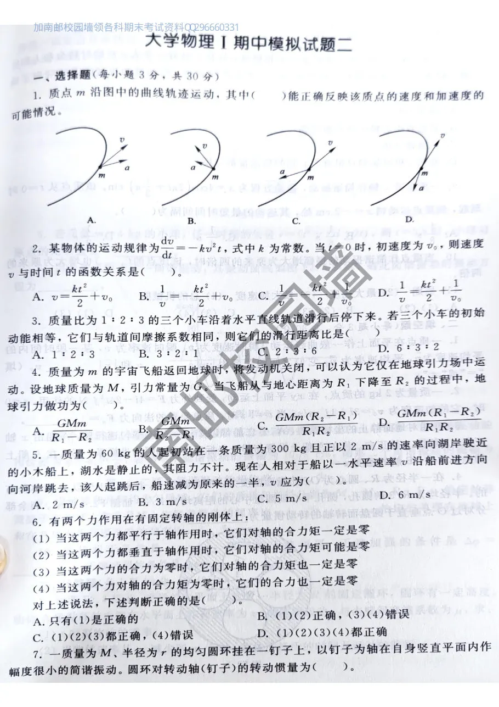

# 南京邮电大学《大学物理Ⅰ》期中模拟试题二

原件经识别和整理；“参考解答”是我们补的。

## 一、选择题（每小题3分，共30分）

### 选择 1

质点 $m$ 沿图中的曲线轨迹运动，其中（ ）能正确反映该质点的速度和加速度的可能情况。

答案：未提供
知识点：[速度、加速度的定义与微分关系](../../../topics/大学物理/速度与加速度定义.md)、[自然参数下的切向加速度与法向加速度](../../../topics/大学物理/自然坐标系下的运动.md)

### 选择 2

某物体的运动规律为 $\frac{\mathrm{d}v}{\mathrm{d}t} = -kv^2 t$ ，式中 $k$ 为常数。当 $t=0$ 时，初速度为 $v_0$ ，则速度 $v$ 与时间 $t$ 的函数关系是（ ）。

- A. $v = \frac{k t^2}{2} + v_0$
- B. $\frac{1}{v} = -\frac{k t^2}{2} + v_0$
- C. $\frac{1}{v} = -\frac{k t^2}{2} + \frac{1}{v_0}$
- D. $\frac{1}{v} = \frac{k t^2}{2} + \frac{1}{v_0}$

答案：C
知识点：[速度、加速度的定义与微分关系](../../../topics/大学物理/速度与加速度定义.md)

### 选择 3

质量比为 $1: 2: 3$ 的三个小车沿着水平直线轨道滑行后停下来。若三个小车的初始动能相等, 它们与轨道间摩擦系数相同, 则它们的滑行距离比是 ( )

- A. $1: 2: 3$
- B. $3: 2: 1$
- C. $2: 3: 6$
- D. $6: 3: 2$

答案：A
知识点：[功的定义、功率与质点动能定理](../../../topics/大学物理/功与动能定理.md)、[常见力（重力、弹力、摩擦力）的受力分析](../../../topics/大学物理/常见力分析.md)

### 选择 4

质量为 m 的宇宙飞船返回地球时，将发动机关闭，可以认为它仅在地球引力场中运动。设地球质量为 M，引力常量为 G。当飞船从与地心距离为 $R_{1}$ 下降至 $R_{2}$ 的过程中，地球引力做功为（）。

- A. $\frac{GMm}{R_{1}-R_{2}}$
- B. $\frac{GMm}{R_{2}-R_{1}}$
- C. $\frac{GMm(R_{2}-R_{1})}{R_{1}R_{2}}$
- D. $\frac{GMm(R_{1}-R_{2})}{R_{1}R_{2}}$

答案：D
知识点：[保守力及其势能、中心力场与有效势](../../../topics/大学物理/保守力与势能.md)、[功的定义、功率与质点动能定理](../../../topics/大学物理/功与动能定理.md)、[常见力（重力、弹力、摩擦力）的受力分析](../../../topics/大学物理/常见力分析.md)

### 选择 5

一质量为 $60 \mathrm{~kg}$ 的人起初站在一条质量为 $300 \mathrm{~kg}$ 且正以 $2 \mathrm{~m} / \mathrm{s}$ 的速率向湖岸驶近的小木船上, 湖水是静止的, 其阻力不计。现在人相对于船以一水平速率 $v$ 沿船前进方向向河岸跳去, 该人起跳后, 船速减为原来的一半, $v$ 应为( )。

- A. $2 \mathrm{~m} / \mathrm{s}$
- B. $3 \mathrm{~m} / \mathrm{s}$
- C. $5 \mathrm{~m} / \mathrm{s}$
- D. $6 \mathrm{~m} / \mathrm{s}$

答案：D
知识点：[动量定理与动量守恒定律](../../../topics/大学物理/动量定理与动量守恒.md)、[相对运动与伽利略变换](../../../topics/大学物理/相对运动.md)

### 选择 6

有两个力作用在有固定转轴的刚体上:
(1) 当这两个力都平行于轴作用时, 它们对轴的合力矩一定是零
(2) 当这两个力都垂直于轴作用时, 它们对轴的合力矩可能是零
(3) 当这两个力的合力为零时, 它们对轴的合力矩也一定是零
(4) 当这两个力对轴的合力矩为零时, 它们的合力也一定是零

对上述说法，下述判断正确的是( )。

- A. 只有(1)是正确的
- B. (1)(2)正确，(3)(4)错误
- C. (1)(2)(3)都正确，(4)错误
- D. (1)(2)(3)(4)都正确

答案：B
知识点：[刚体定轴转动定律（M=Jα）](../../../topics/大学物理/刚体转动定律.md)、[常见力（重力、弹力、摩擦力）的受力分析](../../../topics/大学物理/常见力分析.md)、[角动量定理与角动量守恒定律](../../../topics/大学物理/角动量与角动量守恒.md)

### 选择 7

一质量为 $M$ 、半径为 $r$ 的均匀圆环挂在一钉子上，以钉子为轴在自身竖直平面内作幅度很小的简谐振动。圆环对转动轴(钉子)的转动惯量为（ ）。

- A. $Mr^{2}$
- B. $\frac{1}{2}Mr^{2}$
- C. $\frac{3}{2}Mr^{2}$
- D. $2Mr^{2}$

答案：C
知识点：[转动惯量的计算与平行轴定理](../../../topics/大学物理/转动惯量.md)、[刚体定轴转动的角量描述](../../../topics/大学物理/刚体定轴转动运动学.md)

### 选择 8

一水平转台可绕固定的铅直中心轴转动，转台上站着一个人，初始时转台和人都处于静止状态。当此人在转台上随意走动时，该系统的动量、角动量和机械能是否守恒正确的说法是( )。

- A. 动量守恒
- B. 对铅直中心轴的角动量守恒
- C. 机械能守恒
- D. 动量、机械能和对铅直中心轴的角动量都守恒

答案：B
知识点：[角动量定理与角动量守恒定律](../../../topics/大学物理/角动量与角动量守恒.md)、[质心与质心运动定理](../../../topics/大学物理/质心运动定理.md)、[功能原理与机械能守恒定律](../../../topics/大学物理/功能原理与机械能守恒.md)

### 选择 9

一质点沿 x 轴作简谐振动，振动方程为 $x=4\cos\left(2\pi t+\frac{1}{3}\pi\right)\mathrm{cm}$ 。该质点从 t=0 时刻起，到质点运动到 x=-2 cm 处，其运动的最短时间间隔为（）。

- A. $\frac{1}{8}s$
- B. $\frac{1}{6}s$
- C. $\frac{1}{4}s$
- D. $\frac{1}{3}s$

答案：B
知识点：[简谐振动的运动学方程（振幅、角频率、相位）](../../../topics/大学物理/简谐振动运动学.md)、[用旋转矢量法确定初相与运动状态](../../../topics/大学物理/旋转矢量法.md)

### 选择 10

当质点作简谐振动的振幅增大为原来的两倍时, 该质点的( )也增大为原来的两倍。
(1) 周期 (2) 最大速度 (3) 最大加速度 (4) 总的机械能

- A. (1) (2)
- B. (2) (3)
- C. (3) (4)
- D. (1) (3)

答案：B
知识点：[简谐振动的动能、势能与总机械能](../../../topics/大学物理/简谐振动的能量.md)

### 填空 1

一质点在平面上作一般曲线运动, 瞬时速度为 $\mathbf{v}$ , 瞬时速率为 $v$ , 某一段时间内的平均速度为 $\bar{\mathbf{v}}$ , 平均速率为 $\bar{v}$ , 它们之间的关系为 $|\mathbf{v}|$ \_\_\_\_ $v$ 和 $|\bar{\mathbf{v}}|$ \_\_\_\_ $\bar{v}$ 。(填“=”或“≠”)

答案：= ； ≠
知识点：[速度、加速度的定义与微分关系](../../../topics/大学物理/速度与加速度定义.md)

### 填空 2

一质量为 $2 \mathrm{~kg}$ 的质点, 在 $xy$ 平面上运动, 受到外力 $\mathbf{F} = 4 \mathbf{i} - 24 t^{2} \mathbf{j} \mathrm{~N}$ 的作用, $t = 0$ 时, 它的初速度为 $\mathbf{v}_{0} = 3 \mathbf{i} + 4 \mathbf{j} \mathrm{~m} / \mathrm{s}$ , 当 $t = 1 \mathrm{~s}$ 时, 质点受到的法向力 $\mathbf{F}_{n} =$ \_\_\_\_ 。

答案：$4 \mathbf{i} \mathrm{~N}$ (或大小为 4 N，方向沿 i) *注：需计算切向和法向分量*
知识点：[自然参数下的切向加速度与法向加速度](../../../topics/大学物理/自然坐标系下的运动.md)、[牛顿定律在变力问题中的应用（如 ma_t = -mg sinθ）](../../../topics/大学物理/牛顿定律应用.md)

### 填空 3

在相对地面静止的坐标系内，A、B二船都以 $2 \mathrm{~m} / \mathrm{s}$ 的速率匀速行驶，A 船沿 $x$ 轴正向，B 船沿 $y$ 轴正向。若在 A 船上设置与静止坐标系方向相同的坐标系，那么在 A 船上的坐标系中，B 船的速度 $v =$ \_\_\_\_ 。

答案：$2\sqrt{2} \mathrm{~m/s}$，方向与 x 轴负向成 $45^\circ$ (或西北方向) *注：原识别文本给出的 $1/2 \times 10^{-4}$ 明显是乱码或错误粘贴，忽略*
知识点：[相对运动与伽利略变换](../../../topics/大学物理/相对运动.md)

### 填空 4

在一半径为 $R$ 、圆心为 $O$ 、质量面密度为 $\sigma$ 的薄圆盘上，挖掉了 4 个以 $O$ 对称分布的、半径均为 $R/3$ 的圆孔，圆孔中心到圆盘中心的距离均为 $R/2$ ，如图 F2.1 所示。剩余部分对过 $O$ 点垂直于圆盘面转轴的转动惯量为 \_\_\_\_。

答案：$\frac{1}{2} M_{total} R^2 - 4 \times (\dots)$ *需具体计算*
知识点：[转动惯量的计算与平行轴定理](../../../topics/大学物理/转动惯量.md)

### 填空 5

如图F2.2所示, 一质量为 $M$ 的均质正方形薄板, 其边长为 $L$ , 铅直放置, 它可以绕其一固定边自由转动。现有一质量为 $m$ 、速度为 $v$ 的小球垂直于板面碰在板的边缘上。已知 $M = 6m$ , 设二者碰撞为弹性碰撞, 则碰撞后板的角速度 $\omega =$ \_\_\_\_。

答案：$\frac{3v}{2L}$ *需推导*
知识点：[角动量定理与角动量守恒定律](../../../topics/大学物理/角动量与角动量守恒.md)、[弹性碰撞与非弹性碰撞](../../../topics/大学物理/碰撞问题.md)、[刚体定轴转动定律（M=Jα）](../../../topics/大学物理/刚体转动定律.md)

### 填空 6

若质量 $m = 4 \mathrm{~kg}$ 的小球, 任一时刻的矢径 $\boldsymbol{r} = (t^2 - 1)\boldsymbol{i} + 2t\boldsymbol{j}$ , 则 $t = 3 \mathrm{~s}$ 时, 小球对原点的角动量 $\boldsymbol{L} =$ \_\_\_\_。

答案：$-16 \boldsymbol{k} \mathrm{~kg \cdot m^2/s}$
知识点：[角动量定理与角动量守恒定律](../../../topics/大学物理/角动量与角动量守恒.md)

### 填空 7

用余弦函数表示一简谐振动, 其振动曲线如图 F2.3 所示, 则此简谐振动的振动方程为\_\_\_\_。

答案：$x = 4 \cos(\pi t + \frac{\pi}{3}) \mathrm{~cm}$ *需读图*
知识点：[简谐振动的运动学方程（振幅、角频率、相位）](../../../topics/大学物理/简谐振动运动学.md)、[用旋转矢量法确定初相与运动状态](../../../topics/大学物理/旋转矢量法.md)

### 填空 8

两个同方向、同频率的简谐振动, 其合振动的振幅为 $20 \mathrm{~cm}$ , 与第一个简谐振动的相位差为 $\varphi - \varphi_{1} = \frac{\pi}{6}$ , 若第一个简谐振动的振幅为 $10 \sqrt{3} \mathrm{~cm}$ , 则第二个简谐振动的振幅为 \_\_\_\_ cm, 第一、二两个简谐振动的相位差 $\varphi_{1} - \varphi_{2}$ 为 \_\_\_\_ 。

答案：$10$； $\frac{\pi}{2}$ (或 $90^\circ$)
知识点：[同方向同频率简谐振动的合成](../../../topics/大学物理/简谐振动的合成.md)

### 填空 9

设地球和月球均为匀质球, 它们的质量和半径分别为 $M_{\mathrm{e}} 、 M_{\mathrm{m}} 、 R_{\mathrm{e}} 、 R_{\mathrm{m}}$ , 给定的弹簧振子在地球上和在月球上作简谐振动的频率比 $\nu_{\mathrm{e}} / \nu_{\mathrm{m}}$ 为 \_\_\_\_; 给定的单摆在地球上和在月球上作简谐振动的频率比 $\nu_{\mathrm{e}} / \nu_{\mathrm{m}}$ 为 \_\_\_\_。

答案：$1$； $\sqrt{\frac{M_e R_m^2}{M_m R_e^2}}$
知识点：[简谐振动的运动学方程（振幅、角频率、相位）](../../../topics/大学物理/简谐振动运动学.md)、[常见力（重力、弹力、摩擦力）的受力分析](../../../topics/大学物理/常见力分析.md)

### 填空 10

波的相干条件是 \_\_\_\_，两列相干波相遇，干涉加强的条件是 $\Delta\varphi=$ \_\_\_\_，干涉减弱的条件是 $\Delta\varphi=$ \_\_\_\_。

答案：频率相同、振动方向相同、相位差恒定； $2k\pi$ ($k=0, \pm 1, \dots$)； $(2k+1)\pi$
知识点：[波的叠加原理与干涉条件](../../../topics/大学物理/波的干涉.md)

### 计算 1

如图 F2.4 所示, 光滑的水平面上放置一半径为 $R$ 的固定圆环, 圆环有一定高度。物体 A 紧贴环的内侧在水平面上作初速率为 $v_{0}$ 的圆周运动, 与内壁间摩擦系数为 $\mu$ , 求:

(1) t 时刻物体的速率；

(2) 当物体速率从 $v_{0}$ 减少到 $v_{0}/2$ 时，物体所经历的时间及经过的路程。

知识点：[自然参数下的切向加速度与法向加速度](../../../topics/大学物理/自然坐标系下的运动.md)、[牛顿定律在变力问题中的应用（如 ma_t = -mg sinθ）](../../../topics/大学物理/牛顿定律应用.md)、[速度、加速度的定义与微分关系](../../../topics/大学物理/速度与加速度定义.md)

### 计算 2

如图 F2.5 所示，一根刚性细棒长为 L，总质量为 m，其质量分布与离 O 点的距离成正比。现将细棒放在粗糙的水平桌面上，棒可绕过其端点 O 的竖直轴转动。已知棒与桌面间的摩擦系数为 $\mu$ ，棒的初始角度为 $\omega_{0}$ 。求：

(1) 细棒对给定轴的转动惯量；

(2) 细棒绕轴转动时所受的摩擦力矩；

(3) 细棒从角速度 $\omega_{0}$ 开始到停止转动所经过的时间；

(4) 细棒从角速度 $\omega_{0}$ 开始到停止转动所转过的角度和圈数。

知识点：[转动惯量的计算与平行轴定理](../../../topics/大学物理/转动惯量.md)、[刚体定轴转动定律（M=Jα）](../../../topics/大学物理/刚体转动定律.md)、[力矩的功与刚体定轴转动的动能定理](../../../topics/大学物理/力矩做功.md)
