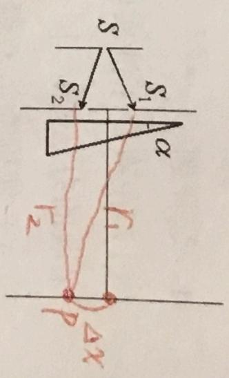

# 南京邮电大学《大学物理》下册活页习题解答

原件经识别和整理；“参考解答”是我们补的。

4、在双缝干涉实验中，波长 $\lambda = 550\,\text{nm}$ 的单色平行光垂直入射到缝间距 $d = 2 \times 10^{-4}\,\text{m}$ 的双缝上，屏到双缝的距离 $D = 2\,\text{m}$。

求：(1) 中央明纹两侧的两条第 10 级明纹中心的间距；

(2) 用一厚度为 $e = 6.6 \times 10^{-6}\,\text{m}$、折射率为 $n = 1.58$ 的云母片覆盖一缝后，零级明纹将移到原来的第几级明纹处？

5\*. 如图所示：在双缝干涉实验中，波长为 $\lambda$ 的单色平行光垂直入射到缝间距为 $d$ 的双缝上，屏到双缝的距离为 $D$。若在紧靠双缝处放置一折射率为 $n$ 的光楔，测得干涉条纹较放光楔前移动了

### 放光楔后

$$
= 0 \text{  一找中央明纹  }
$$

$$
\lim_{t \to 1} - \frac{\pi}{t^2} = 10 \sin\theta \quad t = 10 + 901 = 2\frac{\pi}{t}
$$

100

101

参考解答：## 结论

插入光楔后，中央明纹（零级明纹）向**光楔较厚的一端**平移，条纹间距不变。

---

## 推理过程

设光楔折射率为 $n$，在某一位置处的厚度为 $t$，其引入的附加光程差为：

$$
\Delta = (n - 1)t
$$

对于双缝干涉，未放光楔时屏幕上某点的光程差为 $\delta_0 = d \sin\theta$；放置光楔后总光程差变为：

$$
\delta = d \sin\theta + (n-1)t
$$

### 找中央明纹

中央明纹对应总光程差为零的位置：

$$
d \sin\theta_0 + (n-1)t = 0
$$

解得：

$$
\sin\theta_0 = -\frac{(n-1)t}{d}
$$

负号表明中央明纹向光楔所在一侧偏移。若光楔覆盖其中一条缝且楔形尖端朝上、厚端朝下，则中央明纹向下（厚端方向）移动。

### 条纹间距

相邻明纹满足 $d \sin\theta_{k+1} - d \sin\theta_k = \lambda$，因此条纹间距仍为：

$$
\Delta y = \frac{\lambda D}{d}
$$

与未放光楔时相同——光楔只引起整体平移，不改变条纹间距。

知识点：[光程、光程差与反射时的半波损失](../../../topics/大学物理/光程与半波损失.md)、[杨氏双缝干涉实验与条纹间距](../../../topics/大学物理/杨氏双缝干涉.md)、[等倾干涉与等厚干涉（劈尖、牛顿环）](../../../topics/大学物理/薄膜干涉.md)
