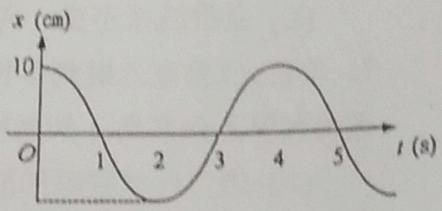
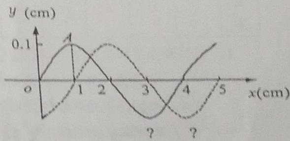

# 南京邮电大学《大学物理（下）》期末考试试卷

原件经识别和整理；“参考解答”是我们补的。

## 二、填充题（每空格 2 分，共计 22 分）

### 填空 1

如图所示为一简谐振动的振动曲线，则该振动从 $t = 0.5\mathrm{s}$ 到 $t = 1.5\mathrm{s}$ 振子经过的路程是 $10\sqrt{2}$。

知识点：[简谐振动的动能、势能与总机械能](../../../topics/大学物理/简谐振动的能量.md)

### 填空 2

同在 $x$ 方向的两个同频率简谐振动

$x_{1}=6\cos(10t+\frac{3\pi}{4})\mathrm{cm},\quad x_{2}=8\cos(10t+\frac{\pi}{4})\mathrm{cm}$，则合振动的振幅为 \_\_\_\_ cm。

知识点：[同方向同频率简谐振动的合成](../../../topics/大学物理/简谐振动的合成.md)、[简谐振动的运动学方程（振幅、角频率、相位）](../../../topics/大学物理/简谐振动运动学.md)、[用旋转矢量法确定初相与运动状态](../../../topics/大学物理/旋转矢量法.md)

### 填空 3

在真空中沿着 $x$ 轴正方向传播的平面电磁波，其电场强度波的表达式是 ${E}_{x} = {E}_{0}\cos {2\pi }\left( {{vt} - x/{\lambda }}\right)$，则磁场强度波的表达式是 $- \sqrt{{\varepsilon }_{0}/{u}_{0}}{E}_{0}\cos {2\pi }\left( {{2t} - x/\lambda }\right)$。

知识点：[电磁波的基本性质](../../../topics/大学物理/电磁波.md)、[平面简谐波的波函数 y=Acos(ω(t±x/u)+φ)](../../../topics/大学物理/平面简谐波方程.md)

### 填空 4

在单缝夫琅禾费衍射实验中，波长为 $\lambda$ 的单色光的第三极亮纹与波长 $\lambda' = 630 \mathrm{nm}$ 的单色光的第二级亮纹恰好重合，此单色光的波长 $\lambda = 450 \mathrm{nm}$。

知识点：[单缝衍射的暗纹条件与中央明纹宽度](../../../topics/大学物理/单缝夫琅禾费衍射.md)

### 填空 5

杨氏双缝的间距为 $0.2\mathrm{mm}$，距离屏幕为 $1\mathrm{m}$，若第一级明纹距离为 $2.5\mathrm{mm}$，则入射光波长 $\lambda=\frac{50.0\mathrm{nm}}{5}$。

知识点：[杨氏双缝干涉实验与条纹间距](../../../topics/大学物理/杨氏双缝干涉.md)

### 填空 6

从某湖水表面反射来的日光正好是完全偏振光，已知湖水的折射率为 $1.33$。推算太阳光与地平线的夹角 \_\_\_\_ $37°$；反射光中光矢量的振动方向 \_\_\_\_。

知识点：[自然光与偏振光、马吕斯定律与布儒斯特定律](../../../topics/大学物理/光的偏振.md)

### 填空 7

在实验室测出，电子 A 以速度 $2.9\times10^{8}\ \mathrm{m/s}$ 向右运动，而电子 B 以速度 $2.7\times10^{8}\ \mathrm{m/s}$ 向左运动，A 电子相对 B 电子的速度大小是 $2.99\times10^{8}\ \mathrm{m\cdot s^{-1}}$。

知识点：[洛伦兹坐标变换与速度变换](../../../topics/大学物理/洛伦兹变换.md)、[爱因斯坦的两个基本假设](../../../topics/大学物理/狭义相对论基本原理.md)

### 填空 8

已知一粒子的动能等于其静止能量的 $n$ 倍，则粒子的速率是 \_\_\_\_。

知识点：[相对论动能、静能与质能关系（E=mc²）](../../../topics/大学物理/相对论能量.md)

### 填空 9

对应于氢原子中电子轨道运动，$n=3$ 时氢原子可能具有的轨道角动量 $\frac{h}{f_{1}}$、$\frac{h}{f_{2}}$、$\frac{3h}{2h}$（$0h$，$12h$，$\sqrt{6h}$）。

知识点：[玻尔的氢原子理论与能级跃迁](../../../topics/大学物理/玻尔氢原子模型.md)、[四个量子数、泡利不相容原理与电子排布](../../../topics/大学物理/原子的量子理论.md)

### 填空 10

光子的波长为 $\lambda = 300\ \mathrm{nm}$，如果确定此波长的精确度 $\Delta\lambda / \lambda = 10^{-6}$，则此光子位置的不确定量为 \_\_\_\_。

## 三、（本题 10 分）

如图所示，已知 $t = 0$ 的波形曲线 I，波沿着 $ox$ 方向传播，经过 $t = 1/2\ \mathrm{s}$ 后，波形变成曲线 II。已知波的周期 $T > 1\ \mathrm{s}$，试根据图中给出的条件，求出波的表达式，并求出 $A$ 点的振动表达式。

知识点：[平面简谐波的波函数 y=Acos(ω(t±x/u)+φ)](../../../topics/大学物理/平面简谐波方程.md)、[海森堡位置与动量的不确定关系](../../../topics/大学物理/不确定关系.md)、[机械波的形成、横波与纵波](../../../topics/大学物理/机械波的产生与传播.md)
