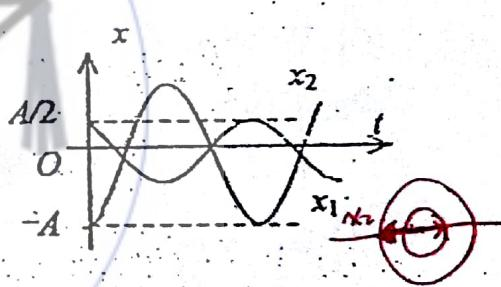
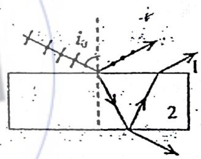
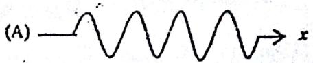
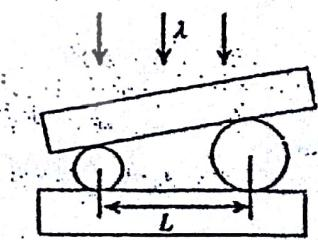
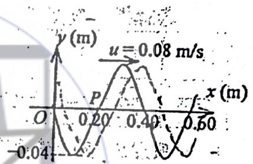

# 南京邮电大学《大学物理下》期末考试试卷（A卷）

原件经识别和整理；“参考解答”是我们补的。

## 一、选择题（每题 3 分，共计 36 分）

### 选择 1

一质点在 $x$ 轴上作简谐振动，振幅 $A = 4\ \mathrm{cm}$，周期 $T = 2\ \mathrm{s}$，其平衡位置取作坐标原点。若 $t = 0$ 时刻质点第一次通过 $x = -2\ \mathrm{cm}$ 处，且向 $x$ 轴负方向运动，则质点第二次通过 $x = -2\ \mathrm{cm}$ 处的时刻为

- A. $1\ \mathrm{s}$
- B. $2/3\ \mathrm{s}$
- C. $4/3\ \mathrm{s}$
- D. $2\ \mathrm{s}$

答案：B。

知识点：[简谐振动的运动学方程（振幅、角频率、相位）](../../../topics/大学物理/简谐振动运动学.md)、[用旋转矢量法确定初相与运动状态](../../../topics/大学物理/旋转矢量法.md)

### 选择 2

图中所画的是两个简谐振动的振动曲线。若这两个简谐振动可叠加，则合成的余弦振动的初相为



答案：B。

知识点：[同方向同频率简谐振动的合成](../../../topics/大学物理/简谐振动的合成.md)、[用旋转矢量法确定初相与运动状态](../../../topics/大学物理/旋转矢量法.md)

### 选择 3

关于驻波的特性，以下说法错误的是

- A. 驻波是一种特殊的振动，波节处的势能与波腹处的动能相互转化
- B. 两波节之间的距离等于产生驻波的相干波的波长
- C. 一波节两边的质点的振动步调（或位相）相反
- D. 相邻两波节之间的质点的振动步调（或位相）相同

答案：B。

知识点：[驻波的形成、波节与波腹](../../../topics/大学物理/驻波.md)

### 选择 4

真空中，平面电磁波的电场强度 $E$、磁场强度 $H$ 和传播速度 $u$ 的关系是

- A. 三者相互垂直，而电场强度 $E$ 和磁场强度 $H$ 位相相差 $\pi/2$
- B. 三者相互垂直，而 $E$、$H$、$u$ 构成右手螺旋
- C. 电场强度 $E$ 和磁场强度 $H$ 方向相同，且与 $u$ 的方向垂直
- D. 电场强度 $E$ 和磁场强度 $H$ 方向不确定，但与 $u$ 的方向垂直

答案：B。

知识点：[电磁波的基本性质](../../../topics/大学物理/电磁波.md)、[电场强度的定义与叠加原理](../../../topics/大学物理/电场强度.md)、[磁通量与磁场中的高斯定理](../../../topics/大学物理/磁场中的高斯定理.md)

### 选择 5

在真空中波长为 $\lambda$ 的单色光，在折射率为 $n$ 的透明介质中从 A 沿某路径传播到 B，若 A、B 两点位相差为 $\pi$，则此路径 AB 的光程为

- A. $0.5\lambda$
- B. $0.5n\lambda$
- C. $3\lambda$
- D. $0.5\lambda/n$

答案：A。

知识点：[光程、光程差与反射时的半波损失](../../../topics/大学物理/光程与半波损失.md)

### 选择 6

空气劈尖干涉实验中，

- A. 干涉条纹是垂直于棱边的直条纹，劈尖夹角变小时，条纹变稀，从中心向两边扩展
- B. 干涉条纹是垂直于棱边的直条纹，劈尖夹角变小时，条纹变密，从两边向中心靠拢
- C. 干涉条纹是平行于棱边的直条纹，劈尖夹角变小时，条纹变疏，条纹背向棱边扩展
- D. 干涉条纹是平行于棱边的直条纹，劈尖夹角变小时，条纹变密，条纹向棱边靠拢

答案：C。

知识点：[光程、光程差与反射时的半波损失](../../../topics/大学物理/光程与半波损失.md)

### 选择 7

一束自然光自空气射向一块平板玻璃（如图），设入射角等于布儒斯特角 $i_0$，则在界面 2 的反射光



- A. 是自然光
- B. 是线偏振光且光矢量的振动方向垂直于入射面
- C. 是线偏振光且光矢量的振动方向平行于入射面
- D. 是部分偏振光

答案：B。

知识点：[自然光与偏振光、马吕斯定律与布儒斯特定律](../../../topics/大学物理/光的偏振.md)

### 选择 8

所谓“黑体”是指这样的一种物体，即：

- A. 不能反射任何可见光的物体
- B. 不能反射任何电磁辐射的物体
- C. 颜色是纯黑的物体
- D. 能够全部吸收外来的任何电磁辐射的物体

答案：D。

知识点：[黑体辐射规律与普朗克能量子假设](../../../topics/大学物理/黑体辐射与普朗克假设.md)、[光电效应的实验规律与爱因斯坦光子理论](../../../topics/大学物理/光电效应.md)、[康普顿散射实验与光子动量](../../../topics/大学物理/康普顿散射.md)

### 选择 9

光电效应和康普顿效应都包含有电子与光子的相互作用过程，对此过程，在以下几种理解中，正确的是：

- A. 光电效应是电子吸收光子的过程，而康普顿效应则是光子和电子的弹性碰撞过程
- B. 两种效应都相当于电子与光子的弹性碰撞过程
- C. 两种效应都属于电子吸收光子的过程
- D. 两种效应都是电子与光子的碰撞，都服从动量守恒定律和能量守恒定律

答案：A。

知识点：[光电效应的实验规律与爱因斯坦光子理论](../../../topics/大学物理/光电效应.md)、[康普顿散射实验与光子动量](../../../topics/大学物理/康普顿散射.md)

### 选择 10

在某地发生两件事，静止位于该地的甲测得时间间隔为 $6\ \mathrm{s}$，若相对甲以 $4c/5$（$c$ 表示真空中光速）的速率作匀速直线运动的乙测得时间间隔为

- A. $10\ \mathrm{s}$
- B. $8\ \mathrm{s}$
- C. $6\ \mathrm{s}$
- D. $3.6\ \mathrm{s}$
- E. $4.8\ \mathrm{s}$

答案：A。

知识点：[同时的相对性、时间膨胀与长度收缩](../../../topics/大学物理/狭义相对论时空观.md)、[洛伦兹坐标变换与速度变换](../../../topics/大学物理/洛伦兹变换.md)

### 选择 11

如果两种不同质量的粒子，其德布罗意波长相同，则这两种粒子的

- A. 动量相同
- B. 能量相同
- C. 速度相同
- D. 动能相同

答案：A。

知识点：[德布罗意物质波假设](../../../topics/大学物理/实物粒子的波动性.md)

### 选择 12

设粒子运动的波函数图线分别如图 (A)、(B)、(C)、(D) 所示，那么其中确定粒子动量的精确度最高的波函数是哪个图？



答案：A。

## 二、填充题（每格 2 分，共计 22 分）

知识点：[海森堡位置与动量的不确定关系](../../../topics/大学物理/不确定关系.md)、[德布罗意物质波假设](../../../topics/大学物理/实物粒子的波动性.md)

### 填空 1

A、B 是简谐波波线上距离小于波长的两点。已知 B 点振动的相位比 A 点落后 $\frac{1}{3}\pi$，波长为 $\lambda = 3\ \mathrm{m}$，则 A、B 两点相距 $L = \underline{2}\ \mathrm{m}$。

参考解答：结论：$L = 0.5\ \mathrm{m}$

**推理过程**  
波线上两点相位差与距离的关系为  

$$
\Delta\varphi = \frac{2\pi}{\lambda} L
$$
  
由题意，$\Delta\varphi = \frac{1}{3}\pi$，$\lambda = 3\ \mathrm{m}$，代入得  

$$
\frac{1}{3}\pi = \frac{2\pi}{3} L \quad\Rightarrow\quad L = \frac{\frac{1}{3}\pi}{\frac{2\pi}{3}} = \frac{1}{3} \cdot \frac{3}{2} = 0.5\ \mathrm{m}
$$
  
题目中横线填“2”是错误的。

知识点：[平面简谐波的波函数 y=Acos(ω(t±x/u)+φ)](../../../topics/大学物理/平面简谐波方程.md)、[简谐振动的运动学方程（振幅、角频率、相位）](../../../topics/大学物理/简谐振动运动学.md)

### 填空 2

一物体作简谐振动，振动方程为 $x = A\cos\left(\omega t + \frac{1}{2}\pi\right)$，则该物体在 $t = 0$ 时刻的动能与 $t = T/8$（$T$ 为振动周期）时刻的动能之比为 $\underline{1}$。

参考解答：结论：该比值为 **2 : 1**（或写为 $2$）。

**推理过程**

1. 由振动方程 $x = A\cos\left(\omega t + \frac{\pi}{2}\right)$ 求速度函数：
   
$$
v = \frac{dx}{dt} = -A\omega\sin\left(\omega t + \frac{\pi}{2}\right)
$$

2. 质点的动能 $E_k = \frac{1}{2}mv^2$，故动能之比等于 $v^2$ 之比：
   
$$
\frac{E_k(0)}{E_k(T/8)} = \frac{v^2(0)}{v^2(T/8)}
$$

3. 计算 $t=0$ 时的速度：
   
$$
v(0) = -A\omega\sin\left(\frac{\pi}{2}\right) = -A\omega \cdot 1 = -A\omega
$$

   
$$
v^2(0) = A^2\omega^2
$$

4. 计算 $t = T/8$ 时的速度。利用 $\omega = \frac{2\pi}{T}$，得 $\omega \cdot \frac{T}{8} = \frac{\pi}{4}$：
   
$$
v(T/8) = -A\omega\sin\left(\frac{\pi}{4} + \frac{\pi}{2}\right) = -A\omega\sin\left(\frac{3\pi}{4}\right) = -A\omega \cdot \frac{\sqrt{2}}{2}
$$

   
$$
v^2(T/8) = A^2\omega^2 \cdot \frac{1}{2}
$$

5. 求比值：
   
$$
\frac{E_k(0)}{E_k(T/8)} = \frac{A^2\omega^2}{\frac{1}{2}A^2\omega^2} = 2
$$

   即 $t=0$ 时刻的动能是 $t=T/8$ 时刻动能的 2 倍。

知识点：[简谐振动的运动学方程（振幅、角频率、相位）](../../../topics/大学物理/简谐振动运动学.md)、[简谐振动的动能、势能与总机械能](../../../topics/大学物理/简谐振动的能量.md)

### 填空 3

一静止的报警器，其频率为 $1000\ \mathrm{Hz}$，有一汽车以 $79.2\ \mathrm{km/h}$ 的时速背离报警器时，坐在汽车里的人听到报警声的频率是 $\underline{935.3}\ \mathrm{Hz}$（设空气中声速为 $340\ \mathrm{m/s}$）。

参考解答：$935.3\ \mathrm{Hz}$

**推理与计算过程：**

1.  **单位换算**：
    将汽车速度从 $\mathrm{km/h}$ 转换为 $\mathrm{m/s}$：
    $$ v_o = 79.2\ \mathrm{km/h} = \frac{79.2}{3.6}\ \mathrm{m/s} = 22\ \mathrm{m/s} $$

2.  **多普勒效应公式应用**：
    声源静止 ($v_s = 0$)，观察者（汽车）背离声源运动。根据多普勒效应公式，观察者接收到的频率 $f'$ 为：
    $$ f' = f_0 \left( \frac{u - v_o}{u} \right) $$
    其中：
    *   $f_0 = 1000\ \mathrm{Hz}$ (声源频率)
    *   $u = 340\ \mathrm{m/s}$ (声速)
    *   $v_o = 22\ \mathrm{m/s}$ (观察者速度，背离取减号)

3.  **代入计算**：
    $$ f' = 1000 \times \left( \frac{340 - 22}{340} \right) = 1000 \times \frac{318}{340} $$
    $$ f' = 1000 \times 0.93529... \approx 935.3\ \mathrm{Hz} $$

知识点：[机械波的形成、横波与纵波](../../../topics/大学物理/机械波的产生与传播.md)

### 填空 4

如图所示，两个直径有微小差别的彼此平行的滚柱之间的距离为 $L$，夹在两块平晶的中间，形成空气劈尖，当单色光垂直入射时，产生等厚干涉条纹。如果两滚柱之间的距离 $L$ 变大，则在 $L$ 范围内干涉条纹的数目 $\underline{\text{不变}}$（填写：不变、变多或变少），间距 $\underline{\text{变大}}$（填写：不变、变大或变小）。



参考解答：**结论**：条纹数目**不变**，条纹间距**变大**。

**推理**：  
设两滚柱直径分别为 $D$ 和 $D+\Delta D$（$\Delta D$ 为微小差值），则两平晶间空气劈尖的最大厚度差为 $\Delta e=\Delta D$。

- **条纹数目**：在 $L$ 范围内，干涉条纹总数 $N$ 由光程差的变化决定：
  $$
  N=\frac{2\Delta e}{\lambda}=\frac{2\Delta D}{\lambda}
  $$
  由于滚柱直径差 $\Delta D$ 不变，故条纹数目 $N$ **不变**（与 $L$ 无关）。

- **条纹间距**：相邻亮纹（或暗纹）对应的厚度差为 $\dfrac{\lambda}{2}$。设劈尖倾角为 $\theta$，则 $\theta\approx\dfrac{\Delta D}{L}$，条纹间距为
  $$
  b=\frac{\lambda/2}{\sin\theta}\approx\frac{\lambda}{2\theta}=\frac{\lambda L}{2\Delta D}
  $$
  当 $L$ 变大时，劈尖倾角 $\theta$ 变小，故条纹间距 $b$ **变大**。

知识点：[等倾干涉与等厚干涉（劈尖、牛顿环）](../../../topics/大学物理/薄膜干涉.md)

### 填空 5

牛顿环装置中透镜与平板玻璃之间充以某种液体时，观察到第 10 级暗环的直径由 $1.42\ \mathrm{cm}$ 变成 $1.27\ \mathrm{cm}$，由此得该液体的折射率 $n = \underline{1.24}$。

参考解答：**结论：** $n = 1.24$

**推理：** 牛顿环第 $m$ 级暗环半径满足 $r_m = \sqrt{m R \lambda / n}$，故 $r_m \propto 1/\sqrt{n}$，直径亦然。

设空气时直径 $d_0 = 1.42\ \mathrm{cm}$，充液体后 $d = 1.27\ \mathrm{cm}$，则

$$
\frac{d}{d_0} = \frac{1}{\sqrt{n}} \Rightarrow n = \left(\frac{d_0}{d}\right)^2 = \left(\frac{1.42}{1.27}\right)^2 = 1.24
$$

知识点：[光程、光程差与反射时的半波损失](../../../topics/大学物理/光程与半波损失.md)

### 填空 6

使光强为 $I_0$ 的自然光依次垂直通过三块偏振片 P1、P2 和 P3。P1 与 P2 的偏振化方向成 $45^\circ$ 角，P2 与 P3 的偏振化方向成 $45^\circ$ 角，则透过三块偏振片的光强 $I$ 为 $\underline{\dfrac{I_0}{8}}$。

参考解答：答案：$\boxed{I=\dfrac{I_0}{8}}$

自然光通过第一块偏振片 $P_1$ 后，光强减半：

$$
I_1=\frac{I_0}{2}.
$$

由马吕斯定律，经过 $P_2$：

$$
I_2=I_1\cos^2 45^\circ=\frac{I_0}{2}\cdot \frac12=\frac{I_0}{4}.
$$

再经过 $P_3$，仍有夹角 $45^\circ$：

$$
I=I_2\cos^2 45^\circ=\frac{I_0}{4}\cdot \frac12=\boxed{\frac{I_0}{8}}.
$$

知识点：[自然光与偏振光、马吕斯定律与布儒斯特定律](../../../topics/大学物理/光的偏振.md)

### 填空 7

有一速度为 $u$ 的宇宙飞船沿 $x$ 轴的正方向飞行，飞船头尾各有一个脉冲光源在工作，处于船尾的观察者测得船头光源发出的光脉冲的传播速度大小为 $\underline{c}$；处于船头的观察者测得船尾光源发出的光脉冲的传播速度大小为 $\underline{c}$。

参考解答：两空均填 $c$。

根据狭义相对论的**光速不变原理**，真空中的光速在任何惯性参考系中沿任何方向均为 $c$，与光源和观察者的相对运动状态无关。飞船虽以速度 $u$ 运动，但船内观察者处于同一惯性系中，测得的光脉冲传播速度大小仍为 $c$。

知识点：[爱因斯坦的两个基本假设](../../../topics/大学物理/狭义相对论基本原理.md)、[洛伦兹坐标变换与速度变换](../../../topics/大学物理/洛伦兹变换.md)

### 填空 8

狭义相对论中，一质点的质量 $m$ 与速度 $v$ 的关系式为 $\underline{m = \dfrac{m_0}{\sqrt{1 - v^2/c^2}}}$，其动能的表达式为 $\underline{E_k = mc^2 - m_0c^2}$。（已知静止质量为 $m_0$）

## 三、（本题 10 分）

图示为一平面简谐波在 $t = 0$ 时刻的波形图，求：

1. 该波的波动表达式；
2. P 处质点的振动方程。



参考解答：由图 $A = 0.04\ \mathrm{m}$，$\lambda = 0.4\ \mathrm{m}$，$u = 0.08\ \mathrm{m/s}$，故 $T = \lambda/u = 5\ \mathrm{s}$。$t = 0$ 时原点处质点位于 $y = 0$ 且向 $y$ 正方向运动，初相 $\varphi = -\dfrac{\pi}{2}$。波动表达式为

$$y = 0.04\cos\left[\frac{2\pi}{5}\left(t - \frac{x}{0.08}\right) - \frac{\pi}{2}\right]\ (\mathrm{SI})$$

P 处质点（$x_P = 0.2\ \mathrm{m}$）的振动方程为

$$y_P = 0.04\cos\left(\frac{2\pi}{5}t + \frac{\pi}{2}\right)\ (\mathrm{SI})$$

# 南京邮电大学《大学物理下》期末考试试卷（A卷）

## 四、计算题（本题8分）

知识点：[平面简谐波的波函数 y=Acos(ω(t±x/u)+φ)](../../../topics/大学物理/平面简谐波方程.md)、[简谐振动的运动学方程（振幅、角频率、相位）](../../../topics/大学物理/简谐振动运动学.md)、[相对论动能、静能与质能关系（E=mc²）](../../../topics/大学物理/相对论能量.md)

### 计算 1

双缝干涉实验装置，双缝与屏之间的距离 $D=120\text{cm}$，两缝之间的距离 $d=0.50\text{mm}$，用波长 $\lambda=5000\mathring{\mathrm{A}}$ 的单色光垂直照射双缝。

(1) 求原点 O (零级明条纹所在处) 上方的第五级明条纹的坐标；

(2) 如果用厚度 $e = 1.0 \times 10^{-2} \mathrm{~mm}$，折射率 $n = 1.58$ 的透明薄膜覆盖在图中的 $s_1$ 缝后面，求上述第五级明条纹的坐标 $x'$。

**参考解答：**

(1) 根据双缝干涉明纹条件：
$$ d \sin \theta = k \lambda $$
当 $k=5$ 时，由于角度较小，$\sin \theta \approx \tan \theta = \frac{x}{D}$，则有：
$$ d \frac{x}{D} = 5 \lambda $$
解得坐标 $x$：
$$ x = \frac{5 \lambda D}{d} = \frac{5 \times 5000 \times 10^{-10} \mathrm{m} \times 1.2 \mathrm{m}}{0.50 \times 10^{-3} \mathrm{m}} $$
$$ x = \frac{6 \times 10^{-6} \times 1.2}{0.5 \times 10^{-3}} \mathrm{m} = \frac{7.2 \times 10^{-6}}{0.5 \times 10^{-3}} \mathrm{m} = 1.44 \times 10^{-2} \mathrm{m} = 1.44 \mathrm{cm} $$
*(注：原件中计算过程存在严重乱码和逻辑错误，此处按物理原理重新推导。原件算出的 $6 \times 10^{-3}\text{m}$ 及后续 $1.2 \times 10^2\text{m}$ 均为错误结果)*

(2) 加入薄膜后，光程差发生变化。原光程差为 $\delta = r_2 - r_1$，现 $r_1$ 路径增加了 $(n-1)e$ 的光程。
新的光程差条件需满足明纹条件 $k'=5$（题目问的是“上述第五级明条纹”，即原来的第5级亮纹位置移动后的新位置，或者指在该位置形成新的第5级亮纹？通常此类题目意为：求原来第5级亮纹的位置现在移动到了哪里，或者求此时在原位置看到的级次。根据题意“求上述第五级明条纹的坐标”，应理解为：寻找满足 $k=5$ 的新位置 $x'$）。

修正理解：题目通常问的是“原来的第5级明纹移到了哪里”或者“此时第5级明纹出现在哪里”。
若指“此时第5级明纹 ($k=5$) 的位置 $x'$”：
光程差 $\Delta = d \sin \theta' + (n-1)e = k \lambda$ （假设薄膜在 $s_1$ 后，光程增加，需补偿相位，具体符号视坐标系定义，通常 $s_1$ 侧光程增加，条纹向 $s_1$ 侧移动）。
更通用的处理是：
原中央明纹 ($k=0$) 位置改变量为 $\Delta x_0 = \frac{(n-1)e D}{d}$。
对于 $k=5$ 的明纹，其位置 $x'$ 满足：
$$ d \frac{x'}{D} + (n-1)e = 5 \lambda $$
$$ x' = \frac{D}{d} [5 \lambda - (n-1)e] $$
代入数据：
$n-1 = 0.58$, $e = 1.0 \times 10^{-5} \mathrm{m}$, $\lambda = 5 \times 10^{-7} \mathrm{m}$
$(n-1)e = 0.58 \times 10^{-5} = 5.8 \times 10^{-6} \mathrm{m}$
$5 \lambda = 25 \times 10^{-7} = 2.5 \times 10^{-6} \mathrm{m}$
可见 $(n-1)e > 5 \lambda$，括号内为负值，说明第5级明纹移到了原点下方（或反向）。
$$ x' = \frac{1.2}{0.5 \times 10^{-3}} (2.5 \times 10^{-6} - 5.8 \times 10^{-6}) $$
$$ x' = 2400 \times (-3.3 \times 10^{-6}) = -7.92 \times 10^{-3} \mathrm{m} = -0.792 \mathrm{cm} $$

*注：原件中的计算过程 $k' = 5 - \dots = -6.6$ 试图计算级数变化，但题目要求坐标。且原件公式书写混乱，此处提供标准物理推导。*

## 五、计算题（本题10分）

参考解答：**结论：**

(1) 原点上方第五级明条纹坐标  

$$
x=1.44\ \text{cm}
$$

(2) 覆盖薄膜后，第五级明条纹坐标  

$$
x'=-0.792\ \text{cm}
$$

即在原点下方 $0.792\ \text{cm}$ 处。

---

**过程：**

(1)  
双缝干涉明纹条件  

$$
d\sin\theta=k\lambda
$$

小角度近似  

$$
\sin\theta\approx \tan\theta=\frac{x}{D}
$$

所以  

$$
\frac{d x}{D}=k\lambda
$$

取 $k=5$，得  

$$
x=\frac{5\lambda D}{d}
$$

代入数据  

$$
\lambda=5000\ \text{Å}=5.00\times10^{-7}\ \text{m}
$$

$$
D=1.20\ \text{m},\quad d=0.50\ \text{mm}=5.0\times10^{-4}\ \text{m}
$$

$$
x=\frac{5\times 5.00\times10^{-7}\times 1.20}{5.0\times10^{-4}}
=1.44\times10^{-2}\ \text{m}
$$

$$
x=1.44\ \text{cm}
$$

---

(2)  
在缝 $S_1$ 后加透明薄膜后，光程差变为  

$$
\Delta=d\sin\theta+(n-1)e
$$

对第五级明纹 $k=5$，有  

$$
d\frac{x'}{D}+(n-1)e=5\lambda
$$

因此  

$$
x'=\frac{D}{d}\left[5\lambda-(n-1)e\right]
$$

已知  

$$
e=1.0\times10^{-2}\ \text{mm}=1.0\times10^{-5}\ \text{m}
$$

$$
n=1.58
$$

所以  

$$
(n-1)e=0.58\times1.0\times10^{-5}
=5.8\times10^{-6}\ \text{m}
$$

而  

$$
5\lambda=5\times5.00\times10^{-7}
=2.5\times10^{-6}\ \text{m}
$$

故  

$$
x'=\frac{1.20}{5.0\times10^{-4}}
\left(2.5\times10^{-6}-5.8\times10^{-6}\right)
$$

$$
x'=2400\times(-3.3\times10^{-6})
=-7.92\times10^{-3}\ \text{m}
$$

$$
x'=-0.792\ \text{cm}
$$

负号表示条纹在原点下方。

知识点：[杨氏双缝干涉实验与条纹间距](../../../topics/大学物理/杨氏双缝干涉.md)、[光程、光程差与反射时的半波损失](../../../topics/大学物理/光程与半波损失.md)

### 计算 2

波长 $\lambda=6000\mathring{\mathrm{A}}$ 的单色光垂直入射到一光栅上，测得第二级主极大的衍射角为 $30^{\circ}$，且第三级是缺级。

(1) 光栅常数 $(a+b)$ 等于多少？

(2) 透光缝可能的最小宽度 $a$ 等于多少？

(3) 在选定了上述 $(a+b)$ 和 $a$ 之后，求在衍射角 $-\pi/2 < \varphi < \pi/2$ 范围内可能观察到的全部主极大的级次。

**参考解答：**

(1) 光栅方程：$d \sin \theta = k \lambda$
已知 $k=2, \theta=30^{\circ}, \lambda=6000\mathring{\mathrm{A}} = 6 \times 10^{-7} \mathrm{m}$。
$$ d \sin 30^{\circ} = 2 \lambda $$
$$ d \times 0.5 = 2 \times 6 \times 10^{-7} $$
$$ d = \frac{12 \times 10^{-7}}{0.5} = 2.4 \times 10^{-6} \mathrm{m} $$
即光栅常数 $a+b = 2.4 \mu\mathrm{m}$。

(2) 缺级条件：当 $k = \frac{d}{a} m$ ($m$ 为整数) 时缺级。
题目指出第三级 ($k=3$) 缺级，即 $3 = \frac{d}{a} \times m$。
要使 $a$ 最小，则 $m$ 取最小整数 $1$（因为 $d/a$ 必须是整数比，且 $a < d$）。
$$ \frac{d}{a} = 3 \implies a = \frac{d}{3} = \frac{2.4 \times 10^{-6}}{3} = 0.8 \times 10^{-6} \mathrm{m} = 0.8 \mu\mathrm{m} $$

(3) 求最大级次 $k_{\max}$：
$$ d \sin \varphi = k \lambda $$
当 $\varphi \to \pi/2$ 时，$\sin \varphi \to 1$。
$$ k_{\max} = \frac{d}{\lambda} = \frac{2.4 \times 10^{-6}}{6 \times 10^{-7}} = 4 $$
所以理论上存在的级次为 $0, \pm 1, \pm 2, \pm 3, \pm 4$。
结合缺级条件：$k = \pm 3, \pm 6, \dots$ 缺级。
在此范围内，缺级的级次为 $\pm 3$。
因此，实际能观察到的主极大级次为：
$$ 0, \pm 1, \pm 2, \pm 4 $$

## 六、计算题（本题8分）

参考解答：**(1)** 光栅常数 $a+b = 2.4 \times 10^{-6}\,\mathrm{m}$。

由光栅方程 $(a+b)\sin\varphi = k\lambda$，代入 $k=2$，$\varphi=30^\circ$，$\lambda=6\times10^{-7}\,\mathrm{m}$：
$$
(a+b) = \frac{k\lambda}{\sin\varphi} = \frac{2 \times 6\times10^{-7}}{\sin 30^\circ} = \frac{12\times10^{-7}}{0.5} = 2.4\times10^{-6}\,\mathrm{m}
$$

---

**(2)** 透光缝可能的最小宽度 $a = 0.8 \times 10^{-6}\,\mathrm{m}$。

缺级条件为 $k = \dfrac{a+b}{a} m$（$m=\pm1,\pm2,\dots$）。第三级缺级即 $k=3$ 时满足：
$$
3 = \frac{a+b}{a} m \implies a = \frac{m(a+b)}{3}
$$
要使 $a$ 最小，取 $m=1$：
$$
a_{\min} = \frac{a+b}{3} = \frac{2.4\times10^{-6}}{3} = 0.8\times10^{-6}\,\mathrm{m}
$$

---

**(3)** 可能观察到的全部主极大级次为 $k = 0,\, \pm1,\, \pm2,\, \pm4$。

理论最大级次由 $\sin\varphi < 1$（严格不等式，因 $-\pi/2<\varphi<\pi/2$）确定：
$$
|k| < \frac{a+b}{\lambda} = \frac{2.4\times10^{-6}}{6\times10^{-7}} = 4
$$
故理论上存在的级次为 $k = 0, \pm1, \pm2, \pm3$（$k=\pm4$ 对应 $\varphi=\pm\pi/2$，不在开区间内，不可观察到）。

由缺级条件 $k = 3m$，在以上范围内 $k = \pm3$ 缺级。

因此实际可观察到的主极大级次为：
$$
k = 0,\, \pm1,\, \pm2
$$

> **注**：若题目将边界 $\varphi = \pm\pi/2$ 视为可观察（部分教材取闭区间），则 $k=\pm4$ 也包含在内，结果为 $k=0,\pm1,\pm2,\pm4$。按题中严格不等式 $-\pi/2<\varphi<\pi/2$，$k=\pm4$ 不应计入。

知识点：[光栅方程、缺级现象与光谱分辨](../../../topics/大学物理/衍射光栅.md)

### 计算 3

实验发现基态氢原子可吸收能量为 $12.75\mathrm{eV}$ 的光子。

(1) 试问氢原子吸收该光子后将被激发到哪个能级？

(2) 受激发的氢原子向低能级跃迁时，可能发出哪几条谱线？请定性画出能级图，并将这些跃迁画在能级图上。

**参考解答：**

(1) 氢原子能级公式：$E_n = \frac{E_1}{n^2}$，其中基态能量 $E_1 = -13.6 \mathrm{eV}$。
吸收光子后能量变为：
$$ E_n = E_1 + \Delta E = -13.6 \mathrm{eV} + 12.75 \mathrm{eV} = -0.85 \mathrm{eV} $$
由 $E_n = \frac{-13.6}{n^2} = -0.85$，解得：
$$ n^2 = \frac{13.6}{0.85} = 16 \implies n = 4 $$
故氢原子被激发到 **第四能级 ($n=4$)**。

(2) 从 $n=4$ 向低能级跃迁，可能的谱线条数为组合数 $C_4^2$：
$$ N = C_4^2 = \frac{4 \times 3}{2} = 6 \text{条} $$
具体的跃迁路径包括：
- $4 \to 3$
- $4 \to 2$
- $4 \to 1$
- $3 \to 2$
- $3 \to 1$
- $2 \to 1$

*(注：原题图片中包含能级示意图，此处文字描述跃迁路径。实际作答需绘制能级图并标出箭头)*

## 七、计算题（本题6分）

参考解答：(1) 氢原子被激发到 **$n=4$ 能级**。

(2) 可能发出 **6 条谱线**，对应跃迁为 $4\to3$、$4\to2$、$4\to1$、$3\to2$、$3\to1$、$2\to1$。

**推理与计算：**

氢原子能级公式为
$$
E_n=-\frac{13.6}{n^2}\ \mathrm{eV}.
$$
基态氢原子吸收能量为 $12.75\,\mathrm{eV}$ 的光子后，总能量为
$$
E_n=E_1+h\nu=-13.6+12.75=-0.85\ \mathrm{eV}.
$$
因此
$$
-\frac{13.6}{n^2}=-0.85
\quad\Rightarrow\quad
n^2=16
\quad\Rightarrow\quad
n=4.
$$

处于 $n=4$ 的氢原子可通过直接或间接跃迁回到基态，谱线条数为
$$
N=\binom{4}{2}=\frac{4\times3}{2}=6.
$$

能级及跃迁示意如下（箭头表示向低能级跃迁）：

```text
n=4  ─────────  E₄=-0.85 eV
       │╲   ╲
       │ ╲   ╲
n=3  ──┼───────  E₃=-1.51 eV
       ││ ╲ ╲
       ││  ╲ ╲
n=2  ──┼┼──────  E₂=-3.40 eV
       ││ │  │
       ↓↓ ↓  ↓
n=1  ─────────  E₁=-13.6 eV
```

六条跃迁也可列表表示：

| 跃迁 | 所属谱线系 |
|---|---|
| $4\to1$、$3\to1$、$2\to1$ | 莱曼系 |
| $4\to2$、$3\to2$ | 巴耳末系 |
| $4\to3$ | 帕邢系 |

知识点：[玻尔的氢原子理论与能级跃迁](../../../topics/大学物理/玻尔氢原子模型.md)

### 计算 4

一粒子被限制在相距为 $l$ 的两个不可穿透的壁之间，如图 24.2 所示。描写粒子状态的波函数为 $\psi = c x (l-x)$，其中 $c$ 为待定常量。求在 $0 \sim l/3$ 区间发现粒子的概率。

**参考解答：**

1. **归一化求常数 $c$**
   波函数归一化条件：$\int_0^l |\psi|^2 dx = 1$
   $$ \int_0^l c^2 x^2 (l-x)^2 dx = 1 $$
   展开被积函数：$x^2(l-x)^2 = x^2(l^2 - 2lx + x^2) = l^2 x^2 - 2l x^3 + x^4$
   积分：
   $$ \int_0^l (l^2 x^2 - 2l x^3 + x^4) dx = \left[ \frac{l^2 x^3}{3} - \frac{2l x^4}{4} + \frac{x^5}{5} \right]_0^l $$
   $$ = \frac{l^5}{3} - \frac{l^5}{2} + \frac{l^5}{5} = l^5 \left( \frac{10 - 15 + 6}{30} \right) = \frac{l^5}{30} $$
   所以：
   $$ c^2 \cdot \frac{l^5}{30} = 1 \implies c^2 = \frac{30}{l^5} $$
   *(注：原件中出现的 $e$ 应为变量 $l$ 的误识，且积分上限和中间步骤有严重乱码，此处按正确物理推导修正)*

2. **计算概率**
   在 $0 \sim l/3$ 区间发现粒子的概率 $P$：
   $$ P = \int_0^{l/3} |\psi|^2 dx = c^2 \int_0^{l/3} x^2 (l-x)^2 dx $$
   令 $u = x/l$，则 $x = lu, dx = l du$，积分限 $0 \to 1/3$。
   $$ P = \frac{30}{l^5} \int_0^{l/3} (l^2 x^2 - 2l x^3 + x^4) dx $$
   或者直接积分：
   $$ \int_0^{l/3} (l^2 x^2 - 2l x^3 + x^4) dx = \left[ \frac{l^2 x^3}{3} - \frac{l x^4}{2} + \frac{x^5}{5} \right]_0^{l/3} $$
   代入 $x = l/3$：
   $$ = \frac{l^2 (l/3)^3}{3} - \frac{l (l/3)^4}{2} + \frac{(l/3)^5}{5} $$
   $$ = \frac{l^5}{3 \cdot 27} - \frac{l^5}{2 \cdot 81} + \frac{l^5}{5 \cdot 243} $$
   $$ = l^5 \left( \frac{1}{81} - \frac{1}{162} + \frac{1}{1215} \right) $$
   通分（公分母 2430? 不，81=3^4, 162=2*3^4, 243=3^5。最小公倍数 2430? 81*30=2430, 162*15=2430, 243*10=2430。是的。）
   $$ \frac{1}{81} = \frac{30}{2430}, \quad \frac{1}{162} = \frac{15}{2430}, \quad \frac{1}{1215} = \frac{2}{2430} $$
   $$ \text{Sum} = \frac{30 - 15 + 2}{2430} = \frac{17}{2430} $$
   所以积分值为 $\frac{17 l^5}{2430}$。
   
   最终概率：
   $$ P = c^2 \times \frac{17 l^5}{2430} = \frac{30}{l^5} \times \frac{17 l^5}{2430} = \frac{30 \times 17}{2430} = \frac{17}{81} $$

   **答案：** $P = \frac{17}{81} \approx 0.21$

---
*注：原件中存在大量无法识别的乱码（如 "电子体到达第四阶段"、"e^5" 等），已根据物理情境修正为 $l$ 相关推导。*

参考解答：在 $0 \sim l/3$ 区间发现粒子的概率为 $\dfrac{17}{81}$。

### 推理与计算过程

1.  **归一化确定常量 $c$**
    由归一化条件 $\int_0^l |\psi|^2 dx = 1$，代入 $\psi = c x (l-x)$：
    $$
    c^2 \int_0^l x^2 (l-x)^2 dx = c^2 \int_0^l (l^2 x^2 - 2l x^3 + x^4) dx = 1
    $$
    计算定积分：
    $$
    \left[ \frac{l^2 x^3}{3} - \frac{l x^4}{2} + \frac{x^5}{5} \right]_0^l = l^5 \left( \frac{1}{3} - \frac{1}{2} + \frac{1}{5} \right) = \frac{l^5}{30}
    $$
    解得归一化常数平方：
    $$
    c^2 = \frac{30}{l^5}
    $$

2.  **计算目标区间概率**
    概率 $P = \int_0^{l/3} |\psi|^2 dx$，利用已求得的被积函数原函数代入上限 $x = l/3$：
    $$
    \int_0^{l/3} (l^2 x^2 - 2l x^3 + x^4) dx = \left[ \frac{l^2 x^3}{3} - \frac{l x^4}{2} + \frac{x^5}{5} \right]_0^{l/3}
    $$
    $$
    = l^5 \left( \frac{1}{3 \cdot 3^3} - \frac{1}{2 \cdot 3^4} + \frac{1}{5 \cdot 3^5} \right) = l^5 \left( \frac{1}{81} - \frac{1}{162} + \frac{1}{1215} \right)
    $$
    通分（公分母为 2430）：
    $$
    = l^5 \left( \frac{30 - 15 + 2}{2430} \right) = \frac{17 l^5}{2430}
    $$
    最终概率：
    $$
    P = c^2 \cdot \frac{17 l^5}{2430} = \frac{30}{l^5} \cdot \frac{17 l^5}{2430} = \frac{17}{81}
    $$

知识点：[海森堡位置与动量的不确定关系](../../../topics/大学物理/不确定关系.md)
