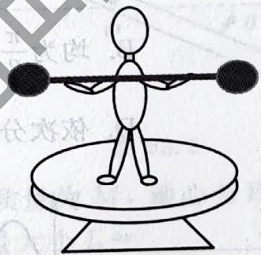
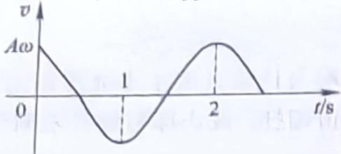
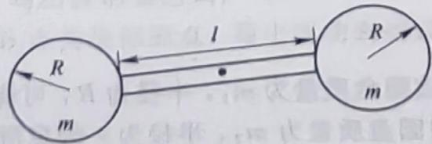
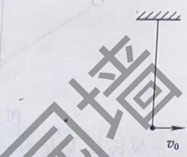
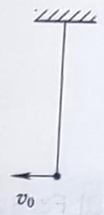
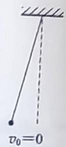
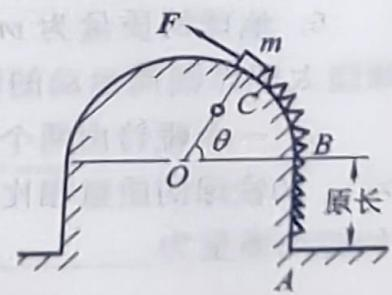
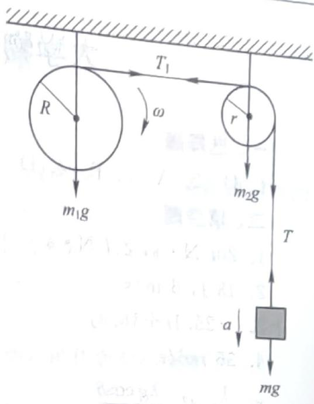
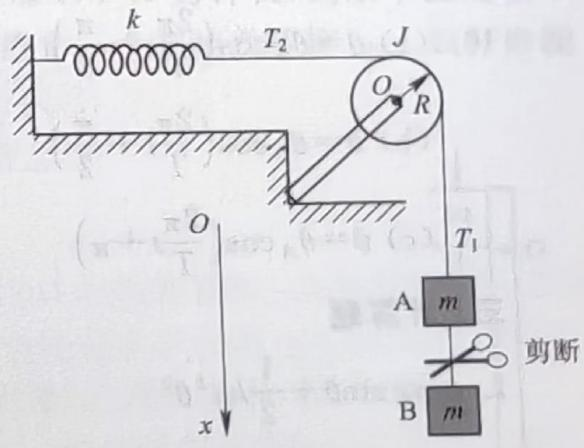

# 《大学物理I》期中模拟试题三

原件经识别和整理；“参考解答”是我们补的。

# 《大学物理I》期中模拟试题三

## 一、选择题（每小题 3 分，共 30 分）

### 选择 1

一质点沿圆周运动，其速率与时间成正比，$a_{\tau}$ 为切向加速度的大小，$a_{n}$ 为法向加速度的大小，加速度矢量 $\boldsymbol{a}$ 与速度矢量 $\boldsymbol{v}$ 间的夹角为 $\varphi$（如图 F3.1 所示）。在质点运动过程中（ ）。

- A. $a_{\tau}$ 增大，$a_{n}$ 增大，$\varphi$ 不变
- B. $a_{\tau}$ 增大，$a_{n}$ 不变，$\varphi$ 减小
- C. $a_{\tau}$ 不变，$a_{n}$ 不变，$\varphi$ 不变
- D. $a_{\tau}$ 不变，$a_{n}$ 增大，$\varphi$ 增大

知识点：[自然参数下的切向加速度与法向加速度](../../../topics/大学物理/自然坐标系下的运动.md)、[圆周运动的角量描述（角速度、角加速度）](../../../topics/大学物理/圆周运动描述.md)

### 选择 2

在 SI 制中，一些物理量的量纲如下，其中动量的量纲为（ ）。

- A. MLT$^{-1}$
- B. MLT$^{-2}$
- C. ML$^{2}$T$^{-1}$
- D. ML$^{2}$T$^{-2}$

知识点：[动量定理与动量守恒定律](../../../topics/大学物理/动量定理与动量守恒.md)

### 选择 3

一演员驾驶小汽车沿半径为 R 的竖直圆筒作飞车走壁表演，如图 F3.2 所示。现已知车与壁间的静摩擦系数为 $\mu$，那么汽车能作飞车走壁表演而不下坠的速率范围是（ ）。

- A. $v^{2} \geqslant \frac{\mu g}{R}$
- B. $v^{2} \geqslant \frac{Rg}{\mu}$
- C. $0 < v^{2} \leqslant \frac{Rg}{\mu}$
- D. $0 < v^{2} \leqslant \frac{\mu g}{R}$

知识点：[圆周运动的角量描述（角速度、角加速度）](../../../topics/大学物理/圆周运动描述.md)、[常见力（重力、弹力、摩擦力）的受力分析](../../../topics/大学物理/常见力分析.md)、[牛顿定律在变力问题中的应用（如 ma_t = -mg sinθ）](../../../topics/大学物理/牛顿定律应用.md)

### 选择 4

在两个质点组成的系统中，若质点之间只有万有引力作用，且此系统所受外力的矢量和为零，则此系统（ ）。

- A. 动量与机械能一定都守恒
- B. 动量与机械能一定都不守恒
- C. 动量不一定守恒，机械能一定守恒
- D. 动量一定守恒，机械能不一定守恒

知识点：[动量定理与动量守恒定律](../../../topics/大学物理/动量定理与动量守恒.md)、[功能原理与机械能守恒定律](../../../topics/大学物理/功能原理与机械能守恒.md)

### 选择 5

如图 F3.3 所示，一对细杆可绕通过上端与杆垂直的水平光滑固定轴 $O$ 旋转，初始状态为静止悬挂。现有一个小球自左方水平打击细杆。设小球与细杆之间为非弹性碰撞，则在碰撞过程中对细杆与小球这一系统（ ）。

- A. 只有机械能守恒
- B. 只有动量守恒
- C. 只有对转轴 $O$ 的角动量守恒
- D. 机械能、动量和角动量均守恒

知识点：[角动量定理与角动量守恒定律](../../../topics/大学物理/角动量与角动量守恒.md)、[弹性碰撞与非弹性碰撞](../../../topics/大学物理/碰撞问题.md)

### 选择 6

一人站在转动的转台中心，在他伸出去的两手中各握有一个重物，如图 F3.4 所示。在这个人向着胸部缩回他的双手及重物的过程中，以下叙述正确的是（ ）。

(1) 系统的转动惯量减小；
(2) 系统的转动角速度增大；
(3) 系统的角动量保持不变；
(4) 系统的转动动能保持不变。

- A. (2)(3)(4)
- B. (1)(2)(3)
- C. (1)(2)(4)
- D. (2)(3)(4)

知识点：[角动量定理与角动量守恒定律](../../../topics/大学物理/角动量与角动量守恒.md)、[转动惯量的计算与平行轴定理](../../../topics/大学物理/转动惯量.md)、[力矩的功与刚体定轴转动的动能定理](../../../topics/大学物理/力矩做功.md)

### 选择 7

一简谐波沿 $OX$ 轴正方向传播，$t = 0$ 时刻波形曲线如图 F3.5 所示。已知周期为 $2 \mathrm{~s}$，则 $P$ 点处质点的振动速度 $v$ 与时间 $t$ 的关系曲线为（ ）。

- A. 

- B. 

- C. 

- D. 

知识点：[平面简谐波的波函数 y=Acos(ω(t±x/u)+φ)](../../../topics/大学物理/平面简谐波方程.md)、[简谐振动的运动学方程（振幅、角频率、相位）](../../../topics/大学物理/简谐振动运动学.md)、[机械波的形成、横波与纵波](../../../topics/大学物理/机械波的产生与传播.md)

### 选择 8

机械波在介质中传播时，介质元的最大形变位移发生在（ ）。

- A. 平衡位置处
- B. 最大位移处
- C. 位移为 $\frac{\sqrt{2}}{2} A$ 处
- D. 位移为 $\frac{1}{2} A$ 处

知识点：[平面简谐波的波函数 y=Acos(ω(t±x/u)+φ)](../../../topics/大学物理/平面简谐波方程.md)

### 选择 9

为了测定音叉 c 的振动频率，另选两个和 c 频率相近的音叉 a 和 b，已知其频率 $\nu_{a}=500\ \mathrm{Hz},\quad\nu_{b}=495\ \mathrm{Hz}$，先使音叉 a 和 c 同时振动，测出每秒钟声响加强两次，然后使音叉 b 和 c 同时振动，测出每秒钟声响加强 3 次，则音叉 c 的频率为（ ）。

- A. 502 Hz
- B. 499 Hz
- C. 498 Hz
- D. 497 Hz

知识点：[同方向同频率简谐振动的合成](../../../topics/大学物理/简谐振动的合成.md)

### 选择 10

图 F3.6(a) 所示为 t=0 时的余弦波的波形图，波沿 x 轴正向传播；图 F3.6(b) 所示为一余弦振动曲线。图 F3.6(a) 所示的 x=0 处振动的初相位与图 F3.6(b) 所示的振动的初相位（ ）。

- A. 均为零
- B. 均为 $\frac{\pi}{2}$
- C. 均为 $-\frac{\pi}{2}$
- D. 依次分别为 $\frac{\pi}{2}$ 与 $-\frac{\pi}{2}$

## 二、填空题（每小题 3 分，共 30 分）

知识点：[平面简谐波的波函数 y=Acos(ω(t±x/u)+φ)](../../../topics/大学物理/平面简谐波方程.md)、[简谐振动的运动学方程（振幅、角频率、相位）](../../../topics/大学物理/简谐振动运动学.md)

### 填空 1

质量为 $m = 2 \mathrm{~kg}$ 的物体，所受合外力沿 $x$ 轴正方向，且力的大小随时间变化，其规律为 $F = 4 + 6t$ (SI)，在 $t = 0 \mathrm{~s}$ 到 $t = 2 \mathrm{~s}$ 的时间内，力 $F$ 的冲量 $I =$ ______，物体动量的增量 $\Delta P =$ ______。

知识点：[动量定理与动量守恒定律](../../../topics/大学物理/动量定理与动量守恒.md)、[速度、加速度的定义与微分关系](../../../topics/大学物理/速度与加速度定义.md)

### 填空 2

质量为 $m = 1 \mathrm{~kg}$ 的物体，在坐标原点处从静止出发在水平面内沿 $x$ 轴运动，其所受合力方向与运动方向相同，合力大小为 $F_{1}=3+2x$ （SI），那么，物体在运动后 3 m 内，合力所做功 W=______，且 x=3 m 时，其速率 v=______。

知识点：[功的定义、功率与质点动能定理](../../../topics/大学物理/功与动能定理.md)、[牛顿定律在变力问题中的应用（如 ma_t = -mg sinθ）](../../../topics/大学物理/牛顿定律应用.md)、[速度、加速度的定义与微分关系](../../../topics/大学物理/速度与加速度定义.md)

### 填空 3

一刚体以每分钟 60 转绕 z 轴沿正方向作匀速转动。设这时刚体上一点 P 的位矢为 $\boldsymbol{r}=3\boldsymbol{i}+4\boldsymbol{j}+5\boldsymbol{k}$，其单位为 $10^{-2}$ m，若以 $10^{-2}$ m/s 为速度单位，则该时刻 P 点的速度为 ______。

知识点：[刚体定轴转动的角量描述](../../../topics/大学物理/刚体定轴转动运动学.md)

### 填空 4

如图 F3.7 所示，钢球 A 和 B 质量相等，两者均可视为质点，正被绳牵着以 $\omega_{0}=4 \mathrm{rad/s}$ 的角速度绕竖直轴转动，二球与轴的距离都为 $r_{1}=15 \mathrm{cm}$。现在把轴上 C 环下移，使得两球离轴的距离缩减为 $r_{2}=5 \mathrm{cm}$，则钢球的角速度 $\omega=$ ______。

知识点：[角动量定理与角动量守恒定律](../../../topics/大学物理/角动量与角动量守恒.md)

### 填空 5

如图 F3.8 所示，一根长 $l$、质量为 $m$ 的均质细棒可绕通过点 $O$ 的水平光滑轴在竖直平面内转动，则棒的转动惯量 $J =$ ______；当棒由水平位置转到图 F3.8 所示的位置时，其角加速度 $\beta =$ ______。

知识点：[转动惯量的计算与平行轴定理](../../../topics/大学物理/转动惯量.md)

### 填空 6

地球的质量为 m，太阳的质量为 M，地心与日心的距离为 R，引力常数为 G，则地球绕太阳作圆周运动的轨道角动量大小 L= ______。

知识点：[圆周运动的角量描述（角速度、角加速度）](../../../topics/大学物理/圆周运动描述.md)、[角动量定理与角动量守恒定律](../../../topics/大学物理/角动量与角动量守恒.md)

### 填空 7

一个哑铃由两个质量为 m、半径为 R 的铁球和中间一根长 l 的连杆组成(如图 F3.9 所示)。和铁球的质量相比，连杆的质量可以忽略。此哑铃对于通过连杆中心并和它垂直的轴的转动惯量为 ______，它对于通过两球的连线的轴的转动惯量为 ______。

知识点：[转动惯量的计算与平行轴定理](../../../topics/大学物理/转动惯量.md)

### 填空 8

轻弹簧下系一质量为 $m_{1}$ 的物体，稳定后在 $m_{1}$ 下边又系一质量为 $m_{2}$ 的物体，于是弹簧又伸长了 $\Delta x$，若将 $m_{2}$ 移去，并令其振动，则振动周期 ______。

知识点：[简谐振动的动力学特征与回复力](../../../topics/大学物理/简谐振动的动力学.md)、[简谐振动的运动学方程（振幅、角频率、相位）](../../../topics/大学物理/简谐振动运动学.md)

### 填空 9

已知某简谐振动曲线如图 F3.10 所示，则该简谐振动方程 $x =$ ______。

知识点：[简谐振动的运动学方程（振幅、角频率、相位）](../../../topics/大学物理/简谐振动运动学.md)、[用旋转矢量法确定初相与运动状态](../../../topics/大学物理/旋转矢量法.md)

### 填空 10

单摆的周期为 $T$，角振幅为 $\theta_A$，起始状态如图 F3.11 所示，有 (a)、(b)、(c) 三种情况，摆线在竖直方向为单摆的平衡位置，设逆时针方向为正方向，则单摆作小角度振动的运动学方程分别为：

(a) ______
(b) ______
(c) ______

## 三、计算题（每小题 10 分，共 40 分）

知识点：[简谐振动的运动学方程（振幅、角频率、相位）](../../../topics/大学物理/简谐振动运动学.md)、[用旋转矢量法确定初相与运动状态](../../../topics/大学物理/旋转矢量法.md)、[简谐振动的动力学特征与回复力](../../../topics/大学物理/简谐振动的动力学.md)

### 计算 1

一弹簧劲度系数为 $k$，一端固定在 $A$ 点，另一端连一质量为 $m$ 的物体，靠在光滑的半径为 $a$ 的圆柱体表面上，弹簧原长为 $AB$，如图 F3.12 所示。在变力 $F$ 作用下，物体极缓慢地沿表面从位置 $B$ 移到 $C$，求力 $F$ 做的功。

(1) 用积分方法做。
(2) 用动能定理做。

知识点：[功的定义、功率与质点动能定理](../../../topics/大学物理/功与动能定理.md)、[牛顿定律在变力问题中的应用（如 ma_t = -mg sinθ）](../../../topics/大学物理/牛顿定律应用.md)、[保守力及其势能、中心力场与有效势](../../../topics/大学物理/保守力与势能.md)

### 计算 2

如图 F3.13 所示，均质圆盘质量为 $m_{1}$，半径为 R，可绕水平固定轴转动。一轻绳一端绕于轮上，另一端通过均质圆盘质量为 $m_{2}$，半径为 r 的定滑轮且悬有质量为 m 的物体。求当物体由静止开始下降了 h 时物体的速度。绳的质量不计且不能伸缩，轴间摩擦不计。

知识点：[刚体定轴转动定律（M=Jα）](../../../topics/大学物理/刚体转动定律.md)、[力矩的功与刚体定轴转动的动能定理](../../../topics/大学物理/力矩做功.md)、[功能原理与机械能守恒定律](../../../topics/大学物理/功能原理与机械能守恒.md)

### 计算 3

一轻质弹簧的一端固定，另一端由跨过一滑轮的轻绳连接两个质量均为 $m$ 的物体 A 和 B，弹簧劲度系数为 $k$，滑轮的转动惯量为 $J$，半径为 $R$，滑轮和轻绳之间无相对滑动，且不计轮轴间的摩擦阻力，系统原先处于静止状态。先将 A、B 间的细线剪断，以此作为计时起点，以新的平衡位置作为 $x$ 坐标原点，$x$ 轴正向竖直向下（如图 F3.14 所示）。

(1) 从动力学角度分析 A 是否作简谐振动；

(2) 求系统的角频率 $\omega$、振幅 $A$ 及初相位 $\varphi$。

知识点：[简谐振动的动力学特征与回复力](../../../topics/大学物理/简谐振动的动力学.md)、[刚体定轴转动定律（M=Jα）](../../../topics/大学物理/刚体转动定律.md)、[简谐振动的运动学方程（振幅、角频率、相位）](../../../topics/大学物理/简谐振动运动学.md)

### 计算 4

一平面简谐波以速度 $u = 20 \mathrm{~m/s}$ 沿 $x$ 轴正方向传播。已知在传播过程中某点 A（如图 F3.15 所示）的简谐运动表达式为 $y = 0.03 \cos 4 \pi t$，$y$ 以 m 计，$t$ 以 s 计。

(1) 以 A 点为坐标原点，写出波动表达式；

(2) 以距 A 点 5 m 处的 B 点为坐标原点，写出波动表达式。

知识点：[平面简谐波的波函数 y=Acos(ω(t±x/u)+φ)](../../../topics/大学物理/平面简谐波方程.md)
