# 《大学物理》§11.10 光的偏振特性 马吕斯定律（课件）

原件的每一页，下面附识别出的文字。

### §11.11 光的偏振特性 马吕斯定律

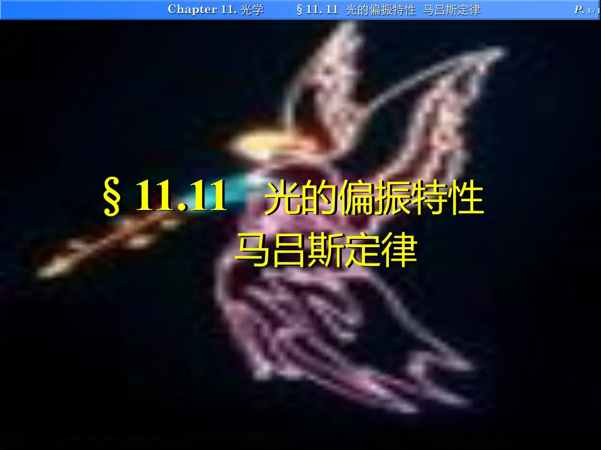

原文：

§11.11 光的偏振特性 马吕斯定律

apterChapter4. 刚体的转11. 光学 ：杨茂田§11§.411. 4 刚体定轴定律光的偏振特性 马吕斯定律

### 机械横波与纵波的检验实验：

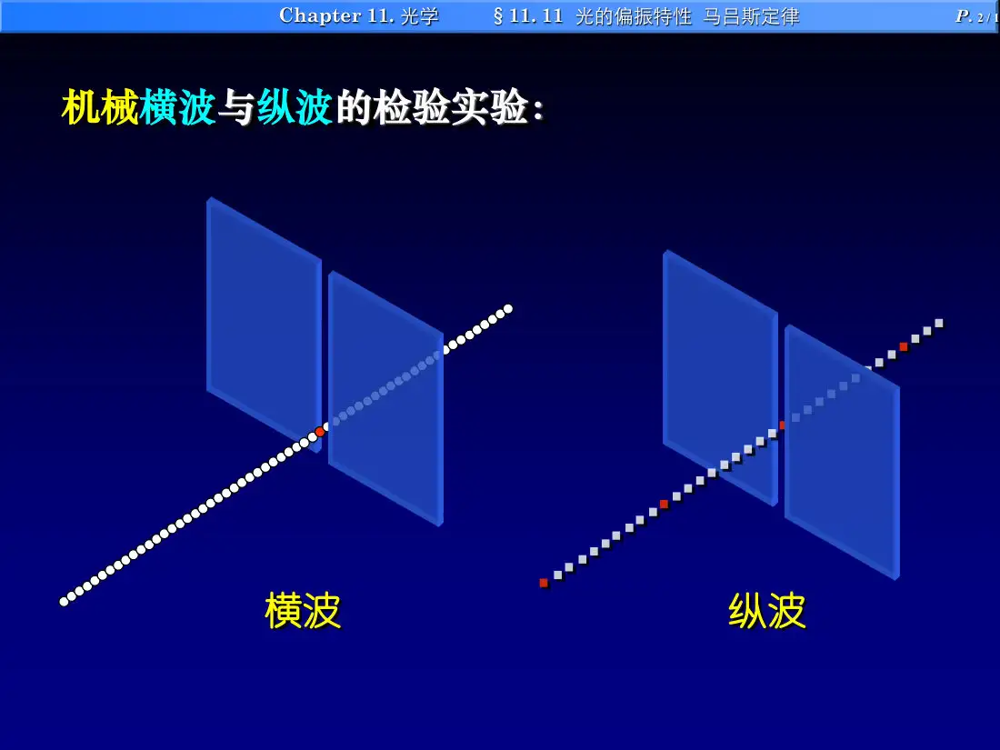

原文：

机械横波与纵波的检验实验：

apter Chapter 4. 刚体的转11. 光学 ：杨茂田§11§.411. 4 刚体定轴定律 光的偏振特性 马吕斯定律

P. 2P/ 1.

### 机械横波与纵波的检验实验：

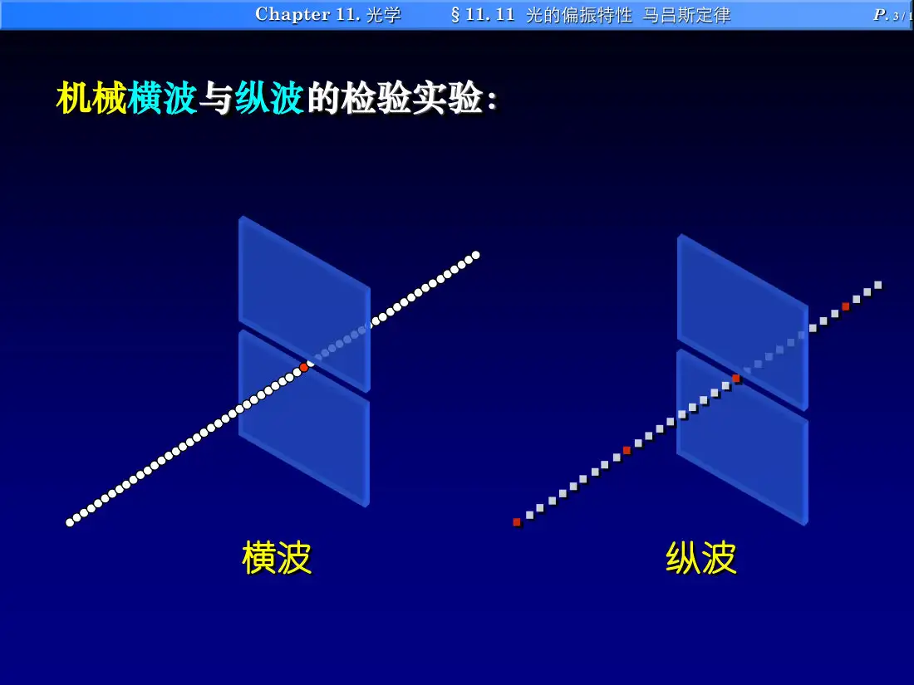

原文：

机械横波与纵波的检验实验：

apter Chapter 4. 刚体的转11. 光学 ：杨茂田§11§.411. 4 刚体定轴定律 光的偏振特性 马吕斯定律

P. 3P/ 1.

### 一、线偏振光与非偏振光

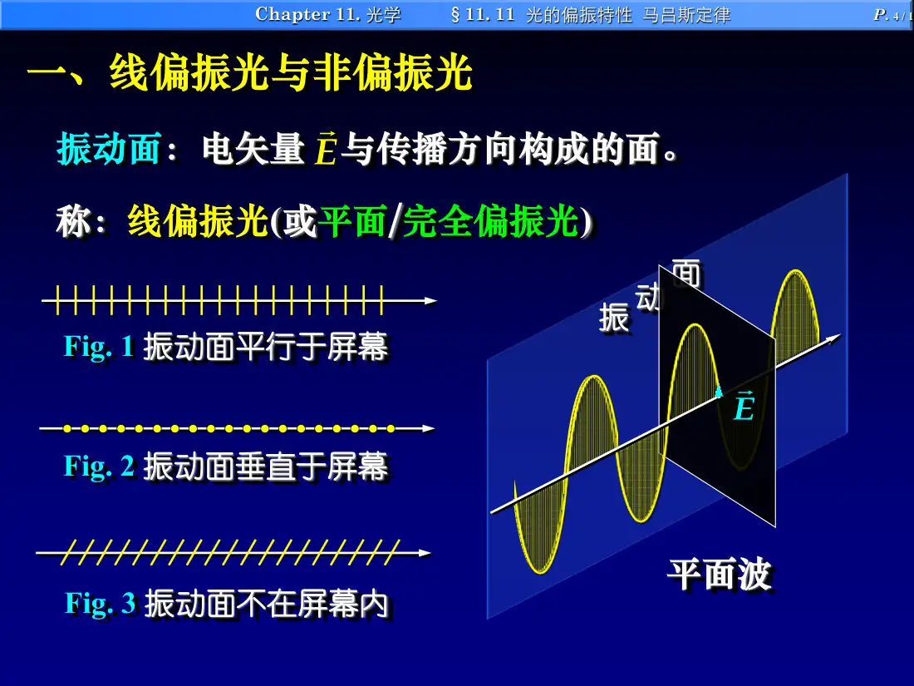

原文：

一、线偏振光与非偏振光

振动面：电矢量 E与传播方向构成的面。

称：线偏振光(或平面/完全偏振光)

Fig. 1 振动面平行于屏幕

Fig. 2 振动面垂直于屏幕

Fig. 3 振动面不在屏幕内

apter Chapter 4. 刚体的转11. 光学 ：杨茂田§11§.411. 4 刚体定轴定律 光的偏振特性 马吕斯定律

P. 4P/ 1.

### 自然光：光矢量 E沿任意方向概率相同 !

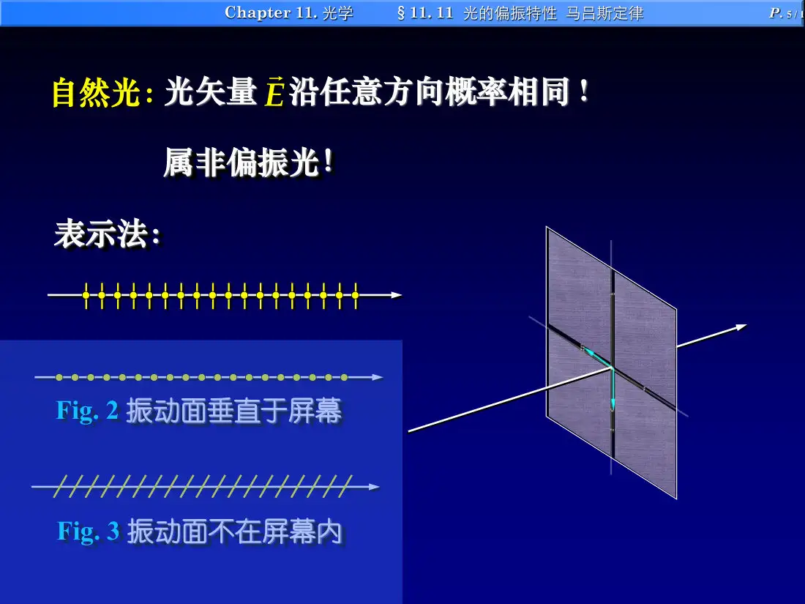

原文：

自然光：光矢量 E沿任意方向概率相同 !

属非偏振光！

表示法：

Fig. 2 振动面垂直于屏幕

HHHH

Fig. 3 振动面不在屏幕内

apter Chapter 4. 刚体的转11. 光学 ：杨茂田§11§.411. 4 刚体定轴定律 光的偏振特性 马吕斯定律

P. 5P/ 1.

### 自然光：光矢量 E沿任意方向概率相同 !

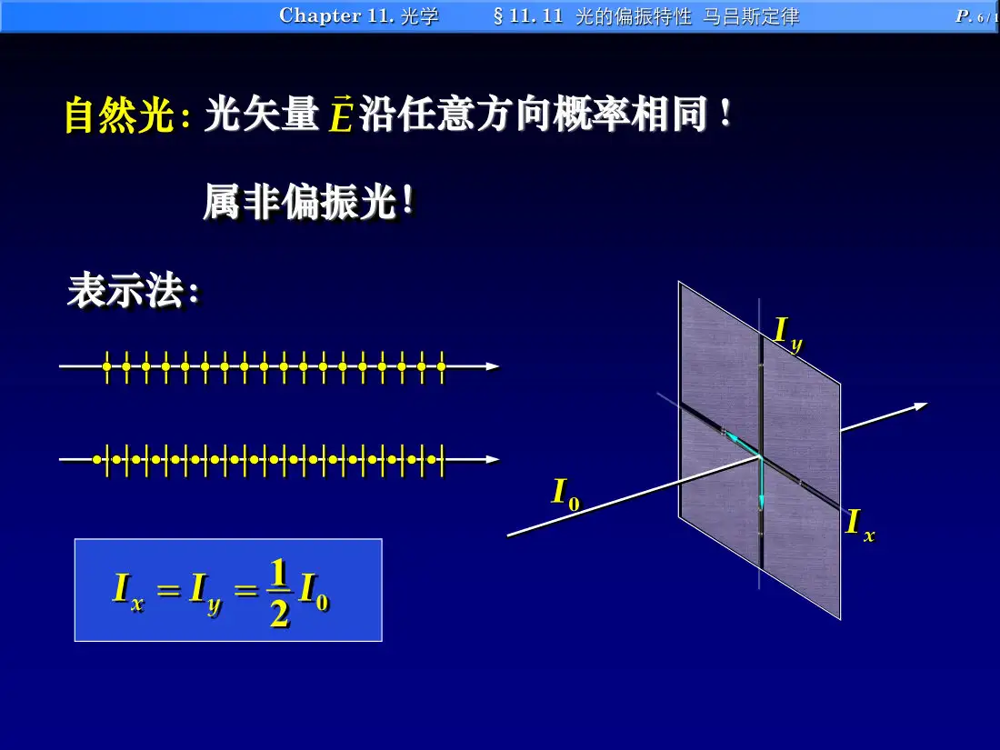

原文：

自然光：光矢量 E沿任意方向概率相同 !

属非偏振光！

表示法：

$$
I _ {x} = I _ {y} = \frac {1}{2} I _ {0}
$$

apter Chapter 4. 刚体的转11. 光学 ：杨茂田§11§.411. 4 刚体定轴定律 光的偏振特性 马吕斯定律

P. 6P/ 1.

### 部分偏振光：光矢量 E沿某一方向占优势 !

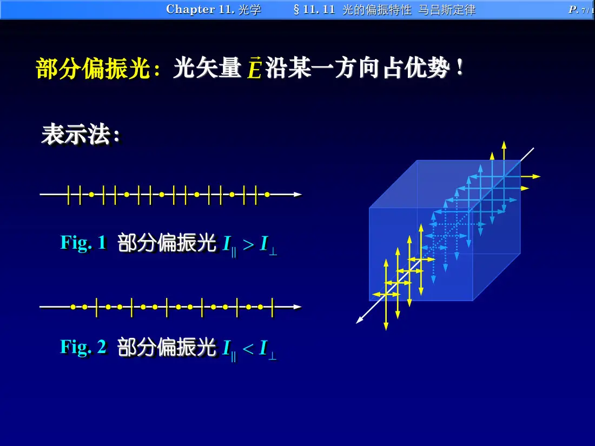

原文：

部分偏振光：光矢量 E沿某一方向占优势 !

表示法：

$$
\begin{array}{c c c c c c c c c c c c} \hline & & & & & & & & & & \\ \hline & & & & & & & & & & \\ \hline & & & & & & & & & & \\ \hline & & & & & & & & & & \\ \hline \end{array}
$$

Fig. 1 部分偏振光 $1 1 > 1 1$

$$
\begin{array}{c c c c c c c c c c c c c} \hline & & & & & & & & & & \\ \hline & & & & & & & & & & \\ \hline & & & & & & & & & & \\ \hline \end{array}
$$

Fig. 2 部分偏振光 $1 1 \leq 1 1$

apterChapter4. 刚体的转11. 光学 ：杨茂田§11§.411. 4 刚体定轴定律光的偏振特性 马吕斯定律

P. 7P/ 1.

### 二、偏振光的起偏与检偏

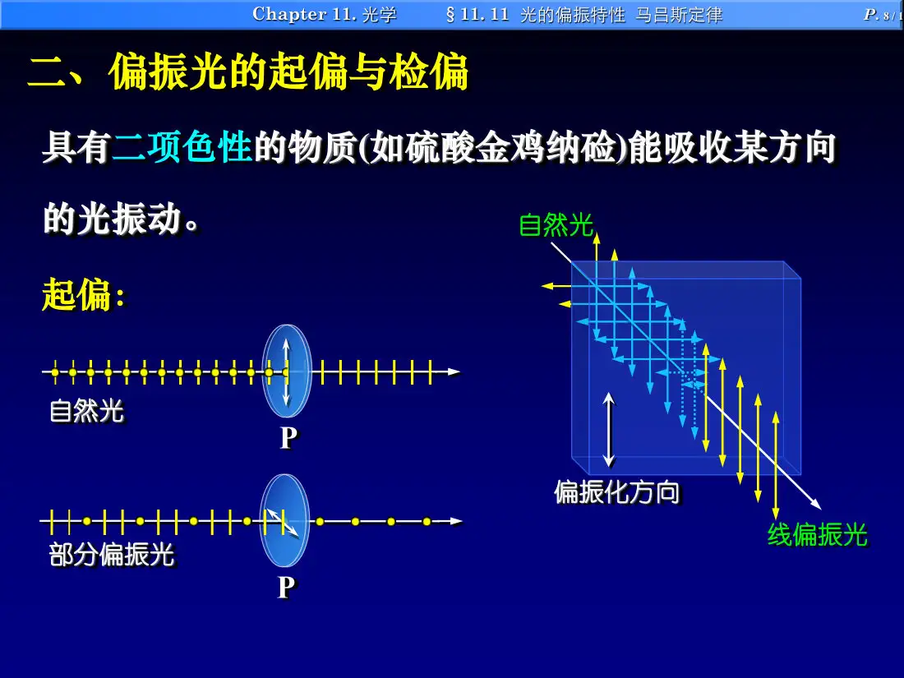

原文：

二、偏振光的起偏与检偏

具有二项色性的物质(如硫酸金鸡纳硷)能吸收某方向的光振动。 自然光

起偏：

apter Chapter 4. 刚体的转11. 光学 ：杨茂田§11§.411. 4 刚体定轴定律 光的偏振特性 马吕斯定律

P. 8P/ 1.

### 检偏：

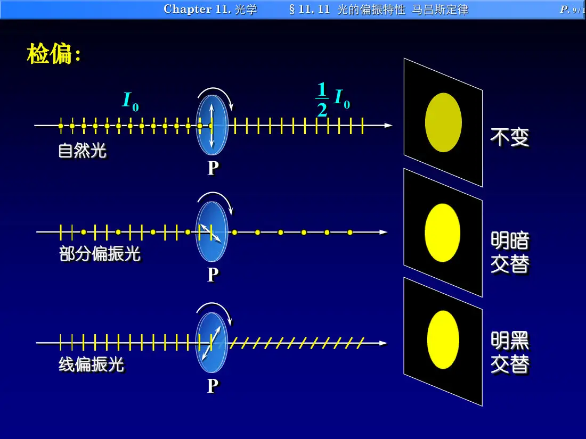

原文：

检偏：

明黑交替

apter Chapter 4. 刚体的转11. 光学 ：杨茂田§11§.411. 4 刚体定轴定律 光的偏振特性 马吕斯定律

P. 9P/ 1.

### 立体电影

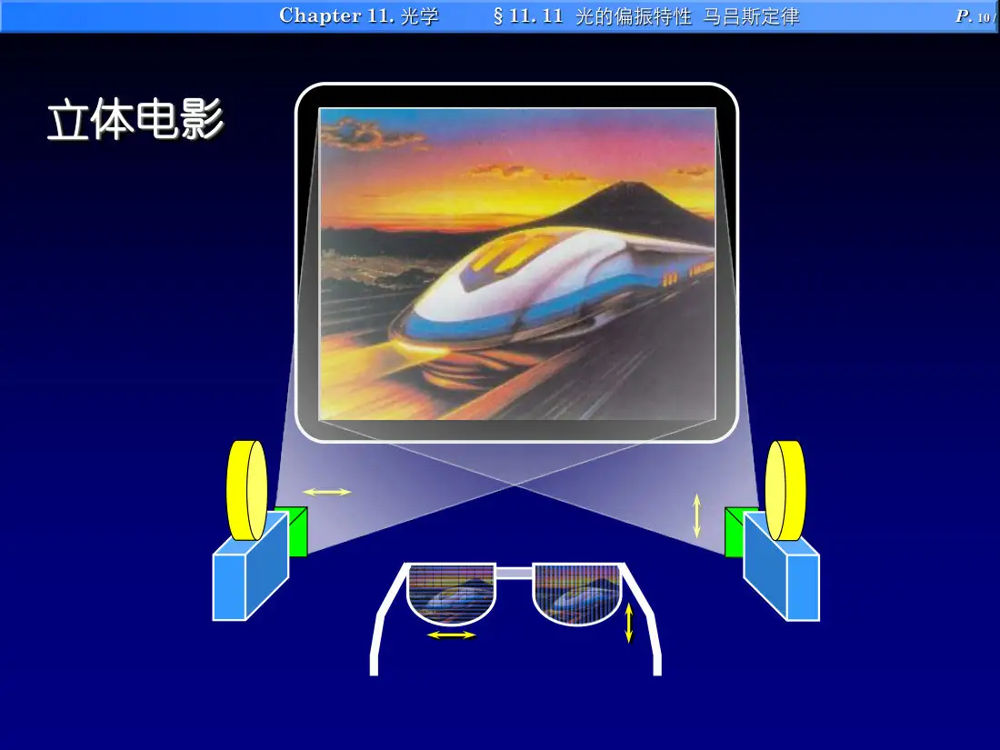

原文：

立体电影

apter Chapter 4. 刚体的转11. 光学 ：杨茂田§11§.411. 4 刚体定轴定律 光的偏振特性 马吕斯定律

P. 10P/.

### 第 11 页

原文：

apterChapter4. 刚体的转11. 光学 ：杨茂田§11§.411. 4 刚体定轴定律光的偏振特性 马吕斯定律

### 三、马吕斯定律

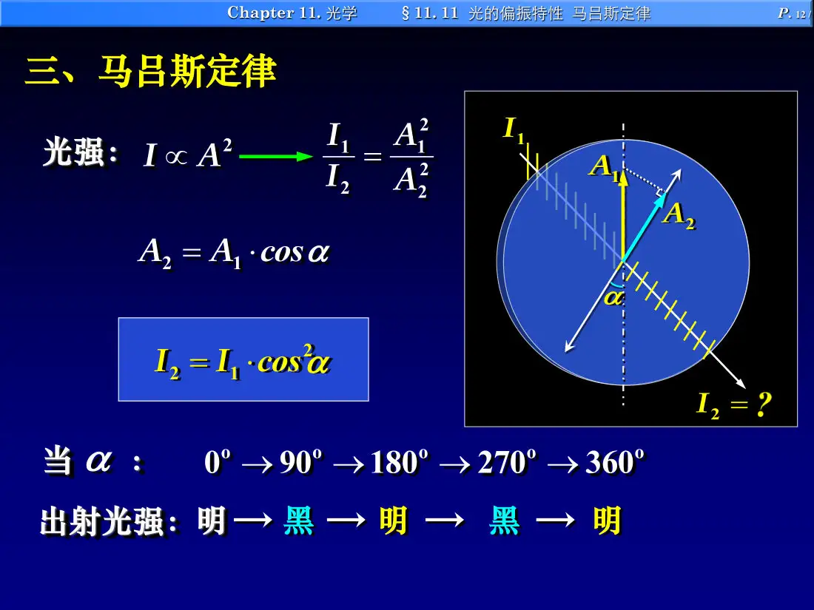

原文：

三、马吕斯定律

光强： $1 1 0 0 0 \div 5 = \frac { 1 1 } { 1 5 }$

$$
A _ {2} = A _ {1} \cdot \cos \alpha
$$

$$
I _ {2} = I _ {1} \cdot \cos^ {2} \alpha
$$

当  ： $( 1 ) ( 1 - \infty , 1 1 ) = ( 1 - \infty , 1 1 ) ( 1 - \infty , 1 1 ) = ( 1 - \infty , 1 1 )$

出射光强：明 黑 明 黑 明例 自然光光强 $\%$ $\mathbb { B }$ 现以与 $\perp$ 成 $5 7 0$ 角插入 $\mathbb { M }$ 求出射光强。

apterChapter4. 刚体的转11. 光学 ：杨茂田§11§.411. 4 刚体定轴定律光的偏振特性 马吕斯定律

P. 12P/.

### $$

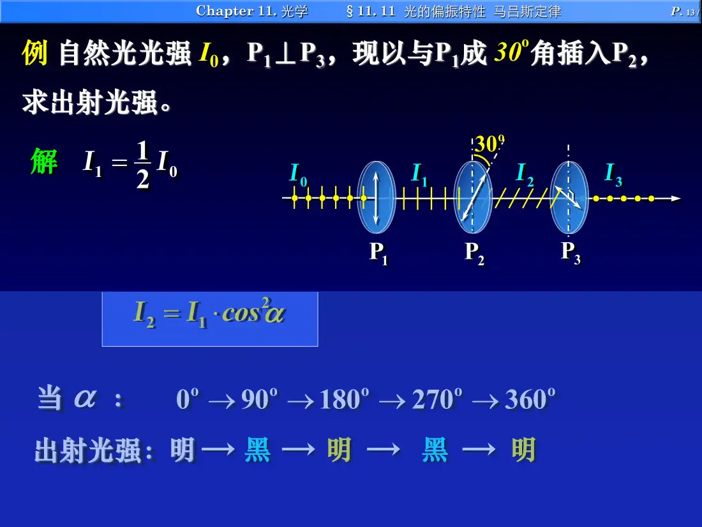

原文：

解 $1 5 - \frac { 1 } { 5 } = \frac { 1 } { 5 }$

$$
I _ {2} = I _ {1} \cdot \cos^ {2} \alpha
$$

当  ： $( 1 ) ( 1 1 ) ( 1 1 ) ( - 2 1 9 ) ( - 2 1 9 ) ( 1 1 ) ( - 2 1 9 ) ( 1 1 )$

出射光强：明 黑 明 黑 明例 自然光光强 $\%$ $\mathbb { B }$ 现以与 $\perp$ 成 $6 0 0$ 角插入 $\mathbb { M }$ 求出射光强。

apter Chapter 4. 刚体的转11. 光学 ：杨茂田§11§.411. 4 刚体定轴定律 光的偏振特性 马吕斯定律

P. 13P/.

### $$

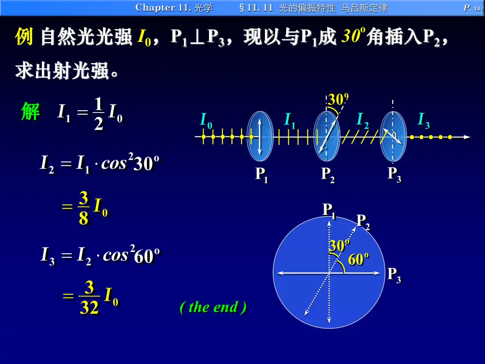

原文：

解 $1 5 - \frac { 1 } { 5 } = \frac { 1 } { 5 }$

$$
\begin{array}{r l} I _ {2} & = I _ {1} \cdot \cos^ {2} 3 0 ^ {\circ} \\ & = \frac {3}{8} I _ {0} \end{array}
$$

$$
\begin{array}{r l} I _ {3} & = I _ {2} \cdot \cos^ {2} 6 0 ^ {\circ} \\ & = \frac {3}{3 2} I _ {0} \end{array}
$$

( the end )

apter Chapter 4. 刚体的转11. 光学 ：杨茂田§11§.411. 4 刚体定轴定律 光的偏振特性 马吕斯定律

P. 14P/.

### 归纳：

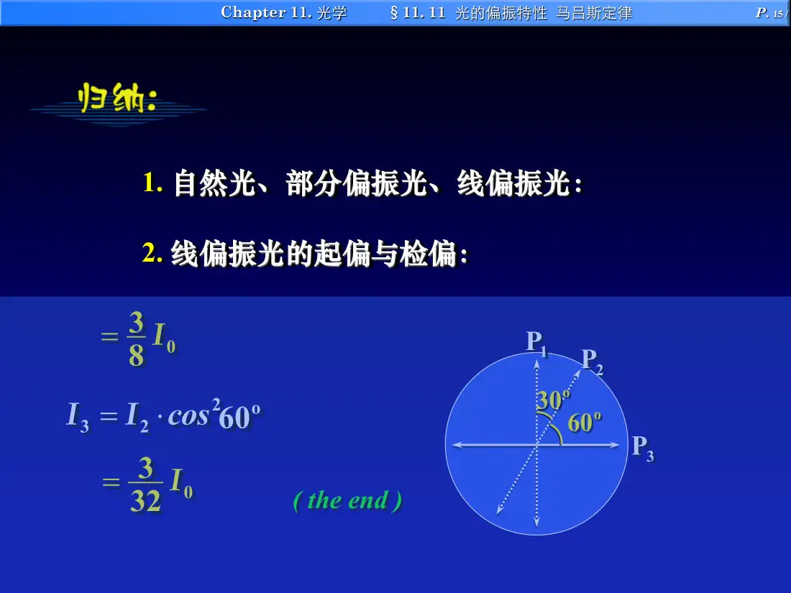

原文：

归纳：

1. 自然光、部分偏振光、线偏振光：

2. 线偏振光的起偏与检偏：

$$
= \frac {3}{8} I _ {0}
$$

$$
\begin{array}{r l} I _ {3} & = I _ {2} \cdot \cos^ {2} 6 0 ^ {\circ} \\ & = \frac {3}{3 2} I _ {0} \end{array}
$$

apter Chapter 4. 刚体的转11. 光学 ：杨茂田§11§.411. 4 刚体定轴定律 光的偏振特性 马吕斯定律

P. 15P/.

### 归纳：

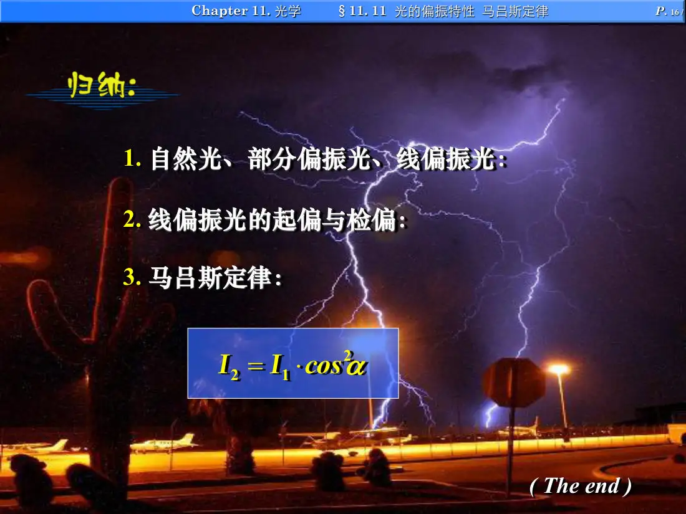

原文：

归纳：

1. 自然光、部分偏振光、线偏振光：

2. 线偏振光的起偏与检偏：

3. 马吕斯定律：

$$
I _ {2} = I _ {1} \cdot \cos^ {2} \alpha
$$

apter Chapter 4. 刚体的转11. 光学 ：杨茂田§11§.411. 4 刚体定轴定律 光的偏振特性 马吕斯定律

P. 16P/.

( The end )
