# 《大学物理》§11.3 光程 薄膜干涉 §11.4 劈尖 牛顿环（课件）

原件的每一页，下面附识别出的文字。

### § 11.3 光程 薄膜干涉 § 11.4 劈尖 牛顿环

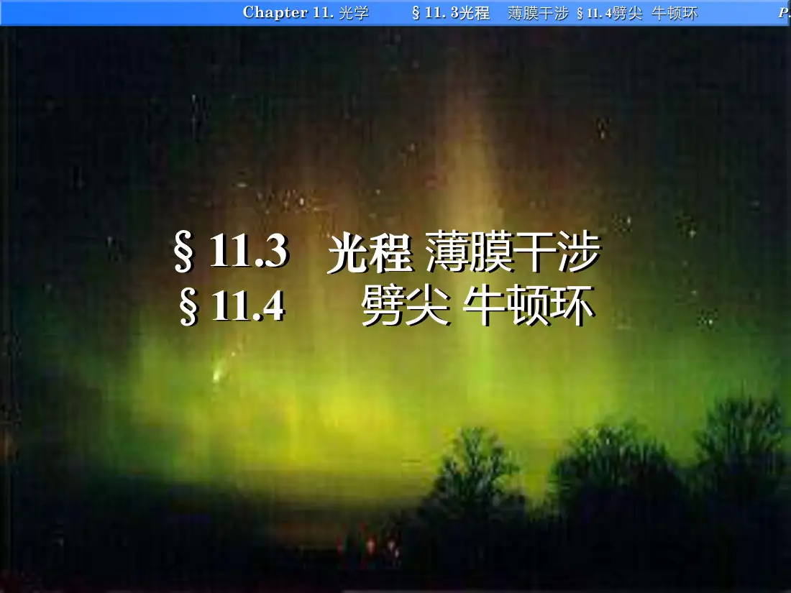

原文：

§ 11.3 光程 薄膜干涉 § 11.4 劈尖 牛顿环

Chapter 11. 光学 § 11.3 光程 薄膜干涉 § 11.4 劈尖 牛顿环

P.

### 一、薄膜干涉

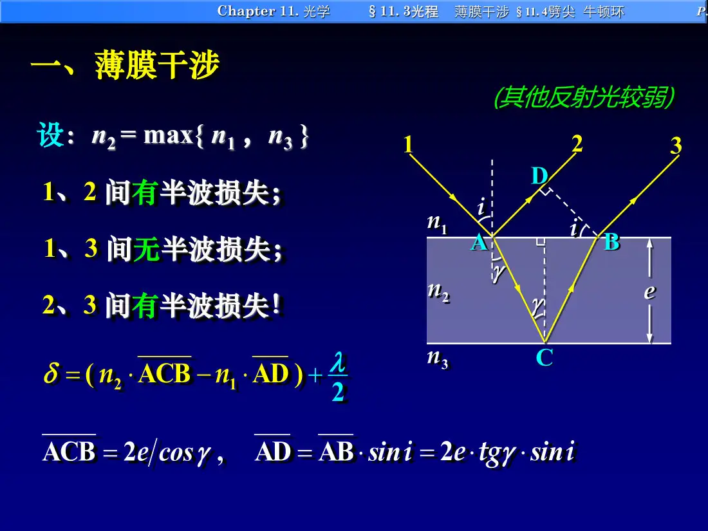

原文：

一、薄膜干涉

设： $n_{2}=\max\{n_{1},n_{3}\}$

1、2 间有半波损失；

1、3 间无半波损失；

2、3 间有半波损失!

$$
\delta = \left(n _ {2} \cdot \overline {{\mathrm{ACB}}} - n _ {1} \cdot \overline {{\mathrm{AD}}}\right) + \frac {\lambda}{2}
$$

(其他反射光较弱)

$\overline{\mathrm{ACB}} = 2e / \cos \gamma ,\quad \overline{\mathrm{AD}} = \overline{\mathrm{AB}}\cdot \sin i = 2e\cdot \operatorname {tg}\gamma \cdot \sin i$

Chapter 11. 光学 § 11.3 光程 薄膜干涉 § 11.4 劈尖 牛顿环

P.

### $$

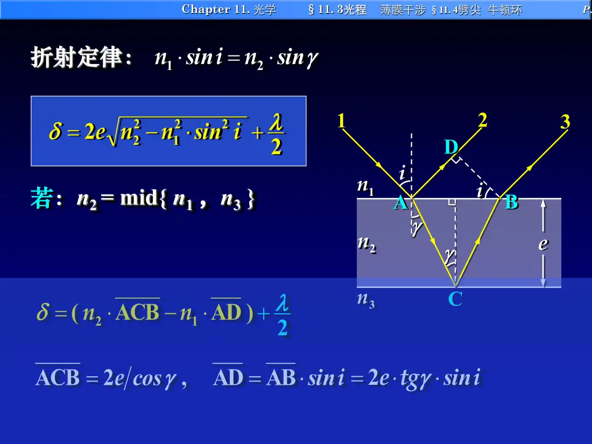

原文：

折射定律: $n_{1} \cdot \sin i = n_{2} \cdot \sin \gamma$

$$
\delta = 2 e \sqrt {n _ {2} ^ {2} - n _ {1} ^ {2} \cdot \sin^ {2} i} + \frac {\lambda}{2}
$$

若： $n_{2}=\operatorname{mid}\{n_{1},n_{3}\}$

$$
\delta = \left(n _ {2} \cdot \overline {{\mathrm{ACB}}} - n _ {1} \cdot \overline {{\mathrm{AD}}}\right) + \frac {\lambda}{2}
$$

$\overline{\mathrm{ACB}} = 2e / \cos \gamma ,\quad \overline{\mathrm{AD}} = \overline{\mathrm{AB}}\cdot \sin i = 2e\cdot \operatorname {tg}\gamma \cdot \sin i$

Chapter 11. 光学 § 11.3 光程 薄膜干涉 § 11.4 劈尖 牛顿环

P.

### $$

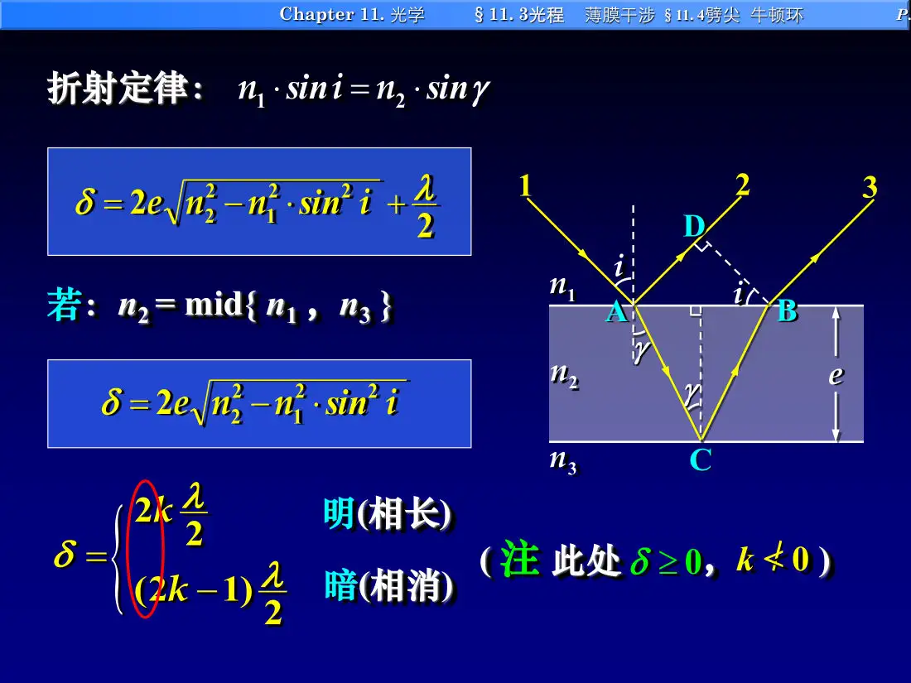

原文：

折射定律: $n_{1} \cdot \sin i = n_{2} \cdot \sin \gamma$

$$
\delta = 2 e \sqrt {n _ {2} ^ {2} - n _ {1} ^ {2} \cdot \sin^ {2} i} + \frac {\lambda}{2}
$$

若： $n_{2}=\operatorname{mid}\left\{n_{1},n_{3}\right\}$

$$
\delta = 2 e \sqrt {n _ {2} ^ {2} - n _ {1} ^ {2} \cdot \sin^ {2} i}
$$

$\delta = \left\{ \begin{array}{ll} 2k\frac{\lambda}{2} & \text{明(相长)} \\ (2k - 1)\frac{\lambda}{2} & \text{暗(相消)} \end{array} \right.$ （注此处 $\delta \geq 0, k < 0$ ）

Chapter 11. 光学 § 11.3 光程 薄膜干涉 § 11.4 劈尖 牛顿环

P.

### 对透射光:

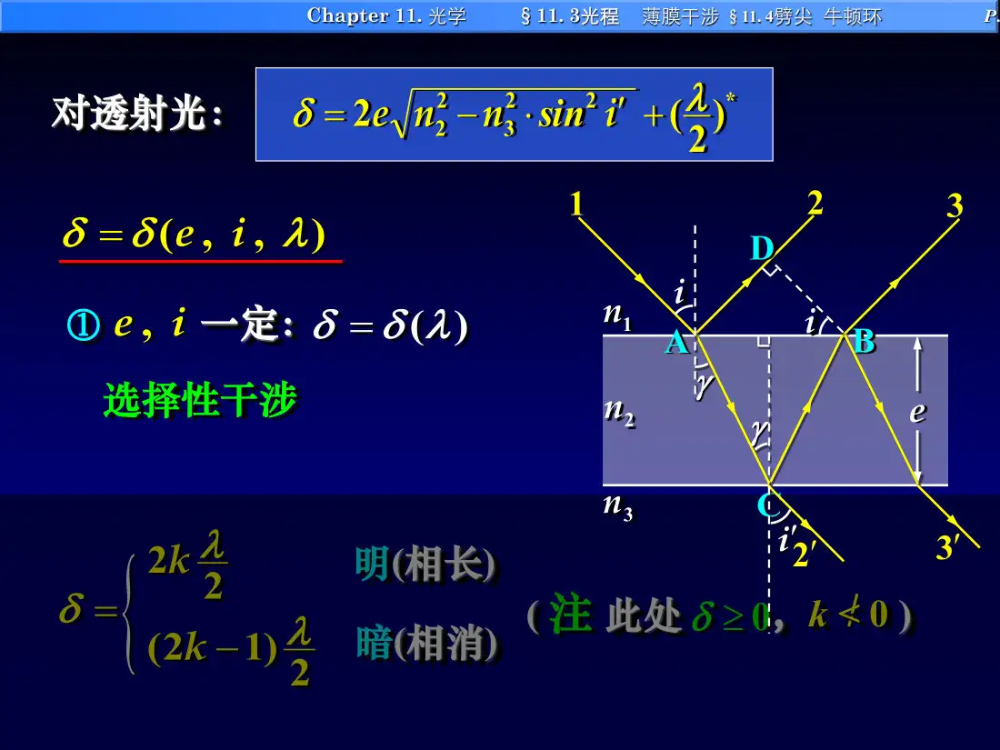

原文：

对透射光:

$$
\delta = 2 e \sqrt {n _ {2} ^ {2} - n _ {3} ^ {2} \cdot \sin^ {2} i ^ {\prime}} + (\frac {\lambda}{2}) ^ {*}
$$

$$
\delta = \delta (e, i, \lambda)
$$

① e, i 一定: $\delta = \delta(\lambda)$

选择性干涉

$\delta = \left\{ \begin{array}{ll}2k\frac{\lambda}{2} & \text{明(相长)}\\ (2k - 1)\frac{\lambda}{2} & \text{暗(相消)} \end{array} \right.$

(注此处 $\delta \geq 0, k < 0$ )

Chapter 11. 光学 § 11.3 光程 薄膜干涉 § 11.4 劈尖 牛顿环

P.

### 对透射光:

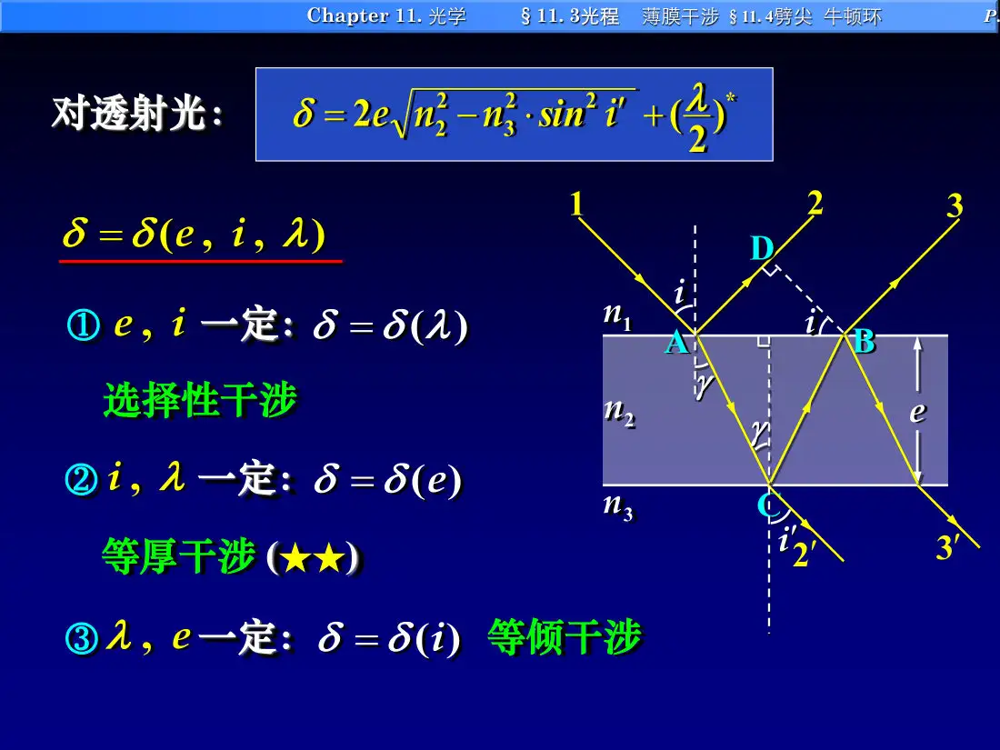

原文：

对透射光:

$$
\delta = 2 e \sqrt {n _ {2} ^ {2} - n _ {3} ^ {2} \cdot \sin^ {2} i ^ {\prime}} + (\frac {\lambda}{2}) ^ {*}
$$

$$
\delta = \delta (e, i, \lambda)
$$

① e, i 一定: $\delta = \delta(\lambda)$

选择性干涉

② i, $\lambda$ 一定: $\delta = \delta(e)$

等厚干涉 (★★)

③ $\lambda$ , e 一定: $\delta = \delta(i)$ 等倾干涉

Chapter 11. 光学 § 11.3 光程 薄膜干涉 § 11.4 劈尖 牛顿环

P.

### 二、选择性干涉: $\delta = \delta(\lambda)$

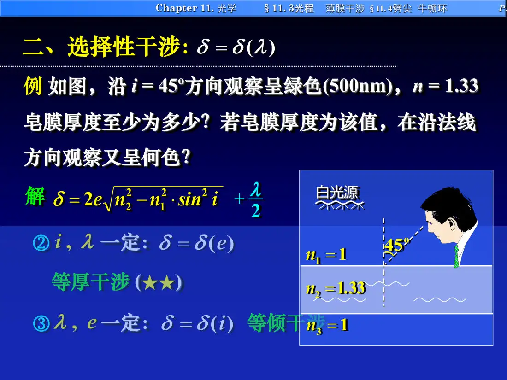

原文：

二、选择性干涉: $\delta = \delta(\lambda)$

例如图，沿 $i = 45^{\circ}$ 方向观察呈绿色(500nm)， $n = 1.33$ 皂膜厚度至少为多少？若皂膜厚度为该值，在沿法线方向观察又呈何色？

解 $\delta=2e\sqrt{n_{2}^{2}-n_{1}^{2}\cdot\sin^{2}i}+\frac{\lambda}{2}$

② i, $\lambda$ 一定: $\delta = \delta(e)$

等厚干涉 (★★)

白光源

$$
n _ {1} = 1
$$

$$
n _ {2} = 1. 3 3
$$

③ $\lambda$ , e 一定: $\delta = \delta(i)$ 等倾干涉 $n_{3} = 1$

Chapter 11. 光学 § 11.3 光程 薄膜干涉 § 11.4 劈尖 牛顿环

P.

### 二、选择性干涉: $\delta = \delta(\lambda)$

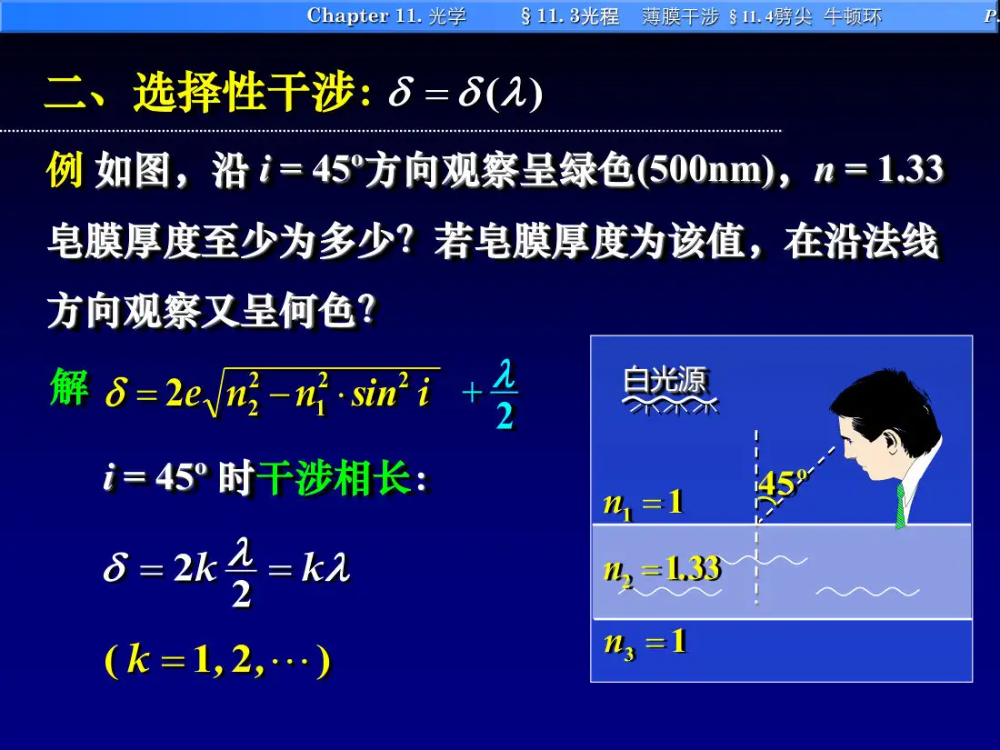

原文：

二、选择性干涉: $\delta = \delta(\lambda)$

例如图，沿 $i = 45^{\circ}$ 方向观察呈绿色(500nm)， $n = 1.33$ 皂膜厚度至少为多少？若皂膜厚度为该值，在沿法线方向观察又呈何色？

解 $\delta=2e\sqrt{n_{2}^{2}-n_{1}^{2}\cdot\sin^{2}i}+\frac{\lambda}{2}$

白光源

$i = 45^{\circ}$ 时干涉相长:

$$
n _ {1} = 1
$$

$$
\delta = 2 k \frac {\lambda}{2} = k \lambda
$$

$$
n _ {2} = 1. 3 3
$$

$$
(k = 1, 2, \dots)
$$

$$
n _ {3} = 1
$$

Chapter 11. 光学 § 11.3 光程 薄膜干涉 § 11.4 劈尖 牛顿环

P.

### $$

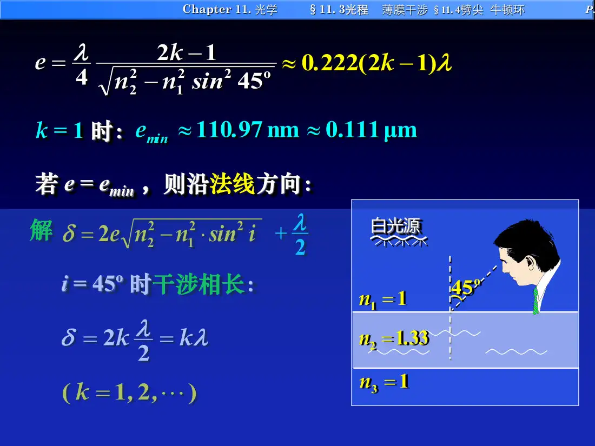

原文：

$$
e = \frac {\lambda}{4} \frac {2 k - 1}{\sqrt {n _ {2} ^ {2} - n _ {1} ^ {2} \sin^ {2} 4 5 ^ {0}}} \approx 0. 2 2 2 (2 k - 1) \lambda
$$

$k = 1$ 时: $e_{min} \approx 110.97 \mathrm{~nm} \approx 0.111 \mu \mathrm{m}$

若 $e = e_{\min}$ ，则沿法线方向：

解 $\delta=2e\sqrt{n_{2}^{2}-n_{1}^{2}\cdot\sin^{2}i}+\frac{\lambda}{2}$

$i = 45^{\circ}$ 时干涉相长:

白光源

$$
\delta = 2 k \frac {\lambda}{2} = k \lambda
$$

$$
n _ {1} = 1
$$

$$
n _ {2} = 1. 3 3
$$

$$
(k = 1, 2, \dots)
$$

$$
n _ {3} = 1
$$

Chapter 11. 光学 § 11.3 光程 薄膜干涉 § 11.4 劈尖 牛顿环

P.

### $$

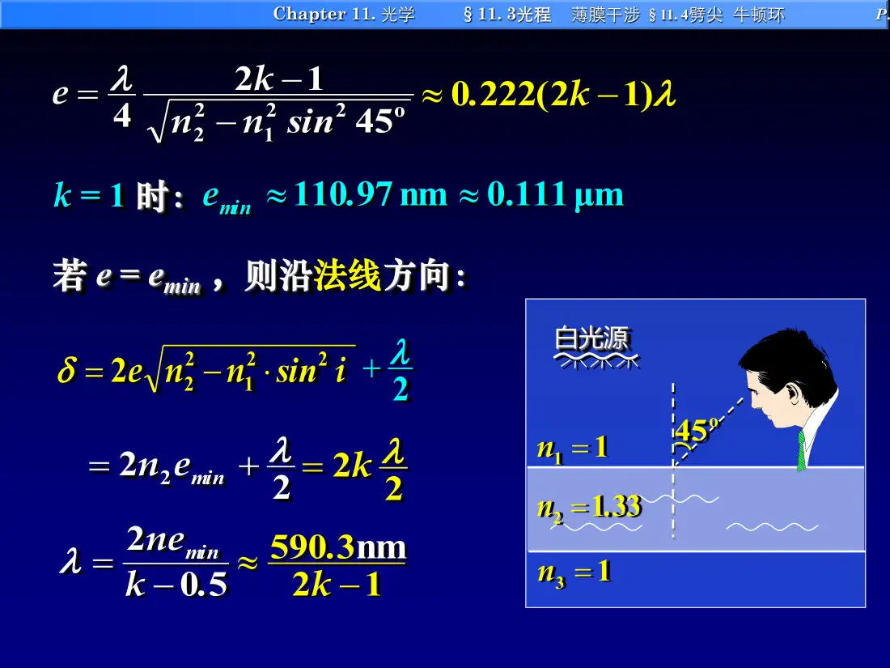

原文：

$$
e = \frac {\lambda}{4} \frac {2 k - 1}{\sqrt {n _ {2} ^ {2} - n _ {1} ^ {2} \sin^ {2} 4 5 ^ {0}}} \approx 0. 2 2 2 (2 k - 1) \lambda
$$

$k = 1$ 时： $e_{min}\approx 110.97\mathrm{nm}\approx 0.111\mu \mathrm{m}$

若 $e = e_{\min}$ ，则沿法线方向：

$$
\delta = 2 e \sqrt {n _ {2} ^ {2} - n _ {1} ^ {2} \cdot \sin^ {2} i} + \frac {\lambda}{2}
$$

白光源

$$
= 2 n _ {2} e _ {\min} + \frac {\lambda}{2} = 2 k \frac {\lambda}{2}
$$

$$
n _ {1} = 1
$$

$$
n _ {2} = 1. 3 3
$$

$$
\lambda = \frac {2 n e _ {\min}}{k - 0 . 5} \approx \frac {5 9 0 . 3 \mathrm{nm}}{2 k - 1}
$$

$$
n _ {3} = 1
$$

Chapter 11. 光学 § 11.3 光程 薄膜干涉 § 11.4 劈尖 牛顿环

P.

### ...

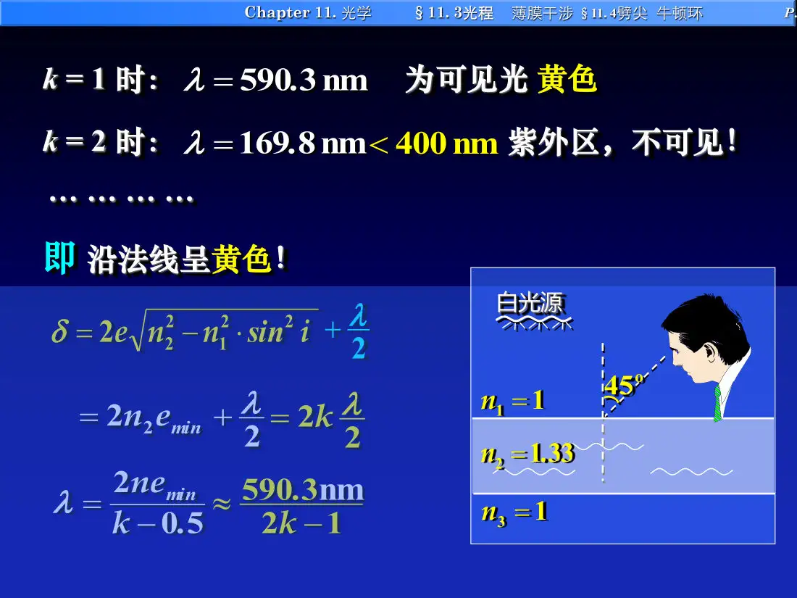

原文：

$k = 1$ 时: $\lambda = 590.3 \mathrm{~nm}$ 为可见光黄色

$k = 2$ 时: $\lambda = 169.8 \mathrm{~nm} < 400 \mathrm{~nm}$ 紫外区, 不可见!

...

即 沿法线呈黄色！

$$
\delta = 2 e \sqrt {n _ {2} ^ {2} - n _ {1} ^ {2} \cdot \sin^ {2} i} + \frac {\lambda}{2}
$$

白光源

$$
= 2 n _ {2} e _ {\min} + \frac {\lambda}{2} = 2 k \frac {\lambda}{2}
$$

$$
n _ {1} = 1
$$

$$
n _ {2} = 1. 3 3
$$

$$
\lambda = \frac {2 n e _ {\min}}{k - 0 . 5} \approx \frac {5 9 0 . 3 \mathrm{nm}}{2 k - 1}
$$

$$
n _ {3} = 1
$$

Chapter 11. 光学 § 11.3 光程 薄膜干涉 § 11.4 劈尖 牛顿环

P.

### ......

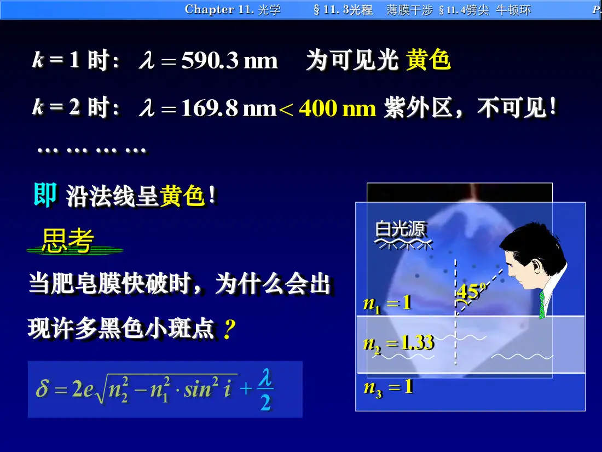

原文：

$k = 1$ 时: $\lambda = 590.3 \mathrm{~nm}$ 为可见光黄色

$k = 2$ 时: $\lambda = 169.8 \mathrm{~nm} < 400 \mathrm{~nm}$ 紫外区, 不可见!

......

即 沿法线呈黄色！

思考

白光源

当肥皂膜快破时，为什么会出现许多黑色小斑点？

$$
\delta = 2 e \sqrt {n _ {2} ^ {2} - n _ {1} ^ {2} \cdot \sin^ {2} i} + \frac {\lambda}{2}
$$

Chapter 11. 光学 § 11.3 光程 薄膜干涉 § 11.4 劈尖 牛顿环

P.

### 增透膜与增反膜：

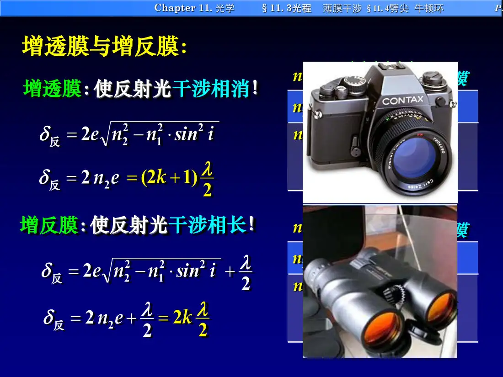

原文：

增透膜与增反膜：

增透膜:使反射光干涉相消!

$$
\delta_ {\text {反}} = 2 e \sqrt {n _ {2} ^ {2} - n _ {1} ^ {2} \cdot \sin^ {2} i}
$$

$$
\delta_ {\text {反}} = 2 n _ {2} e = (2 k + 1) \frac {\lambda}{2}
$$

增反膜:使反射光干涉相长!

$$
\delta_ {\text {反}} = 2 e \sqrt {n _ {2} ^ {2} - n _ {1} ^ {2} \cdot \sin^ {2} i} + \frac {\lambda}{2}
$$

$$
\delta_ {\text {反}} = 2 n _ {2} e + \frac {\lambda}{2} = 2 k \frac {\lambda}{2}
$$

Chapter 11. 光学 § 11.3 光程 薄膜干涉 § 11.4 劈尖 牛顿环

P.

### 增透膜 增反膜

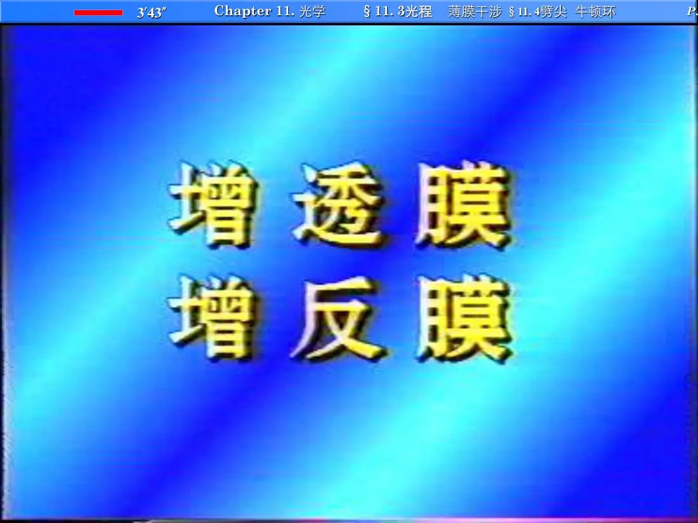

原文：

增透膜 增反膜

P.

3'43" Chapter 11. 光学 § 11.3 光程 薄膜干涉 § 11.4 劈尖 牛顿环

### 三、等厚干涉: $\delta = \delta(e)$

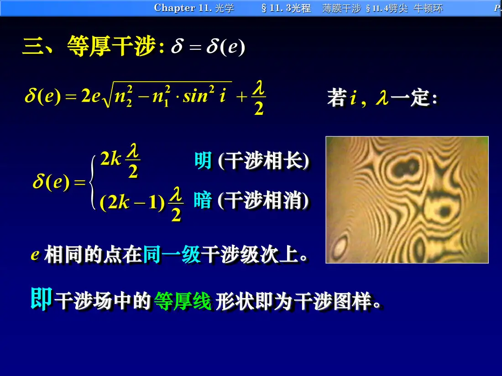

原文：

三、等厚干涉: $\delta = \delta(e)$

$$
\delta (e) = 2 e \sqrt {n _ {2} ^ {2} - n _ {1} ^ {2} \cdot \sin^ {2} i} + \frac {\lambda}{2}
$$

$\delta (e) = \left\{ \begin{array}{ll}2k\frac{\lambda}{2} & \text{明 (干涉相长)}\\ (2k - 1)\frac{\lambda}{2} & \text{暗 (干涉相消)} \end{array} \right.$

e 相同的点在同一级干涉级次上。

若 $i, \lambda$ 一定:

即干涉场中的等厚线形状即为干涉图样。

Chapter 11. 光学 § 11.3 光程 薄膜干涉 § 11.4 劈尖 牛顿环

P.

### 1、劈尖

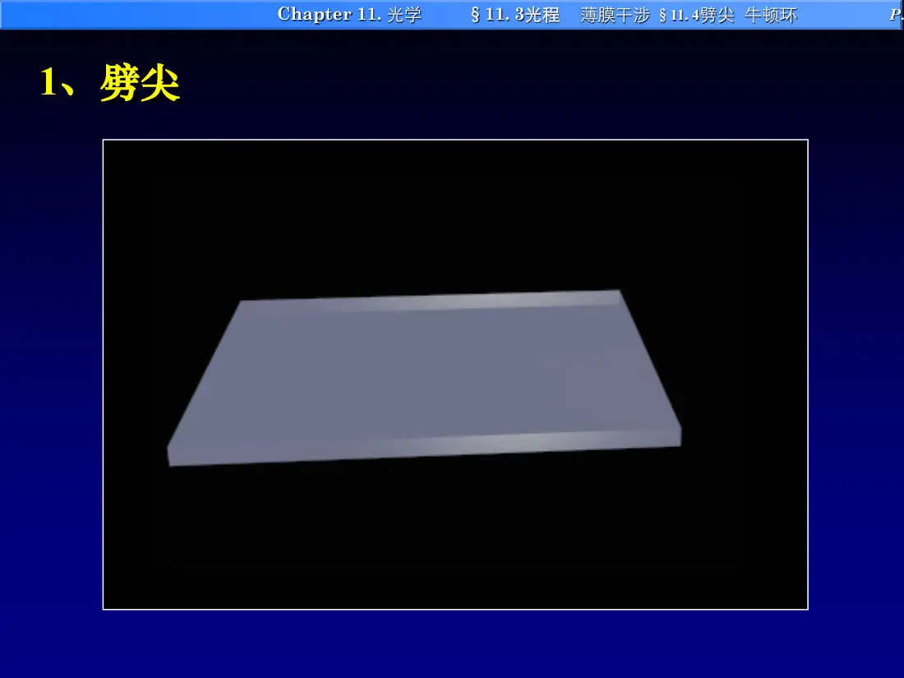

原文：

1、劈尖

Chapter 11. 光学 § 11.3 光程 薄膜干涉 § 11.4 劈尖 牛顿环

P.

### 1、劈尖

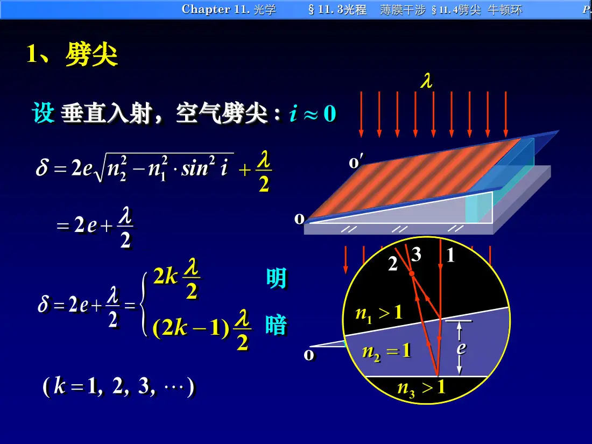

原文：

1、劈尖

设 垂直入射，空气劈尖： $i \approx 0$

$$
\begin{array}{r l} \delta & = 2 e \sqrt {n _ {2} ^ {2} - n _ {1} ^ {2} \cdot \sin^ {2} i} + \frac {\lambda}{2} \\ & = 2 e + \frac {\lambda}{2} \end{array}
$$

$$
\delta = 2 e + \frac {\lambda}{2} = \left\{ \begin{array}{l} 2 k \frac {\lambda}{2} \\ (2 k - 1) \frac {\lambda}{2} \end{array} \right.
$$

明
暗

$$
(k = 1, 2, 3, \dots)
$$

Chapter 11. 光学 § 11.3 光程 薄膜干涉 § 11.4 劈尖 牛顿环

P.

### 对底边 $oo'$ : e = 0，则

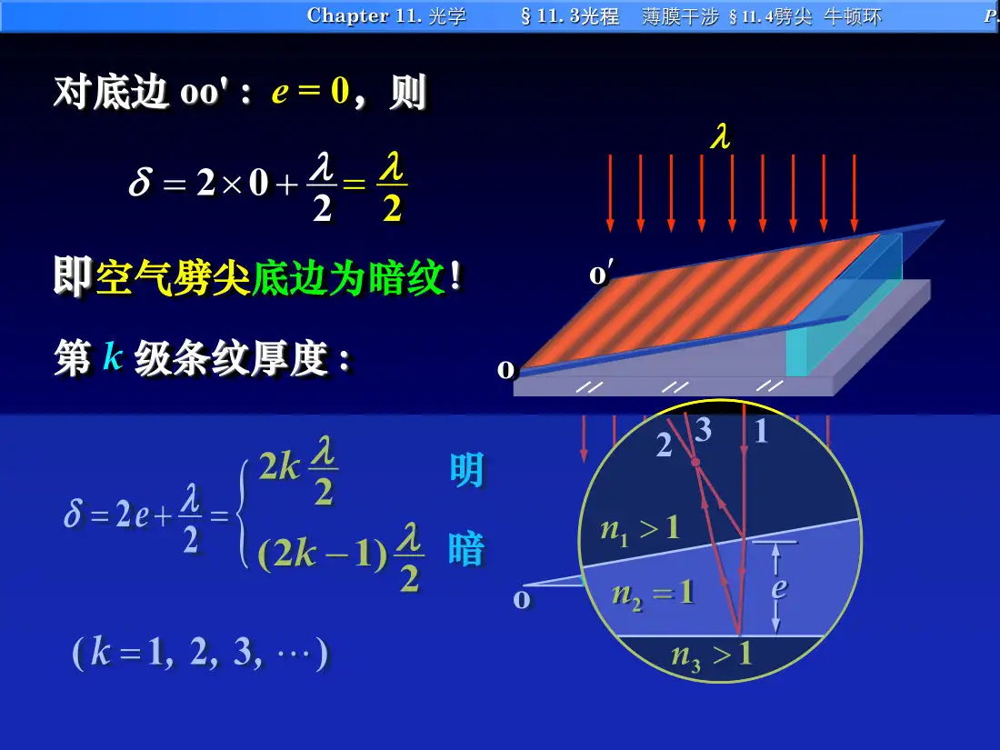

原文：

对底边 $oo'$ : e = 0，则

$$
\delta = 2 \times 0 + \frac {\lambda}{2} = \frac {\lambda}{2}
$$

即空气劈尖底边为暗纹！

第 $k$ 级条纹厚度：

$$
\delta = 2 e + \frac {\lambda}{2} = \left\{ \begin{array}{l} 2 k \frac {\lambda}{2} \\ (2 k - 1) \frac {\lambda}{2} \end{array} \right.
$$

明
暗

$$
(k = 1, 2, 3, \dots)
$$

Chapter 11. 光学 § 11.3 光程 薄膜干涉 § 11.4 劈尖 牛顿环

P.

### 对底边 $oo'$ : e = 0，则

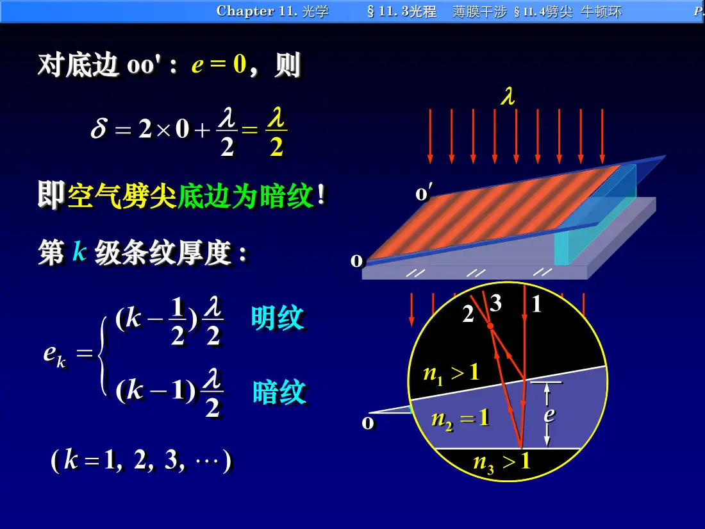

原文：

对底边 $oo'$ : e = 0，则

$$
\delta = 2 \times 0 + \frac {\lambda}{2} = \frac {\lambda}{2}
$$

即空气劈尖底边为暗纹！

第 $k$ 级条纹厚度：

$e_{k}=\left\{\begin{array}{ll}(k-\frac{1}{2})\frac{\lambda}{2}& 明纹  \\ (k-1)\frac{\lambda}{2}& 暗纹 \end{array}\right.$

$$
(k = 1, 2, 3, \dots)
$$

Chapter 11. 光学 § 11.3 光程 薄膜干涉 § 11.4 劈尖 牛顿环

P.

### 相邻两明纹(或暗纹)的厚度差：

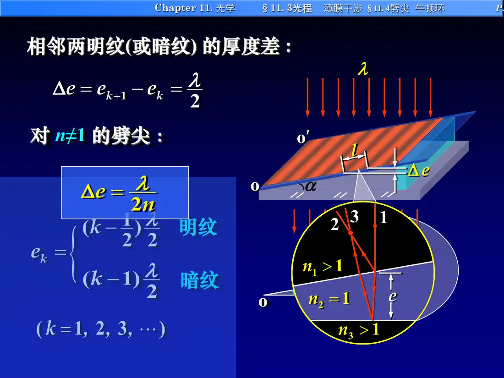

原文：

相邻两明纹(或暗纹)的厚度差：

$$
\Delta e = e _ {k + 1} - e _ {k} = \frac {\lambda}{2}
$$

对 $n \neq 1$ 的劈尖：

$$
e _ {k} = \left\{ \begin{array}{l l} \Delta e = \frac {\lambda}{2 n} & \text {明纹} \\ (k - \frac {1}{2}) \frac {\lambda}{2} & \\ (k - 1) \frac {\lambda}{2} & \text {暗纹} \end{array} \right.
$$

$$
(k = 1, 2, 3, \dots)
$$

Chapter 11. 光学 § 11.3 光程 薄膜干涉 § 11.4 劈尖 牛顿环

P.

### 相邻两明纹(或暗纹)的厚度差：

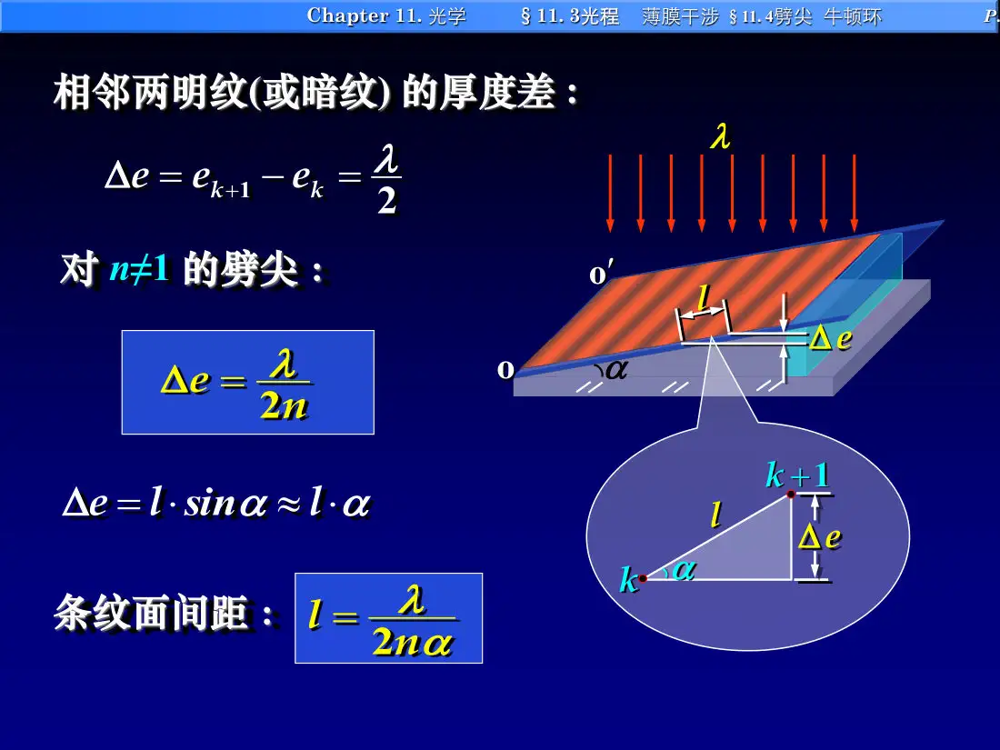

原文：

相邻两明纹(或暗纹)的厚度差：

$$
\Delta e = e _ {k + 1} - e _ {k} = \frac {\lambda}{2}
$$

对 $n \neq 1$ 的劈尖：

$$
\Delta e = \frac {\lambda}{2 n}
$$

$$
\Delta e = l \cdot \sin \alpha \approx l \cdot \alpha
$$

条纹面间距：

$$
l = \frac {\lambda}{2 n \alpha}
$$

Chapter 11. 光学 § 11.3 光程 薄膜干涉 § 11.4 劈尖 牛顿环

P.

### 利用劈尖干涉测量小物体尺寸：

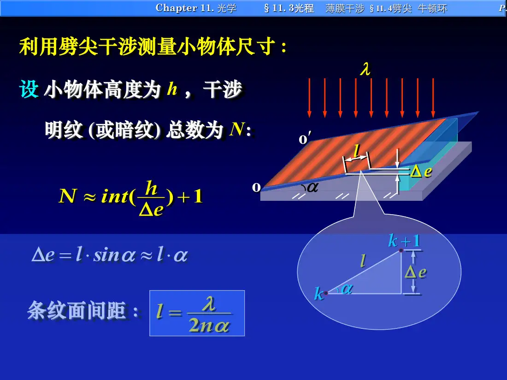

原文：

利用劈尖干涉测量小物体尺寸：

设小物体高度为 $h$ ，干涉

明纹 (或暗纹) 总数为 N:

$$
N \approx i n t (\frac {h}{\Delta e}) + 1
$$

$$
\Delta e = l \cdot \sin \alpha \approx l \cdot \alpha
$$

条纹面间距：

$$
l = \frac {\lambda}{2 n \alpha}
$$

Chapter 11. 光学 § 11.3 光程 薄膜干涉 § 11.4 劈尖 牛顿环

P.

### 利用劈尖干涉测量小物体尺寸：

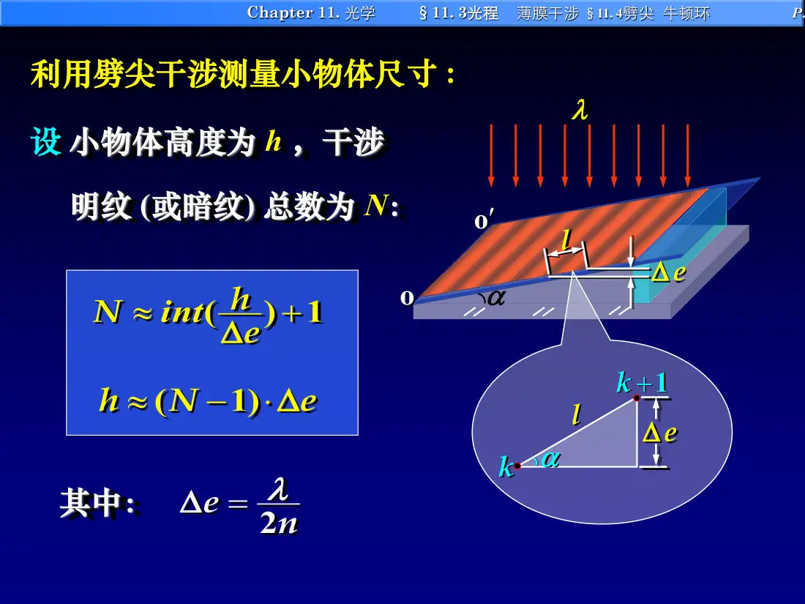

原文：

利用劈尖干涉测量小物体尺寸：

设小物体高度为 $h$ ，干涉

明纹 (或暗纹) 总数为 N:

$$
N \approx i n t (\frac {h}{\Delta e}) + 1
$$

$$
h \approx (N - 1) \cdot \Delta e
$$

其中：

$$
\Delta e = \frac {\lambda}{2 n}
$$

Chapter 11. 光学 § 11.3 光程 薄膜干涉 § 11.4 劈尖 牛顿环

P.

### 利用劈尖干涉测量工件的平整程度：

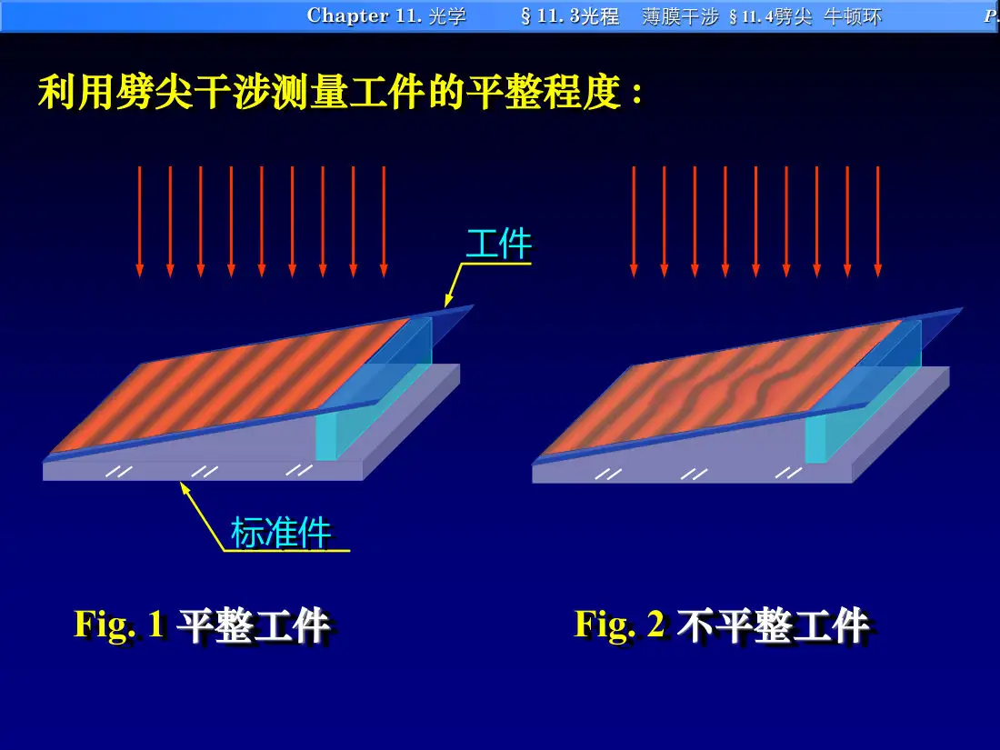

原文：

利用劈尖干涉测量工件的平整程度：

标准件

Fig. 1 平整工件

Fig. 2 不平整工件

Chapter 11. 光学 § 11.3 光程 薄膜干涉 § 11.4 劈尖 牛顿环

P.

### 例 讨论图中劈尖干涉条纹的变动情况。

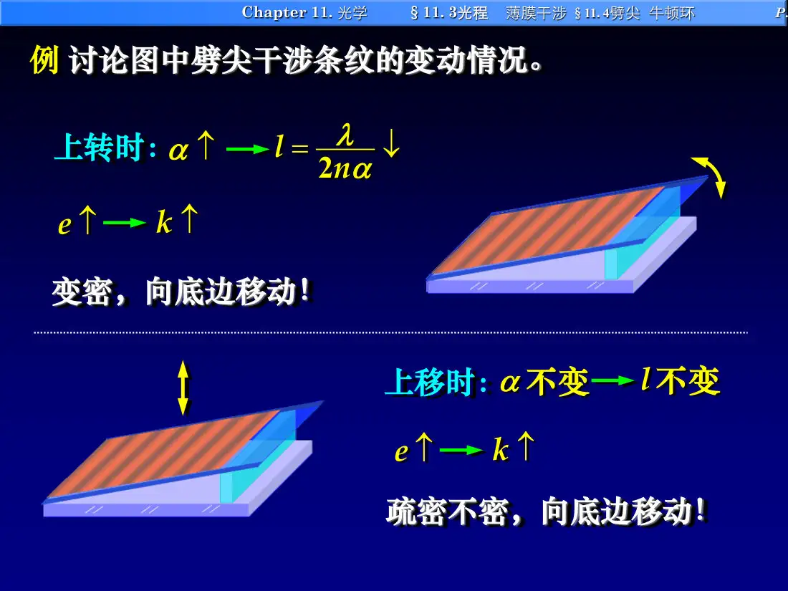

原文：

例 讨论图中劈尖干涉条纹的变动情况。

上转时: $\alpha \uparrow \rightarrow l = \frac{\lambda}{2n\alpha} \downarrow$

e↑→k↑

变密，向底边移动！

上移时: $\alpha$ 不变 $\rightarrow l$ 不变

e↑→k↑

疏密不密，向底边移动！

Chapter 11. 光学 § 11.3 光程 薄膜干涉 § 11.4 劈尖 牛顿环

P.

### 2、牛顿环

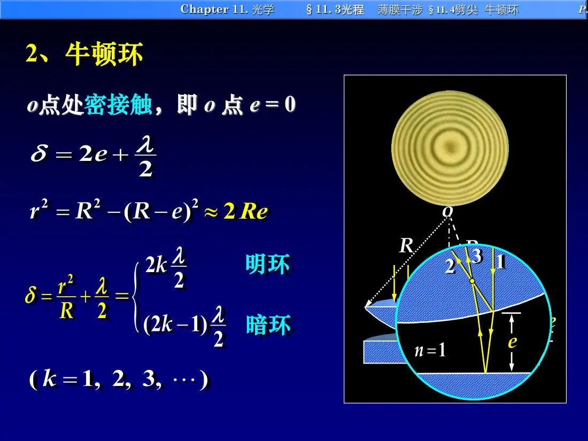

原文：

2、牛顿环

o点处密接触，即 o 点 e = 0

$\delta = 2e + \frac{\lambda}{2}$

$$
r ^ {2} = R ^ {2} - (R - e) ^ {2} \approx 2 R e
$$

$\delta = \frac{r^2}{R} +\frac{\lambda}{2} = \left\{ \begin{array}{ll}2k\frac{\lambda}{2} & \text{明环}\\ (2k - 1)\frac{\lambda}{2} & \text{暗环} \end{array} \right.$

$$
(k = 1, 2, 3, \dots)
$$

Chapter 11. 光学 § 11.3 光程 薄膜干涉 § 11.4 劈尖 牛顿环

P.

### 明、暗环半径:

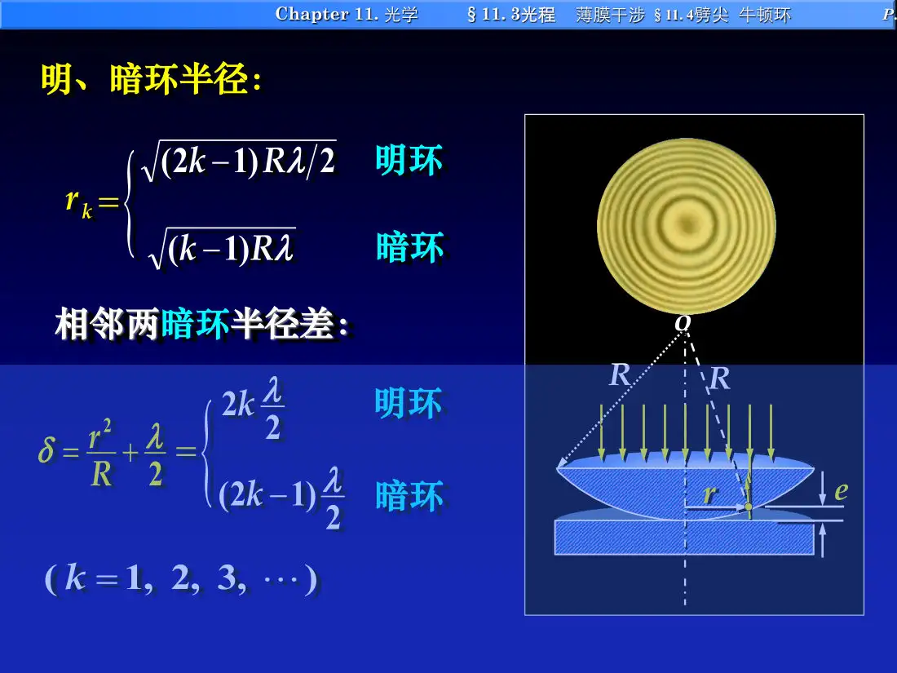

原文：

明、暗环半径:

$$
r _ {k} = \left\{ \begin{array}{l l} \sqrt {(2 k - 1) R \lambda / 2} & \text {明环} \\ \sqrt {(k - 1) R \lambda} & \text {暗环} \end{array} \right.
$$

相邻两暗环半径差:

$\delta = \frac{r^2}{R} +\frac{\lambda}{2} = \left\{ \begin{array}{ll}2k\frac{\lambda}{2} & \text{明环}\\ (2k - 1)\frac{\lambda}{2} & \text{暗环} \end{array} \right.$

$$
(k = 1, 2, 3, \dots)
$$

Chapter 11. 光学 § 11.3 光程 薄膜干涉 § 11.4 劈尖 牛顿环

P.

### 明、暗环半径：

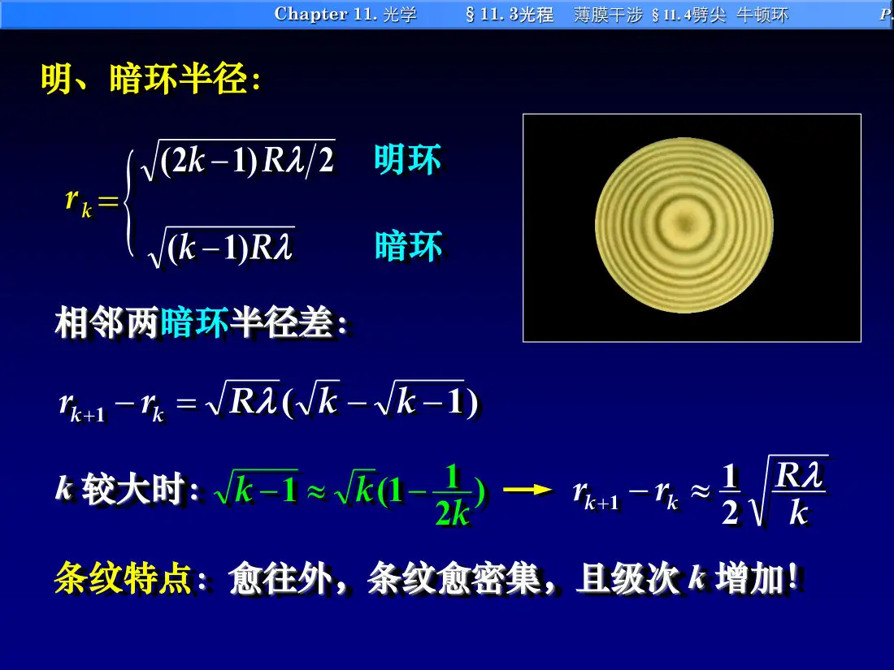

原文：

明、暗环半径：

$$
r _ {k} = \left\{ \begin{array}{l l} \sqrt {(2 k - 1) R \lambda / 2} & \text {明环} \\ \sqrt {(k - 1) R \lambda} & \text {暗环} \end{array} \right.
$$

相邻两暗环半径差:

$r_{k + 1} - r_k = \sqrt{R\lambda} (\sqrt{k} -\sqrt{k - 1})$

k 较大时: $\sqrt{k-1}\approx\sqrt{k}(1-\frac{1}{2k})\rightarrow r_{k+1}-r_{k}\approx\frac{1}{2}\sqrt{\frac{R\lambda}{k}}$

条纹特点：愈往外，条纹愈密集，且级次 $k$ 增加！

Chapter 11. 光学 § 11.3 光程 薄膜干涉 § 11.4 劈尖 牛顿环

P.

### 利用牛顿环测量透镜曲率半径:

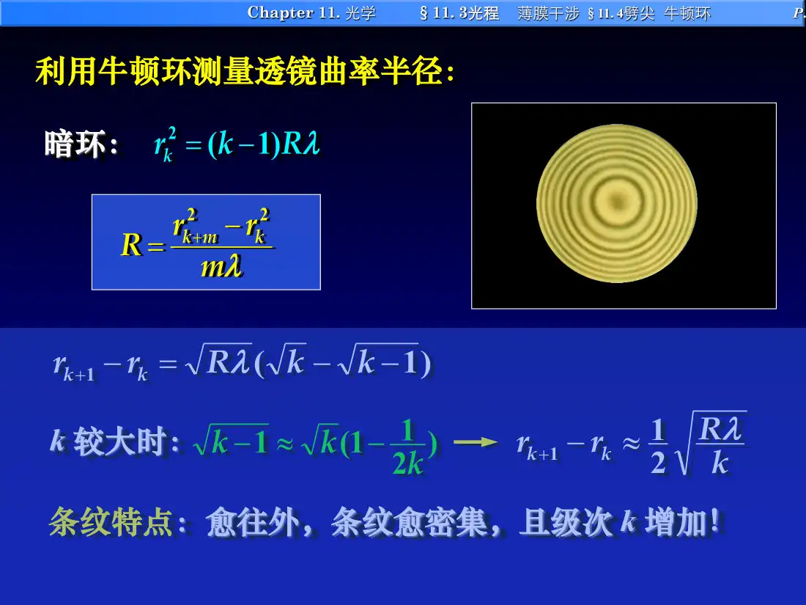

原文：

利用牛顿环测量透镜曲率半径:

暗环: $r_k^2 = (k - 1)R\lambda$

$$
R = \frac {r _ {k + m} ^ {2} - r _ {k} ^ {2}}{m \lambda}
$$

$$
r _ {k + 1} - r _ {k} = \sqrt {R \lambda} (\sqrt {k} - \sqrt {k - 1})
$$

k 较大时: $\sqrt{k - 1} \approx \sqrt{k} (1 - \frac{1}{2k}) \rightarrow r_{k + 1} - r_k \approx \frac{1}{2}\sqrt{\frac{R\lambda}{k}}$ 条纹特点: 愈往外, 条纹愈密集, 且级次 $k$ 增加!

Chapter 11. 光学 § 11.3 光程 薄膜干涉 § 11.4 劈尖 牛顿环

P.

### 利用牛顿环测量透镜曲率半径:

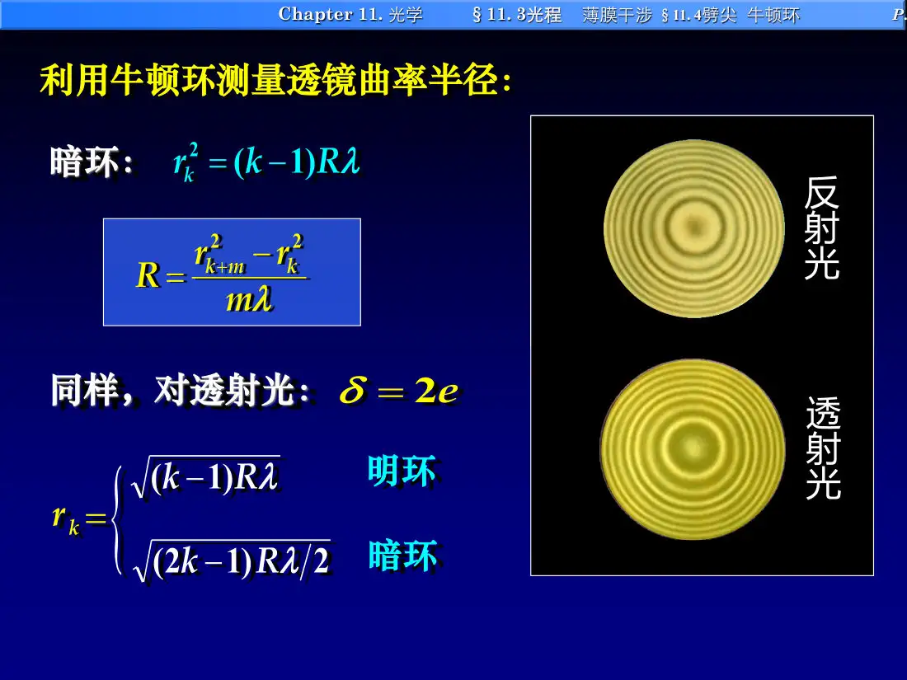

原文：

利用牛顿环测量透镜曲率半径:

暗环: $r_{k}^{2} = (k - 1)R\lambda$

$$
R = \frac {r _ {k + m} ^ {2} - r _ {k} ^ {2}}{m \lambda}
$$

同样，对透射光： $\delta = 2e$

$r_{k}=\left\{\begin{array}{ll}\sqrt{(k-1)R\lambda}& 明环 \\ \sqrt{(2k-1)R\lambda/2}& 暗环\end{array}\right.$

反射光透射光

Chapter 11. 光学 § 11.3 光程 薄膜干涉 § 11.4 劈尖 牛顿环

P.

### 例如图，轻压透镜，干涉条纹将发生以下哪种变化：

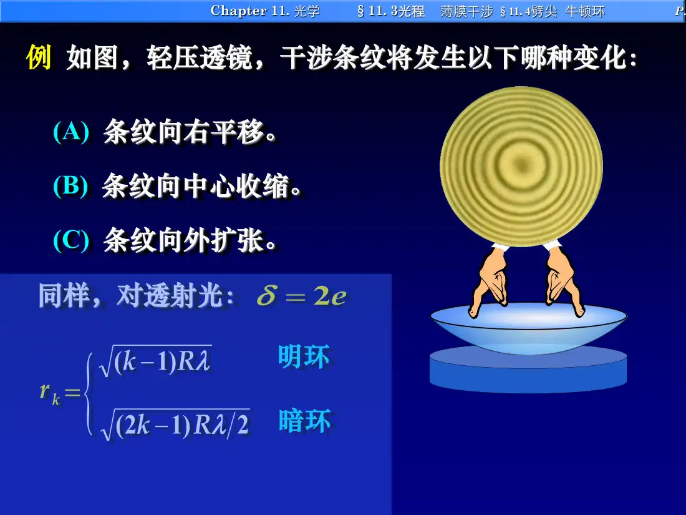

原文：

例如图，轻压透镜，干涉条纹将发生以下哪种变化：

(A) 条纹向右平移。

(B) 条纹向中心收缩。

(C) 条纹向外扩张。

同样，对透射光： $\delta = 2 e$

$r_{k}=\left\{\begin{array}{ll}\sqrt{(k-1)R\lambda}& 明环 \\ \sqrt{(2k-1)R\lambda/2}& 暗环\end{array}\right.$

Chapter 11. 光学 § 11.3 光程 薄膜干涉 § 11.4 劈尖 牛顿环

P.

### 例如图，轻压透镜，干涉条纹将发生以下哪种变化：

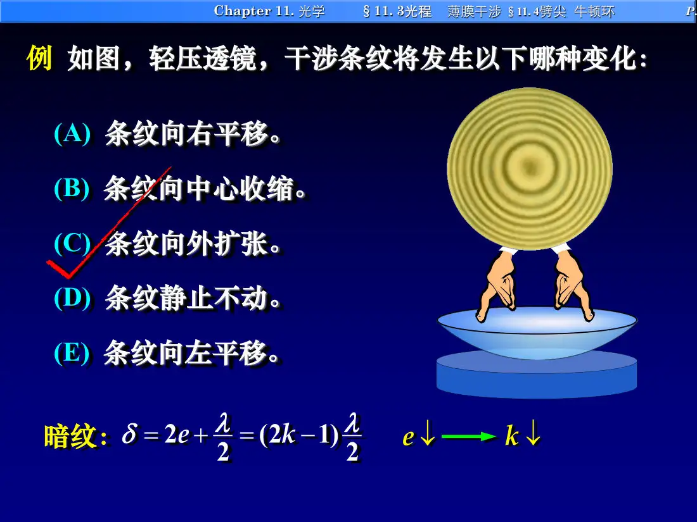

原文：

例如图，轻压透镜，干涉条纹将发生以下哪种变化：

(A) 条纹向右平移。

(B) 条纹向中心收缩。

(C) 条纹向外扩张。

(D) 条纹静止不动。

(E) 条纹向左平移。

暗纹: $\delta = 2e + \frac{\lambda}{2} = (2k - 1)\frac{\lambda}{2}$ $e \downarrow \longrightarrow k \downarrow$ 课堂练习 平凸型空气隙，单色光 $\lambda = 589 \mathrm{~nm}$ 垂直入射，干涉暗环如图，则空气隙最大厚度不超过多少？

Chapter 11. 光学 § 11.3 光程 薄膜干涉 § 11.4 劈尖 牛顿环

P.

### 解 暗环条件:

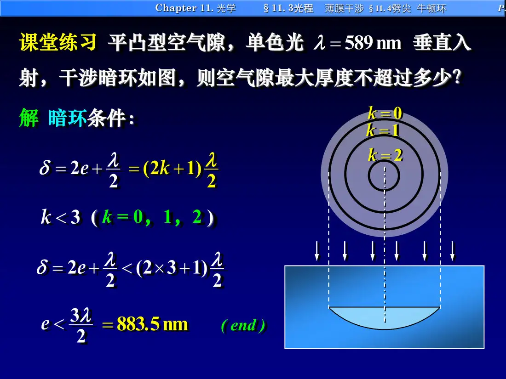

原文：

解 暗环条件:

$$
\delta = 2 e + \frac {\lambda}{2} = (2 k + 1) \frac {\lambda}{2}
$$

$$
k <   3 \quad (k = 0, 1, 2)
$$

$$
\delta = 2 e + \frac {\lambda}{2} <   (2 \times 3 + 1) \frac {\lambda}{2}
$$

$$
e <   \frac {3 \lambda}{2} = 8 8 3. 5 \mathrm{nm}
$$

Chapter 11. 光学 § 11.3 光程 薄膜干涉 § 11.4 劈尖 牛顿环

P.

### 归纳：

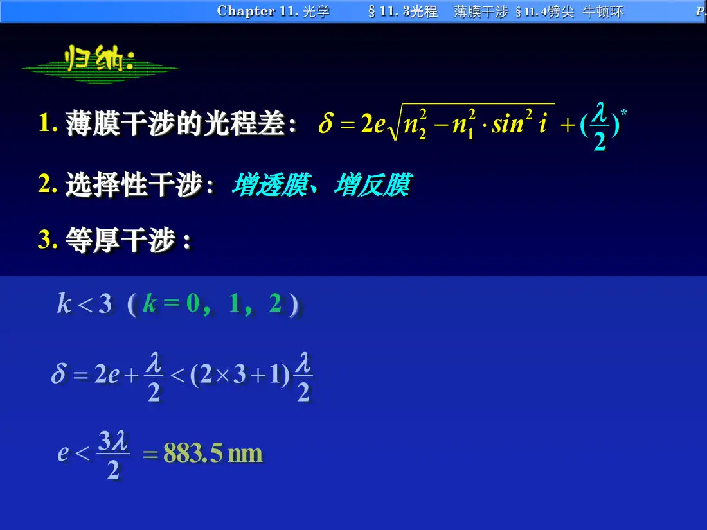

原文：

归纳：

1. 薄膜干涉的光程差: $\delta = 2e\sqrt{n_2^2 - n_1^2 \cdot \sin^2 i} + (\frac{\lambda}{2})^*$

2. 选择性干涉：增透膜、增反膜

3. 等厚干涉：

k<3 (k=0, 1, 2)

$$
\delta = 2 e + \frac {\lambda}{2} <   (2 \times 3 + 1) \frac {\lambda}{2}
$$

$e < \frac{3\lambda}{2} = 883.5 \, nm$

Chapter 11. 光学 § 11.3 光程 薄膜干涉 § 11.4 劈尖 牛顿环

P.

### 归纳:

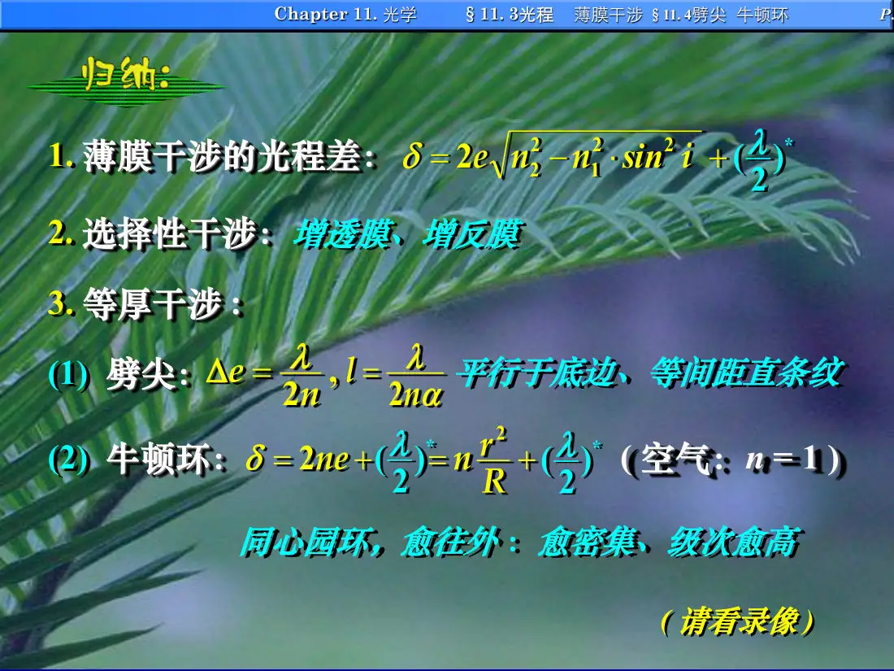

原文：

归纳:

1. 薄膜干涉的光程差: $\delta = 2e\sqrt{n_2^2 - n_1^2 \cdot \sin^2 i} + (\frac{\lambda}{2})^*$

2. 选择性干涉：增透膜、增反膜

3. 等厚干涉：

(1) 劈尖: $\Delta e = \frac{\lambda}{2n}, l = \frac{\lambda}{2n\alpha}$ 平行于底边、等间距直条纹

(2) 牛顿环: $\delta = 2ne + (\frac{\lambda}{2})^{*} = n\frac{r^{2}}{R} + (\frac{\lambda}{2})^{*}$ (空气: $m = 1$ )

同心园环，愈往外：愈密集、级次愈高

(请看录像)

Chapter 11. 光学 § 11.3 光程 薄膜干涉 § 11.4 劈尖 牛顿环

P.

### 等厚干涉

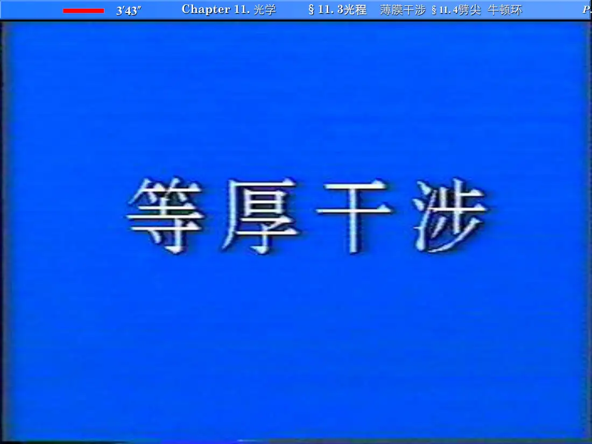

原文：

等厚干涉

P.

3'43" Chapter 11. 光学 § 11.3 光程 薄膜干涉 § 11.4 劈尖 牛顿环
