# 《大学物理》§14.4 相对论性动量与能量（课件）

原件的每一页，下面附识别出的文字。

### §14.4 相对论动量与能量

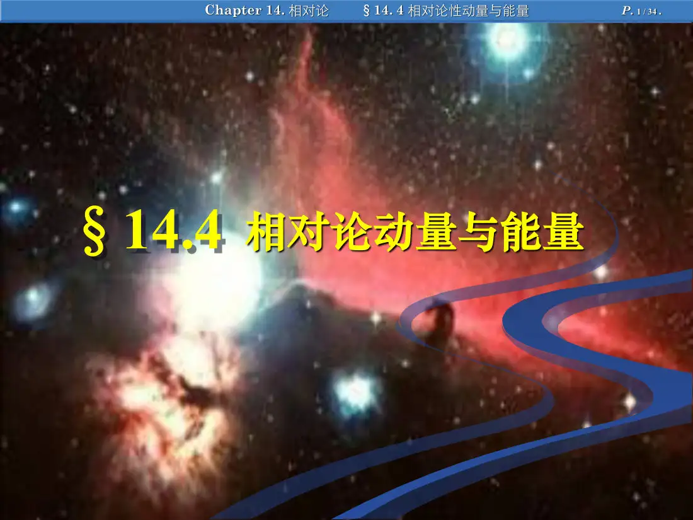

原文：

§14.4 相对论动量与能量

r 18. Chapter 14. 相对论 相对论 §14. 4 §18. 2 相对论性动量与能量洛沦兹变换

P. 1 / 34 P.

### 一.动量与质量

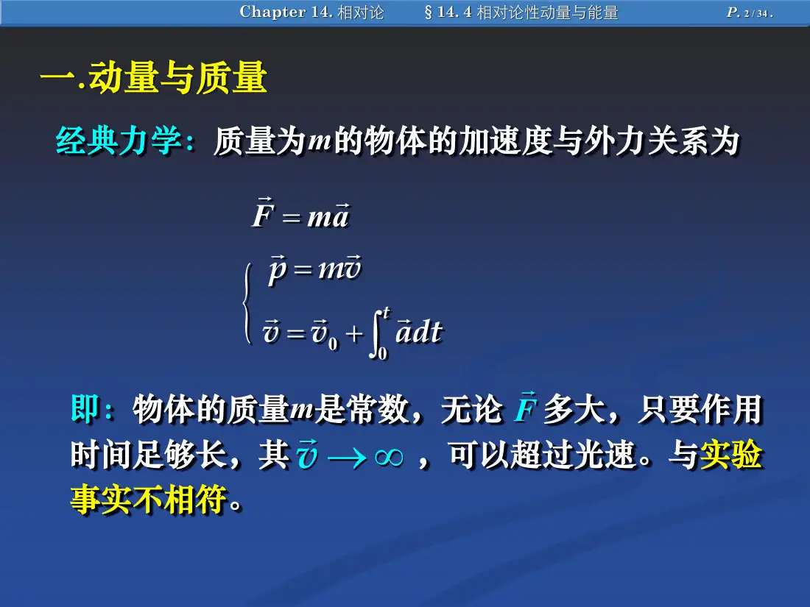

原文：

一.动量与质量

经典力学：质量为m的物体的加速度与外力关系为

$$
\begin{array}{l} \vec {F} = m \vec {a} \\ \left\{ \begin{array}{l} \vec {p} = m \vec {v} \\ \vec {v} = \vec {v} _ {0} + \int_ {0} ^ {t} \vec {a} d t \end{array} \right. \end{array}
$$

即：物体的质量m是常数，无论 多大，只要作用时间足够长，其 ，可以超过光速。与实验事实不相符。

P. 2 / 34 P.

r 18. Chapter 14. 相对论 相对论 §14. 4 §18. 2 相对论性动量与能量 洛沦兹变换

### 相对论质量

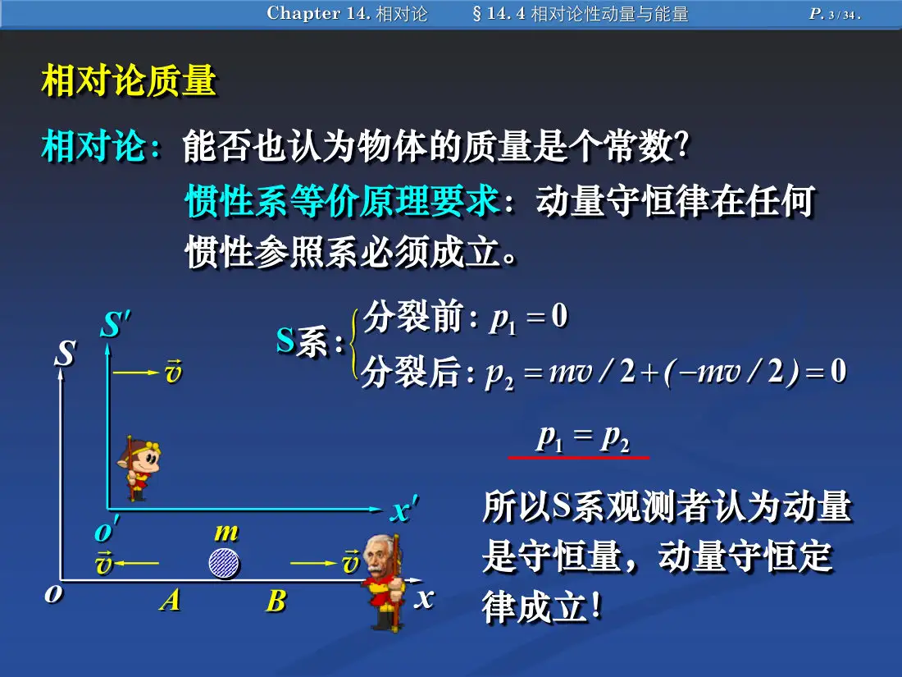

原文：

相对论质量

相对论：能否也认为物体的质量是个常数？惯性系等价原理要求：动量守恒律在任何惯性参照系必须成立。

S系：

分裂前： $D / \subseteq \mathbb { Q }$

分裂后： $( 2 ) = m ( 0 , 0 ) = ( - \infty , 0 ) = 0$

$$
p _ {1} \equiv p _ {2}
$$

所以S系观测者认为动量是守恒量，动量守恒定律成立！

P. 3 / 34 P. .

r 18. Chapter 14. 相对论 相对论 §14. 4 §18. 2 相对论性动量与能量洛沦兹变换

### S′系：

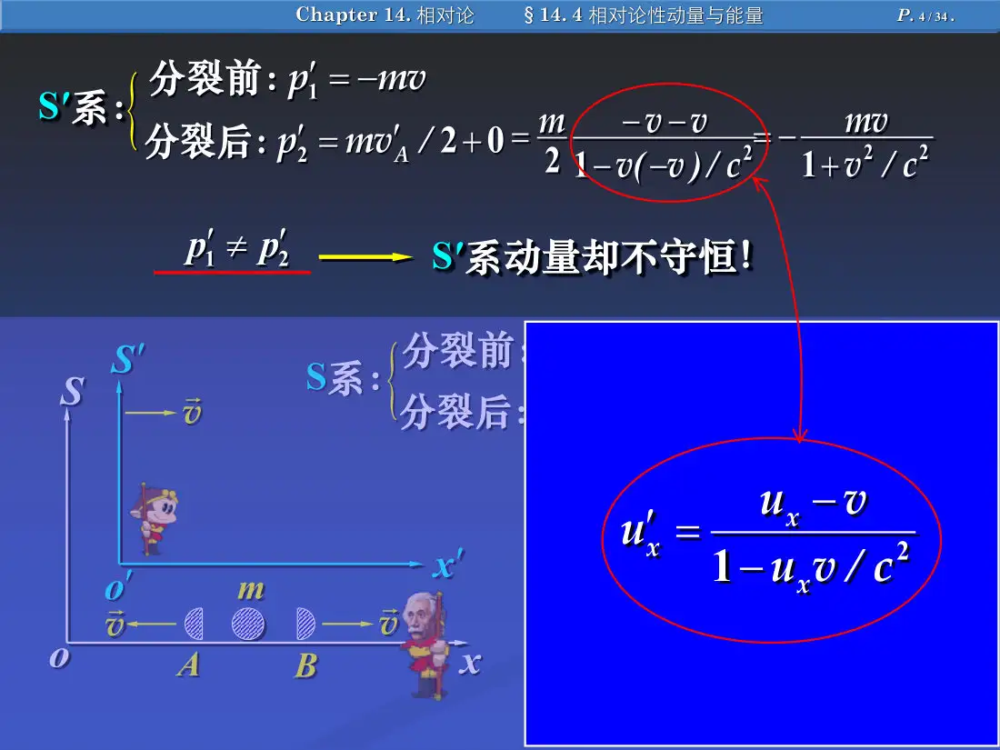

原文：

S′系：

分裂前： $1 \% = - 1 \% ( 1 0 \% )$

分裂后： $1 2 - 1 1 0 \div b \cdots a - 1 1 0 - \frac { 1 1 } { 2 0 } \cdots a - 1 1 0 - \frac { 1 1 } { 2 0 } \cdots a - 1 1 0$

P1≠P2 S′系动量却不守恒！

S系：

分裂前

分裂后：

$$
u _ {x} ^ {\prime} = \frac {u _ {x} - v}{1 - u _ {x} v / c ^ {2}}
$$

r 18. Chapter 14. 相对论 相对论 §14. 4 §18. 2 相对论性动量与能量 洛沦兹变换

P. 4 / 34 P. .

### 相对论认为：物体的质量与物体的速度有关，即

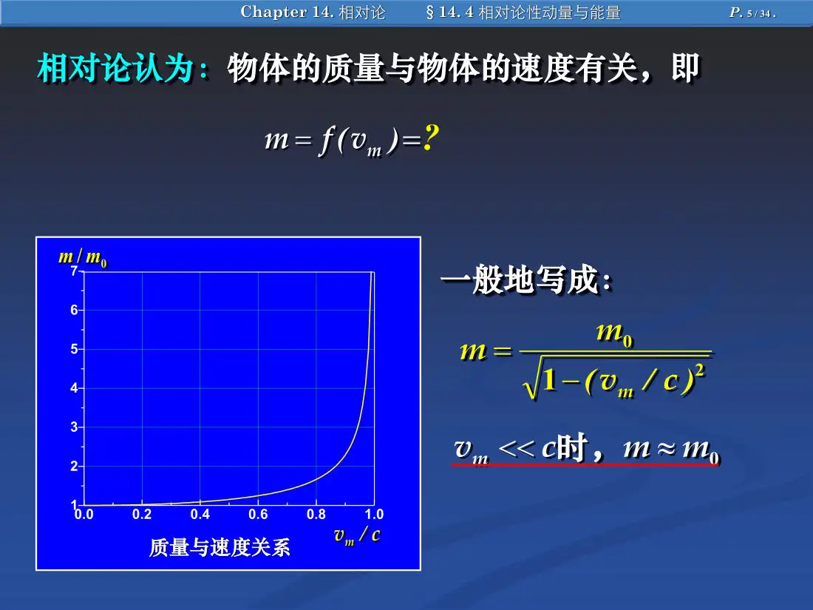

原文：

相对论认为：物体的质量与物体的速度有关，即

$$
m = f (v _ {m}) = ?
$$

一般地写成：

$$
\begin{array}{l} m = \frac {m _ {0}}{\sqrt {1 - (v _ {m} / c) ^ {2}}} \\ v _ {m} <   <   c \text {时，} m \approx m _ {0} \end{array}
$$

r 18. Chapter 14. 相对论 相对论

§14. 4 §18. 2 相对论性动量与能量洛沦兹变换

P. 5 / 34 P.

### 实验验证

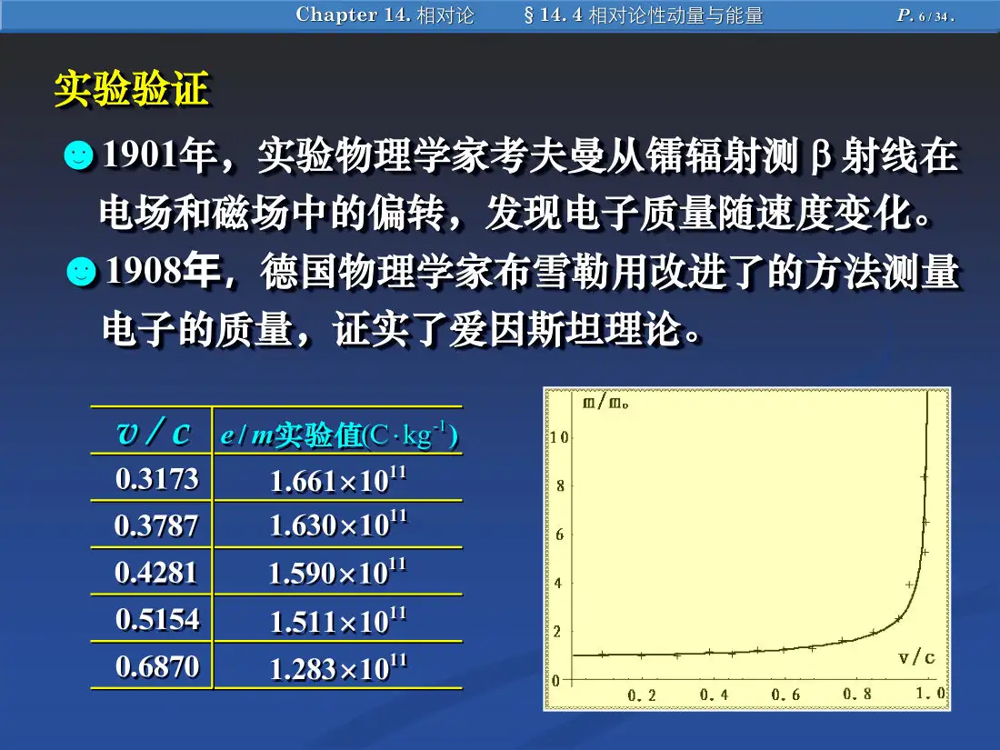

原文：

实验验证

☻1901年，实验物理学家考夫曼从镭辐射测  射线在电场和磁场中的偏转，发现电子质量随速度变化。

☻1908年，德国物理学家布雪勒用改进了的方法测量电子的质量，证实了爱因斯坦理论。

<table><tr><td>v/c</td><td>e/m实验值(C·kg-1)</td></tr><tr><td>0.3173</td><td> $1.661 \times 10^{11}$ </td></tr><tr><td>0.3787</td><td> $1.630 \times 10^{11}$ </td></tr><tr><td>0.4281</td><td> $1.590 \times 10^{11}$ </td></tr><tr><td>0.5154</td><td> $1.511 \times 10^{11}$ </td></tr><tr><td>0.6870</td><td> $1.283 \times 10^{11}$ </td></tr></table>

P. 6 / 34 P.

r 18. Chapter 14. 相对论 相对论 §14. 4 §18. 2 相对论性动量与能量 洛沦兹变换

### ☻实验测得当质子在加速器中被加速接近光速时，实验测得其质量皆大于静止质量。

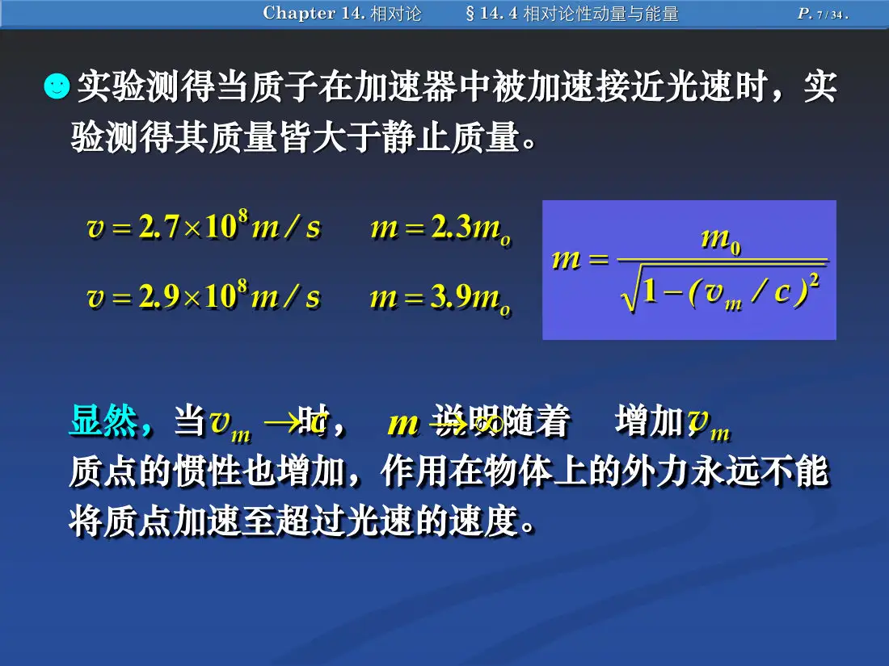

原文：

☻实验测得当质子在加速器中被加速接近光速时，实验测得其质量皆大于静止质量。

$$
\begin{array}{r l r} {v = 2. 7 \times 1 0 ^ {8} m / s} & & {m = 2. 3 m _ {o}} \\ {v = 2. 9 \times 1 0 ^ {8} m / s} & & {m = 3. 9 m _ {o}} \end{array}
$$

$$
m = \frac {m _ {0}}{\sqrt {1 - (v _ {m} / c) ^ {2}}}
$$

显然，当 $\textcircled { \pmb { \mathscr { P } } } _ { i h }$ 时， 说明随着 增加 $( 1 )$ 质点的惯性也增加，作用在物体上的外力永远不能将质点加速至超过光速的速度。

r 18. Chapter 14. 相对论 相对论 §14. 4 §18. 2 相对论性动量与能量 洛沦兹变换

P. 7 / 34 P.

### $\angle C M D =$ 物体静止质量 (静质量)，为一常数。

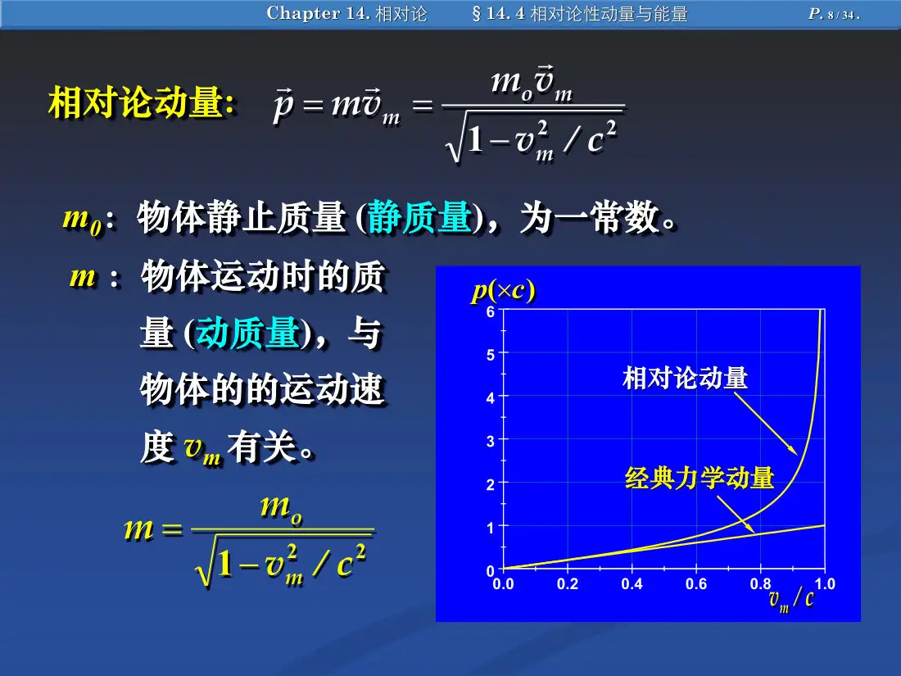

原文：

相对论动量: $\begin{array} { r } { | \vec { p } | = m \widehat { \xi ( \vec { p } ) } _ { i i } = = \frac { | \vec { \mu } | _ { i i } \cdot \vec { \varrho } _ { i i } } { \sqrt { | \vec { \mu } | - ( \vec { \varrho } _ { i i } ^ { 2 } ) / \varrho ^ { 2 } } } } \end{array}$

$\angle C M D =$ 物体静止质量 (静质量)，为一常数。

m ：物体运动时的质量 (动质量)，与物体的的运动速度 $\textcircled { \bullet } \textcircled { = }$ 有关。

$$
m = \frac {m _ {o}}{\sqrt {1 - v _ {m} ^ {2} / c ^ {2}}}
$$

r 18. Chapter 14. 相对论 相对论

§14. 4 §18. 2 相对论性动量与能量洛沦兹变换

P. 8 / 34 P.

### 解: 建立参照系如图所示

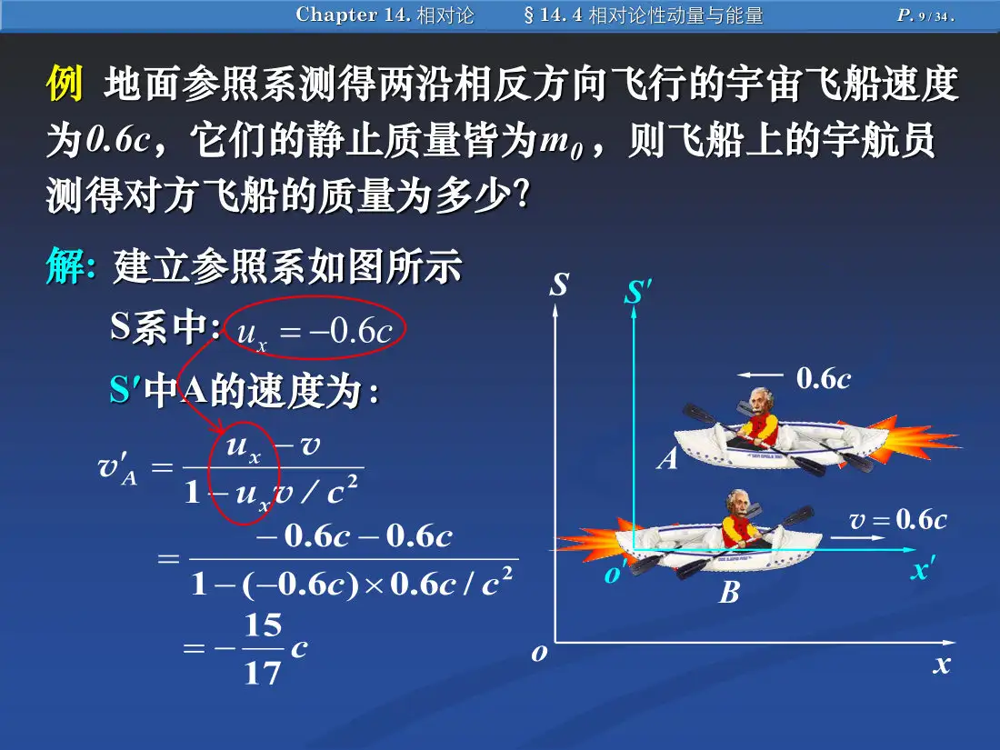

原文：

例 地面参照系测得两沿相反方向飞行的宇宙飞船速度$\textcircled { 1 } \textcircled { 1 } \textcircled { 1 } \textcircled { 1 }$ 它们的静止质量皆为 $m = 0$ ，则飞船上的宇航员测得对方飞船的质量为多少？

解: 建立参照系如图所示

S系中: $0 . 5 \times 5 = 0 . 5 ( m ^ { 3 } )$

S′中A的速度为：

$$
\begin{array}{r l} v _ {A} ^ {\prime} & = \frac {u _ {x} - v}{1 - u _ {x} v / c ^ {2}} \\ & = \frac {- 0 . 6 c - 0 . 6 c}{1 - (- 0 . 6 c) \times 0 . 6 c / c ^ {2}} \\ & = - \frac {1 5}{1 7} c \end{array}
$$

r 18. Chapter 14. 相对论 相对论 §14. 4 §18. 2 相对论性动量与能量 洛沦兹变换

P. 9 / 34 P. .

X

### 则在 S′中测得飞船A的质量为：

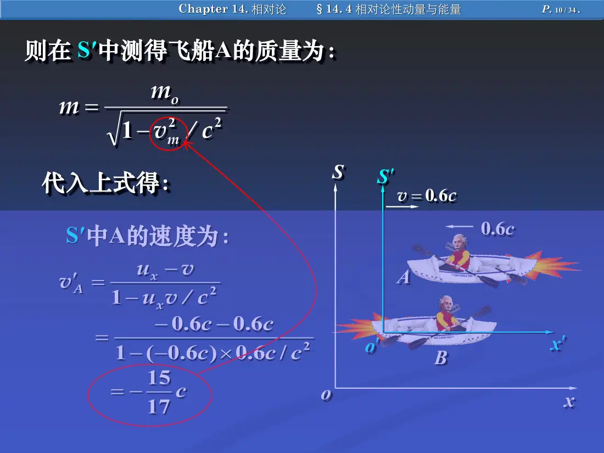

原文：

则在 S′中测得飞船A的质量为：

$$
m = \frac {m _ {o}}{\sqrt {1 - v _ {m} ^ {2} / c ^ {2}}}
$$

代入上式得：

S′中A的速度为：

$$
\begin{array}{r l} v _ {A} ^ {\prime} & = \frac {u _ {x} - v}{1 - u _ {x} v / c ^ {2}} \\ & = \frac {- 0 . 6 c - 0 . 6 c}{1 - (- 0 . 6 c) \times 0 . 6 c / c ^ {2}} \\ & = - \frac {1 5}{1 7} c \end{array}
$$

r 18. Chapter 14. 相对论 相对论 §14. 4 §18. 2 相对论性动量与能量 洛沦兹变换

P. 10 / 34 P..

### 则在 S′中测得飞船A的质量为：

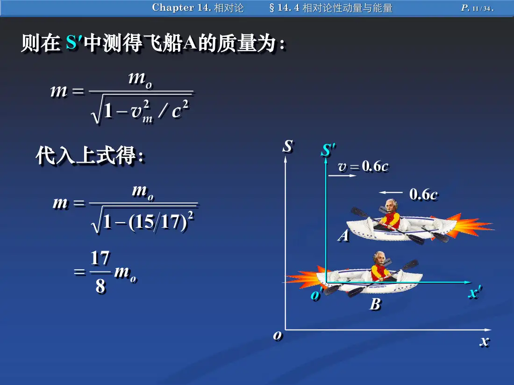

原文：

则在 S′中测得飞船A的质量为：

$$
m = \frac {m _ {o}}{\sqrt {1 - v _ {m} ^ {2} / c ^ {2}}}
$$

代入上式得：

$$
\begin{array}{l} m = \frac {m _ {o}}{\sqrt {1 - (1 5 / 1 7) ^ {2}}} \\ = \frac {1 7}{8} m _ {o} \end{array}
$$

r 18. Chapter 14. 相对论 相对论 §14. 4 §18. 2 相对论性动量与能量 洛沦兹变换

P. 11 / 34 P..

### 二.狭义相对论力学的基本方程

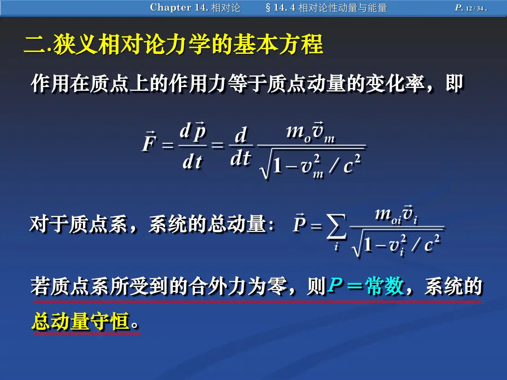

原文：

二.狭义相对论力学的基本方程

作用在质点上的作用力等于质点动量的变化率，即

$$
\vec {F} = \frac {d \vec {p}}{d t} = \frac {d}{d t} \frac {m _ {o} \vec {v} _ {m}}{\sqrt {1 - v _ {m} ^ {2} / c ^ {2}}}
$$

对于质点系，系统的总动量： $P = \sum _ { i } \frac { W _ { i } ( \Vec { \theta } _ { i } , \Vec { \theta } _ { i } ) } { \sqrt { \lvert 1 - ( \theta ) \rvert ^ { 2 } / \langle 2 ^ { 2 } } }$

若质点系所受到的合外力为零，则 $P = \frac { 1 } { 1 5 } \times 1 5$ 系统的总动量守恒。

r 18. Chapter 14. 相对论 相对论

§14. 4 §18. 2 相对论性动量与能量洛沦兹变换

P. 12 / 34 P..

### 三.质量与能量的关系

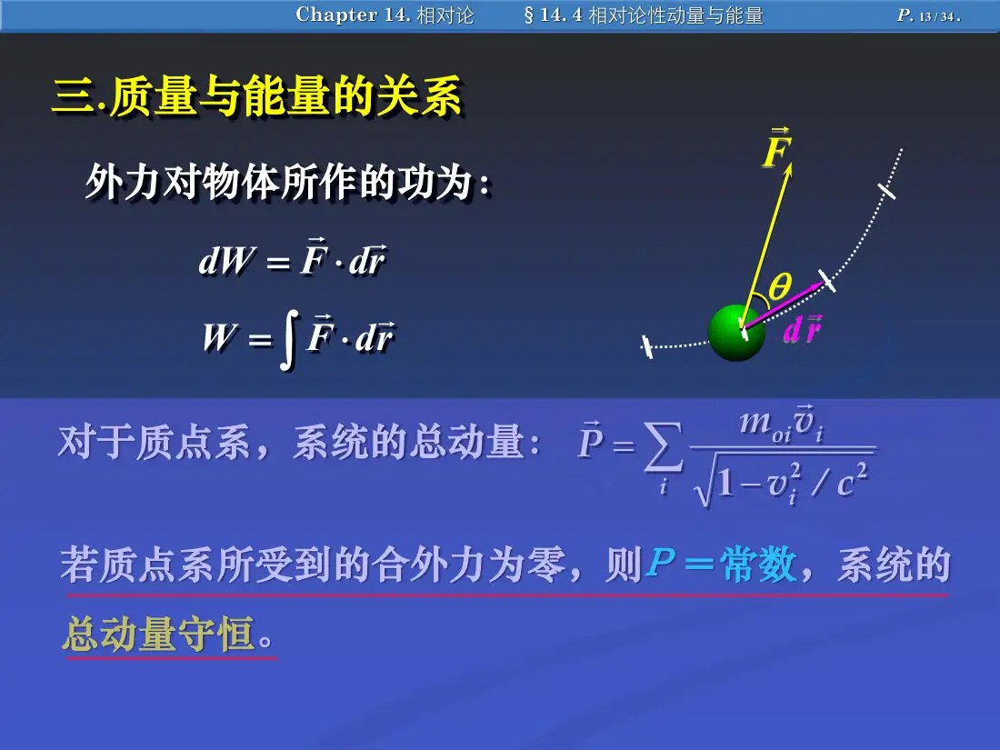

原文：

三.质量与能量的关系

外力对物体所作的功为：

$$
d W = \vec {F} \cdot d \vec {r}
$$

$$
W = \int \vec {F} \cdot d \vec {r}
$$

对于质点系，系统的总动量： $P = \sum \limits _ { i = 1 } ^ { n } \frac { m _ { i } ( 0 ) _ { i } } { \sqrt { 1 - ( 0 ) _ { i } ^ { 2 } } / \mathrm { e } ^ { 2 } }$

若质点系所受到的合外力为零，则 $1 0 ) = C E \equiv 2 \sqrt { 1 - 3 } , 2 \equiv 3 1 ($ ，系统的总动量守恒。

r 18. Chapter 14. 相对论 相对论 §14. 4 §18. 2 相对论性动量与能量洛沦兹变换

P. 13 / 34 P..

### 三.质量与能量的关系

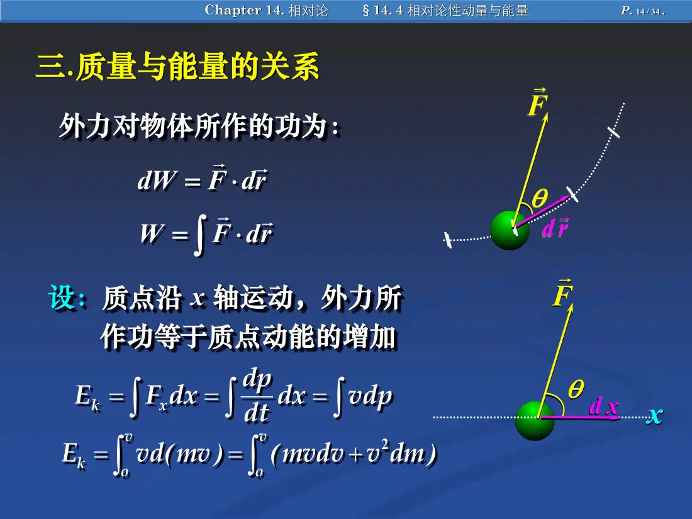

原文：

三.质量与能量的关系

外力对物体所作的功为：

$$
d W = \vec {F} \cdot d \vec {r}
$$

$$
W = \int \vec {F} \cdot d \vec {r}
$$

设：质点沿 x 轴运动，外力所作功等于质点动能的增加

$$
E _ {k} = \int F _ {x} d x = \int \frac {d p}{d t} d x = \int v d p
$$

$$
E _ {k} = \int_ {0} ^ {v} v d (m v) = \int_ {0} ^ {v} (m v d v + v ^ {2} d m)
$$

r 18. Chapter 14. 相对论 相对论 §14. 4 §18. 2 相对论性动量与能量 洛沦兹变换

P. 14 / 34 P..

### $$

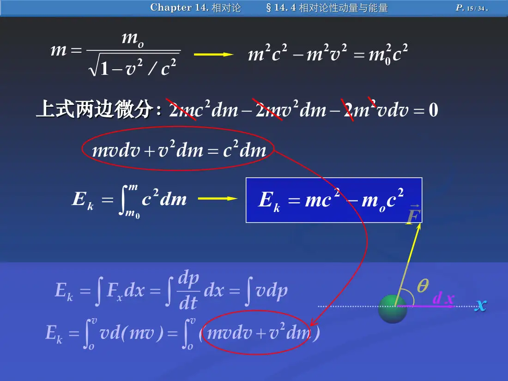

原文：

$$
m = \frac {m _ {o}}{\sqrt {1 - v ^ {2} / c ^ {2}}} \longrightarrow m ^ {2} c ^ {2} - m ^ {2} v ^ {2} = m _ {0} ^ {2} c ^ {2}
$$

上式两边微分： $) A N C = C B \cdot \angle B A C = \angle A N C = \angle C A B = \angle B A C = \angle C$

$$
m v d v + v ^ {2} d m = c ^ {2} d m
$$

$$
E _ {k} = \int_ {m _ {0}} ^ {m} c ^ {2} d m \longrightarrow E _ {k} = m c ^ {2} - m _ {o} c ^ {2}
$$

$$
E _ {k} = \int F _ {x} d x = \int \frac {d p}{d t} d x = \int v d p
$$

$$
E _ {k} = \int_ {o} ^ {v} v d (m v) = \int_ {o} ^ {v} (m v d v + v ^ {2} d m)
$$

r 18. Chapter 14. 相对论 相对论 §14. 4 §18. 2 相对论性动量与能量 洛沦兹变换

P. 15 / 34 P..

### $$

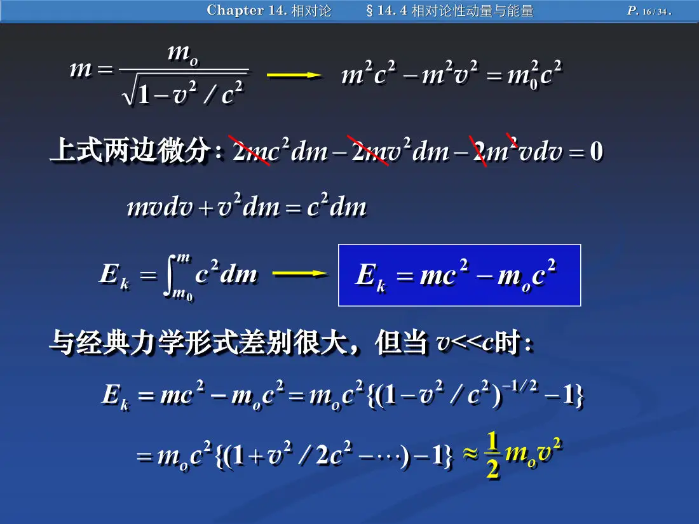

原文：

$$
m = \frac {m _ {o}}{\sqrt {1 - v ^ {2} / c ^ {2}}} \longrightarrow m ^ {2} c ^ {2} - m ^ {2} v ^ {2} = m _ {0} ^ {2} c ^ {2}
$$

上式两边微分： $9 \times 1 0 = ( 1 5 0 - 1 9 ) ( 0 ) = ( 1 5 0 ) ( 0 ) = ( 1 )$

$$
m v d v + v ^ {2} d m = c ^ {2} d m
$$

$$
E _ {k} = \int_ {m _ {0}} ^ {m} c ^ {2} d m \longrightarrow E _ {k} \equiv m c ^ {2} - m _ {o} c ^ {2}
$$

与经典力学形式差别很大，但当 $( 0 ) \leq - ( 2 )$ 时：

$$
\begin{array}{r l} & E _ {k} = m c ^ {2} - m _ {o} c ^ {2} \equiv m _ {o} c ^ {2} \{(1 - v ^ {2} / c ^ {2}) ^ {- 1 / 2} - 1 \} \\ & = m _ {o} c ^ {2} \{(1 + v ^ {2} / 2 c ^ {2} - \dots) - 1 \} \approx \frac {1}{2} m _ {o} v ^ {2} \end{array}
$$

r 18. Chapter 14. 相对论 相对论 §14. 4 §18. 2 相对论性动量与能量 洛沦兹变换

P. 16 / 34 P..

### 与经典力学形式差别很大，但当 $( 0 ) \leq \leq 0$ 时：

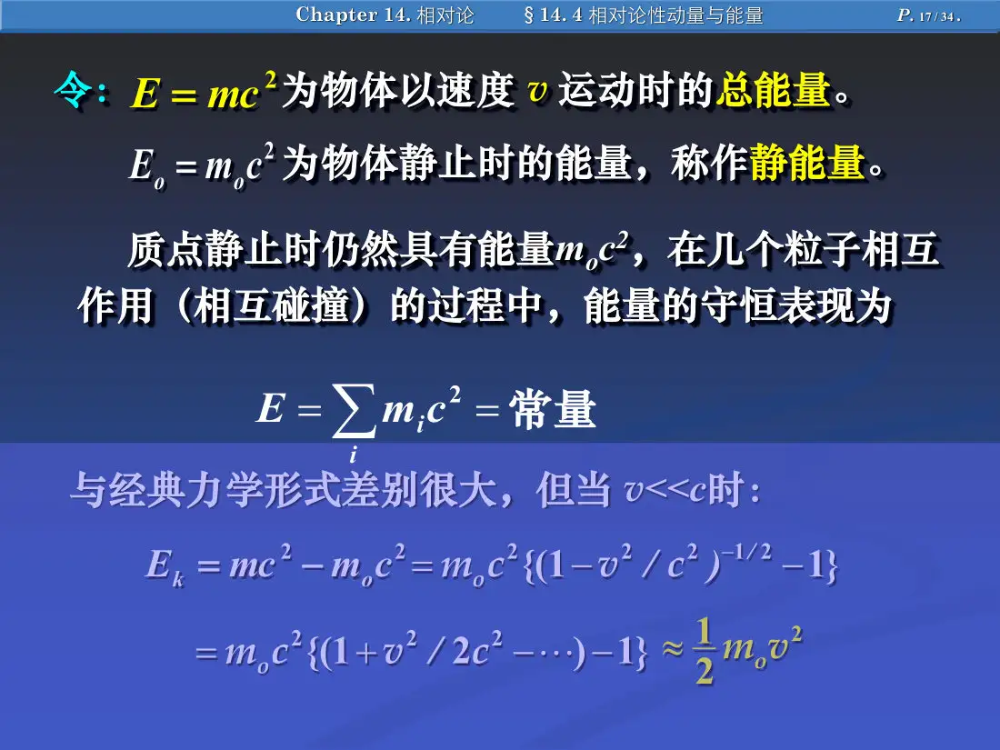

原文：

令： $\Delta B C = \Delta B C$ 为物体以速度 v 运动时的总能量。

$\angle B ^ { \prime } = 1 1 2 0 ^ { \circ }$ 为物体静止时的能量，称作静能量。

质点静止时仍然具有能量 $( 1 1 ) . ( 2 ^ { 2 }$ 在几个粒子相互作用（相互碰撞） 的过程中，能量的守恒表现为

与经典力学形式差别很大，但当 $( 0 ) \leq \leq 0$ 时：

$$
\begin{array}{r} E _ {k} = m c ^ {2} - m _ {o} c ^ {2} = m _ {o} c ^ {2} \{(1 - v ^ {2} / c ^ {2}) ^ {- 1 / 2} - 1 \} \\ = m _ {o} c ^ {2} \{(1 + v ^ {2} / 2 c ^ {2} - \dots) - 1 \} \approx \frac {1}{2} m _ {o} v ^ {2} \end{array}
$$

r 18. Chapter 14. 相对论 相对论 §14. 4 §18. 2 相对论性动量与能量 洛沦兹变换

P. 17 / 34 P..

### E=∑m,c²=常量m=∑mi=常量

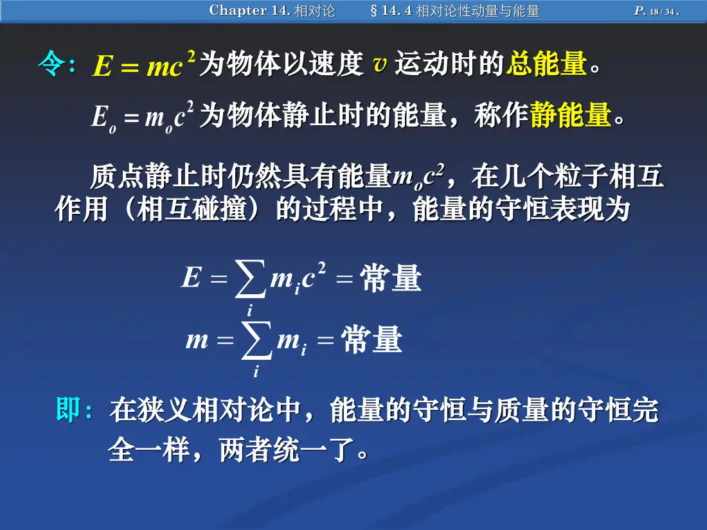

原文：

令： $| \overline { { p } } | = | \overline { { U } } | \overline { { Q } }$ 为物体以速度 v 运动时的总能量。

$1 0 ^ { \circ } = 1 1 0 ^ { \circ }$ 为物体静止时的能量，称作静能量。

质点静止时仍然具有能量 $1 1 1 0$ 在几个粒子相互作用（相互碰撞）的过程中，能量的守恒表现为

E=∑m,c²=常量m=∑mi=常量

即：在狭义相对论中，能量的守恒与质量的守恒完全一样，两者统一了。

r 18. Chapter 14. 相对论 相对论 §14. 4 §18. 2 相对论性动量与能量 洛沦兹变换

P. 18 / 34 P..

### $$

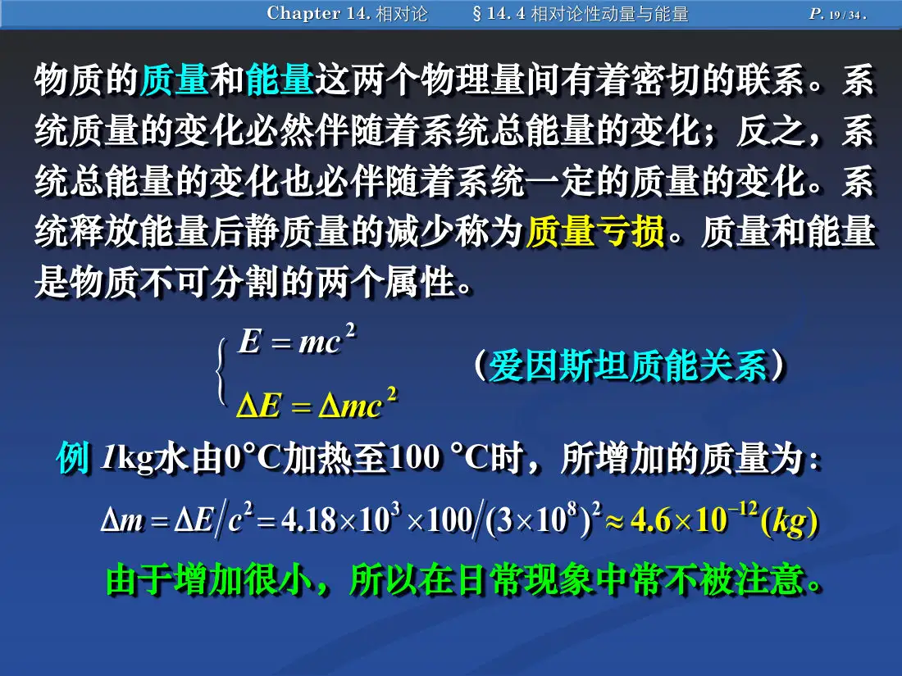

原文：

物质的质量和能量这两个物理量间有着密切的联系。系统质量的变化必然伴随着系统总能量的变化；反之，系统总能量的变化也必伴随着系统一定的质量的变化。系统释放能量后静质量的减少称为质量亏损。质量和能量是物质不可分割的两个属性。

$$
\left\{ \begin{array}{l} E = m c ^ {2} \\ \Delta E = \Delta m c ^ {2} \end{array} \right.
$$

（爱因斯坦质能关系）

例 1kg水由 $[ 0 ^ { \circ } ( \mathfrak { C }$ 加热至 $1 1 1 0 \%$ 时，所增加的质量为：$\Delta N H = \Delta N b ^ { 2 } / c ^ { 2 } = \Delta E B / ( 1 ) , ( 1 1 1 ) ( 3 . 3 1 0 ) = \Delta 0 = 1 0 0 ( 1 ) ( 1 0 ^ { \circ } )$ 由于增加很小，所以在日常现象中常不被注意。

§14. 4 §18. 2 相对论性动量与能量洛沦兹变换

P. 19 / 34 P..

### 四.动量与能量的关系

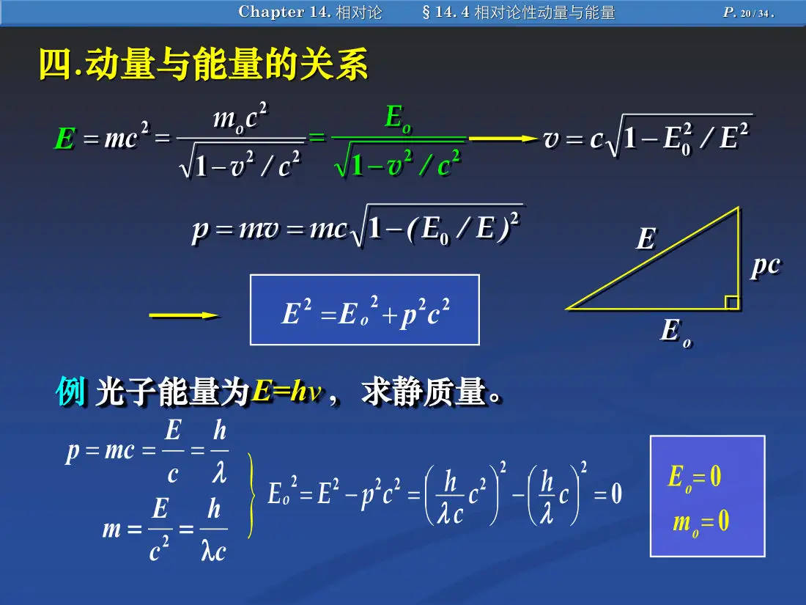

原文：

四.动量与能量的关系

$$
E = m c ^ {2} = \frac {m _ {o} c ^ {2}}{\sqrt {1 - v ^ {2} / c ^ {2}}} = \frac {E _ {o}}{\sqrt {1 - v ^ {2} / c ^ {2}}} \longrightarrow v = c \sqrt {1 - E _ {0} ^ {2} / E ^ {2}}
$$

$$
p = m v = m c \sqrt {1 - (E _ {0} / E) ^ {2}}
$$

$$
E ^ {2} = E _ {o} ^ {2} + p ^ {2} c ^ {2}
$$

例 光子能量为E=hν , 求静质量。

$$
\left. \begin{array}{l} p = m c = \frac {E}{c} = \frac {h}{\lambda} \\ m = \frac {E}{c ^ {2}} = \frac {h}{\lambda c} \end{array} \right\} E _ {o} ^ {2} = E ^ {2} - p ^ {2} c ^ {2} = \left(\frac {h}{\lambda c} c ^ {2}\right) ^ {2} - \left(\frac {h}{\lambda} c\right) ^ {2} = 0
$$

$$
\begin{array}{c} E _ {o} = 0 \\ m _ {o} = 0 \end{array}
$$

r 18. Chapter 14. 相对论 相对论 §14. 4 §18. 2 相对论性动量与能量 洛沦兹变换

P. 20 / 34 P..

### 本章结束语

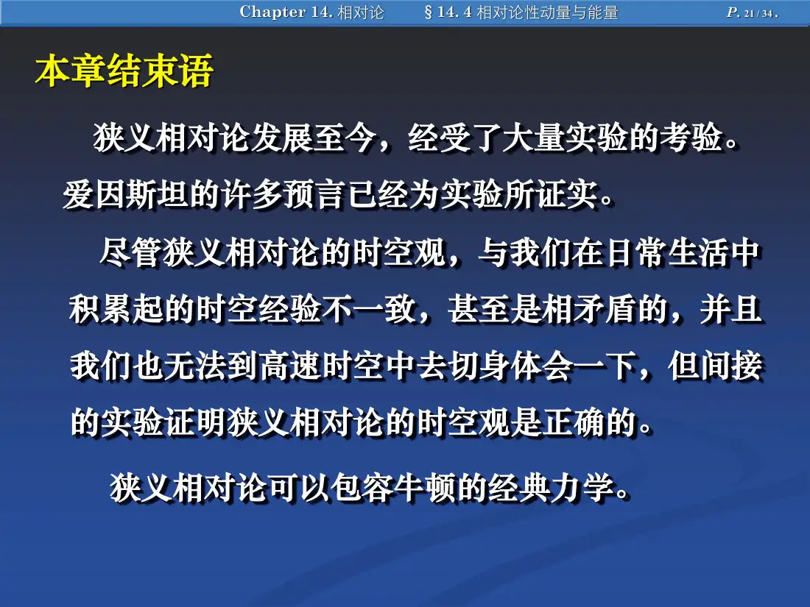

原文：

本章结束语

狭义相对论发展至今，经受了大量实验的考验。爱因斯坦的许多预言已经为实验所证实。

尽管狭义相对论的时空观，与我们在日常生活中积累起的时空经验不一致，甚至是相矛盾的，并且我们也无法到高速时空中去切身体会一下，但间接的实验证明狭义相对论的时空观是正确的。

狭义相对论可以包容牛顿的经典力学。

r 18. Chapter 14. 相对论 相对论 §14. 4 §18. 2 相对论性动量与能量 洛沦兹变换

P. 21 / 34 P..

### 实验验证

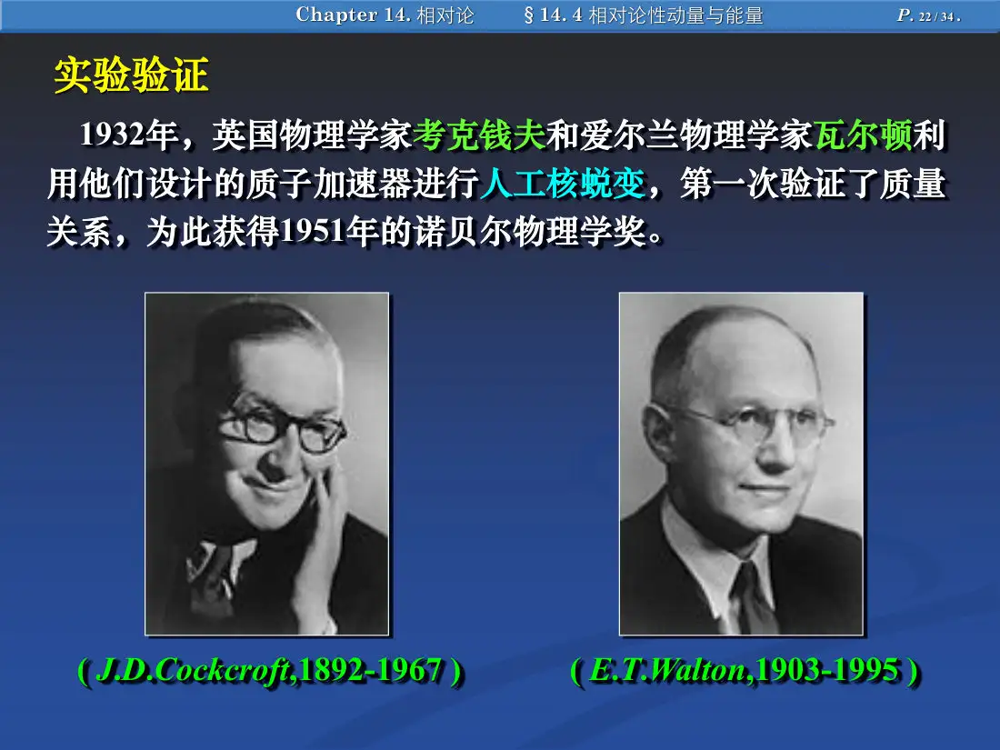

原文：

实验验证

1932年，英国物理学家考克钱夫和爱尔兰物理学家瓦尔顿利用他们设计的质子加速器进行人工核蜕变，第一次验证了质量关系，为此获得1951年的诺贝尔物理学奖。

r 18. Chapter 14. 相对论 相对论 §14. 4 §18. 2 相对论性动量与能量洛沦兹变换

P. 22 / 34 P..

### $$

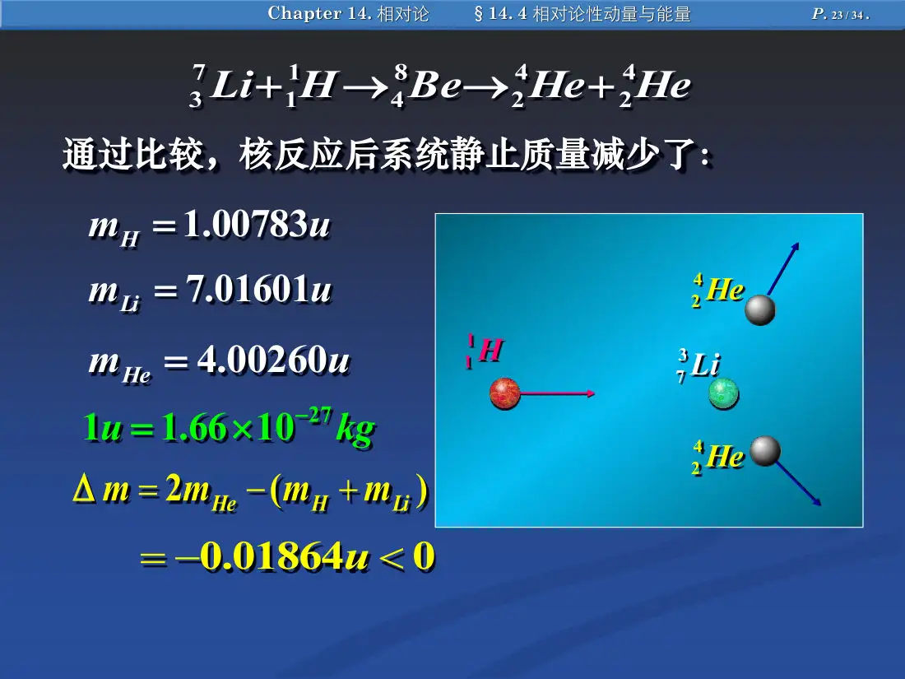

原文：

$$
{ } _ { 3 } ^ { 7 } L i + { } _ { 1 } ^ { 1 } H \rightarrow { } _ { 4 } ^ { 8 } B e \rightarrow { } _ { 2 } ^ { 4 } H e + { } _ { 2 } ^ { 4 } H e
$$

通过比较，核反应后系统静止质量减少了：

$$
m _ {H} = 1. 0 0 7 8 3 u
$$

$$
m _ {L i} = 7. 0 1 6 0 1 u
$$

$$
_ 2 ^ {4} H e
$$

$$
m _ {H e} = 4. 0 0 2 6 0 u
$$

$$
^ 1 _ {1} H
$$

$$
{ } _ { 7 } ^ { 3 } L i
$$

$$
1 u = 1. 6 6 \times 1 0 ^ {- 2 7} k g
$$

$$
_ 2 ^ {4} H e
$$

$$
\begin{array}{r l} \Delta m & = 2 m _ {H e} - (m _ {H} + m _ {L i}) \\ & = - 0. 0 1 8 6 4 u <   0 \end{array}
$$

r 18. Chapter 14. 相对论 相对论

§14. 4 §18. 2 相对论性动量与能量洛沦兹变换

P. 23 / 34 P..

### 即核反应后氦原子核（粒子）的总动能应为：

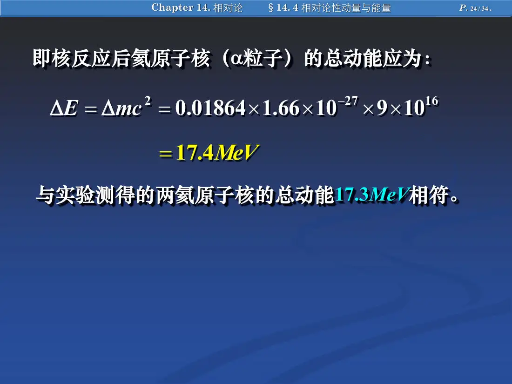

原文：

即核反应后氦原子核（粒子）的总动能应为：

$$
\begin{array}{r l} \Delta E = \Delta m c ^ {2} & = 0. 0 1 8 6 4 \times 1. 6 6 \times 1 0 ^ {- 2 7} \times 9 \times 1 0 ^ {1 6} \\ & = 1 7. 4 M e V \end{array}
$$

与实验测得的两氦原子核的总动能17.3MeV相符。

r 18. Chapter 14. 相对论 相对论 §14. 4 §18. 2 相对论性动量与能量 洛沦兹变换

P. 24 / 34 P..

### 四.核能利用

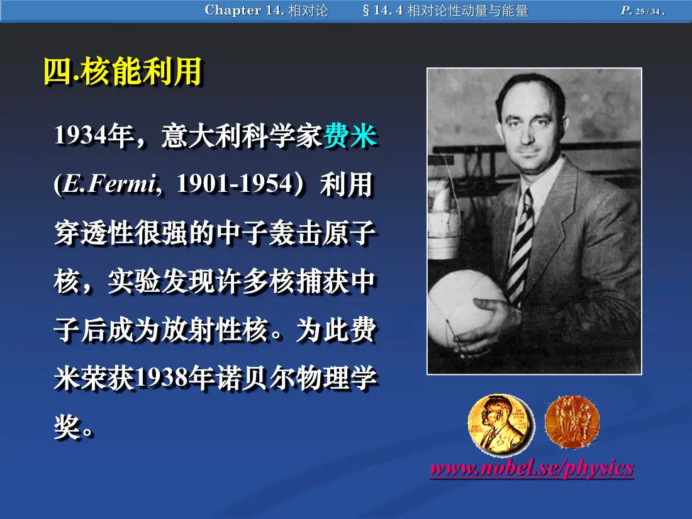

原文：

四.核能利用

1934年，意大利科学家费米(E.Fermi, 1901-1954）利用穿透性很强的中子轰击原子核，实验发现许多核捕获中子后成为放射性核。为此费米荣获1938年诺贝尔物理学奖。

r 18. Chapter 14. 相对论 相对论 §14. 4 §18. 2 相对论性动量与能量洛沦兹变换

P. 25 / 34 P..

www.nobel.se/physics

### P. 26 / 34 P..

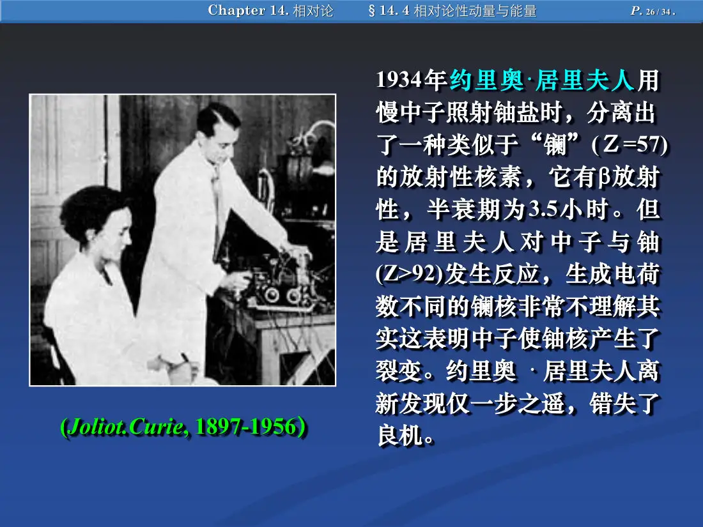

原文：

1934年约里奥·居里夫人用慢中子照射铀盐时，分离出了一种类似于“镧”(Z=57)的放射性核素，它有放射性，半衰期为3.5小时。但是 居 里 夫 人 对 中 子 与 铀(Z>92)发生反应，生成电荷数不同的镧核非常不理解其实这表明中子使铀核产生了裂变。约里奥 ·居里夫人离新发现仅一步之遥，错失了良机。

r 18. Chapter 14. 相对论 相对论 §14. 4 §18. 2 相对论性动量与能量洛沦兹变换

P. 26 / 34 P..

### P. 27 / 34 P..

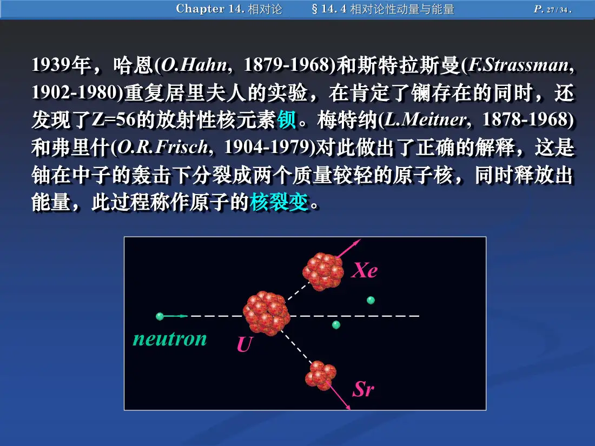

原文：

1939年，哈恩(O.Hahn, 1879-1968)和斯特拉斯曼(F.Strassman,1902-1980)重复居里夫人的实验，在肯定了镧存在的同时，还发现了Z=56的放射性核元素钡。梅特纳(L.Meitner, 1878-1968)和弗里什(O.R.Frisch, 1904-1979)对此做出了正确的解释，这是铀在中子的轰击下分裂成两个质量较轻的原子核，同时释放出能量，此过程称作原子的核裂变。

r 18. Chapter 14. 相对论 相对论 §14. 4 §18. 2 相对论性动量与能量洛沦兹变换

P. 27 / 34 P..

### $$

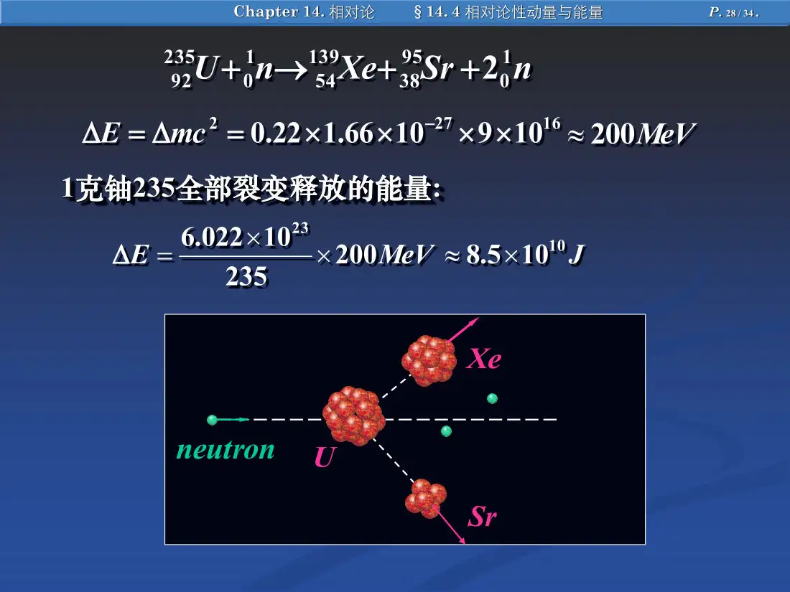

原文：

$$
{ } _ { 9 2 } ^ { 2 3 5 } U + _ { 0 } ^ { 1 } n \rightarrow { } _ { 5 4 } ^ { 1 3 9 } X e + _ { 3 8 } ^ { 9 5 } S r + 2 _ { 0 } ^ { 1 } n
$$

$$
\Delta E = \Delta m c ^ {2} = 0. 2 2 \times 1. 6 6 \times 1 0 ^ {- 2 7} \times 9 \times 1 0 ^ {1 6} \approx 2 0 0 M e V
$$

1克铀235全部裂变释放的能量:

$$
\Delta E \equiv \frac {6 . 0 2 2 \times 1 0 ^ {2 3}}{2 3 5} \times 2 0 0 M e V \approx 8. 5 \times 1 0 ^ {1 0} J
$$

r 18. Chapter 14. 相对论 相对论

§14. 4 §18. 2 相对论性动量与能量洛沦兹变换

P. 28 / 34 P..

### r 18. Chapter 14. 相对论 相对论

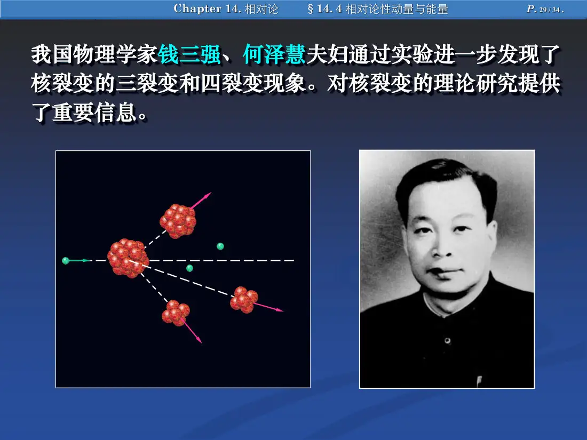

原文：

我国物理学家钱三强、何泽慧夫妇通过实验进一步发现了核裂变的三裂变和四裂变现象。对核裂变的理论研究提供了重要信息。

r 18. Chapter 14. 相对论 相对论

§14. 4 §18. 2 相对论性动量与能量洛沦兹变换

P. 29 / 34 P..

### 原子弹和核反应堆就是利用放射性原子的核裂变释放出的核能。

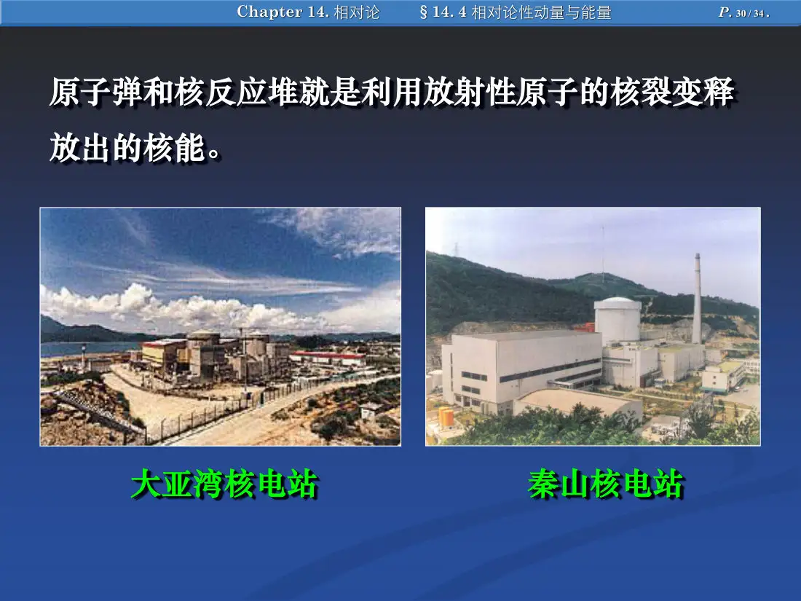

原文：

原子弹和核反应堆就是利用放射性原子的核裂变释放出的核能。

r 18. Chapter 14. 相对论 相对论 §14. 4 §18. 2 相对论性动量与能量洛沦兹变换

P. 30 / 34 P..

### r 18. Chapter 14. 相对论 相对论

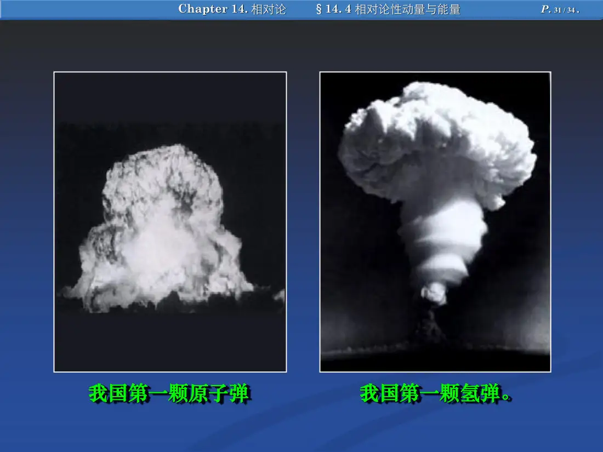

原文：

r 18. Chapter 14. 相对论 相对论

§14. 4 §18. 2 相对论性动量与能量洛沦兹变换

P. 31 / 34 P..

### r 18. Chapter 14. 相对论 相对论

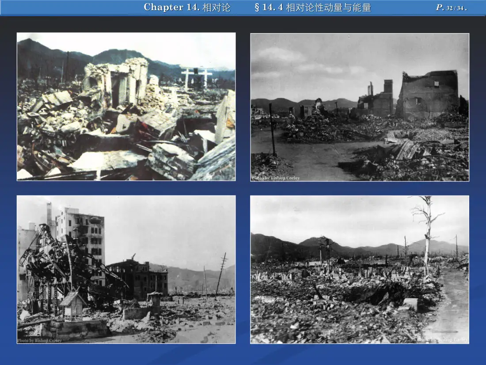

原文：

r 18. Chapter 14. 相对论 相对论

§14. 4 §18. 2 相对论性动量与能量洛沦兹变换

P. 32 / 34 P..

### P. 33 / 34 P..

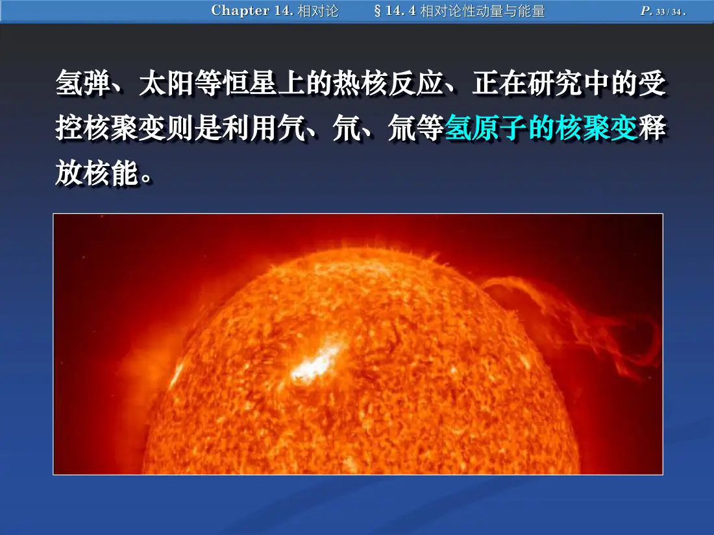

原文：

氢弹、太阳等恒星上的热核反应、正在研究中的受控核聚变则是利用氕、氘、氚等氢原子的核聚变释放核能。

r 18. Chapter 14. 相对论 相对论 §14. 4 §18. 2 相对论性动量与能量洛沦兹变换

P. 33 / 34 P..

### 归纳：

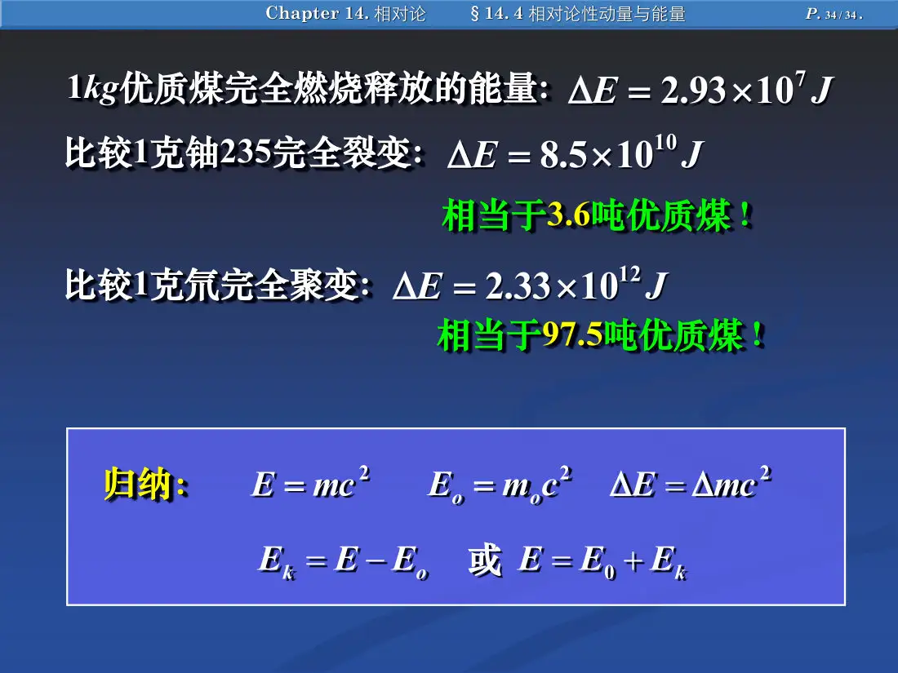

原文：

1kg优质煤完全燃烧释放的能量: $\Delta B D C = \Delta B C D = \Delta C D C$ 比较1克铀235完全裂变: $\Delta V _ { D } ^ { \prime } = ( 3 - \sqrt { 3 } , 1 0 ^ { \prime } )$ 相当于3.6吨优质煤 !比较1克氘完全聚变: $\Delta B E = \Delta B A C , \Delta B C D = 1 1 0 ^ { \circ }$ 相当于97.5吨优质煤 !

归纳：

$$
E = m c ^ {2}
$$

$$
E _ {o} = m _ {o} c ^ {2}
$$

$$
\Delta E = \Delta m c ^ {2}
$$

$$
E _ {k} = E - E _ {o}
$$

$$
\boldsymbol {E} = \boldsymbol {E _ {0}} + \boldsymbol {E _ {k}}
$$

r 18. Chapter 14. 相对论 相对论

§14. 4 §18. 2 相对论性动量与能量洛沦兹变换

P. 34 / 34 P..
