# 《大学物理》§15.3 康普顿效应（课件）

原件的每一页，下面附识别出的文字。

### § 15.3 康普顿效应

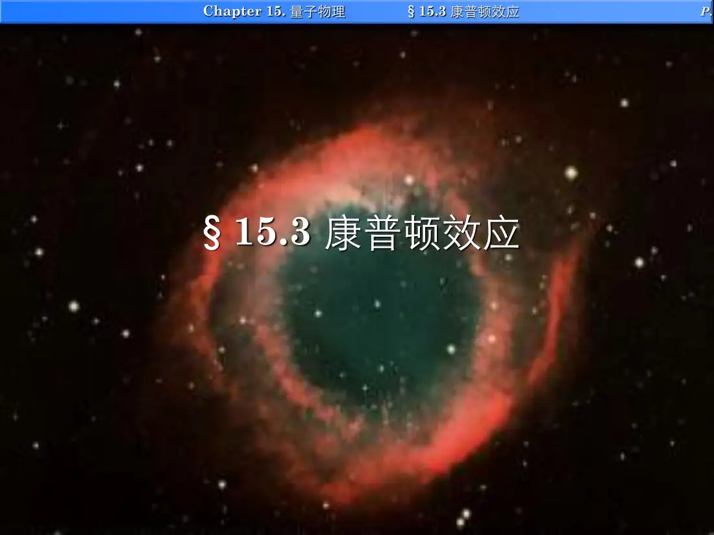

原文：

§ 15.3 康普顿效应

Chapter 15. 量子物理

§ 15.3 康普顿效应

P.

### 康普顿效应

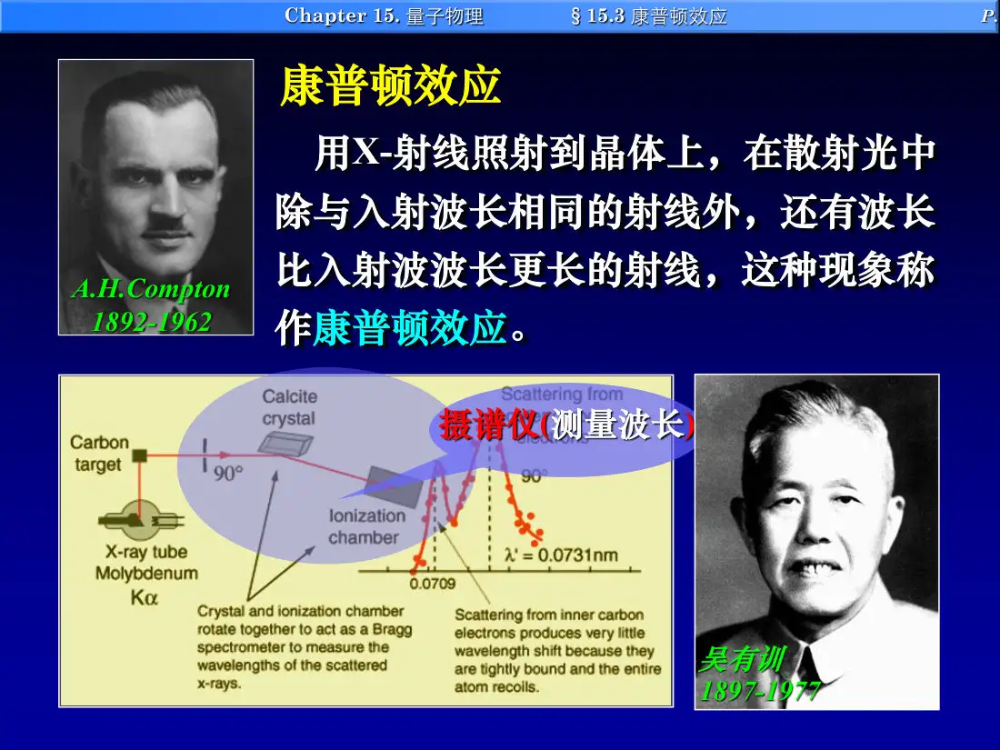

原文：

康普顿效应

用X-射线照射到晶体上，在散射光中除与入射波长相同的射线外，还有波长比入射波波长更长的射线，这种现象称作康普顿效应。

摄谱仪(测量波长)

Crystal and ionization chamber rotate together to act as a Bragg spectrometer to measure the wavelengths of the scattered x-rays.

Scattering from inner carbon electrons produces very little wavelength shift because they are tightly bound and the entire atom recoils.

Chapter 15. 量子物理

§ 15.3 康普顿效应

P.

### 康普顿散射实验装置及实验结果

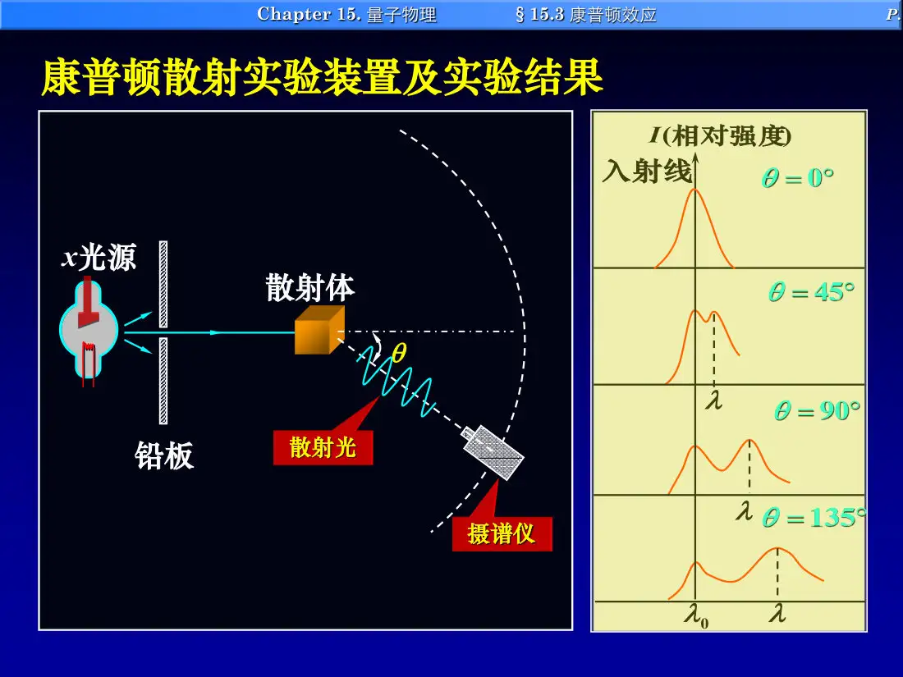

原文：

康普顿散射实验装置及实验结果

x光源

散射体

铅板

散射光

摄谱仪

$I$ (相对强度)

入射线

Chapter 15. 量子物理

§ 15.3 康普顿效应

P.

### 一、经典电磁波理论面临的问题

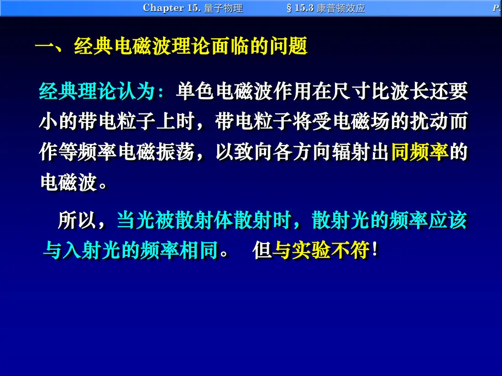

原文：

一、经典电磁波理论面临的问题

经典理论认为：单色电磁波作用在尺寸比波长还要小的带电粒子上时，带电粒子将受电磁场的扰动而作等频率电磁振荡，以致向各方向辐射出同频率的电磁波。

所以，当光被散射体散射时，散射光的频率应该与入射光的频率相同。但与实验不符！

Chapter 15. 量子物理

§ 15.3 康普顿效应

P.

### 二、光量子理论的解释

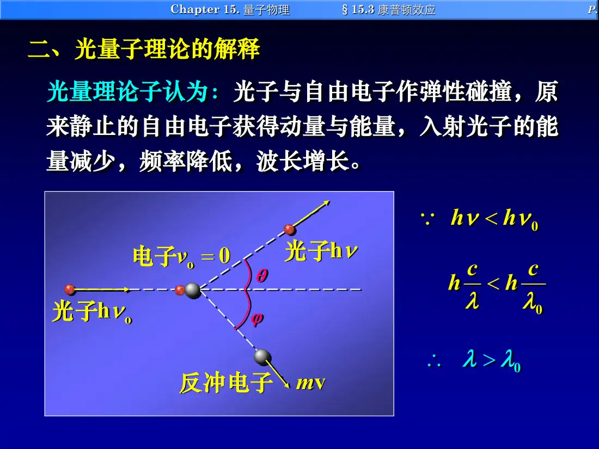

原文：

二、光量子理论的解释

光量理论子认为：光子与自由电子作弹性碰撞，原来静止的自由电子获得动量与能量，入射光子的能量减少，频率降低，波长增长。

$$
\because h \nu <   h \nu_ {0}
$$

电子 $v_{0}=0$

光子hν

光子hν $_{o}$

$$
h \frac {c}{\lambda} <   h \frac {c}{\lambda_ {0}}
$$

反冲电子 \ mv

$$
\therefore \quad \lambda > \lambda_ {0}
$$

Chapter 15. 量子物理

§ 15.3 康普顿效应

P.

### $$

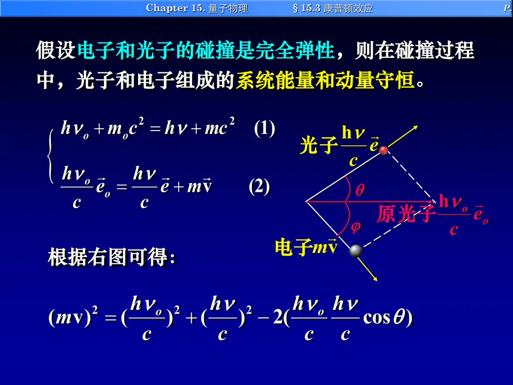

原文：

假设电子和光子的碰撞是完全弹性，则在碰撞过程中，光子和电子组成的系统能量和动量守恒。

$$
\left\{ \begin{array}{l} h \nu_ {o} + m _ {o} c ^ {2} = h \nu + m c ^ {2} \\ \frac {h \nu_ {o}}{c} \vec {e} _ {o} = \frac {h \nu}{c} \vec {e} + m \vec {\mathrm{v}} \end{array} \right.\tag{1}
$$

(2)

根据右图可得:

电子m$\vec{v}$原光子 $\frac{\mathrm{h}\nu_{o}}{c}\vec{e}_{o}$

$$
(m v) ^ {2} = (\frac {h \nu_ {o}}{c}) ^ {2} + (\frac {h \nu}{c}) ^ {2} - 2 (\frac {h \nu_ {o}}{c} \frac {h \nu}{c} \cos \theta)
$$

Chapter 15. 量子物理

§ 15.3 康普顿效应

P.

### $$

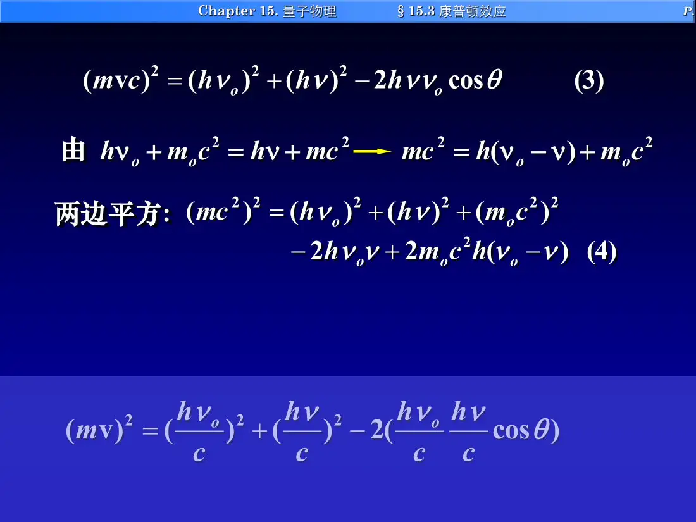

原文：

$$
(m \mathrm{vc}) ^ {2} = (h \nu_ {o}) ^ {2} + (h \nu) ^ {2} - 2 h \nu \nu_ {o} \cos \theta\tag{3}
$$

$$
h v _ {o} + m _ {o} c ^ {2} = h v + m c ^ {2} \longrightarrow m c ^ {2} = h (v _ {o} - v) + m _ {o} c ^ {2}
$$

两边平方: $(mc^{2})^{2} = (h\nu_{o})^{2} + (h\nu)^{2} + (m_{o}c^{2})^{2}$ $-2h\nu_{o}\nu + 2m_{o}c^{2}h(\nu_{o} - \nu)$ (4)

$$
(m v) ^ {2} = \left(\frac {h v _ {o}}{c}\right) ^ {2} + \left(\frac {h v}{c}\right) ^ {2} - 2 \left(\frac {h v _ {o}}{c} \frac {h v}{c} \cos \theta\right)
$$

Chapter 15. 量子物理

§ 15.3 康普顿效应

P.

### $$

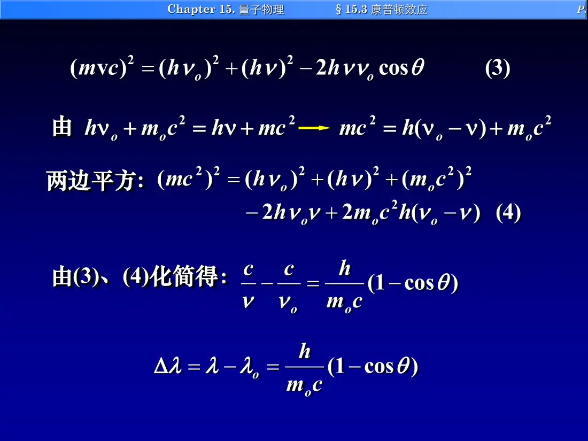

原文：

$$
(m \mathrm{vc}) ^ {2} = (h \nu_ {o}) ^ {2} + (h \nu) ^ {2} - 2 h \nu \nu_ {o} \cos \theta\tag{3}
$$

$$
h v _ {o} + m _ {o} c ^ {2} = h v + m c ^ {2} \longrightarrow m c ^ {2} = h (v _ {o} - v) + m _ {o} c ^ {2}
$$

两边平方： $(mc^{2})^{2}=(h\nu_{o})^{2}+(h\nu)^{2}+(m_{o}c^{2})^{2}$ $-2h\nu_{o}\nu+2m_{o}c^{2}h(\nu_{o}-\nu)$ (4)

由(3)、(4)化简得: $\frac{c}{\nu} - \frac{c}{\nu_o} = \frac{h}{m_o c} (1 - \cos \theta)$

$$
\Delta \lambda = \lambda - \lambda_ {o} = \frac {h}{m _ {o} c} (1 - \cos \theta)
$$

Chapter 15. 量子物理

§ 15.3 康普顿效应

P.

### $$

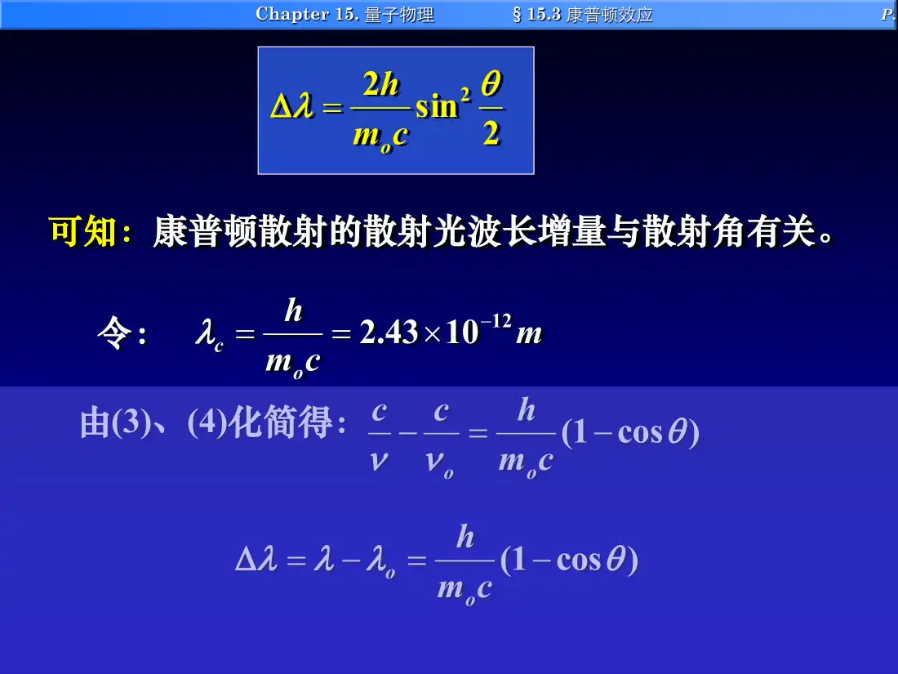

原文：

$$
\Delta \lambda = \frac {2 h}{m _ {o} c} \sin^ {2} \frac {\theta}{2}
$$

可知：康普顿散射的散射光波长增量与散射角有关。

令： $\lambda_{c} = \frac{h}{m_{o}c} = 2.43\times 10^{-12}m$

由(3)、(4)化简得: $\frac{c}{v} - \frac{c}{v_o} = \frac{h}{m_o c} (1 - \cos \theta)$

$$
\Delta \lambda = \lambda - \lambda_ {o} = \frac {h}{m _ {o} c} (1 - \cos \theta)
$$

Chapter 15. 量子物理

§ 15.3 康普顿效应

P.

### $$

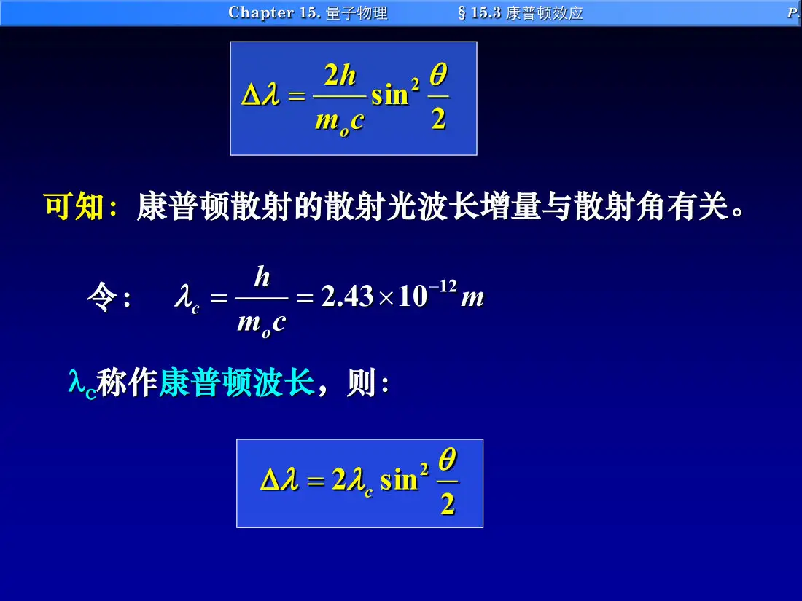

原文：

$$
\Delta \lambda = \frac {2 h}{m _ {o} c} \sin^ {2} \frac {\theta}{2}
$$

可知：康普顿散射的散射光波长增量与散射角有关。

令： $\lambda_{c} = \frac{h}{m_{o}c} = 2.43\times 10^{-12}m$

$\lambda_{c}$ 称作康普顿波长，则：

$$
\Delta \lambda = 2 \lambda_ {c} \sin^ {2} {\frac {\theta}{2}}
$$

Chapter 15. 量子物理

§ 15.3 康普顿效应

P.

### 明确几点

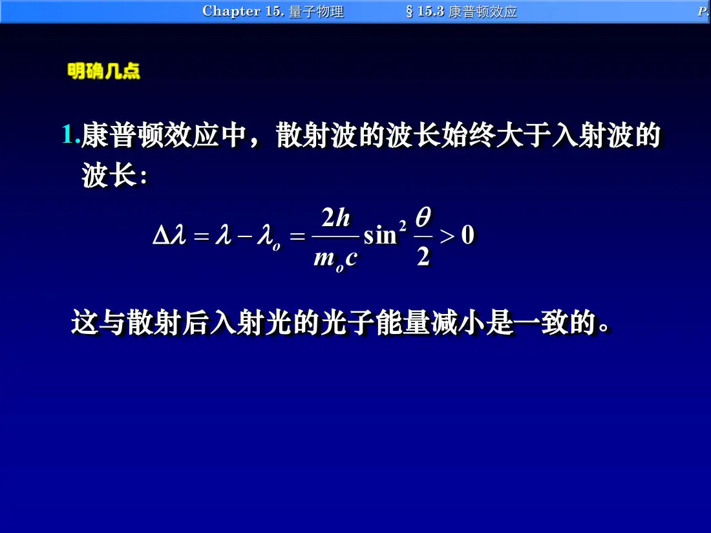

原文：

明确几点

1.康普顿效应中, 散射波的波长始终大于入射波的波长:

$$
\Delta \lambda = \lambda - \lambda_ {o} = \frac {2 h}{m _ {o} c} \sin^ {2} \frac {\theta}{2} > 0
$$

这与散射后入射光的光子能量减小是一致的。

Chapter 15. 量子物理

§ 15.3 康普顿效应

P.

### 散射体

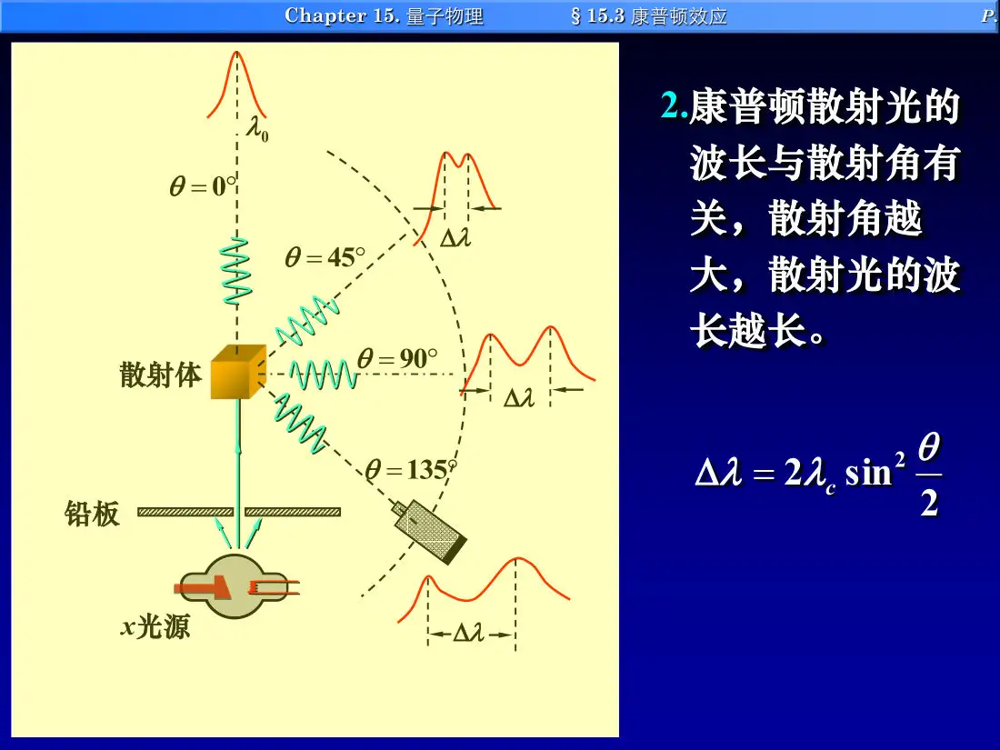

原文：

散射体

铅板

$x$ 光源

2.康普顿散射光的波长与散射角有关，散射角越大，散射光的波长越长。

$$
\Delta \lambda = 2 \lambda_ {c} \sin^ {2} \frac {\theta}{2}
$$

Chapter 15. 量子物理

§ 15.3 康普顿效应

P.

### 3.康普顿散射光波长增长与散射物质无关。

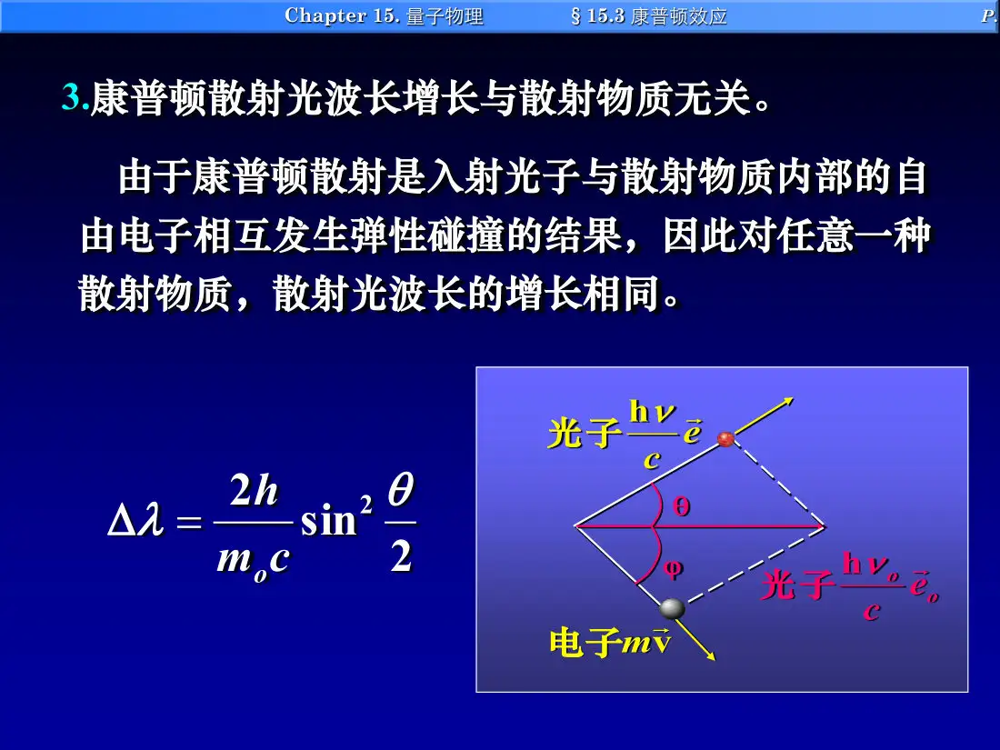

原文：

3.康普顿散射光波长增长与散射物质无关。

由于康普顿散射是入射光子与散射物质内部的自由电子相互发生弹性碰撞的结果，因此对任意一种散射物质，散射光波长的增长相同。

$$
\Delta \lambda = \frac {2 h}{m _ {o} c} \sin^ {2} \frac {\theta}{2}
$$

Chapter 15. 量子物理

§ 15.3 康普顿效应

P.

### $m_{o} \ll M$ (原子质量)

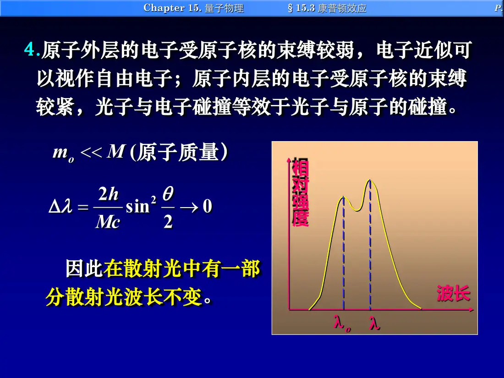

原文：

4. 原子外层的电子受原子核的束缚较弱，电子近似可以视作自由电子；原子内层的电子受原子核的束缚较紧，光子与电子碰撞等效于光子与原子的碰撞。

$m_{o} \ll M$ (原子质量)

$$
\Delta \lambda = \frac {2 h}{M c} \sin^ {2} \frac {\theta}{2} \rightarrow 0
$$

因此在散射光中有一部分散射光波长不变。

Chapter 15. 量子物理

§ 15.3 康普顿效应

P.

### Chapter 15. 量子物理

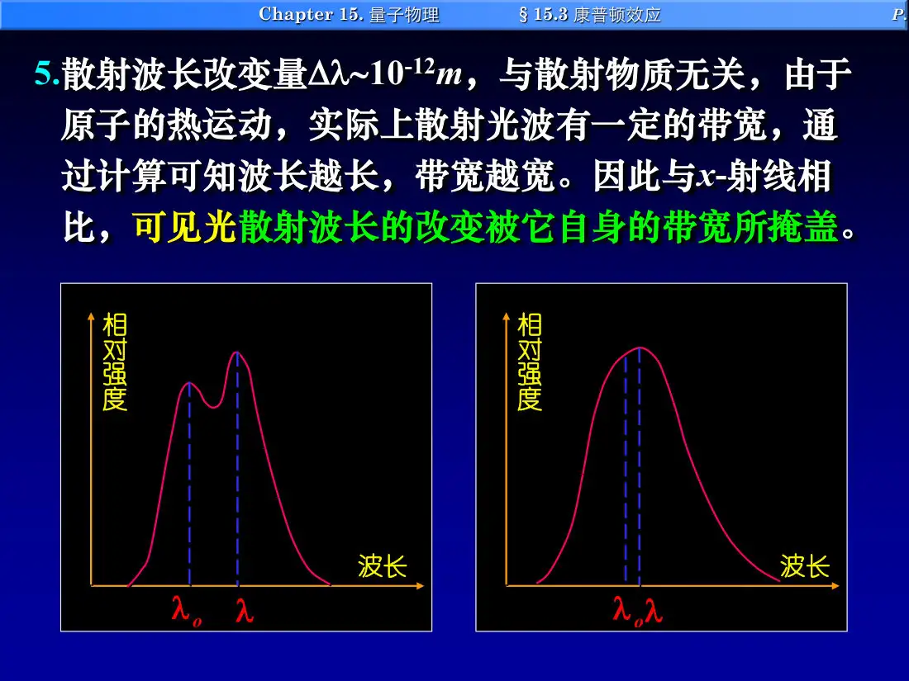

原文：

5.散射波长改变量 $\Delta \lambda \sim 10^{-12} m$ ，与散射物质无关，由于原子的热运动，实际上散射光波有一定的带宽，通过计算可知波长越长，带宽越宽。因此与x-射线相比，可见光散射波长的改变被它自身的带宽所掩盖。

Chapter 15. 量子物理

§ 15.3 康普顿效应

P.

### $$

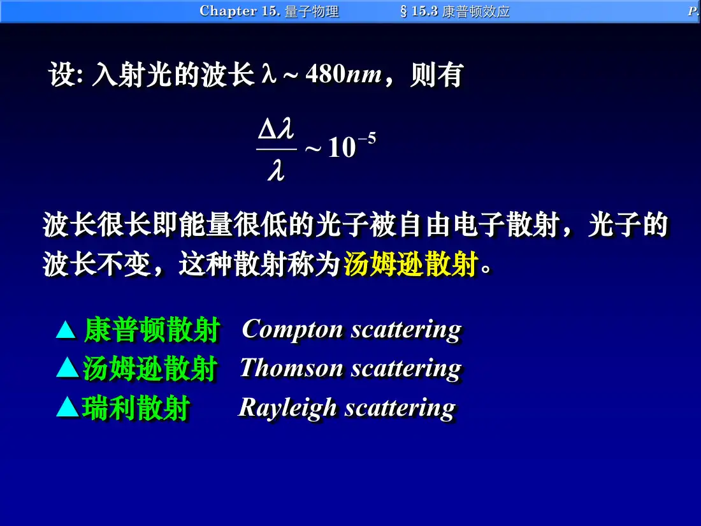

原文：

设: 入射光的波长 $\lambda \sim 480 \mathrm{~nm}$ , 则有

$$
\frac {\Delta \lambda}{\lambda} \sim 1 0 ^ {- 5}
$$

波长很长即能量很低的光子被自由电子散射，光子的波长不变，这种散射称为汤姆逊散射。

▲康普顿散射 Compton scattering

▲汤姆逊散射 Thomson scattering

▲瑞利散射 Rayleigh scattering例 设有波长 $\lambda_{0}=1.00\times10^{-10}m$ 的 $x$ -射线的光子与自由电子作弹性碰撞，散射 $x$ -射线的散射角 $\theta=90^{\circ}$ ，求:

Chapter 15. 量子物理

§ 15.3 康普顿效应

P.

### (3) 碰撞中光子能量的损失。

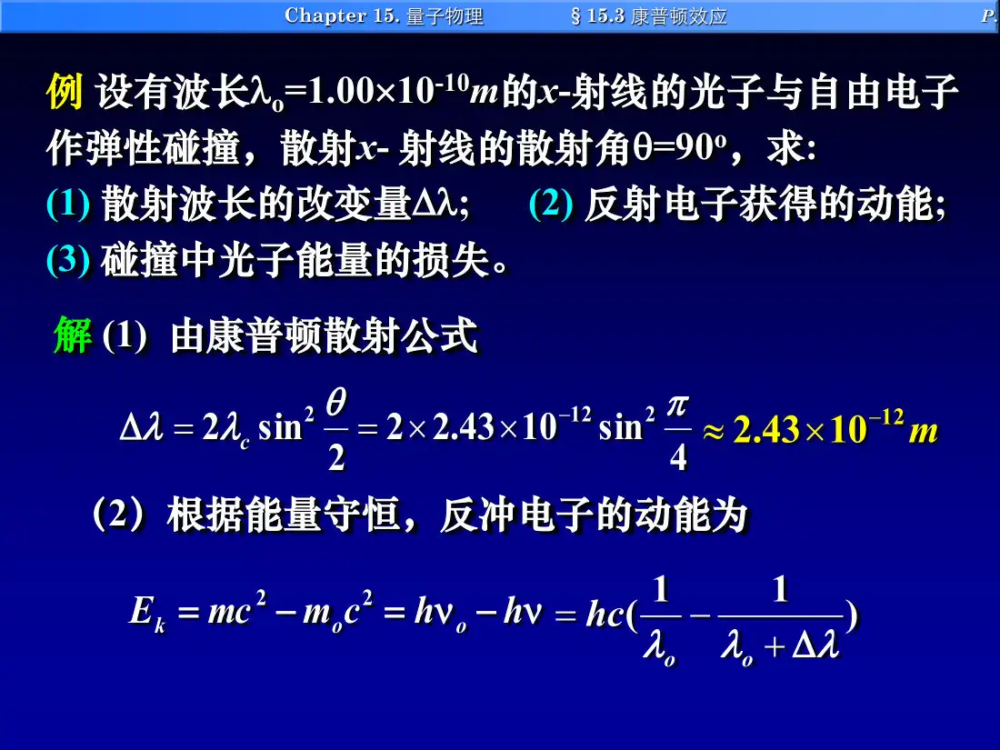

原文：

(1) 散射波长的改变量 $\Delta \lambda$ ; (2) 反射电子获得的动能;

(3) 碰撞中光子能量的损失。

解 (1) 由康普顿散射公式

$$
\Delta \lambda = 2 \lambda_ {c} \sin^ {2} \frac {\theta}{2} = 2 \times 2. 4 3 \times 1 0 ^ {- 1 2} \sin^ {2} \frac {\pi}{4} \approx 2. 4 3 \times 1 0 ^ {- 1 2} m
$$

(2) 根据能量守恒, 反冲电子的动能为

$$
E _ {k} = m c ^ {2} - m _ {o} c ^ {2} = h \nu_ {o} - h \nu = h c (\frac {1}{\lambda_ {o}} - \frac {1}{\lambda_ {o} + \Delta \lambda})
$$

Chapter 15. 量子物理

§ 15.3 康普顿效应

P.

### 由于 $\Delta\lambda<<\lambda_{o}$ ，则

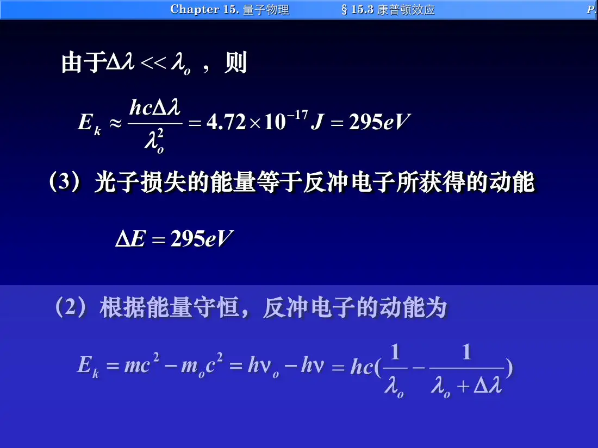

原文：

由于 $\Delta\lambda<<\lambda_{o}$ ，则

$$
E _ {k} \approx \frac {h c \Delta \lambda}{\lambda_ {o} ^ {2}} = 4. 7 2 \times 1 0 ^ {- 1 7} J = 2 9 5 e V
$$

(3) 光子损失的能量等于反冲电子所获得的动能

$$
\Delta E = 2 9 5 e V
$$

(2) 根据能量守恒, 反冲电子的动能为

$$
E _ {k} = m c ^ {2} - m _ {o} c ^ {2} = h v _ {o} - h v = h c \left(\frac {1}{\lambda_ {o}} - \frac {1}{\lambda_ {o} + \Delta \lambda}\right)
$$

Chapter 15. 量子物理

§ 15.3 康普顿效应

P.

### Chapter 15. 量子物理

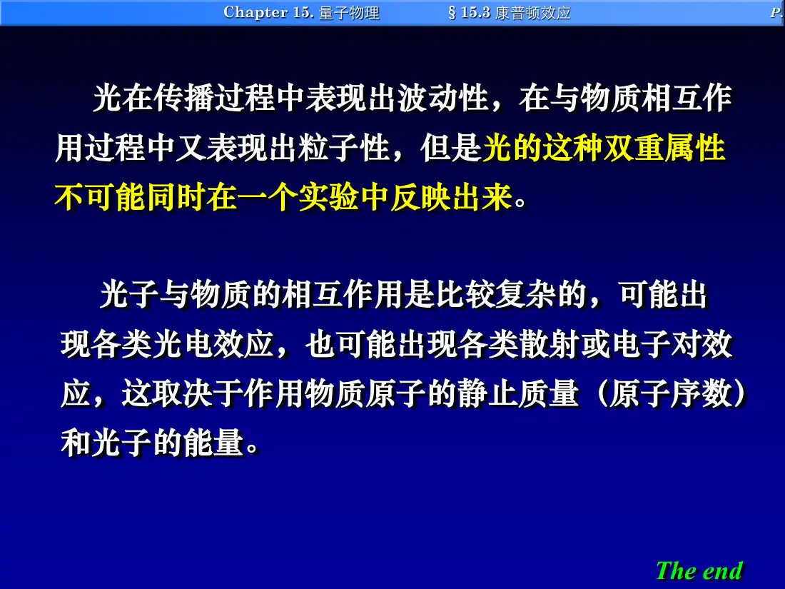

原文：

光在传播过程中表现出波动性，在与物质相互作用过程中又表现出粒子性，但是光的这种双重属性不可能同时在一个实验中反映出来。

光子与物质的相互作用是比较复杂的，可能出现各类光电效应，也可能出现各类散射或电子对效应，这取决于作用物质原子的静止质量（原子序数）和光子的能量。

Chapter 15. 量子物理

§ 15.3 康普顿效应

P.

The end
