# 《大学物理》§3-4 功 动能定理（课件）

原件的每一页，下面附识别出的文字。

### 功 功率动能定理

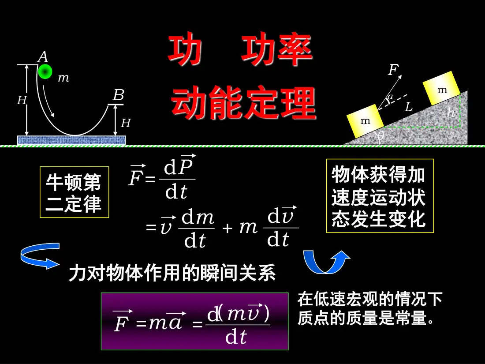

原文：

功 功率动能定理

牛顿第二定律

$$
= \vec {\nu} \frac {\mathrm{d} m}{\mathrm{d} t} + m \frac {\mathrm{d} \vec {\nu}}{\mathrm{d} t}
$$

物体获得加速度运动状态发生变化

力对物体作用的瞬间关系

F =ma = md( v )dt在低速宏观的情况下质点的质量是常量。

### §3-4 功 动能定理

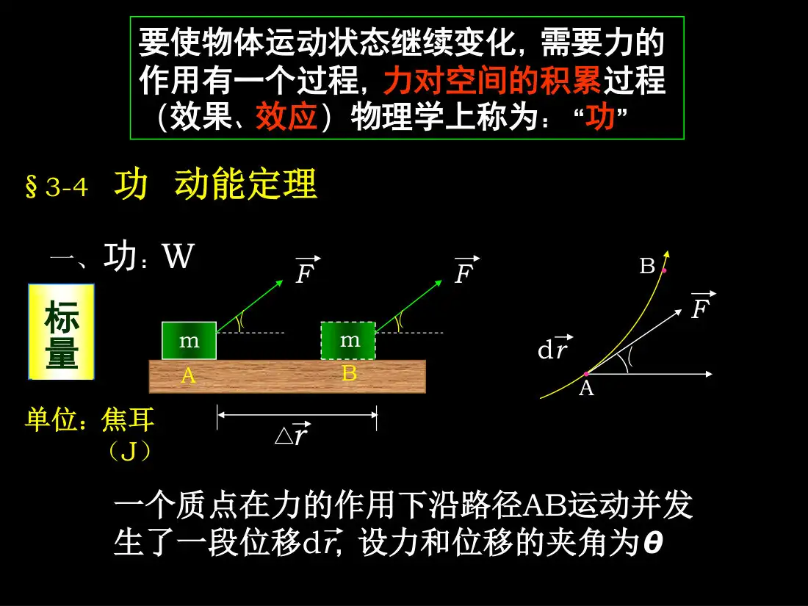

原文：

要使物体运动状态继续变化，需要力的作用有一个过程，力对空间的积累过程（效果、效应）物理学上称为：“功”

§3-4 功 动能定理

一、 功：W

标量

单位：焦耳（J）

一个质点在力的作用下沿路径AB运动并发生了一段位移dr，设力和位移的夹角为θ

### 1. 恒力的功：

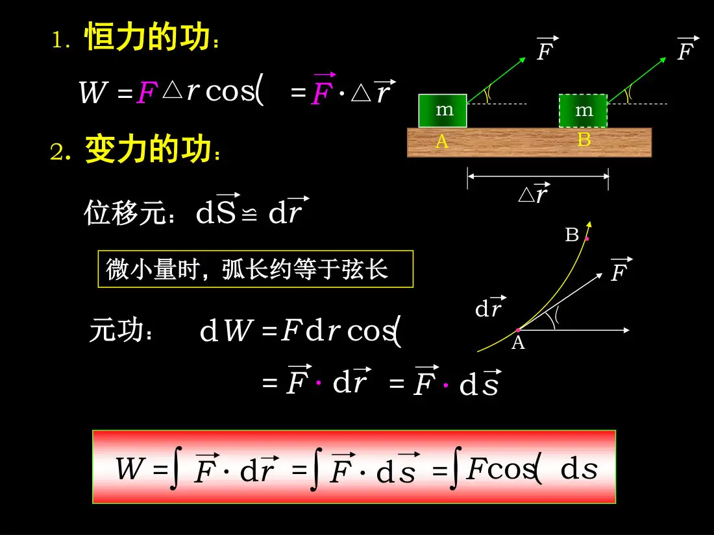

原文：

1. 恒力的功：

$$
W = F \triangle r \cos (\quad = \vec {F} \cdot \triangle \vec {r}
$$

2. 变力的功：

位移元： $\angle B A C = \angle C D B$

微小量时，弧长约等于弦长

元功： $1 0 0 \times 1 0 0 \times 1 0 0 0 \times 1 0 0 0 \times 1 0 0 0 \times 1 0 0 0 0 \times 1 0 0 0 0 \times 1 0 0 0 0 0 \times 1 0 0 0 0 0 0 0 \times 1 0 0 0 0 0 0 0 0 0 0 0 0 0 0 0 0 0 0 0 0 0 0 0 0 0 0 0 0 0 0 0 0 0 0 0 0 0 0 0 0 0 0 0 0 0 0 0 0 0 0 0 0 0 0 0 0 0 0 0 0 0 0 0 0 0 0 0 0 0 0 0 0 0 0 0 0 0 0 0 0 0 0 0 0 0 0 0 0 0 0 0 0 0 0 0 0 0 0 0 0 0 0 0 0 0 0 0 0 0 0 0 0 0 0 0 0 0 0 0 0 0 0 0 0 0 0 0 0 0 0 0 0 0 0 0 0 0 0 0 0 0 0 0 0 0 0 0 0 0 0 0 0 0 0 0 0 0 0 0 0 0 0 0 0 0 0 0 0 0 0 0 0 0 0 0 0 0 0 0 0 0 0 0 0 0 0 0 0 0 0 0 0 0 0 0 0 0 0 0 0 0 0 0 0 0 0 0 0 0 0 0 0 0 0 0 0 0 0 0 0 0 0 0 0 0 0 0 0 0 0 0 0 0 0 0 0 0 0 0 0 0 0 0 0 0 0 0 0 0 0 0 0 0 0 0 0 0 0 0 0 0 0 0 0 0 0 0 0 0 0 0 0 0 0 0 0 0 0 0 0 0 0 0 0 0 0 0 0 0 0 0 0 0 0 0 0 0 0 0 0 0 0 0 0 0 0 0 0 0 0 0 0 0 0 0 0 0 0 0 0 0 0 0 0 0 0 0 0 0 0 0 0 0 0 0 0 0 0 0 0 0 0 0 0 0 0 0 0 0 0 0 0 0 0 0 0 0 0 0 0 0 0 0 0 0 0 0 0 0 0 0 0 0 0 0 0 0 0 0 0 0 0 0 0 0 0 0 0 0 0 0 0 0 0 0 0 0 0 0 0 0 0 0 0 0 0 0 0 0 0 0 0 0 0 0 0 0 0 0 0 0 0 0 0 0 0 0 0 0 0 0 0 0 0 0 0 0 0 0 0 0 0 0 0 0 0 0 0 0 0 0 0 0 0 0 0 0 0 0 0 0 0 0 0 0 0 0 0 0 0 0 0 0 0 0 0 0 0 0 0 0 0 0 0 0 0 0 0 0 0 0 0 0 0 0 0 0 0 0 0 0 0 0 0 0 0 0 0 0 0 0 0 0 0 0 0 0 0 0 $

$$
W = \int \vec {F} \cdot \mathrm{d} \vec {r} = \int \vec {F} \cdot \mathrm{d} \vec {s} = \int F \cos (\mathrm{d} s
$$

### 在直角坐标中解析式

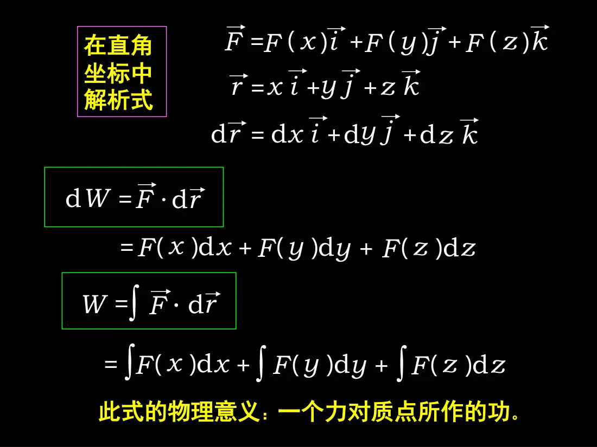

原文：

在直角坐标中解析式

F =F ( x )i +F ( y )j +F ( z )k r =x i +y j +z k dr = dx i +dy j +dz k

$$
W = \int \overrightarrow {F} \cdot \mathrm{d} \overrightarrow {r}
$$

$$
= \int F (x) \mathrm{d} x + \int F (y) \mathrm{d} y + \int F (z) \mathrm{d} z
$$

### 若几个力同时作用在质点上，它们所作的功是：

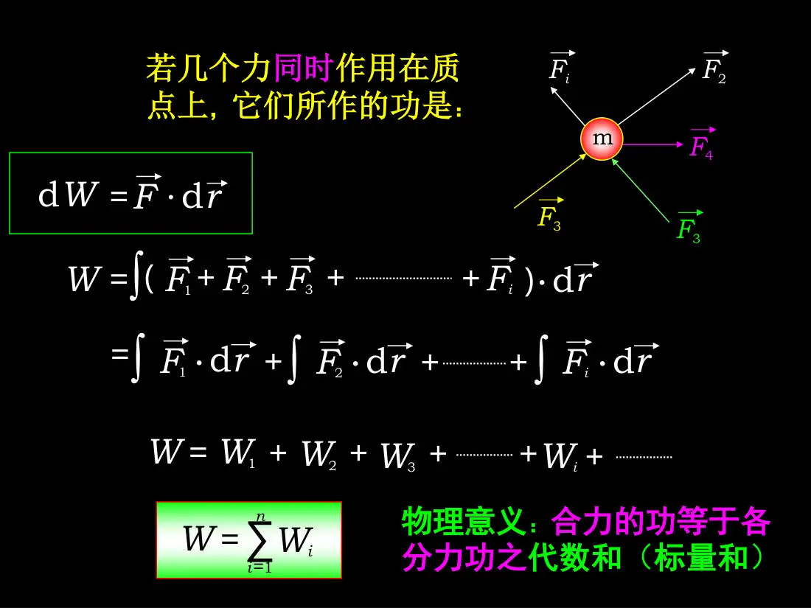

原文：

若几个力同时作用在质点上，它们所作的功是：

$$
\mathrm{d} W = \overrightarrow {F} \cdot \mathrm{d} \overrightarrow {r}
$$

$$
\begin{array}{r l} & W = \int (\overrightarrow {F _ {1}} + \overrightarrow {F _ {2}} + \overrightarrow {F _ {3}} + \dots \dots + \overrightarrow {F _ {i}}) \cdot \mathrm{d} \overrightarrow {r} \\ & = \int \overrightarrow {F _ {1}} \cdot \mathrm{d} \overrightarrow {r} + \int \overrightarrow {F _ {2}} \cdot \mathrm{d} \overrightarrow {r} + \dots \dots + \int \overrightarrow {F _ {i}} \cdot \mathrm{d} \overrightarrow {r} \end{array}
$$

W = W1 ＋W2＋W3＋ ＋Wi＋

$$
W = \sum_ {i = 1} ^ {n} W _ {i}
$$

物理意义：合力的功等于各分力功之代数和（标量和）

### 个质点受到变力的作用，从A点移动到B点

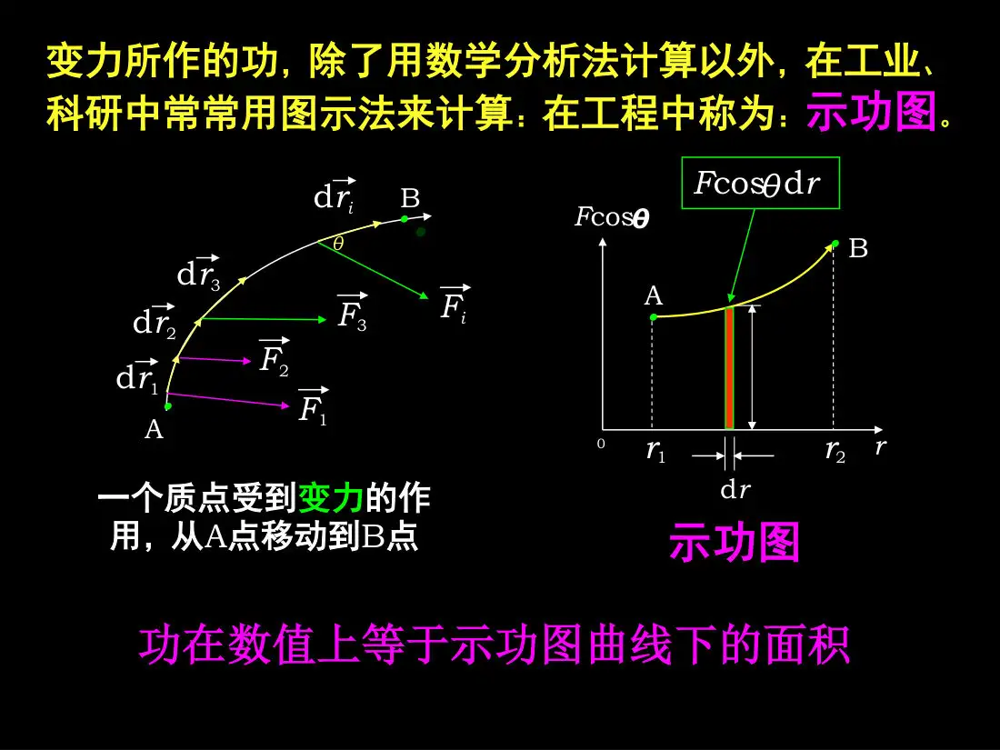

原文：

变力所作的功，除了用数学分析法计算以外，在工业、科研中常常用图示法来计算：在工程中称为：示功图。

个质点受到变力的作用，从A点移动到B点

示功图

功在数值上等于示功图曲线下的面积如果示功图曲线下的面积规则则可以运用初等数学计算几何面积的方法求解恒力所作的功。

### 梯形面积

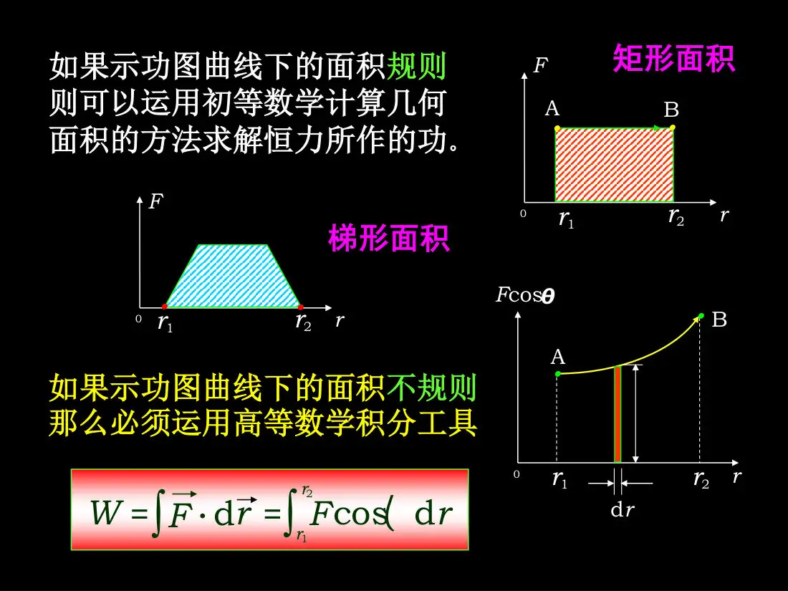

原文：

梯形面积

如果示功图曲线下的面积不规则那么必须运用高等数学积分工具

$$
W = \int \vec {F} \cdot \mathrm{d} \vec {r} = \int_ {r _ {1}} ^ {r _ {2}} F \cos (\mathrm{d} r
$$

矩形面积

### 3. 功率：

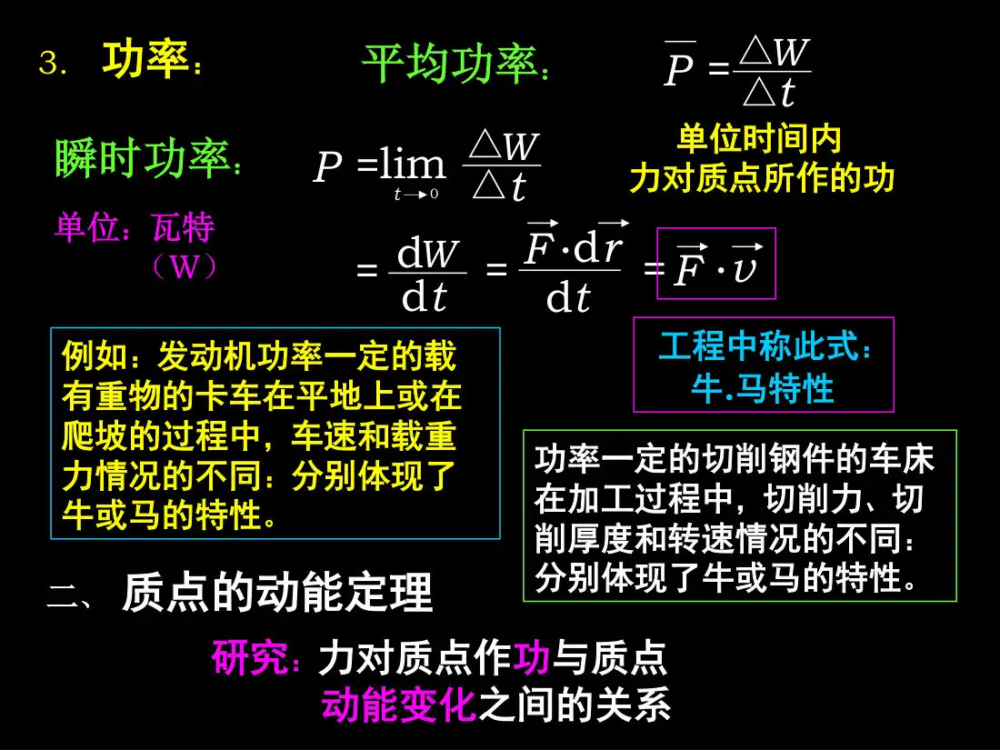

原文：

3. 功率：

平均功率：

$$
\overline {{P}} = \frac {\triangle W}{\triangle t}
$$

瞬时功率：

$$
P = \lim _ {t \rightarrow 0} \frac {\triangle W}{\triangle t}
$$

单位时间内力对质点所作的功

单位：瓦特（W）

$$
= \frac {\mathrm{d} W}{\mathrm{d} t} = \frac {\vec {F} \cdot \mathrm{d} \vec {r}}{\mathrm{d} t} = \boxed {\vec {F} \cdot \vec {\nu}}
$$

例如：发动机功率一定的载有重物的卡车在平地上或在爬坡的过程中，车速和载重力情况的不同：分别体现了牛或马的特性。

二、 质点的动能定理工程中称此式：牛.马特性

功率一定的切削钢件的车床在加工过程中，切削力、切削厚度和转速情况的不同：分别体现了牛或马的特性。

研究：力对质点作功与质点动能变化之间的关系

### 二、 质点的动能定理

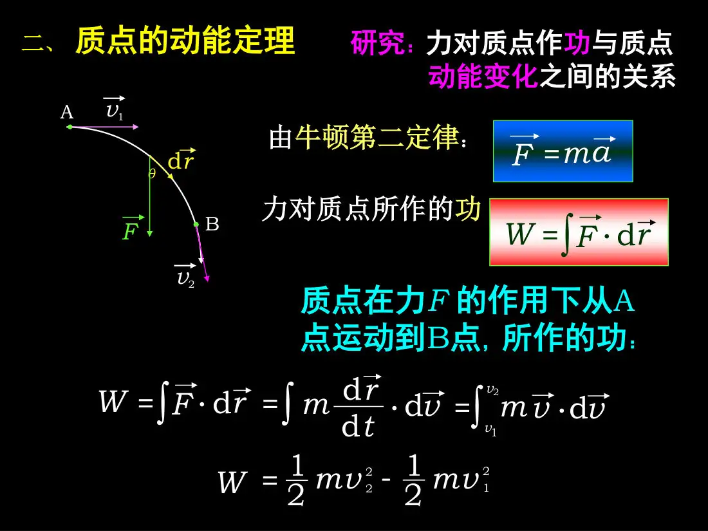

原文：

二、 质点的动能定理

研究：力对质点作功与质点动能变化之间的关系

由牛顿第二定律：

$$
\overrightarrow {F} = m \overrightarrow {a}
$$

力对质点所作的功

$$
W = \int \vec {F} \cdot \mathrm{d} \vec {r}
$$

质点在力 $\boxed { \frac { D } { B } }$ 的作用下从A点运动到B点，所作的功：

$\because \angle B A C = \angle B A C = \angle C A B = \angle C D B = \angle C A B = 9 0 ^ { \circ }$ 21 1 W = mv 22 mv2 2

### 二、 质点的动能定理

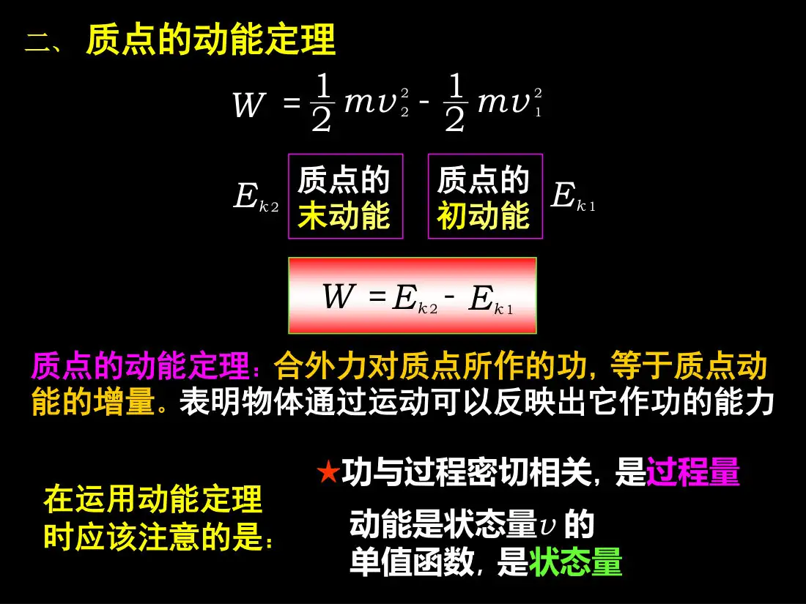

原文：

二、 质点的动能定理

$$
W = \frac {1}{2} m \nu_ {2} ^ {2} - \frac {1}{2} m \nu_ {1} ^ {2}
$$

$$
E _ {k 2}
$$

质点的末动能质点的初动能

$$
E _ {k 1}
$$

$$
W = E _ {k 2} - E _ {k 1}
$$

质点的动能定理：合外力对质点所作的功，等于质点动能的增量。表明物体通过运动可以反映出它作功的能力

在运用动能定理时应该注意的是：

★功与过程密切相关，是过程量

动能是状态量v 的

单值函数，是状态量在运用动能定理时应该注意的是：

### ★能量的改变通过作功来实现，作功的过程一定伴随着物体能量的变化。单位相同。

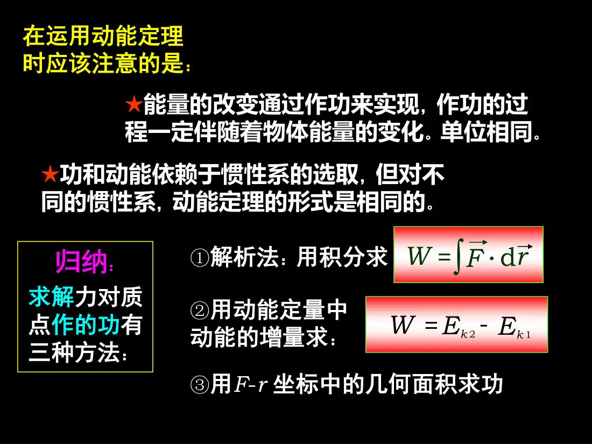

原文：

★能量的改变通过作功来实现，作功的过程一定伴随着物体能量的变化。单位相同。

★功和动能依赖于惯性系的选取，但对不同的惯性系，动能定理的形式是相同的。

归纳：求解力对质点作的功有三种方法：

①解析法：用积分求

②用动能定量中动能的增量求：

$$
W = \int \vec {F} \cdot \mathrm{d} \vec {r}
$$

$$
W = E _ {k 2} - E _ {k 1}
$$

③用 $\textcircled { 1 2 } = \textcircled { 1 }$ 坐标中的几何面积求功

### 动能定理和动量定理比较

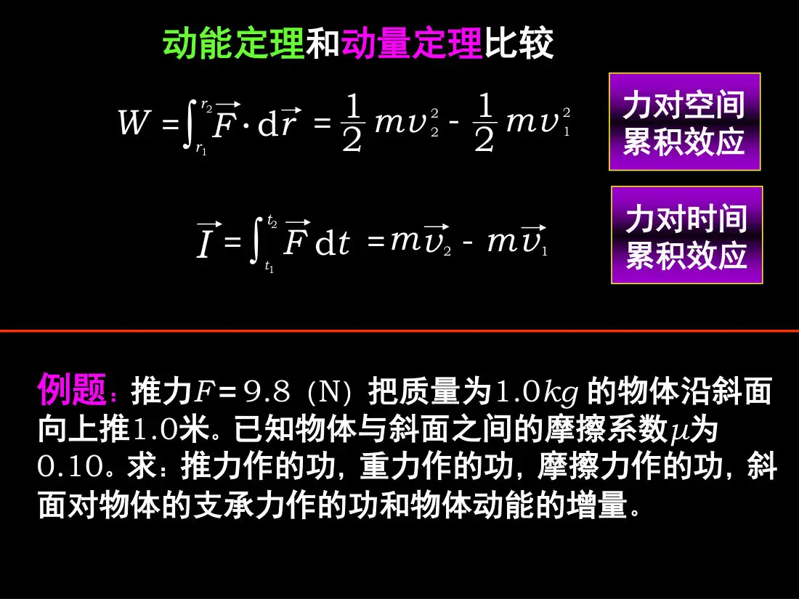

原文：

动能定理和动量定理比较

$$
W = \int_ {r _ {1}} ^ {r _ {2}} \overrightarrow {F} \cdot \mathrm{d} \overrightarrow {r} = \frac {1}{2} m v _ {2} ^ {2} - \frac {1}{2} m v _ {1} ^ {2}
$$

力对空间累积效应

$$
\overrightarrow {I} = \int_ {t _ {1}} ^ {t _ {2}} \overrightarrow {F} \mathrm{d} t = m \overrightarrow {\nu_ {2}} - m \overrightarrow {\nu_ {1}}
$$

力对时间累积效应

例题：推力F＝9.8（N）把质量为1.0kg 的物体沿斜面向上推1.0米。已知物体与斜面之间的摩擦系数μ为0.10。求：推力作的功，重力作的功，摩擦力作的功，斜面对物体的支承力作的功和物体动能的增量。

### 解 ：对物体进行受力分析，然后根据功的定义公式求解各个力所作的功。

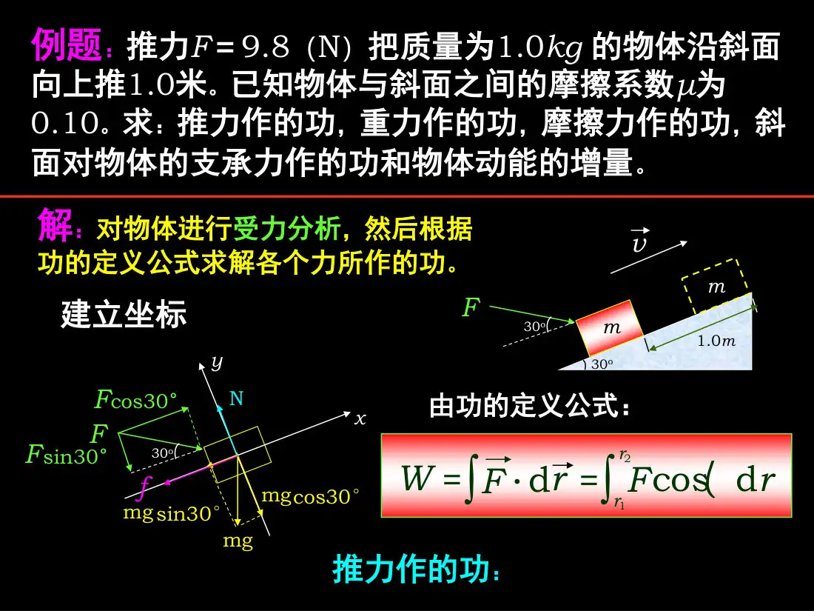

原文：

例题：推力F＝9.8（N）把质量为1.0kg 的物体沿斜面向上推1.0米。已知物体与斜面之间的摩擦系数μ为0.10。求：推力作的功，重力作的功，摩擦力作的功，斜面对物体的支承力作的功和物体动能的增量。

解 ：对物体进行受力分析，然后根据功的定义公式求解各个力所作的功。

建立坐标

由功的定义公式：

$$
W = \int \vec {F} \cdot \mathrm{d} \vec {r} = \int_ {r _ {1}} ^ {r _ {2}} F \cos (\mathrm{d} r
$$

推力作的功：

### 第 14 页

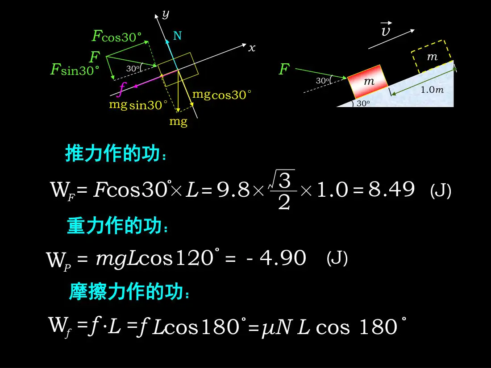

原文：

推力作的功： $\mathrm { C L } = ( \mathrm { C O S e ( 0 ) . 7 5 - 2 0 0 0 0 0 0 } ) \times \mathrm { 2 0 0 0 0 0 0 0 0 } \times \mathrm { 2 0 0 0 0 0 0 0 0 0 }$ (J) 重力作的功： $W _ { 1 } = ( 1 0 0 ) P _ { 2 } ( 0 0 0 ) ( 0 0 0 ) = ( 1 0 0 0 ) ( 0 0 0 )$ 摩擦力作的功： Wf＝f ·L＝f Lcos180 =μN L cos 180 o o

### 摩擦力作的功：

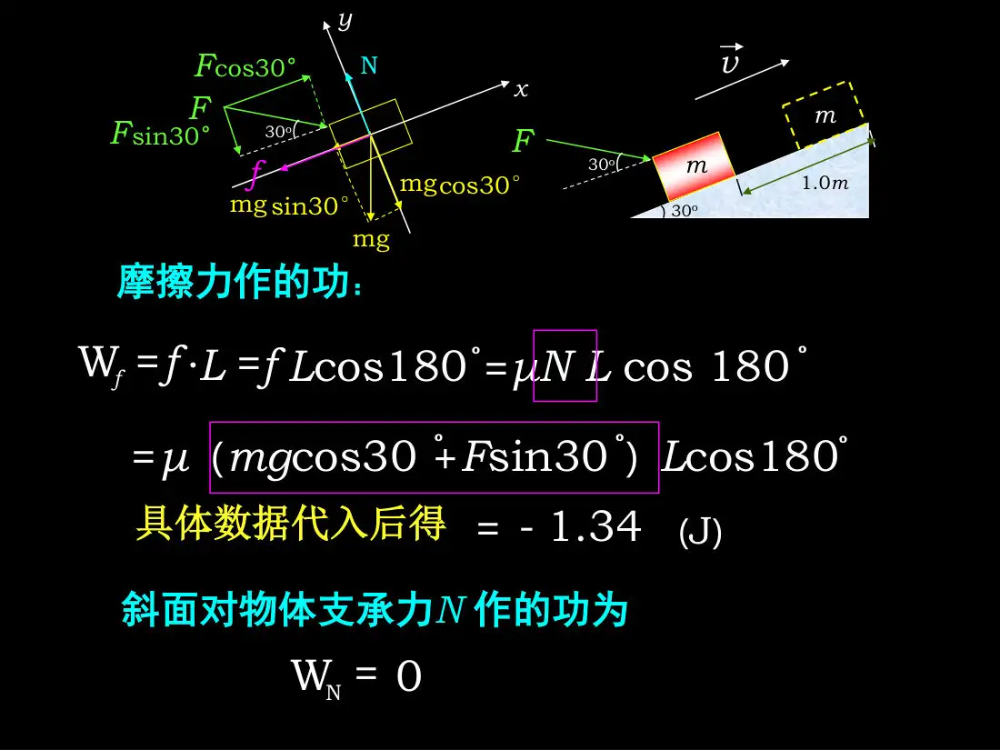

原文：

摩擦力作的功：

Wf＝f ·L＝f Lcos180 =μN L cos 180 o ＝μ（mgcos30 +Fsin30 ）Lcos180 具体数据代入后得 ＝－1.34 (J) 斜面对物体支承力N 作的功为 W ＝ 0

### 物体动能的增量:

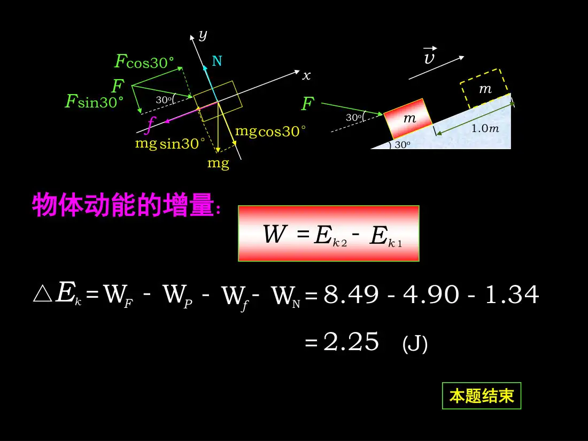

原文：

物体动能的增量:

$$
W = E _ {k 2} - E _ {k 1}
$$

$$
\begin{array}{r} \triangle E _ {k} = W _ {F} - W _ {P} - W _ {f} - W _ {\mathrm{N}} = 8. 4 9 - 4. 9 0 - 1. 3 4 \\ = 2. 2 5 (\mathrm{J}) \end{array}
$$

本题结束

### 例题：有一个质量为m＝0.5kg的质点在x－y平面内运动，其运动方程是：

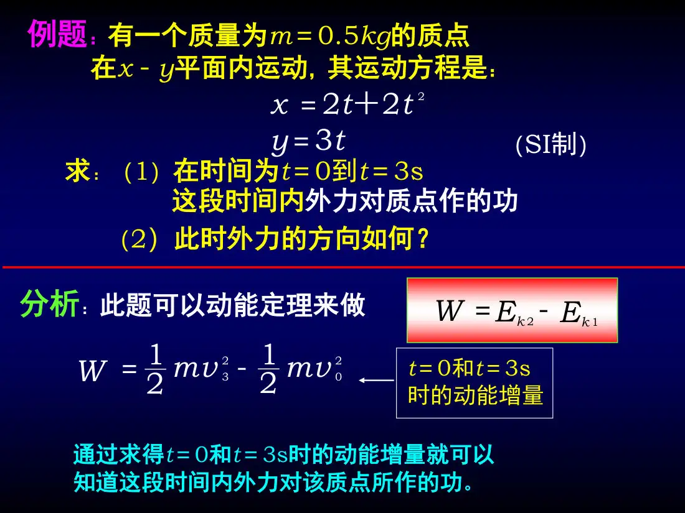

原文：

例题：有一个质量为m＝0.5kg的质点在x－y平面内运动，其运动方程是：

$$
x = 2 t + 2 t ^ {2}
$$

$$
y = 3 t
$$

（SI制）

求：（1）在时间为 $i i = \pmb { \left\lfloor 0 \right\rfloor }$ 到 $1 4 = 1 8 5$ 这段时间内外力对质点作的功

（2）此时外力的方向如何？

分析：此题可以动能定理来做

$$
W = E _ {k 2} - E _ {k 1}
$$

1 1W = 2 mv2 2 mv2t＝0和t＝3s时的动能增量

通过求得 $l \dot { \pmb { q } } = \pmb { 0 }$ 和t＝3s时的动能增量就可以知道这段时间内外力对该质点所作的功。

### W = 21 mv 23 －？ 21 mv 20 ？

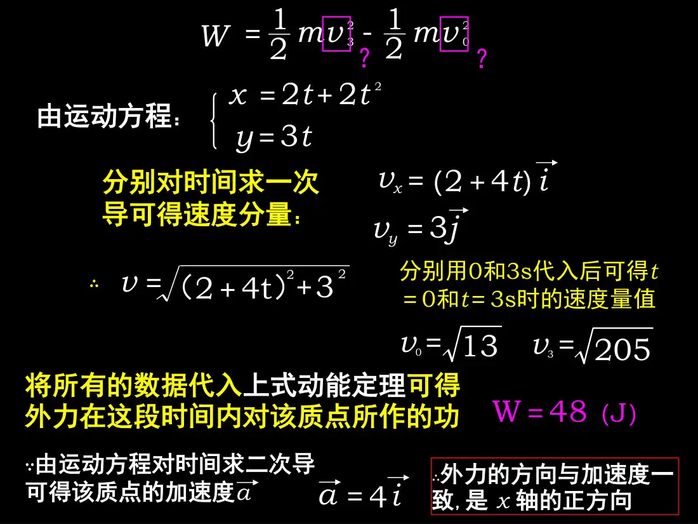

原文：

W = 21 mv 23 －？ 21 mv 20 ？

由运动方程：

$$
\left\{ \begin{array}{l} x = 2 t + 2 t ^ {2} \\ y = 3 t \end{array} \right.
$$

分别对时间求一次导可得速度分量：

$$
\upsilon_ {x} = (2 + 4 t) \vec {i}
$$

$$
\nu_ {y} = 3 \vec {j}
$$

$$
\nu = \sqrt {(2 + 4 t) ^ {2} + 3 ^ {2}}
$$

分别用0和3s代入后可得t＝0和t＝3s时的速度量值

$$
\nu_ {0} = \sqrt {1 3} \quad \nu_ {3} = \sqrt {2 0 5}
$$

将所有的数据代入上式动能定理可得外力在这段时间内对该质点所作的功

$$
\mathrm{W} = 4 8 \mathrm{(J)}
$$

∵由运动方程对时间求二次导

可得该质点的加速度a

$$
\vec {a} = 4 \vec {i}
$$

∴外力的方向与加速度

致,是 x 轴的正方向

### 解：在圆周上建立坐标

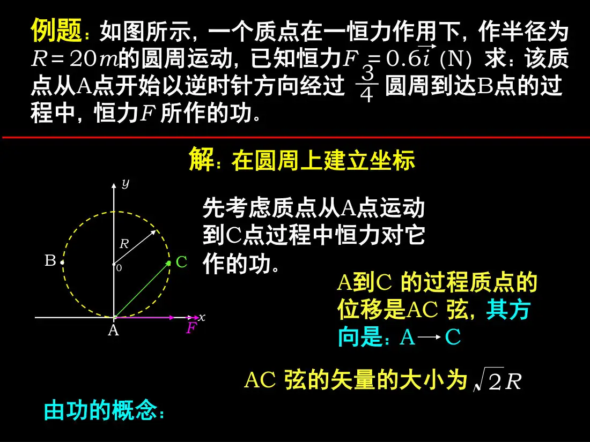

原文：

例题：如图所示，一个质点在一恒力作用下，作半径为R＝20m的圆周运动，已知恒力F ＝0.6i（N）求：该质点从A点开始以逆时针方向经过 3 圆周到达B点的过程中，恒力F 所作的功。

解：在圆周上建立坐标

由功的概念：

先考虑质点从A点运动到C点过程中恒力对它作的功。

A到C 的过程质点的位移是AC 弦，其方向是：A C

AC 弦的矢量的大小为 2R

### $$

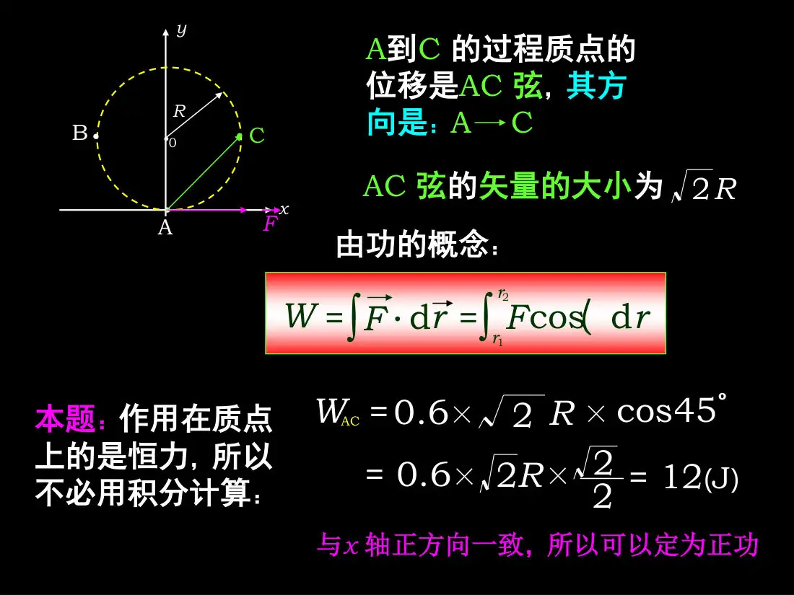

原文：

A到C 的过程质点的位移是AC 弦，其方向是：A C$\mathbb { A } \mathbb { G }$ 弦的矢量的大小为 2R由功的概念：

$$
W = \int \vec {F} \cdot \mathrm{d} \vec {r} = \int_ {r _ {1}} ^ {r _ {2}} F \cos (\mathrm{d} r
$$

本题：作用在质点上的是恒力，所以不必用积分计算：

$( 1 ) A ^ { \prime } ( 1 0 ) : ( 1 0 ) : ( 2 0 ) : ( 1 0 ) : ( 1 0 ) : ( 1 0 ) : ( 1 0 ) : ( 1 0 )$ $= ( 0 . 7 5 \times 0 . 7 5 \times 0 . 7 5 \times 0 . 7 5 \times 0 . 7 5 \times 0 . 7 5 \times 0 . 7 5 \times 0 . 7 5 \times 0 . 7 5 \times 0 . 7 5 \times 0 . 7 5 \times 0 . 7 5 \times 0 . 7 5 \times 0 . 7 5 \times 0 . 7 5 \times 0 . 7 5 \times 0 . 7 5 \times 0 . 7 5 \times 0 . 7 5 \times 0 . 7 5 \times 0 . 7 5 \times 0 . 7 5 \times 0 . 7 5 \times 0 . 7 5 \times 0 . 7 5 \times 0 . 7 5 \times 0 . 7 5 \times 0 . 7 5 \times 0 . 7 5 \times 0 . 7 5 \times 0 . 7 5 \times 0 . 7 5 \times 0 . 7 5 \times 0 . 7 5 \times 0 . 7 5 \times 0 . 7 5 \times 0 . 7 5 \times 0 . 7 5 \times 0 . 7 5 \times 0 . 7 5 \times 0 . 7 5 \times 0 .$ 与x 轴正方向一致，所以可以定为正功

### $$

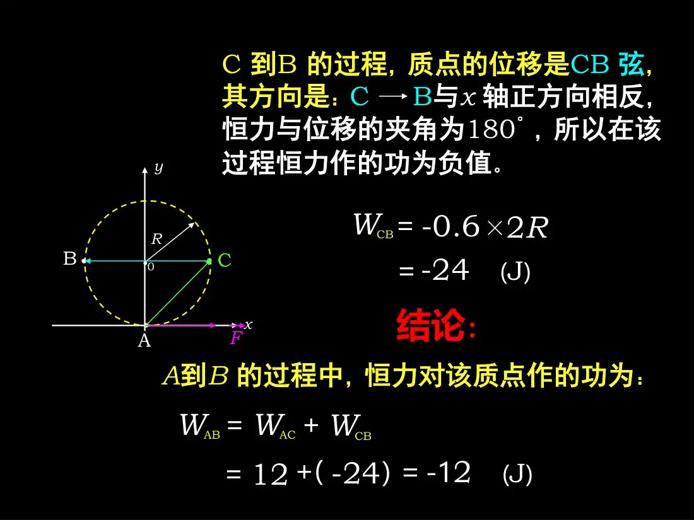

原文：

C 到B 的过程，质点的位移是CB 弦，其方向是：C B与x 轴正方向相反，恒力与位移的夹角为 $1 1 3 \times 1 0$ ，所以在该过程恒力作的功为负值。

$$
\begin{array}{r l} W _ {\mathrm{CB}} & = - 0. 6 \times 2 R \\ & = - 2 4 (\mathrm{J}) \end{array}
$$

结论：

A到B 的过程中，恒力对该质点作的功为：

$$
\begin{array}{r l} {W _ {\mathrm{AB}} = W _ {\mathrm{AC}} + W _ {\mathrm{CB}}} \\ & {= 1 2 + (- 2 4) = - 1 2} \end{array}
$$

(J)

### 解：对不断提升的水桶进行受力分析，并确定向上为正方向。

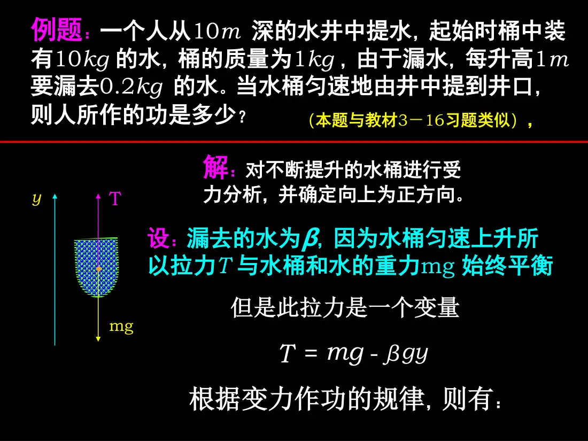

原文：

例题：一个人从10m 深的水井中提水，起始时桶中装有10kg 的水，桶的质量为1kg ，由于漏水，每升高1m要漏去0.2kg 的水。当水桶匀速地由井中提到井口，则人所作的功是多少？ （本题与教材3－16习题类似），

解：对不断提升的水桶进行受力分析，并确定向上为正方向。

设：漏去的水为β，因为水桶匀速上升所以拉力T 与水桶和水的重力mg 始终平衡

但是此拉力是一个变量

T ＝mg－βgy

根据变力作功的规律，则有：

### 根据变力作功的规律，则有：

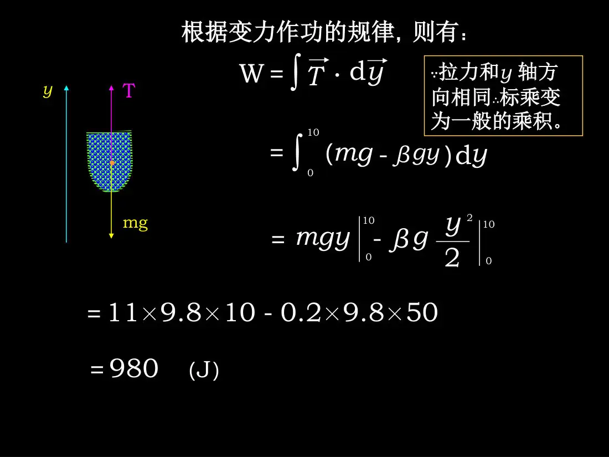

原文：

根据变力作功的规律，则有：

W＝ T ·dy∵拉力和y 轴方向相同∴标乘变为一般的乘积。

$$
= \int_ {0} ^ {1 0} (m g - \beta g y) d y
$$

$$
= m g y \left| _ {0} ^ {1 0} - \beta g \frac {y ^ {2}}{2} \right| _ {0} ^ {1 0}
$$

$$
= 1 1 \times 9. 8 \times 1 0 - 0. 2 \times 9. 8 \times 5 0
$$

＝980 （J）

### 例题：物体的质量为2.0kg，在变力

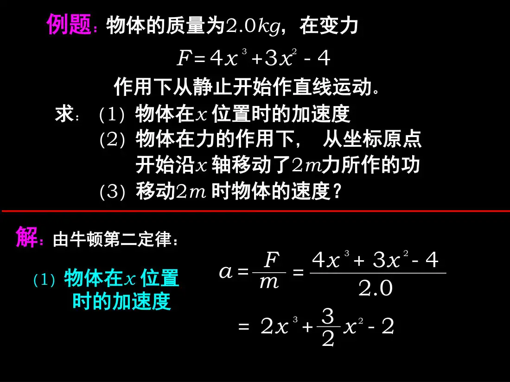

原文：

例题：物体的质量为2.0kg，在变力

$$
F = 4 x ^ {3} + 3 x ^ {2} - 4
$$

作用下从静止开始作直线运动。

求：（1）物体在x 位置时的加速度

（2）物体在力的作用下， 从坐标原点开始沿x 轴移动了2m力所作的功

（3）移动2m 时物体的速度？

解：由牛顿第二定律：

（1）物体在x 位置时的加速度

$$
\begin{array}{r l} {a = \frac {F}{m}} & {= \frac {4 x ^ {3} + 3 x ^ {2} - 4}{2 . 0}} \\ & {= 2 x ^ {3} + \frac {3}{2} x ^ {2} - 2} \end{array}
$$

### （2）物体在力的作用下， 从坐标原点开始沿x 轴移动了2m力所作的功

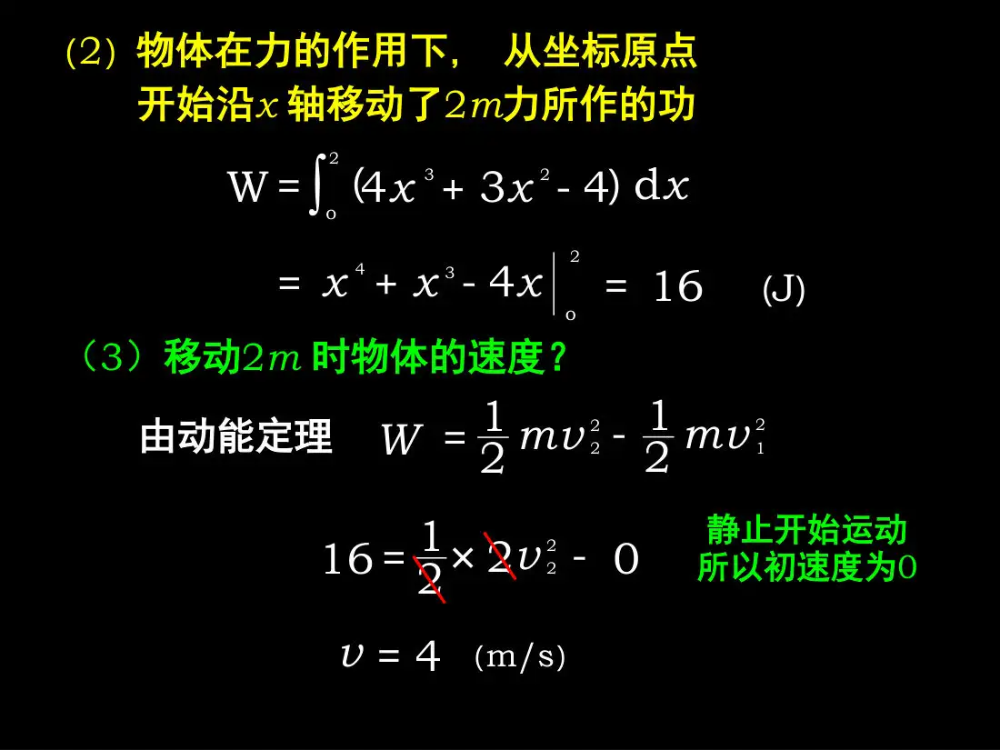

原文：

（2）物体在力的作用下， 从坐标原点开始沿x 轴移动了2m力所作的功

$$
\begin{array}{r l} & W = \int_ {0} ^ {2} (4 x ^ {3} + 3 x ^ {2} - 4) d x \\ & = x ^ {4} + x ^ {3} - 4 x \Big | _ {0} ^ {2} = 1 6 \end{array}
$$

（3）移动2m 时物体的速度？

由动能定理 $( 1 ) ( 1 - \frac { 1 } { 2 } ) \times ( 1 + \frac { 1 } { 2 } ) \times ( 1 + \frac { 1 } { 2 } ) = \frac { 1 } { 2 } ( 1 + \frac { 1 } { 2 } )$

$$
1 6 = \frac {1}{2} \times 2 \nu_ {2} ^ {2} - 0
$$

静止开始运动所以初速度为0

$$
\nu = 4 \quad (\mathrm{m/s})
$$

### 解：由功的概念：

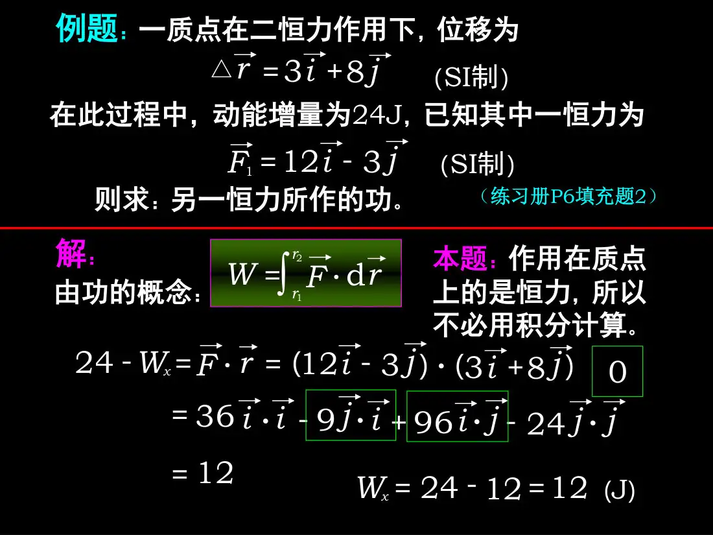

原文：

例题：一质点在二恒力作用下，位移为$\angle A B C = \angle C F C = 9 0 ^ { \circ }$ （SI制）在此过程中，动能增量为24J，已知其中一恒力为$1 2 - 5 \textcircled { 2 } 2 \textcircled { 2 } 2 \textcircled { 2 } 2 \textcircled { 2 } 2 \textcircled { 2 } 2 \textcircled { 2 } 2 \textcircled { 2 } 2 \textcircled { 2 } 2 \textcircled { 2 } 2 \textcircled { 2 } 2 \textcircled { 2 } 2 \textcircled { 2 } 2 \textcircled { 2 } 2 \textcircled { 2 } 2 \textcircled { 2 } 2 \textcircled { 2 } 2 \textcircled { 2 } 2 \textcircled { 2 } 2 \textcircled { 2 } 2 \textcircled { 2 } 2 \textcircled { 2 } 2 \textcircled { 2 } 2 \textcircled { 2 } 2 \textcircled { 2 } 2 \textcircled { 2 } 2 \textcircled { 2 } 2 \textcircled { 2 } 2 \textcircled { 2 } 2 \textcircled { 2 } 2 \textcircled { 2 } 2 \textcircled { 2 } 2 \textcircled { 2 } 2 \textcircled { 2 } 2 \textcircled { 2 } 2 \textcircled { 2 } 2 $ （SI制）则求：另一恒力所作的功。 （练习册P6填充题2）

解：由功的概念：

$$
W = \int_ {r _ {1}} ^ {r _ {2}} \overrightarrow {F} \cdot \mathrm{d} \overrightarrow {r}
$$

本题：作用在质点上的是恒力，所以不必用积分计算。

### （练习册P25填充题10）

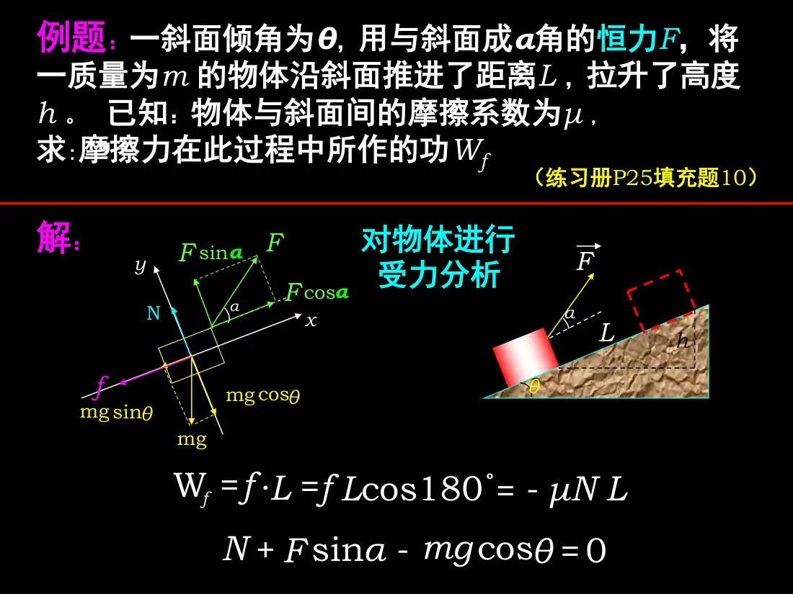

原文：

例题：一斜面倾角为θ，用与斜面成α角的恒力F，将一质量为m 的物体沿斜面推进了距离L ，拉升了高度h 。 已知：物体与斜面间的摩擦系数为μ ,求:摩擦力在此过程中所作的功 W

（练习册P25填充题10）

解：

对物体进行受力分析

Wf＝f ·L＝f Lcos180 =－μN L o

N＋Fsinα－mg cosθ =0

### $W = \frac { 1 } { 2 }$ sinα－mg cosθ =0

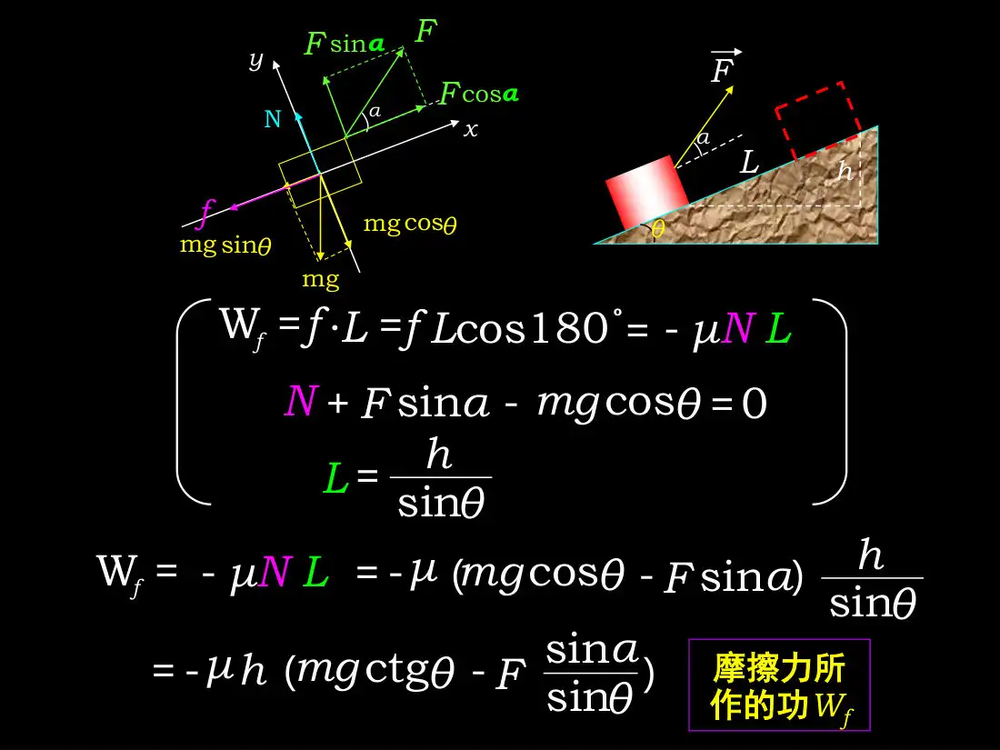

原文：

$W _ { 1 } = ( 1 0 - 1 ) m = 1 1$ Lcos180 =－μN Lo

$W = \frac { 1 } { 2 }$ sinα－mg cosθ =0

$$
L = \frac {h}{\sin \theta}
$$

$W _ { 2 } = - \frac { 1 } { 2 } \times \frac { 1 } { 3 } = \frac { 1 } { 3 }$ （mg cosθ－Fsinα）

＝－μh（mg ctgθ －F sinαsinθ

$$
\frac {h}{\sin \theta}
$$

摩擦力所作的功Wf

### 第 29 页

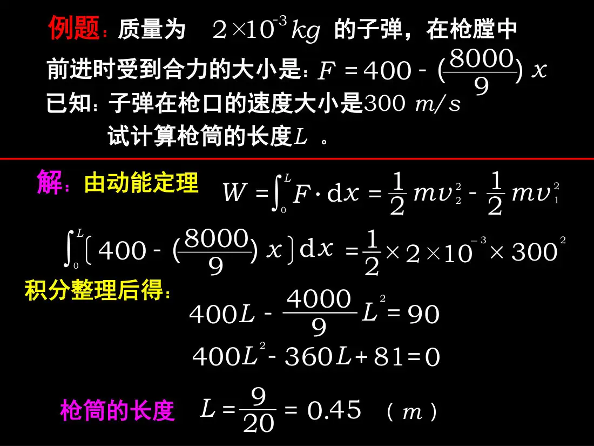

原文：

例题：质量为 $\textcircled { 2 } \textcircled { \div } \textcircled { 1 } \textcircled { \div } \textcircled { \div } \textcircled { \div } \textcircled { \div }$ 的子弹，在枪膛中前进时受到合力的大小是： $\frac { 1 2 } { 1 0 } \times \frac { 1 0 0 0 } { 1 0 } = \frac { 1 0 0 0 0 } { 1 0 } = \frac { 1 0 0 0 0 } { 1 0 }$ 已知：子弹在枪口的速度大小是300 m/s试计算枪筒的长度L 。

解：由动能定理 $( 1 ) ( 1 0 - 1 ) \times ( 1 0 - 2 ) \times ( 1 0 - 2 ) = 1 0 ( 1 0 - 2 ) ( 1 0 - 2 ) = 1 0 ( 1 0 - 2 ) ( 1 0 - 2 ) ( 1 0 - 2 ) ( 1 0 - 2 ) ( 1 0 - 2 ) ( 1 0 - 2 ) ( 1 0 - 2 ) ( 1 0 - 2 ) ( 1 0 - 2 )$ $1 0 0 0 \times \frac { 1 0 0 0 0 } { 0 0 0 0 0 } \times 2 0 0 0 0 0 = 2 0 0 0 0 0 0 0 0$ 积分整理后得： $\frac { ( 1 0 1 0 ) } { ( 1 0 1 0 ) } \times \frac { ( 1 0 1 0 ) } { ( 1 0 1 0 ) } = \frac { ( 1 0 1 0 ) } { ( 1 0 1 0 ) }$ 枪筒的长度 $1 0 \div \frac { 0 } { 0 . 0 6 } = \frac { 0 . 0 6 } { 0 . 0 6 } = \frac { 0 . 0 6 } { 0 . 0 6 }$

### (练习册P25填充题9）

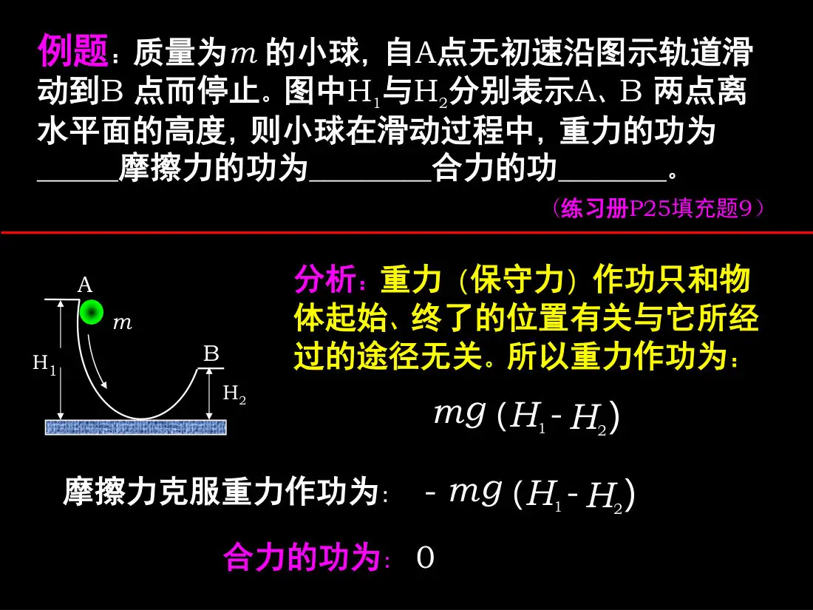

原文：

例题：质量为m 的小球，自A点无初速沿图示轨道滑动到B 点而停止。图中H 与H 分别表示A、B 两点离水平面的高度，则小球在滑动过程中，重力的功为摩擦力的功为 合力的功

(练习册P25填充题9）

分析：重力（保守力）作功只和物体起始、终了的位置有关与它所经过的途径无关。所以重力作功为：

mg（H1－H）

摩擦力克服重力作功为: $1 4 \times 9 = 1 4 ( m ^ { 2 } )$

合力的功为: 0

### $$

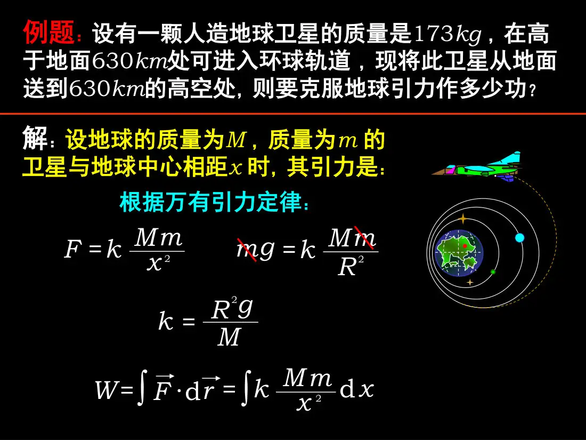

原文：

例题：设有一颗人造地球卫星的质量是173kg ，在高于地面630km处可进入环球轨道 ，现将此卫星从地面送到630km的高空处，则要克服地球引力作多少功？

解：设地球的质量为M ，质量为m 的卫星与地球中心相距x 时，其引力是：根据万有引力定律：

$$
F = k \frac {M m}{x ^ {2}}
$$

$$
m g = k \frac {M m}{R ^ {2}}
$$

$$
k = \frac {R ^ {2} g}{M}
$$

W=∫F·dr=∫k Mm dx x 2

### $$

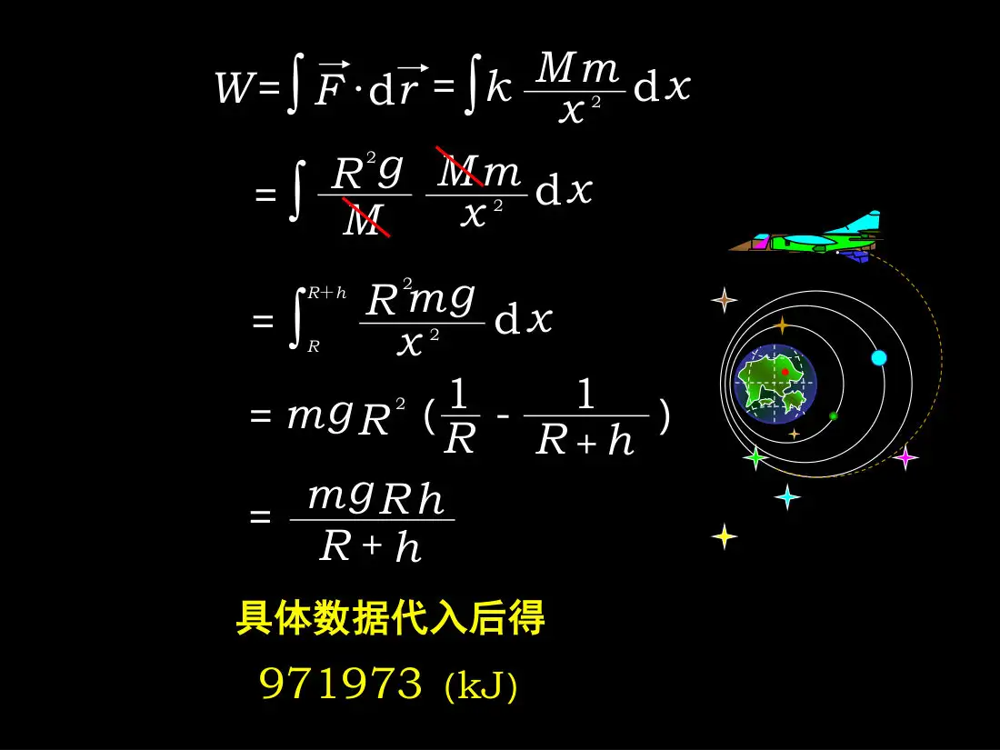

原文：

$$
\begin{array}{r l} & W = \int \overrightarrow {F} \cdot \mathrm{d} \overrightarrow {r} = \int k \frac {M m}{x ^ {2}} \mathrm{d} x \\ & = \int \frac {R ^ {2} g}{M} \frac {M m}{x ^ {2}} \mathrm{d} x \\ & = \int_ {R} ^ {R + h} \frac {R ^ {2} m g}{x ^ {2}} \mathrm{d} x \\ & = m g R ^ {2} (\frac {1}{R} - \frac {1}{R + h}) \\ & = \frac {m g R h}{R + h} \\ & \text {具体数据代入后得} \end{array}
$$

971973（kJ）

### 解： 由功的概念： 概念：

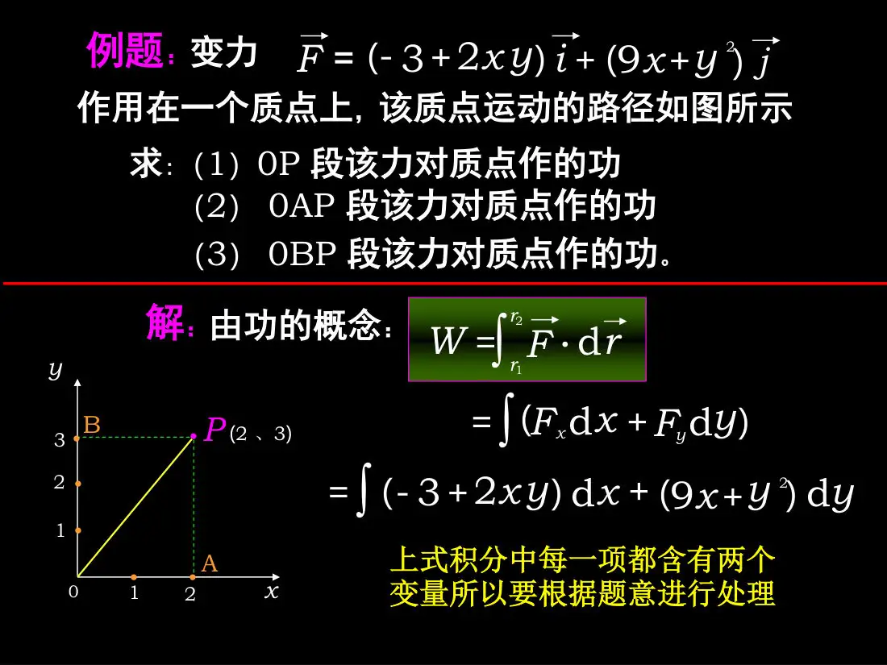

原文：

例题：变力 $1 2 - ( 1 0 - 2 0 ) \times ( 2 0 - 2 0 ) \times ( 2 0 - 2 0 ) \times ( 2 0 - 2 0 ) \times ( 2 0 - 2 0 ) \times ( 2 0 - 2 0 ) \times ( 2 0 - 2 0 ) \times ( 2 0 - 2 0 ) \times ( 2 0 - 2 0 )$ 作用在一个质点上，该质点运动的路径如图所示

求:（1）0P 段该力对质点作的功（2） 0AP 段该力对质点作的功（3） 0BP 段该力对质点作的功。

解： 由功的概念： 概念：

W = F. dr2r1$= 1 1 0 0 0 0 0 0 0 0 0 0 0 0 0 0 0 0$ $= ( 1 5 . 5 7 . 5 7 . 5 7 . 5 7 . 5 7 . 5 7 . 5 7 . 5 7 . 5 7 . 5 7 . 5 7 . 5 7 . 5 7 . 5 7 . 5 7 . 5 7 . 5 7 . 5 7 . 5 7 . 5 7 . 5 7 . 5 7 . 5 7 . 5 7 . 5 7 . 5 7 . 5 7 . 5 7 . 5 7 . 5 7 . 5 7 . 5 7 . 5 7 . 5 7 . 5 7 . 5 7 . 5 7 . 5 7 . 5 7 .$ 上式积分中每一项都含有两个变量所以要根据题意进行处理

### $$

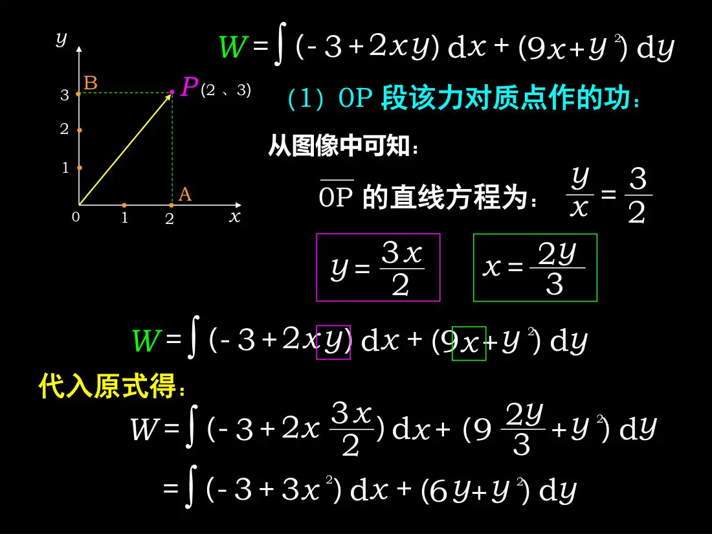

原文：

$$
W = \int (- 3 + 2 x y) \mathrm{d} x + (9 x + y ^ {2}) \mathrm{d} y
$$

（1）0P 段该力对质点作的功：

从图像中可知：

0P 的直线方程为： $\frac { \frac { 1 0 } { 2 } } { 2 } = \frac { 6 } { 2 }$

$$
y = \frac {3 x}{2}
$$

$$
x = \frac {2 y}{3}
$$

$( 1 ) 1 0 0 0 0 0 0 0 0 0 0 0 0 0 0 0 0 0 0 0 0 0 0 0 0 0 0 0 0 0 0 0 0 0 0 0 0 0 0 0 0 0 0 0 0 0 0 0 0 0 0 0 0 0 0 0 0 0 0 0 0 0 0 0 0 0 0 0 0 0 0 0 0 0 0 0 0 0 0 0 0 0 0 0 0 0 0 0 0 0 0 0 0 0 0 0 0 0 0 0 0 0 0 0 0 0 0 0 0 0 0 0 0 0 0 0 0 0 0 0 0 0 0 0 0 0 0 0 0 0 0 0 0 0 0 0 0 0 0 0 0 0 0 0 0 0 0 0 0 0 0 0 0 0 0 0 0 0 0 0 0 0 0 0 0 0 0 0 0 0 0 0 0 0 0 0 0 0 0 0 0 0 0 0 0 0 0 0 0 0 0 0 0 0 0 0 0 0 0 0 0 0 0 0 0 0 0 0 0 0 0 0 0 0 0 0 0 0 0 0 0 0 0 0 0 0 0 0 0 0 0 0 0 0 0 0 0 0 0 0 0 0 0 0 0 0 0 0 0 0 0 0 0 0 0 0 0 0 0 0 0 0 0 0 0 0 0 0 0 0 0 0 0 0 0 0 0 0 0 0 0 0 0 0 0 0 0 0 0 0 0 0 0 0 0 0 0 0 0 0 0 0 0 0 0 0 0 0 0 0 0 0 0 0 0 0 0 0 0 0 0 0 0 0 0 0 0 0 0 0 0 0 0 0 0 0 0 0 0 0 0 0 0 0 0 0 0 0 0 0 0 0 0 0 0 0 0 0 0 0 0 0 0 0 0 0 0 0 0 0 0 0 0 0 0 0 0 0 0 0 0 0 0 0 0 0 0 0 0 0 0 0 0 0 0 0 0 0 0 0 0 0 0 0 0 0 0 0 0 0 0 0 0 0 0 0 0 0 0 0 0 0 0 0 0 0 0 0 0 0 0 0 0 0 0 0 0 0 0 0 0 0 0 0 0 0 0 0 0 0 0 0 0 0 0 0 0 0 0 0 0 0 0 0 0 0 0 0 0 0 0 0 0 0 0 0 0 0 0 0 0 0 0 0 0 0 0 0 0 0 0 0 0 0 0 0 0 0 0 0 0 0 0 0 0 0 0 0 0 0 0 0 0 0 0 0 0 0 0 0 0 0 0 0 0 0 0 0 0 0 0 0 0 0 0 0 0 0 0 0 0 0 0 0 0 0 0 0 0 0 0 0 0 0 0 0 0 0 0 0 0 0 0 0 0 0 0 0 0 0 0 0 0$ ）dy

代入原式得：

$$
\begin{array}{r l} & W = \int (- 3 + 2 x \frac {3 x}{2}) \mathrm{d} x + (9 \frac {2 y}{3} + y ^ {2}) \mathrm{d} y \\ & = \int (- 3 + 3 x ^ {2}) \mathrm{d} x + (6 y + y ^ {2}) \mathrm{d} y \end{array}
$$

### $$

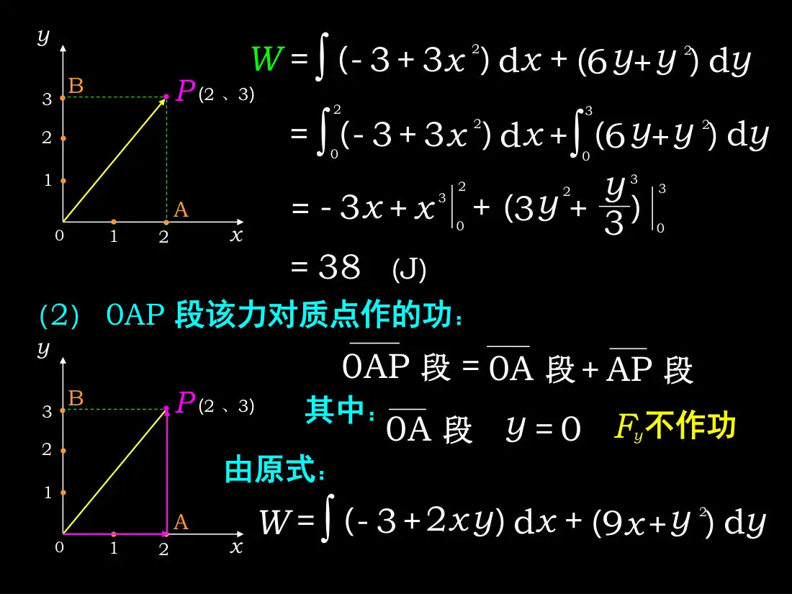

原文：

$$
\begin{array}{l} \text {   W = \int (-3 + 3x^2) dx + (6y+ y^2) dy   } \\ \text {   = \int_0^2 (-3 + 3x^2) dx + \int_0^3 (6y+ y^2) dy   } \\ \text {   = -3x + x^3|_0^2 + (3y^2 + \frac{y^3}{3})|_0^3   } \\ \text {   = 38 (J)   } \end{array}
$$

（2） 0AP 段该力对质点作的功：

P(2 、3)·

0AP 段＝0A 段＋AP 段

其中： $\textcircled { 9 } \frac { 4 } { 3 }$ 段 y＝0 $\sqrt { \frac { D } { B } \frac { x } { y } }$ 不作功

由原式：

（9x＋y 2 =（－3＋2xy）dx＋ ）dyW

### （2） 0AP 段该力对质点作的功：

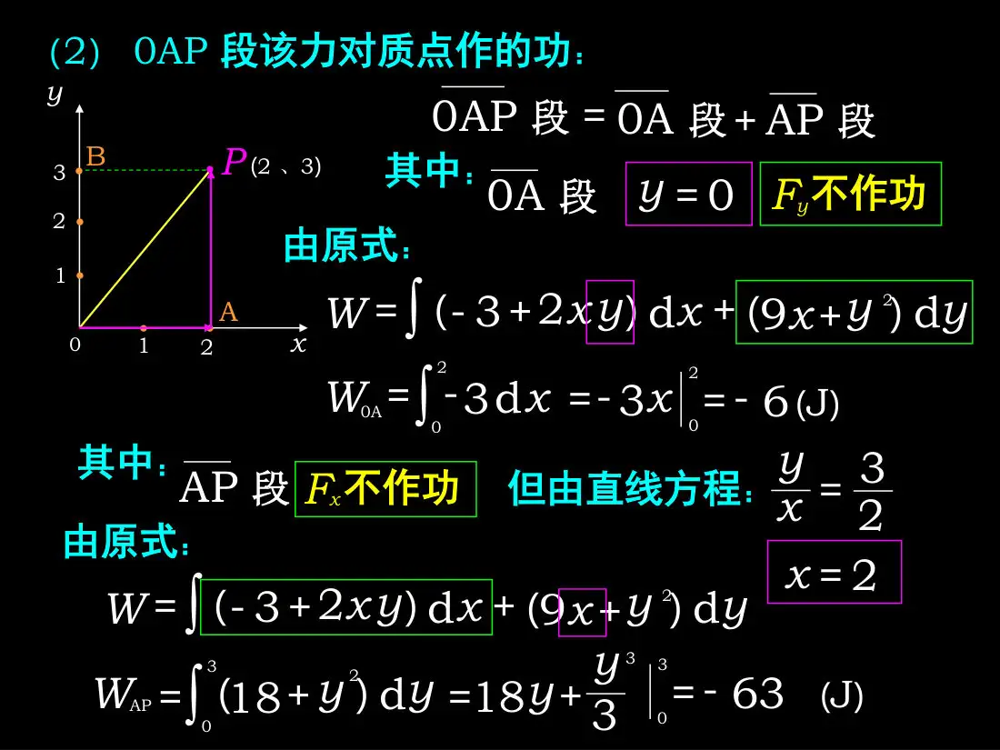

原文：

（2） 0AP 段该力对质点作的功：

0AP 段＝0A 段＋AP 段

由原式：

$$
W = \int (- 3 + 2 x y) d x + (9 x + y ^ {2}) d y
$$

$$
W _ {0 \mathrm{A}} = \int_ {0} ^ {2} - 3 \mathrm{d} x = - 3 x \Big | _ {0} ^ {2} = - 6 (\mathrm{J})
$$

其中：AP 段 Fx不作功 但由直线方程： $\frac { \frac { 1 0 } { 2 } } { 2 } = \frac { 6 } { 2 }$

（9x＋y 2 =（－3＋2xy）dx＋ ）dyW

$$
x = 2
$$

$1 1 7 5 \div 1 9 9 \cdots 2 9 9 1 0 1 0 1 0 1 \cdots 2 9 9 \cdots 2 9 9$ (J)

### $$

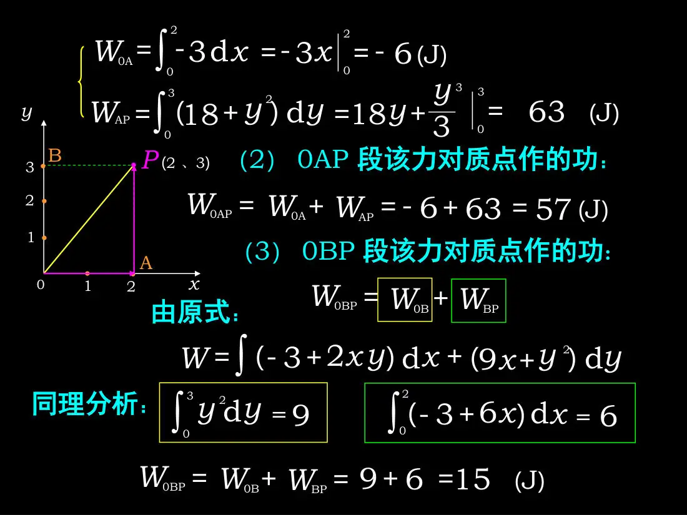

原文：

$$
W _ {0 \mathrm{A}} = \int_ {0} ^ {2} - 3 \mathrm{d} x = - 3 x \Big | _ {0} ^ {2} = - 6 (\mathrm{J})
$$

$$
W _ {\mathrm{AP}} = \int_ {0} ^ {3} (1 8 + y ^ {2}) \mathrm{d} y = 1 8 y + \frac {y ^ {3}}{3} \Big | _ {0} ^ {3} = 6 3 (\mathrm{J})
$$

P(2 、3) （2） 0AP 段该力对质点作的功：

$$
W _ {\mathrm{0AP}} = W _ {\mathrm{0A}} + W _ {\mathrm{AP}} = - 6 + 6 3 = 5 7 (\mathrm{J})
$$

（3） 0BP 段该力对质点作的功:

由原式：

$$
W _ {\mathrm{OBP}} = \boxed {W _ {\mathrm{OB}}} + \boxed {W _ {\mathrm{BP}}}
$$

$$
W = \int (- 3 + 2 x y) \mathrm{d} x + (9 x + y ^ {2}) \mathrm{d} y
$$

同理分析：

$$
\int_ {0} ^ {3} y ^ {2} \mathrm{d} y = 9
$$

$$
\int_ {0} ^ {2} (- 3 + 6 x) \mathrm{d} x = 6
$$

$$
W _ {\mathrm{OBP}} = W _ {\mathrm{OB}} + W _ {\mathrm{BP}} = 9 + 6 = 1 5 \quad (\mathrm{J})
$$

### 受力分析：摆球受到三个力的作用：摆球的重力mg 绳子的张力T 和水平力F

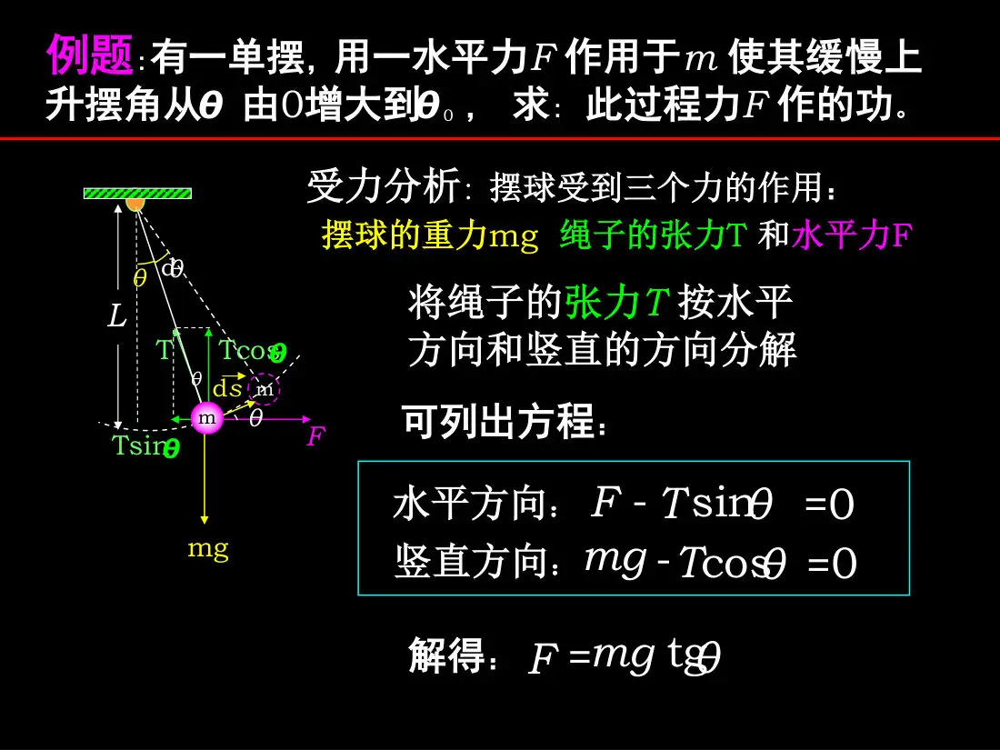

原文：

例题:有一单摆，用一水平力F 作用于m 使其缓慢上升摆角从θ 由0增大到θ ， 求: 此过程力F 作的功。

受力分析：摆球受到三个力的作用：摆球的重力mg 绳子的张力T 和水平力F

将绳子的张力T按水平方向和竖直的方向分解

可列出方程：

F－Tsinθ =0水平方向：mg Tcos =0－ θ竖直方向：

解得： F=mg tgθ

### 可列出方程：

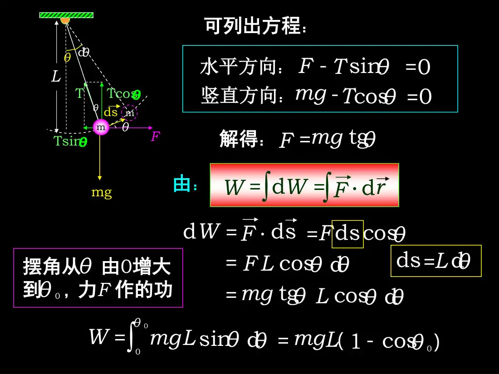

原文：

可列出方程：

水平方向： $1 0 \times 1 0 = 1 0 0 0 ( c m ) = 1 0 0 ( d m )$ 竖直方向： $1 4 \times 9 = 1 1 ( c m ) = 9 7 ( m )$

解得： $1 0 0 - 1 0 0 0 = 1 0 0 0$

由： $W = \int \mathrm { d } W = \int \overrightarrow { F } \cdot \mathrm { d } \overrightarrow { r }$

摆角从 由0增大θ到 ，力F 作的功θdW =F. ds =Fdscosθ= FL cosθ dθ $\therefore A E = \sqrt { 1 } ( 0 , 0 )$ =mg tgθ L cosθ dθ

$\because \angle B = \angle C = 9 0 ^ { \circ }$ mg sin θ =mgL( 1 cosθ 0)L θ d －例题：有一细棒，其密度为ρ,长度为l ，其下端紧贴着密度为ρ´的液体表面，上端用一细线悬挂。试求将悬线剪断后细棒全部没入液体时的速度。

### （不计液体之粘性）

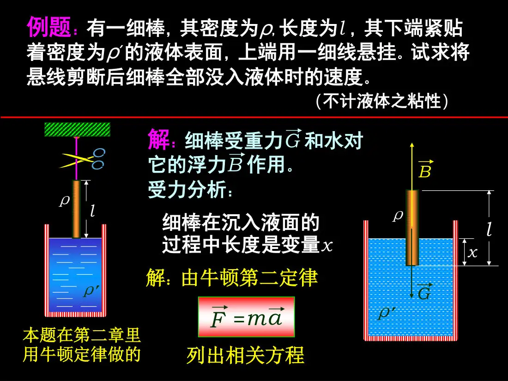

原文：

（不计液体之粘性）

本题在第二章里

用牛顿定律做的解：细棒受重力G 和水对它的浮力B 作用。受力分析：

细棒在沉入液面的过程中长度是变量x

解：由牛顿第二定律

$$
\vec {F} = m \vec {a}
$$

列出相关方程

### $$

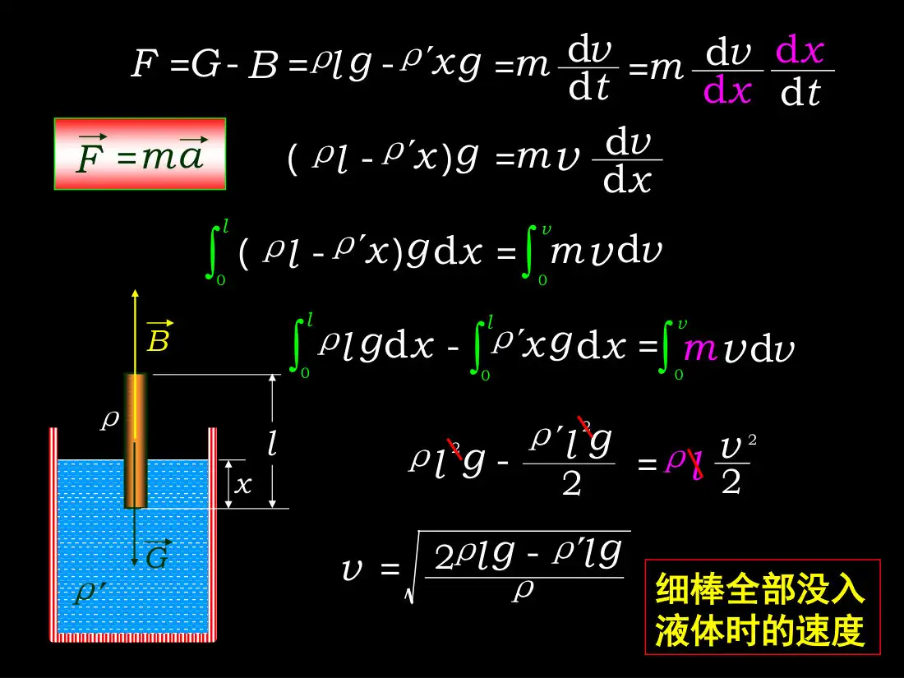

原文：

$$
F = G - B = \rho l g - \rho^ {\prime} x g = m \frac {\mathrm{d} \nu}{\mathrm{d} t} = m \frac {\mathrm{d} \nu}{\mathrm{d} x} \frac {\mathrm{d} x}{\mathrm{d} t}
$$

$$
\vec {F} = m \vec {a}
$$

$$
(\rho l - \rho^ {\prime} x) g = m \nu \frac {\mathrm{d} \nu}{\mathrm{d} x}
$$

∫(ρl-ρ'x)gdx =mvdv

ρ1gdx - ρxgdx =mvdv

$$
\rho l ^ {2} g - \frac {\rho^ {\prime} l ^ {2} g}{2} = \rho \chi \frac {v ^ {2}}{2}
$$

$$
\nu = \sqrt {\frac {2 ^ {\rho} l g - ^ {\rho^ {\prime}} l g}{\rho}}
$$

细棒全部没入液体时的速度

### 解：现在用动能定理解此题更显得方便

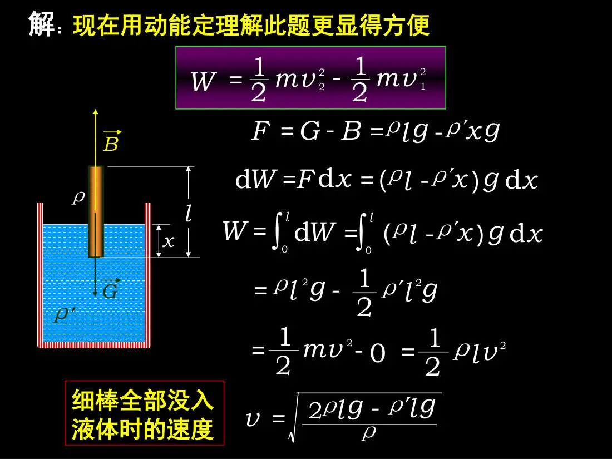

原文：

解：现在用动能定理解此题更显得方便

$$
W = \frac {1}{2} m \nu_ {2} ^ {2} - \frac {1}{2} m \nu_ {1} ^ {2}
$$

$$
F = G - B = ^ {\rho} l g - ^ {\rho^ {\prime}} x g
$$

dW =F dx =（ρl－ρ´x )g dx

$$
\begin{array}{r l} & W = \int_ {0} ^ {l} \mathrm{d} W = \int_ {0} ^ {l} (\rho l - \rho^ {\prime} x) g \mathrm{d} x \\ & \qquad = \rho l ^ {2} g - \frac {1}{2} \rho^ {\prime} l ^ {2} g \\ & \qquad = \frac {1}{2} m v ^ {2} - 0 = \frac {1}{2} \rho l v ^ {2} \\ & \nu = \sqrt {\frac {2 \rho l g - \rho^ {\prime} l g}{\rho}} \end{array}
$$

细棒全部没入液体时的速度

### $$

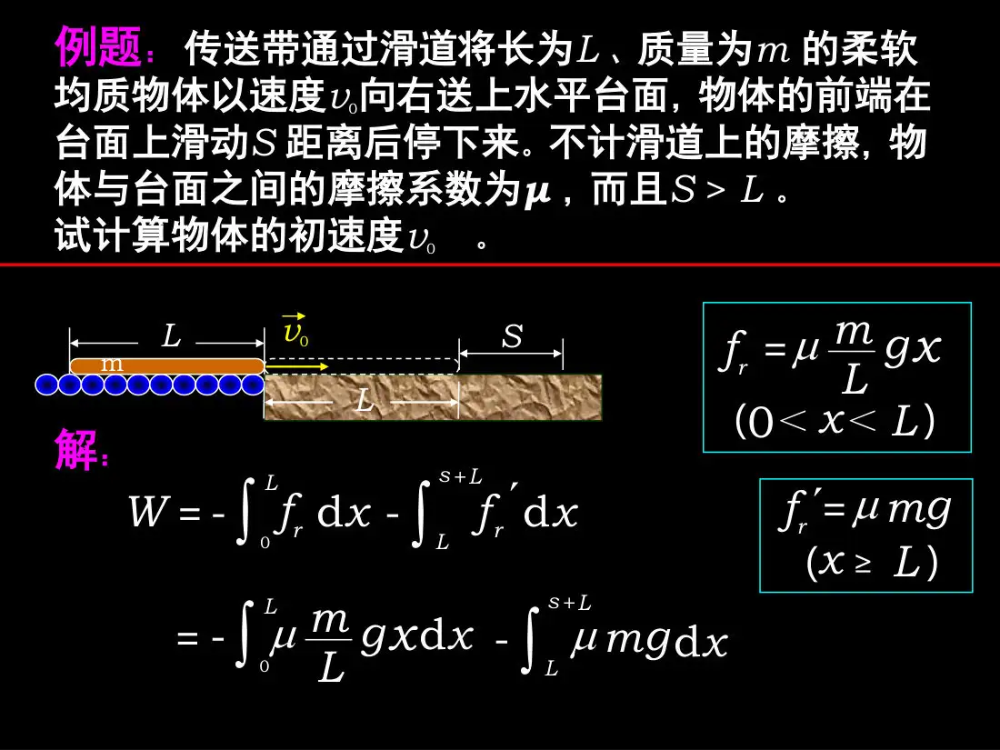

原文：

例题： 传送带通过滑道将长为L 、质量为m 的柔软均质物体以速度v向右送上水平台面，物体的前端在台面上滑动S 距离后停下来。不计滑道上的摩擦，物体与台面之间的摩擦系数为μ ，而且S > L 。试计算物体的初速度v

$$
\begin{array}{l} f _ {r} = \mu \frac {m}{L} g x \\ (0 <   x <   L) \end{array}
$$

解：

W =- ∫µf, dx - ∫ν f, dx s L+ － =  －m gxdx  mgdx L

$$
\begin{array}{l} f _ {r} ^ {\prime} = \mu m g \\ (x \ge L) \end{array}
$$

### 第 44 页

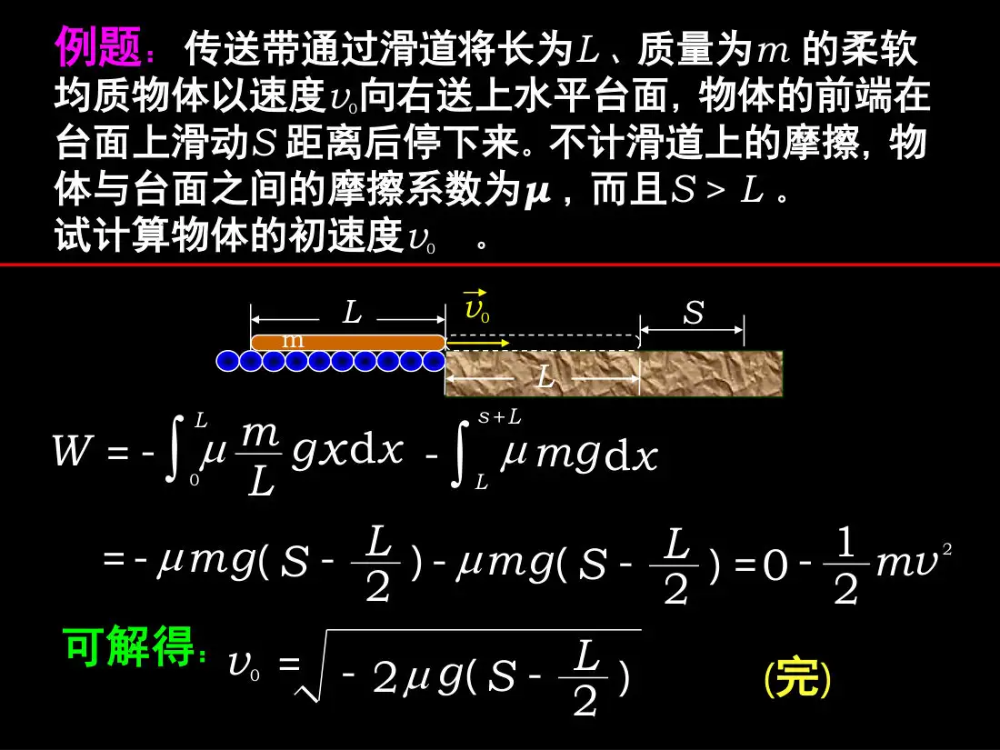

原文：

例题： 传送带通过滑道将长为L 、质量为m 的柔软均质物体以速度v向右送上水平台面，物体的前端在台面上滑动S 距离后停下来。不计滑道上的摩擦，物体与台面之间的摩擦系数为μ ，而且S > L 。试计算物体的初速度v

L v0 Sm00000000 L sW  m gxdx  mgdx0 L$\angle A C E = \angle A C E = \angle A C E = \angle A C E = \angle E C E = \angle E C E$ 可解得： $( 1 ) . = ( 1 - \frac { 1 } { 2 } ) \times ( 1 0 - \frac { 1 } { 2 } ) \times ( 1 0 - \frac { 1 } { 2 } )$ (完)

### 第 45 页

原文：

sin cos tg ctg sec csc ∝ ≈ ≠≤ ≥⊕′∂∞ § AB C DEFGH IJ K LMNOPQRSTUVW a b c d e fg h i jk l m no pq r s t u v w x yz α γ δ ζ η λ µ ν ξπ ρ σ τ φ Φ ψ  Ω ω x a b c d 1 2 3 0 ΔΣ a b c d i j kox y z XYZ∝ ±干+ × = > < )?1234567890.
