# 《大学物理》§9.1 简谐振动（课件）

原件的每一页，下面附识别出的文字。

### 本学期上课内容为:

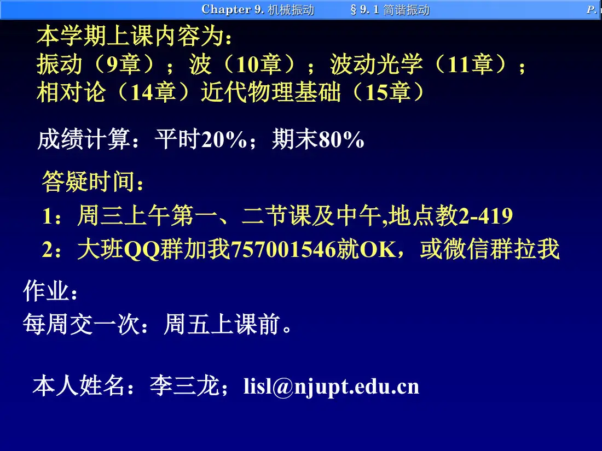

原文：

本学期上课内容为:
振动（9章）；波（10章）；波动光学（11章）；
相对论（14章）近代物理基础（15章）

成绩计算：平时20%；期末80%

答疑时间：

1: 周三上午第一、二节课及中午,地点教2-419

2: 大班QQ群加我757001546就OK，或微信群拉我作业：

每周交一次：周五上课前。

本人姓名：李三龙；lisl@njupt.edu.cn

Chapter 9. 机械振动 § 9.1 简谐振动

P.

### § 9.1 简谐振动

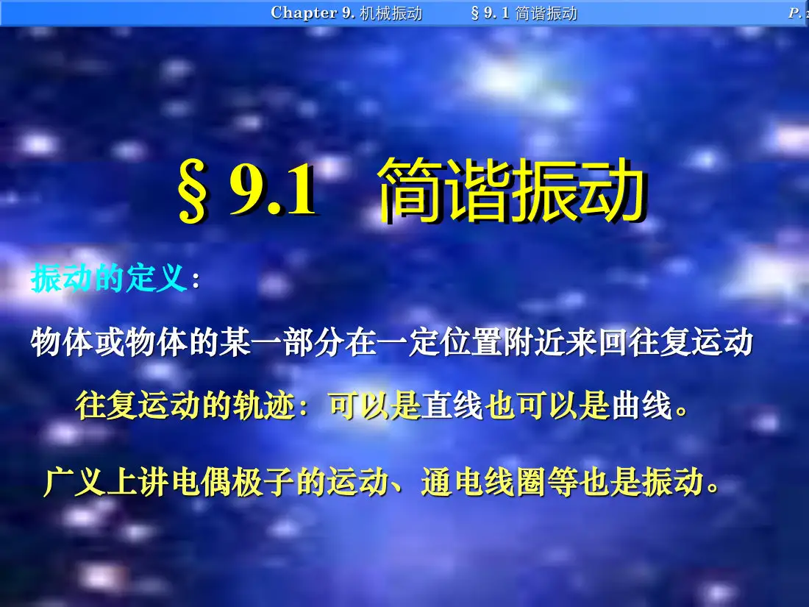

原文：

§ 9.1 简谐振动

振动的定义：

物体或物体的某一部分在一定位置附近来回往复运动

往复运动的轨迹：可以是直线也可以是曲线。

广义上讲电偶极子的运动、通电线圈等也是振动。

Chapter 9. 机械振动

§ 9.1 简谐振动

P.

### 复杂的振动可以看成许多不同频率不同初相位的简谐振动的合成

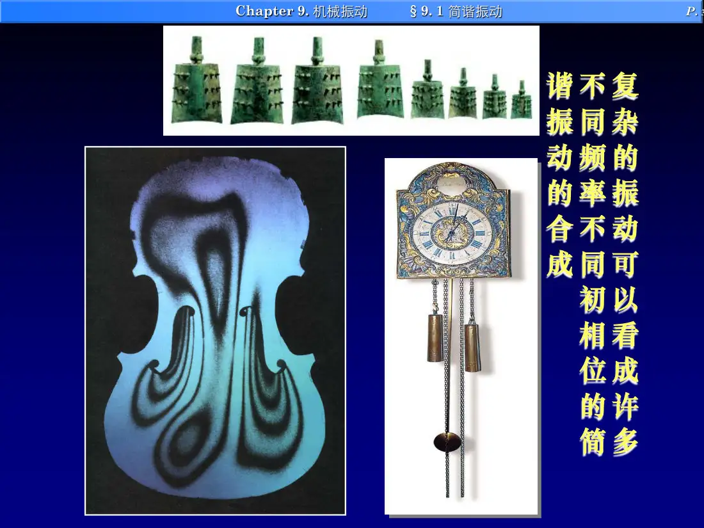

原文：

复杂的振动可以看成许多不同频率不同初相位的简谐振动的合成

Chapter 9. 机械振动

§ 9.1 简谐振动

P.

### 一、简谐振动(谐振动)的描述

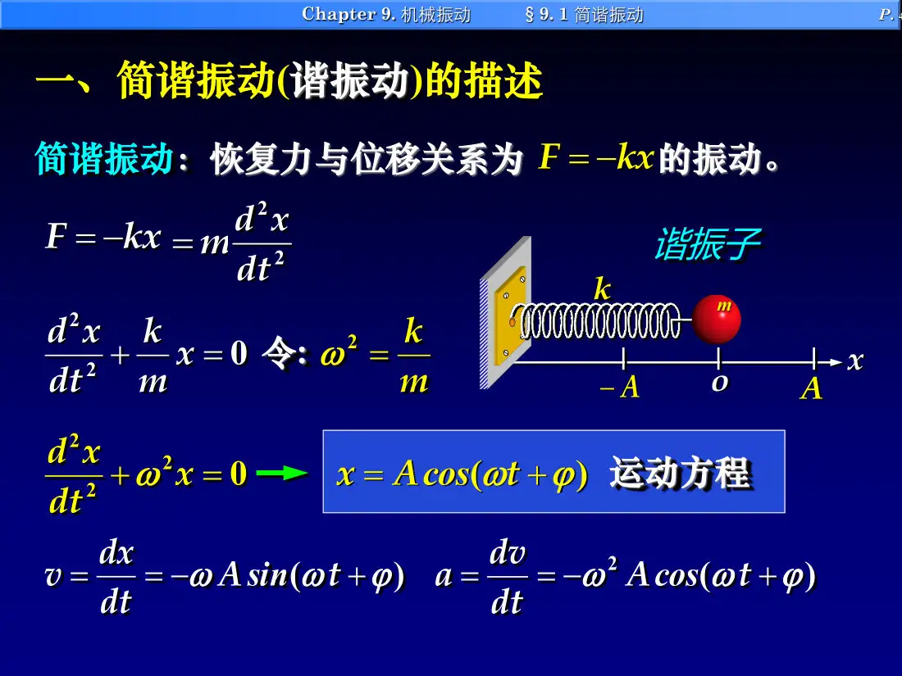

原文：

一、简谐振动(谐振动)的描述

简谐振动：恢复力与位移关系为 $F = -kx$ 的振动。

$$
F = - k x = m \frac {d ^ {2} x}{d t ^ {2}}
$$

谐振子

$$
\frac {d ^ {2} x}{d t ^ {2}} + \frac {k}{m} x = 0 \text {令:} \omega^ {2} = \frac {k}{m}
$$

The image contains no discernible text or characters. It is a graphical representation of a coiled spring, which is composed of small white springs on a blue background with yellow and black vertical markers on the left side. There is no textual content to extract.

$$
\frac {d ^ {2} x}{d t ^ {2}} + \omega^ {2} x = 0
$$

$x = A \cos(\omega t + \varphi)$ 运动方程

$$
v = \frac {d x}{d t} = - \omega A \sin (\omega t + \varphi) \quad a = \frac {d v}{d t} = - \omega^ {2} A \cos (\omega t + \varphi)
$$

Chapter 9. 机械振动 § 9.1 简谐振动

P.

### $$

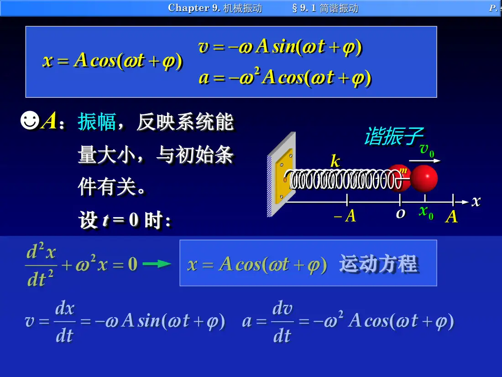

原文：

$$
x = A \cos (\omega t + \varphi)
$$

$$
\begin{array}{l} \boldsymbol {v} = - \omega A \sin (\omega t + \varphi) \\ a = - \omega^ {2} A \cos (\omega t + \varphi) \end{array}
$$

😊A: 振幅, 反映系统能量大小, 与初始条件有关。

设 t=0 时:

$$
\frac {d ^ {2} x}{d t ^ {2}} + \omega^ {2} x = 0 \rightarrow
$$

$x = A \cos(\omega t + \varphi)$ 运动方程

$v = \frac{dx}{dt} = -\omega A \sin (\omega t + \varphi) \quad a = \frac{dv}{dt} = -\omega^2 A \cos (\omega t + \varphi)$

Chapter 9. 机械振动

§ 9.1 简谐振动

P.

### $$

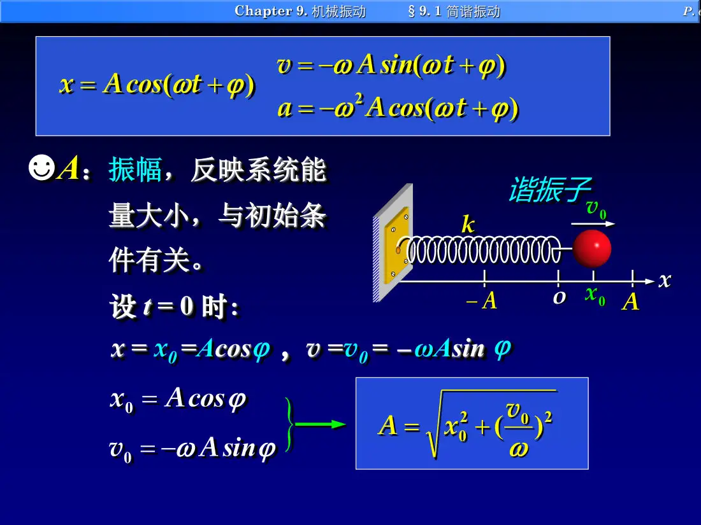

原文：

$$
x = A \cos (\omega t + \varphi)
$$

$$
\begin{array}{l} \boldsymbol {v} = - \omega A \sin (\omega t + \varphi) \\ a = - \omega^ {2} A \cos (\omega t + \varphi) \end{array}
$$

😊A: 振幅, 反映系统能量大小, 与初始条件有关。

设 t=0 时:

谐振子

$x = x_{0} = A\cos \varphi$ , $v = v_{0} = -\omega A\sin \varphi$

$$
x _ {0} = A \cos \varphi
$$

$$
v _ {0} = - \omega A \sin \varphi
$$

$$
A = \sqrt {x _ {0} ^ {2} + (\frac {v _ {0}}{\omega}) ^ {2}}
$$

Chapter 9. 机械振动

§ 9.1 简谐振动

P.

### $$

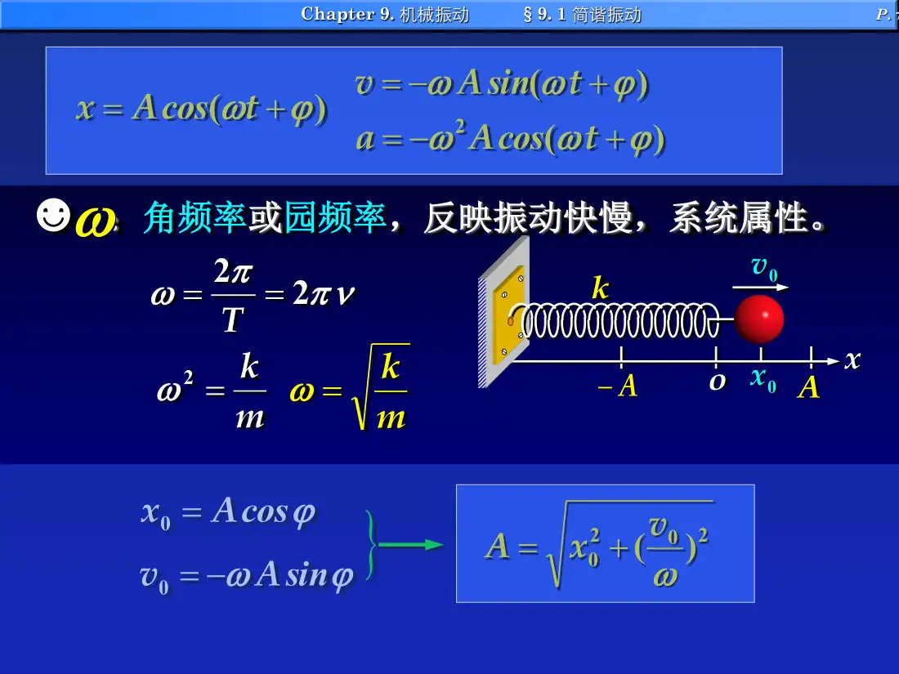

原文：

$$
x = A \cos (\omega t + \varphi)
$$

$$
\boldsymbol {v} = - \omega A \sin (\omega t + \varphi)
$$

$$
a = - \omega^ {2} A \cos (\omega t + \varphi)
$$

@ 角频率或园频率，反映振动快慢，系统属性。

$$
\omega = \frac {2 \pi}{T} = 2 \pi \nu
$$

$$
\omega^ {2} = \frac {k}{m} \quad \omega = \sqrt {\frac {k}{m}}
$$

The image contains a graphical symbol (a coiled spring) and no textual content. Therefore, the correct OCR output is an empty string.

$$
x _ {0} = A \cos \varphi
$$

$$
v _ {0} = - \omega A \sin \varphi
$$

$$
A = \sqrt {x _ {0} ^ {2} + (\frac {v _ {0}}{\omega}) ^ {2}}
$$

Chapter 9. 机械振动

§ 9.1 简谐振动

P.

### $$

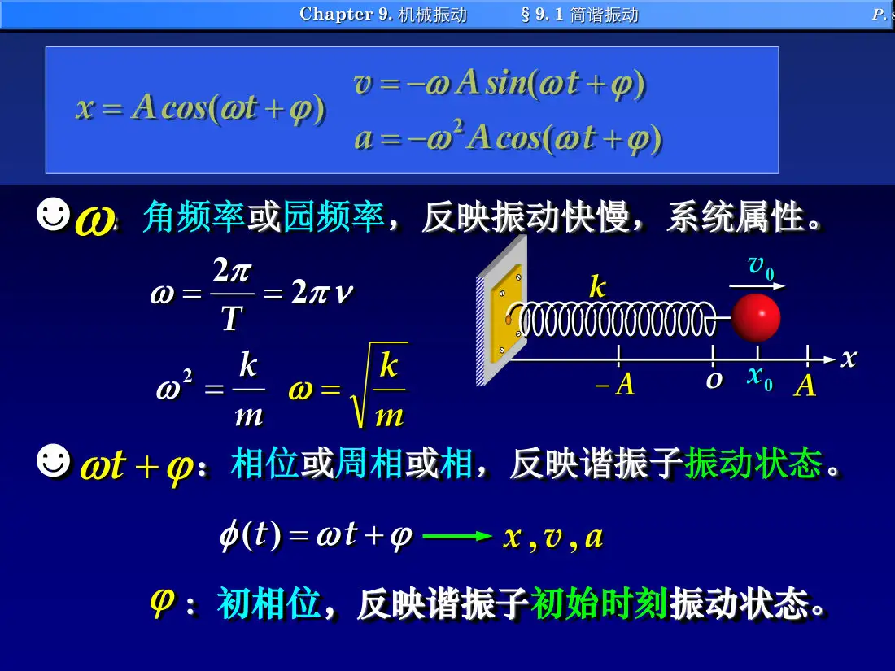

原文：

$$
\boldsymbol {v} = - \omega A \sin (\omega t + \varphi)
$$

$$
x = A \cos (\omega t + \varphi)
$$

$$
a = - \omega^ {2} A \cos (\omega t + \varphi)
$$

@ 角频率或园频率，反映振动快慢，系统属性。

$$
\omega = \frac {2 \pi}{T} = 2 \pi \nu
$$

$$
\omega^ {2} = \frac {k}{m} \quad \omega = \sqrt {\frac {k}{m}}
$$

😊 ωt + φ: 相位或周相或相，反映谐振子振动状态。

$$
\phi (t) = \omega t + \varphi \longrightarrow x, v, a
$$

φ：初相位，反映谐振子初始时刻振动状态。

Chapter 9. 机械振动

§ 9.1 简谐振动

P.

### 二、谐振动曲线

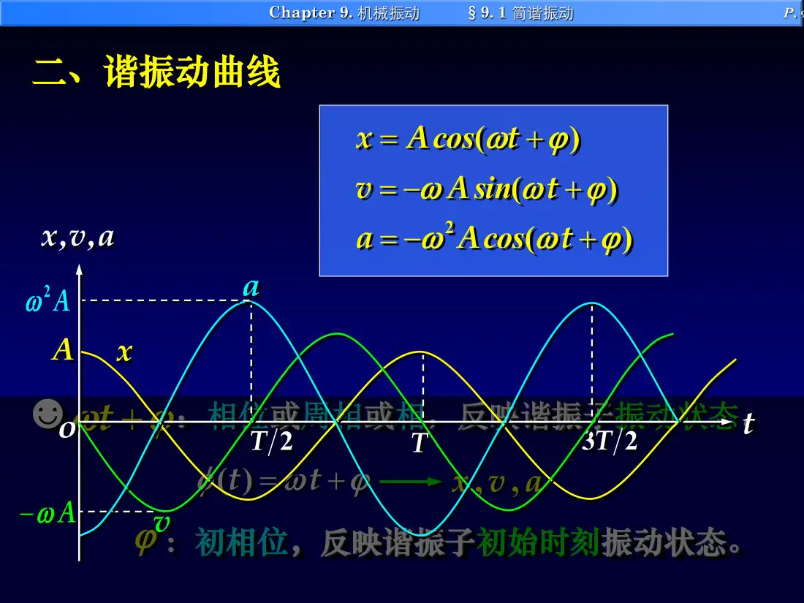

原文：

二、谐振动曲线

$$
x = A \cos (\omega t + \varphi)
$$

$$
\boldsymbol {v} = - \omega A \sin (\omega t + \varphi)
$$

$$
a = - \omega^ {2} A \cos (\omega t + \varphi)
$$

Chapter 9. 机械振动

§ 9.1 简谐振动

P.

### 三、谐振动的图解法——旋转矢量法

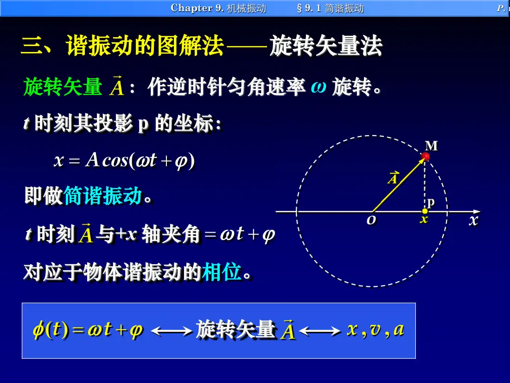

原文：

三、谐振动的图解法——旋转矢量法

旋转矢量 $\vec{A}$ ：作逆时针匀角速率 $\omega$ 旋转。

t 时刻其投影 p 的坐标:

$$
x = A \cos (\omega t + \varphi)
$$

即做简谐振动。

t 时刻 $\vec{A}$ 与 +x 轴夹角 = $\omega t + \varphi$

对应于物体谐振动的相位。

$\phi (t) = \omega t + \varphi \longleftrightarrow$ 旋转矢量 $\vec{A}\longleftrightarrow x,v,a$ 例如，下图中 $t = 0, t_{1}, t_{2}, t_{3}, t_{4}$ 时刻谐振动所对应的旋转矢量： $x, v, a \longrightarrow$ 旋转矢量 $\vec{A}$

Chapter 9. 机械振动

§ 9.1 简谐振动

P.

### Chapter 9. 机械振动

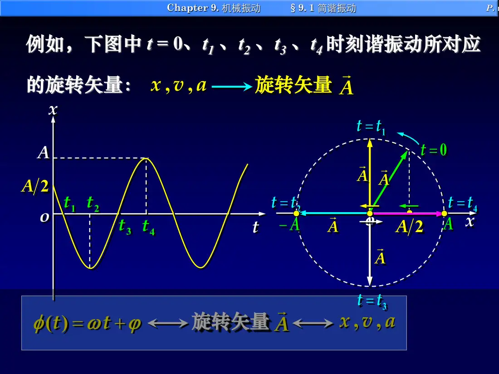

原文：

$\phi (t) = \omega t + \varphi \longleftrightarrow$ 旋转矢量 $\vec{A}\longleftrightarrow x,v,a$ 例如，下图中 $t = 0, t_{1}, t_{2}, t_{3}, t_{4}$ 时刻谐振动所对应的旋转矢量： $x, v, a \longrightarrow$ 旋转矢量 $\vec{A}$

Chapter 9. 机械振动

§ 9.1 简谐振动

P.

### 思考：该振动的初相位 $\varphi = ?$

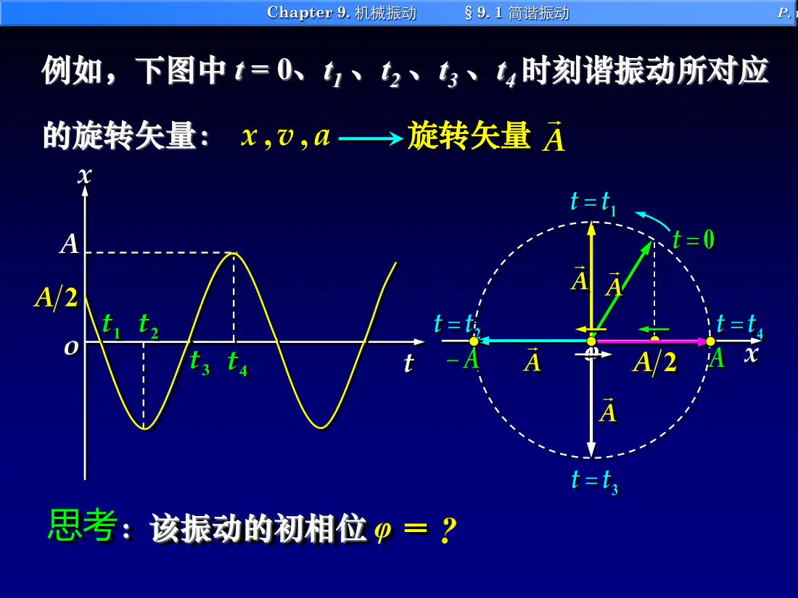

原文：

思考：该振动的初相位 $\varphi = ?$

Chapter 9. 机械振动

§ 9.1 简谐振动

P.

### 录像:

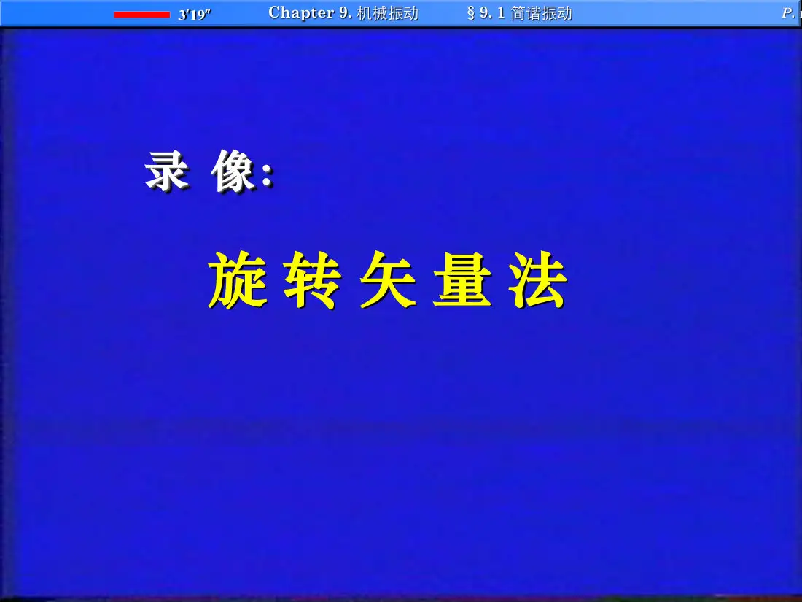

原文：

录像:

旋转矢量法

3'19"

Chapter 9. 机械振动

§ 9.1 简谐振动

P.

### 四、振动问题求解

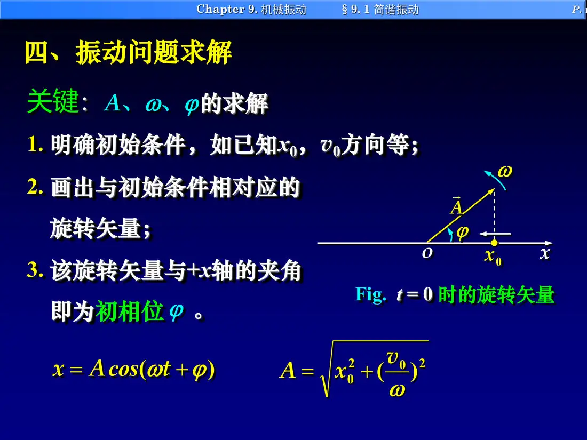

原文：

四、振动问题求解

关键：A、 $\omega$ 、 $\varphi$ 的求解

1. 明确初始条件，如已知 $x_{0}$ ， $v_{0}$ 方向等；

2. 画出与初始条件相对应的旋转矢量;

3. 该旋转矢量与+x轴的夹角即为初相位φ。

$$
x = A \cos (\omega t + \varphi)
$$

Fig. $t = 0$ 时的旋转矢量

$$
A = \sqrt {x _ {0} ^ {2} + (\frac {v _ {0}}{\omega}) ^ {2}}
$$

Chapter 9. 机械振动

§ 9.1 简谐振动

P.

### $$

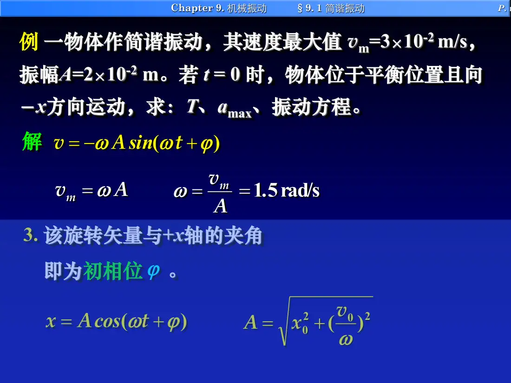

原文：

例一物体作简谐振动，其速度最大值 $v_{m}=3\times10^{-2}$ m/s，
振幅 $A=2\times10^{-2}$ m。若 t=0 时，物体位于平衡位置且向-x方向运动，求：T、 $a_{max}$ 、振动方程。

解 $v = -\omega A \sin(\omega t + \varphi)$

$$
v _ {m} = \omega A
$$

$$
\omega = \frac {v _ {m}}{A} = 1. 5 \mathrm{rad/s}
$$

3. 该旋转矢量与 $+ x$ 轴的夹角

即为初相位 $\varphi$ 。

$$
x = A \cos (\omega t + \varphi)
$$

$$
A = \sqrt {x _ {0} ^ {2} + (\frac {v _ {0}}{\omega}) ^ {2}}
$$

Chapter 9. 机械振动

§ 9.1 简谐振动

P.

### $$

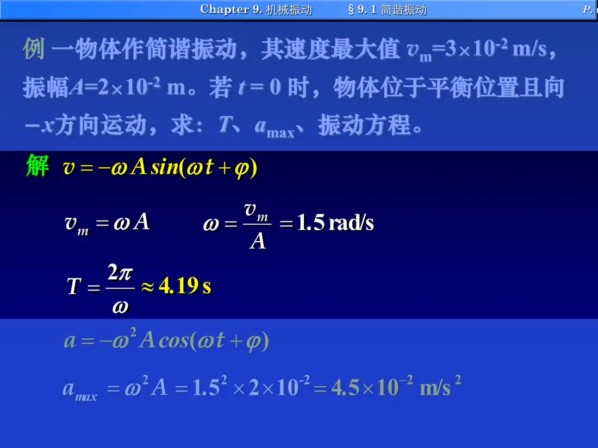

原文：

例一物体作简谐振动，其速度最大值 $v_{\mathrm{m}} = 3 \times 10^{-2} \mathrm{~m/s}$ ，振幅 $A = 2 \times 10^{-2} \mathrm{~m}$ 。若 $t = 0$ 时，物体位于平衡位置且向 -x 方向运动，求：T、 $a_{\max}$ 、振动方程。

解 $v = -\omega A \sin(\omega t + \varphi)$

$$
v _ {m} = \omega A
$$

$$
\omega = \frac {v _ {m}}{A} = 1. 5 \mathrm{rad/s}
$$

$$
T = \frac {2 \pi}{\omega} \approx 4. 1 9 \mathrm{s}
$$

$$
a = - \omega^ {2} A \cos (\omega t + \varphi)
$$

$$
a _ {m a x} = \omega^ {2} A = 1. 5 ^ {2} \times 2 \times 1 0 ^ {- 2} = 4. 5 \times 1 0 ^ {- 2} \mathrm{m/s} ^ {2}
$$

Chapter 9. 机械振动

§ 9.1 简谐振动

P.

### 由旋转矢量图可知: $\varphi = \frac{\pi}{2}$

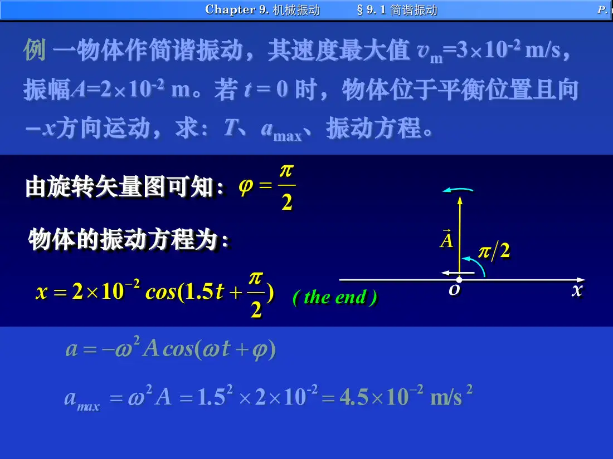

原文：

例一物体作简谐振动，其速度最大值 $v_{m}=3\times10^{-2}$ m/s，
振幅 $A=2\times10^{-2}$ m。若 t=0 时，物体位于平衡位置且向-x方向运动，求：T、 $a_{max}$ 、振动方程。

由旋转矢量图可知: $\varphi = \frac{\pi}{2}$

物体的振动方程为：

$$
x = 2 \times 1 0 ^ {- 2} \cos (1. 5 t + \frac {\pi}{2})
$$

$$
a = - \omega^ {2} A \cos (\omega t + \varphi)
$$

$$
a _ {m a x} = \omega^ {2} A = 1. 5 ^ {2} \times 2 \times 1 0 ^ {- 2} = 4. 5 \times 1 0 ^ {- 2} \mathrm{m/s} ^ {2}
$$

Chapter 9. 机械振动

§ 9.1 简谐振动

P.

### 课堂练习 用旋转矢量法判断下列各振动的初位相 $\varphi$ 。

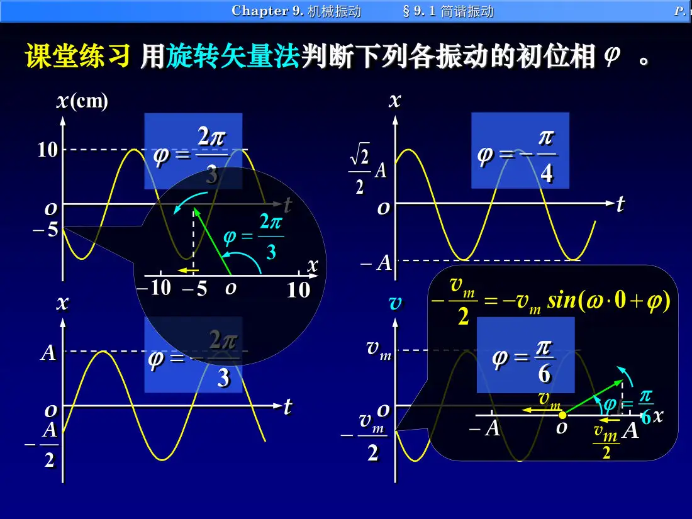

原文：

课堂练习 用旋转矢量法判断下列各振动的初位相 $\varphi$ 。

Chapter 9. 机械振动

§ 9.1 简谐振动

P.

### 解 物体振幅: $A = 0.08 \mathrm{~m}$

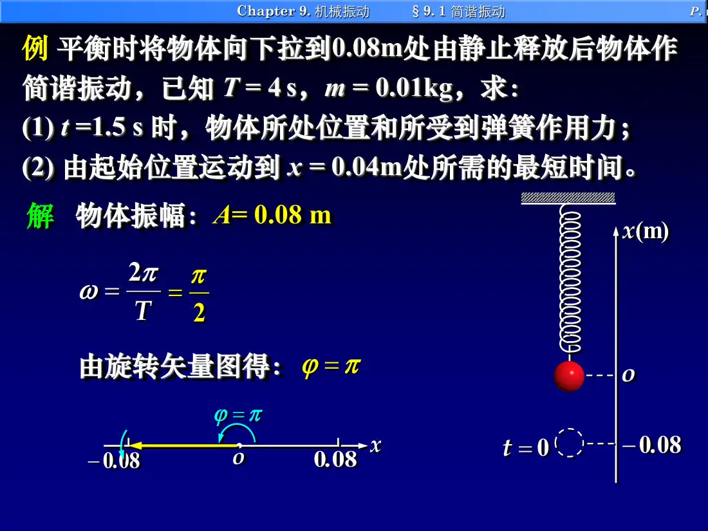

原文：

例 平衡时将物体向下拉到0.08m处由静止释放后物体作简谐振动，已知 T = 4s, m = 0.01kg，求：

(1) $t = 1.5 \mathrm{~s}$ 时, 物体所处位置和所受到弹簧作用力;

(2) 由起始位置运动到 $x = 0.04 \mathrm{~m}$ 处所需的最短时间。

解 物体振幅: $A = 0.08 \mathrm{~m}$

$$
\omega = \frac {2 \pi}{T} = \frac {\pi}{2}
$$

由旋转矢量图得: $\varphi = \pi$

Chapter 9. 机械振动 § 9.1 简谐振动

P.

### $$

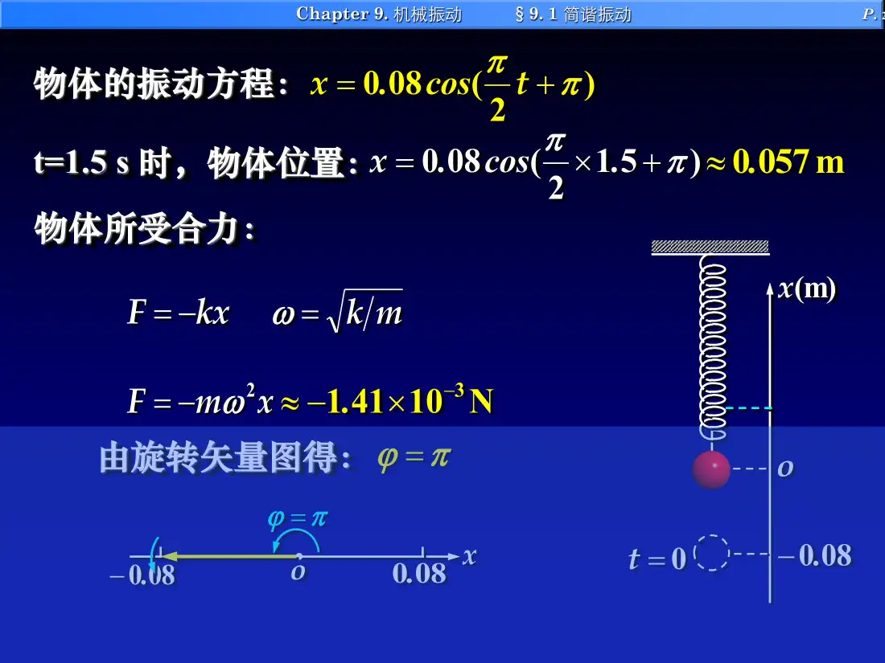

原文：

物体的振动方程: $x = 0.08 \cos \left( \frac{\pi}{2} t + \pi \right)$ t=1.5 s 时, 物体位置: $x = 0.08 \cos \left( \frac{\pi}{2} \times 1.5 + \pi \right) \approx 0.057 \mathrm{~m}$ 物体所受合力:

$$
F = - k x
$$

$$
\omega = \sqrt {k / m}
$$

$$
F = - m \omega^ {2} x \approx - 1. 4 1 \times 1 0 ^ {- 3} \mathrm{N}
$$

由旋转矢量图得: $\varphi = \pi$

$$
\varphi = \pi
$$

Chapter 9. 机械振动

§ 9.1 简谐振动

P.

### $$

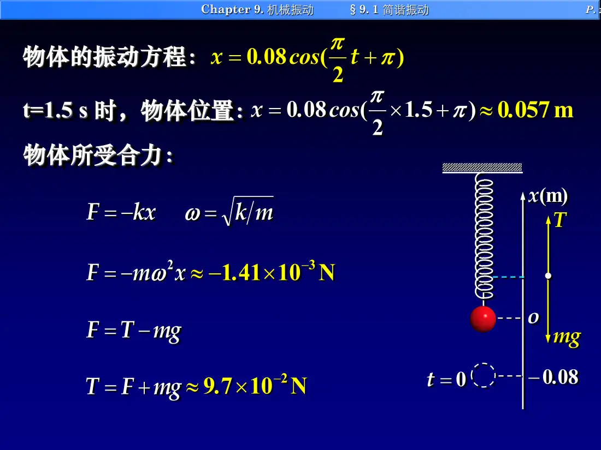

原文：

物体的振动方程: $x = 0.08 \cos \left( \frac{\pi}{2} t + \pi \right)$ t=1.5 s 时, 物体位置: $x = 0.08 \cos \left( \frac{\pi}{2} \times 1.5 + \pi \right) \approx 0.057 \mathrm{~m}$ 物体所受合力:

$$
F = - k x
$$

$$
\omega = \sqrt {k / m}
$$

$$
F = - m \omega^ {2} x \approx - 1. 4 1 \times 1 0 ^ {- 3} \mathrm{N}
$$

$$
F = T - m g
$$

$$
T = F + m g \approx 9. 7 \times 1 0 ^ {- 2} \mathrm{N}
$$

Chapter 9. 机械振动

§ 9.1 简谐振动

P.

### $F = T - mg$

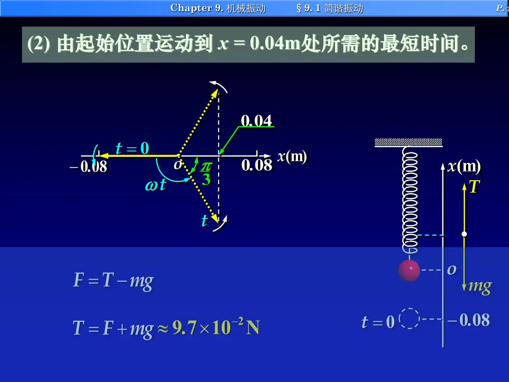

原文：

(2) 由起始位置运动到 $x = 0.04 \mathrm{~m}$ 处所需的最短时间。

$F = T - mg$

$$
T = F + m g \approx 9. 7 \times 1 0 ^ {- 2} \mathrm{N}
$$

Chapter 9. 机械振动

§ 9.1 简谐振动

P.

### $$

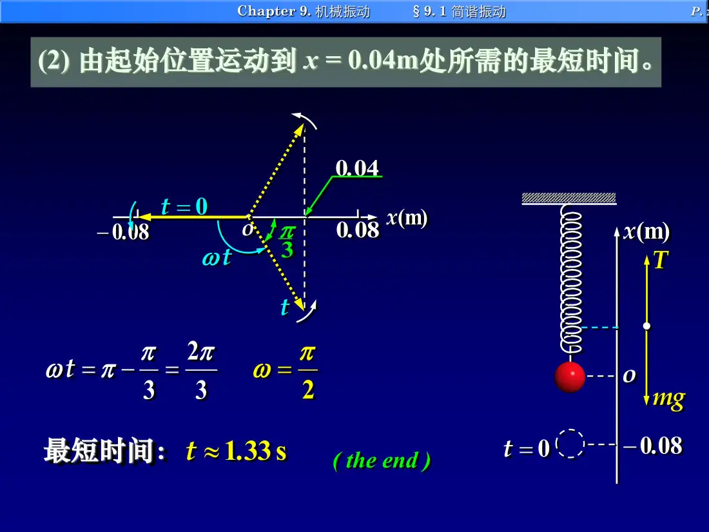

原文：

(2) 由起始位置运动到 $x = 0.04 \mathrm{~m}$ 处所需的最短时间。

$$
\omega t = \pi - \frac {\pi}{3} = \frac {2 \pi}{3} \quad \omega = \frac {\pi}{2}
$$

最短时间: $t \approx 1.33 \mathrm{~s}$

( the end )

Chapter 9. 机械振动

§ 9.1 简谐振动

P.

### 五、简谐振动的超前与落后

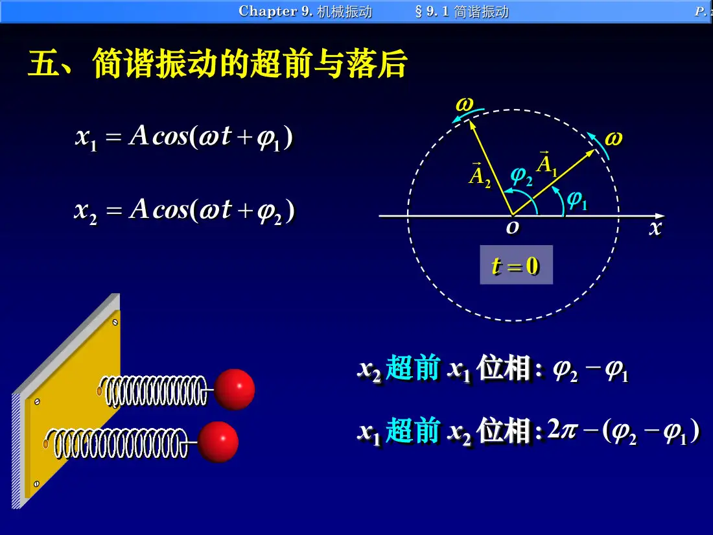

原文：

五、简谐振动的超前与落后

$$
x _ {1} = A \cos (\omega t + \varphi_ {1})
$$

$$
x _ {2} = A \cos (\omega t + \varphi_ {2})
$$

$x_{2}$ 超前 $x_{1}$ 位相: $\varphi_{2}-\varphi_{1}$

$x_{1}$ 超前 $x_{2}$ 位相: $2\pi - (\varphi_{2} - \varphi_{1})$

Chapter 9. 机械振动

§ 9.1 简谐振动

P.

### 位相和时间？

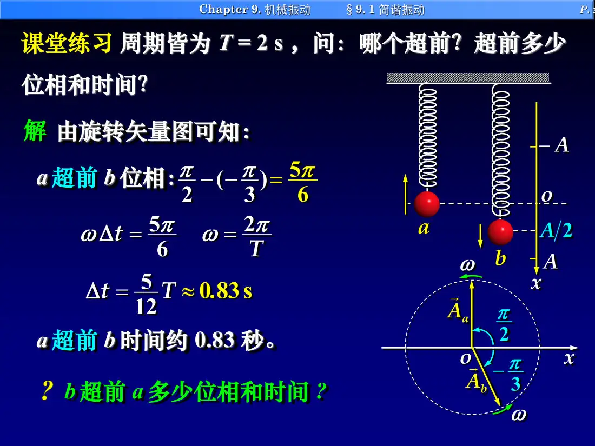

原文：

课堂练习 周期皆为 $T = 2 \mathrm{~s}$ ，问：哪个超前？超前多少

位相和时间？

解 由旋转矢量图可知:

a 超前 b 位相: $\frac{\pi}{2}-\left(-\frac{\pi}{3}\right)=\frac{5\pi}{6}$

$$
\omega \Delta t = \frac {5 \pi}{6} \quad \omega = \frac {2 \pi}{T}
$$

$\Delta t = \frac{5}{12} T \approx 0.83 \mathrm{~s}$

a 超前 b 时间约 0.83 秒。

? b超前 a多少位相和时间？

Chapter 9. 机械振动 § 9.1 简谐振动

P.

### 归纳

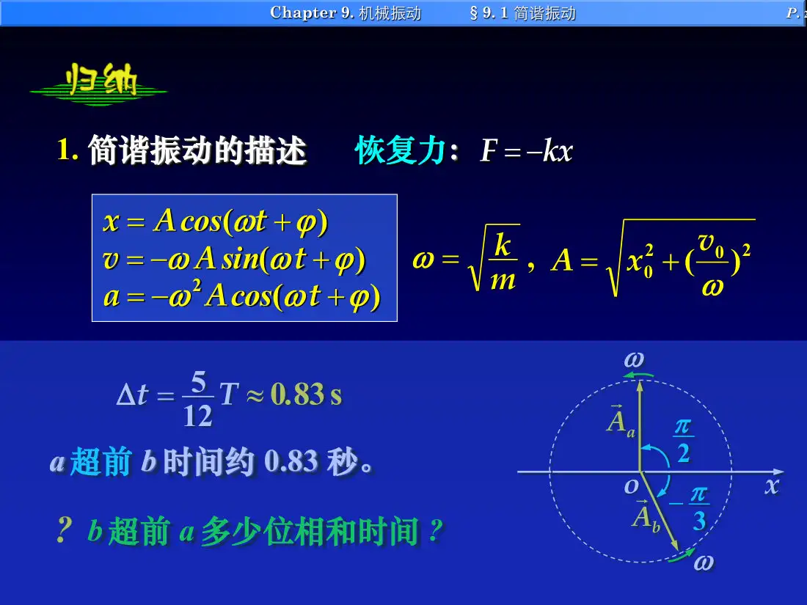

原文：

归纳

1. 简谐振动的描述 恢复力: $F = -kx$

$$
\begin{array}{l} x = A \cos (\omega t + \varphi) \\ v = - \omega A \sin (\omega t + \varphi) \\ a = - \omega^ {2} A \cos (\omega t + \varphi) \end{array}
$$

$$
\Delta t = \frac {5}{1 2} T \approx 0. 8 3 \mathrm{s}
$$

$$
\omega = \sqrt {\frac {k}{m}}, A = \sqrt {x _ {0} ^ {2} + (\frac {v _ {0}}{\omega}) ^ {2}}
$$

a 超前 b 时间约 0.83 秒。

？b超前a多少位相和时间？

Chapter 9. 机械振动

§ 9.1 简谐振动

P.

### 归纳

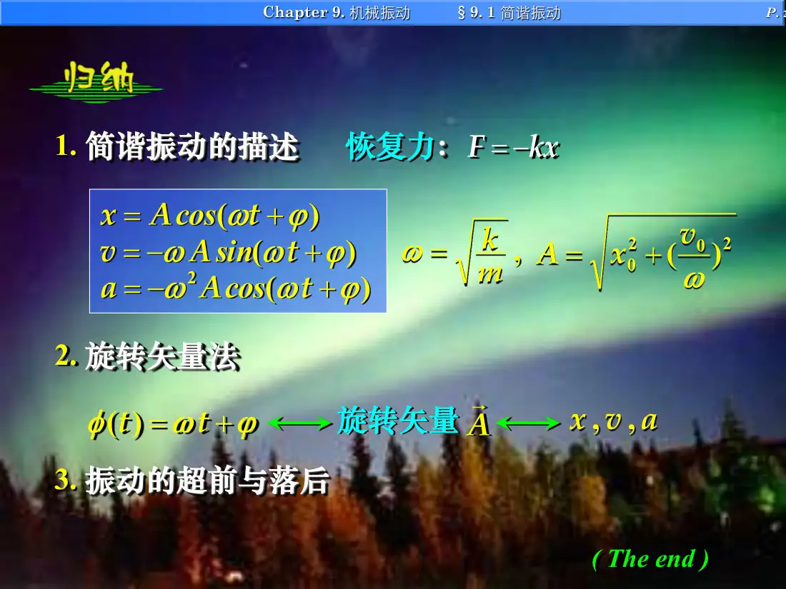

原文：

归纳

1. 简谐振动的描述 恢复力: $F = -kx$

$$
\begin{array}{l} x = A \cos (\omega t + \varphi) \\ v = - \omega A \sin (\omega t + \varphi) \\ a = - \omega^ {2} A \cos (\omega t + \varphi) \end{array}
$$

$$
\omega = \sqrt {\frac {k}{m}}, A = \sqrt {x _ {0} ^ {2} + (\frac {v _ {0}}{\omega}) ^ {2}}
$$

2. 旋转矢量法

$\phi(t) = \omega t + \varphi \longleftrightarrow$ 旋转矢量 $\vec{A} \longleftrightarrow x, v, a$

3. 振动的超前与落后

Chapter 9. 机械振动

§ 9.1 简谐振动

P.
