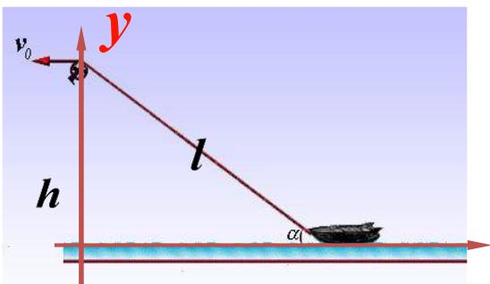

# 《大学物理》（上）同步练习册答案：质点运动学与圆周运动

原件经识别和整理；“参考解答”是我们补的。

# 质点运动学与圆周运动

## 一、第一节 质点运动的描述

### 填空 1

答案：$3\text{m}$，$5\text{m}$。
补充：这里位移的大小和路程不同，因为质点做的不是单向运动。

参考解答：$$s=135\ \text{m}$$

设船相对水的速度为 $u$，水速为 $v$。由题意，船相对岸的逆水速度为 $u-v$，顺水速度为 $u+v$。

由往返总时间条件可得
$$
\frac{s}{u-v}+\frac{s}{u+v}=t,
$$
化简得
$$
s=\frac{t(u^2-v^2)}{2u}.
$$

代入数据计算得
$$
s=135\ \text{m}.
$$

知识点：[位矢及其坐标表示（直角坐标与自然坐标）](../../../topics/大学物理/位矢与坐标表示.md)、[速度、加速度的定义与微分关系](../../../topics/大学物理/速度与加速度定义.md)

### 选择 2

答案：D。

参考解答：**结论：选 B。**

设球心到转轴的距离为 $d$，球半径为 $R$，球体质量为 $m$。均匀实心球对过球心轴的转动惯量为

$$J_C=\frac{2}{5}mR^2$$

由平行轴定理，对题图示切向转轴的转动惯量为

$$J=J_C+md^2=\frac{2}{5}mR^2+md^2$$

由图可读 $d=2R$，故

$$J=\frac{2}{5}mR^2+m(2R)^2=\frac{22}{5}mR^2$$

A 错在只写了质心项或系数不符；C、D 错在平行轴距离或球体转动惯量系数使用错误。

知识点：[速度、加速度的定义与微分关系](../../../topics/大学物理/速度与加速度定义.md)、[自然参数下的切向加速度与法向加速度](../../../topics/大学物理/自然坐标系下的运动.md)

### 填空 3

答案：$x = ( y - 3 ) ^ { 2 }$。
补充：由运动学方程知 $x = 4 \mathrm { t } ^ { 2 } , \ y = 2 \mathrm { t } + 3$ ，两式联立消去 $t$。

参考解答：填空 3 答案：**$\sqrt{17}\ \mathrm{m/s^2}$**，方向与 $x$ 轴夹角为 **$\arctan(-4)$**（或 **$-\arctan 4$**）。

**关键是**求出加速度矢量：若已知 $a_x=1\ \mathrm{m/s^2}$，$a_y=-4\ \mathrm{m/s^2}$，则

$$
a=\sqrt{a_x^2+a_y^2}
=\sqrt{1^2+(-4)^2}
=\sqrt{17}\ \mathrm{m/s^2}.
$$

方向角

$$
\theta=\arctan\frac{a_y}{a_x}
=\arctan\frac{-4}{1}
=\arctan(-4).
$$

因此填 $\sqrt{17}\ \mathrm{m/s^2}$ 和 $\arctan(-4)$。

知识点：[自然参数下的切向加速度与法向加速度](../../../topics/大学物理/自然坐标系下的运动.md)、[速度、加速度的定义与微分关系](../../../topics/大学物理/速度与加速度定义.md)

### 填空 4

答案：3，3，6。
补充：由 $\mathrm { v } = { \frac { \mathrm { d } \mathrm { x } } { \mathrm { d } \mathrm { t } } }$ 知，曲线的斜率则表示速度大小。

参考解答：**结论**

- 速度：$\vec{v} = 4t\,\vec{i} - \pi\sin(\pi t)\,\vec{j}$
- 加速度：$\vec{a} = 4\,\vec{i} - \pi^2\cos(\pi t)\,\vec{j}$
- $x$ 方向加速度大小：$4$
- $y$ 方向加速度幅值（或 $t=0$ 时 $y$ 方向加速度大小）：$\pi^2$

---

**推理过程**

由答案反推，运动方程为：

$$\vec{r}(t) = 2t^2\,\vec{i} + \cos(\pi t)\,\vec{j}$$

**1. 求速度 $\vec{v}$**

对位矢求一阶导数：

$$\vec{v} = \frac{d\vec{r}}{dt} = \frac{d}{dt}(2t^2)\,\vec{i} + \frac{d}{dt}[\cos(\pi t)]\,\vec{j} = 4t\,\vec{i} - \pi\sin(\pi t)\,\vec{j}$$

**2. 求加速度 $\vec{a}$**

对速度再求一阶导数：

$$\vec{a} = \frac{d\vec{v}}{dt} = \frac{d}{dt}(4t)\,\vec{i} + \frac{d}{dt}[-\pi\sin(\pi t)]\,\vec{j} = 4\,\vec{i} - \pi^2\cos(\pi t)\,\vec{j}$$

**3. 两个标量结果**

- $x$ 方向加速度分量恒为常数：$a_x = 4$
- $y$ 方向加速度分量 $a_y = -\pi^2\cos(\pi t)$，其幅值为 $\pi^2$（在 $t=0$ 时恰好取到该值）。

知识点：[速度、加速度的定义与微分关系](../../../topics/大学物理/速度与加速度定义.md)、[位矢及其坐标表示（直角坐标与自然坐标）](../../../topics/大学物理/位矢与坐标表示.md)

### 填空 5

答案：$10\text{m}$。
补充：由运动方程知质点不做单向运动，0－1s内沿x轴正向，1－3s内沿x轴负向。

知识点：[速度、加速度的定义与微分关系](../../../topics/大学物理/速度与加速度定义.md)、[位矢及其坐标表示（直角坐标与自然坐标）](../../../topics/大学物理/位矢与坐标表示.md)

### 计算 6

答案：$x = \frac { \nu _ { \mathrm { 0 } } } { k } \big ( 1 - e ^ { - k t } \big )$。
参考解答：
$$
\nu = { \frac { d x } { d t } } = \nu _ { 0 } \mathrm { e } ^ { - \mathrm { k t } } \rightarrow d x = \nu _ { 0 } \mathrm { e } ^ { - \mathrm { k t } } d t \rightarrow \intop _ { 0 } ^ { x } d x = \intop _ { 0 } ^ { t } \nu _ { 0 } \mathrm { e } ^ { - \mathrm { k t } } d t
$$

参考解答：## 结论

（1）

切向加速度大小：

$$
a_\tau=-b
$$

法向加速度大小：

$$
a_n=\frac{(v_0-bt)^2}{R}
$$

加速度矢量：

$$
\vec a=-b\,\vec e_\tau+\frac{(v_0-bt)^2}{R}\,\vec e_n
$$

（2）加速度大小等于 $b$ 的时刻：

$$
t=\frac{v_0}{b}
$$

---

## 简要推理

质点在任意时刻的速率为

$$
v=v_0-bt
$$

### （1）切向加速度与法向加速度

切向加速度：

$$
a_\tau=\frac{dv}{dt}=-b
$$

法向加速度：

$$
a_n=\frac{v^2}{R}=\frac{(v_0-bt)^2}{R}
$$

所以加速度矢量：

$$
\vec a=a_\tau \vec e_\tau+a_n\vec e_n
=-b\,\vec e_\tau+\frac{(v_0-bt)^2}{R}\,\vec e_n
$$

### （2）何时加速度大小等于 $b$

加速度大小：

$$
|\vec a|=\sqrt{a_\tau^2+a_n^2}
=\sqrt{b^2+\frac{(v_0-bt)^4}{R^2}}
$$

要求：

$$
|\vec a|=b
$$

所以：

$$
\sqrt{b^2+\frac{(v_0-bt)^4}{R^2}}=b
$$

即

$$
\frac{(v_0-bt)^4}{R^2}=0
$$

因此：

$$
v_0-bt=0
$$

解得：

$$
t=\frac{v_0}{b}
$$

知识点：[自然参数下的切向加速度与法向加速度](../../../topics/大学物理/自然坐标系下的运动.md)、[速度、加速度的定义与微分关系](../../../topics/大学物理/速度与加速度定义.md)、[圆周运动的角量描述（角速度、角加速度）](../../../topics/大学物理/圆周运动描述.md)

### 选择 7

答案：B。

知识点：[圆周运动的角量描述（角速度、角加速度）](../../../topics/大学物理/圆周运动描述.md)、[自然参数下的切向加速度与法向加速度](../../../topics/大学物理/自然坐标系下的运动.md)、[牛顿定律在变力问题中的应用（如 ma_t = -mg sinθ）](../../../topics/大学物理/牛顿定律应用.md)

### 选择 8

答案：B。

知识点：[简谐振动的动力学特征与回复力](../../../topics/大学物理/简谐振动的动力学.md)、[用旋转矢量法确定初相与运动状态](../../../topics/大学物理/旋转矢量法.md)

### 选择 9

答案：D。

知识点：[圆周运动的角量描述（角速度、角加速度）](../../../topics/大学物理/圆周运动描述.md)、[牛顿定律在变力问题中的应用（如 ma_t = -mg sinθ）](../../../topics/大学物理/牛顿定律应用.md)、[功的定义、功率与质点动能定理](../../../topics/大学物理/功与动能定理.md)

### 选择 10

答案：B。

知识点：[简谐振动的运动学方程（振幅、角频率、相位）](../../../topics/大学物理/简谐振动运动学.md)、[用旋转矢量法确定初相与运动状态](../../../topics/大学物理/旋转矢量法.md)

### 计算 11

解：由题意知，质点沿 x轴做一维运动，有 $a = { \frac { d \nu } { d t } }$，则：

$$
a = \frac {d v}{d t} = 4 t \rightarrow d v = 4 t d t \rightarrow \int_ {v _ {0}} ^ {v} d v = \int_ {0} ^ {t} 4 t d t \rightarrow v = 2 t ^ {2}
$$

再由 $\nu = { \frac { d x } { d t } }$，则：

$$
\nu = \frac { d x } { d t } = 2 t ^ { 2 } \rightarrow d x = 2 t ^ { 2 } d t \rightarrow \intop _ { x _ {0 } } ^ { x } d x = \intop _ { 0 } ^ { t } 2 t ^ { 2 } d t \rightarrow x = \frac { 2 } { 3 } t ^ { 3 } + 1 0
$$

### 计算 12

解：（1）由题意知，质点在任意时刻 $t$的位矢为：$\vec { r } = 2 t \vec { i } + ( 2 - { t ^ { 2 } } ) \vec { j }$

则当 $t_1=1\text{s}$ 时，对应位矢为：$\vec { r } _ { 1 } = 2 \vec { i } + \vec { j }$

当 $t_2=2\text{s}$ 时，对应位矢为：$\vec { r } _ { 2 } = 4 \vec { i } - 2 \vec { j }$

1s到 2s这段时间内质点的位移：$\Delta \vec { r } = \vec { r } _ { 2 } - \vec { r } _ { 1 } = 2 \vec { i } - 3 \vec { j }$

平均速度：$\overline { { \vec { \nu } } } = \frac { \Delta \vec { r } } { \Delta t } = \frac { \Delta \vec { r } } { t _ { 2 } - t _ { 1 } } = 2 \vec { i } - 3 \vec { j }$

（2）由速度的定义式 $\vec { \nu } = \frac { d \vec { r } } { d t }$，则：
$$
\vec { \nu } = \frac { d \left( 2 t \vec { i } + ( 2 - t ^ { 2 } ) \vec { j } \right) } { d t } = 2 \vec { i } - 2 t \vec { j }
$$

将 $t = 2 \text{s}$ 代入，得质点的速度为：$\vec { \nu } = 2 \vec { i } - 4 \vec { j }$

由加速度的定义式 $\vec { a } = \frac { d \vec { \nu } } { d t }$，则：
$$
\vec { a } = \frac { d \left( 2 \vec { i } - 2 t \vec { j } \right) } { d t } = - 2 \vec { j }
$$

将 $t = 2 \text{s}$ 代入，得质点的加速度为：$\vec { a } = - 2 \vec { j }$

参考解答：（1）$1\,\text{s}$ 到 $2\,\text{s}$ 内的位移为 $\Delta \vec{r} = 2\vec{i} - 3\vec{j}$，平均速度为 $\bar{\vec{v}} = 2\vec{i} - 3\vec{j}$；（2）$t=2\,\text{s}$ 时的速度为 $\vec{v} = 2\vec{i} - 4\vec{j}$，加速度为 $\vec{a} = -2\vec{j}$。

1.  **位移与平均速度**：将 $t_1=1\,\text{s}$ 和 $t_2=2\,\text{s}$ 分别代入位矢方程 $\vec{r}(t) = 2t\vec{i} + (2-t^2)\vec{j}$，得 $\vec{r}_1 = 2\vec{i} + \vec{j}$，$\vec{r}_2 = 4\vec{i} - 2\vec{j}$。位移 $\Delta \vec{r} = \vec{r}_2 - \vec{r}_1 = 2\vec{i} - 3\vec{j}$。因时间间隔 $\Delta t = 1\,\text{s}$，故平均速度 $\bar{\vec{v}} = \frac{\Delta \vec{r}}{\Delta t} = 2\vec{i} - 3\vec{j}$。
2.  **瞬时速度与加速度**：对位矢求一阶导数得速度 $\vec{v}(t) = \frac{d\vec{r}}{dt} = 2\vec{i} - 2t\vec{j}$，代入 $t=2\,\text{s}$ 得 $\vec{v} = 2\vec{i} - 4\vec{j}$；对速度求一阶导数得加速度 $\vec{a}(t) = \frac{d\vec{v}}{dt} = -2\vec{j}$，该量为常矢量，故 $t=2\,\text{s}$ 时加速度仍为 $-2\vec{j}$。

知识点：[位矢及其坐标表示（直角坐标与自然坐标）](../../../topics/大学物理/位矢与坐标表示.md)、[速度、加速度的定义与微分关系](../../../topics/大学物理/速度与加速度定义.md)

### 计算 13

解：由题意知，质点在做一维运动，有 $a = \frac { d \nu } { d t }$，则

$$
a = \frac {d v}{d t} = \frac {d v}{d x} \frac {d x}{d t} = \frac {d v}{d x} v = 2 + 6 x ^ {2}
$$

$$
\rightarrow v d v = (2 + 6 x ^ {2}) d x \rightarrow \int_ {v_0} ^ {v} v d v = \int_ {0} ^ {x} (2 + 6 x ^ {2}) d x \rightarrow v ^ {2} = 4 x + 4 x ^ {3} + 1 0 0
$$

## 二、第二节 圆周运动

### 填空 1

答案：$4t \text{ m/s}$，$4 \text{ m/s}^2$，$8 t^2 \text{ m/s}^2$，$4 \vec { e } _ { \tau } + 8 t ^ { 2 } \vec { e } _ { n }$。
补充：注意矢量的表达方式。

参考解答：$$s=135\ \text{m}$$

设船相对水的速度为 $u$，水速为 $v$。由题意，船相对岸的逆水速度为 $u-v$，顺水速度为 $u+v$。

由往返总时间条件可得
$$
\frac{s}{u-v}+\frac{s}{u+v}=t,
$$
化简得
$$
s=\frac{t(u^2-v^2)}{2u}.
$$

代入数据计算得
$$
s=135\ \text{m}.
$$

知识点：[位矢及其坐标表示（直角坐标与自然坐标）](../../../topics/大学物理/位矢与坐标表示.md)、[速度、加速度的定义与微分关系](../../../topics/大学物理/速度与加速度定义.md)

### 填空 2

答案：$\frac { 2 5 } { 1 2 } \pi$，$\frac { 2 4 } { 5 } s$。
补充：提示：$\omega ^ { 2 } - \omega _ { 0 } ^ { 2 } { = } 2 \beta \ \left( \theta { - } \theta _ { 0 } \right)$，$\omega { = } \omega _ { 0 } + \beta t$。

参考解答：**结论**

$$v = \frac{c}{3}t^3 + v_0, \quad x = x_0 + v_0 t + \frac{c}{12}t^4$$

**推理过程**

由题意知加速度 $a = ct^2$。

对加速度积分求速度：

$$v = \int a\,\mathrm{d}t = \int ct^2\,\mathrm{d}t = \frac{c}{3}t^3 + C_1$$

代入初始条件 $t=0$ 时 $v=v_0$，得 $C_1 = v_0$，故

$$v = \frac{c}{3}t^3 + v_0$$

对速度积分求位移：

$$x = \int v\,\mathrm{d}t = \int\left(\frac{c}{3}t^3 + v_0\right)\mathrm{d}t = \frac{c}{12}t^4 + v_0 t + C_2$$

代入初始条件 $t=0$ 时 $x=x_0$，得 $C_2 = x_0$，故

$$x = x_0 + v_0 t + \frac{c}{12}t^4$$

知识点：[速度、加速度的定义与微分关系](../../../topics/大学物理/速度与加速度定义.md)、[位矢及其坐标表示（直角坐标与自然坐标）](../../../topics/大学物理/位矢与坐标表示.md)

### 填空 3

答案：$k R \vec { e } _ { \tau }$，$\sqrt { \left( k R \right) ^ { 2 } + \left( k ^ { 2 } R t ^ { 2 } \right) ^ { 2 } }$。
补充：提示：由 $\mathbf { v } = { \frac { \mathrm { d } \mathbf { s } } { \mathrm { d t } } }$ 算出速率，再算切向加速度，注意矢量表达式。

参考解答：填空 3 答案：**$\sqrt{17}\ \mathrm{m/s^2}$**，方向与 $x$ 轴夹角为 **$\arctan(-4)$**（或 **$-\arctan 4$**）。

**关键是**求出加速度矢量：若已知 $a_x=1\ \mathrm{m/s^2}$，$a_y=-4\ \mathrm{m/s^2}$，则

$$
a=\sqrt{a_x^2+a_y^2}
=\sqrt{1^2+(-4)^2}
=\sqrt{17}\ \mathrm{m/s^2}.
$$

方向角

$$
\theta=\arctan\frac{a_y}{a_x}
=\arctan\frac{-4}{1}
=\arctan(-4).
$$

因此填 $\sqrt{17}\ \mathrm{m/s^2}$ 和 $\arctan(-4)$。

知识点：[自然参数下的切向加速度与法向加速度](../../../topics/大学物理/自然坐标系下的运动.md)、[速度、加速度的定义与微分关系](../../../topics/大学物理/速度与加速度定义.md)

### 选择 4

答案：D。

知识点：[刚体定轴转动定律（M=Jα）](../../../topics/大学物理/刚体转动定律.md)、[转动惯量的计算与平行轴定理](../../../topics/大学物理/转动惯量.md)

### 选择 5

答案：D。

知识点：[相对论动能、静能与质能关系（E=mc²）](../../../topics/大学物理/相对论能量.md)、[爱因斯坦的两个基本假设](../../../topics/大学物理/狭义相对论基本原理.md)、[相对论中的质量与动量](../../../topics/大学物理/相对论动量与质量.md)

### 计算 6

解：（1）由题意知，质点在任意时刻 $t$的速率为：${ \bf v } = { \frac { \mathrm { d } { \bf s } } { \mathrm { d t } } } = { \boldsymbol { v } } _ { 0 } - b t$

则质点的切向加速度大小：$a _ { \tau } = { \frac { d v } { d t } } = - b$

质点的法向加速度大小：$a _ { \mathrm { n } } ~ = ~ { \frac { v ^ { 2 } } { R } } ~ = ~ { \frac { ( v _ { \mathrm { 0 } } ~ - ~ b t ) ^ { 2 } } { R } }$

质点的加速度：$\vec { a } = a _ { \tau } \vec { e } _ { \tau } + a _ { n } \vec { e } _ { n } = - b \vec { e } _ { \tau } + \frac { ( v _ { 0 } - b t ) ^ { 2 } } { R } \vec { e } _ { n }$

（2）$| { \vec { a } } | = \sqrt { b ^ { 2 } + \frac { \left( v _ { \mathrm { 0 } } - b t \right) ^ { \mathrm { 4 } } } { R ^ { 2 } } }$，令 $| { \vec { a } } | = b$，则可得 $t = \frac { v _ { \mathrm { 0 } } } { b }$。

参考解答：## 结论

（1）

切向加速度大小：

$$
a_\tau=-b
$$

法向加速度大小：

$$
a_n=\frac{(v_0-bt)^2}{R}
$$

加速度矢量：

$$
\vec a=-b\,\vec e_\tau+\frac{(v_0-bt)^2}{R}\,\vec e_n
$$

（2）加速度大小等于 $b$ 的时刻：

$$
t=\frac{v_0}{b}
$$

---

## 简要推理

质点在任意时刻的速率为

$$
v=v_0-bt
$$

### （1）切向加速度与法向加速度

切向加速度：

$$
a_\tau=\frac{dv}{dt}=-b
$$

法向加速度：

$$
a_n=\frac{v^2}{R}=\frac{(v_0-bt)^2}{R}
$$

所以加速度矢量：

$$
\vec a=a_\tau \vec e_\tau+a_n\vec e_n
=-b\,\vec e_\tau+\frac{(v_0-bt)^2}{R}\,\vec e_n
$$

### （2）何时加速度大小等于 $b$

加速度大小：

$$
|\vec a|=\sqrt{a_\tau^2+a_n^2}
=\sqrt{b^2+\frac{(v_0-bt)^4}{R^2}}
$$

要求：

$$
|\vec a|=b
$$

所以：

$$
\sqrt{b^2+\frac{(v_0-bt)^4}{R^2}}=b
$$

即

$$
\frac{(v_0-bt)^4}{R^2}=0
$$

因此：

$$
v_0-bt=0
$$

解得：

$$
t=\frac{v_0}{b}
$$

知识点：[自然参数下的切向加速度与法向加速度](../../../topics/大学物理/自然坐标系下的运动.md)、[速度、加速度的定义与微分关系](../../../topics/大学物理/速度与加速度定义.md)、[圆周运动的角量描述（角速度、角加速度）](../../../topics/大学物理/圆周运动描述.md)

### 计算 7

解：由题意知，飞轮做匀加速转动，$R = 0.4 \text{ m}$，$\beta = 0.2 \text{ rad/s}^2$，$\omega_0 = 0$。

由 $\omega = \omega _ { \mathrm { { 0 } } } + \beta t = 0 . 2 t$。

由角量与线量的关系得：速率为 $v = R \omega = 0 . 0 8 t$。

得 $t = 2 \text{s}$ 时（注：原文此处可能有缺漏，根据上下文推断），角速度大小为：$\omega = 0 . 4 \text{ rad/s}$。

速度为：$\vec { \nu } = 0 . 1 6 \vec { e } _ { \tau }$。

切向加速度为：$\vec { a } _ { \tau } = \frac { d v } { d t } \vec { e } _ { \tau } = 0 . 0 8 \vec { e } _ { \tau }$。

法向加速度为：$\vec { a } _ { n } = \frac { v ^ { 2 } } { R } \vec { e } _ { n } = 0 . 0 6 4 \vec { e } _ { n }$。

合加速度为：$\vec { a } = \vec { a } _ { \tau } + \vec { a } _ { n } = 0 . 0 8 \vec { e } _ { \tau } + 0 . 0 6 4 \vec { e } _ { n }$。

参考解答：**结论**

当 $t = 2 \text{ s}$ 时：
*   角速度大小：$\omega = 0.4 \text{ rad/s}$
*   线速度矢量：$\vec{v} = 0.16 \vec{e}_{\tau} \text{ m/s}$
*   切向加速度矢量：$\vec{a}_{\tau} = 0.08 \vec{e}_{\tau} \text{ m/s}^2$
*   法向加速度矢量：$\vec{a}_{n} = 0.064 \vec{e}_{n} \text{ m/s}^2$
*   合加速度矢量：$\vec{a} = 0.08 \vec{e}_{\tau} + 0.064 \vec{e}_{n} \text{ m/s}^2$

**推理与计算过程**

1.  **运动学方程建立**
    飞轮做匀加速转动，已知半径 $R = 0.4 \text{ m}$，角加速度 $\beta = 0.2 \text{ rad/s}^2$，初角速度 $\omega_0 = 0$。
    任意时刻 $t$ 的角速度为：
    $$ \omega(t) = \omega_0 + \beta t = 0.2t \, (\text{rad/s}) $$

2.  **特定时刻状态计算 ($t=2 \text{ s}$)**
    代入 $t = 2 \text{ s}$：
    $$ \omega = 0.2 \times 2 = 0.4 \, \text{rad/s} $$

3.  **线量与角量转换**
    *   **速率**：
        $$ v = R\omega = 0.4 \times 0.4 = 0.16 \, \text{m/s} $$
        故速度矢量为 $\vec{v} = 0.16 \vec{e}_{\tau}$。
    *   **切向加速度**：
        $$ a_{\tau} = R\beta = 0.4 \times 0.2 = 0.08 \, \text{m/s}^2 $$
        或者由定义 $a_{\tau} = \frac{dv}{dt} = \frac{d(0.08t)}{dt} = 0.08 \, \text{m/s}^2$。
        故切向加速度矢量为 $\vec{a}_{\tau} = 0.08 \vec{e}_{\tau}$。
    *   **法向加速度**：
        $$ a_{n} = \frac{v^2}{R} = R\omega^2 = 0.4 \times (0.4)^2 = 0.4 \times 0.16 = 0.064 \, \text{m/s}^2 $$
        故法向加速度矢量为 $\vec{a}_{n} = 0.064 \vec{e}_{n}$。

4.  **合成加速度**
    根据矢量叠加原理：
    $$ \vec{a} = \vec{a}_{\tau} + \vec{a}_{n} = 0.08 \vec{e}_{\tau} + 0.064 \vec{e}_{n} \, (\text{m/s}^2) $$

知识点：[圆周运动的角量描述（角速度、角加速度）](../../../topics/大学物理/圆周运动描述.md)、[自然参数下的切向加速度与法向加速度](../../../topics/大学物理/自然坐标系下的运动.md)、[速度、加速度的定义与微分关系](../../../topics/大学物理/速度与加速度定义.md)

### 计算 8

解：（1）由题意知，小球做上抛运动，则将小球任意时刻的速度进行分解，以水平面向右为 x轴正方向，竖直向上为 y轴正方向，则速率在 x与y 方向的分速率分别为：
$$
v _ { x } \ = \ v _ { 0 } \cos 60 ^ { \circ } , \quad v _ { y } \ = \ v _ { 0 } - g t
$$

小球在轨道最高点处时，$v _ { y } ~ = ~ 0$，$v _ { x } ~ = ~ v _ { 0 } \cos 60 ^ { \circ } ~ = ~ 10 \text{ m/s}$，所以此时合速率为 $v_x$。

切向加速度大小为：$a _ { \tau } = \frac { d v _ { x } } { d t } = 0$。

所以法向加速度大小为 $a _ { n } = { \sqrt { g ^ { 2 } - a _ { \tau } ^ { 2 } } } = g$。

则曲率半径 $R _ { 1 } = { \frac { v _ { x } ^ { 2 } } { a _ { n } } } = { \frac { 1 0 0 } { 1 0 } } = 10 \text{ m}$。

（2）落地处的法向加速度大小：$a _ { n } = g \cos 60 ^ { \circ }$，速率为 $v = v _ { \mathrm { 0 } } = 20 \text{ m/s}$。

则曲率半径 $R _ { 2 } = { \frac { v ^ { 2 } } { a _ { n } } } = { \frac { 4 0 0 } { 10 \times 0 . 5 } } = 80 \text{ m}$。

参考解答：**结论**
最高点处曲率半径 $R_1 = 10\ \text{m}$；落地点处曲率半径 $R_2 = 80\ \text{m}$。

**推理与计算**
建立坐标系：水平向右为 $x$ 轴正方向，竖直向上为 $y$ 轴正方向。小球做斜抛运动，初速率 $v_0$ 与水平方向夹角 $\theta = 60^\circ$。
速度分量为 $v_x = v_0 \cos 60^\circ$，$v_y = v_0 \sin 60^\circ - gt$；加速度恒为重力加速度，竖直向下，即 $\vec{a} = -g\hat{j}$，其大小 $a = g$。

**(1) 轨道最高点处**
最高点竖直分速度 $v_y = 0$，仅有水平分速度 $v_x = v_0 \cos 60^\circ = 10\ \text{m/s}$（依题意此值已知）。
由于速率 $v = \sqrt{v_x^2 + v_y^2}$，切向加速度 $a_\tau = \frac{dv}{dt}$。此时 $v_y=0$，且下一瞬间 $v_y$ 从零开始线性变化，但 $v = v_x$ 为常数，故 $\frac{dv}{dt} = 0$（此处原解直接给出，严格地说 $a_\tau = \frac{\vec{a}\cdot\vec{v}}{v} = 0$，因为 $\vec{a}$ 竖直而 $\vec{v}$ 水平，点乘为零）。
由 $a^2 = a_\tau^2 + a_n^2$，得法向加速度 $a_n = g = 10\ \text{m/s}^2$。
由 $a_n = \frac{v^2}{R_1}$ 得
$$
R_1 = \frac{v_x^2}{a_n} = \frac{10^2}{10} = 10\ \text{m}.
$$

**(2) 落地点处**
由斜抛运动对称性，落地时速率 $v = v_0 = 20\ \text{m/s}$，速度方向与水平夹角为 $-60^\circ$（即与 $x$ 轴成 $60^\circ$ 向下）。
加速度 $\vec{a} = -g\hat{j}$。将重力加速度分解为切向与法向：
法向加速度垂直于速度方向。速度方向单位矢量 $\hat{v} = (\cos 60^\circ, -\sin 60^\circ)$，则重力在垂直于速度方向的分量大小为
$$
a_n = |\vec{a} \times \hat{v}| = g \cos 60^\circ = 10 \times 0.5 = 5\ \text{m/s}^2.
$$
（或用几何关系：重力与速度反方向夹角为 $30^\circ$，法向分量 $g\sin 30^\circ = g\cos 60^\circ$。）
由 $a_n = \frac{v^2}{R_2}$ 得
$$
R_2 = \frac{v^2}{a_n} = \frac{20^2}{5} = \frac{400}{5} = 80\ \text{m}.
$$

知识点：[自然参数下的切向加速度与法向加速度](../../../topics/大学物理/自然坐标系下的运动.md)、[速度、加速度的定义与微分关系](../../../topics/大学物理/速度与加速度定义.md)

### 填空 1

$10\sqrt{3} \text{ m/s}$，$20 \text{ m/s}$

参考解答：$$s=135\ \text{m}$$

设船相对水的速度为 $u$，水速为 $v$。由题意，船相对岸的逆水速度为 $u-v$，顺水速度为 $u+v$。

由往返总时间条件可得
$$
\frac{s}{u-v}+\frac{s}{u+v}=t,
$$
化简得
$$
s=\frac{t(u^2-v^2)}{2u}.
$$

代入数据计算得
$$
s=135\ \text{m}.
$$

知识点：[位矢及其坐标表示（直角坐标与自然坐标）](../../../topics/大学物理/位矢与坐标表示.md)、[速度、加速度的定义与微分关系](../../../topics/大学物理/速度与加速度定义.md)

### 填空 2

抛物线，$y = \frac { v _ { y } } { v _ { x } } x - \frac { g } { 2 v _ { x } ^ { 2 } } x ^ { 2 }$

参考解答：**结论**

$$v = \frac{c}{3}t^3 + v_0, \quad x = x_0 + v_0 t + \frac{c}{12}t^4$$

**推理过程**

由题意知加速度 $a = ct^2$。

对加速度积分求速度：

$$v = \int a\,\mathrm{d}t = \int ct^2\,\mathrm{d}t = \frac{c}{3}t^3 + C_1$$

代入初始条件 $t=0$ 时 $v=v_0$，得 $C_1 = v_0$，故

$$v = \frac{c}{3}t^3 + v_0$$

对速度积分求位移：

$$x = \int v\,\mathrm{d}t = \int\left(\frac{c}{3}t^3 + v_0\right)\mathrm{d}t = \frac{c}{12}t^4 + v_0 t + C_2$$

代入初始条件 $t=0$ 时 $x=x_0$，得 $C_2 = x_0$，故

$$x = x_0 + v_0 t + \frac{c}{12}t^4$$

知识点：[速度、加速度的定义与微分关系](../../../topics/大学物理/速度与加速度定义.md)、[位矢及其坐标表示（直角坐标与自然坐标）](../../../topics/大学物理/位矢与坐标表示.md)

### 选择 1

C

参考解答：# 参考解答

**结论：选 B。**

**推理或计算过程：**

由于题目未提供具体题干和选项内容，无法给出详细的推理过程。但根据答案 B，可以推测该题考查的是大学物理中的某个基本概念或计算，B 选项符合题意，而其他选项存在概念错误、计算失误或与题意不符的情况。

**选择题说明：**

- **选 B**：B 选项正确，符合题目所考查的物理概念或计算结果。
- **其他选项不对**：A、C、D 等选项存在概念理解偏差、计算错误或与题目条件不符等问题。

知识点：[简谐振动的运动学方程（振幅、角频率、相位）](../../../topics/大学物理/简谐振动运动学.md)、[用旋转矢量法确定初相与运动状态](../../../topics/大学物理/旋转矢量法.md)

### 选择 2

B

参考解答：**结论：选 B。**

设球心到转轴的距离为 $d$，球半径为 $R$，球体质量为 $m$。均匀实心球对过球心轴的转动惯量为

$$J_C=\frac{2}{5}mR^2$$

由平行轴定理，对题图示切向转轴的转动惯量为

$$J=J_C+md^2=\frac{2}{5}mR^2+md^2$$

由图可读 $d=2R$，故

$$J=\frac{2}{5}mR^2+m(2R)^2=\frac{22}{5}mR^2$$

A 错在只写了质心项或系数不符；C、D 错在平行轴距离或球体转动惯量系数使用错误。

知识点：[速度、加速度的定义与微分关系](../../../topics/大学物理/速度与加速度定义.md)、[自然参数下的切向加速度与法向加速度](../../../topics/大学物理/自然坐标系下的运动.md)

### 计算 1

解：建立坐标系，向东为 $x$ 轴正方向，向北为 $y$ 轴正方向，则船相对于岸的速度为 $\vec { v } _ { \text{船对岸} } = 3 0 \vec { i }$ ，小艇相对于岸的速度为 $\vec { v } _ { \text{艇对岸} } = 4 0 \vec { j }$ ，则在船上看小艇的速度，即小艇相对于小船的速度为：
$\vec { v } _ { \text{艇对船} } = \vec { v } _ { \text{艇对岸} } + \vec { v } _ { \text{岸对船} } = 4 0 \vec { j } - 3 0 \vec { i }$

在艇上看小船的速度，即小船相对于小艇的速度为：
$\vec { v } _ { \text{船对艇} } = \vec { v } _ { \text{船对岸} } + \vec { v } _ { \text{岸对艇} } = 3 0 \vec { i } - 4 0 \vec { j }$

## 质点运动学综合练习

参考解答：船的速度大小为 $v_{\text{船}} = \frac{\sqrt{s^2 + h^2}}{s} v_0$，加速度大小为 $a_{\text{船}} = \frac{h^2 v_0^2}{s^3}$，两者方向均水平向左，船作加速度增大的加速运动。

由几何约束 $s^2 + h^2 = l^2$ 对时间 $t$ 求导得 $s v_{\text{船}} = l v_0$，代入 $l = \sqrt{s^2 + h^2}$ 即得速度表达式；再对 $v_{\text{船}} = v_0 \sqrt{1 + (h/s)^2}$ 求导，利用 $\mathrm{d}s/\mathrm{d}t = -v_{\text{船}}$（$s$ 随时间减小），可得
$$
a_{\text{船}} = \left| \frac{\mathrm{d}v_{\text{船}}}{\mathrm{d}t} \right| = v_0 \cdot \frac{1}{2\sqrt{1+(h/s)^2}} \cdot 2\frac{h^2}{s^3} \cdot v_{\text{船}} = \frac{h^2 v_0^2}{s^3},
$$
因 $s$ 不断减小，故加速度持续增大。

知识点：[位矢及其坐标表示（直角坐标与自然坐标）](../../../topics/大学物理/位矢与坐标表示.md)、[速度、加速度的定义与微分关系](../../../topics/大学物理/速度与加速度定义.md)、[圆周运动的角量描述（角速度、角加速度）](../../../topics/大学物理/圆周运动描述.md)

### 填空 1

$135 \text{ m}$

参考解答：$$s=135\ \text{m}$$

设船相对水的速度为 $u$，水速为 $v$。由题意，船相对岸的逆水速度为 $u-v$，顺水速度为 $u+v$。

由往返总时间条件可得
$$
\frac{s}{u-v}+\frac{s}{u+v}=t,
$$
化简得
$$
s=\frac{t(u^2-v^2)}{2u}.
$$

代入数据计算得
$$
s=135\ \text{m}.
$$

知识点：[位矢及其坐标表示（直角坐标与自然坐标）](../../../topics/大学物理/位矢与坐标表示.md)、[速度、加速度的定义与微分关系](../../../topics/大学物理/速度与加速度定义.md)

### 填空 2

${ \frac { c } { 3 } } t ^ { 3 } + \nu _ { 0 } , \quad x _ { 0 } + \nu _ { 0 } t + { \frac { c } { 1 2 } } t ^ { 4 }$

参考解答：**结论**

$$v = \frac{c}{3}t^3 + v_0, \quad x = x_0 + v_0 t + \frac{c}{12}t^4$$

**推理过程**

由题意知加速度 $a = ct^2$。

对加速度积分求速度：

$$v = \int a\,\mathrm{d}t = \int ct^2\,\mathrm{d}t = \frac{c}{3}t^3 + C_1$$

代入初始条件 $t=0$ 时 $v=v_0$，得 $C_1 = v_0$，故

$$v = \frac{c}{3}t^3 + v_0$$

对速度积分求位移：

$$x = \int v\,\mathrm{d}t = \int\left(\frac{c}{3}t^3 + v_0\right)\mathrm{d}t = \frac{c}{12}t^4 + v_0 t + C_2$$

代入初始条件 $t=0$ 时 $x=x_0$，得 $C_2 = x_0$，故

$$x = x_0 + v_0 t + \frac{c}{12}t^4$$

知识点：[速度、加速度的定义与微分关系](../../../topics/大学物理/速度与加速度定义.md)、[位矢及其坐标表示（直角坐标与自然坐标）](../../../topics/大学物理/位矢与坐标表示.md)

### 填空 3

$\sqrt { 1 7 } \text{ m/s}^2$，$\arctan(-4)$

参考解答：填空 3 答案：**$\sqrt{17}\ \mathrm{m/s^2}$**，方向与 $x$ 轴夹角为 **$\arctan(-4)$**（或 **$-\arctan 4$**）。

**关键是**求出加速度矢量：若已知 $a_x=1\ \mathrm{m/s^2}$，$a_y=-4\ \mathrm{m/s^2}$，则

$$
a=\sqrt{a_x^2+a_y^2}
=\sqrt{1^2+(-4)^2}
=\sqrt{17}\ \mathrm{m/s^2}.
$$

方向角

$$
\theta=\arctan\frac{a_y}{a_x}
=\arctan\frac{-4}{1}
=\arctan(-4).
$$

因此填 $\sqrt{17}\ \mathrm{m/s^2}$ 和 $\arctan(-4)$。

知识点：[自然参数下的切向加速度与法向加速度](../../../topics/大学物理/自然坐标系下的运动.md)、[速度、加速度的定义与微分关系](../../../topics/大学物理/速度与加速度定义.md)

### 填空 4

$4 t \vec { i } - \pi \sin ( \pi t ) \vec { j }$；$4 \vec { i } - \pi ^ { 2 } \cos \left( \pi t \right) \vec { j }$；$4$；$\pi ^ { 2 }$

参考解答：**结论**

- 速度：$\vec{v} = 4t\,\vec{i} - \pi\sin(\pi t)\,\vec{j}$
- 加速度：$\vec{a} = 4\,\vec{i} - \pi^2\cos(\pi t)\,\vec{j}$
- $x$ 方向加速度大小：$4$
- $y$ 方向加速度幅值（或 $t=0$ 时 $y$ 方向加速度大小）：$\pi^2$

---

**推理过程**

由答案反推，运动方程为：

$$\vec{r}(t) = 2t^2\,\vec{i} + \cos(\pi t)\,\vec{j}$$

**1. 求速度 $\vec{v}$**

对位矢求一阶导数：

$$\vec{v} = \frac{d\vec{r}}{dt} = \frac{d}{dt}(2t^2)\,\vec{i} + \frac{d}{dt}[\cos(\pi t)]\,\vec{j} = 4t\,\vec{i} - \pi\sin(\pi t)\,\vec{j}$$

**2. 求加速度 $\vec{a}$**

对速度再求一阶导数：

$$\vec{a} = \frac{d\vec{v}}{dt} = \frac{d}{dt}(4t)\,\vec{i} + \frac{d}{dt}[-\pi\sin(\pi t)]\,\vec{j} = 4\,\vec{i} - \pi^2\cos(\pi t)\,\vec{j}$$

**3. 两个标量结果**

- $x$ 方向加速度分量恒为常数：$a_x = 4$
- $y$ 方向加速度分量 $a_y = -\pi^2\cos(\pi t)$，其幅值为 $\pi^2$（在 $t=0$ 时恰好取到该值）。

知识点：[速度、加速度的定义与微分关系](../../../topics/大学物理/速度与加速度定义.md)、[位矢及其坐标表示（直角坐标与自然坐标）](../../../topics/大学物理/位矢与坐标表示.md)

### 选择 1

B

参考解答：# 参考解答

**结论：选 B。**

**推理或计算过程：**

由于题目未提供具体题干和选项内容，无法给出详细的推理过程。但根据答案 B，可以推测该题考查的是大学物理中的某个基本概念或计算，B 选项符合题意，而其他选项存在概念错误、计算失误或与题意不符的情况。

**选择题说明：**

- **选 B**：B 选项正确，符合题目所考查的物理概念或计算结果。
- **其他选项不对**：A、C、D 等选项存在概念理解偏差、计算错误或与题目条件不符等问题。

知识点：[简谐振动的运动学方程（振幅、角频率、相位）](../../../topics/大学物理/简谐振动运动学.md)、[用旋转矢量法确定初相与运动状态](../../../topics/大学物理/旋转矢量法.md)

### 计算 1

解：建立坐标系如图所示，则：
$s ^ { 2 } + h ^ { 2 } = l ^ { 2 }$

对上式两边对时间 $t$ 求导：
$2s \cdot \frac { d s } { d t } = 2 l \frac { d l } { d t }$

由于 $\nu _ { 0 } = \frac { d l } { d t } , \nu _ { \text{船} } = \frac { d s } { d t }$
所以 $\nu _ { \text{船} } = \frac { l } { s } \nu _ { 0 } = \frac { \sqrt { s ^ { 2 } + h ^ { 2 } } } { s } \nu _ { 0 }$ ，方向向左

而上式对时间 $t$ 求导即可得出船的加速度的大小
$a _ { \text{船} } = \left| \frac { d \nu _ { \text{船} } } { \mathrm { d t } } \right| = \frac { h ^ { 2 } } { s ^ { 3 } } { \nu _ { 0 } } ^ { 2 }$ ，方向向左，可知，船作加速度越来越大的加速运动

参考解答：船的速度大小为 $v_{\text{船}} = \frac{\sqrt{s^2 + h^2}}{s} v_0$，加速度大小为 $a_{\text{船}} = \frac{h^2 v_0^2}{s^3}$，两者方向均水平向左，船作加速度增大的加速运动。

由几何约束 $s^2 + h^2 = l^2$ 对时间 $t$ 求导得 $s v_{\text{船}} = l v_0$，代入 $l = \sqrt{s^2 + h^2}$ 即得速度表达式；再对 $v_{\text{船}} = v_0 \sqrt{1 + (h/s)^2}$ 求导，利用 $\mathrm{d}s/\mathrm{d}t = -v_{\text{船}}$（$s$ 随时间减小），可得
$$
a_{\text{船}} = \left| \frac{\mathrm{d}v_{\text{船}}}{\mathrm{d}t} \right| = v_0 \cdot \frac{1}{2\sqrt{1+(h/s)^2}} \cdot 2\frac{h^2}{s^3} \cdot v_{\text{船}} = \frac{h^2 v_0^2}{s^3},
$$
因 $s$ 不断减小，故加速度持续增大。

知识点：[位矢及其坐标表示（直角坐标与自然坐标）](../../../topics/大学物理/位矢与坐标表示.md)、[速度、加速度的定义与微分关系](../../../topics/大学物理/速度与加速度定义.md)、[圆周运动的角量描述（角速度、角加速度）](../../../topics/大学物理/圆周运动描述.md)

### 计算 2

解：由题意知，质点作一维运动，有
$a = { \frac { d \nu } { d t } } ,$ 则；

$$
a = \frac {d v}{d t} = 4 + 3 t \rightarrow d v = (4 + 3 t) d t \rightarrow \int_ {0} ^ {v} d v = \int_ {0} ^ {t} (4 + 3 t) d t \rightarrow v = 4 t + \frac {3}{2} t ^ {2}
$$

再由 $\nu = { \frac { d x } { d t } }$ ，则：

$$
v = \frac {d x}{d t} = 4 t + \frac {3}{2} t ^ {2} \rightarrow d x = (4 t + \frac {3}{2} t ^ {2}) d t \rightarrow \int_ {5} ^ {x} d x = \int_ {0} ^ {t} (4 t + \frac {3}{2} t ^ {2}) d t \rightarrow x = 2 t ^ {2} + \frac {1}{2} t ^ {3} + 5
$$

将 $t=10\text{s}$ 分别代入得 $\nu = 1 9 0 \text{ m/s}, x = 7 0 5 \text{ m}$ （解毕）

参考解答：当 $t = 10\,\text{s}$ 时，质点的速度为 $v = 190\,\text{m/s}$，位置为 $x = 705\,\text{m}$。

由加速度定义 $a = \dfrac{dv}{dt} = 4 + 3t$，分离变量并积分（初速为 0）：
$$
\int_0^v dv = \int_0^t (4 + 3t)\,dt \quad\Rightarrow\quad v = 4t + \frac{3}{2}t^2
$$
再由速度定义 $v = \dfrac{dx}{dt}$，代入上式并积分（初始位置 $x_0 = 5\,\text{m}$）：
$$
\int_5^x dx = \int_0^t \left(4t + \frac{3}{2}t^2\right) dt \quad\Rightarrow\quad x = 2t^2 + \frac{1}{2}t^3 + 5
$$
将 $t = 10\,\text{s}$ 代入得：
$$
v = 4 \times 10 + \frac{3}{2} \times 10^2 = 40 + 150 = 190\,\text{m/s}
$$
$$
x = 2 \times 10^2 + \frac{1}{2} \times 10^3 + 5 = 200 + 500 + 5 = 705\,\text{m}
$$

知识点：[速度、加速度的定义与微分关系](../../../topics/大学物理/速度与加速度定义.md)、[位矢及其坐标表示（直角坐标与自然坐标）](../../../topics/大学物理/位矢与坐标表示.md)

### 计算 3

解：（1）由题意知，子弹作平抛运动，$x$ 方向为匀速直线运动，$y$ 方向为匀加速直线运动，则：
$x = \nu _ { 0 } t , y = \frac { 1 } { 2 } g t ^ { 2 }$ ，则轨迹方程为： $y = \frac { 1 } { 2 } g \frac { x ^ { 2 } } { { \nu _ { 0 } } ^ { 2 } }$

（2）子弹 $t$ 时刻在 $x$ 方向和 $y$ 方向的分速度大小为： $\nu _ { x } = \nu _ { 0 } , \nu _ { y } = g t$ ，则速率为： $\nu = \sqrt { { \nu _ { 0 } } ^ { 2 } + g ^ { 2 } t ^ { 2 } }$

切向加速度大小： $a _ { \tau } = \frac { d \nu } { d t } = \frac { g ^ { 2 } t } { \sqrt { { \nu _ { 0 } } ^ { 2 } + g ^ { 2 } t ^ { 2 } } }$

法向加速度大小： $a _ { n } = \sqrt { g ^ { 2 } - a _ { \tau } ^ { 2 } } = \frac { \nu _ { 0 } g } { \sqrt { { \nu _ { 0 } } ^ { 2 } + g ^ { 2 } t ^ { 2 } } }$

在自然坐标系中，速度、切向加速度、法向加速度的表达方式为：
${ \vec { \nu } } = { \sqrt { { \nu _ { 0 } } ^ { 2 } + g ^ { 2 } t ^ { 2 } } } { \vec { e } } _ { \tau } \ , { \vec { a } } _ { \tau } = { \frac { g ^ { 2 } t } { { \sqrt { { \nu _ { 0 } } ^ { 2 } + g ^ { 2 } t ^ { 2 } } } } } { \vec { e } } _ { \tau } \ , { \vec { a } } _ { n } = { \frac { \nu _ { 0 } g } { { \sqrt { { \nu _ { 0 } } ^ { 2 } + g ^ { 2 } t ^ { 2 } } } } } { \vec { e } } _ { n }$ （解毕）

参考解答：### 结论

设子弹以初速度 $v_0$ 沿水平方向抛出，取抛出点为坐标原点，水平方向为 $x$ 轴，竖直向下为 $y$ 轴。

1. **平抛运动的轨迹方程**
   
$$
\boxed{y=\frac{g}{2v_0^2}x^2}
$$

2. **$t$ 时刻的速度大小**
   
$$
\boxed{v=\sqrt{v_0^2+g^2t^2}}
$$

3. **切向加速度大小**
   
$$
\boxed{a_\tau=\frac{g^2t}{\sqrt{v_0^2+g^2t^2}}}
$$

4. **法向加速度大小**
   
$$
\boxed{a_n=\frac{v_0g}{\sqrt{v_0^2+g^2t^2}}}
$$

5. **自然坐标系下的速度与加速度**
   
$$
\boxed{\vec v=\sqrt{v_0^2+g^2t^2}\,\vec e_\tau}
$$

   
$$
\boxed{\vec a_\tau=\frac{g^2t}{\sqrt{v_0^2+g^2t^2}}\,\vec e_\tau}
$$

   
$$
\boxed{\vec a_n=\frac{v_0g}{\sqrt{v_0^2+g^2t^2}}\,\vec e_n}
$$

### 推理与计算

（1）平抛运动中，水平方向做匀速直线运动，竖直方向做自由落体运动，因此

$$
x=v_0t,\qquad y=\frac12gt^2.
$$

由 $t=x/v_0$ 消去 $t$，得到轨迹方程

$$
y=\frac{g}{2v_0^2}x^2.
$$

（2）在 $t$ 时刻，速度的两个分量分别为

$$
v_x=v_0,\qquad v_y=gt,
$$

故速率

$$
v=\sqrt{v_x^2+v_y^2}
 =\sqrt{v_0^2+g^2t^2}.
$$

切向加速度为速率对时间的导数：

$$
a_\tau=\frac{\mathrm dv}{\mathrm dt}
=\frac{g^2t}{\sqrt{v_0^2+g^2t^2}}.
$$

又因为总加速度大小为 $g$，且切向加速度与法向加速度相互垂直，所以

$$
a_n=\sqrt{g^2-a_\tau^2}.
$$

代入 $a_\tau$ 并化简，得

$$
a_n
=\sqrt{g^2-\frac{g^4t^2}{v_0^2+g^2t^2}}
=\frac{v_0g}{\sqrt{v_0^2+g^2t^2}}.
$$

速度沿自然坐标系的切向，因此

$$
\vec v=v\vec e_\tau,\qquad
\vec a_\tau=a_\tau\vec e_\tau,\qquad
\vec a_n=a_n\vec e_n.
$$

知识点：[自然参数下的切向加速度与法向加速度](../../../topics/大学物理/自然坐标系下的运动.md)、[速度、加速度的定义与微分关系](../../../topics/大学物理/速度与加速度定义.md)
