# 《大学物理（上）》第13章 热力学基础 §13.2 热力学第一定律及其应用（课件）

原件的每一页，下面附识别出的文字。

### § 13.2 热力学第一定律及其应用

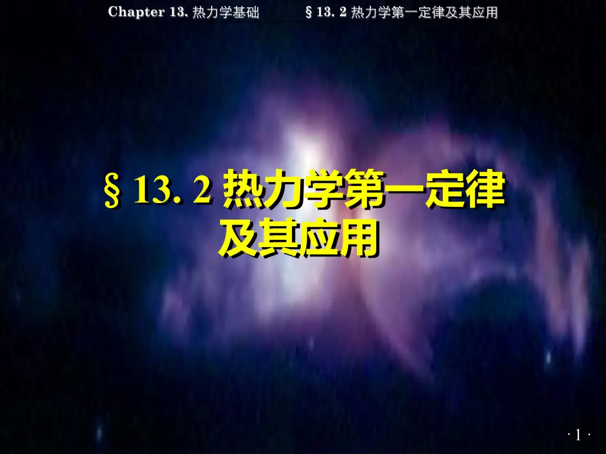

原文：

§ 13.2 热力学第一定律及其应用

Chapter 13. 热力学基础

§ 13.2 热力学第一定律及其应用

1

### Chapter 13. 热力学基础

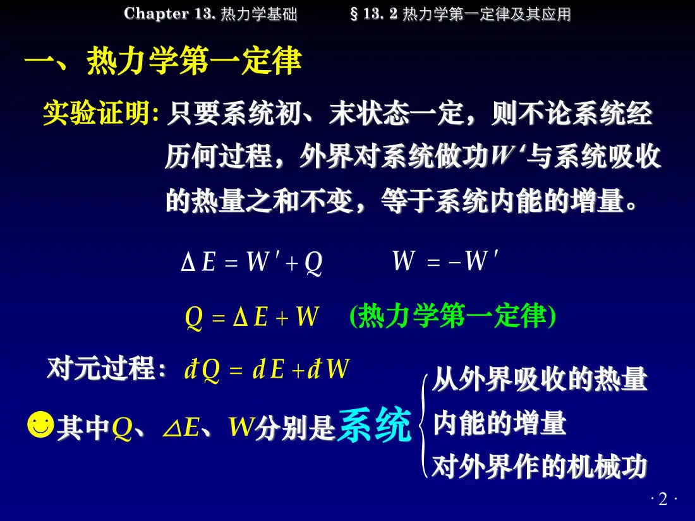

原文：

Chapter 13. 热力学基础

§ 13.2 热力学第一定律及其应用

一、热力学第一定律

实验证明: 只要系统初、末状态一定, 则不论系统经历何过程, 外界对系统做功 $W'$ 与系统吸收的热量之和不变, 等于系统内能的增量。

$\Delta E = W' + Q$

$$
W = - W ^ {\prime}
$$

$Q = \Delta E + W$ (热力学第一定律)

对元过程: $dQ = dE + dW$

其中Q、 $\Delta E$ 、W分别是系统

从外界吸收的热量

内能的增量

对外界作的机械功

2

### Chapter 13. 热力学基础

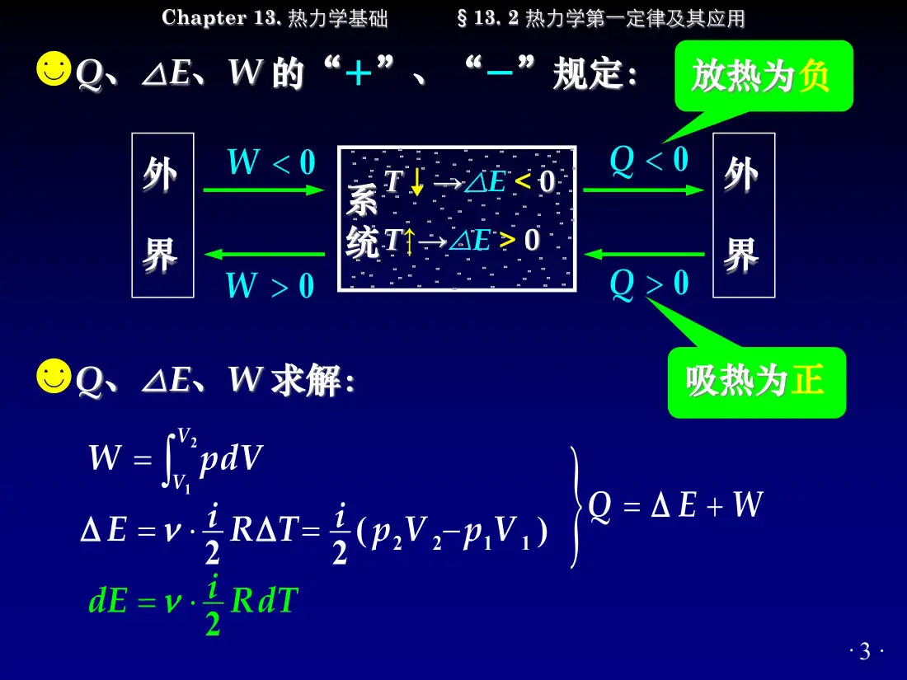

原文：

Chapter 13. 热力学基础

§ 13.2 热力学第一定律及其应用

😊Q、△E、W的“+”、“-”规定：

放热为负

外界

$$
\begin{array}{c} W <   0 \\ \hline \hline W > 0 \end{array}
$$

$$
\begin{array}{l}\text {系统} T \downarrow \rightarrow \Delta E <   0\\\text {系统} T \uparrow \rightarrow \Delta E > 0\end{array}
$$

外界

😊Q、△E、W求解:

吸热为正

$$
W = \int_ {V _ {1}} ^ {V _ {2}} p d V
$$

$$
\Delta E = \nu \cdot \frac {i}{2} R \Delta T = \frac {i}{2} (p _ {2} V _ {2} - p _ {1} V _ {1})
$$

$$
Q = \Delta E + W
$$

$$
d E = \nu \cdot \frac {i}{2} R d T
$$

3

### Chapter 13. 热力学基础

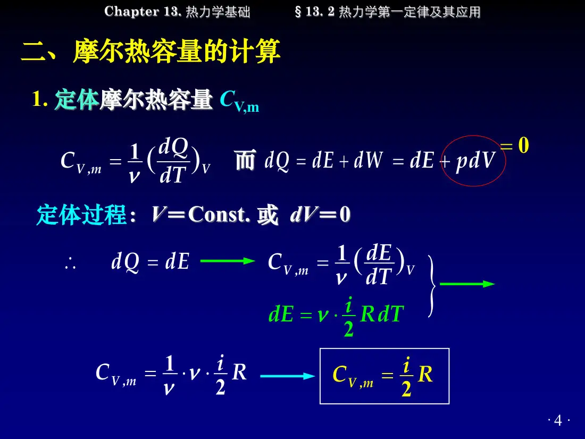

原文：

Chapter 13. 热力学基础

二、摩尔热容量的计算

1. 定体摩尔热容量 $C_{V,m}$

$C_{V,m}=\frac{1}{\nu}\left(\frac{dQ}{dT}\right)_{V}$ 而 dQ=dE+dW=dE+pdV=0

定体过程: $V = \mathrm{Const}.$ 或 $dV = 0$

$\therefore dQ = dE \longrightarrow C_{V,m} = \frac{1}{\nu}\left(\frac{dE}{dT}\right)_V \quad \left. dE = \nu \cdot \frac{i}{2}RdT \right\}$

$$
C _ {V, m} = \frac {1}{\nu} \cdot \nu \cdot \frac {i}{2} R \longrightarrow C _ {V, m} = \frac {i}{2} R
$$

§ 13.2 热力学第一定律及其应用

4

### Chapter 13. 热力学基础

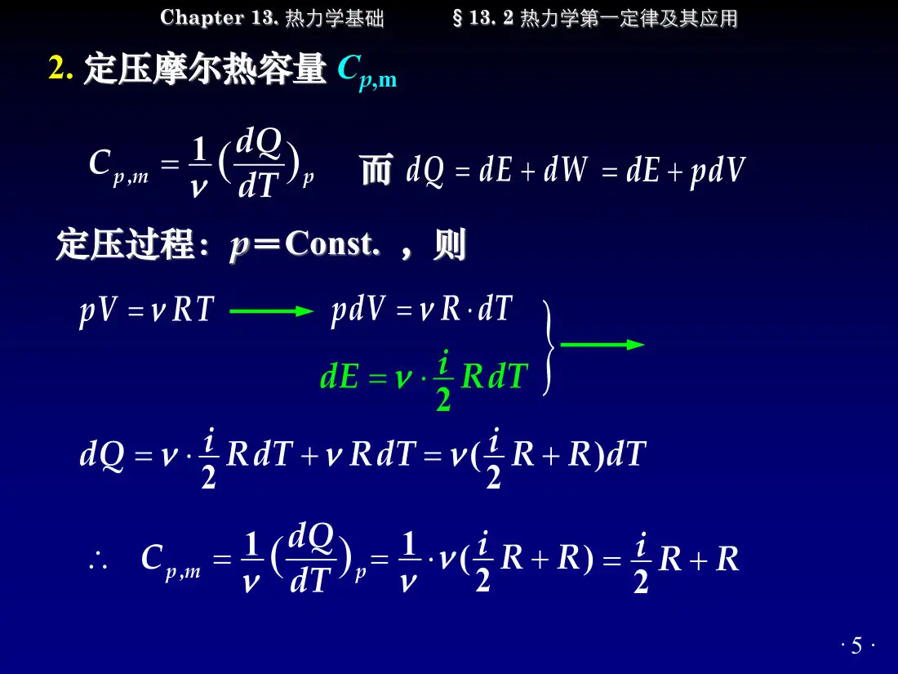

原文：

Chapter 13. 热力学基础

§ 13.2 热力学第一定律及其应用

2. 定压摩尔热容量 $C_{p,m}$

$C_{p,m} = \frac{1}{\nu}\left(\frac{dQ}{dT}\right)_p$ 而 $dQ = dE + dW = dE + pdV$ 定压过程： $p = \text{Const.}$ ，则 $pV = \nu RT \longrightarrow p dV = \nu R \cdot dT$ $dE = \nu \cdot \frac{i}{2} RdT$ $dQ = \nu \cdot \frac{i}{2} RdT + \nu RdT = \nu (\frac{i}{2} R + R)dt$ $\therefore C_{p,m} = \frac{1}{\nu}\left(\frac{dQ}{dT}\right)_p = \frac{1}{\nu} \cdot \nu (\frac{i}{2} R + R) = \frac{i}{2} R + R$

5

### Chapter 13. 热力学基础

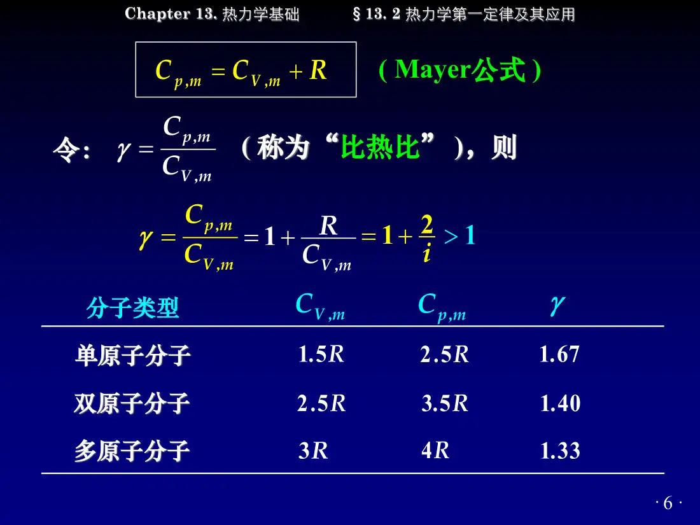

原文：

Chapter 13. 热力学基础

§ 13.2 热力学第一定律及其应用

$$
C _ {p, m} = C _ {V, m} + R
$$

(Mayer公式)

令: $\gamma = \frac{C_{p,m}}{C_{V,m}}$ (称为“比热比”), 则

$$
\gamma = \frac {C _ {p , m}}{C _ {V , m}} = 1 + \frac {R}{C _ {V , m}} = 1 + \frac {2}{i} > 1
$$

分子类型

$$
C _ {V, m}
$$

$$
C _ {p, m}
$$

γ

单原子分子

1.5R

2.5R

1.67

双原子分子

2.5R

3.5R

1.40

多原子分子

3R

4R

1.33

6

### 三、等值过程Q、 $\Delta E$ 、W的计算

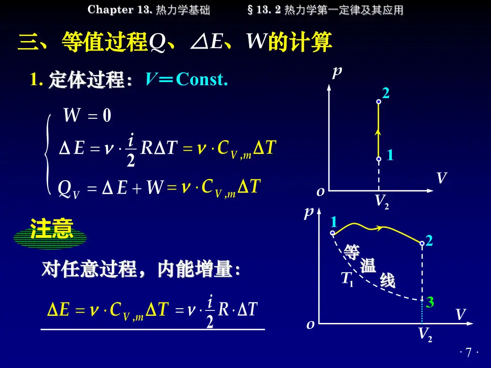

原文：

三、等值过程Q、 $\Delta E$ 、W的计算

1. 定体过程：V=Const.

$$
\left\{ \begin{array}{l} W = 0 \\ \Delta E = \nu \cdot \frac {i}{2} R \Delta T = \nu \cdot C _ {V, m} \Delta T \\ Q _ {V} = \Delta E + W = \nu \cdot C _ {V, m} \Delta T \end{array} \right.
$$

注意

对任意过程，内能增量：

$$
\Delta E = \nu \cdot C _ {V, m} \Delta T = \nu \cdot \frac {i}{2} R \cdot \Delta T
$$

Chapter 13. 热力学基础

§ 13.2 热力学第一定律及其应用

7

### Chapter 13. 热力学基础

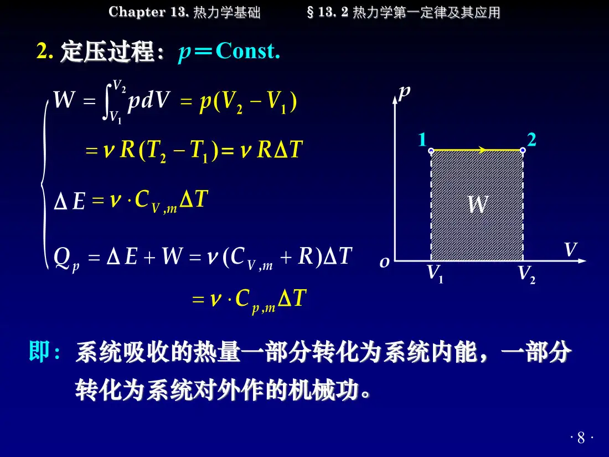

原文：

Chapter 13. 热力学基础

2. 定压过程: $p = \mathrm{Const}$ .

$$
\begin{array}{r l} W & = \int_ {V _ {1}} ^ {V _ {2}} p d V = p (V _ {2} - V _ {1}) \\ & = \nu R (T _ {2} - T _ {1}) = \nu R \Delta T \end{array}
$$

$$
\Delta E = \nu \cdot C _ {V, m} \Delta T
$$

$$
\begin{array}{r} \left| Q _ {p} = \Delta E + W = \nu (C _ {V, m} + R) \Delta T \right. \\ = \nu \cdot C _ {p, m} \Delta T \end{array}
$$

§ 13.2 热力学第一定律及其应用

即：系统吸收的热量一部分转化为系统内能，一部分转化为系统对外作的机械功。

8

### 3. 等温过程: $T = \mathrm{Const}$ .

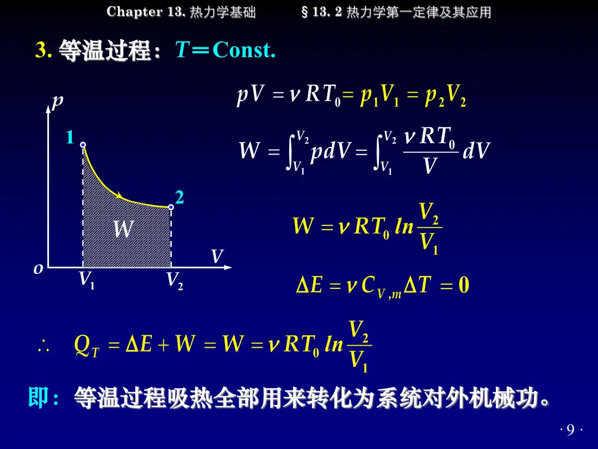

原文：

3. 等温过程: $T = \mathrm{Const}$ .

$$
p V = \nu R T _ {0} = p _ {1} V _ {1} = p _ {2} V _ {2}
$$

$$
W = \int_ {V _ {1}} ^ {V _ {2}} p d V = \int_ {V _ {1}} ^ {V _ {2}} \frac {\nu R T _ {0}}{V} d V
$$

$$
W = \nu R T _ {0} \ln \frac {V _ {2}}{V _ {1}}
$$

$$
\Delta E = \nu C _ {V, m} \Delta T = 0
$$

$$
\therefore Q _ {T} = \Delta E + W = W = \nu R T _ {0} \ln \frac {V _ {2}}{V _ {1}}
$$

即：等温过程吸热全部用来转化为系统对外机械功。

Chapter 13. 热力学基础

§ 13.2 热力学第一定律及其应用

9

### ★ 任意过程的内能增量：

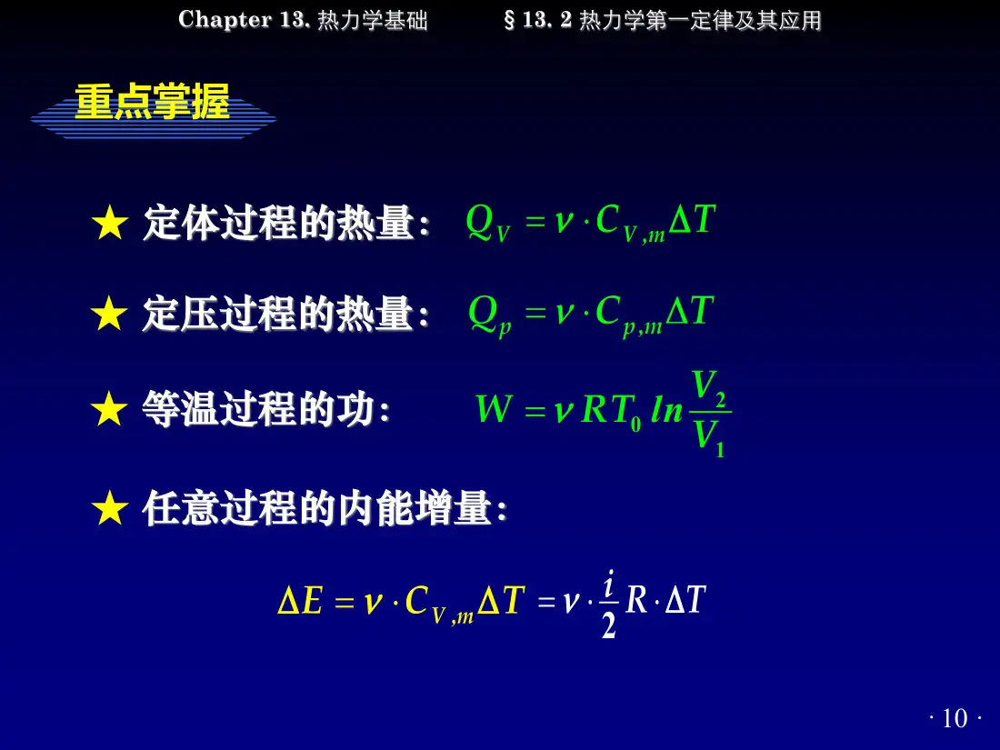

原文：

定体过程的热量: $Q_{V} = \nu \cdot C_{V,m}\Delta T$

定压过程的热量: $Q_{p} = \nu \cdot C_{p, m} \Delta T$

★ 等温过程的功: $W = \nu R T_{0} \ln \frac{V_{2}}{V_{1}}$

★ 任意过程的内能增量：

$$
\Delta E = \nu \cdot C _ {V, m} \Delta T = \nu \cdot \frac {i}{2} R \cdot \Delta T
$$

Chapter 13. 热力学基础

§ 13.2 热力学第一定律及其应用

10

### Chapter 13. 热力学基础

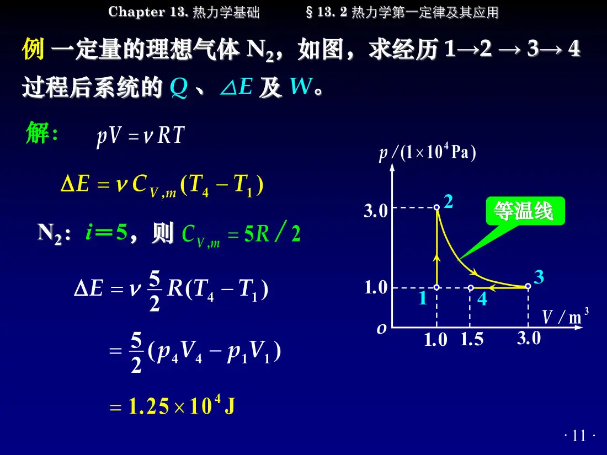

原文：

Chapter 13. 热力学基础

§ 13.2 热力学第一定律及其应用

例一定量的理想气体 $\mathrm{N}_{2}$ , 如图, 求经历 $1 \rightarrow 2 \rightarrow 3 \rightarrow 4$ 过程后系统的 $Q$ 、 $\Delta E$ 及 $W$ 。

解: $pV = \nu RT$

$$
\Delta E = \nu C _ {V, m} (T _ {4} - T _ {1})
$$

$N_{2}$ : i=5，则 $C_{V,m}=5R/2$

$$
\begin{array}{r l} \Delta E & = \nu \frac {5}{2} R (T _ {4} - T _ {1}) \\ & = \frac {5}{2} (p _ {4} V _ {4} - p _ {1} V _ {1}) \\ & = 1. 2 5 \times 1 0 ^ {4} \mathrm{J} \end{array}
$$

11

### Chapter 13. 热力学基础

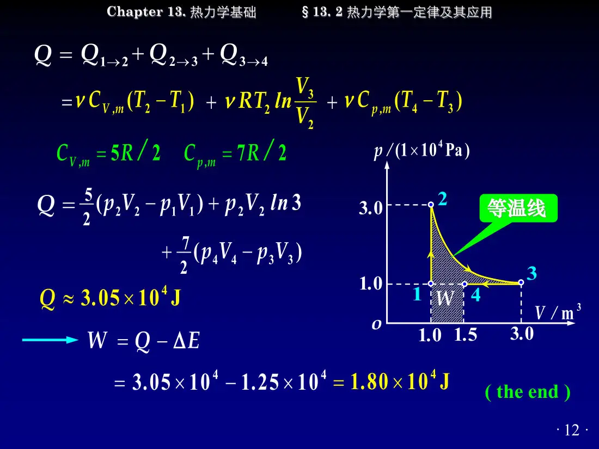

原文：

Chapter 13. 热力学基础

§ 13.2 热力学第一定律及其应用

$$
\begin{array}{r l}Q&= Q _ {1 \rightarrow 2} + Q _ {2 \rightarrow 3} + Q _ {3 \rightarrow 4}\\&= \nu C _ {V, m} (T _ {2} - T _ {1}) + \nu R T _ {2} \ln \frac {V _ {3}}{V _ {2}} + \nu C _ {p, m} (T _ {4} - T _ {3})\end{array}
$$

$$
C _ {V, m} = 5 R / 2 \quad C _ {p, m} = 7 R / 2
$$

$$
\begin{array}{r l} Q = \frac {5}{2} (p _ {2} V _ {2} - p _ {1} V _ {1}) + p _ {2} V _ {2} \ln 3 & \\ + \frac {7}{2} (p _ {4} V _ {4} - p _ {3} V _ {3}) \end{array}
$$

$Q \approx 3.05 \times 10^{4} \mathrm{~J}$

等温线

$$
\begin{array}{r l} \longrightarrow & W = Q - \Delta E \\ & = 3. 0 5 \times 1 0 ^ {4} - 1. 2 5 \times 1 0 ^ {4} = 1. 8 0 \times 1 0 ^ {4} \mathrm{J} \end{array}
$$

( the end )

12

### Chapter 13. 热力学基础

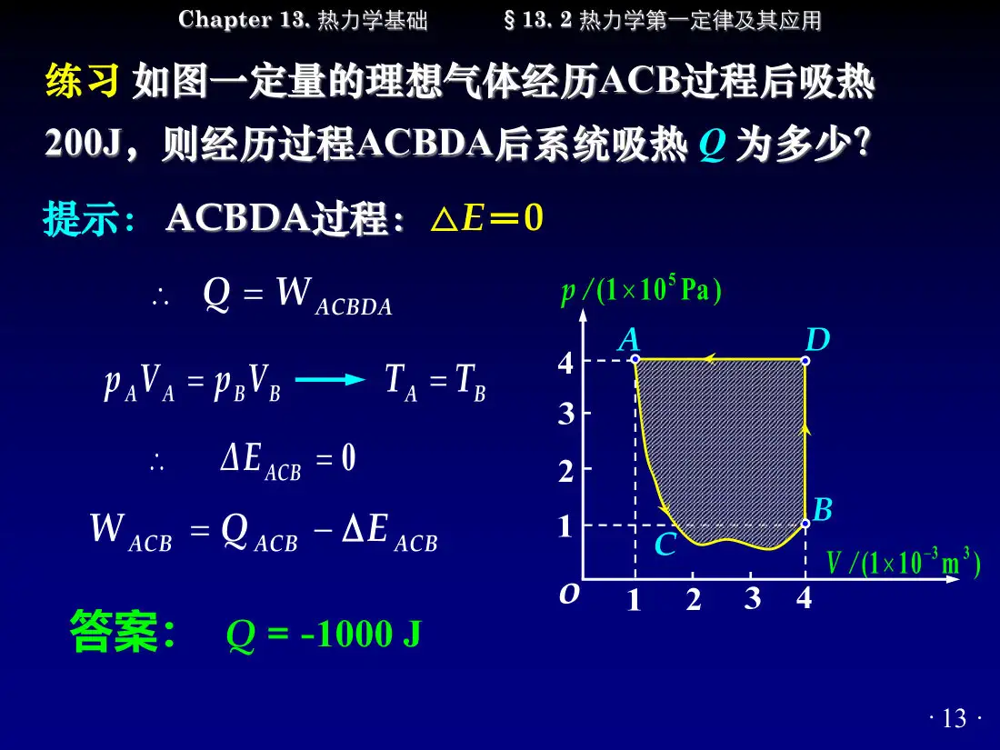

原文：

Chapter 13. 热力学基础

§ 13.2 热力学第一定律及其应用

练习 如图一定量的理想气体经历ACB过程后吸热200J，则经历过程ACBDA后系统吸热 $Q$ 为多少？

提示: ACBDA过程: $\triangle E = 0$

$$
\therefore Q = W _ {A C B D A}
$$

$$
p _ {A} V _ {A} = p _ {B} V _ {B} \longrightarrow T _ {A} = T _ {B}
$$

$$
\therefore \Delta E _ {A C B} = 0
$$

$$
W _ {A C B} = Q _ {A C B} - \Delta E _ {A C B}
$$

答案: $Q = -1000 \mathrm{~J}$

13

### 归纳

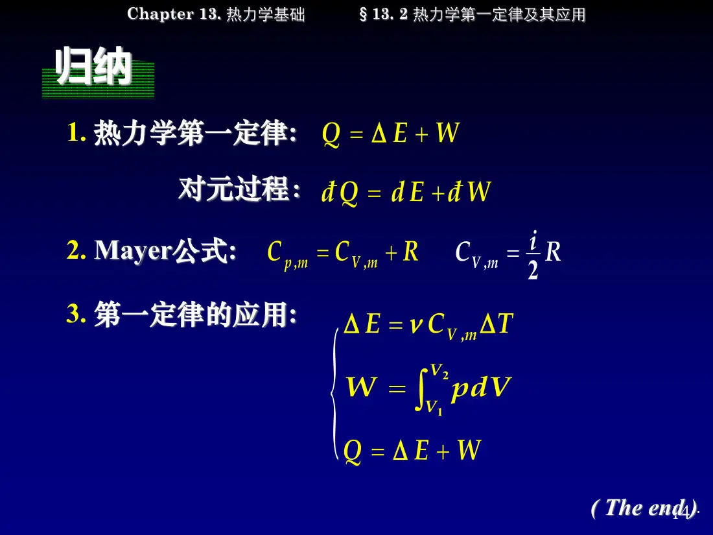

原文：

归纳

1. 热力学第一定律: $Q = \Delta E + W$

对元过程: $dQ = dE + dW$

2. Mayer公式: $C_{p,m} = C_{V,m} + R$ $C_{V,m} = \frac{i}{2} R$

3. 第一定律的应用:

$$
\Delta E = \nu C _ {V, m} \Delta T
$$

$$
W = \int_ {V _ {1}} ^ {V _ {2}} p d V
$$

$$
Q = \Delta E + W
$$

Chapter 13. 热力学基础

§ 13.2 热力学第一定律及其应用

(The end4).
