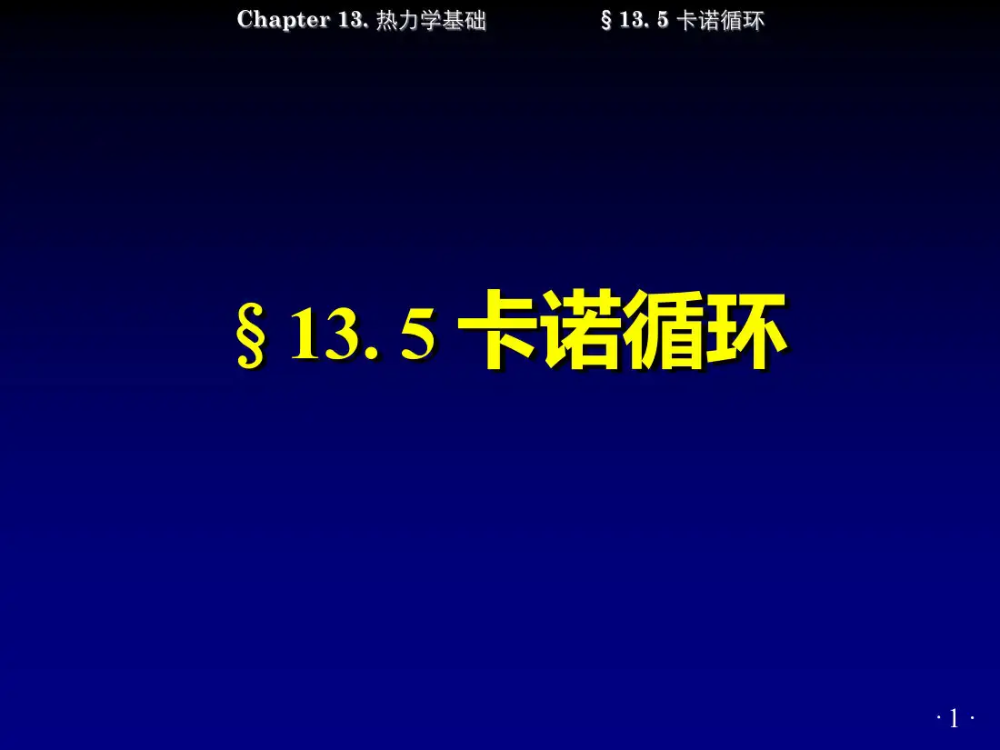
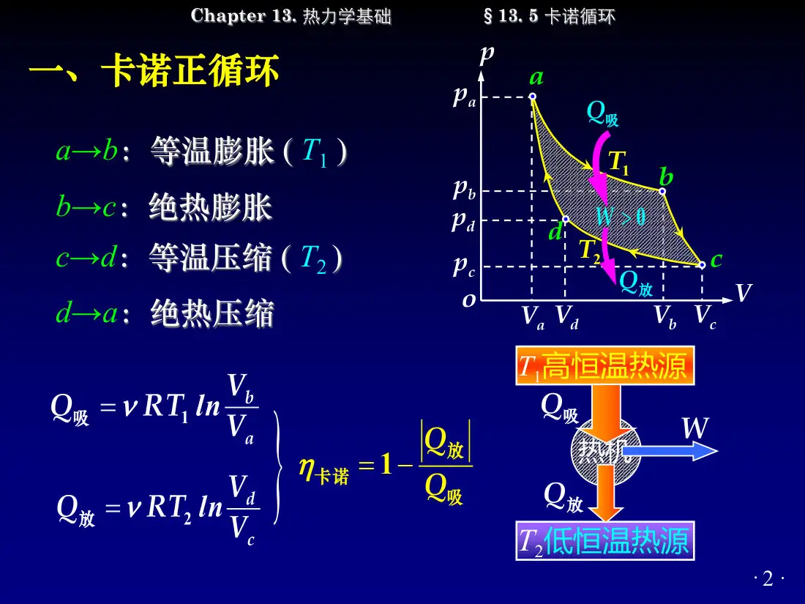
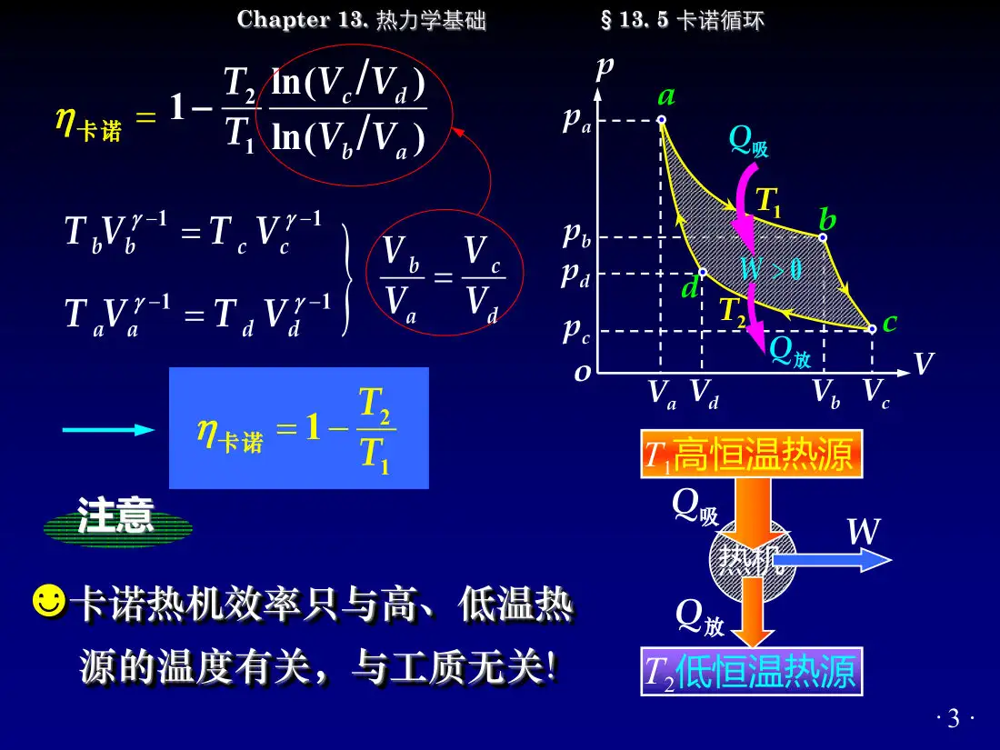
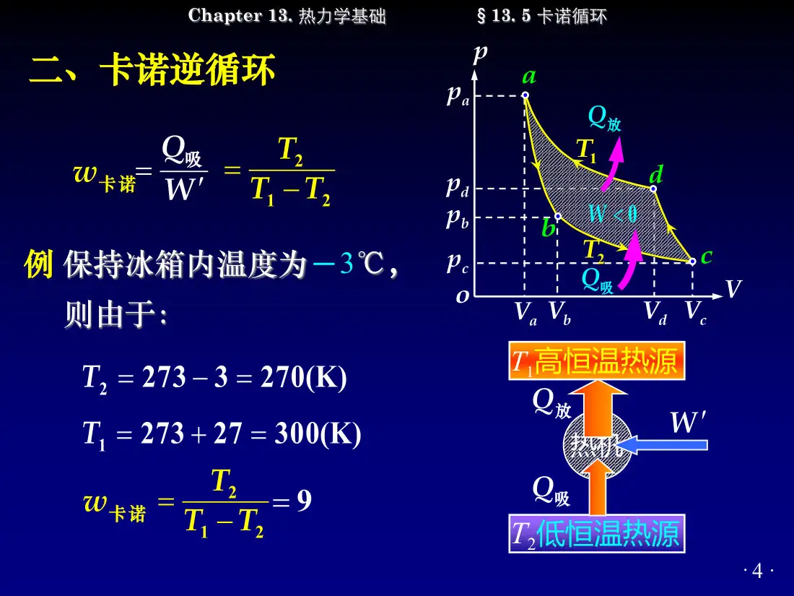
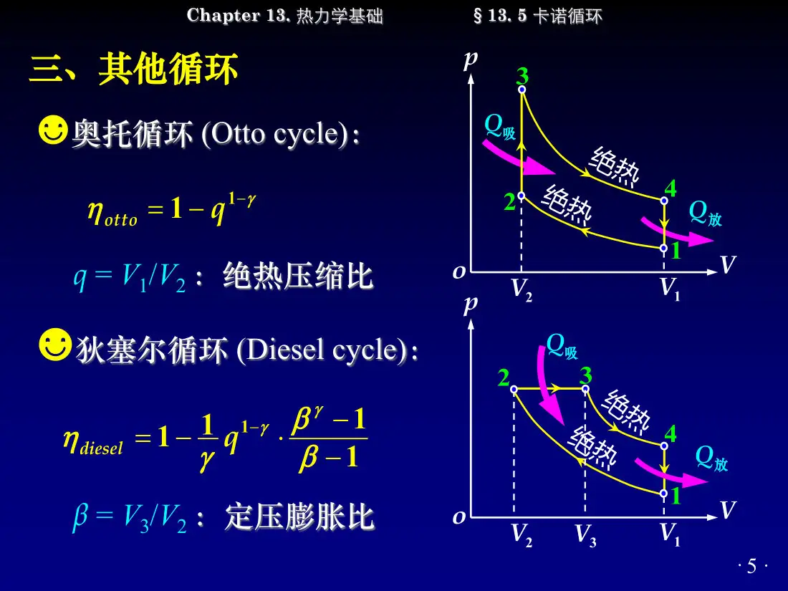
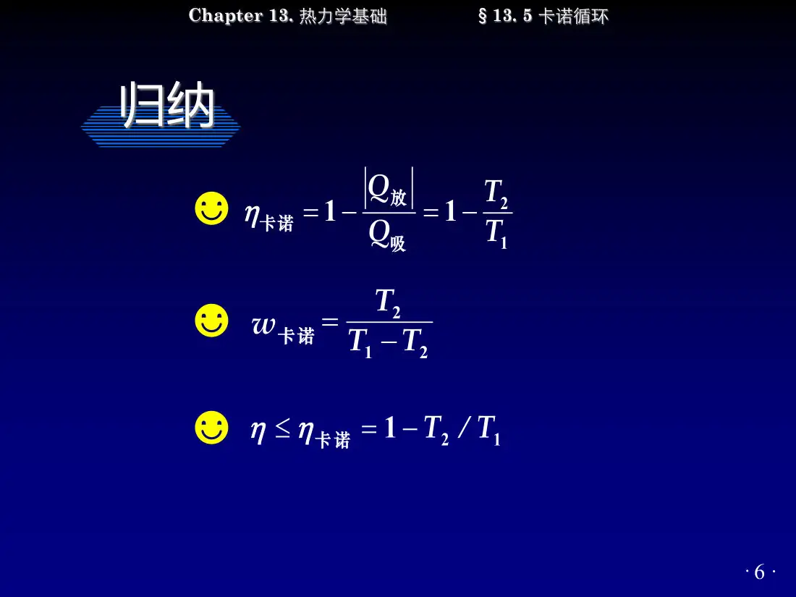

# 《大学物理（上）》第13章 热力学基础 §13.5 卡诺循环（课件）

原件的每一页，下面附识别出的文字。

### §13. 5 卡诺循环

原文：

§13. 5 卡诺循环

Chapter 13. 热力学基础

§13. 5 卡诺循环

1

### Chapter 13. 热力学基础

原文：

Chapter 13. 热力学基础

一、卡诺正循环

a→b：等温膨胀 ( T1 )

b→c：绝热膨胀

c→d：等温压缩 ( T )

d→a：绝热压缩

$$
Q _ {\text {吸}} = \nu R T _ {1} \ln \frac {V _ {b}}{V _ {a}}
$$

$$
Q _ {\text {放}} = \nu R T _ {2} \ln \frac {V _ {d}}{V _ {c}}
$$

$$
\eta_ {\text {卡诺}} = 1 - \frac {| Q _ {\text {放}} |}{Q _ {\text {吸}}}
$$

§13. 5 卡诺循环

T高恒温热源

T低恒温热源

· 2

### Chapter 13. 热力学基础

原文：

Chapter 13. 热力学基础

7卡诺 1– T2 T1 In(Vc ln(Vbl /Vd ,/va a

$$
T _ {b} V _ {b} ^ {\gamma - 1} = T _ {c} V _ {c} ^ {\gamma - 1}
$$

$$
T _ {a} V _ {a} ^ {\gamma - 1} = T _ {d} V _ {d} ^ {\gamma - 1}
$$

$$
\frac {V _ {b}}{V _ {a}} = \frac {V _ {c}}{V _ {d}}
$$

$$
\eta_ {\mathrm{卡诺}} = 1 - \frac {T _ {2}}{T _ {1}}
$$

注意

☻卡诺热机效率只与高、低温热 源的温度有关，与工质无关!

§13. 5 卡诺循环

T高恒温热源

T2低恒温热源

· 3

### 二、卡诺逆循环

原文：

二、卡诺逆循环

$$
w _ {\text {卡诺}} = \frac {Q _ {\text {吸}}}{W ^ {\prime}} = \frac {T _ {2}}{T _ {1} - T _ {2}}
$$

例 保持冰箱内温度为－3℃，则由于：

$$
T _ {2} = 2 7 3 - 3 = 2 7 0 (\mathrm{K})
$$

$$
T _ {1} = 2 7 3 + 2 7 = 3 0 0 (\mathrm{K})
$$

$$
w _ {\text {卡诺}} = \frac {T _ {2}}{T _ {1} - T _ {2}} = 9
$$

T高恒温热源

T低恒温热源

Chapter 13. 热力学基础

§13. 5 卡诺循环

· 4

### 三、其他循环

原文：

三、其他循环

☻奥托循环 (Otto cycle)：

ηotto =1− q1−γ

$\textcircled { 9 } = \textcircled { 1 } \textcircled { 2 }$ ：绝热压缩比

☻狄塞尔循环 (Diesel cycle)：

$$
\eta_ {d i e s e l} = 1 - \frac {1}{\gamma} q ^ {1 - \gamma} \cdot \frac {\beta^ {\gamma} - 1}{\beta - 1}
$$

$1 6 2 = 1 6 2$ ：定压膨胀比

Chapter 13. 热力学基础

§13. 5 卡诺循环

· 5

### 归纳

原文：

归纳

$$
\text {   } \eta_ {\text { 卡诺 }} = 1 - \frac {| Q _ {\text { 放 }} |}{Q _ {\text { 吸 }}} = 1 - \frac {T _ {2}}{T _ {1}}
$$

$( 1 0 ) \div 2 = \frac { 1 1 } { 1 1 } = \frac { 1 1 } { 1 1 }$

$( 1 ) 1 2 \div 1 1 = 1 1 \cdots 1$

Chapter 13. 热力学基础

§13. 5 卡诺循环

· 6
