# 《大学物理（上）》第1章 质点运动学 §1.1 质点运动的描述（课件）

原件的每一页，下面附识别出的文字。

### 质点运动的描述(1)

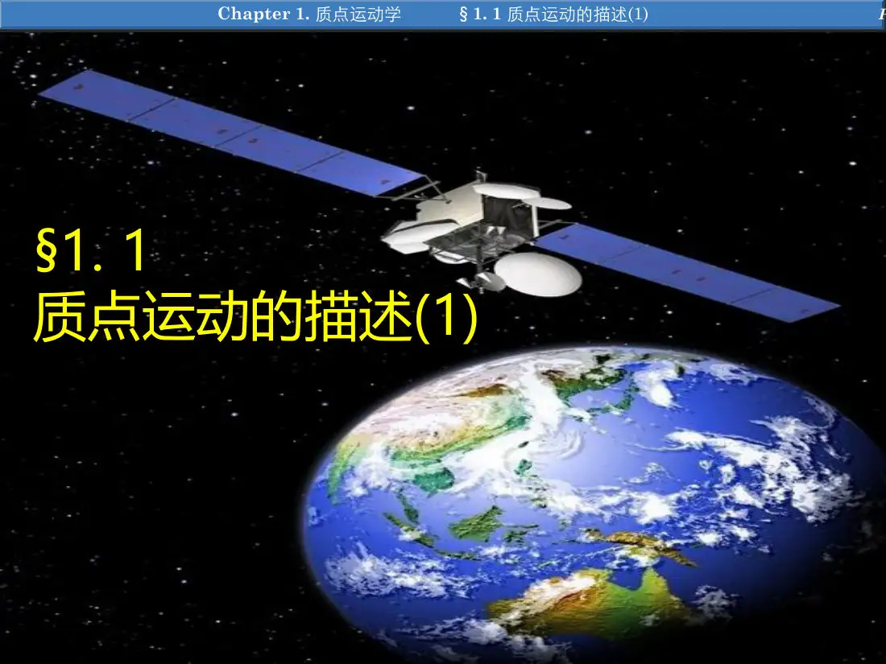

原文：

质点运动的描述(1)

Chapter 1. 质点运动学 § 1.1 质点运动的描述(1)

### 研究力学要明确的两个基本概念

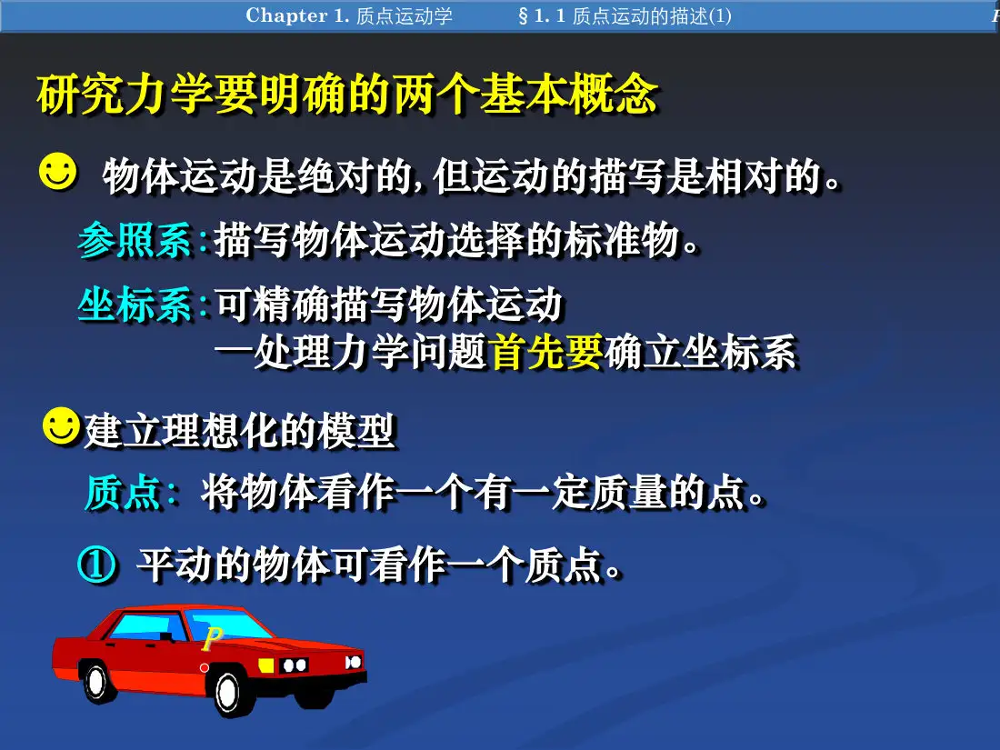

原文：

研究力学要明确的两个基本概念

物体运动是绝对的, 但运动的描写是相对的。参照系: 描写物体运动选择的标准物。

坐标系:可精确描写物体运动
—处理力学问题首先要确立坐标系

建立理想化的模型质点：将物体看作一个有一定质量的点。

① 平动的物体可看作一个质点。

Chapter 1. 质点运动学

§ 1.1 质点运动的描述(1)

### ② 物体运动范围>>物体本身线度。

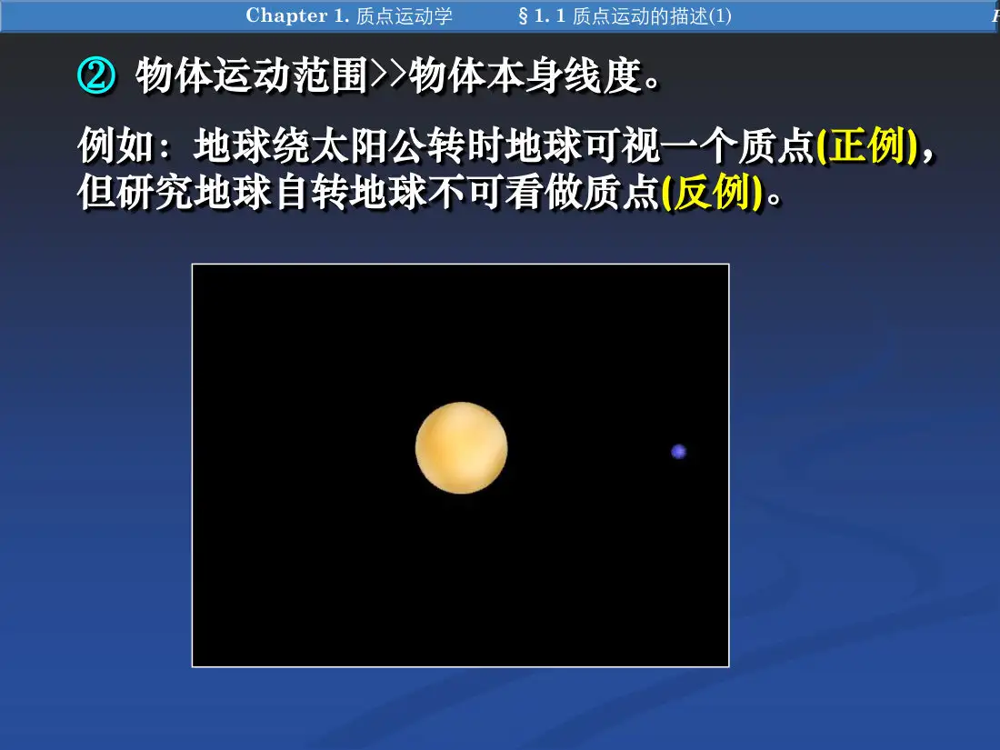

原文：

② 物体运动范围>>物体本身线度。

例如：地球绕太阳公转时地球可视一个质点(正例)，但研究地球自转地球不可看做质点(反例)。

Chapter 1. 质点运动学

§ 1.1 质点运动的描述(1)

### 描述质点运动的基本物理量

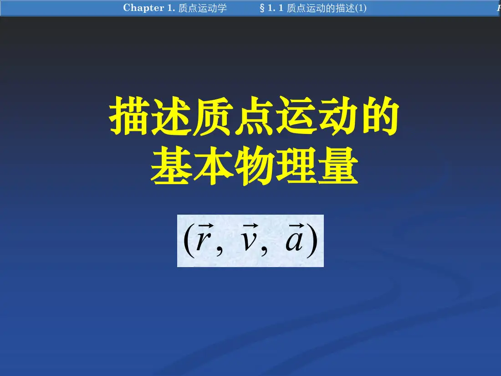

原文：

描述质点运动的基本物理量

$$
(\vec {r}, \vec {v}, \vec {a})
$$

Chapter 1. 质点运动学

§ 1.1 质点运动的描述(1)

### 一、位置矢量 $\vec{r}$

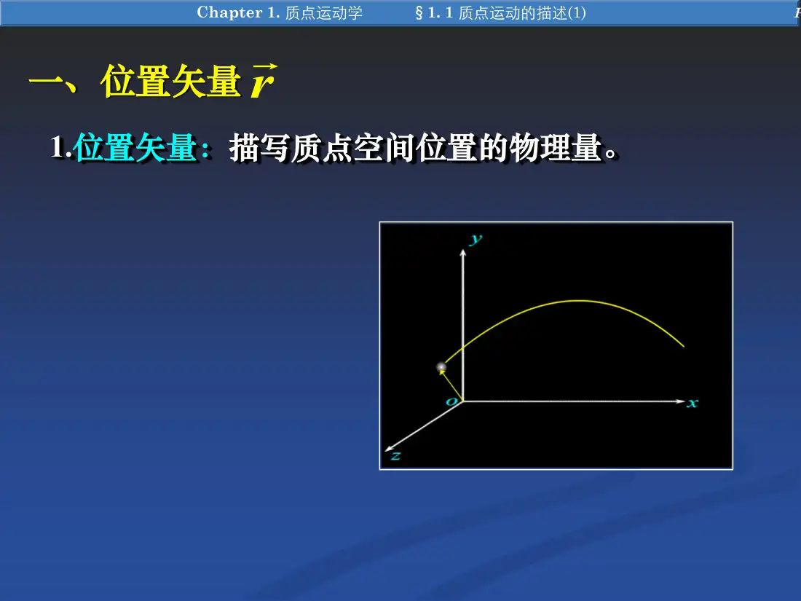

原文：

一、位置矢量 $\vec{r}$

1. 位置矢量：描写质点空间位置的物理量。

Chapter 1. 质点运动学

§ 1.1 质点运动的描述(1)

### 一、位置矢量 $\vec{r}$

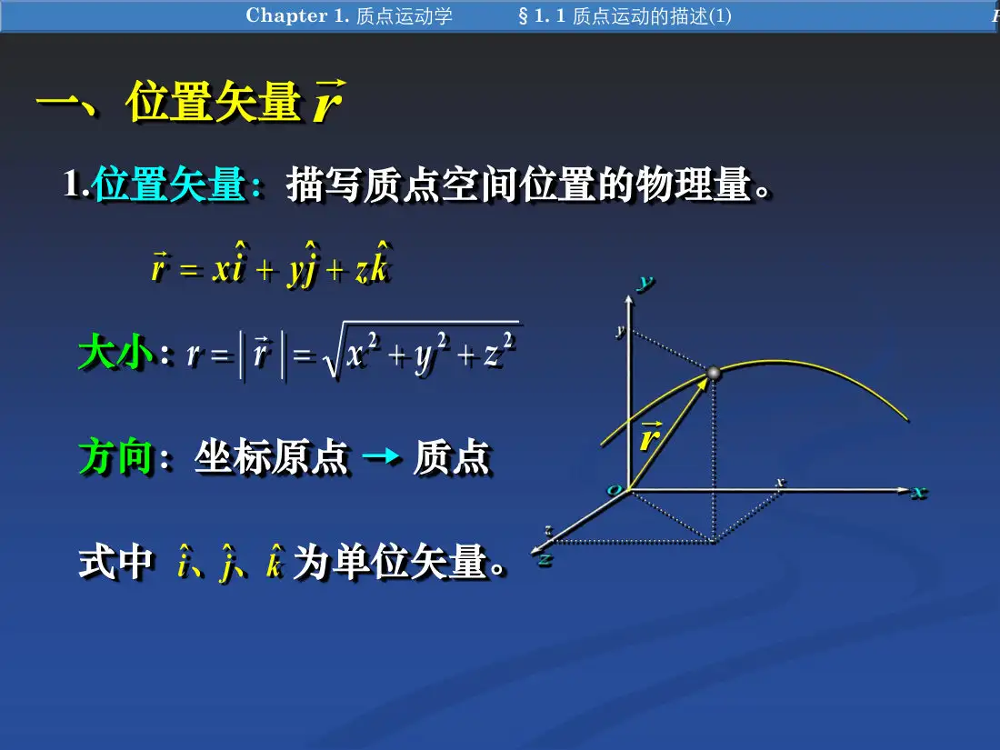

原文：

一、位置矢量 $\vec{r}$

1. 位置矢量：描写质点空间位置的物理量。

$$
\vec {r} = x \hat {i} + y \hat {j} + z \hat {k}
$$

大小： $r \equiv |\vec{r}| \equiv \sqrt{x^{2} + y^{2} + z^{2}}$

方向：坐标原点 → 质点

式中 $\hat{i}$ 、 $\hat{j}$ 、 $\hat{k}$ 为单位矢量。

Chapter 1. 质点运动学

§ 1.1 质点运动的描述(1)

### 2. 运动方程：质点位置随时间变化的关系。

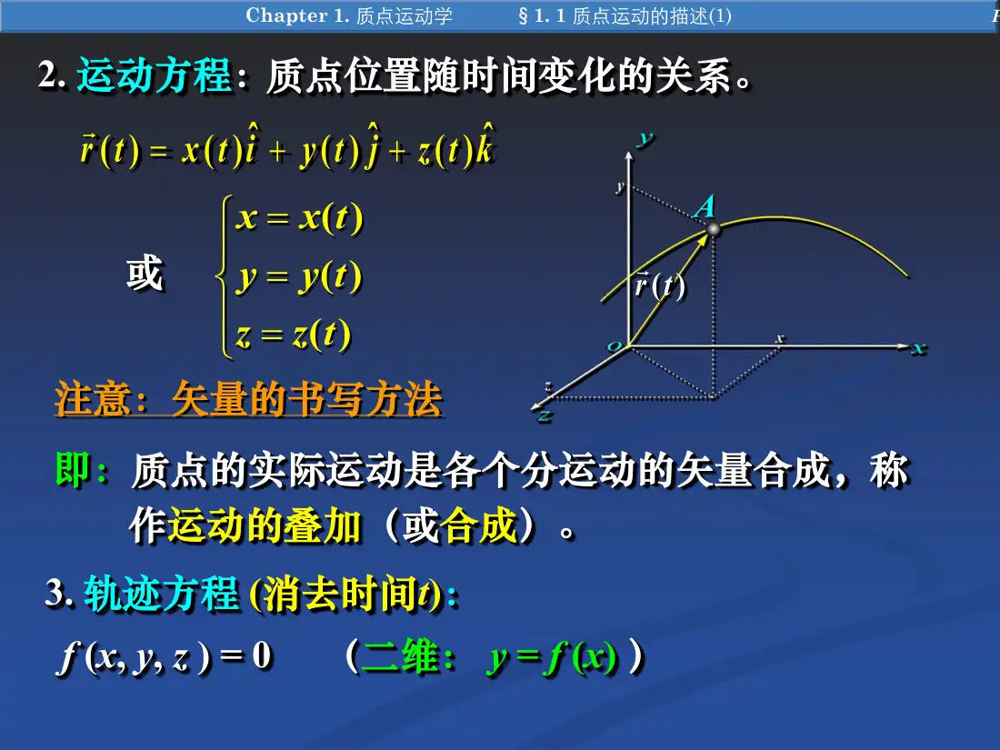

原文：

2. 运动方程：质点位置随时间变化的关系。

$$
\vec {r} (t) = x (t) \hat {i} + y (t) \hat {j} + z (t) \hat {k}
$$

或

$$
\left\{ \begin{array}{l} x = x (t) \\ y = y (t) \\ z = z (t) \end{array} \right.
$$

注意：矢量的书写方法

即：质点的实际运动是各个分运动的矢量合成，称作运动的叠加（或合成）。

3. 轨迹方程 (消去时间 $t$ ):

$$
f (x, y, z) = 0
$$

$$
y = f (x)
$$

Chapter 1. 质点运动学

§ 1.1 质点运动的描述(1)

### 二、位移 $\Delta \vec{r}$

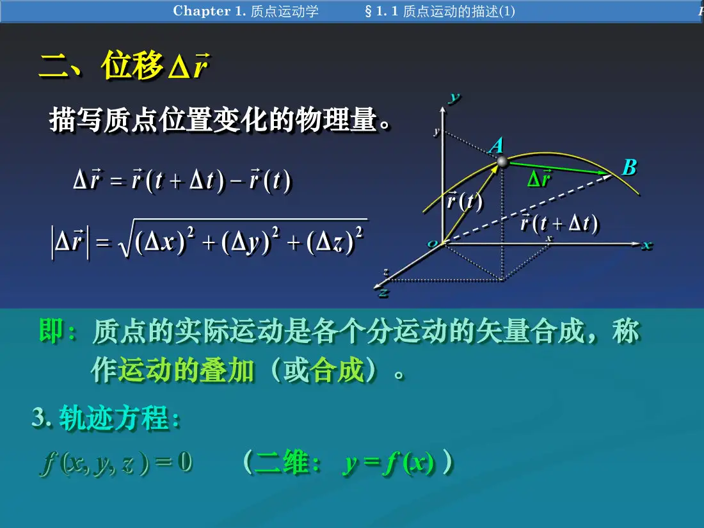

原文：

二、位移 $\Delta \vec{r}$

描写质点位置变化的物理量。

$$
\Delta \vec {r} = \vec {r} (t + \Delta t) - \vec {r} (t)
$$

$$
\left| \Delta \vec {r} \right| = \sqrt {(\Delta x) ^ {2} + (\Delta y) ^ {2} + (\Delta z) ^ {2}}
$$

即：质点的实际运动是各个分运动的矢量合成，称作运动的叠加（或合成）。

3. 轨迹方程:

$$
f (x, y, z) = 0
$$

$$
(\text {二维:} y = f (x))
$$

Chapter 1. 质点运动学

§ 1.1 质点运动的描述(1)

### 二、位移 $\Delta\vec{r}$

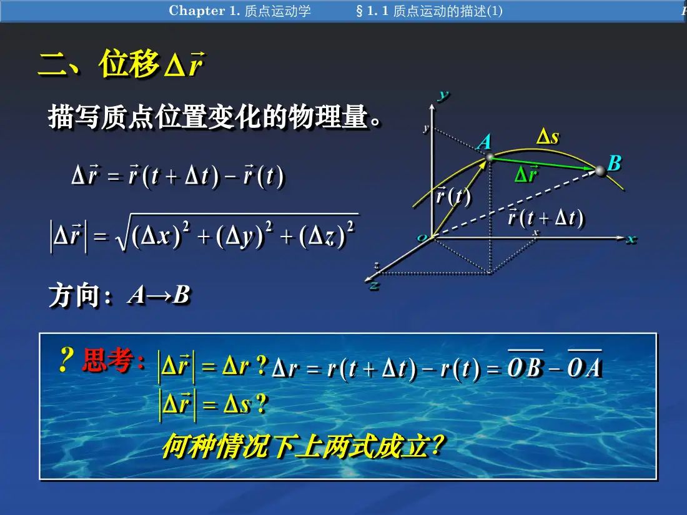

原文：

二、位移 $\Delta\vec{r}$

描写质点位置变化的物理量。

$$
\Delta \vec {r} = \vec {r} (t + \Delta t) - \vec {r} (t)
$$

$$
\left| \Delta \vec {r} \right| = \sqrt {(\Delta x) ^ {2} + (\Delta y) ^ {2} + (\Delta z) ^ {2}}
$$

方向： $A \rightarrow B$

? 思考:

$$
\left| \Delta \vec {r} \right| = \Delta r? \Delta r = r (t + \Delta t) - r (t) = \overline {{O B}} - \overline {{O A}}
$$

$$
\left| \Delta \vec {r} \right| = \Delta s?
$$

何种情况下上两式成立？

Chapter 1. 质点运动学

§ 1.1 质点运动的描述(1)

### 三、速度ひ

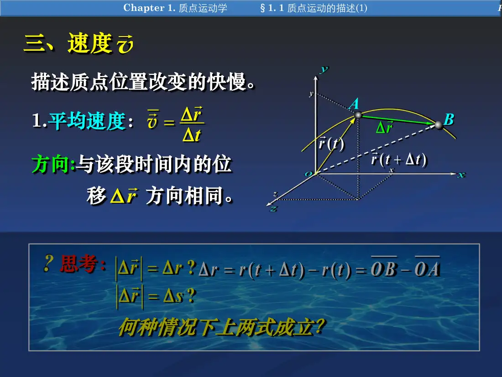

原文：

三、速度ひ

描述质点位置改变的快慢。

1. 平均速度: $\vec{v} = \frac{\Delta\vec{r}}{\Delta t}$ 方向: 与该段时间内的位移 $\Delta \vec{r}$ 方向相同。

? 思考: $|\Delta \vec{r}| = \Delta r ? \Delta r = r(t + \Delta t) - r(t) = \overline{OB} - \overline{OA}$ $|\Delta \vec{r}| = \Delta s?$ 何种情况下上两式成立?

Chapter 1. 质点运动学

§ 1.1 质点运动的描述(1)

### 三、速度ひ

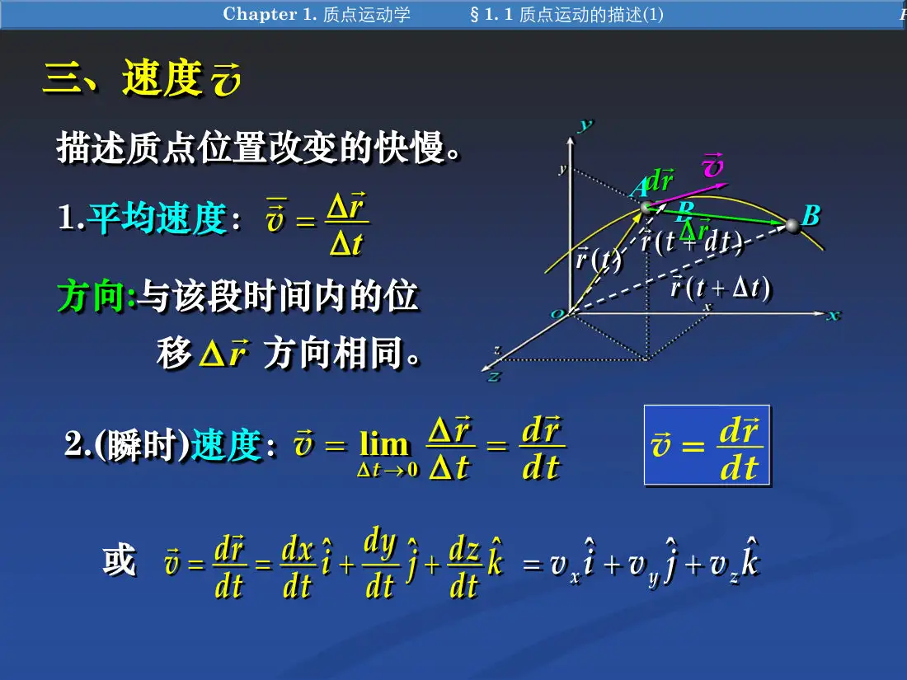

原文：

三、速度ひ

描述质点位置改变的快慢。

1. 平均速度: $\vec{v} = \frac{\Delta \vec{r}}{\Delta t}$ 方向: 与该段时间内的位移 $\Delta \vec{r}$ 方向相同。

2.(瞬时)速度: $\vec{v} = \lim_{\Delta t \to 0} \frac{\Delta \vec{r}}{\Delta t} = \frac{d \vec{r}}{dt}$ $\vec{v} = \frac{d \vec{r}}{dt}$

或 $\vec{v} = \frac{d\vec{r}}{dt} = \frac{dx}{dt}\hat{i} +\frac{dy}{dt}\hat{j} +\frac{dz}{dt}\hat{k} = v_x\hat{i} +v_y\hat{j} +v_z\hat{k}$

Chapter 1. 质点运动学

§ 1.1 质点运动的描述(1)

### 方向：轨迹上该点的切线方向

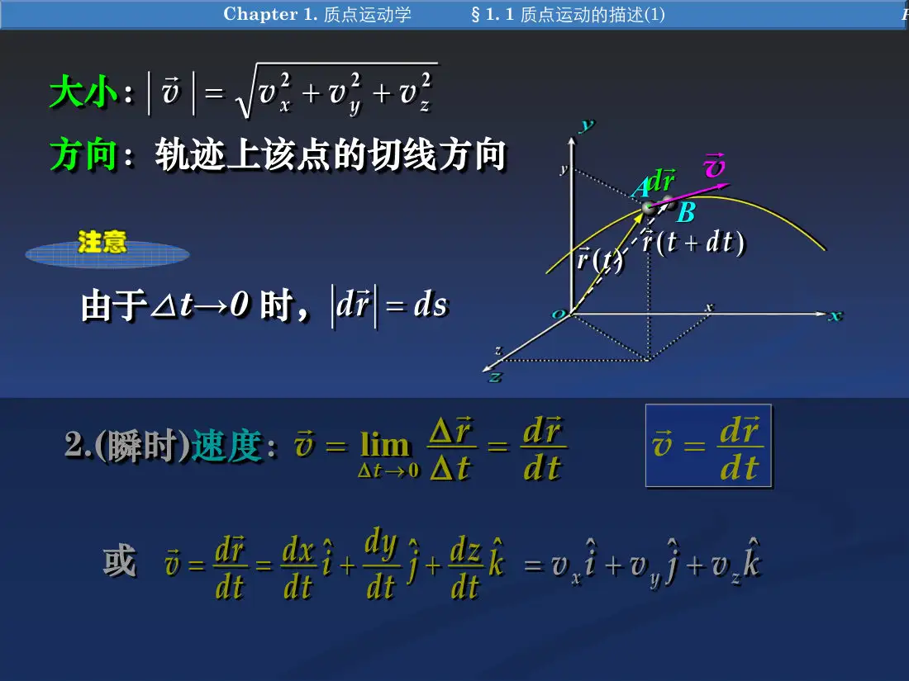

原文：

大小： $|\vec{v}| = \sqrt{v_x^2 + v_y^2 + v_z^2}$

方向：轨迹上该点的切线方向

注意

由于 $\Delta t\to 0$ 时， $|\vec{d}\vec{r}| = ds$

2.(瞬时)速度: $\vec{v} = \lim_{\Delta t \to 0} \frac{\Delta \vec{r}}{\Delta t} = \frac{d \vec{r}}{dt}$ $\vec{v} = \frac{d \vec{r}}{dt}$

或 $\vec{v}=\frac{d\vec{r}}{dt}=\frac{dx}{dt}\hat{i}+\frac{dy}{dt}\hat{j}+\frac{dz}{dt}\hat{k}=v_{x}\hat{i}+v_{y}\hat{j}+v_{z}\hat{k}$

Chapter 1. 质点运动学

§ 1.1 质点运动的描述(1)

### Chapter 1. 质点运动学

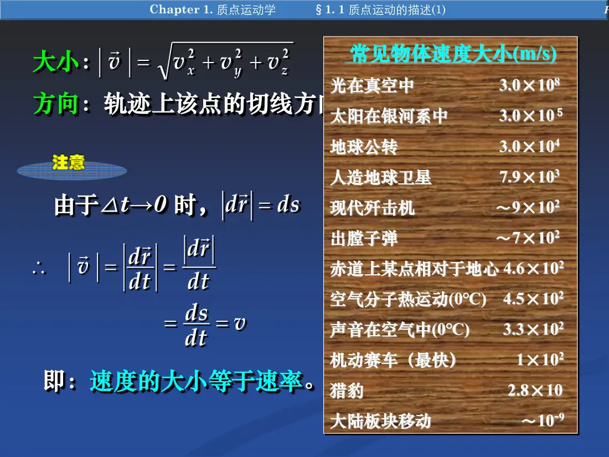

原文：

Chapter 1. 质点运动学

大小： $|\vec{v}| = \sqrt{v_x^2 + v_y^2 + v_z^2}$

方向：轨迹上该点的切线方

注意

由于 $\Delta t\to 0$ 时， $|\vec{d}\vec{r}| = ds$

$$
\begin{array}{r l r} & \therefore & \left| \vec {v} \right| = \left| \frac {d \vec {r}}{d t} \right| = \frac {\left| d \vec {r} \right|}{d t} \\ & & = \frac {d s}{d t} = v \end{array}
$$

即：速度的大小等于速率。

§ 1.1 质点运动的描述(1)

<table><tr><td colspan="2">常见物体速度大小(m/s)</td></tr><tr><td>光在真空中</td><td> $3.0 \times 10^{8}$ </td></tr><tr><td>太阳在银河系中</td><td> $3.0 \times 10^{5}$ </td></tr><tr><td>地球公转</td><td> $3.0 \times 10^{4}$ </td></tr><tr><td>人造地球卫星</td><td> $7.9 \times 10^{3}$ </td></tr><tr><td>现代歼击机</td><td> $\sim 9 \times 10^{2}$ </td></tr><tr><td>出膛子弹</td><td> $\sim 7 \times 10^{2}$ </td></tr><tr><td>赤道上某点相对于地心</td><td> $4.6 \times 10^{2}$ </td></tr><tr><td>空气分子热运动(0°C)</td><td> $4.5 \times 10^{2}$ </td></tr><tr><td>声音在空气中(0°C)</td><td> $3.3 \times 10^{2}$ </td></tr><tr><td>机动赛车(最快)</td><td> $1 \times 10^{2}$ </td></tr><tr><td>猎豹</td><td> $2.8 \times 10$ </td></tr><tr><td>大陆板块移动</td><td> $\sim 10^{-9}$ </td></tr></table>

### 解 1) 由题意可知:

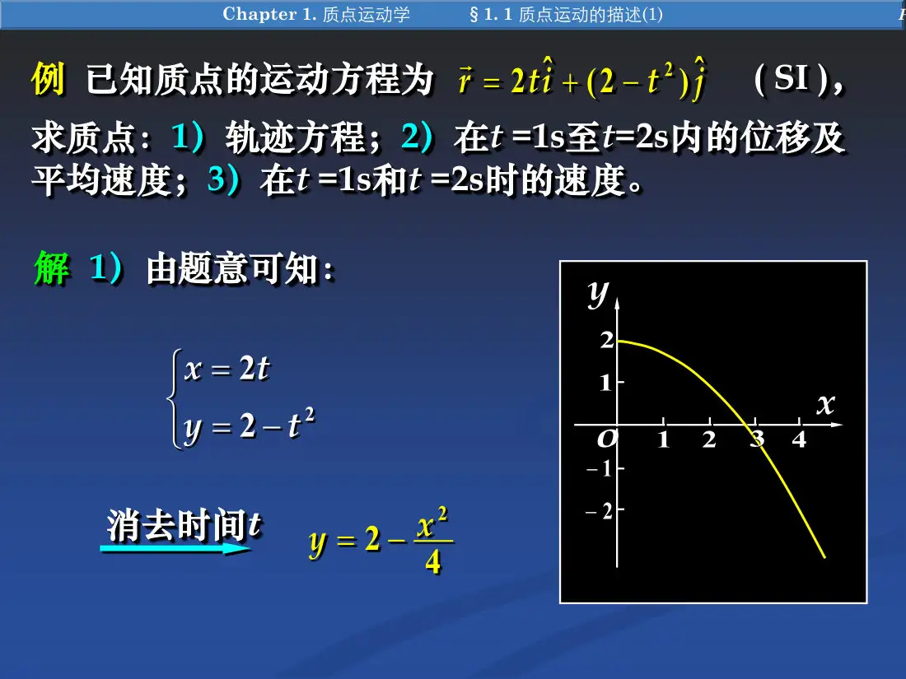

原文：

例 已知质点的运动方程为 $\vec{r}=2t\hat{i}+(2-t^{2})\hat{j}$ (SI)，求质点：1）轨迹方程；2）在t=1s至t=2s内的位移及平均速度；3）在t=1s和t=2s时的速度。

解 1) 由题意可知:

$$
\left\{ \begin{array}{l} x = 2 t \\ y = 2 - t ^ {2} \end{array} \right.
$$

消去时间t

$$
y = 2 - \frac {x ^ {2}}{4}
$$

Chapter 1. 质点运动学

§ 1.1 质点运动的描述(1)

### $$

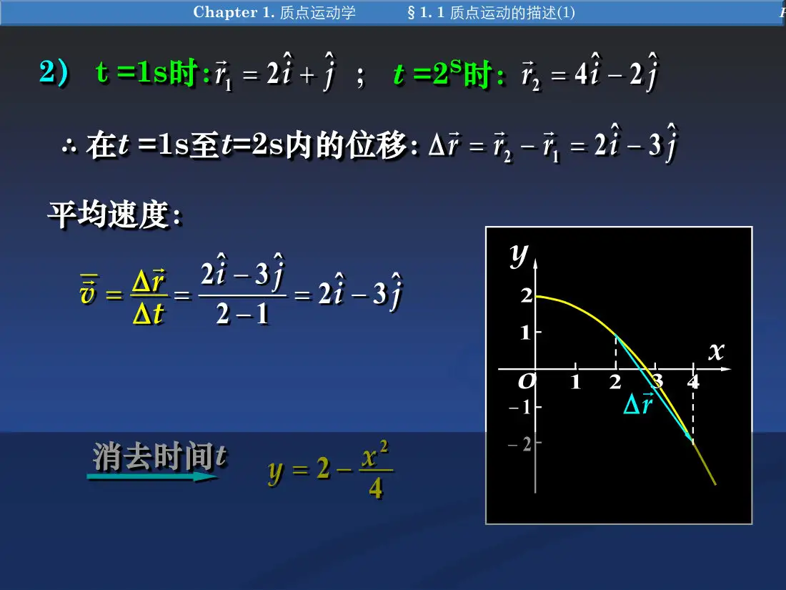

原文：

$$
2) \quad t = 1 s \text {时}: \vec {r} _ {1} = 2 \hat {i} + \hat {j}; \quad t = 2 ^ {s} \text {时}: \vec {r} _ {2} = 4 \hat {i} - 2 \hat {j}
$$

∴ 在t=1s至t=2s内的位移: $\Delta\vec{r}=\vec{r}_{2}-\vec{r}_{1}=2\hat{i}-3\hat{j}$

平均速度:

$$
\overline {{\vec {v}}} = \frac {\Delta \vec {r}}{\Delta t} = \frac {2 \hat {i} - 3 \hat {j}}{2 - 1} = 2 \hat {i} - 3 \hat {j}
$$

消去时间t

$$
y = 2 - \frac {x ^ {2}}{4}
$$

Chapter 1. 质点运动学

§ 1.1 质点运动的描述(1)

### 平均速度:

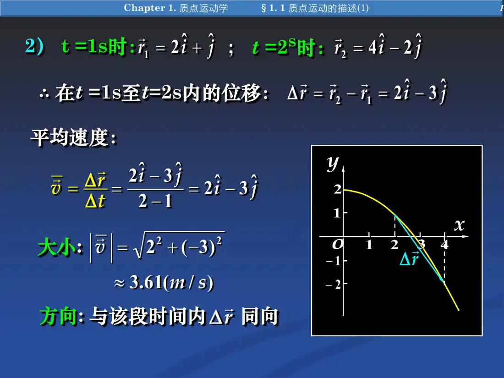

原文：

2) t=1s时: $\vec{r}_{1}=2\hat{i}+\hat{j}$ ; $t=2^{s}$ 时: $\vec{r}_{2}=4\hat{i}-2\hat{j}$

∴ 在t=1s至t=2s内的位移： $\Delta\vec{r}=\vec{r}_{2}-\vec{r}_{1}=2\hat{i}-3\hat{j}$

平均速度:

$$
\overline {{\vec {v}}} = \frac {\Delta \vec {r}}{\Delta t} = \frac {2 \hat {i} - 3 \hat {j}}{2 - 1} = 2 \hat {i} - 3 \hat {j}
$$

大小: $\left|\overline{\vec{v}}\right|=\sqrt{2^{2}+(-3)^{2}}$ $\approx 3.61(m/s)$

方向: 与该段时间内 $\Delta \vec{r}$ 同向

Chapter 1. 质点运动学

§ 1.1 质点运动的描述(1)

### 方向: 与该段时间内 $\Delta \vec{r}$ 同向

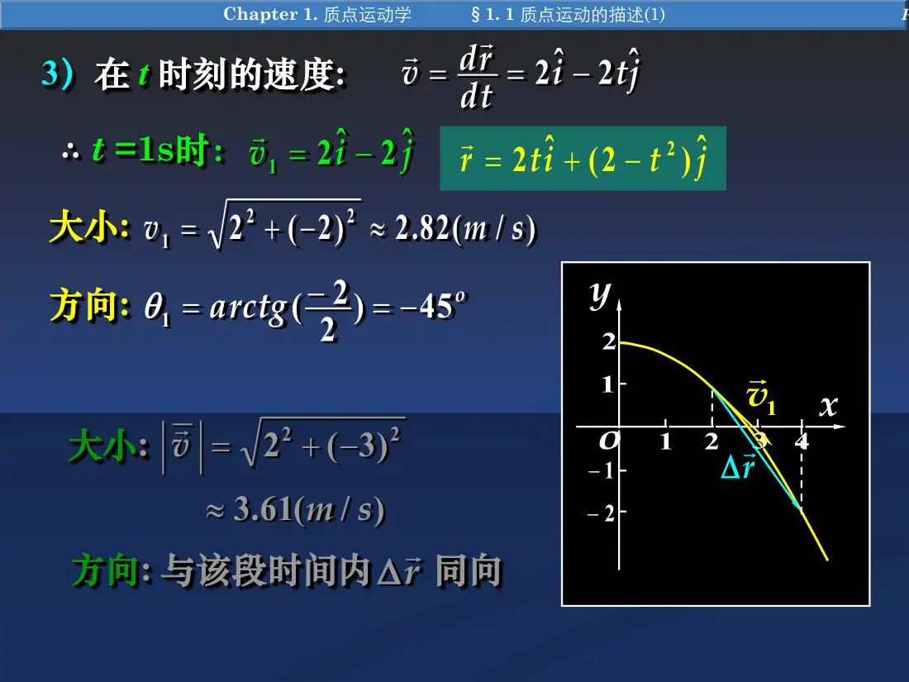

原文：

3) 在 t 时刻的速度: $\vec{v} = \frac{d\vec{r}}{dt} = 2\hat{i} - 2t\hat{j}$

∴ t=1s时： $\vec{v}_{1}=2\hat{i}-2\hat{j}$ $\vec{r}=2t\hat{i}+(2-t^{2})\hat{j}$

大小: $v_{1} = \sqrt{2^{2} + (-2)^{2}} \approx 2.82(m / s)$

方向: $\theta_{1} = \operatorname{arctg}\left(\frac{-2}{2}\right) = -45^{\circ}$

大小: $\left|\overrightarrow{\vec{v}}\right|=\sqrt{2^{2}+(-3)^{2}}$ $\approx 3.61(m/s)$

方向: 与该段时间内 $\Delta \vec{r}$ 同向

Chapter 1. 质点运动学

§ 1.1 质点运动的描述(1)

### t=2s时： $\vec{v}_{2}=2\hat{i}-4\hat{j}$

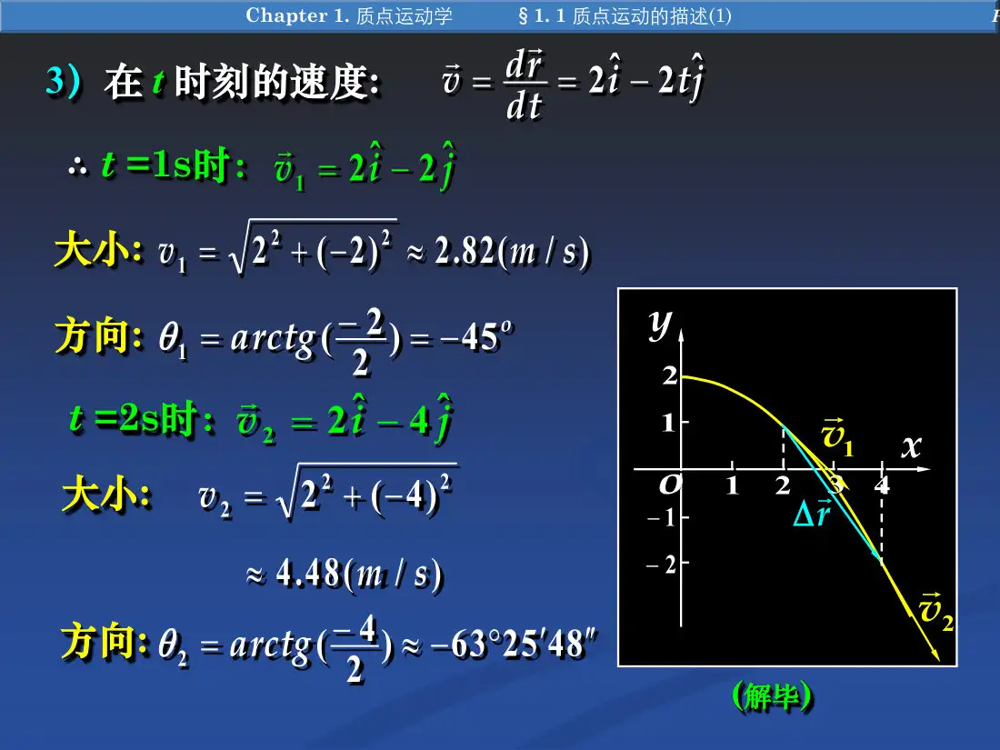

原文：

3) 在 t 时刻的速度: $\vec{v} = \frac{d\vec{r}}{dt} = 2\hat{i} - 2t\hat{j}$

∴ t=1s 时： $\vec{v}_{1}=2\hat{i}-2\hat{j}$

大小: $v_{1} = \sqrt{2^{2} + (-2)^{2}} \approx 2.82 (m / s)$

方向: $\theta_{1} = \operatorname{arctg}\left(\frac{-2}{2}\right) = -45^{\circ}$

t=2s时： $\vec{v}_{2}=2\hat{i}-4\hat{j}$

大小: $v_{2} = \sqrt{2^{2} + (-4)^{2}}$

$$
\approx 4. 4 8 (m / s)
$$

方向: $\theta_{2} = \operatorname{arctg}\left(\frac{-4}{2}\right) \approx -63^{\circ} 25' 48''$

Chapter 1. 质点运动学

§ 1.1 质点运动的描述(1)

### 四、加速度 $\vec{a}$

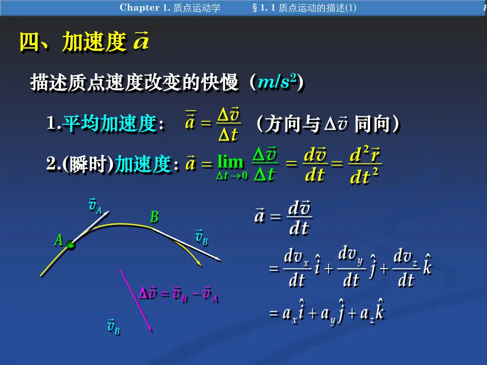

原文：

四、加速度 $\vec{a}$

描述质点速度改变的快慢（ $m/s^{2}$ ）

1. 平均加速度: $\vec{a} = \frac{\Delta \vec{v}}{\Delta t}$ (方向与 $\Delta \vec{v}$ 同向)

2.(瞬时)加速度: $\vec{a}=\lim_{\Delta t\to0}\frac{\Delta\vec{v}}{\Delta t}=\frac{d\vec{v}}{dt}=\frac{d^{2}\vec{r}}{dt^{2}}$

$$
\begin{array}{r l} & {\vec {a} = \frac {d \vec {v}}{d t}} \\ & {= \frac {d v _ {x}}{d t} \hat {i} + \frac {d v _ {y}}{d t} \hat {j} + \frac {d v _ {z}}{d t} \hat {k}} \\ & {= a _ {x} \hat {i} + a _ {y} \hat {j} + a _ {z} \hat {k}} \end{array}
$$

Chapter 1. 质点运动学

§ 1.1 质点运动的描述(1)

### 其中

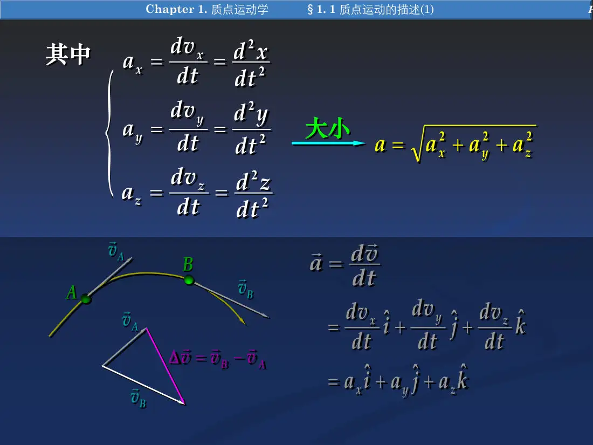

原文：

其中

$$
\left\{ \begin{array}{l} a _ {x} = \frac {d v _ {x}}{d t} = \frac {d ^ {2} x}{d t ^ {2}} \\ a _ {y} = \frac {d v _ {y}}{d t} = \frac {d ^ {2} y}{d t ^ {2}} \\ a _ {z} = \frac {d v _ {z}}{d t} = \frac {d ^ {2} z}{d t ^ {2}} \end{array} \right. \xrightarrow {\text {大小}} a = \sqrt {a _ {x} ^ {2} + a _ {y} ^ {2} + a _ {z} ^ {2}}
$$

$$
\begin{array}{r l} & {\vec {a} = \frac {d \vec {v}}{d t}} \\ & {= \frac {d v _ {x}}{d t} \hat {i} + \frac {d v _ {y}}{d t} \hat {j} + \frac {d v _ {z}}{d t} \hat {k}} \\ & {= a _ {x} \hat {i} + a _ {y} \hat {j} + a _ {z} \hat {k}} \end{array}
$$

Chapter 1. 质点运动学

§ 1.1 质点运动的描述(1)

### Chapter 1. 质点运动学

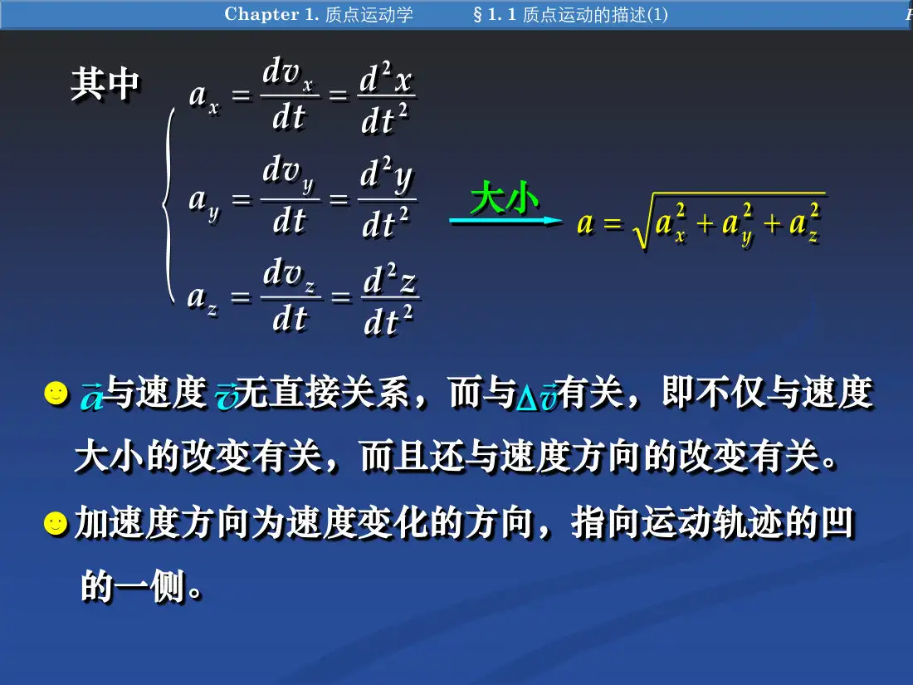

原文：

Chapter 1. 质点运动学

§ 1.1 质点运动的描述(1)

其中

$$
\left\{ \begin{array}{l} a _ {x} = \frac {d v _ {x}}{d t} = \frac {d ^ {2} x}{d t ^ {2}} \\ a _ {y} = \frac {d v _ {y}}{d t} = \frac {d ^ {2} y}{d t ^ {2}} \\ a _ {z} = \frac {d v _ {z}}{d t} = \frac {d ^ {2} z}{d t ^ {2}} \end{array} \right. \xrightarrow {\text {大小}} a = \sqrt {a _ {x} ^ {2} + a _ {y} ^ {2} + a _ {z} ^ {2}}
$$

\- 与速度 $\vec{v}$ 无直接关系，而与 $\Delta \vec{v}$ 有关，即不仅与速度大小的改变有关，而且还与速度方向的改变有关。

加速度方向为速度变化的方向，指向运动轨迹的凹的一侧。

### Chapter 1. 质点运动学

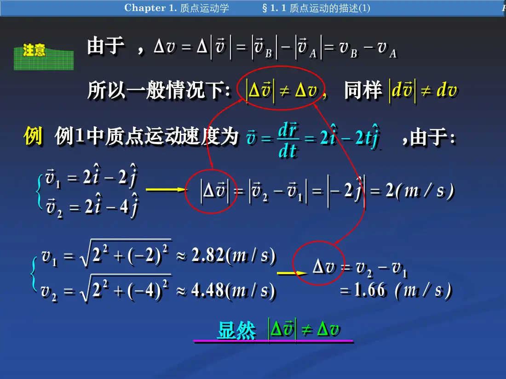

原文：

Chapter 1. 质点运动学

§ 1.1 质点运动的描述(1)

注意 由于， $\Delta v = \Delta |\vec{v}| = |\vec{v}_B| - |\vec{v}_A| = v_B - v_A$

所以一般情况下: $|\Delta \vec{v}| \neq \Delta v$ , 同样 $|d \vec{v}| \neq d v$

例 例1中质点运动速度为 $\vec{v} = \frac{d\vec{r}}{dt} = 2\hat{i} - 2t\hat{j}$ ，由于：

$$
\left\{ \begin{array}{l} \vec {v} _ {1} = 2 \hat {i} - 2 \hat {j} \\ \vec {v} _ {2} = 2 \hat {i} - 4 \hat {j} \end{array} \right. \longrightarrow \left| \Delta \vec {v} \right| = \left| \vec {v} _ {2} - \vec {v} _ {1} \right| = \left| - 2 \hat {j} \right| = 2 (m / s)
$$

$$
\left\{ \begin{array}{l} v _ {1} = \sqrt {2 ^ {2} + (- 2) ^ {2}} \approx 2. 8 2 (m / s) \\ v _ {2} = \sqrt {2 ^ {2} + (- 4) ^ {2}} \approx 4. 4 8 (m / s) \end{array} \right. \xrightarrow {\Delta v = v _ {2} - v _ {1}} = 1. 6 6 (m / s)
$$

显然 $|\Delta \vec{v}| \neq \Delta v$

### 能由运动方程说明 $|d\vec{v}|\neq dv$ 吗？

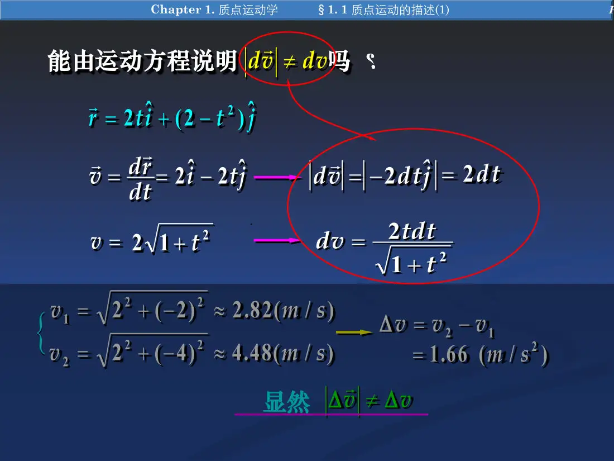

原文：

能由运动方程说明 $|d\vec{v}|\neq dv$ 吗？

$$
\vec {r} = 2 t \hat {i} + (2 - t ^ {2}) \hat {j}
$$

$$
\vec {v} = \frac {d \vec {r}}{d t} = 2 \hat {i} - 2 t \hat {j} \longrightarrow | d \vec {v} | = | - 2 d t \hat {j} | = 2 d t
$$

$$
v = 2 \sqrt {1 + t ^ {2}}
$$

$$
d v = \frac {2 t d t}{\sqrt {1 + t ^ {2}}}
$$

$$
\left\{ \begin{array}{l} v _ {1} = \sqrt {2 ^ {2} + (- 2) ^ {2}} \approx 2. 8 2 (m / s) \\ v _ {2} = \sqrt {2 ^ {2} + (- 4) ^ {2}} \approx 4. 4 8 (m / s) \end{array} \right. \longrightarrow \begin{array}{r l} \Delta v & = v _ {2} - v _ {1} \\ & = 1. 6 6 (m / s ^ {2}) \end{array}
$$

显然 $|\Delta \vec{v}| \neq \Delta v$

Chapter 1. 质点运动学

§ 1.1 质点运动的描述(1)

### 能由运动方程说明 $|d\vec{v}|\neq dv$ 吗？

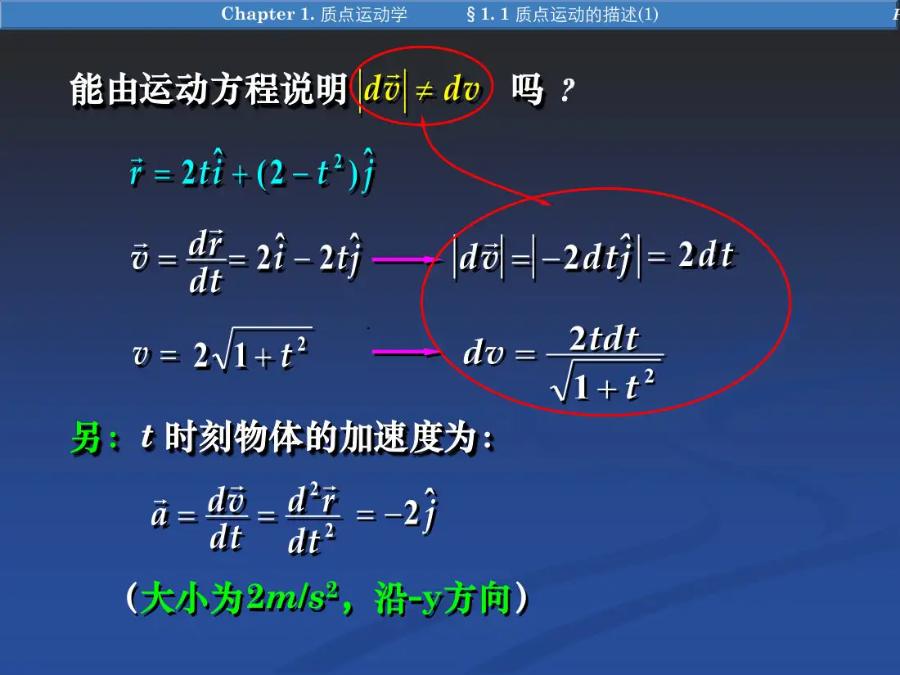

原文：

能由运动方程说明 $|d\vec{v}|\neq dv$ 吗？

$$
\vec {r} = 2 t \hat {i} + (2 - t ^ {2}) \hat {j}
$$

$$
\vec {v} = \frac {d \vec {r}}{d t} = 2 \hat {i} - 2 t \hat {j} \longrightarrow | d \vec {v} | = | - 2 d t \hat {j} | = 2 d t
$$

$$
v = 2 \sqrt {1 + t ^ {2}}
$$

$$
d v = \frac {2 t d t}{\sqrt {1 + t ^ {2}}}
$$

另：t 时刻物体的加速度为：

$$
\vec {a} = \frac {d \vec {v}}{d t} = \frac {d ^ {2} \vec {r}}{d t ^ {2}} = - 2 \hat {j}
$$

(大小为 $2m / s^{2}$ , 沿-y方向)

Chapter 1. 质点运动学

§ 1.1 质点运动的描述(1)

### 描述质点运动，即描述 t 时刻质点：

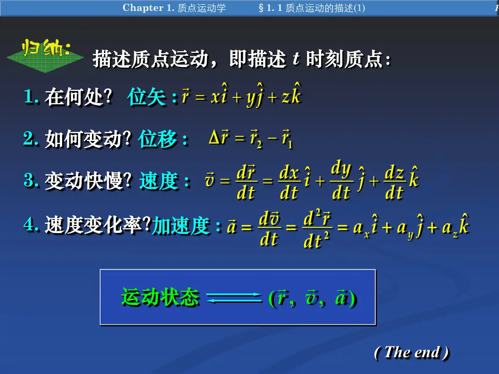

原文：

描述质点运动，即描述 t 时刻质点：

1. 在何处？位矢： $\vec{r} = x \hat{i} + y \hat{j} + z \hat{k}$

2. 如何变动? 位移: $\Delta \vec{r} = \vec{r}_{2} - \vec{r}_{1}$

3. 变动快慢？速度： $\vec{v} = \frac{d\vec{r}}{dt} = \frac{dx}{dt}\hat{i} + \frac{dy}{dt}\hat{j} + \frac{dz}{dt}\hat{k}$

4. 速度变化率?加速度: $\vec{a} = \frac{d\vec{v}}{dt} = \frac{d^2\vec{r}}{dt^2} = a_x\hat{i} + a_y\hat{j} + a_z\hat{k}$

运动状态 $\Longrightarrow(\vec{r},\vec{v},\vec{a})$

Chapter 1. 质点运动学

§ 1.1 质点运动的描述(1)

(The end)
