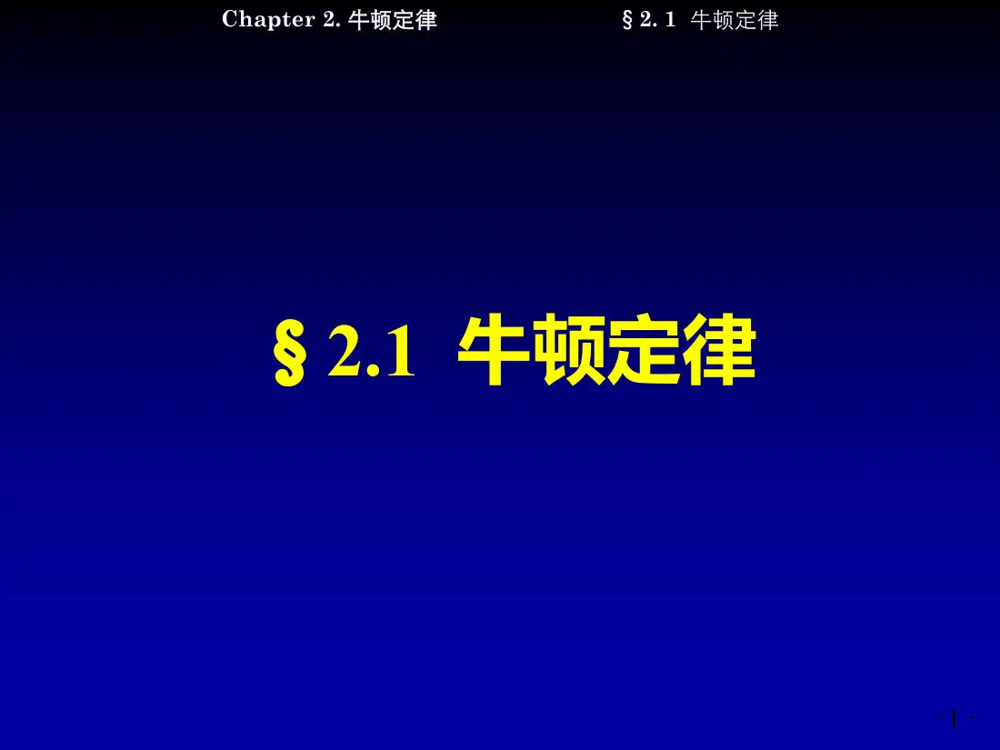
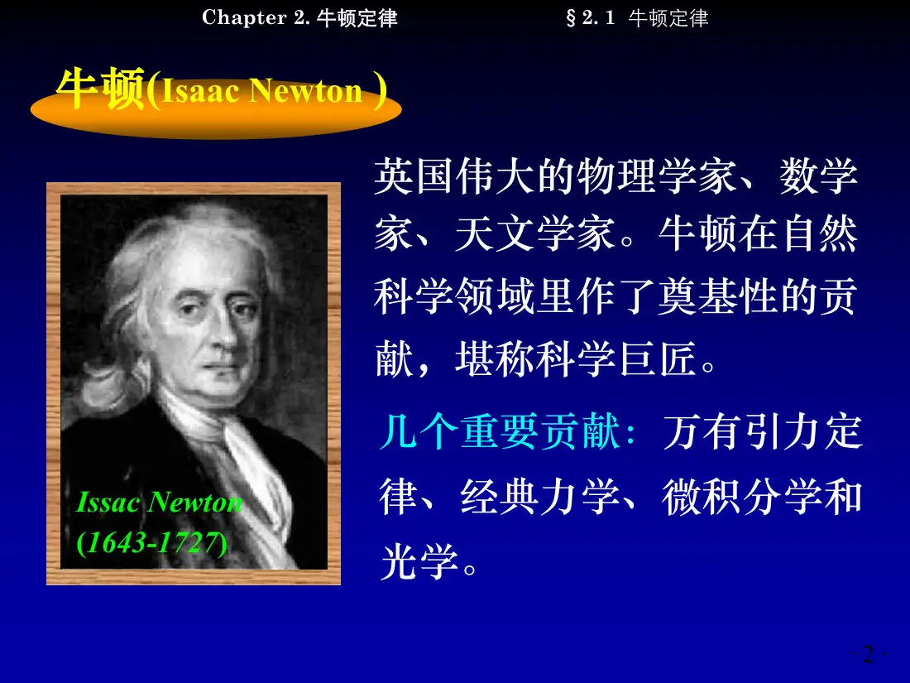
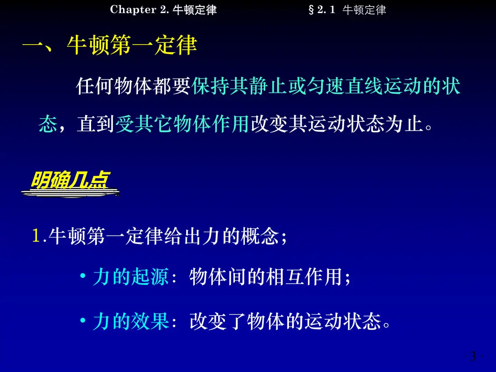
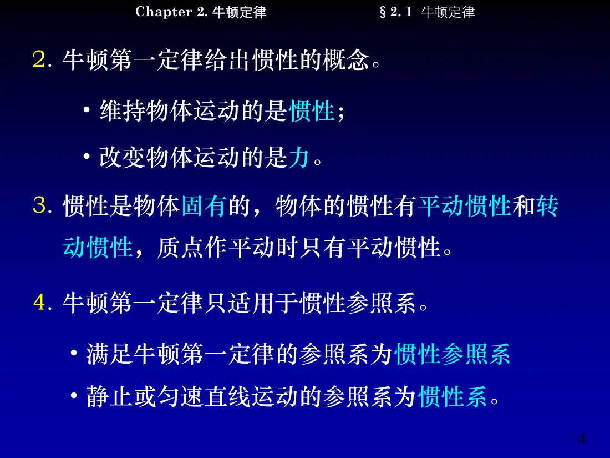
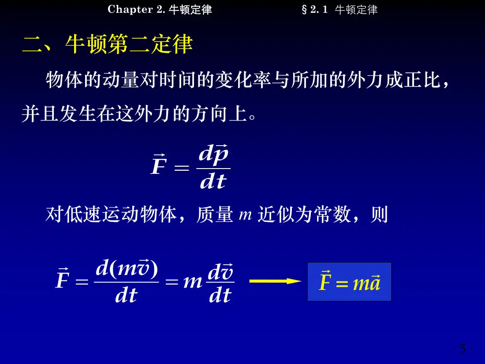
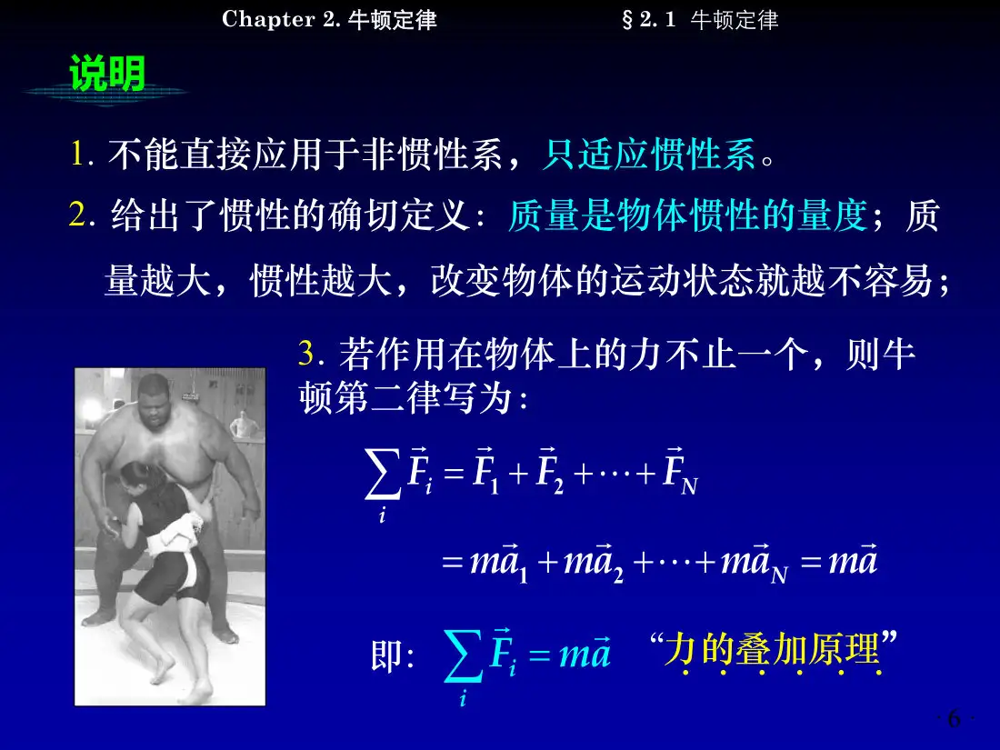
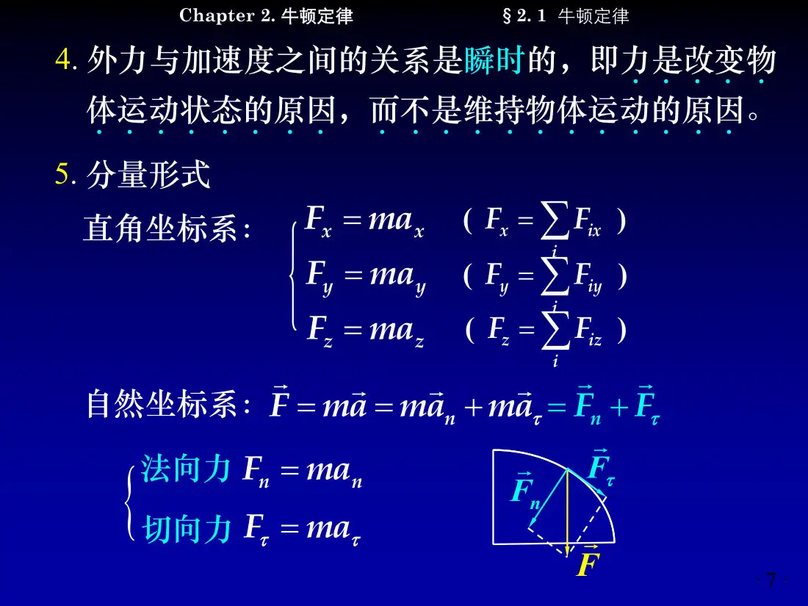
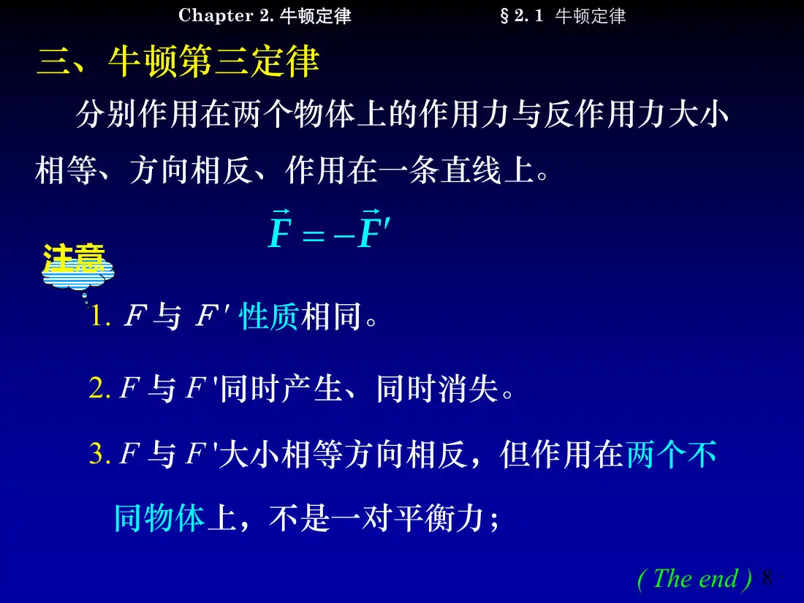
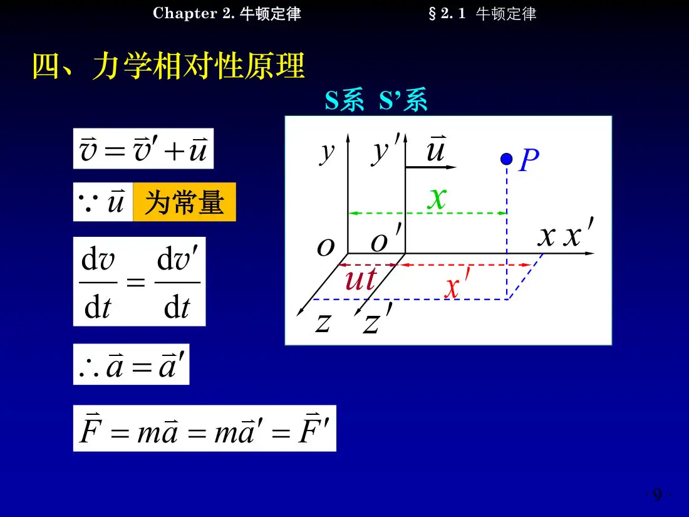
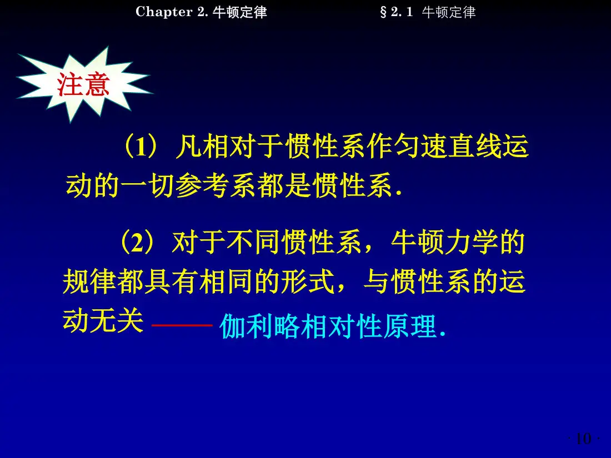

# 《大学物理（上）》第2章 牛顿运动定律（§2.1 牛顿定律）

原件的每一页，下面附识别出的文字。

### § 2.1 牛顿定律

原文：

§ 2.1 牛顿定律

Chapter 2. 牛顿定律

§ 2.1 牛顿定律

### 牛顿(Isaac Newton

原文：

牛顿(Isaac Newton

英国伟大的物理学家、数学家、天文学家。牛顿在自然科学领域里作了奠基性的贡献，堪称科学巨匠。

几个重要贡献：万有引力定律、经典力学、微积分学和光学。

Chapter 2. 牛顿定律

§ 2.1 牛顿定律

2

### 一、牛顿第一定律

原文：

一、牛顿第一定律

任何物体都要保持其静止或匀速直线运动的状态，直到受其它物体作用改变其运动状态为止。

明确几点

1. 牛顿第一定律给出力的概念；

· 力的起源：物体间的相互作用；

\- 力的效果：改变了物体的运动状态。

Chapter 2. 牛顿定律

§ 2.1 牛顿定律

3

### Chapter 2. 牛顿定律

原文：

Chapter 2. 牛顿定律

§ 2.1 牛顿定律

2. 牛顿第一定律给出惯性的概念。

\- 维持物体运动的是惯性;

\- 改变物体运动的是力。

3. 惯性是物体固有的，物体的惯性有平动惯性和转动惯性，质点作平动时只有平动惯性。

4. 牛顿第一定律只适用于惯性参照系。

\- 满足牛顿第一定律的参照系为惯性参照系

\- 静止或匀速直线运动的参照系为惯性系。

### 二、牛顿第二定律

原文：

二、牛顿第二定律

物体的动量对时间的变化率与所加的外力成正比，并且发生在这外力的方向上。

$$
\vec {F} = \frac {d \vec {p}}{d t}
$$

对低速运动物体，质量 m 近似为常数，则

$$
\vec {F} = \frac {d (m \vec {v})}{d t} = m \frac {d \vec {v}}{d t} \longrightarrow \vec {F} = m \vec {a}
$$

Chapter 2. 牛顿定律

§ 2.1 牛顿定律

5

### 说明

原文：

说明

1. 不能直接应用于非惯性系，只适应惯性系。

2. 给出了惯性的确切定义: 质量是物体惯性的量度; 质量越大, 惯性越大, 改变物体的运动状态就越不容易;

3. 若作用在物体上的力不止一个, 则牛顿第二律写为:

$$
\begin{array}{r l} \sum_ {i} \vec {F} _ {i} & = \vec {F} _ {1} + \vec {F} _ {2} + \dots + \vec {F} _ {N} \\ & = m \vec {a} _ {1} + m \vec {a} _ {2} + \dots + m \vec {a} _ {N} = m \vec {a} _ {N}. \end{array}
$$

即: $\sum_{i} \vec{F}_{i} = m \vec{a}$ “力的叠加原理”

Chapter 2. 牛顿定律

§ 2.1 牛顿定律

6

### Chapter 2. 牛顿定律

原文：

Chapter 2. 牛顿定律

§ 2.1 牛顿定律

4. 外力与加速度之间的关系是瞬时的，即力是改变物体运动状态的原因，而不是维持物体运动的原因。

5. 分量形式

直角坐标系:

$$
\left\{ \begin{array}{l l} F _ {x} = m a _ {x} & (F _ {x} = \sum_ {i} F _ {i x}) \\ F _ {y} = m a _ {y} & (F _ {y} = \sum_ {i} F _ {i y}) \\ F _ {z} = m a _ {z} & (F _ {z} = \sum_ {i} F _ {i z}) \end{array} \right.
$$

自然坐标系： $\vec{F} = m\vec{a} = m\vec{a}_n + m\vec{a}_{\tau} = \vec{F}_n + \vec{F}_{\tau}$

法向力 $F_{n}=ma_{n}$

切向力 $F_{\tau}=ma_{\tau}$

7

### 三、牛顿第三定律

原文：

三、牛顿第三定律

分别作用在两个物体上的作用力与反作用力大小相等、方向相反、作用在一条直线上。

$\vec{F} = -\vec{F}'$

注意

1. $F$ 与 $F'$ 性质相同。

2. $F$ 与 $F'$ 同时产生、同时消失。

3. $F$ 与 $F'$ 大小相等方向相反，但作用在两个不

同物体上，不是一对平衡力；

Chapter 2. 牛顿定律

§ 2.1 牛顿定律

( The end

8

### 四、力学相对性原理

原文：

四、力学相对性原理

$$
\vec {v} = \vec {v} ^ {\prime} + \vec {u}
$$

∵ $\vec{u}$ 为常量

$$
\frac {\mathrm{d} v}{\mathrm{d} t} = \frac {\mathrm{d} v ^ {\prime}}{\mathrm{d} t}
$$

$$
\therefore \vec {a} = \vec {a} ^ {\prime}
$$

S系 S'系

$$
\vec {F} = m \vec {a} = m \vec {a} ^ {\prime} = \vec {F} ^ {\prime}
$$

Chapter 2. 牛顿定律

§ 2.1 牛顿定律

9

### (1) 凡相对于惯性系作匀速直线运动的一切参考系都是惯性系.

原文：

(1) 凡相对于惯性系作匀速直线运动的一切参考系都是惯性系.

(2) 对于不同惯性系, 牛顿力学的规律都具有相同的形式, 与惯性系的运动无关——伽利略相对性原理.

Chapter 2. 牛顿定律

§ 2.1 牛顿定律

10
