# 《大学物理（上）》第2章 质点动力学 §2.2 牛顿定律的应用举例（课件）

原件的每一页，下面附识别出的文字。

### §2.2 牛顿定律的应用

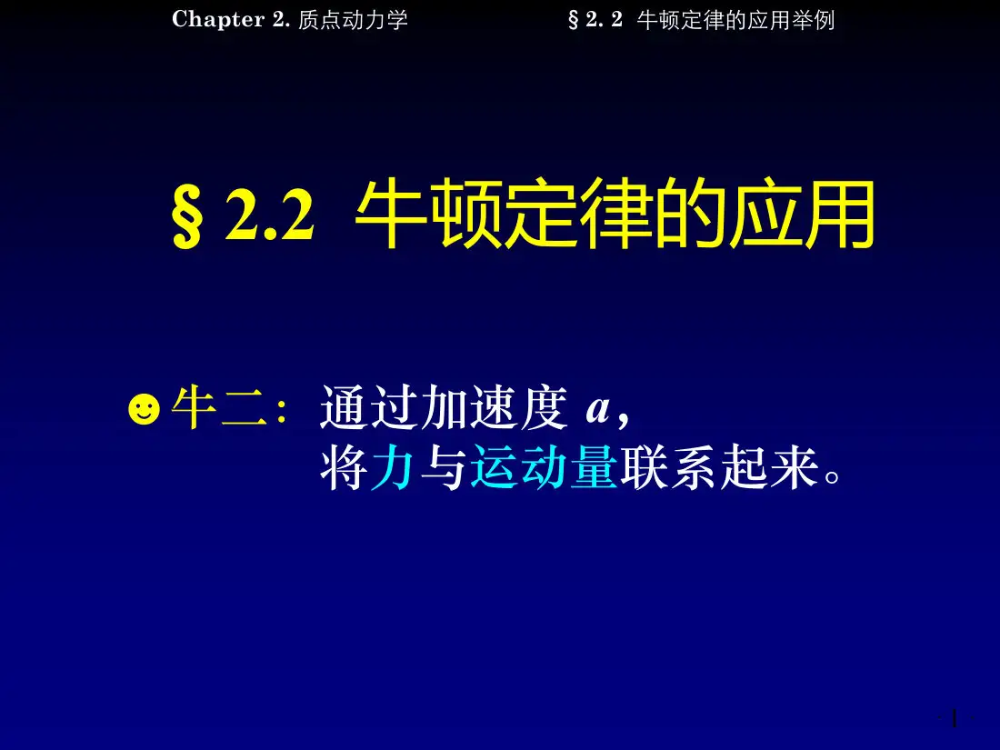

原文：

§2.2 牛顿定律的应用

☻牛二：通过加速度 a，将力与运动量联系起来。

Chapter 2. 质点动力学

§2. 2 牛顿定律的应用举例

### Chapter 2. 质点动力学

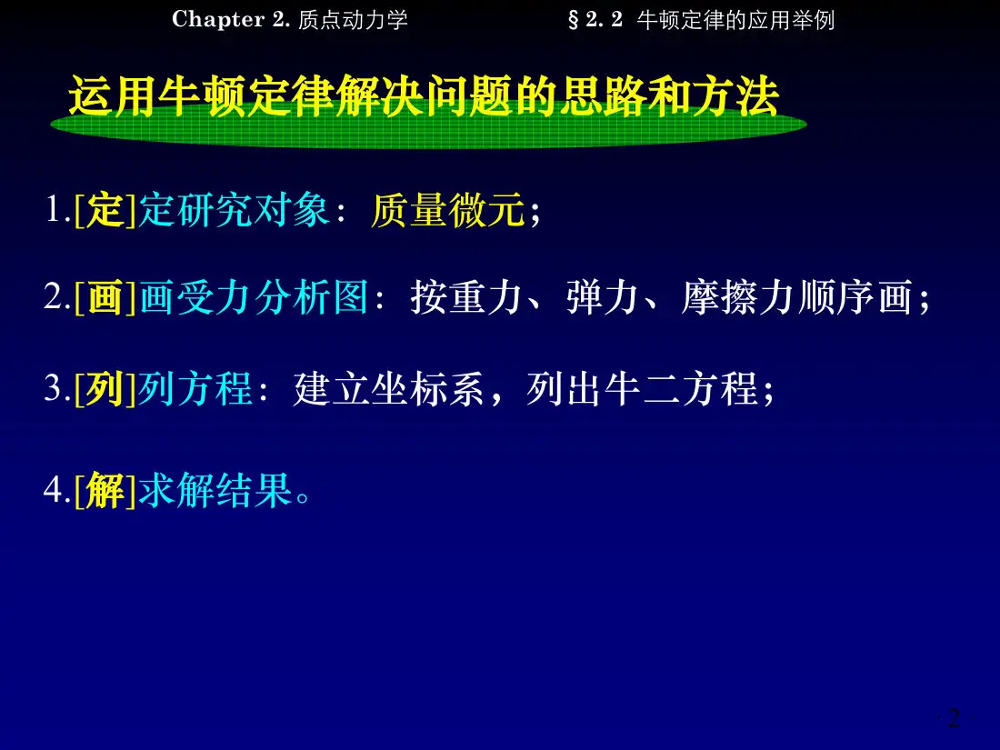

原文：

Chapter 2. 质点动力学

§2. 2 牛顿定律的应用举例

运用牛顿定律解决问题的思路和方法

1.[定]定研究对象：质量微元；

2.[画]画受力分析图：按重力、弹力、摩擦力顺序画；

3.[列]列方程：建立坐标系，列出牛二方程；

4.[解]求解结果。

· 2

### 三类问题：

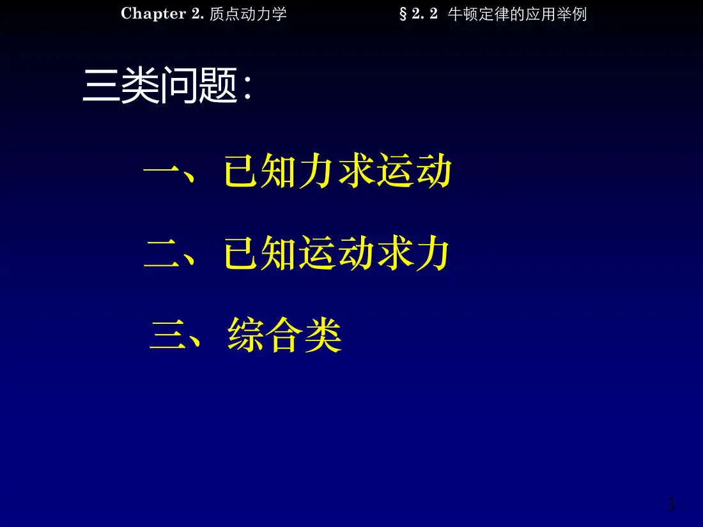

原文：

三类问题：

已知力求运动

二、已知运动求力

三、综合类

Chapter 2. 质点动力学

§2. 2 牛顿定律的应用举例

· 3

### Chapter 2. 质点动力学

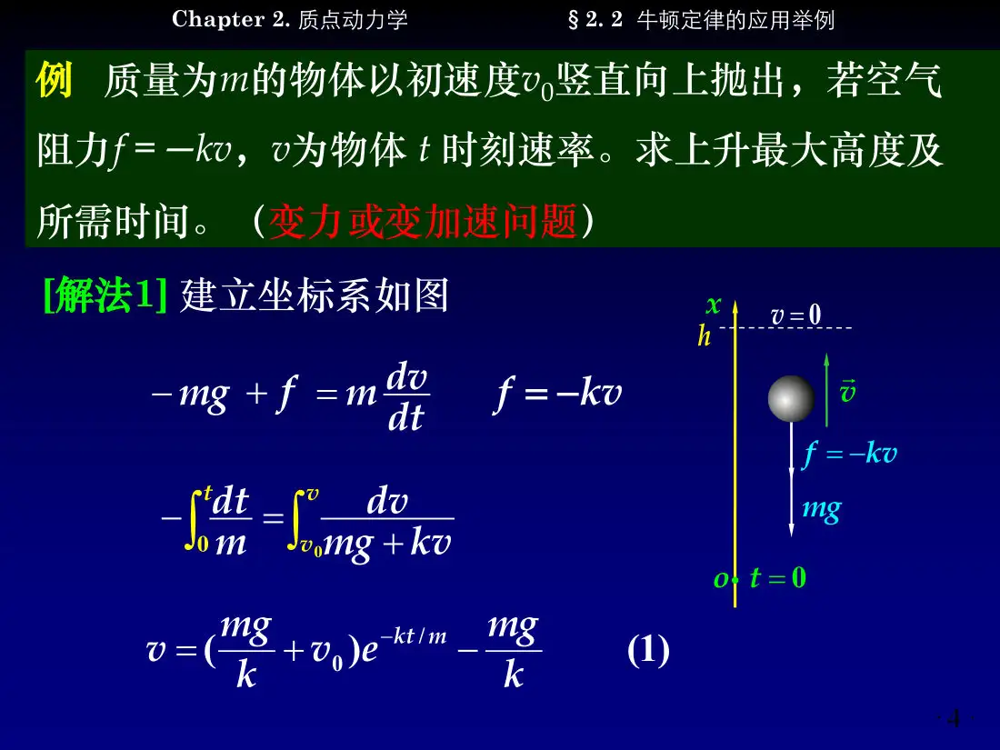

原文：

Chapter 2. 质点动力学

§2. 2 牛顿定律的应用举例

例 质量为m的物体以初速度 $\textcircled { \bullet }$ 竖直向上抛出，若空气阻力f =－kv，v为物体 t 时刻速率。求上升最大高度及所需时间。（变力或变加速问题）

[解法1] 建立坐标系如图

$$
- m g + f = m \frac {d v}{d t} \quad f = - k v
$$

$$
- \int_ {0} ^ {t} \frac {d t}{m} = \int_ {v _ {0}} ^ {v} \frac {d v}{m g + k v}
$$

$$
\begin{array}{c c} x & v = 0 \\ h & \vec {v} \\ & f = - k v \\ & m g \\ o & t = 0 \end{array}
$$

$$
v = (\frac {m g}{k} + v _ {0}) e ^ {- k t / m} - \frac {m g}{k}
$$

(1)

· 4

### Chapter 2. 质点动力学

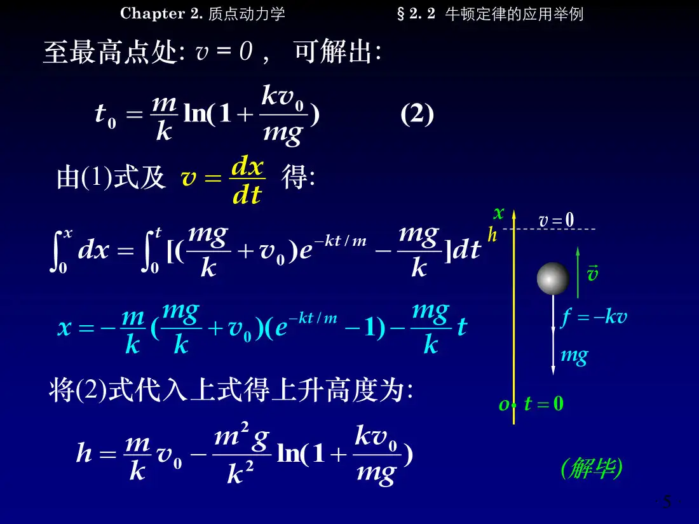

原文：

Chapter 2. 质点动力学

§2. 2 牛顿定律的应用举例

至最高点处: $[ \pmb { \theta } ] \in [ 0 ]$ , 可解出:

$$
t _ {0} = \frac {m}{k} \ln (1 + \frac {k v _ {0}}{m g})\tag{2}
$$

由(1)式及 $\textcircled { 6 } = \frac { \textcircled { 1 } 6 } { \textcircled { 7 } 6 }$ 得:

$$
\int_ {0} ^ {x} d x = \int_ {0} ^ {t} [ (\frac {m g}{k} + v _ {0}) e ^ {- k t / m} - \frac {m g}{k} ] d t
$$

$$
x = - \frac {m}{k} (\frac {m g}{k} + v _ {0}) (e ^ {- k t / m} - 1) - \frac {m g}{k} t
$$

将(2)式代入上式得上升高度为:

$$
h = \frac {m}{k} v _ {0} - \frac {m ^ {2} g}{k ^ {2}} \ln (1 + \frac {k v _ {0}}{m g})
$$

$$
\begin{array}{c} x \\ h \end{array} \quad \begin{array}{c} v = 0 \\ \vec {v} \\ f = - k v \\ m g \\ o \cdot t = 0 \end{array}
$$

(解毕)

· 5

### Chapter 2. 质点动力学

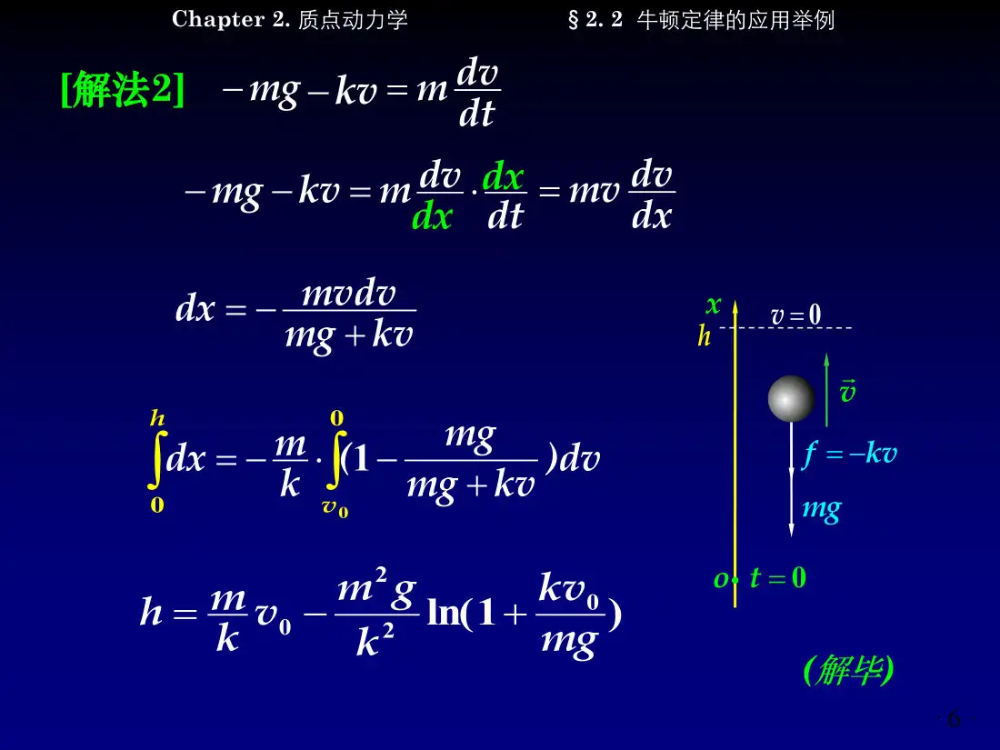

原文：

Chapter 2. 质点动力学

§2. 2 牛顿定律的应用举例

[解法2] $\frac { 1 } { 6 } \times 6 \times \frac { 1 } { 2 } \times 6 = 1 1 4$

$$
- m g - k v = m \frac {d v}{d x} \cdot \frac {d x}{d t} = m v \frac {d v}{d x}
$$

$$
d x = - \frac {m v d v}{m g + k v}
$$

$$
\int_ {0} ^ {h} d x = - \frac {m}{k} \cdot \int_ {v _ {0}} ^ {0} (1 - \frac {m g}{m g + k v}) d v
$$

$$
h = \frac {m}{k} v _ {0} - \frac {m ^ {2} g}{k ^ {2}} \ln (1 + \frac {k v _ {0}}{m g})
$$

$$
\begin{array}{c} x \\ h \end{array} \quad \begin{array}{c} v = 0 \\ \vec {v} \\ f = - k v \\ m g \\ o \cdot t = 0 \end{array}
$$

(解毕)

6

### Chapter 2. 质点动力学

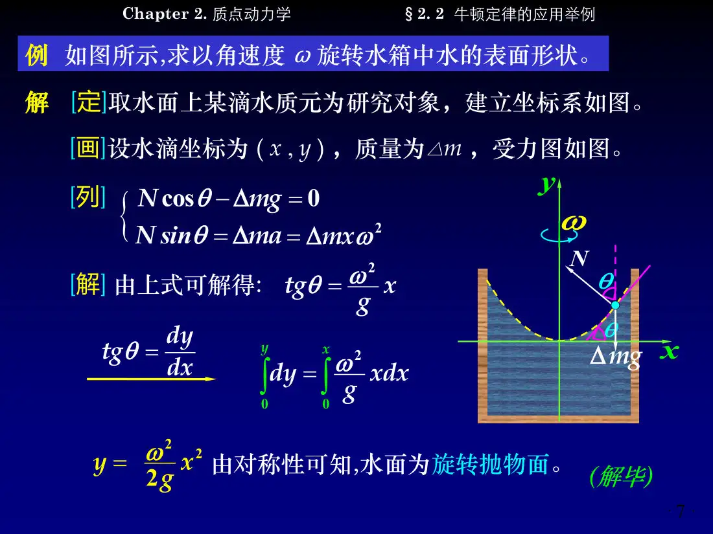

原文：

Chapter 2. 质点动力学

§2. 2 牛顿定律的应用举例

例 如图所示,求以角速度 ω 旋转水箱中水的表面形状。

解 [定]取水面上某滴水质元为研究对象，建立坐标系如图。

[画]设水滴坐标为 $( \cos \theta , \theta )$ ，质量为 $\angle A E G = 9 0 ^ { \circ }$ ，受力图如图。

[列]

$$
\begin{array}{l} N \cos \theta - \Delta m g = 0 \\ N \sin \theta = \Delta m a = \Delta m x \omega^ {2} \end{array}
$$

[解] 由上式可解得: $\because ( \frac { 1 } { 2 } - \frac { 1 } { 3 } ) \times ( \frac { 1 } { 2 } - \frac { 1 } { 3 } ) \times ( \frac { 1 } { 2 } - \frac { 1 } { 3 } ) \times ( \frac { 1 } { 2 } - \frac { 1 } { 3 } )$

$$
t g \theta = \frac {d y}{d x}
$$

$$
\int_ {0} ^ {y} d y = \int_ {0} ^ {x} \frac {\omega^ {2}}{g} x d x
$$

$V _ { 1 } = \frac { \cos ^ { 2 } \theta } { \cos \theta } = \frac { \cos ^ { 2 } \theta } { \cos \theta }$ 由对称性可知,水面为旋转抛物面

(解毕)

· 7

### Chapter 2. 质点动力学

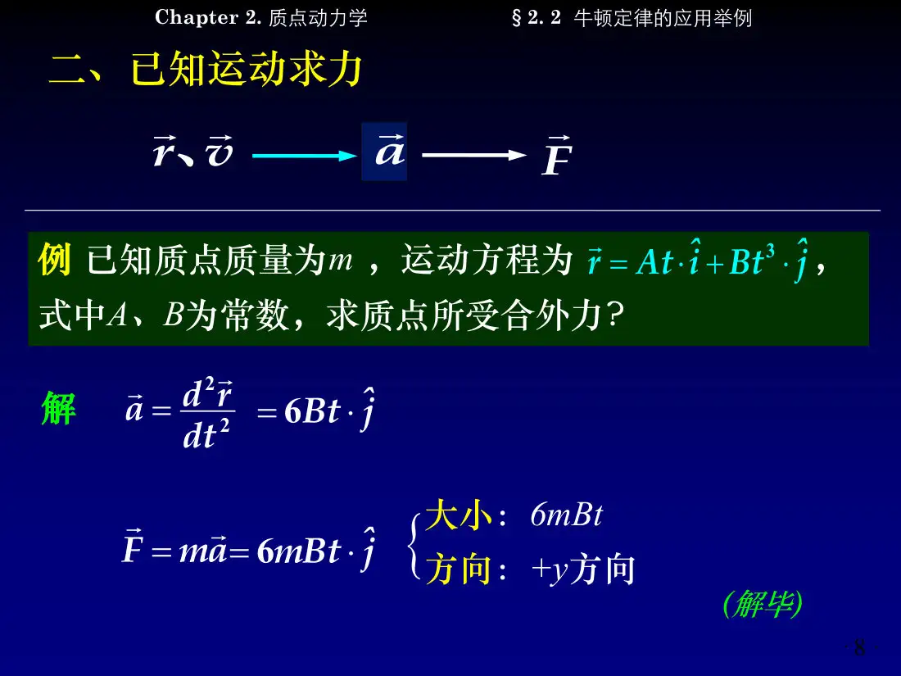

原文：

Chapter 2. 质点动力学

二、已知运动求力

$$
\vec {r} 、 \vec {v} \longrightarrow \vec {a} \longrightarrow \vec {F}
$$

例 已知质点质量为m ，运动方程为 $1 2 - 1 = 1 2 ( m ^ { 2 } )$ 式中A、 B为常数，求质点所受合外力?

解 $\frac { 1 } { 3 } \times \frac { 1 } { 3 } = \frac { 1 } { 3 } \times \frac { 1 } { 3 } = \frac { 1 } { 3 } \times \frac { 1 } { 3 } = \frac { 1 } { 3 } ( m ^ { 2 } )$

大小：6mBtF = mā= 6mBt · j 方向：+y方向

(解毕)

§2. 2 牛顿定律的应用举例

8

### Chapter 2. 质点动力学

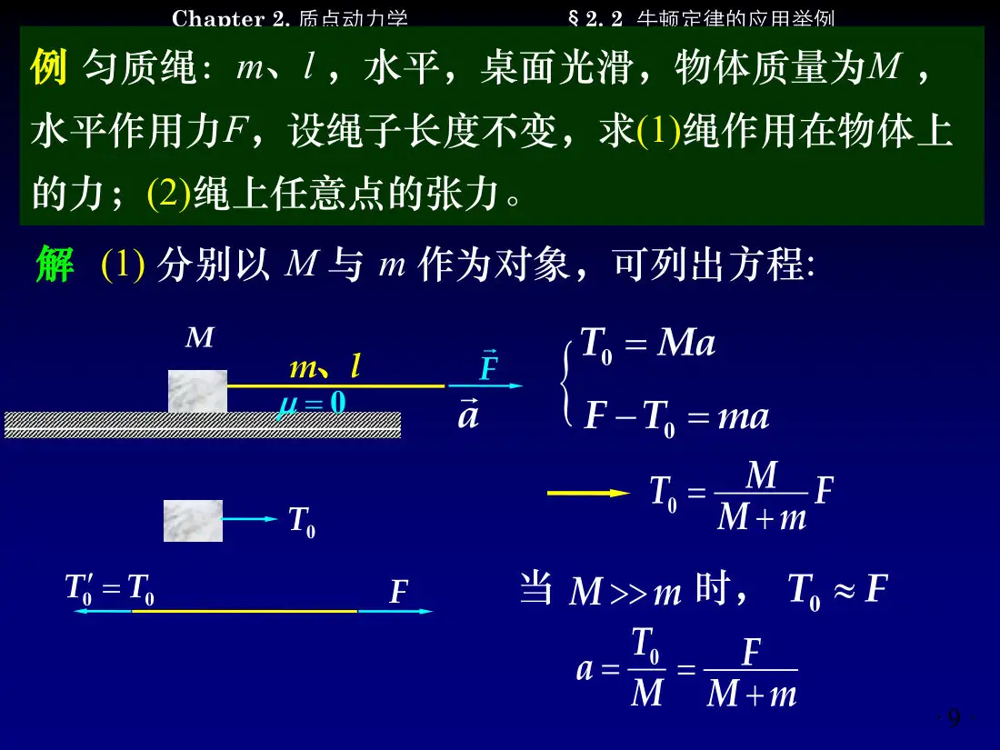

原文：

Chapter 2. 质点动力学

§2. 2 牛顿定律的应用举例

例 匀质绳：m、l ，水平，桌面光滑，物体质量为M ，水平作用力F，设绳子长度不变，求(1)绳作用在物体上的力；(2)绳上任意点的张力。

解 (1) 分别以 M 与 m 作为对象，可列出方程:

$$
\begin{array}{r l} & \text {当} M > > m \text {时,} T _ {0} \approx F \\ & a = \frac {T _ {0}}{M} = \frac {F}{M + m} \\ & T _ {0} ^ {\prime} = T _ {0} \quad \text {当} T _ {0} = T _ {0} \quad \text {当} T _ {0} = T _ {0} \end{array}
$$

· 9

### Chapter 2. 质点动力学

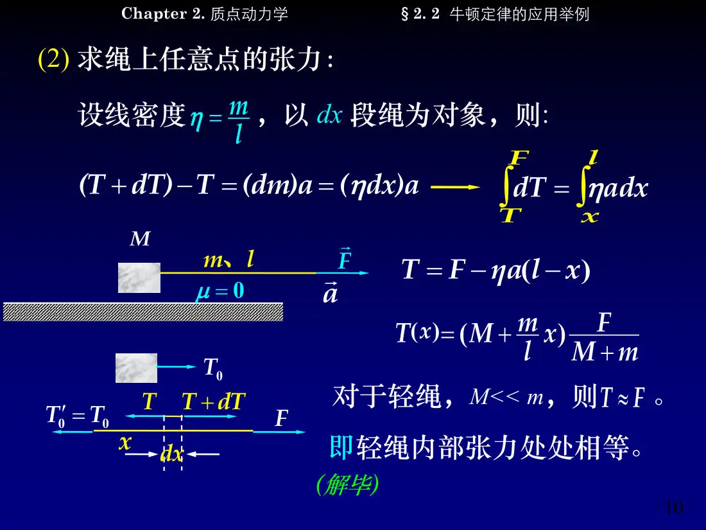

原文：

Chapter 2. 质点动力学

§2. 2 牛顿定律的应用举例

(2) 求绳上任意点的张力：

设线密度 $y = \frac { 1 1 1 } { 1 1 }$ ，以 dx 段绳为对象，则:

(T + dT) −T = (dm)a = (ηdx)a dT =  adx T x

$$
M \xrightarrow [ \mu = 0 ]{m , l} \frac {\vec {F}}{\vec {a}} \quad T = F - \eta a (l - x)
$$

$$
T _ {0} ^ {\prime} = T _ {0} \xleftarrow [ x ]{T} \frac {T + d T}{d x} F
$$

$$
T (x) = \left(M + \frac {m}{l} x\right) \frac {F}{M + m}
$$

对于轻绳， $1 1 7 - 1 = 1 1 1$ ，则 $1 1 \approx 1$

即轻绳内部张力处处相等。

(解毕)

· 10

### §2. 2 牛顿定律的应用举例

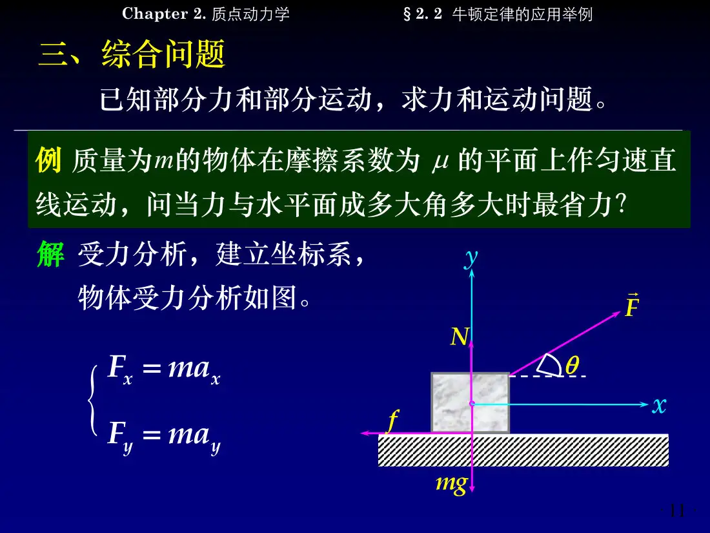

原文：

§2. 2 牛顿定律的应用举例

三、综合问题

已知部分力和部分运动，求力和运动问题。

例 质量为m的物体在摩擦系数为 的平面上作匀速直线运动，问当力与水平面成多大角多大时最省力？

解 受力分析，建立坐标系，物体受力分析如图。

$$
\left\{ \begin{array}{l} F _ {x} = m a _ {x} \\ F _ {y} = m a _ {y} \end{array} \right.
$$

Chapter 2. 质点动力学

11

### Chapter 2. 质点动力学

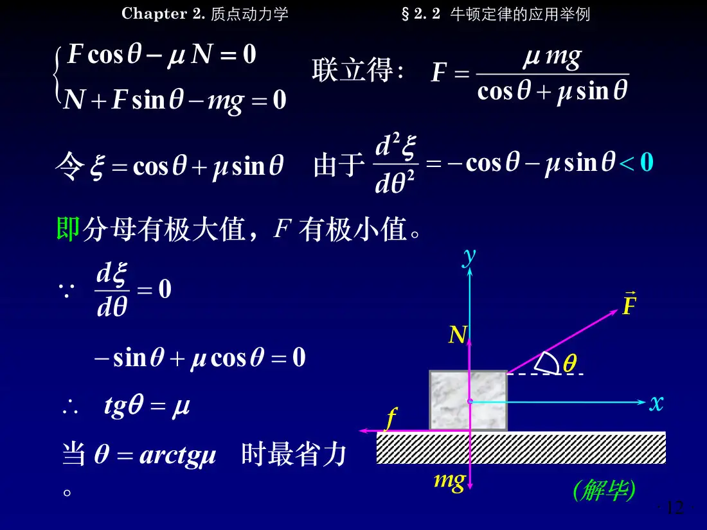

原文：

Chapter 2. 质点动力学

$$
F \cos \theta - \mu N = 0
$$

$$
N + F \sin \theta - m g = 0
$$

§2. 2 牛顿定律的应用举例

联立得： $1 3 = 1 \times 1 1 9 = 1 1 9 ( m ^ { 2 } )$

令 $\langle \hat { \mathcal { Z } } | = \langle \langle \langle \mathbf { U } | \cdot \mathbf { V } | \cdot \mathbf { U } | \cdot \mathbf { V } | \cdot \mathbf { V } | \cdot \mathbf { U } | \cdot \mathbf { U } \rangle$ 由于 $\frac { 1 6 8 } { 1 0 0 } = \frac { 1 6 0 0 0 } { 1 0 0 } = \frac { 1 6 0 0 0 } { 1 0 0 0 } = 0 . 1 2 5 ( c m )$ 即分母有极大值， $\sqrt { \frac { m } { c } }$ 有极小值。

$\frac { \frac { 1 } { 2 } \times \frac { 1 } { 3 } } { \frac { 1 } { 2 } \times \frac { 1 } { 3 } } = \frac { 1 } { 3 }$ −sinθ+µcos θ = 0 tgθ = μ $\textcircled { 1 } = \textcircled { 1 } \textcircled { 4 } \textcircled { 4 }$ 时最省力

(解毕)

12
