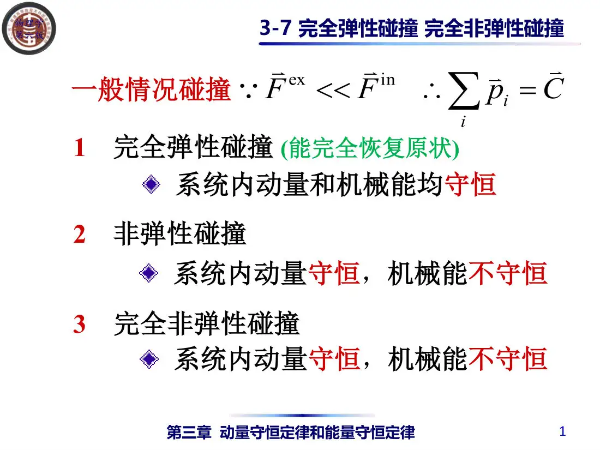
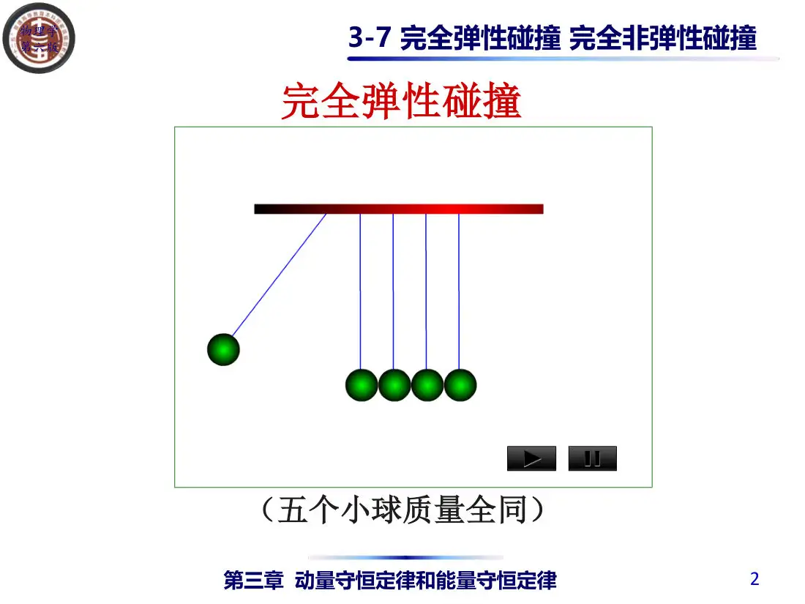
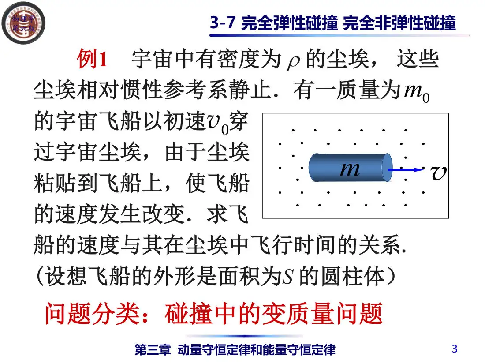
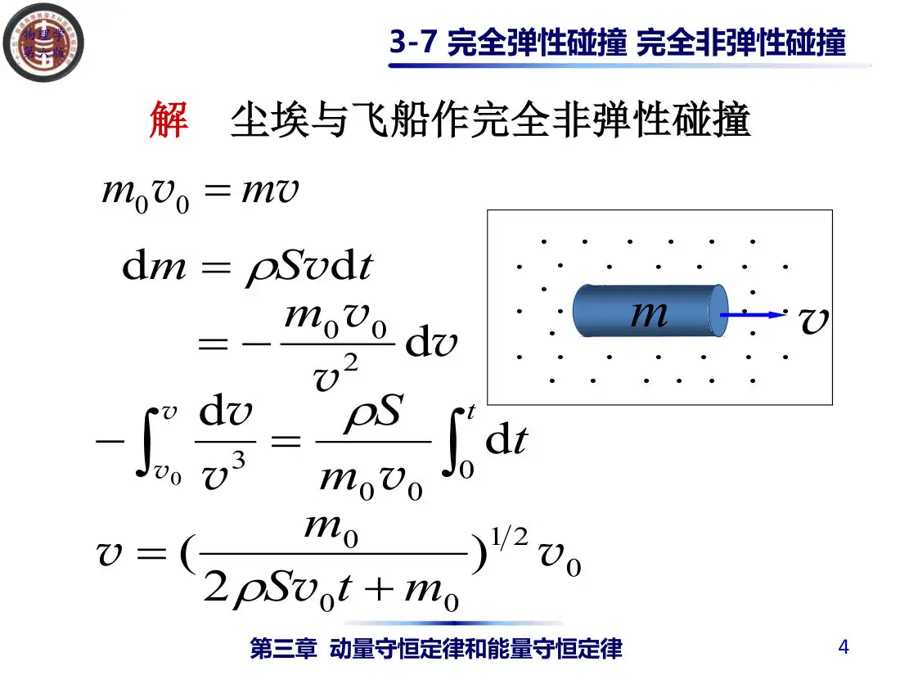
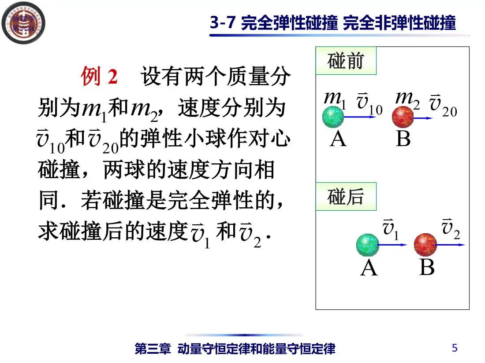
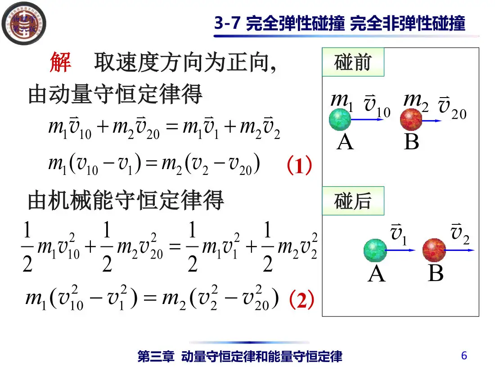
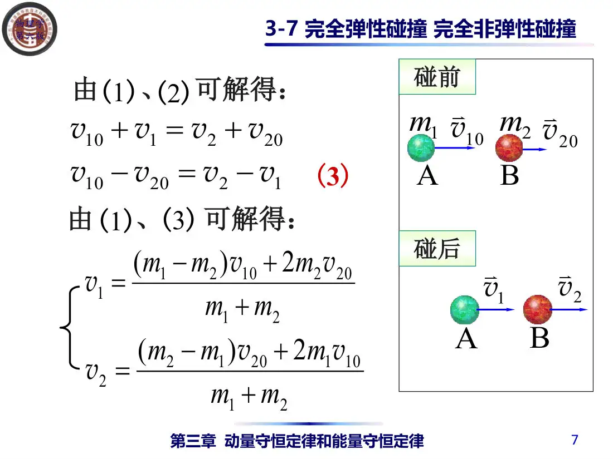
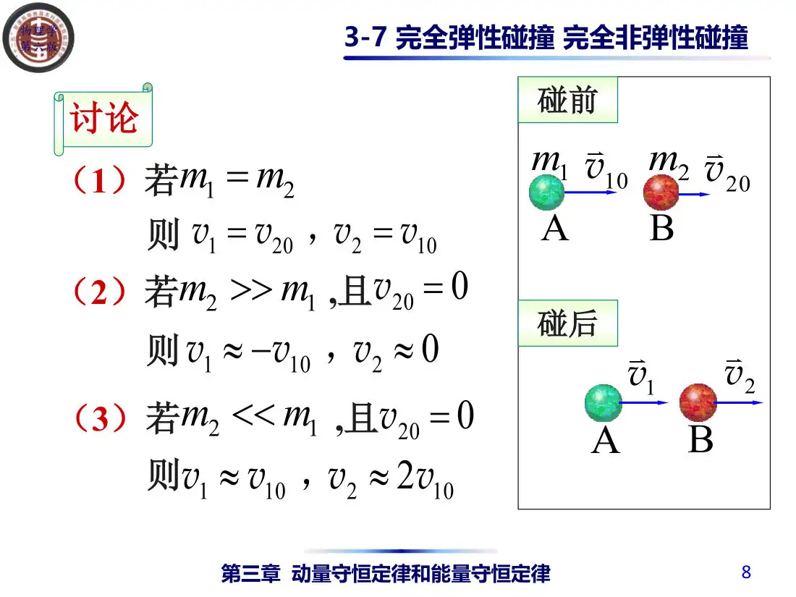

# 《大学物理（上）》第3章 §3.7 完全弹性碰撞 完全非弹性碰撞（课件）

原件的每一页，下面附识别出的文字。

### 1 完全弹性碰撞 (能完全恢复原状)

原文：

一般情况碰撞 $\scriptstyle { \vec { F } } ^ { \mathrm { e x } } < < { \vec { F } } ^ { \mathrm { i n } } \therefore \sum { \vec { p } } _ { i } = { \vec { C } }$

1 完全弹性碰撞 (能完全恢复原状)

● 系统内动量和机械能均守恒

2 非弹性碰撞

系统内动量守恒，机械能不守恒

3 完全非弹性碰撞

系统内动量守恒，机械能不守恒

物理学第六版

3-7 完全弹性碰撞 完全非弹性碰撞

第三章 动量守恒定律和能量守恒定律

1

### 完全弹性碰撞

原文：

完全弹性碰撞

物理学第六版

3-7 完全弹性碰撞 完全非弹性碰撞

第三章 动量守恒定律和能量守恒定律

2

### $$

原文：

例1 宇宙中有密度为 $\rho$ 的尘埃， 这些尘埃相对惯性参考系静止．有一质量为 $m _ { 0 }$

的宇宙飞船以初速 ${ \bf \nabla } \cdot { \bf \vec { \tau } } ^ { \boldsymbol { v } } _ { 0 }$ 穿过宇宙尘埃，由于尘埃粘贴到飞船上，使飞船的速度发生改变．求飞

$$
m \text {   or   } v
$$

船的速度与其在尘埃中飞行时间的关系.(设想飞船的外形是面积为S 的圆柱体）问题分类：碰撞中的变质量问题

物理学第六版

3-7 完全弹性碰撞 完全非弹性碰撞

第三章 动量守恒定律和能量守恒定律

3

### 解 尘埃与飞船作完全非弹性碰撞

原文：

解 尘埃与飞船作完全非弹性碰撞

$$
m _ {0} v _ {0} = m v
$$

$$
\begin{array}{l} \mathrm{d} m = \rho S v \mathrm{d} t \\ = - \frac {m _ {0} v _ {0}}{v ^ {2}} \mathrm{d} v \\ - \int_ {v _ {0}} ^ {v} \frac {\mathrm{d} v}{v ^ {3}} = \frac {\rho S}{m _ {0} v _ {0}} \int_ {0} ^ {t} \mathrm{d} t \\ v = (\frac {m _ {0}}{2 \rho S v _ {0} t + m _ {0}}) ^ {1 / 2} v _ {0} \end{array}
$$

物理学第六版

3-7 完全弹性碰撞 完全非弹性碰撞

第三章 动量守恒定律和能量守恒定律

4

### 碰前

原文：

例 2 设有两个质量分别为 $m _ { 1 }$ 和 $m _ { 2 ^ { \prime } }$ 速度分别为$\overline { { v } } _ { 1 0 }$ 和 $\overline { { v } } _ { 2 0 }$ 的弹性小球作对心碰撞，两球的速度方向相同．若碰撞是完全弹性的，求碰撞后的速度 $\overline { { v } } _ { 1 }$ 和 $\overline { { v } } _ { 2 }$

碰前

碰后

物理学第六版

3-7 完全弹性碰撞 完全非弹性碰撞

第三章 动量守恒定律和能量守恒定律

5

### 解 取速度方向为正向,由动量守恒定律得

原文：

解 取速度方向为正向,由动量守恒定律得

$$
\begin{array}{l} m _ {1} \vec {v} _ {1 0} + m _ {2} \vec {v} _ {2 0} = m _ {1} \vec {v} _ {1} + m _ {2} \vec {v} _ {2} \\ m _ {1} (v _ {1 0} - v _ {1}) = m _ {2} (v _ {2} - v _ {2 0}) \end{array}\tag{1}
$$

由机械能守恒定律得

$$
\frac {1}{2} m _ {1} v _ {1 0} ^ {2} + \frac {1}{2} m _ {2} v _ {2 0} ^ {2} = \frac {1}{2} m _ {1} v _ {1} ^ {2} + \frac {1}{2} m _ {2} v _ {2} ^ {2}
$$

$$
m _ {1} (v _ {1 0} ^ {2} - v _ {1} ^ {2}) = m _ {2} (v _ {2} ^ {2} - v _ {2 0} ^ {2})\tag{2}
$$

碰前

碰后

物理学第六版

3-7 完全弹性碰撞 完全非弹性碰撞

第三章 动量守恒定律和能量守恒定律

6

### 由 、 可解得：(1) (2)

原文：

由 、 可解得：(1) (2)

$$
\begin{array}{l} v _ {1 0} + v _ {1} = v _ {2} + v _ {2 0} \\ v _ {1 0} - v _ {2 0} = v _ {2} - v _ {1} \end{array}\tag{3}
$$

由(1)、(3)可解得：

$$
\left\{ \begin{array}{l} v _ {1} = \frac {(m _ {1} - m _ {2}) v _ {1 0} + 2 m _ {2} v _ {2 0}}{m _ {1} + m _ {2}} \\ v _ {2} = \frac {(m _ {2} - m _ {1}) v _ {2 0} + 2 m _ {1} v _ {1 0}}{m _ {1} + m _ {2}} \end{array} \right.
$$

碰前

碰后

物理学第六版

3-7 完全弹性碰撞 完全非弹性碰撞

第三章 动量守恒定律和能量守恒定律

7

### 讨论

原文：

讨论

（1）若 $m _ { 1 } = m _ { 2 }$ 则 $v _ { 1 } = v _ { 2 0 } \ , \ v _ { 2 } = v _ { 1 0 }$

（2）若 $m _ { 2 } > > m _ { 1 }$ ,且 $v _ { 2 0 } = 0$ 则 $v _ { 1 } \approx - v _ { 1 0 } \ , \ v _ { 2 } \approx 0$

（3）若 $m _ { 2 } < < m _ { 1 }$ ,且 $v _ { 2 0 } = 0$ 则 $v _ { 1 } \approx v _ { 1 0 } \ , \ v _ { 2 } \approx 2 v _ { 1 0 }$

碰前

碰后

物理学第六版

3-7 完全弹性碰撞 完全非弹性碰撞

第三章 动量守恒定律和能量守恒定律

8
