# 《大学物理（上）》第3章 守恒定律 §3.4 动能定理（课件）

原件的每一页，下面附识别出的文字。

### § 3.4 动能定理

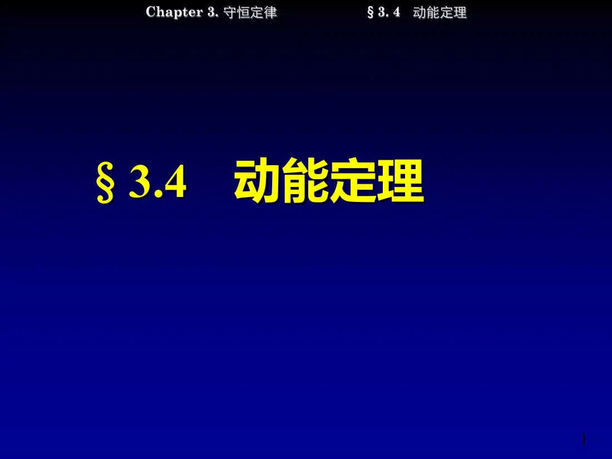

原文：

§ 3.4 动能定理

Chapter 3. 守恒定律

§ 3.4 动能定理

### 一、功

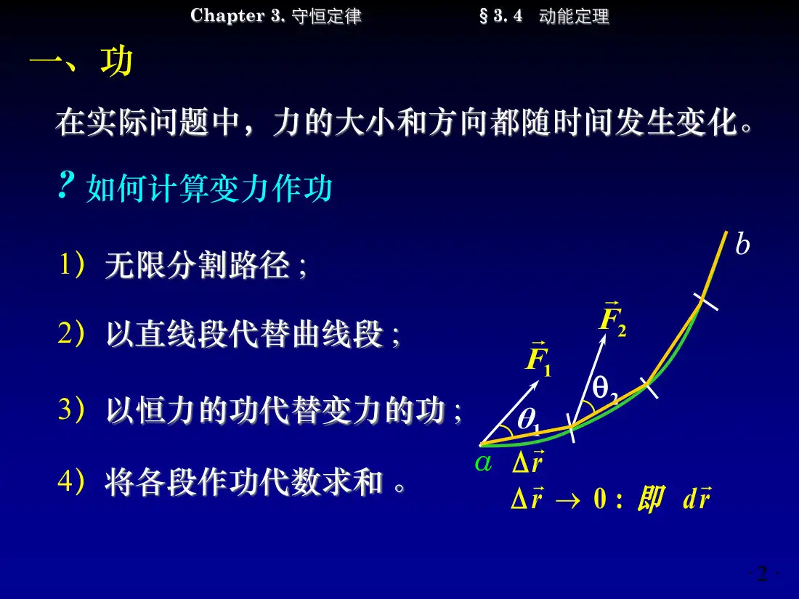

原文：

一、功

在实际问题中，力的大小和方向都随时间发生变化。

？如何计算变力作功

1）无限分割路径；

2）以直线段代替曲线段；

3）以恒力的功代替变力的功；

4）将各段作功代数求和。

Chapter 3. 守恒定律

§ 3.4 动能定理

2

### 1. 定义

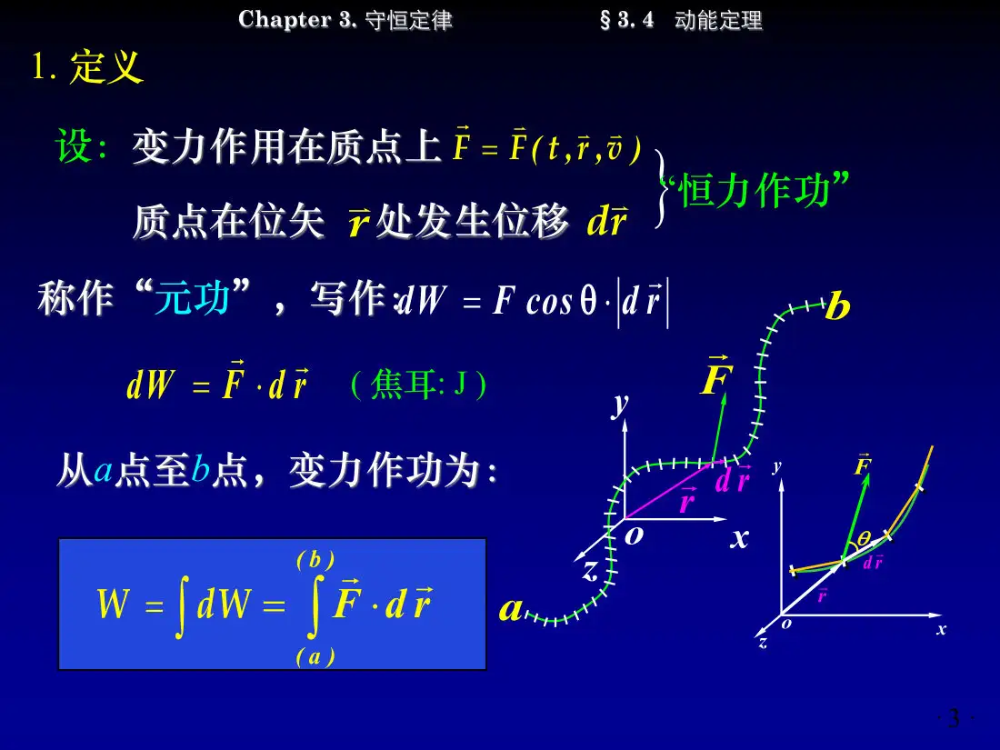

原文：

1. 定义

设：变力作用在质点上 $\vec{F} = \vec{F}(t, \vec{r}, \vec{v})$

质点在位矢 $\vec{r}$ 处发生位移 $d\vec{r}$

“恒力作功”

称作 “元功”，写作: $dW = F \cos \theta \cdot |d \vec{r}|$

$dW = \vec{F} \cdot d \vec{r}$ （焦耳: J）

从 $a$ 点至 $b$ 点，变力作功为：

$$
W = \int d W = \int_ {(a)} ^ {(b)} \vec {F} \cdot d \vec {r}
$$

Chapter 3. 守恒定律

§ 3.4 动能定理

3

### Chapter 3. 守恒定律

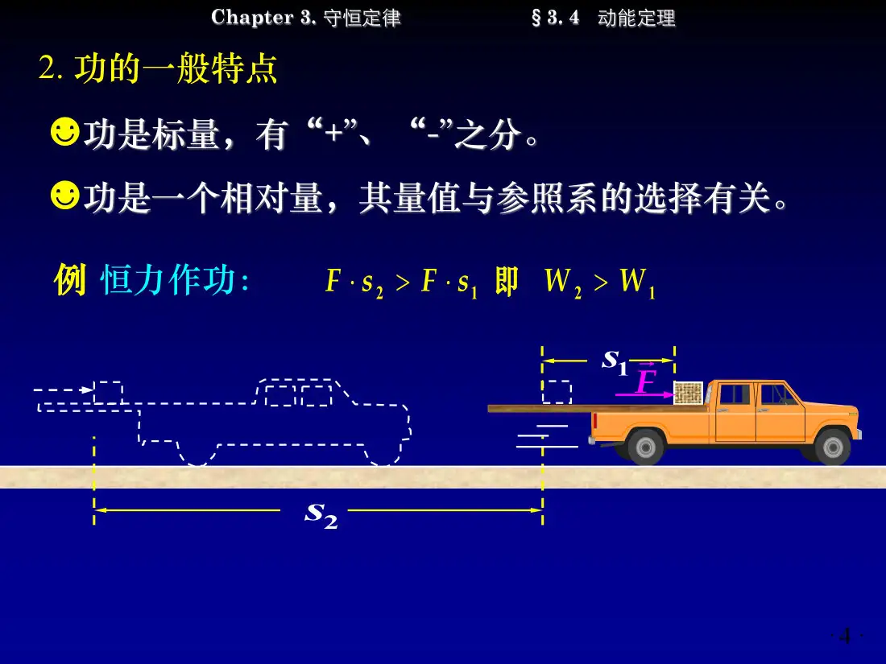

原文：

Chapter 3. 守恒定律

§ 3.4 动能定理

2. 功的一般特点

功是标量，有“+”、“-”之分。

功是一个相对量，其量值与参照系的选择有关。

例 恒力作功: $F \cdot s_{2} > F \cdot s_{1}$ 即 $W_{2} > W_{1}$

4

### Chapter 3. 守恒定律

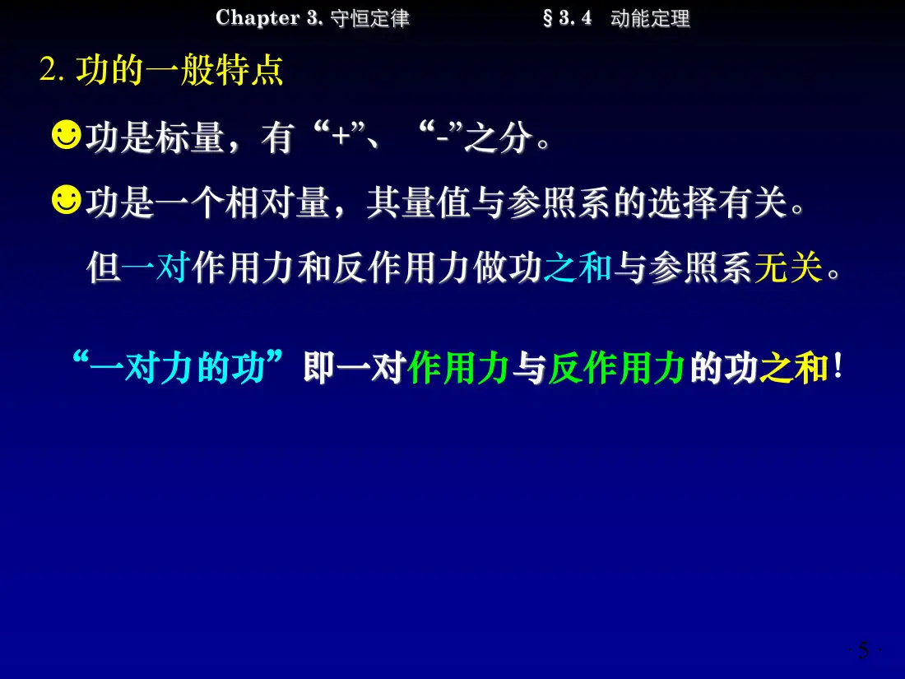

原文：

Chapter 3. 守恒定律

§ 3.4 动能定理

2. 功的一般特点

😊功是标量，有“+”、“-”之分。

功是一个相对量，其量值与参照系的选择有关。

但一对作用力和反作用力做功之和与参照系无关。

“一对力的功”即一对作用力与反作用力的功之和!

5

### 一对力的功

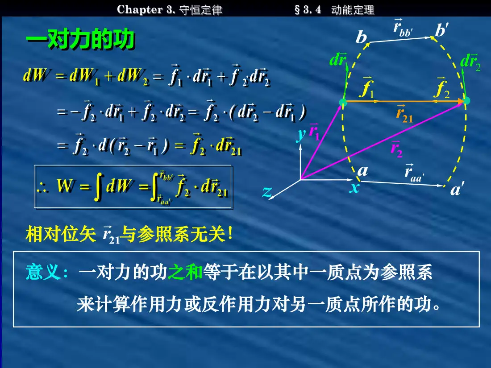

原文：

一对力的功

$$
\begin{array}{r l} d W & = d W _ {1} + d W _ {2} = \vec {f} _ {1} \cdot d \vec {r} _ {1} + \vec {f} _ {2} \cdot d \vec {r} _ {2} \\ & = - \vec {f} _ {2} \cdot d \vec {r} _ {1} + \vec {f} _ {2} \cdot d \vec {r} _ {2} = \vec {f} _ {2} \cdot (d \vec {r} _ {2} - d \vec {r} _ {1}) \\ & = \vec {f} _ {2} \cdot d (\vec {r} _ {2} - \vec {r} _ {1}) = \vec {f} _ {2} \cdot d \vec {r} _ {2 1} \end{array}
$$

$\therefore W = \int dW = \int_{\vec{r}_{aa'}'}^{\vec{r}_b b'} \vec{f}_2 \cdot d\vec{r}_{21}$

相对位矢 $\vec{r}_{21}$ 与参照系无关!

意义: 一对力的功之和等于在以其中一质点为参照系来计算作用力或反作用力对另一质点所作的功。

Chapter 3. 守恒定律

§ 3.4 动能定理

### Chapter 3. 守恒定律

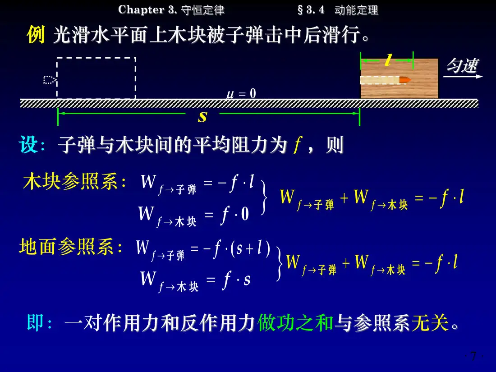

原文：

Chapter 3. 守恒定律

例 光滑水平面上木块被子弹击中后滑行。

设：子弹与木块间的平均阻力为 $f$ ，则

木块参照系:

地面参照系:

$W_{f\to \text{子弹}} = -f\cdot l$

$W_{f\to \text{木块}} = f\cdot 0$

$W_{f\to \text{木块}} = f\cdot s$

$$
W _ {f \rightarrow \text {子弹}} + W _ {f \rightarrow \text {木块}} = - f \cdot l
$$

$$
W _ {f \rightarrow \text {子弹}} + W _ {f \rightarrow \text {木块}} = - f \cdot l
$$

即：一对作用力和反作用力做功之和与参照系无关。

§ 3.4 动能定理

7

### 其他一对力做功，如：重力做功、万有引力做功、静

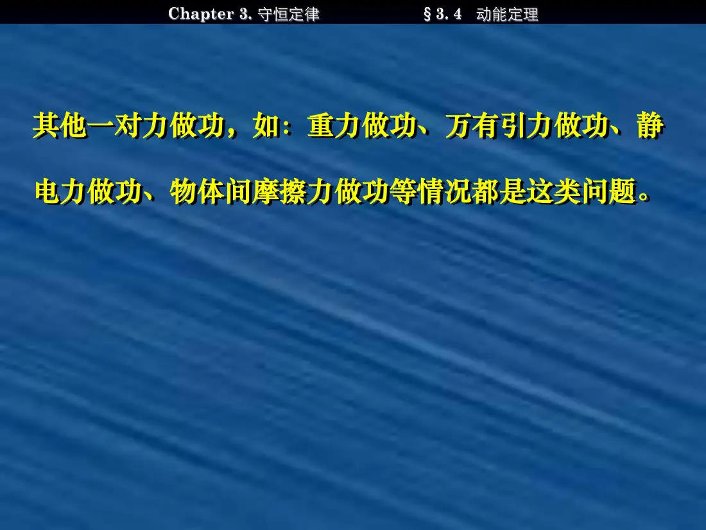

原文：

其他一对力做功，如：重力做功、万有引力做功、静

电力做功、物体间摩擦力做功等情况都是这类问题。

Chapter 3. 守恒定律

§ 3.4 动能定理

### Chapter 3. 守恒定律

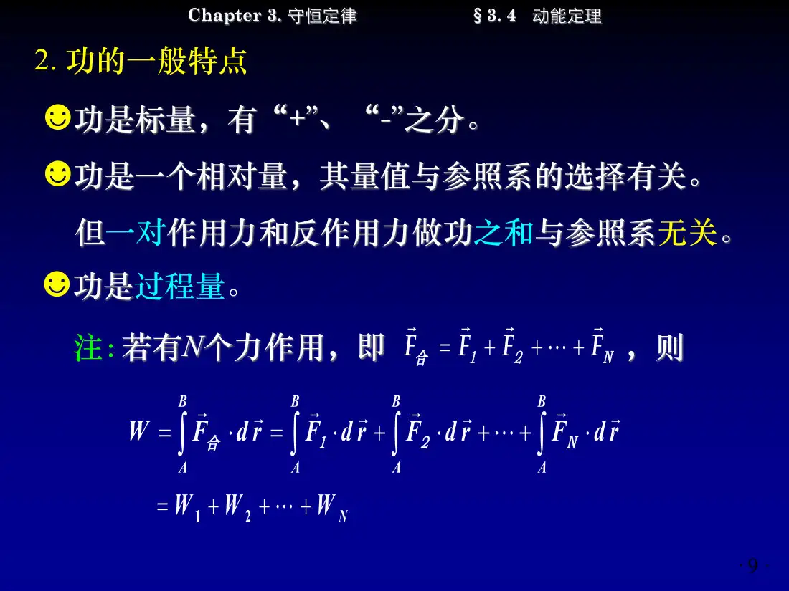

原文：

Chapter 3. 守恒定律

§ 3.4 动能定理

2. 功的一般特点

功是标量，有“+”、“-”之分。

功是一个相对量，其量值与参照系的选择有关。但一对作用力和反作用力做功之和与参照系无关。

😊功是过程量。

注: 若有N个力作用, 即 $\vec{F}_{\text {合}} = \vec{F}_1 + \vec{F}_2 + \dots + \vec{F}_N$ , 则

$$
\begin{array}{r l} W & = \int_ {A} ^ {B} \vec {F} _ {\text {合}} \cdot d \vec {r} = \int_ {A} ^ {B} \vec {F} _ {1} \cdot d \vec {r} + \int_ {A} ^ {B} \vec {F} _ {2} \cdot d \vec {r} + \dots + \int_ {A} ^ {B} \vec {F} _ {N} \cdot d \vec {r} \\ & = W _ {1} + W _ {2} + \dots + W _ {N} \end{array}
$$

9

### 3. 功的几何意义

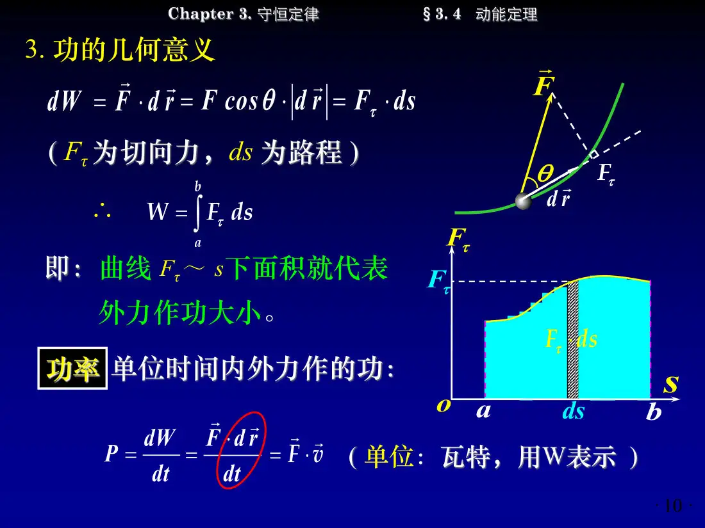

原文：

3. 功的几何意义

$$
d W = \vec {F} \cdot d \vec {r} = F \cos \theta \cdot | d \vec {r} | = F _ {\tau} \cdot d s
$$

$(F_{\tau} \text{为切向力，} ds \text{为路程})$

$\therefore W = \int_{a}^{b} F_{\tau} ds$

即：曲线 $F_{\tau} \sim s$ 下面积就代表外力作功大小。

功率 单位时间内外力作的功：

$P = \frac{dW}{dt} = \frac{\vec{F} \cdot d\vec{r}}{dt} = \vec{F} \cdot \vec{v}$ （单位：瓦特，用W表示）

Chapter 3. 守恒定律

§ 3.4 动能定理

10

### 4. 功值的计算

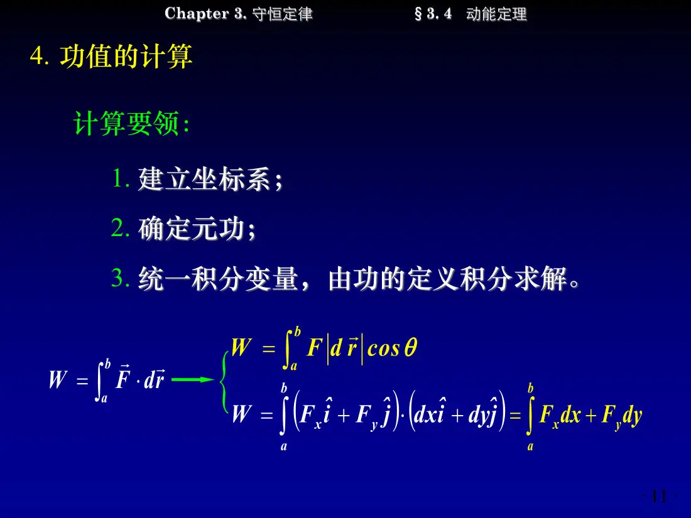

原文：

4. 功值的计算

计算要领:

1. 建立坐标系；

2. 确定元功;

3. 统一积分变量，由功的定义积分求解。

$$
W = \int_ {a} ^ {b} \vec {F} \cdot d \vec {r} \longrightarrow \left\{ \begin{array}{l} W = \int_ {a} ^ {b} F | d \vec {r} | \cos \theta \\ W = \int_ {a} ^ {b} \left(F _ {x} \hat {\boldsymbol {i}} + F _ {y} \hat {\boldsymbol {j}}\right) \cdot \left(d x \hat {\boldsymbol {i}} + d y \hat {\boldsymbol {j}}\right) = \int_ {a} ^ {b} F _ {x} d x + F _ {y} d y \end{array} \right.
$$

Chapter 3. 守恒定律

§ 3.4 动能定理

11

### Chapter 3. 守恒定律

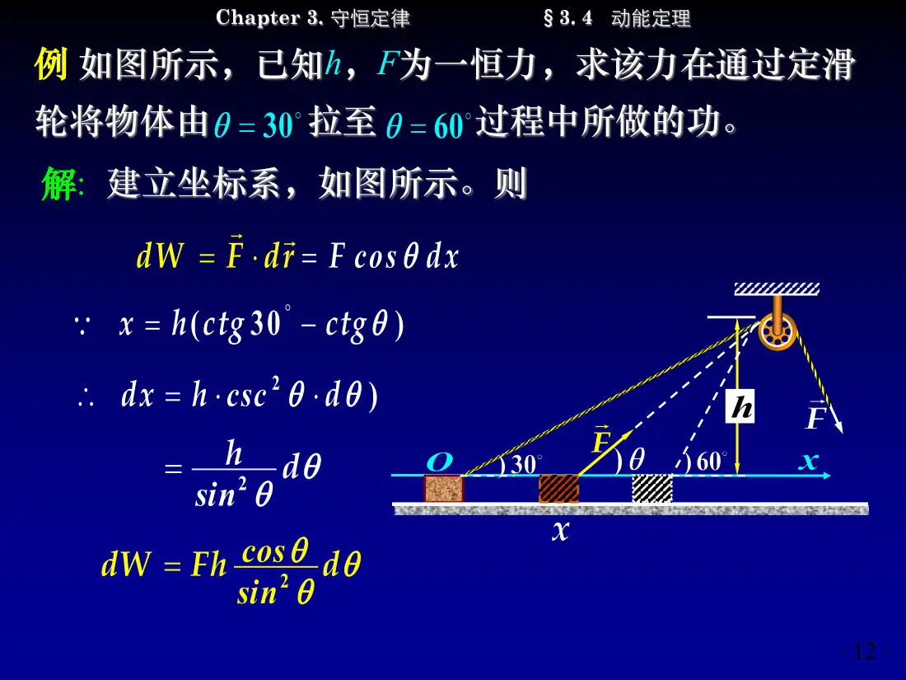

原文：

Chapter 3. 守恒定律

§ 3.4 动能定理

例如图所示，已知h，F为一恒力，求该力在通过定滑轮将物体由 $\theta=30^{\circ}$ 拉至 $\theta=60^{\circ}$ 过程中所做的功。

解: 建立坐标系, 如图所示。则

$dW = \vec{F}\cdot d\vec{r} = F\cos \theta dx$

$$
\because x = h \left(c t g 3 0 ^ {\circ} - c t g \theta\right)
$$

$$
\begin{array}{r l} \therefore & d x = h \cdot \csc^ {2} \theta \cdot d \theta) \\ & = \frac {h}{\sin^ {2} \theta} d \theta \end{array}
$$

$$
d W = F h \frac {\cos \theta}{\sin^ {2} \theta} d \theta
$$

12

### Chapter 3. 守恒定律

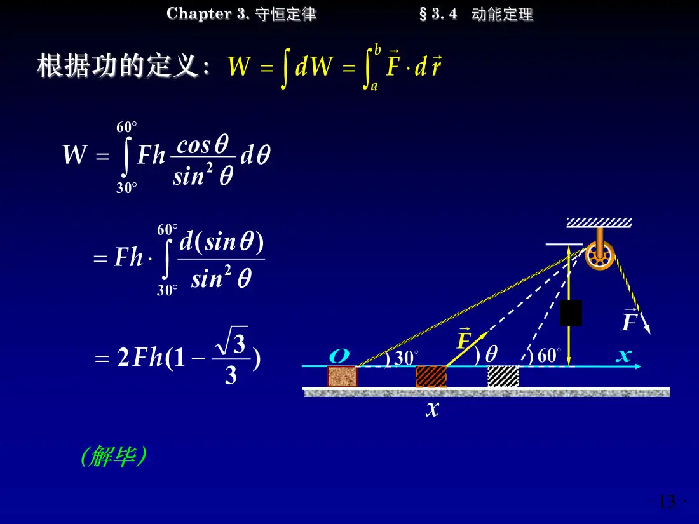

原文：

Chapter 3. 守恒定律

§ 3.4 动能定理

根据功的定义： $W = \int dW = \int_{a}^{b}\vec{F} \cdot d\vec{r}$

$$
W = \int_ {3 0 ^ {\circ}} ^ {6 0 ^ {\circ}} F h \frac {\cos \theta}{\sin^ {2} \theta} d \theta
$$

$$
= F h \cdot \int_ {3 0 ^ {\circ}} ^ {6 0 ^ {\circ}} \frac {d (\sin \theta)}{\sin^ {2} \theta}
$$

$$
= 2 F h \left(1 - \frac {\sqrt {3}}{3}\right)
$$

x

(解毕)

13

### Chapter 3. 守恒定律

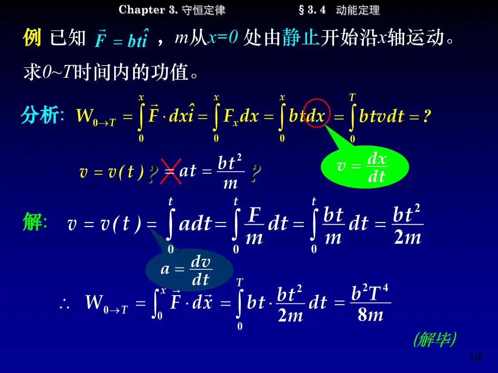

原文：

Chapter 3. 守恒定律

§ 3.4 动能定理

例 已知 $\vec{F} = b t \hat{i}$ ，m 从 x=0 处由静止开始沿 x 轴运动。求 0\~T 时间内的功值。

分析: $W_{0 \to T} = \int_0^x \vec{F} \cdot d x \hat{i} = \int_0^x F_x dx = \int_0^x b t dx = \int_0^T b t v dt = ?$

$$
v = v (t)? \times a t = \frac {b t ^ {2}}{m}?
$$

$$
v = \frac {d x}{d t}
$$

解:

$$
v = v (t) = \int_ {0} ^ {t} a d t = \int_ {0} ^ {t} \frac {F}{m} d t = \int_ {0} ^ {t} \frac {b t}{m} d t = \frac {b t ^ {2}}{2 m}
$$

$$
a = \frac {d v}{d t}
$$

$$
\therefore W _ {0 \rightarrow T} = \int_ {0} ^ {x} \vec {F} \cdot d \vec {x} = \int_ {0} ^ {T} b t \cdot \frac {b t ^ {2}}{2 m} d t = \frac {b ^ {2} T ^ {4}}{8 m}
$$

(解毕)

14

### 二、动能定理

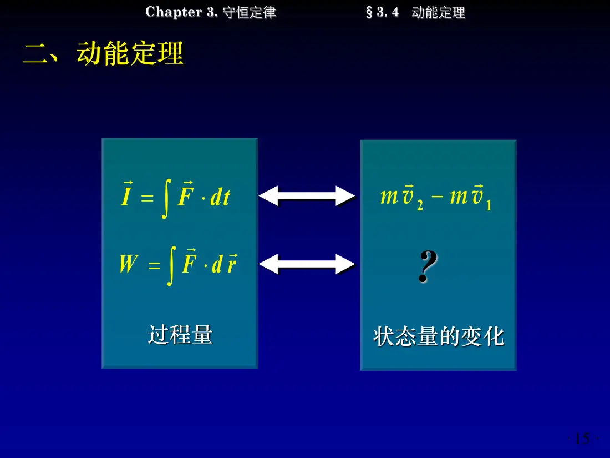

原文：

二、动能定理

$$
\vec {I} = \int \vec {F} \cdot d t
$$

$$
\leftarrow \rightleftharpoons
$$

$$
m \vec {v} _ {2} - m \vec {v} _ {1}
$$

$$
W = \int \vec {F} \cdot d \vec {r}
$$

$$
\leftarrow \rightleftharpoons
$$

$$
\mathrm{?}
$$

过程量

状态量的变化

Chapter 3. 守恒定律

§ 3.4 动能定理

15

### 二、动能定理

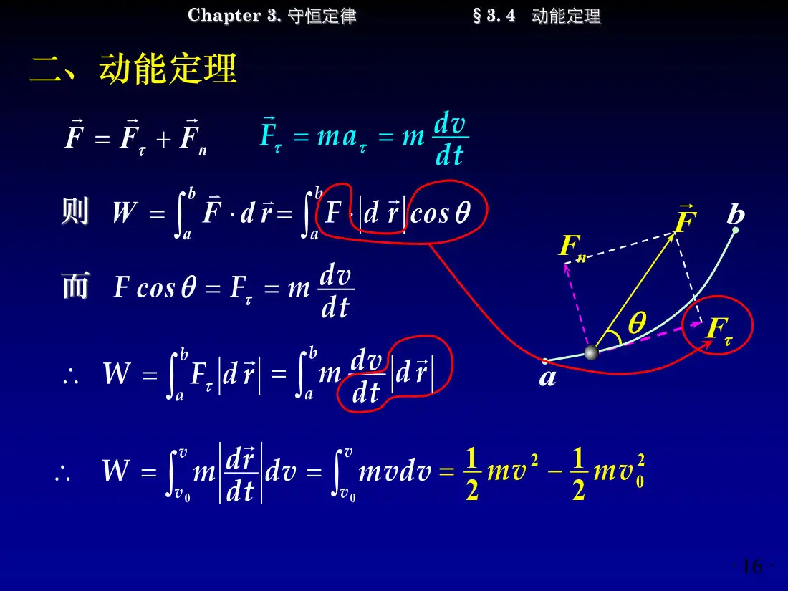

原文：

二、动能定理

$$
\vec {F} = \vec {F} _ {\tau} + \vec {F} _ {n} \qquad \vec {F} _ {\tau} = m a _ {\tau} = m \frac {d v}{d t}
$$

则 $W = \int_{a}^{b} \vec{F} \cdot d \vec{r} = \int_{a}^{b} F \cdot |d \vec{r}| \cos \theta$

而

$$
F \cos \theta = F _ {\tau} = m \frac {d v}{d t}
$$

$$
\therefore W = \int_ {a} ^ {b} F _ {\tau} | d \vec {r} | = \int_ {a} ^ {b} m \frac {d v}{d t} | d \vec {r} |
$$

$$
\therefore W = \int_ {v _ {0}} ^ {v} m \left| \frac {d \vec {r}}{d t} \right| d v = \int_ {v _ {0}} ^ {v} m v d v = \frac {1}{2} m v ^ {2} - \frac {1}{2} m v _ {0} ^ {2}
$$

Chapter 3. 守恒定律

§ 3.4 动能定理

16

### Chapter 3. 守恒定律

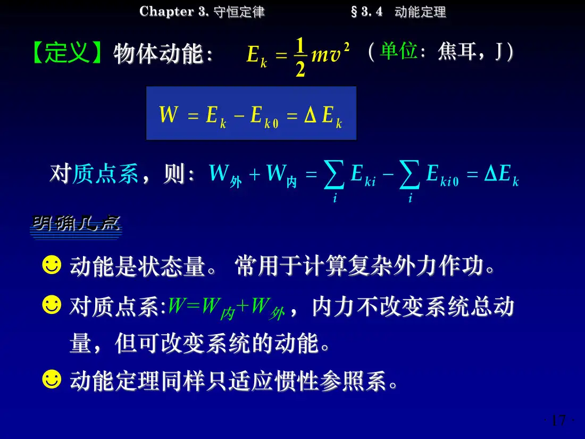

原文：

Chapter 3. 守恒定律

§ 3.4 动能定理

【定义】物体动能: $E_{k} = \frac{1}{2} m v^{2}$ （单位：焦耳，J）

$$
W = E _ {k} - E _ {k 0} = \Delta E _ {k}
$$

对质点系，则： $W_{外} + W_{内} = \sum_{i} E_{ki} - \sum_{i} E_{ki0} = \Delta E_{k}$ 明确几点

动能是状态量。常用于计算复杂外力作功。

对质点系: $W = W_{\text {内}} + W_{\text {外}}$ ，内力不改变系统总动量，但可改变系统的动能。

动能定理同样只适应惯性参照系。

17

### Chapter 3. 守恒定律

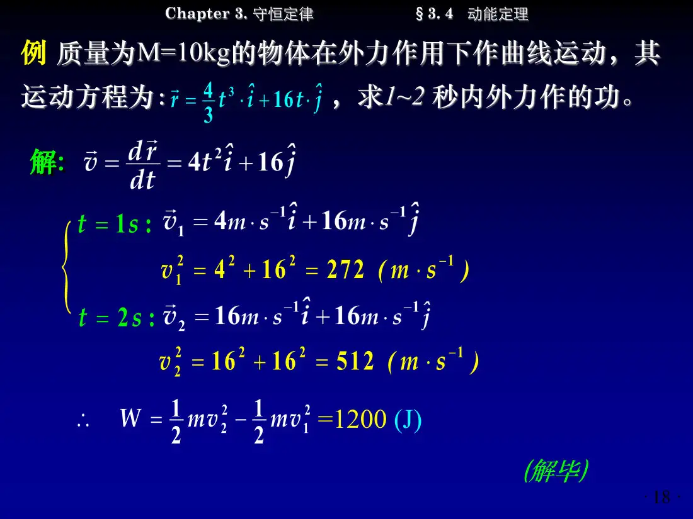

原文：

Chapter 3. 守恒定律

§ 3.4 动能定理

例 质量为M=10kg的物体在外力作用下作曲线运动，其运动方程为: $\vec{r}=\frac{4}{3}t^{3}\cdot\hat{i}+16t\cdot\hat{j}$ ，求1\~2秒内外力作的功。

解: $\vec{v} = \frac{d\vec{r}}{dt} = 4t^2\hat{i} + 16\hat{j}$

$$
t = 1 s: \vec {v} _ {1} = 4 m \cdot s ^ {- 1} \hat {i} + 1 6 m \cdot s ^ {- 1} \hat {j}
$$

$$
v _ {1} ^ {2} = 4 ^ {2} + 1 6 ^ {2} = 2 7 2 (m \cdot s ^ {- 1})
$$

$$
t = 2 s: \vec {v} _ {2} = 1 6 m \cdot s ^ {- 1} \hat {i} + 1 6 m \cdot s ^ {- 1} \hat {j}
$$

$$
v _ {2} ^ {2} = 1 6 ^ {2} + 1 6 ^ {2} = 5 1 2 (m \cdot s ^ {- 1})
$$

∴ $W = \frac{1}{2}mv_{2}^{2} - \frac{1}{2}mv_{1}^{2} = 1200 \, (\text{J})$

(解毕)

18

### 归纳

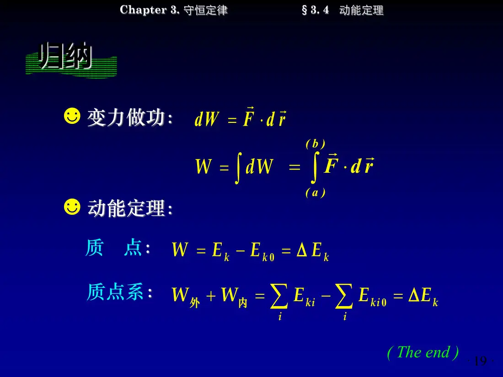

原文：

归纳

变力做功: $dW = \vec{F} \cdot d\vec{r}$

$$
W = \int d W = \int_ {(a)} ^ {(b)} \vec {F} \cdot d \vec {r}
$$

动能定理：

质 点: $W = E_{k} - E_{k0} = \Delta E_{k}$

质点系： $W_{外} + W_{内} = \sum_{i} E_{ki} - \sum_{i} E_{ki0} = \Delta E_{k}$

Chapter 3. 守恒定律

§ 3.4 动能定理

The end )

19
