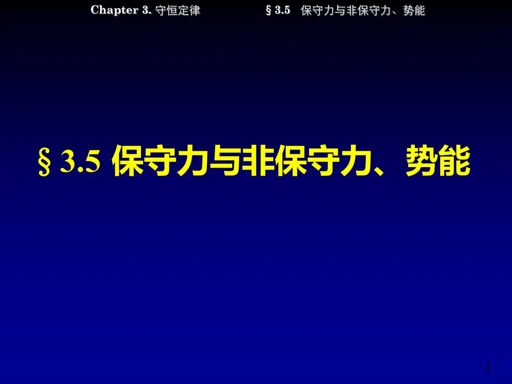
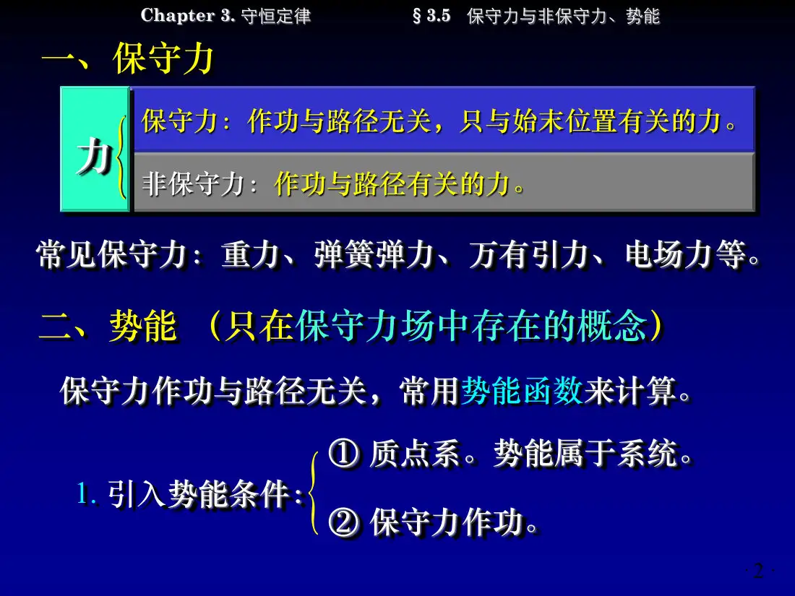
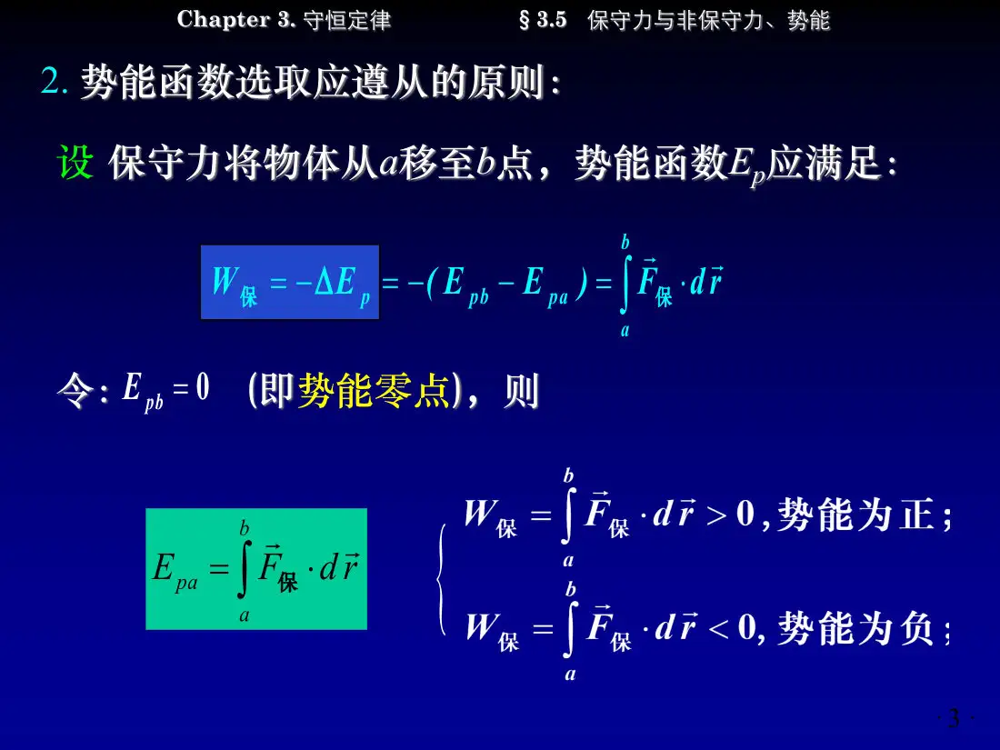
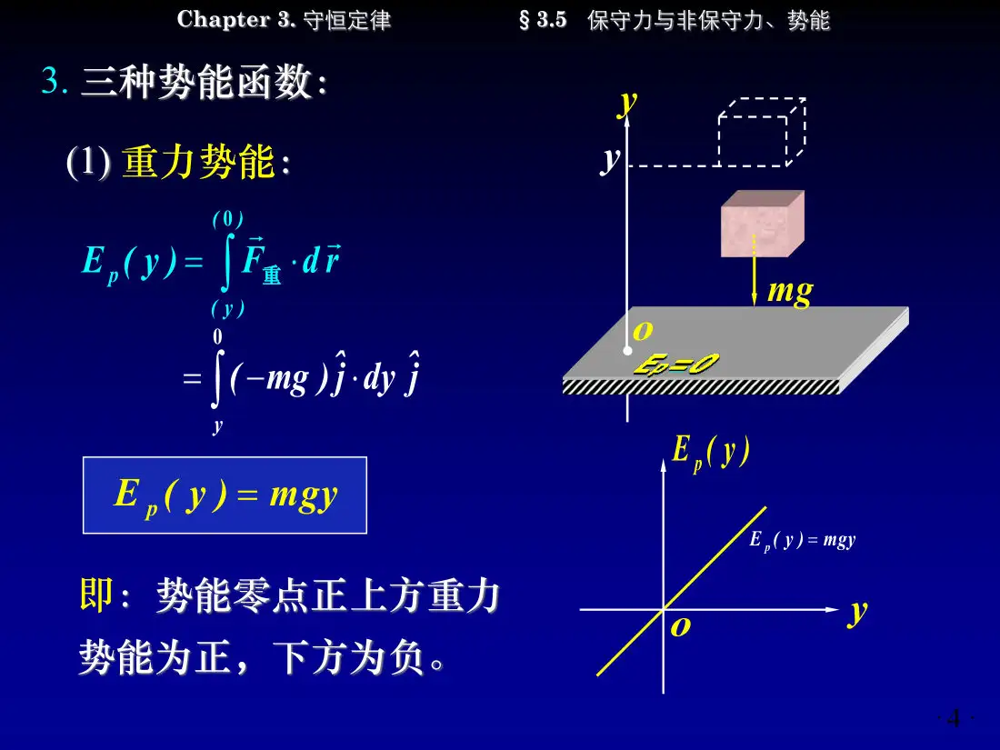
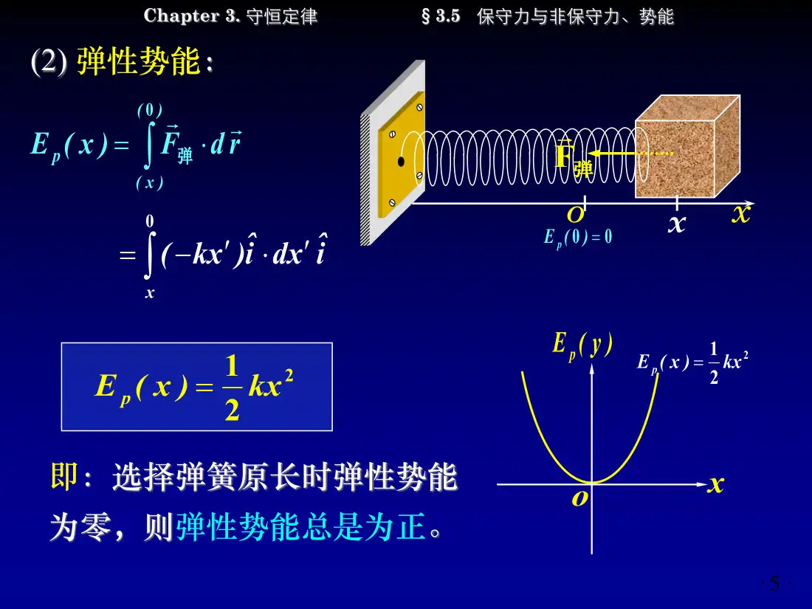
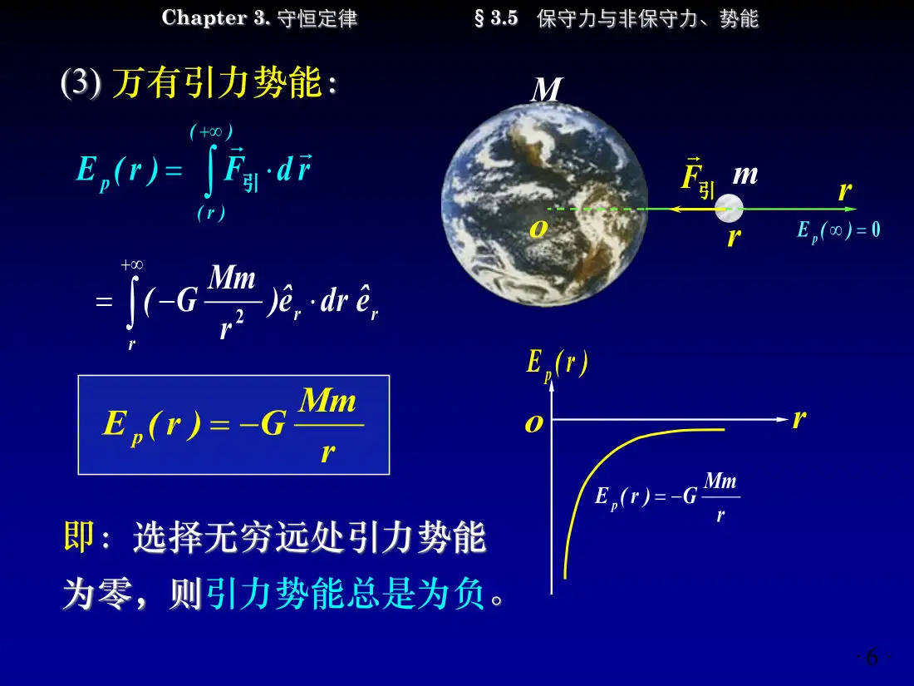
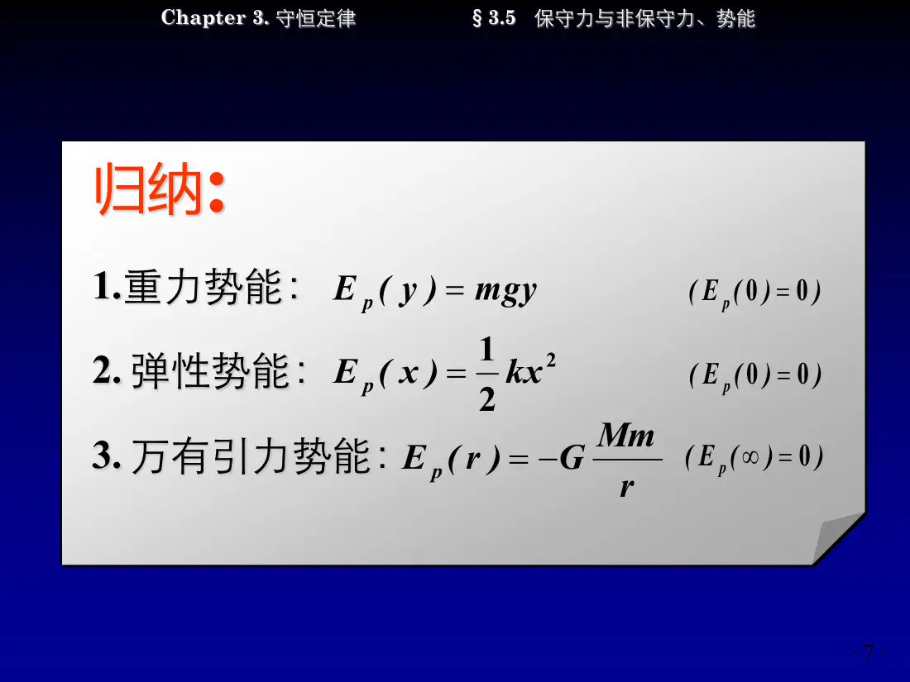

# 《大学物理（上）》第3章 守恒定律 §3.5 保守力与非保守力、势能（课件）

原件的每一页，下面附识别出的文字。

### §3.5 保守力与非保守力、势能

原文：

§3.5 保守力与非保守力、势能

Chapter 3. 守恒定律

§3.5 保守力与非保守力、势能

### 一、保守力

原文：

一、保守力

保守力：作功与路径无关，只与始末位置有关的力。

力

非保守力：作功与路径有关的力。

常见保守力：重力、弹簧弹力、万有引力、电场力等。

二、势能 （只在保守力场中存在的概念）

保守力作功与路径无关，常用势能函数来计算。

质点系。势能属于系统。

1. 引入势能条件：

保守力作功。

Chapter 3. 守恒定律

§3.5 保守力与非保守力、势能

· 2

### Chapter 3. 守恒定律

原文：

Chapter 3. 守恒定律

§3.5 保守力与非保守力、势能

2. 势能函数选取应遵从的原则：

设 保守力将物体从a移至b点，势能函数 $1 2$ 应满足：

$$
W _ {\text {保}} = - \Delta E _ {p} = - \left(E _ {p b} - E _ {p a}\right) = \int_ {a} ^ {b} \vec {F} _ {\text {保}} \cdot d \vec {r}
$$

令： $| \frac { \eta } { \nu } | \frac { \eta } { \nu } | \equiv | \mathbb { I } |$ (即势能零点)，则

$$
E _ {p a} = \int_ {a} ^ {b} {\vec {F}} _ {\mathrm{保}} \cdot d {\vec {r}}
$$

$1 2 \div 2 = 1 1 0 ( m > 1 )$ ,势能为正；

$1 4 0 - 1 1 0 = 1 1 2 0 ( m ^ { 2 } - 1 )$ 势能为负：

· 3

### Chapter 3. 守恒定律

原文：

Chapter 3. 守恒定律

3. 三种势能函数：

(1) 重力势能：

$$
\begin{array}{r l} E _ {p} (y) & = \int_ {(y)} ^ {(0)} \vec {F} _ {\text {重}} \cdot d \vec {r} \\ & = \int_ {y} ^ {0} (- m g) \hat {j} \cdot d y \hat {j} \end{array}
$$

$$
E _ {p} (y) = m g y
$$

即：势能零点正上方重力势能为正，下方为负。

§3.5 保守力与非保守力、势能

· 4

### (2) 弹性势能：

原文：

(2) 弹性势能：

$$
\begin{array}{r l} E _ {p} (x) & = \int_ {(x)} ^ {(0)} \vec {F} _ {\text {弹}} \cdot d \vec {r} \\ & = \int_ {x} ^ {0} (- k x ^ {\prime}) \hat {i} \cdot d x ^ {\prime} \hat {i} \end{array}
$$

§3.5 保守力与非保守力、势能

$$
E _ {p} (x) = \frac {1}{2} k x ^ {2}
$$

即：选择弹簧原长时弹性势能为零，则弹性势能总是为正。

Chapter 3. 守恒定律

· 5

### Chapter 3. 守恒定律

原文：

Chapter 3. 守恒定律

(3) 万有引力势能：

$$
E _ {p} (r) = \int_ {(r)} ^ {(+ \infty)} \vec {F} _ {\text {引}} \cdot d \vec {r}
$$

$$
= \int_ {r} ^ {+ \infty} (- G \frac {M m}{r ^ {2}}) \hat {\boldsymbol {e}} _ {r} \cdot d \boldsymbol {r} \hat {\boldsymbol {e}} _ {r}
$$

$$
E _ {p} (r) = - G \frac {M m}{r}
$$

即：选择无穷远处引力势能为零，则引力势能总是为负。

§3.5 保守力与非保守力、势能

$$
E _ {p} (r) = - G \frac {M m}{r}
$$

6

### 归纳：

原文：

归纳：

1.重力势能： $E _ { p } ( y ) = m g y$ $( E _ { p } ( \mathbf { 0 } ) = \mathbf { 0 } )$

2. 弹性势能： $E _ { _ { p } } ( x ) = { \frac { 1 } { 2 } } k x ^ { 2 }$ $( E _ { p } ( \mathbf { 0 } ) = \mathbf { 0 } )$

3. 万有引力势能： $E _ { _ p } ( r ) = - G { \frac { M m } { r } } ( E _ { _ p } ( \infty ) = 0 )$

Chapter 3. 守恒定律

§3.5 保守力与非保守力、势能

· 7
