# 《大学物理（上）》第5章 静电场 §5.4 电势能与电势（课件）

原件的每一页，下面附识别出的文字。

### § 5.4 电势能与电势

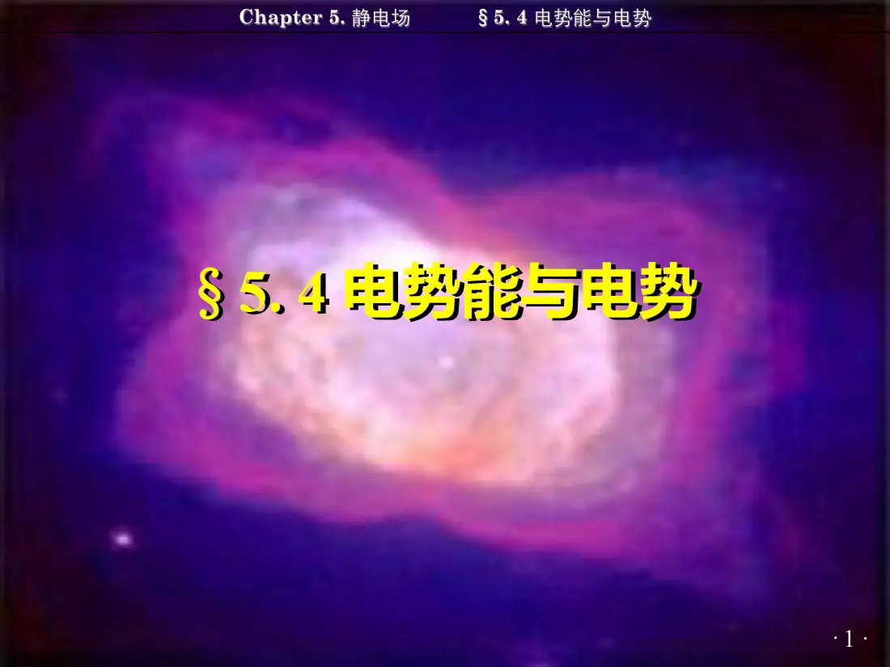

原文：

§ 5.4 电势能与电势

Chapter 5. 静电场

§ 5.4 电势能与电势

1

### 一、静电力为保守力

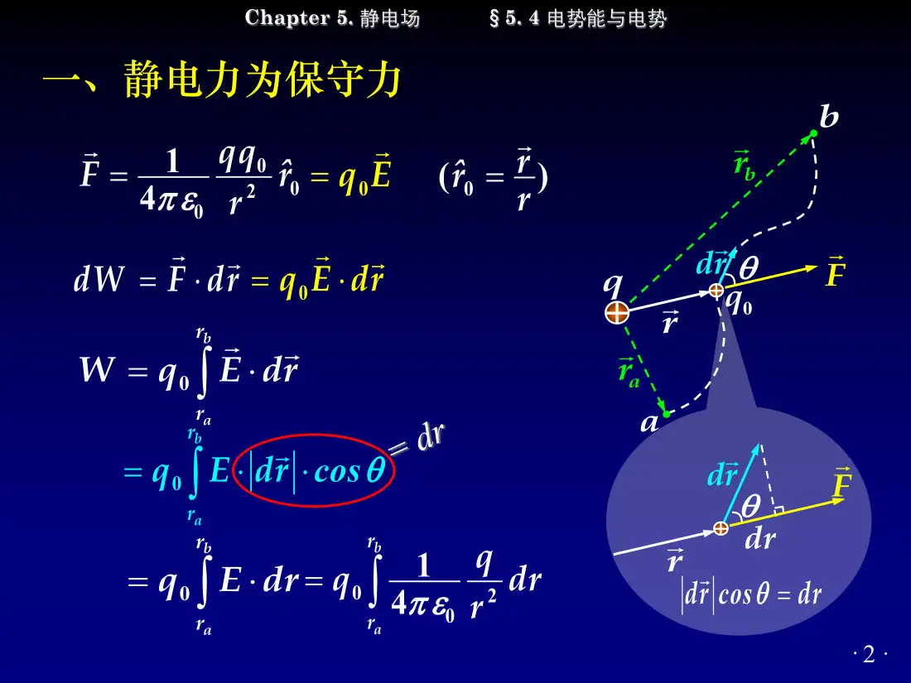

原文：

一、静电力为保守力

$$
\vec {F} = \frac {1}{4 \pi \varepsilon_ {0}} \frac {q q _ {0}}{r ^ {2}} \hat {r} _ {0} = q _ {0} \vec {E} (\hat {r} _ {0} = \frac {\vec {r}}{r})
$$

$$
d W = \vec {F} \cdot d \vec {r} = q _ {0} \vec {E} \cdot d \vec {r}
$$

$$
\begin{array}{l} W = q _ {0} \int_ {r _ {a}} ^ {r _ {b}} \vec {E} \cdot d \vec {r} \\ = q _ {0} \int_ {r _ {a}} ^ {r _ {b}} E \cdot | d \vec {r} | \cdot c o s \theta = d r \\ = q _ {0} \int_ {r _ {a}} ^ {r _ {b}} E \cdot d r = q _ {0} \int_ {r _ {a}} ^ {r _ {b}} \frac {1}{4 \pi \varepsilon_ {0}} \frac {q}{r ^ {2}} d r \end{array}
$$

Chapter 5. 静电场

§ 5.4 电势能与电势

2

### $$

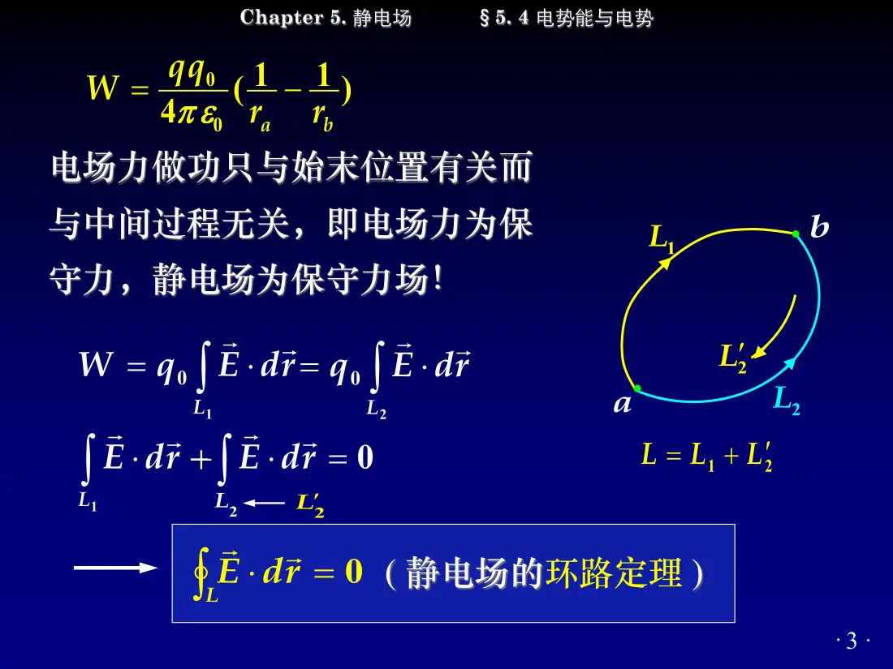

原文：

$$
W = \frac {q q _ {0}}{4 \pi \varepsilon_ {0}} (\frac {1}{r _ {a}} - \frac {1}{r _ {b}})
$$

电场力做功只与始末位置有关而与中间过程无关，即电场力为保守力，静电场为保守力场！

$$
\begin{array}{l} W = q _ {0} \int_ {L _ {1}} \vec {E} \cdot d \vec {r} = q _ {0} \int_ {L _ {2}} \vec {E} \cdot d \vec {r} \\ \int_ {L _ {1}} \vec {E} \cdot d \vec {r} + \int_ {L _ {2}} \vec {E} \cdot d \vec {r} = 0 \\ L _ {2} ^ {\prime} \longleftarrow L _ {2} ^ {\prime} \end{array}
$$

$\oint_{L} \vec{E} \cdot d\vec{r} = 0$ （静电场的环路定理）

Chapter 5. 静电场

§ 5.4 电势能与电势

3

### 二、电势能

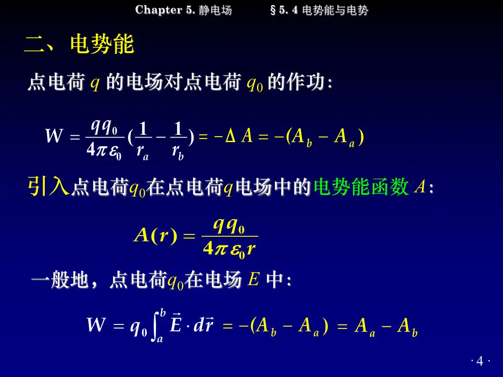

原文：

二、电势能

点电荷 q 的电场对点电荷 $q_{0}$ 的作功:

$$
W = \frac {q q _ {0}}{4 \pi \varepsilon_ {0}} (\frac {1}{r _ {a}} - \frac {1}{r _ {b}}) = - \Delta A = - (A _ {b} - A _ {a})
$$

引入点电荷 $q_{0}$ 在点电荷 $q$ 电场中的电势能函数 $A$ :

$$
A (r) = \frac {q q _ {0}}{4 \pi \varepsilon_ {0} r}
$$

一般地，点电荷 $q_{0}$ 在电场 $E$ 中：

$$
W = q _ {0} \int_ {a} ^ {b} \vec {E} \cdot d \vec {r} = - (A _ {b} - A _ {a}) = A _ {a} - A _ {b}
$$

Chapter 5. 静电场

§ 5.4 电势能与电势

4

### Chapter 5. 静电场

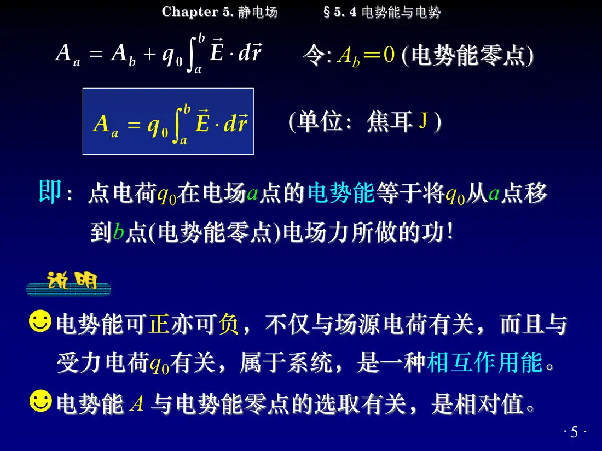

原文：

Chapter 5. 静电场

$$
A _ {a} = A _ {b} + q _ {0} \int_ {a} ^ {b} \vec {E} \cdot d \vec {r}
$$

§ 5.4 电势能与电势

令: $A_{b}=0$ (电势能零点)

$$
A _ {a} = q _ {0} \int_ {a} ^ {b} \vec {E} \cdot d \vec {r}
$$

(单位：焦耳 J)

即：点电荷 $q_{0}$ 在电场 $a$ 点的电势能等于将 $q_{0}$ 从 $a$ 点移到 $b$ 点(电势能零点)电场力所做的功！

说明

电势能可正亦可负，不仅与场源电荷有关，而且与受力电荷 $q_{0}$ 有关，属于系统，是一种相互作用能。

电势能 A 与电势能零点的选取有关，是相对值。

5

### Chapter 5. 静电场 § 5.4 电势能与电势

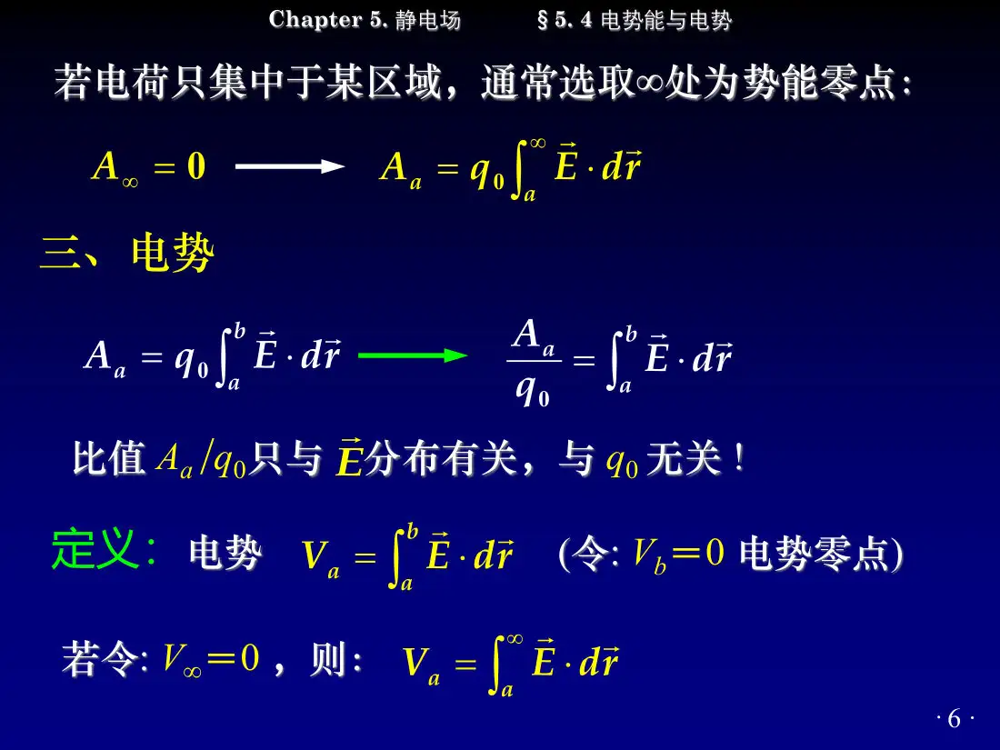

原文：

Chapter 5. 静电场 § 5.4 电势能与电势

若电荷只集中于某区域，通常选取∞处为势能零点：

$$
A _ {\infty} = 0 \longrightarrow A _ {a} = q _ {0} \int_ {a} ^ {\infty} \vec {E} \cdot d \vec {r}
$$

三、电势

$$
A _ {a} = q _ {0} \int_ {a} ^ {b} \vec {E} \cdot d \vec {r} \longrightarrow \frac {A _ {a}}{q _ {0}} = \int_ {a} ^ {b} \vec {E} \cdot d \vec {r}
$$

比值 $A_{a} / q_{0}$ 只与 $\vec{E}$ 分布有关，与 $q_{0}$ 无关！

定义: 电势 $V_{a} = \int_{a}^{b} \vec{E} \cdot d\vec{r}$ (令: $V_{b} = 0$ 电势零点)

若令: $V_{\infty} = 0$ ，则： $V_{a} = \int_{a}^{\infty}\vec{E}\cdot d\vec{r}$

6

### § 5.4 电势能与电势

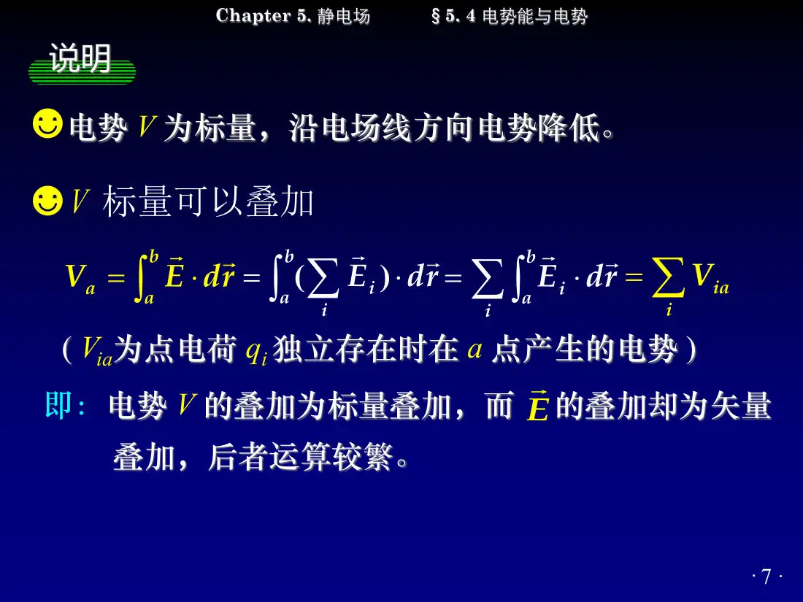

原文：

§ 5.4 电势能与电势

说明

电势 V 为标量，沿电场线方向电势降低。

😊 V 标量可以叠加

$$
V _ {a} = \int_ {a} ^ {b} \vec {E} \cdot d \vec {r} = \int_ {a} ^ {b} (\sum_ {i} \vec {E} _ {i}) \cdot d \vec {r} = \sum_ {i} \int_ {a} ^ {b} \vec {E} _ {i} \cdot d \vec {r} = \sum_ {i} V _ {i a}
$$

( $V_{ia}$ 为点电荷 $q_{i}$ 独立存在时在a点产生的电势)

即: 电势 $V$ 的叠加为标量叠加, 而 $\vec{E}$ 的叠加却为矢量叠加, 后者运算较繁。

Chapter 5. 静电场

7

### Chapter 5. 静电场 § 5.4 电势能与电势

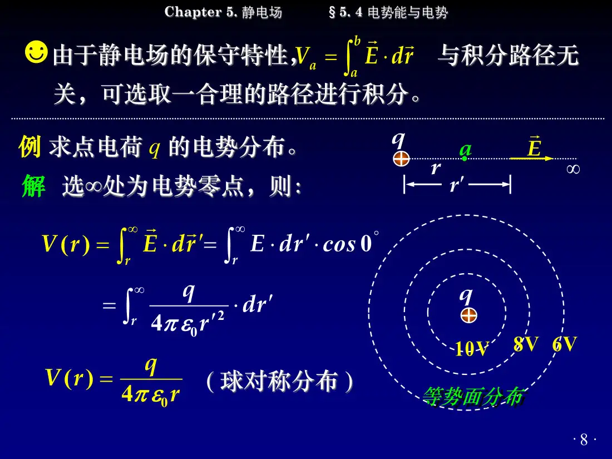

原文：

Chapter 5. 静电场 § 5.4 电势能与电势

由于静电场的保守特性, $V_{a}=\int_{a}^{b}\vec{E}\cdot d\vec{r}$ 与积分路径无关，可选取一合理的路径进行积分。

例 求点电荷 q 的电势分布。

解 选∞处为电势零点，则:

$$
\begin{array}{r l} V (r) & = \int_ {r} ^ {\infty} \vec {E} \cdot d \vec {r} ^ {\prime} = \int_ {r} ^ {\infty} E \cdot d r ^ {\prime} \cdot c o s 0 ^ {\circ} \\ & = \int_ {r} ^ {\infty} \frac {q}{4 \pi \varepsilon_ {0} r ^ {\prime 2}} \cdot d r ^ {\prime} \end{array}
$$

$V(r)=\frac{q}{4\pi\varepsilon_{0}r}$ （球对称分布）

8

### Chapter 5. 静电场 § 5.4 电势能与电势

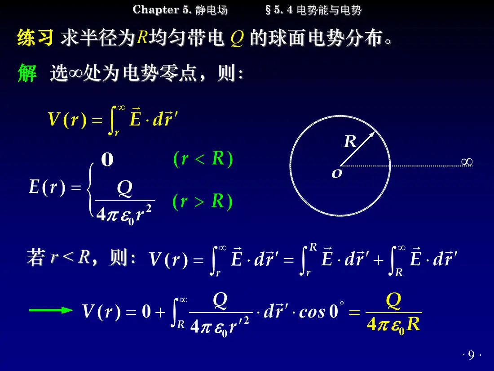

原文：

Chapter 5. 静电场 § 5.4 电势能与电势

练习 求半径为R均匀带电 Q 的球面电势分布。

解 选∞处为电势零点，则：

$$
V (r) = \int_ {r} ^ {\infty} \vec {E} \cdot d \vec {r} ^ {\prime}
$$

$$
E (r) = \left\{ \begin{array}{l l} 0 & (r <   R) \\ \frac {Q}{4 \pi \varepsilon_ {0} r ^ {2}} & (r > R) \end{array} \right.
$$

若 $r < R$ ，则： $V(r) = \int_{r}^{\infty}\vec{E}\cdot d\vec{r}^{\prime} = \int_{r}^{R}\vec{E}\cdot d\vec{r}^{\prime} + \int_{R}^{\infty}\vec{E}\cdot d\vec{r}^{\prime}$

$$
\longrightarrow V (r) = 0 + \int_ {R} ^ {\infty} \frac {Q}{4 \pi \varepsilon_ {0} r ^ {\prime 2}} \cdot d \vec {r} ^ {\prime} \cdot c o s 0 ^ {\circ} = \frac {Q}{4 \pi \varepsilon_ {0} R}
$$

9

### Chapter 5. 静电场 § 5.4 电势能与电势

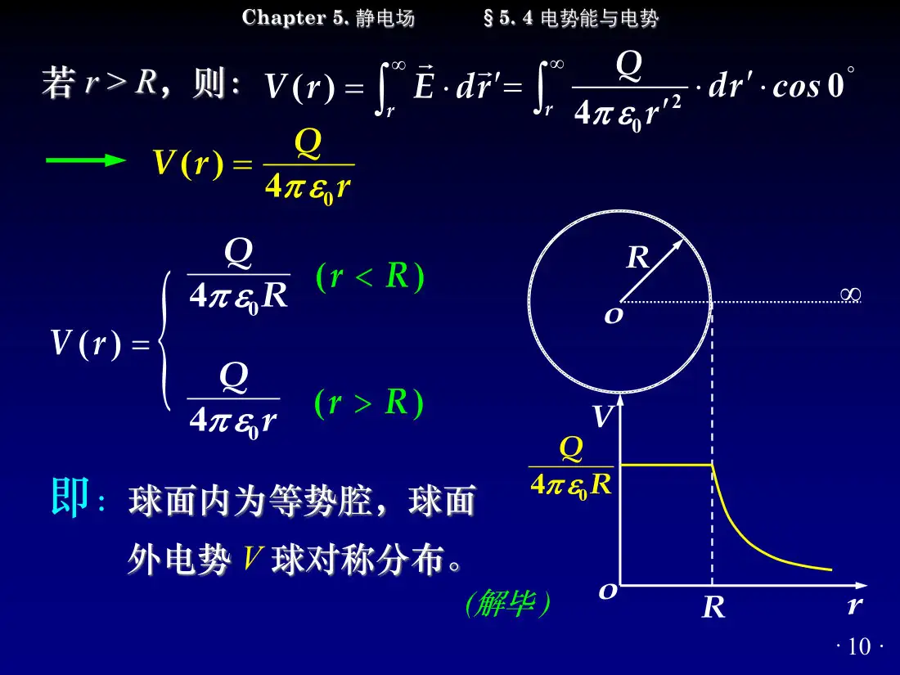

原文：

Chapter 5. 静电场 § 5.4 电势能与电势

若 $r > R$ ，则： $V(r) = \int_{r}^{\infty}\vec{E}\cdot d\vec{r}^{\prime} = \int_{r}^{\infty}\frac{Q}{4\pi\varepsilon_{0}r^{\prime 2}}\cdot dr^{\prime}\cdot cos0^{\circ}$

$$
V (r) = \left\{ \begin{array}{l l} \frac {Q}{4 \pi \varepsilon_ {0} R} & (r <   R) \\ \frac {Q}{4 \pi \varepsilon_ {0} r} & (r > R) \end{array} \right.
$$

即：球面内为等势腔，球面外电势 $V$ 球对称分布。

(解毕)

10

### Chapter 5. 静电场 § 5.4 电势能与电势

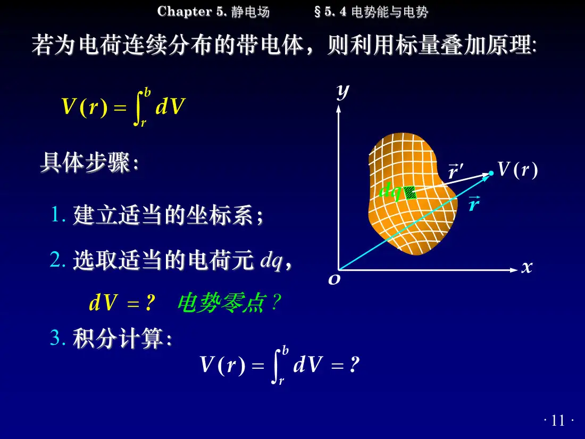

原文：

Chapter 5. 静电场 § 5.4 电势能与电势

若为电荷连续分布的带电体，则利用标量叠加原理:

$$
V (r) = \int_ {r} ^ {b} d V
$$

具体步骤:

1. 建立适当的坐标系；

2. 选取适当的电荷元 dq，

dV = ? 电势零点？

3. 积分计算:

$$
V (r) = \int_ {r} ^ {b} d V = ?
$$

11

### Chapter 5. 静电场 § 5.4 电势能与电势

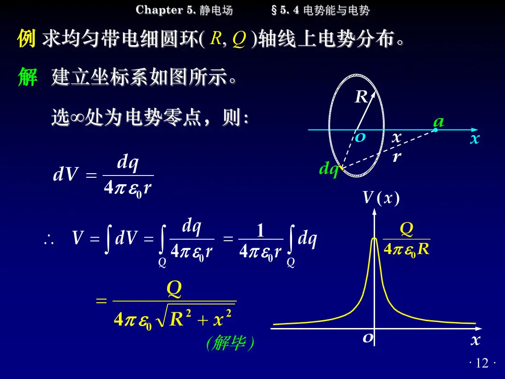

原文：

Chapter 5. 静电场 § 5.4 电势能与电势

例 求均匀带电细圆环(R, Q)轴线上电势分布。

解 建立坐标系如图所示。

选∞处为电势零点，则：

$$
d V = \frac {d q}{4 \pi \varepsilon_ {0} r}
$$

$$
\begin{array}{r l} \therefore & V = \int d V = \int_ {Q} \frac {d q}{4 \pi \varepsilon_ {0} r} = \frac {1}{4 \pi \varepsilon_ {0} r} \int_ {Q} d q \\ & = \frac {Q}{4 \pi \varepsilon_ {0} \sqrt {R ^ {2} + x ^ {2}}} \\ & (\text {解毕}) \end{array}
$$

12

### Chapter 5. 静电场 § 5.4 电势能与电势

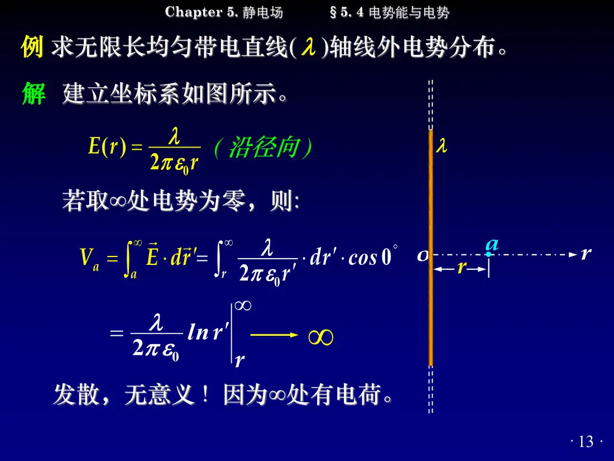

原文：

Chapter 5. 静电场 § 5.4 电势能与电势

例 求无限长均匀带电直线( $\lambda$ )轴线外电势分布。

解 建立坐标系如图所示。

$E(r)=\frac{\lambda}{2\pi\varepsilon_{0}r}$ （沿径向）

若取∞处电势为零，则:

$$
\begin{array}{r l} & V _ {a} = \int_ {a} ^ {\infty} \vec {E} \cdot d \vec {r} ^ {\prime} = \int_ {r} ^ {\infty} \frac {\lambda}{2 \pi \varepsilon_ {0} r ^ {\prime}} \cdot d r ^ {\prime} \cdot c o s 0 ^ {\circ} \\ & = \left. \frac {\lambda}{2 \pi \varepsilon_ {0}} l n r ^ {\prime} \right| _ {r} ^ {\infty} \longrightarrow \infty \\ & \text {发散，无意义！因为} \infty \text {处有电荷。} \end{array}
$$

13

### Chapter 5. 静电场

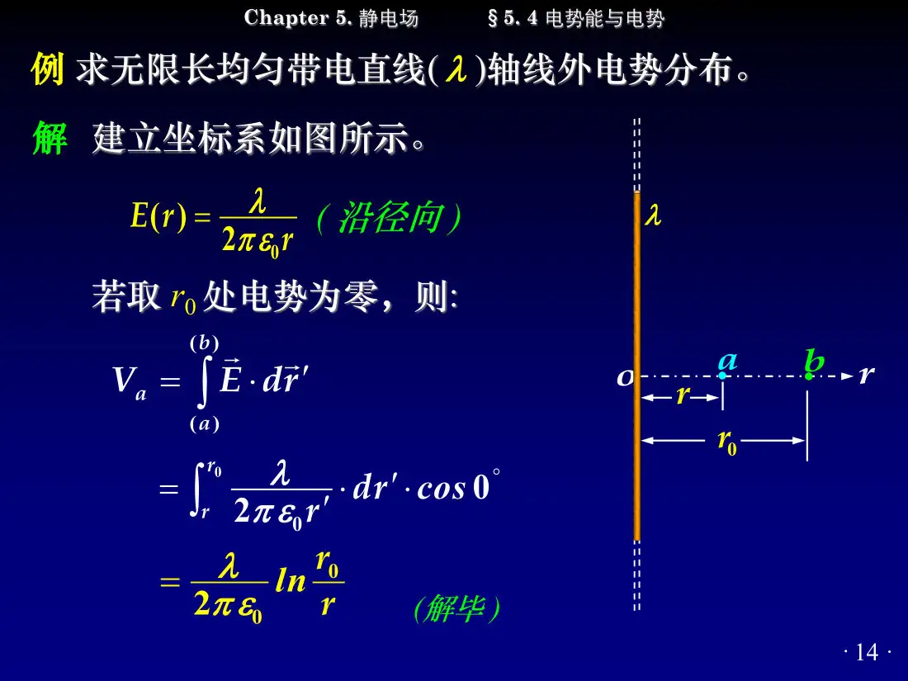

原文：

Chapter 5. 静电场

§ 5.4 电势能与电势

例 求无限长均匀带电直线( $\lambda$ )轴线外电势分布。

解 建立坐标系如图所示。

$E(r)=\frac{\lambda}{2\pi\varepsilon_{0}r}$ （沿径向）

若取 $r_0$ 处电势为零，则：

$$
\begin{array}{r l} V _ {a} & = \int_ {(a)} ^ {(b)} \vec {E} \cdot d \vec {r} ^ {\prime} \\ & = \int_ {r} ^ {r _ {0}} \frac {\lambda}{2 \pi \varepsilon_ {0} r ^ {\prime}} \cdot d r ^ {\prime} \cdot c o s 0 ^ {\circ} \\ & = \frac {\lambda}{2 \pi \varepsilon_ {0}} l n \frac {r _ {0}}{r} \quad (\text {解毕}) \end{array}
$$

14

### Chapter 5. 静电场

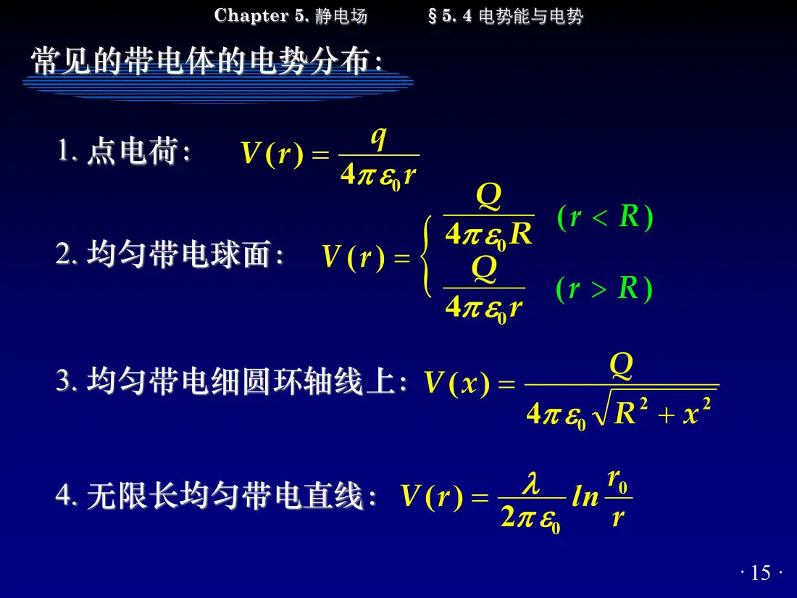

原文：

Chapter 5. 静电场

§ 5.4 电势能与电势

常见的带电体的电势分布:

1. 点电荷:

$$
V (r) = \frac {q}{4 \pi \varepsilon_ {0} r}
$$

2. 均匀带电球面: $V(r) = \left\{ \begin{array}{ll} \frac{Q}{4\pi\varepsilon_0R} & (r < R) \\ \frac{Q}{4\pi\varepsilon_0r} & (r > R) \end{array} \right.$

3. 均匀带电细圆环轴线上: $V(x) = \frac{Q}{4 \pi \varepsilon_ {0} \sqrt {R ^ {2} + x ^ {2}}}$

4. 无限长均匀带电直线: $V(r) = \frac{\lambda}{2 \pi \varepsilon_ {0}} \ln \frac{r _ {0}}{r}$

15

### § 5.4 电势能与电势

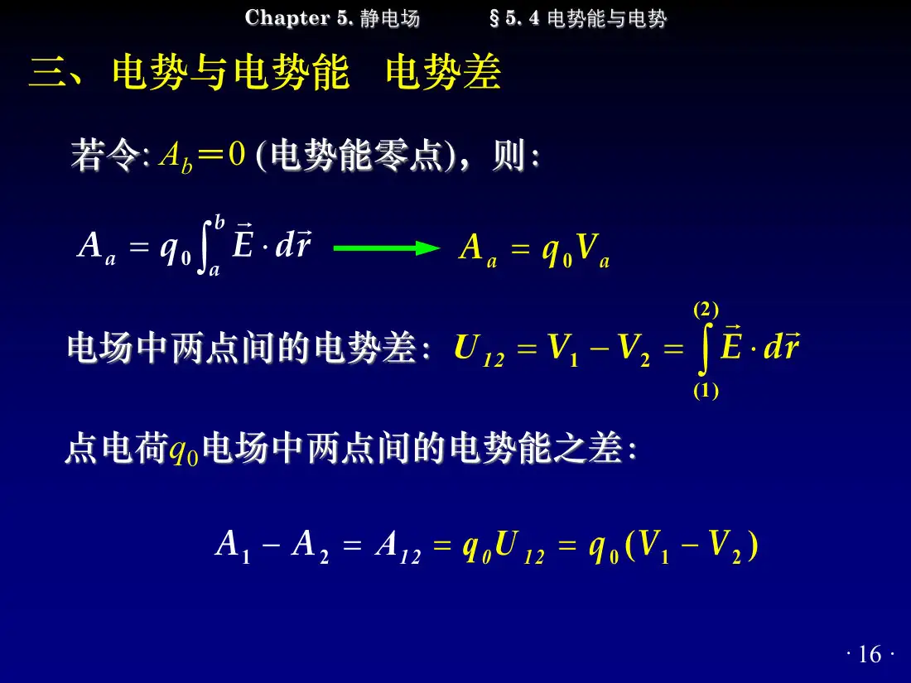

原文：

§ 5.4 电势能与电势

三、电势与电势能 电势差

若令: $A_{b}=0$ (电势能零点), 则:

$$
A _ {a} = q _ {0} \int_ {a} ^ {b} \vec {E} \cdot d \vec {r} \longrightarrow A _ {a} = q _ {0} V _ {a}
$$

电场中两点间的电势差: $U_{12} = V_{1} - V_{2} = \int^ {(2)} \vec {E} \cdot d \vec {r}$

点电荷 $q_{0}$ 电场中两点间的电势能之差：

$$
A _ {1} - A _ {2} = A _ {1 2} = q _ {0} U _ {1 2} = q _ {0} \left(V _ {1} - V _ {2}\right)
$$

16

### Chapter 5. 静电场 § 5.4 电势能与电势

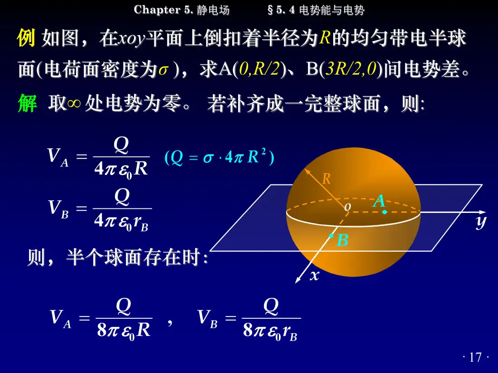

原文：

Chapter 5. 静电场 § 5.4 电势能与电势

例如图, 在 $xoy$ 平面上倒扣着半径为 $R$ 的均匀带电半球面 (电荷面密度为 $\sigma$ ), 求 A(0, R/2)、B(3R/2, 0) 间电势差。解 取 $\infty$ 处电势为零。若补齐成一完整球面, 则:

$$
V _ {A} = \frac {Q}{4 \pi \varepsilon_ {0} R} (Q = \sigma \cdot 4 \pi R ^ {2})
$$

$$
V _ {B} = \frac {Q}{4 \pi \varepsilon_ {0} r _ {B}}
$$

则，半个球面存在时：

$$
V _ {A} = \frac {Q}{8 \pi \varepsilon_ {0} R}, V _ {B} = \frac {Q}{8 \pi \varepsilon_ {0} r _ {B}}
$$

17

### Chapter 5. 静电场

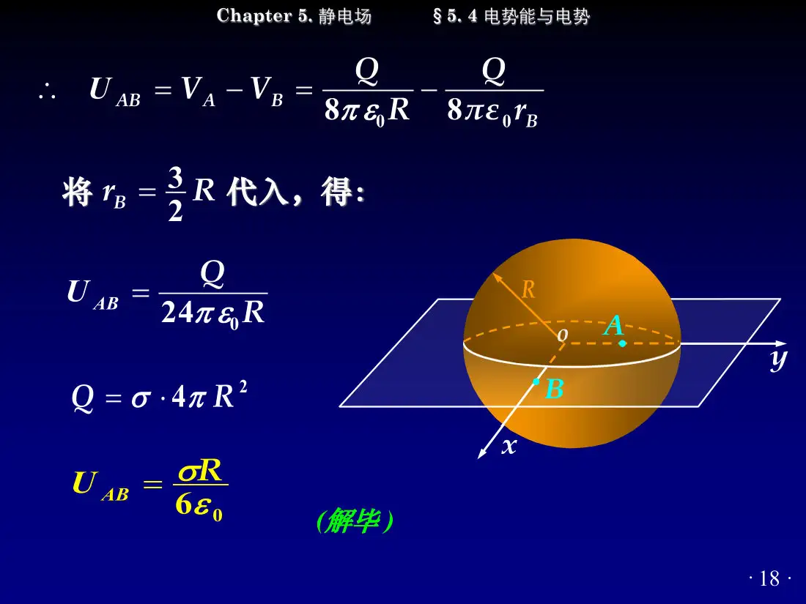

原文：

Chapter 5. 静电场

§ 5.4 电势能与电势

$$
\therefore U _ {A B} = V _ {A} - V _ {B} = \frac {Q}{8 \pi \varepsilon_ {0} R} - \frac {Q}{8 \pi \varepsilon_ {0} r _ {B}}
$$

将 $r_{B}=\frac{3}{2}R$ 代入，得:

$$
U _ {A B} = \frac {Q}{2 4 \pi \varepsilon_ {0} R}
$$

$$
Q = \sigma \cdot 4 \pi R ^ {2}
$$

$$
U _ {A B} = \frac {\sigma R}{6 \varepsilon_ {0}}
$$

(解毕)

18

### 1. 静电场的保守特性：

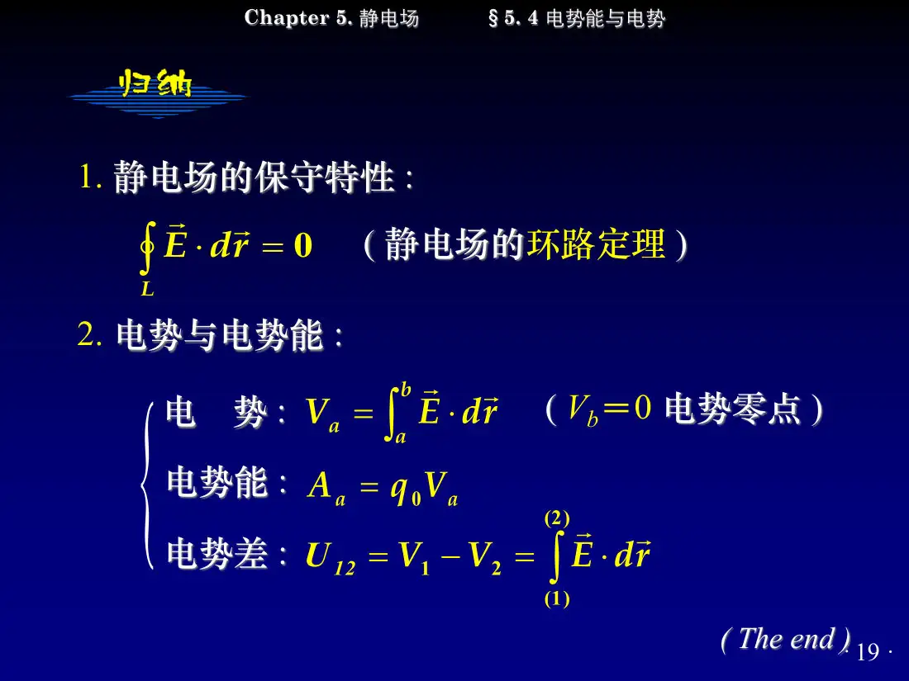

原文：

1. 静电场的保守特性：

$\oint_{L} \vec{E} \cdot d\vec{r} = 0$ （静电场的环路定理）

2. 电势与电势能：

电势： $V_{a}=\int_{a}^{b}\vec{E}\cdot d\vec{r}$ （ $V_{b}=0$ 电势零点）

电势能： $A_{a}=q_{0}V_{a}$

电势差： $U_{12}=V_{1}-V_{2}=\int\limits_{(1)}^{(2)}\vec{E}\cdot d\vec{r}$

Chapter 5. 静电场

§ 5.4 电势能与电势

(The end

19

### Chapter 5. 静电场

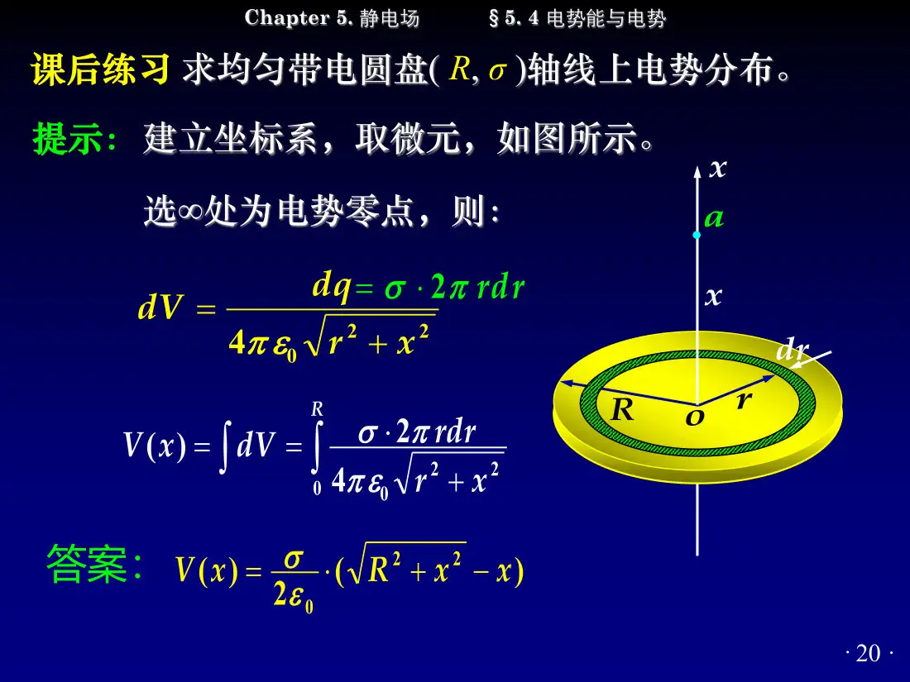

原文：

Chapter 5. 静电场

§ 5.4 电势能与电势

课后练习 求均匀带电圆盘(R,σ)轴线上电势分布。

提示：建立坐标系，取微元，如图所示。

选∞处为电势零点，则：

$$
d V = \frac {d q = \sigma \cdot 2 \pi r d r}{4 \pi \varepsilon_ {0} \sqrt {r ^ {2} + x ^ {2}}}
$$

$$
V (x) = \int d V = \int_ {0} ^ {R} \frac {\sigma \cdot 2 \pi r d r}{4 \pi \varepsilon_ {0} \sqrt {r ^ {2} + x ^ {2}}}
$$

答案: $V(x) = \frac{\sigma}{2\varepsilon_0} \cdot (\sqrt{R^2 + x^2} - x)$

20

### Chapter 5. 静电场 § 5.4 电势能与电势

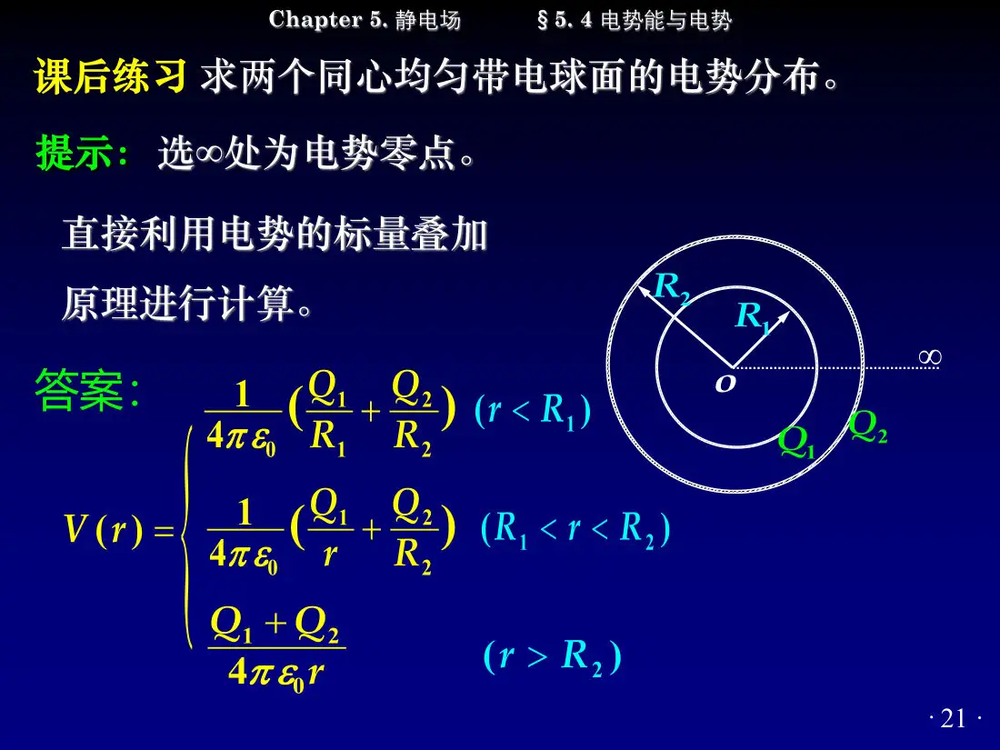

原文：

Chapter 5. 静电场 § 5.4 电势能与电势

课后练习 求两个同心均匀带电球面的电势分布。

提示：选∞处为电势零点。

直接利用电势的标量叠加原理进行计算。

$$
V (r) = \left\{ \begin{array}{l l} \frac {1}{4 \pi \varepsilon_ {0}} \left(\frac {Q _ {1}}{R _ {1}} + \frac {Q _ {2}}{R _ {2}}\right) & (r <   R _ {1}) \\ \frac {1}{4 \pi \varepsilon_ {0}} \left(\frac {Q _ {1}}{r} + \frac {Q _ {2}}{R _ {2}}\right) & (R _ {1} <   r <   R _ {2}) \\ \frac {Q _ {1} + Q _ {2}}{4 \pi \varepsilon_ {0} r} & (r > R _ {2}) \end{array} \right.
$$

21

### Chapter 5. 静电场 § 5.4 电势能与电势

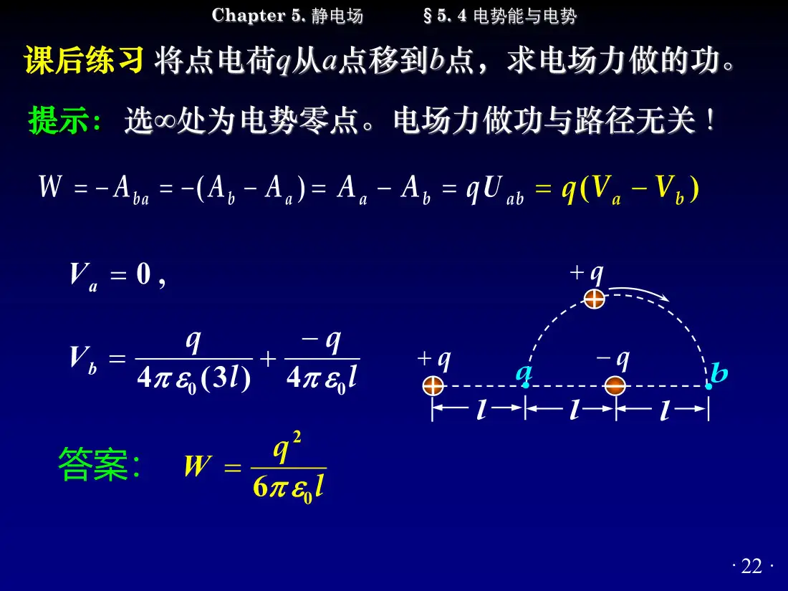

原文：

Chapter 5. 静电场 § 5.4 电势能与电势

课后练习 将点电荷q从a点移到b点，求电场力做的功。

提示：选∞处为电势零点。电场力做功与路径无关！

$$
W = - A _ {b a} = - (A _ {b} - A _ {a}) = A _ {a} - A _ {b} = q U _ {a b} = q (V _ {a} - V _ {b})
$$

$$
\begin{array}{l} V _ {a} = 0, \\ V _ {b} = \frac {q}{4 \pi \varepsilon_ {0} (3 l)} + \frac {- q}{4 \pi \varepsilon_ {0} l} \\ \text {答案：} W = \frac {q ^ {2}}{6 \pi \varepsilon_ {0} l} \end{array} \quad \begin{array}{c} + q \\ + q \\ + q \\ + q \\ + q \\ + q \\ + q \\ + q \\ + q \\ + q \\ + q \\ + q \\ + q \\ + q \\ + q \\ + q \\ + q \\ + q \\ + q \\ + q \\ + q \\ + q \\ + q \\ + q \\ + q \\ + q \\ + q \\ + q \\ + q \\ + q \\ + q \\ + q \\ + q \\ + q \\ - q \\ - q \\ - q \\ - q \\ - q \\ - q \\ - q \\ - q \\ - q \\ - q \\ - q \\ - q \\ - q \\ - q \\ - q \\ - q \\ - q \\ - q \\ - q \\ - q \\ - q \\ - q \\ - q \\ - q \\ - q \\ - q \\ - q \\ - q \\ - q \\ - q \\ - q \\ - q \\ - q \\ - k \end{array}
$$

22
