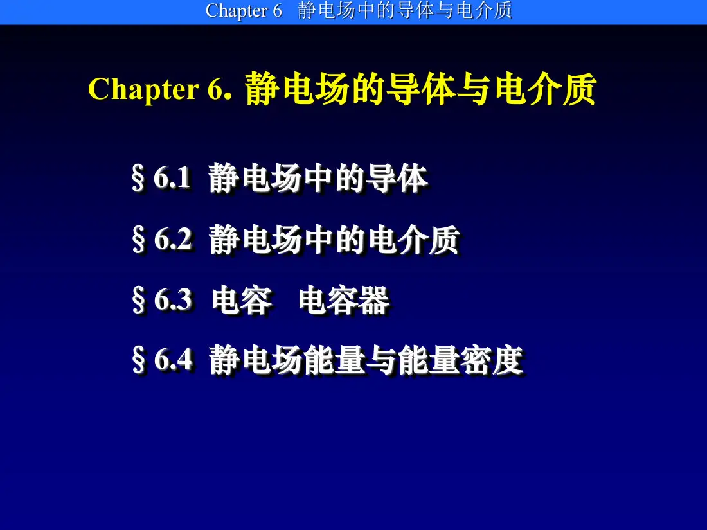
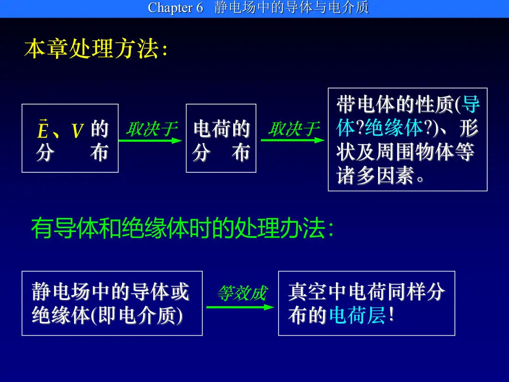

# 《大学物理（上）》第6章 静电场中的导体与电介质（课件）

原件的每一页，下面附识别出的文字。

### Chapter 6. 静电场的导体与电介质

原文：

Chapter 6. 静电场的导体与电介质

§6.1 静电场中的导体

§6.2 静电场中的电介质

§6.3 电容 电容器

§6.4 静电场能量与能量密度

作者：杨茂田Chapter 6 静电场中的导体与电介质

### 作者：杨茂田Chapter 6 静电场中的导体与电介质

原文：

作者：杨茂田Chapter 6 静电场中的导体与电介质

本章处理方法：

分 V 的 布

取决于

电荷的分 布取决于

带电体的性质(导体?绝缘体?)、形状及周围物体等诸多因素。

有导体和绝缘体时的处理办法：

静电场中的导体或绝缘体(即电介质)

等效成

真空中电荷同样分布的电荷层！
