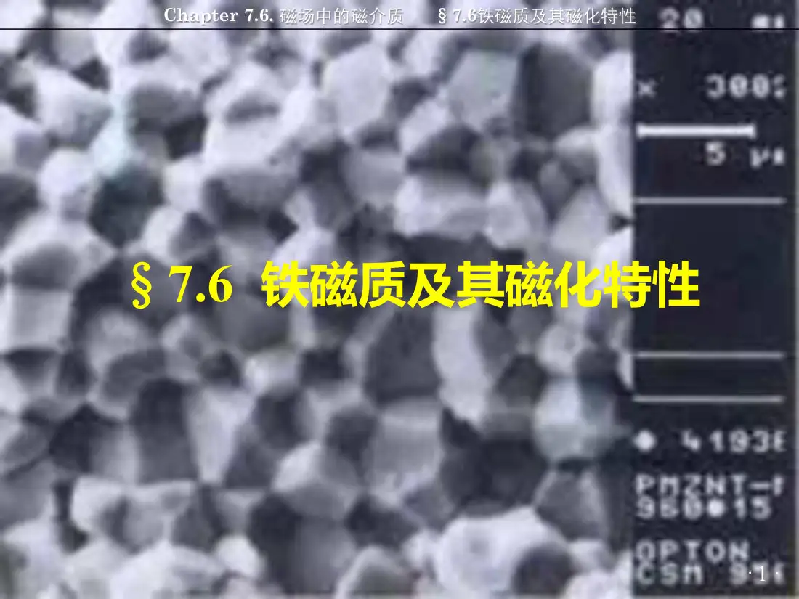
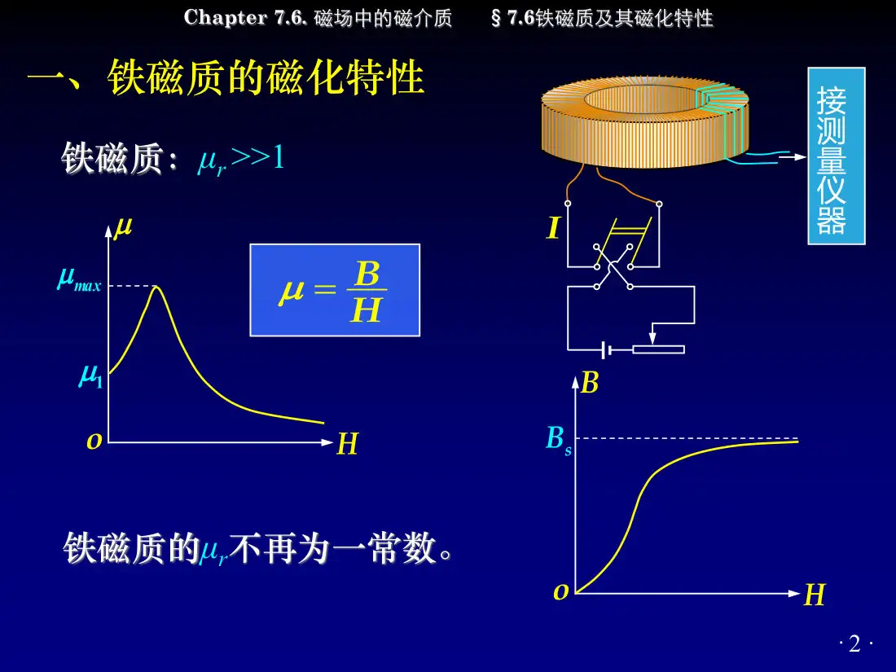
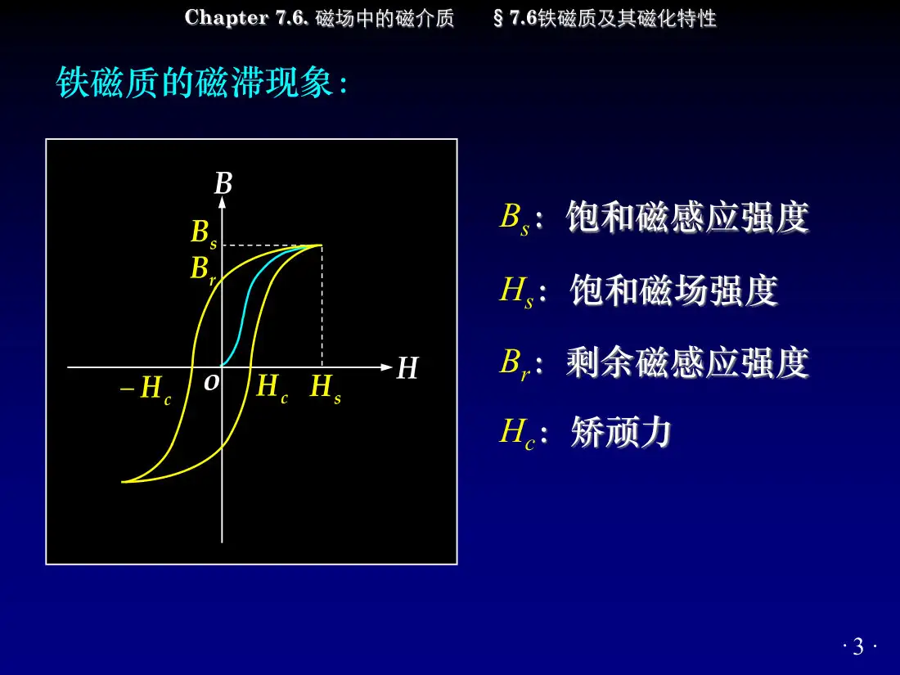
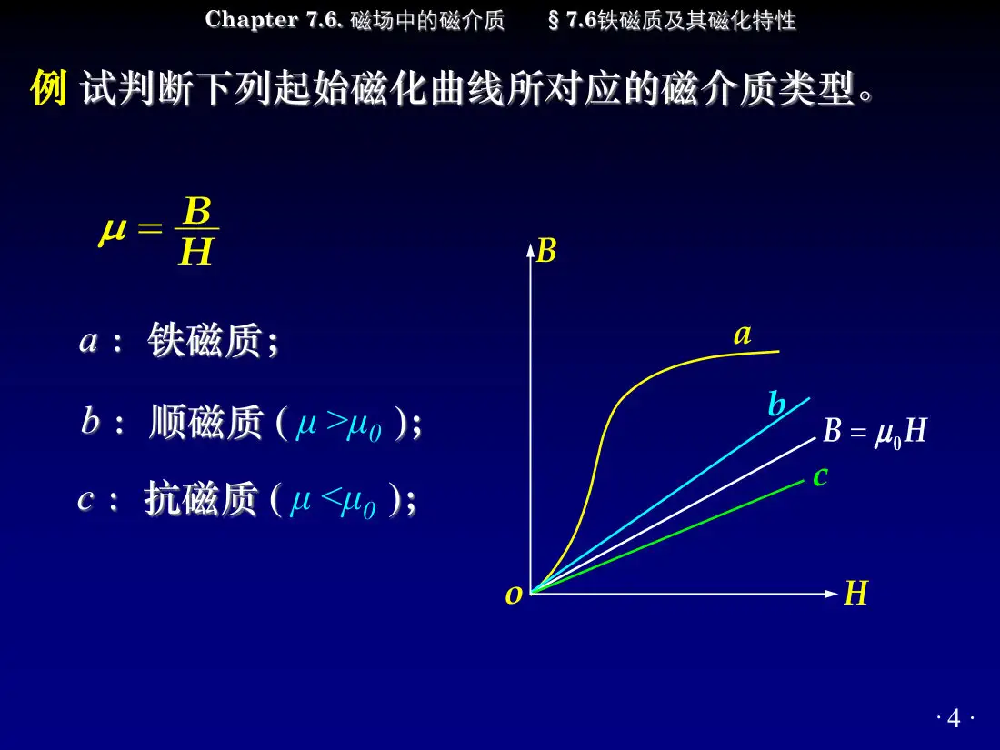
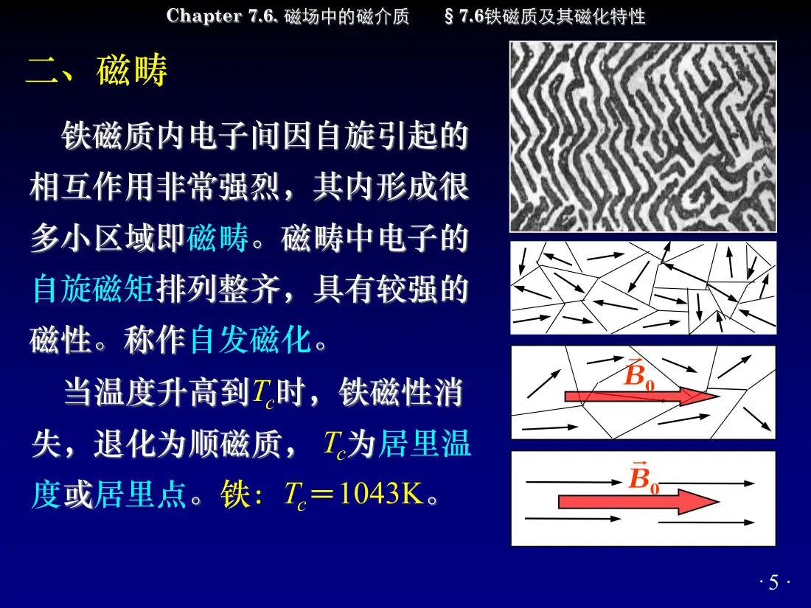
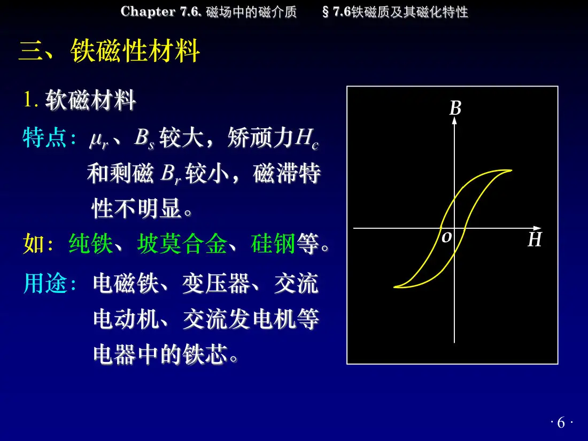
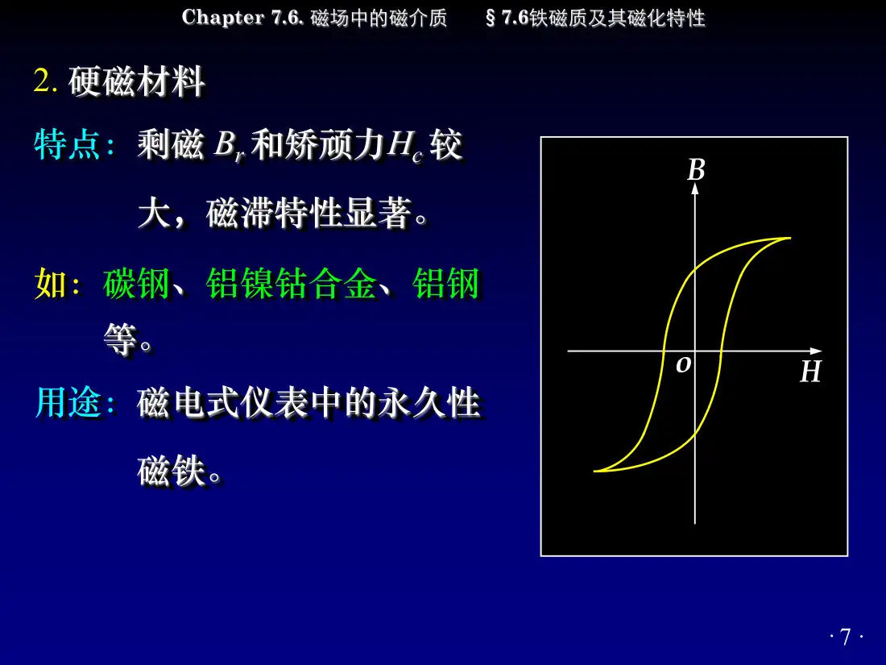
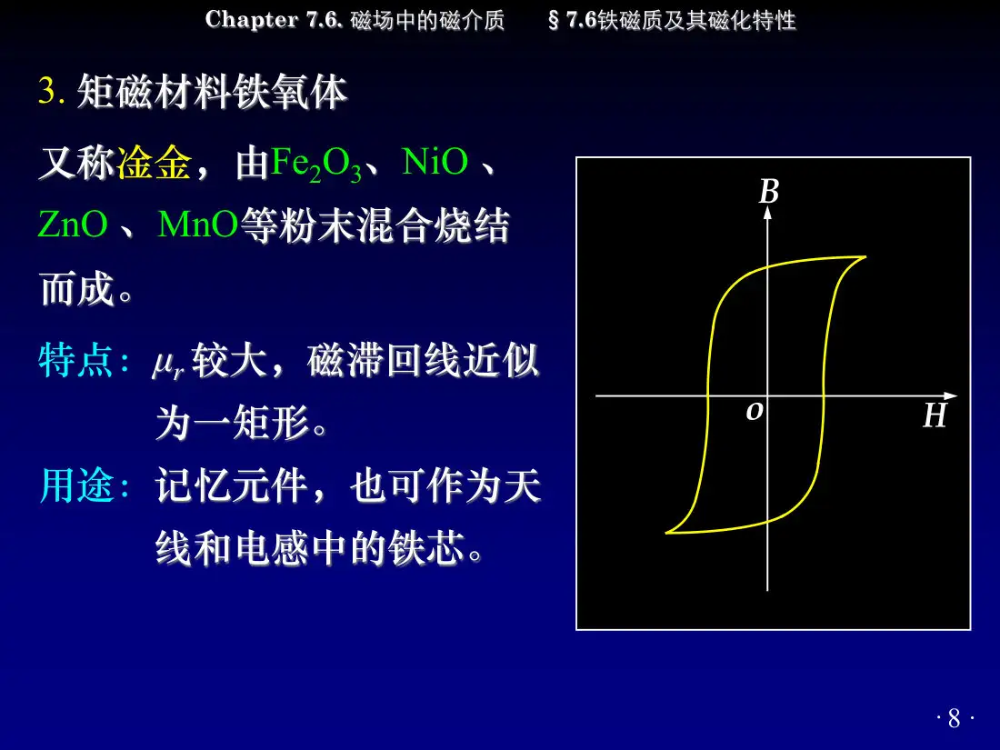

# 《大学物理（上）》第7章 恒定磁场 §7.6.3 铁磁质及其磁化特性（课件）

原件的每一页，下面附识别出的文字。

### §7.6 铁磁质及其磁化特性

原文：

§7.6 铁磁质及其磁化特性

Chapter 7.6. 磁场中的磁介质 §7.6铁磁质及其磁化特性

### 一、铁磁质的磁化特性

原文：

一、铁磁质的磁化特性

铁磁质： $\textcircled { 1 } m = 1$

铁磁质的μr不再为一常数。

接

测

量

仪

器

Chapter 7.6. 磁场中的磁介质 §7.6铁磁质及其磁化特性

· 2

### 铁磁质的磁滞现象：

原文：

铁磁质的磁滞现象：

Bs：饱和磁感应强度

Hs：饱和磁场强度

B ：剩余磁感应强度

Hc：矫顽力

Chapter 7.6. 磁场中的磁介质 §7.6铁磁质及其磁化特性

· 3

### Chapter 7.6. 磁场中的磁介质 §7.6铁磁质及其磁化特性

原文：

Chapter 7.6. 磁场中的磁介质 §7.6铁磁质及其磁化特性

例 试判断下列起始磁化曲线所对应的磁介质类型。

$$
\mu = \frac {B}{H}
$$

a ：铁磁质；

b ：顺磁质 $( 1 1 0 ) \div ( 1 0 ) = 1 2$

c ：抗磁质 $( 1 0 , 1 0 ) = 1 0 0 0$

· 4

### 二、磁畴

原文：

二、磁畴

铁磁质内电子间因自旋引起的相互作用非常强烈，其内形成很多小区域即磁畴。磁畴中电子的自旋磁矩排列整齐，具有较强的磁性。称作自发磁化。

当温度升高到T时，铁磁性消失，退化为顺磁质， T为居里温度或居里点。铁： $1 1 0 - 1 1 0 = 1 3 1 0$

Chapter 7.6. 磁场中的磁介质 §7.6铁磁质及其磁化特性

5

### 三、铁磁性材料

原文：

三、铁磁性材料

1. 软磁材料

特点： $| \pmb { \mathit { n } } | _ { \pmb { \mathit { n } } }$ 较大，矫顽力H和剩磁 Br 较小，磁滞特性不明显。

如：纯铁、坡莫合金、硅钢等。

用途：电磁铁、变压器、交流电动机、交流发电机等电器中的铁芯。

Chapter 7.6. 磁场中的磁介质 §7.6铁磁质及其磁化特性

6

### 2. 硬磁材料

原文：

2. 硬磁材料

特点：剩磁 B 和矫顽力H 较大，磁滞特性显著。

如：碳钢、铝镍钴合金、铝钢等。

用途：磁电式仪表中的永久性磁铁。

Chapter 7.6. 磁场中的磁介质 §7.6铁磁质及其磁化特性

7

### Chapter 7.6. 磁场中的磁介质 §7.6铁磁质及其磁化特性

原文：

Chapter 7.6. 磁场中的磁介质 §7.6铁磁质及其磁化特性

3. 矩磁材料铁氧体又称凎金，由F $\textcircled { \bullet } \textcircled { \bullet }$ NiO 、$\boxed { 7 } \boxed { 1 } \boxed { 6 }$ 、MnO等粉末混合烧结而成。

特点： $\textcircled { 1 }$ 较大，磁滞回线近似 为一矩形。

用途：记忆元件，也可作为天线和电感中的铁芯。

8
