# 《大学物理（上）》第8章 §8.6 位移电流 Maxwell方程组（课件）

原件的每一页，下面附识别出的文字。

### § 8.6 位移电流 Maxwell方程组

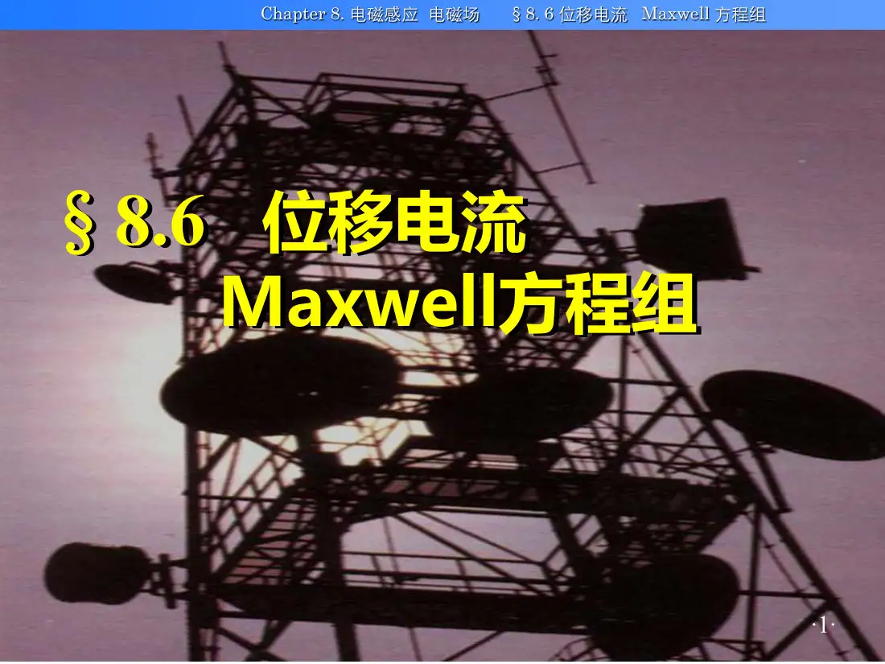

原文：

§ 8.6 位移电流 Maxwell方程组

Chapter 8. 电磁感应 电磁场 § 8.6 位移电流 Maxwell 方程组

### 一、位移电流

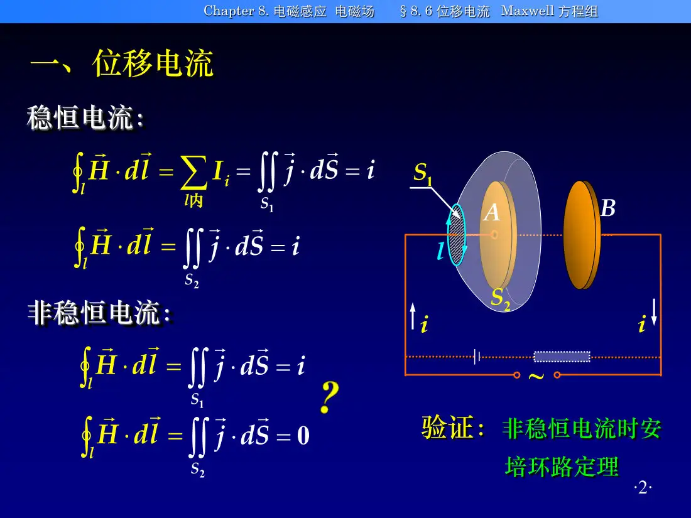

原文：

一、位移电流

稳恒电流：

$$
\oint_ {l} \vec {H} \cdot d \vec {l} = \sum_ {l \text {内}} I _ {i} = \iint_ {S _ {1}} \vec {j} \cdot d \vec {S} = i
$$

$$
\oint_ {l} \vec {H} \cdot d \vec {l} = \iint_ {S _ {2}} \vec {j} \cdot d \vec {S} = i
$$

非稳恒电流：

$$
\begin{array}{l} \oint_ {l} \vec {H} \cdot d \vec {l} = \iint_ {S _ {1}} \vec {j} \cdot d \vec {S} = i \\ \oint_ {l} \vec {H} \cdot d \vec {l} = \iint_ {S _ {2}} \vec {j} \cdot d \vec {S} = 0 \end{array}
$$

验证：非稳恒电流时安培环路定理

Chapter 8. 电磁感应 电磁场 § 8.6 位移电流 Maxwell 方程组

2

### 矛盾根源：非稳恒电流的不连续性。

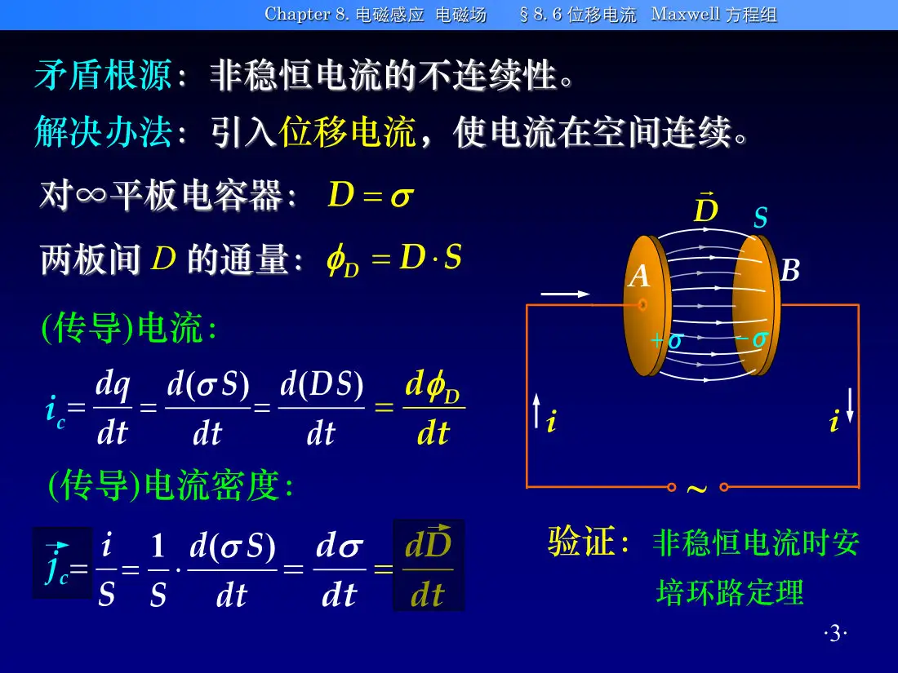

原文：

矛盾根源：非稳恒电流的不连续性。

解决办法：引入位移电流，使电流在空间连续。

对 $\infty$ 平板电容器: $D = \sigma$

两板间 D 的通量： $\phi_{D}=D\cdot S$

(传导)电流:

$$
i _ {c} = \frac {d q}{d t} = \frac {d (\sigma S)}{d t} = \frac {d (D S)}{d t} = \frac {d \phi_ {D}}{d t}
$$

(传导)电流密度:

$$
\vec {j} _ {c} = \frac {i}{S} = \frac {1}{S} \cdot \frac {d (\sigma S)}{d t} = \frac {d \sigma}{d t} = \frac {d \vec {D}}{d t}
$$

验证：非稳恒电流时安培环路定理

Chapter 8. 电磁感应 电磁场 § 8.6 位移电流 Maxwell 方程组

·3·

### 定义

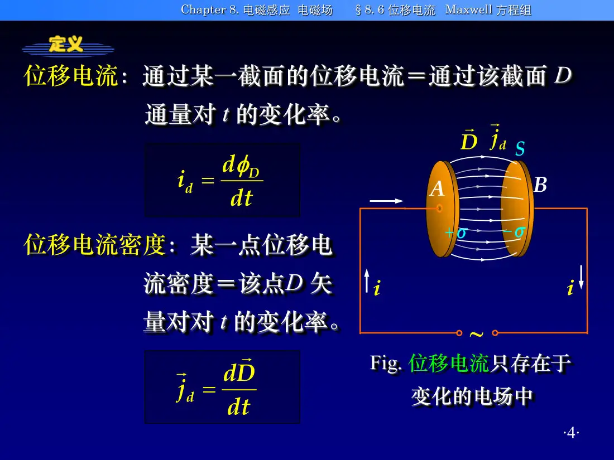

原文：

定义

位移电流: 通过某一截面的位移电流 $=$ 通过该截面 $D$ 通量对 $t$ 的变化率。

$$
i _ {d} = \frac {d \phi_ {D}}{d t}
$$

位移电流密度: 某一点位移电流密度=该点D矢量对对t的变化率。

$$
\vec {j} _ {d} = \frac {d \vec {D}}{d t}
$$

Fig. 位移电流只存在于变化的电场中

Chapter 8. 电磁感应 电磁场

§ 8.6 位移电流 Maxwell 方程组

•4•

### § 8.6 位移电流 Maxwell 方程组

原文：

学、统计物理学、光学、力学、弹性理论方面的研究。尤其是他建立的电磁场理论，将电学、磁学、光学统一起来，是19世纪物理学发展的最光辉的成果，是科学史上最伟大的综合之一。

§ 8.6 位移电流 Maxwell 方程组

Chapter 8. 电磁感应 电磁场

·5·

### 传导电流与位移电流的比较:

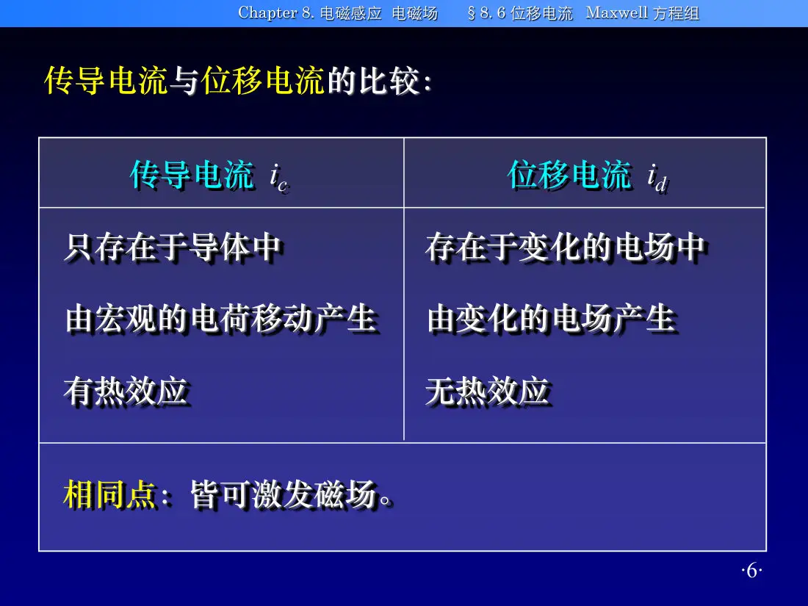

原文：

传导电流与位移电流的比较:

<table><tr><td>传导电流  $i_c$ </td><td>位移电流  $i_d$ </td></tr><tr><td>只存在于导体中由宏观的电荷移动产生有热效应</td><td>存在于变化的电场中由变化的电场产生无热效应</td></tr><tr><td colspan="2">相同点:皆可激发磁场。</td></tr></table>

Chapter 8. 电磁感应 电磁场 § 8.6 位移电流 Maxwell 方程组

6.

### 二、全电流 全电流定律

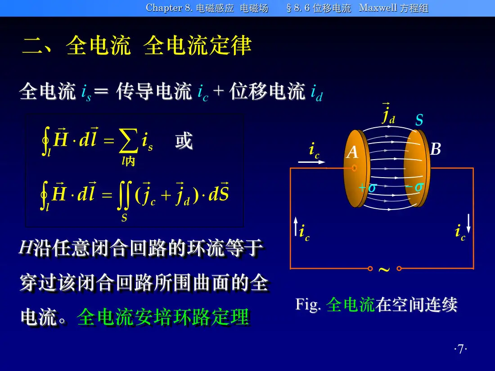

原文：

二、全电流 全电流定律

全电流 $i_{s} =$ 传导电流 $i_{c} +$ 位移电流 $i_{d}$

$$
\oint_ {l} \vec {H} \cdot d \vec {l} = \sum_ {l \text {内}} i _ {s} \quad \text {或}
$$

$$
\oint_ {l} \vec {H} \cdot d \vec {l} = \iint_ {S} (\vec {j} _ {c} + \vec {j} _ {d}) \cdot d \vec {S}
$$

H沿任意闭合回路的环流等于穿过该闭合回路所围曲面的全电流。全电流安培环路定理

Fig. 全电流在空间连续

Chapter 8. 电磁感应 电磁场 § 8.6 位移电流 Maxwell 方程组

•7•

### 解 在其内部作一高斯面：封闭圆柱面

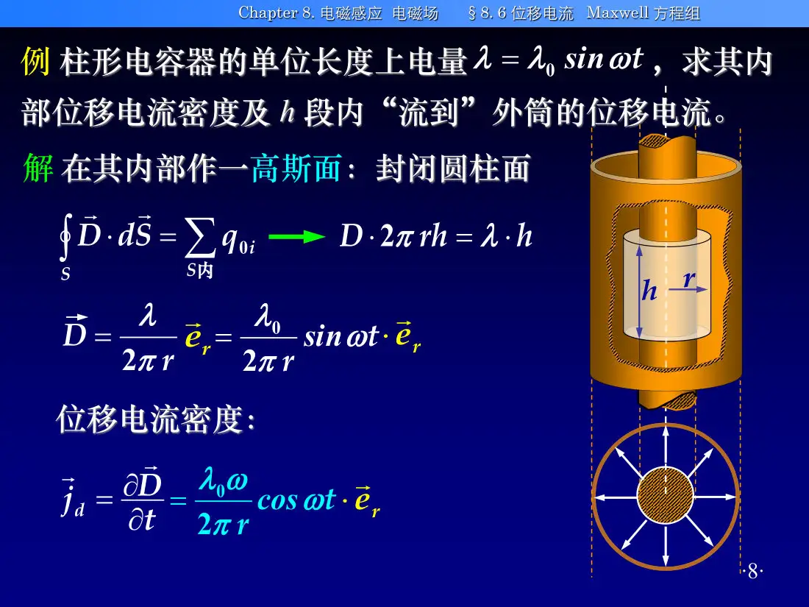

原文：

例 柱形电容器的单位长度上电量 $\lambda = \lambda_{0} \sin \omega t$ ，求其内部位移电流密度及 h 段内“流到”外筒的位移电流。

解 在其内部作一高斯面：封闭圆柱面

$$
\oint_ {S} \vec {D} \cdot d \vec {S} = \sum_ {S \text {内}} q _ {0 i} \longrightarrow D \cdot 2 \pi r h = \lambda \cdot h
$$

$$
\vec {D} = \frac {\lambda}{2 \pi r} \vec {e} _ {r} = \frac {\lambda_ {0}}{2 \pi r} \sin \omega t \cdot \vec {e} _ {r}
$$

位移电流密度:

$$
\vec {j} _ {d} = \frac {\partial \vec {D}}{\partial t} = \frac {\lambda_ {0} \omega}{2 \pi r} \cos \omega t \cdot \vec {e} _ {r}
$$

Chapter 8. 电磁感应 电磁场 § 8.6 位移电流 Maxwell 方程组

8.

### $$

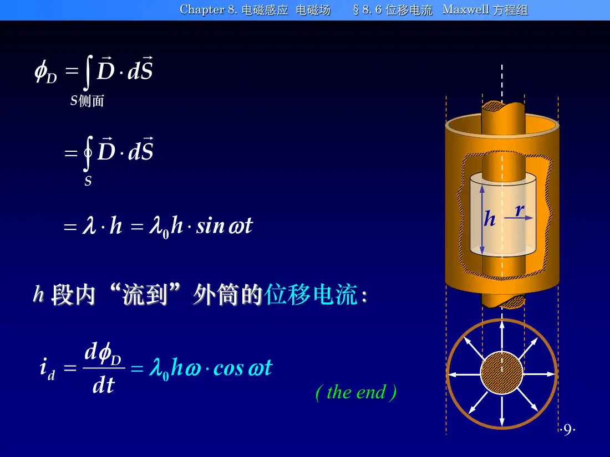

原文：

$\phi_{D} = \int \limits_{S\text{侧面}} \vec{D} \cdot d \vec{S}$

$$
= \oint_ {S} \vec {D} \cdot d \vec {S}
$$

$$
= \lambda \cdot h = \lambda_ {0} h \cdot \sin \omega t
$$

h 段内 “流到” 外筒的位移电流:

$$
i _ {d} = \frac {d \phi_ {D}}{d t} = \lambda_ {0} h \omega \cdot c o s \omega t
$$

( the end )

Chapter 8. 电磁感应 电磁场 § 8.6 位移电流 Maxwell 方程组

1.9.

### $$

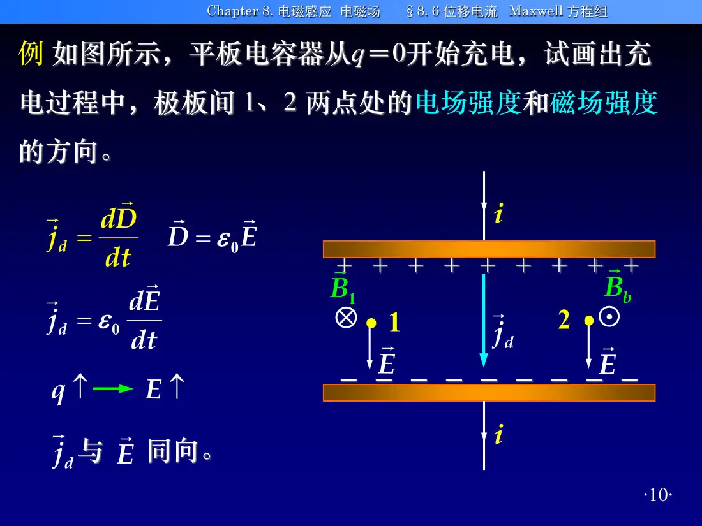

原文：

例如图所示，平板电容器从 $q = 0$ 开始充电，试画出充电过程中，极板间1、2两点处的电场强度和磁场强度的方向。

$$
\begin{array}{r l}&{\vec {j} _ {d} = \frac {d \vec {D}}{d t} \quad \vec {D} = \varepsilon_ {0} \vec {E}}\\&{\vec {j} _ {d} = \varepsilon_ {0} \frac {d \vec {E}}{d t}}\\&{q \uparrow \rightarrow E \uparrow}\\&{\vec {j} _ {d} \text {与} \vec {E} \text {同向。}}\end{array}
$$

$$
\begin{array}{c c c} & i \\ \hline & \vec {B} _ {1} & \vec {B} _ {b} \\ & \stackrel {{+}} {{\times}} & 1 \\ & \vec {E} & j _ {d} \\ & & 2 \\ & & \vec {E} \\ & & i \end{array}
$$

10·

### 三、Maxwell方程组

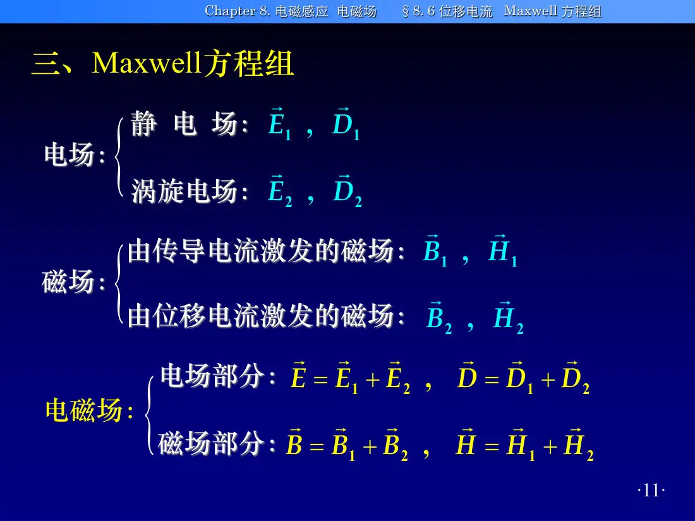

原文：

三、Maxwell方程组

静电场: $\vec{E}_{1}$ , $\vec{D}_{1}$

电场：

涡旋电场: $\vec{E}_{2}$ , $\vec{D}_{2}$

由传导电流激发的磁场: $\vec{B}_{1}$ , $\vec{H}_{1}$

磁场：

由位移电流激发的磁场: $\vec{B}_{2}$ , $\vec{H}_{2}$

电场部分： $\vec{E} = \vec{E}_1 + \vec{E}_2$ ， $\vec{D} = \vec{D}_1 + \vec{D}_2$

电磁场:

磁场部分: $\vec{B} = \vec{B}_1 + \vec{B}_2$ ， $\vec{H} = \vec{H}_1 + \vec{H}_2$

Chapter 8. 电磁感应 电磁场 § 8.6 位移电流 Maxwell 方程组

·11

### 1. 电场性质:

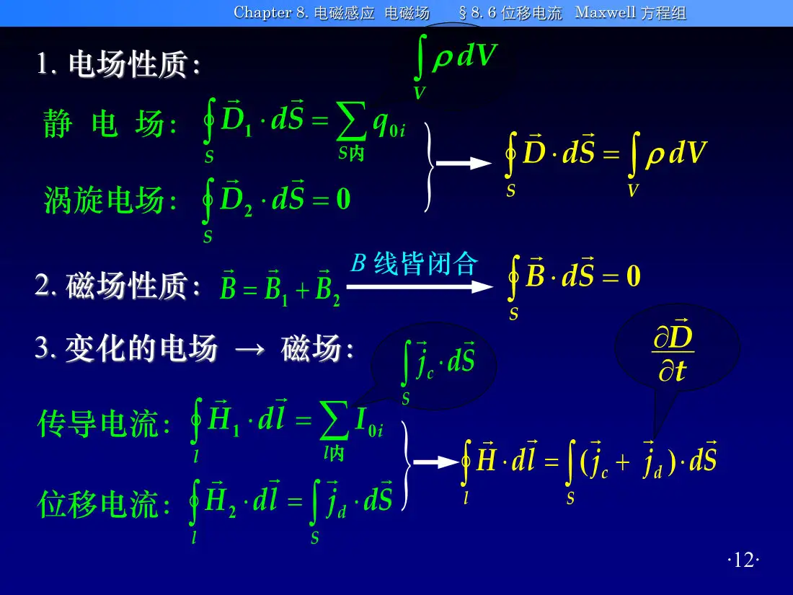

原文：

1. 电场性质:

$$
\int_ {V} \rho d V
$$

静电场: $\oint_{S} \vec{D}_{1} \cdot d\vec{S} = \sum_{S \text{内}} q_{0i}$

涡旋电场:

$$
\oint_ {S} \vec {D} _ {2} \cdot d \vec {S} = 0
$$

$$
\left\{ \begin{array} {c}\cdots \\ \int_ {S} \vec {D} \cdot d \vec {S} = \int_ {V} \rho d V \\ \end{array} \right.
$$

2. 磁场性质: $\vec{B} = \vec{B}_1 + \vec{B}_2 \xrightarrow{B\text{线皆闭合}} \oint_{S} \vec{B} \cdot d\vec{S} = 0$

3. 变化的电场 → 磁场:

$$
\int \vec {j} _ {c} \cdot d \vec {S}
$$

$$
\frac {\partial \vec {D}}{\partial t}
$$

传导电流: $\oint_{l} \vec{H}_{1} \cdot d\vec{l} = \sum_{l \text{内}} I_{0i}$

位移电流: $\oint_{l} \vec{H}_{2} \cdot d\vec{l} = \int_{S} \vec{j}_{d} \cdot d\vec{S}$

$$
\oint_ {l} \vec {H} \cdot d \vec {l} = \int_ {S} (\vec {j} _ {c} + \vec {j} _ {d}) \cdot d \vec {S}
$$

Chapter 8. 电磁感应 电磁场 § 8.6 位移电流 Maxwell 方程组

·12·

### 4. 变化的磁场 → 电场:

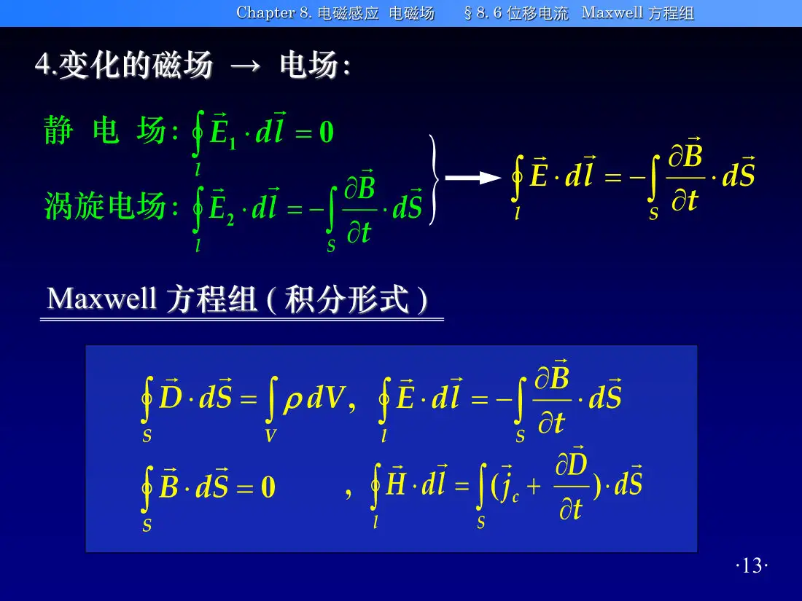

原文：

4. 变化的磁场 → 电场:

静电场: $\oint_{l} \vec{E}_1 \cdot d\vec{l} = 0$ 涡旋电场: $\oint_{l} \vec{E}_2 \cdot d\vec{l} = -\int_{S} \frac{\partial \vec{B}}{\partial t} \cdot d\vec{S}$ $\rightarrow$ $\oint_{l} \vec{E} \cdot d\vec{l} = -\int_{S} \frac{\partial \vec{B}}{\partial t} \cdot d\vec{S}$

Maxwell 方程组（积分形式）

$\oint_{S} \vec{D} \cdot d\vec{S} = \int_{V} \rho dV, \oint_{l} \vec{E} \cdot d\vec{l} = -\int_{S} \frac{\partial \vec{B}}{\partial t} \cdot d\vec{S}$

$$
\oint_ {S} \vec {B} \cdot d \vec {S} = 0
$$

$$
\oint_ {l} \vec {H} \cdot d \vec {l} = \int_ {S} (\vec {j} _ {c} + \frac {\partial \vec {D}}{\partial t}) \cdot d \vec {S}
$$

Chapter 8. 电磁感应 电磁场 § 8.6 位移电流 Maxwell 方程组

·13·

### Maxwell 方程组（微分形式）

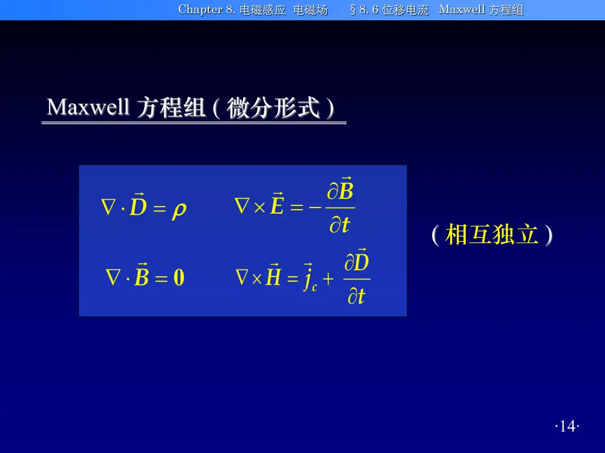

原文：

Maxwell 方程组（微分形式）

$$
\nabla \cdot \vec {D} = \rho
$$

$$
\nabla \times \vec {E} = - \frac {\partial \vec {B}}{\partial t}
$$

(相互独立)

$$
\nabla \cdot \vec {B} = 0
$$

$$
\nabla \times \vec {H} = \vec {j} _ {c} + \frac {\partial \vec {D}}{\partial t}
$$

Chapter 8. 电磁感应 电磁场 § 8.6 位移电流 Maxwell 方程组

·14·

### 例 Maxwell方程组也可写成:

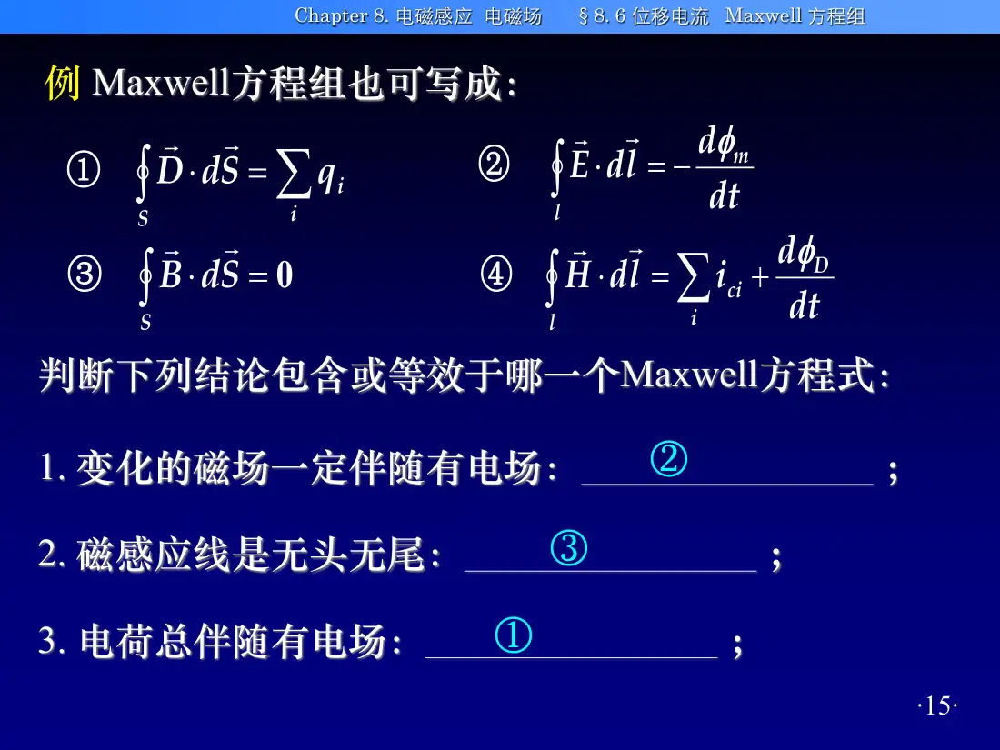

原文：

例 Maxwell方程组也可写成:

① $\oint_{S} \vec{D} \cdot d\vec{S} = \sum_{i} q_{i}$

③ $\oint_{S}\vec{B}\cdot d\vec{S}=0$

② $\oint_{l}\vec{E}\cdot dl=-\frac{d\phi_{m}}{dt}$

④ $\oint_{l}\vec{H}\cdot d\vec{l}=\sum_{i}i_{ci}+\frac{d\phi_{D}}{dt}$

判断下列结论包含或等效于哪一个Maxwell方程式：

1. 变化的磁场一定伴随有电场: ② ;

2. 磁感应线是无头无尾：③ ;

3. 电荷总伴随有电场: ① ;

Chapter 8. 电磁感应 电磁场 § 8.6 位移电流 Maxwell 方程组

·15·

### 归纳:

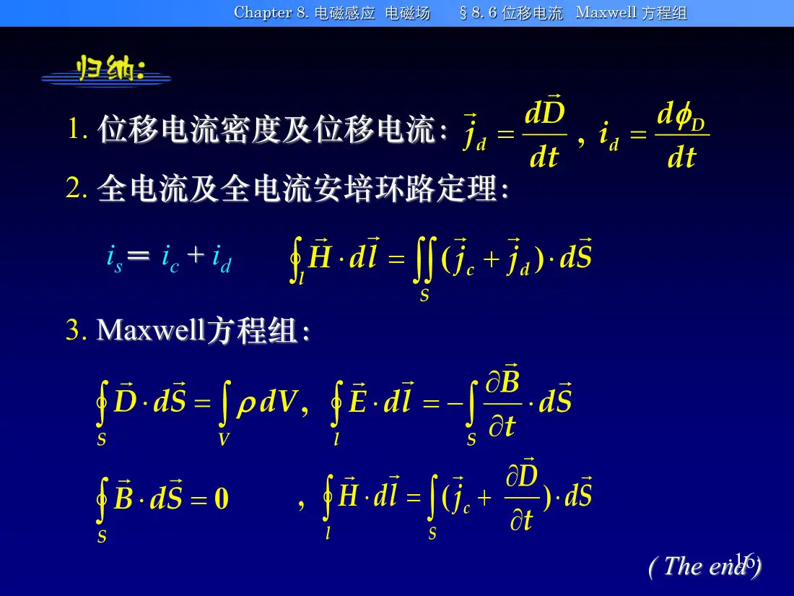

原文：

归纳:

1. 位移电流密度及位移电流: $\vec{j}_{d} = \frac{d\vec{D}}{dt}$ , $i_{d} = \frac{d\phi_{D}}{dt}$

2. 全电流及全电流安培环路定理：

$$
i _ {s} = i _ {c} + i _ {d}
$$

$$
\oint_ {l} \vec {H} \cdot d \vec {l} = \iint_ {S} (\vec {j} _ {c} + \vec {j} _ {d}) \cdot d \vec {S}
$$

3. Maxwell方程组:

$$
\oint_ {S} \vec {D} \cdot d \vec {S} = \int_ {V} \rho d V, \oint_ {l} \vec {E} \cdot d \vec {l} = - \int_ {S} \frac {\partial \vec {B}}{\partial t} \cdot d \vec {S}
$$

$$
\oint_ {S} \vec {B} \cdot d \vec {S} = 0
$$

$$
\oint_ {l} \vec {H} \cdot d \vec {l} = \int_ {S} (\vec {j} _ {c} + \frac {\partial \vec {D}}{\partial t}) \cdot d \vec {S}
$$

Chapter 8. 电磁感应 电磁场

§ 8.6 位移电流 Maxwell 方程组
