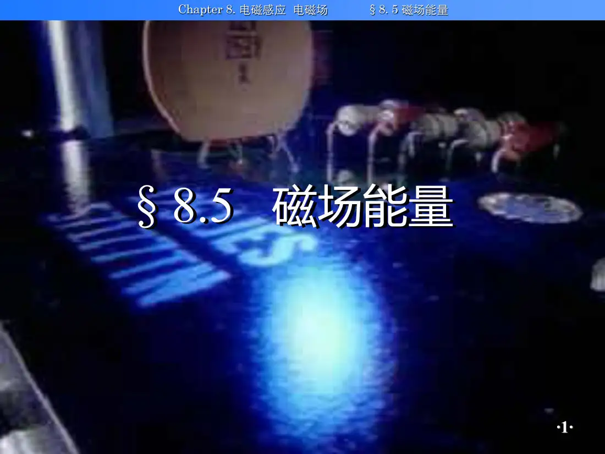
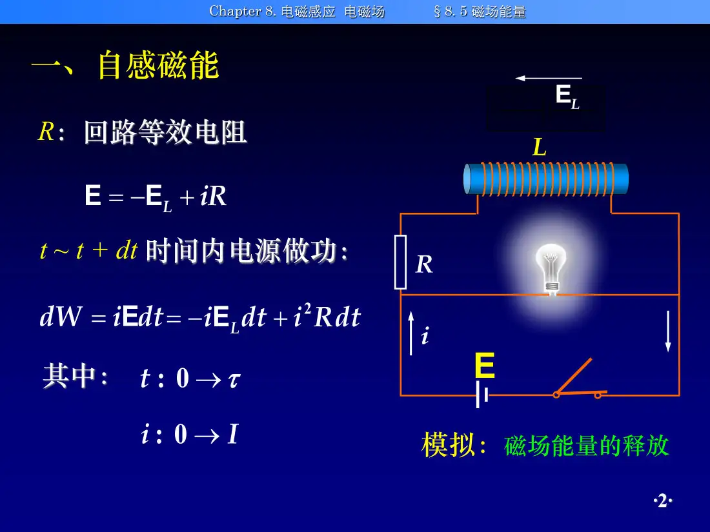
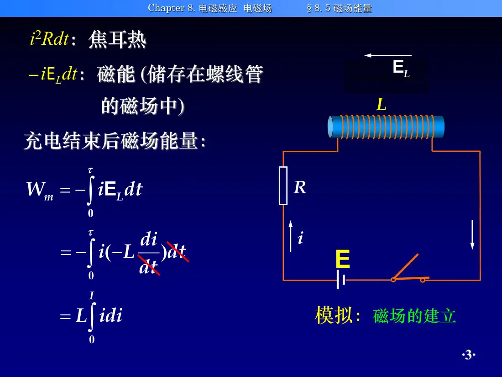
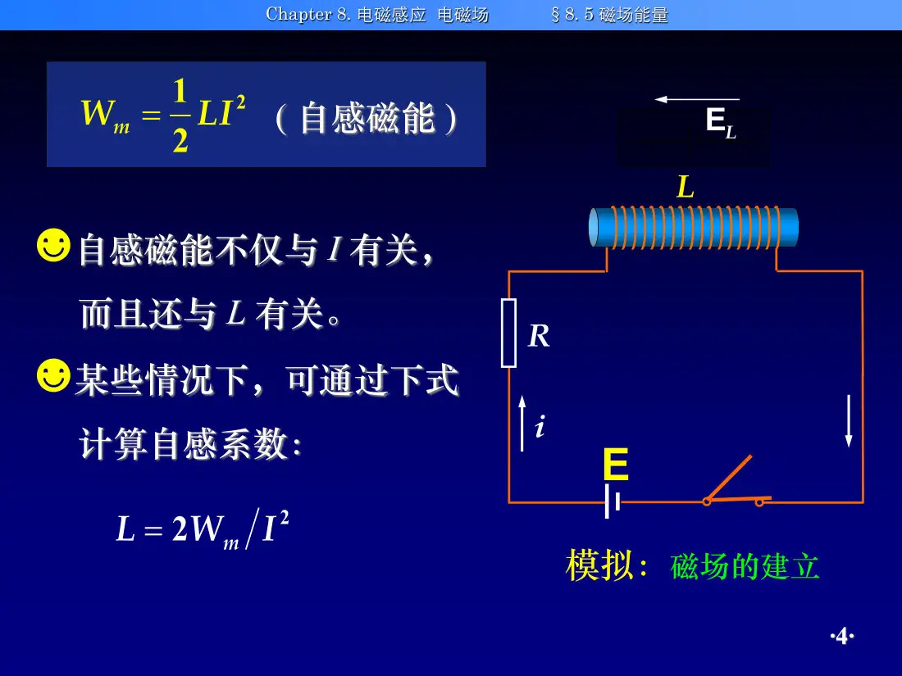
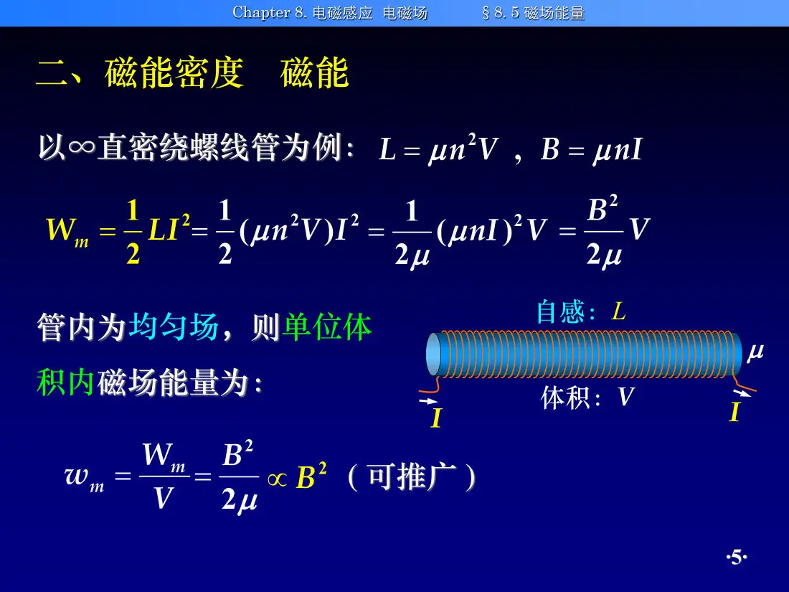
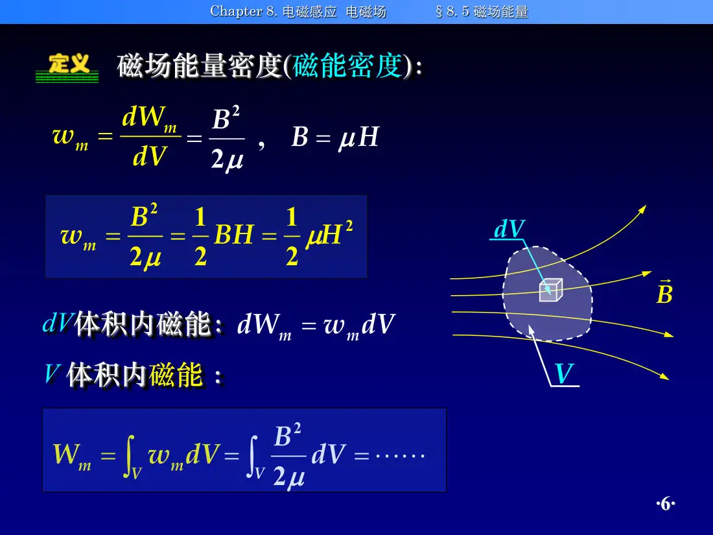
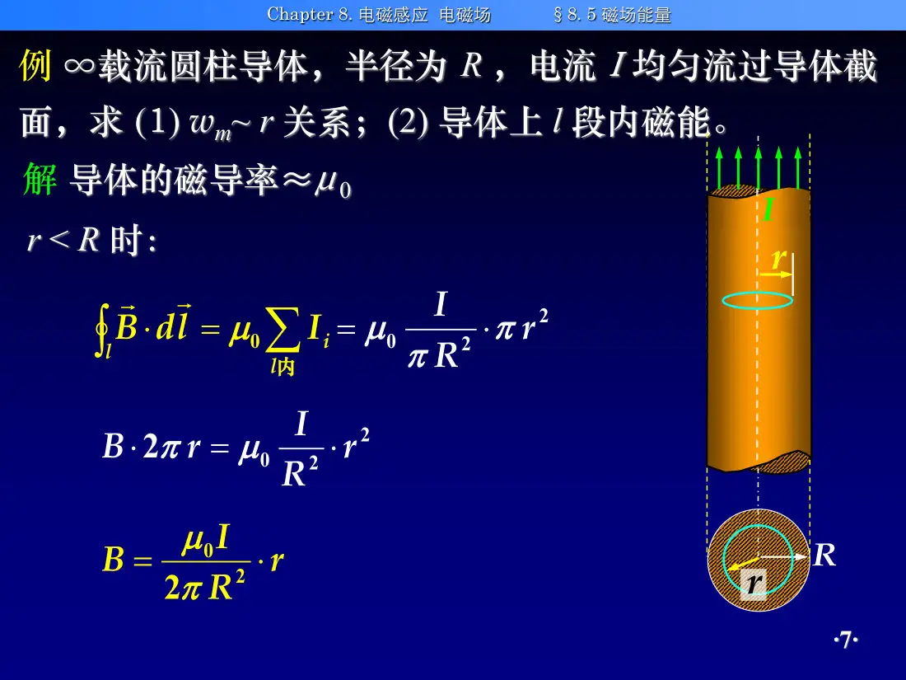
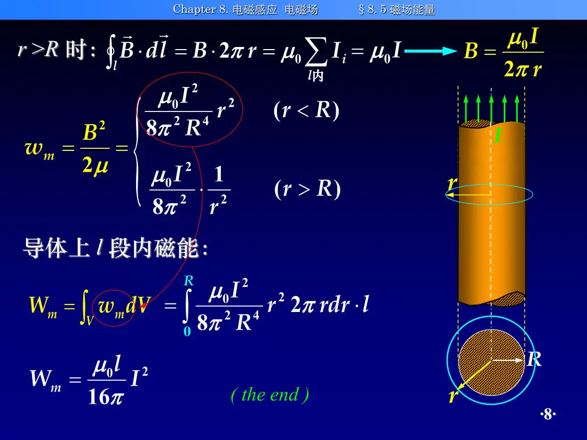
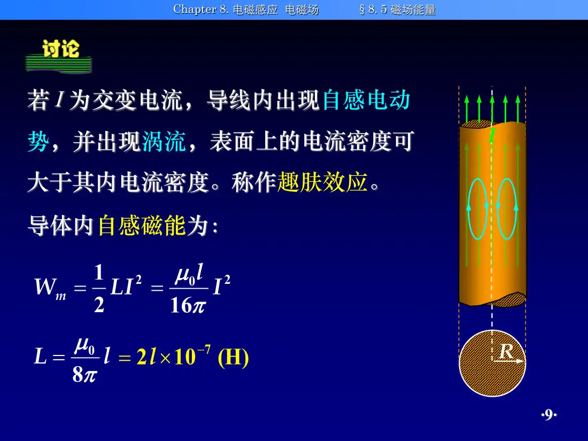
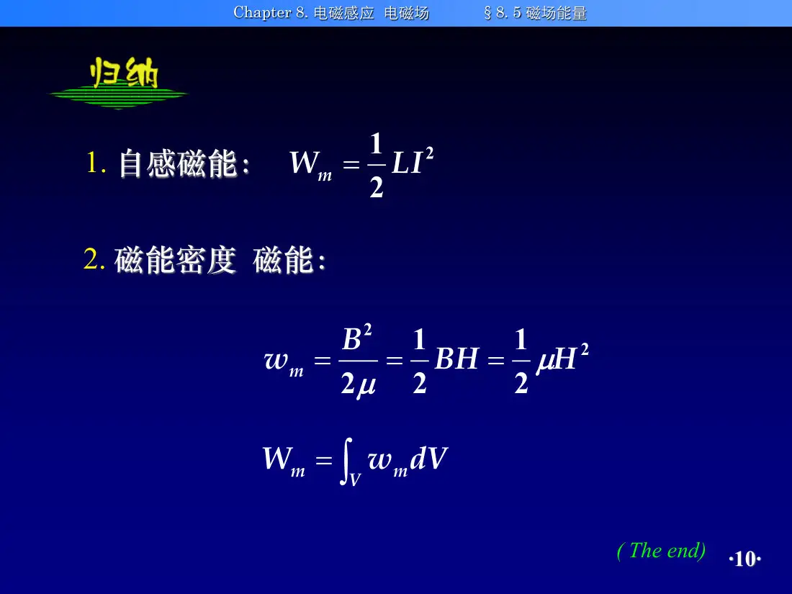

# 《大学物理（上）》第8章 电磁感应 电磁场 §8.5 磁场能量（课件）

原件的每一页，下面附识别出的文字。

### § 8.5 磁场能量

原文：

§ 8.5 磁场能量

Chapter 8. 电磁感应 电磁场

§ 8.5 磁场能量

### 一、自感磁能

原文：

一、自感磁能

R: 回路等效电阻

$\mathbf{E} = -\mathbf{E}_L + i\mathbf{R}$

$t \sim t + dt$ 时间内电源做功：

$dW = iEdt = -iE_Ldt + i^2Rdt$

其中: $t: 0 \to \tau$

i: 0 → I

模拟：磁场能量的释放

Chapter 8. 电磁感应 电磁场

§ 8.5 磁场能量

2

### $i^{2}Rdt$ ：焦耳热

原文：

$i^{2}Rdt$ ：焦耳热

$-iE_{L}dt$ ：磁能（储存在螺线管的磁场中）

充电结束后磁场能量：

$$
\begin{array}{l} W _ {m} = - \int_ {0} ^ {\tau} i \mathbf {E} _ {L} d t \\ = - \int_ {0} ^ {\tau} i (- L \frac {d i}{d t}) d t \\ = L \int_ {0} ^ {I} i d i \end{array}
$$

模拟：磁场的建立

Chapter 8. 电磁感应 电磁场

§ 8.5 磁场能量

3.

### $$

原文：

$$
W _ {m} = \frac {1}{2} L I ^ {2}
$$

(自感磁能)

自感磁能不仅与 I 有关，而且还与 L 有关。

某些情况下，可通过下式计算自感系数：

$$
L = 2 W _ {m} / I ^ {2}
$$

模拟：磁场的建立

Chapter 8. 电磁感应 电磁场

§ 8.5 磁场能量

### 二、磁能密度 磁能

原文：

二、磁能密度 磁能

以 $\infty$ 直密绕螺线管为例: $L = \mu n^{2} V$ , $B = \mu n I$

$$
W _ {m} = \frac {1}{2} L I ^ {2} = \frac {1}{2} (\mu n ^ {2} V) I ^ {2} = \frac {1}{2 \mu} (\mu n I) ^ {2} V = \frac {B ^ {2}}{2 \mu} V
$$

管内为均匀场，则单位体

积内磁场能量为:

$w_{m}=\frac{W_{m}}{V}=\frac{B^{2}}{2\mu}\propto B^{2}$ （可推广）

自感：L
体积：V定义 磁场能量密度(磁能密度):

Chapter 8. 电磁感应 电磁场

§ 8.5 磁场能量

5.

### $$

原文：

$$
w _ {m} = \frac {d W _ {m}}{d V} = \frac {B ^ {2}}{2 \mu}, B = \mu H
$$

$$
w _ {m} = \frac {B ^ {2}}{2 \mu} = \frac {1}{2} B H = \frac {1}{2} \mu H ^ {2}
$$

dV体积内磁能: $dW_{m} = w_{m} dV$

$V$ 体积内磁能：

$$
W _ {m} = \int_ {V} w _ {m} d V = \int_ {V} \frac {B ^ {2}}{2 \mu} d V = \dots .
$$

Chapter 8. 电磁感应 电磁场

§ 8.5 磁场能量

6.

### $r < R$ 时：

原文：

例 $\infty$ 载流圆柱导体, 半径为 $R$ , 电流 $l$ 均匀流过导体截面, 求 (1) $w_{m} \sim r$ 关系; (2) 导体上 $l$ 段内磁能。解 导体的磁导率 $\approx \mu_0$

$r < R$ 时：

$$
\oint_ {l} \vec {B} \cdot d \vec {l} = \mu_ {0} \sum_ {l \text {内}} I _ {i} = \mu_ {0} \frac {I}{\pi R ^ {2}} \cdot \pi r ^ {2}
$$

$$
B \cdot 2 \pi r = \mu_ {0} \frac {I}{R ^ {2}} \cdot r ^ {2}
$$

$$
B = \frac {\mu_ {0} I}{2 \pi R ^ {2}} \cdot r
$$

Chapter 8. 电磁感应 电磁场

§ 8.5 磁场能量

7

### $$

原文：

$r > R$ 时: $\oint_{l} \vec{B} \cdot d\vec{l} = B \cdot 2\pi r = \mu_{0} \sum_{l \text{内}} I_{i} = \mu_{0} I \longrightarrow B = \frac{\mu_{0} I}{2\pi r}$

$$
w _ {m} = \frac {B ^ {2}}{2 \mu} = \left\{ \begin{array}{l l} \frac {\mu_ {0} I ^ {2}}{8 \pi^ {2} R ^ {4}} r ^ {2} & (r <   R) \\ \frac {\mu_ {0} I ^ {2}}{8 \pi^ {2}} \cdot \frac {1}{r ^ {2}} & (r > R) \end{array} \right.
$$

导体上 $l$ 段内磁能:

$W_{m} = \int_{V} w_{m} dV = \int_{0}^{R} \frac{\mu_{0} I^{2}}{8\pi^{2} R^{4}} r^{2} 2\pi r dr \cdot l$

$$
W _ {m} = \frac {\mu_ {0} l}{1 6 \pi} I ^ {2}
$$

( the end )

Chapter 8. 电磁感应 电磁场

§ 8.5 磁场能量

8.

### 导体内自感磁能为：

原文：

若 $I$ 为交变电流，导线内出现自感电动势，并出现涡流，表面上的电流密度可大于其内电流密度。称作趣肤效应。

导体内自感磁能为：

$$
W _ {m} = \frac {1}{2} L I ^ {2} = \frac {\mu_ {0} l}{1 6 \pi} I ^ {2}
$$

$$
L = \frac {\mu_ {0}}{8 \pi} l = 2 l \times 1 0 ^ {- 7} (\mathrm{H})
$$

Chapter 8. 电磁感应 电磁场

§ 8.5 磁场能量

9.

### 归纳

原文：

归纳

1. 自感磁能: $W_{m} = \frac{1}{2} L I^{2}$

2. 磁能密度 磁能:

$$
w _ {m} = \frac {B ^ {2}}{2 \mu} = \frac {1}{2} B H = \frac {1}{2} \mu H ^ {2}
$$

$$
W _ {m} = \int_ {V} w _ {m} d V
$$

Chapter 8. 电磁感应 电磁场

§ 8.5 磁场能量

(The end)

•10•
