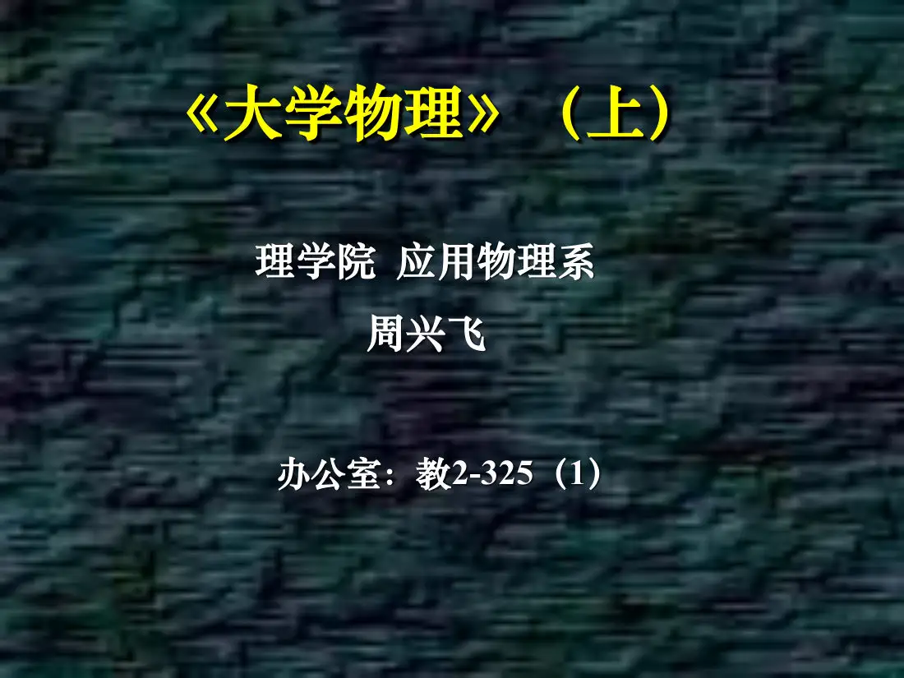
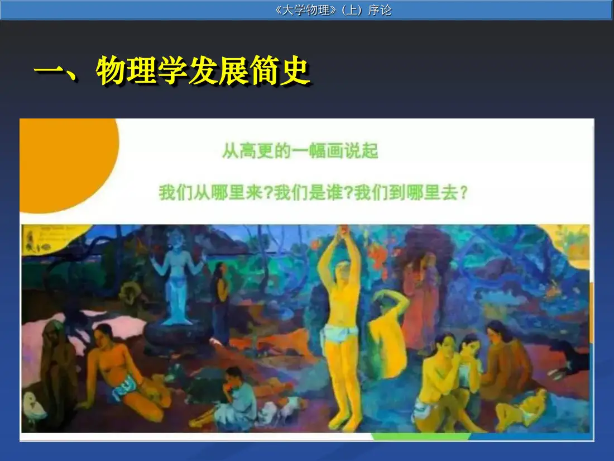
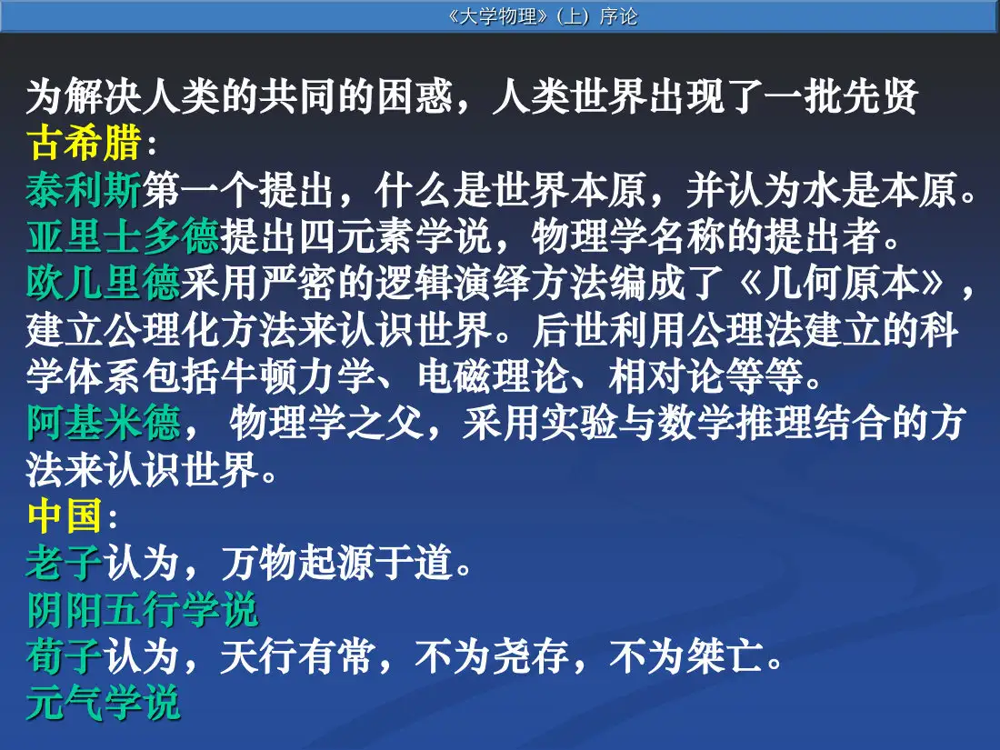
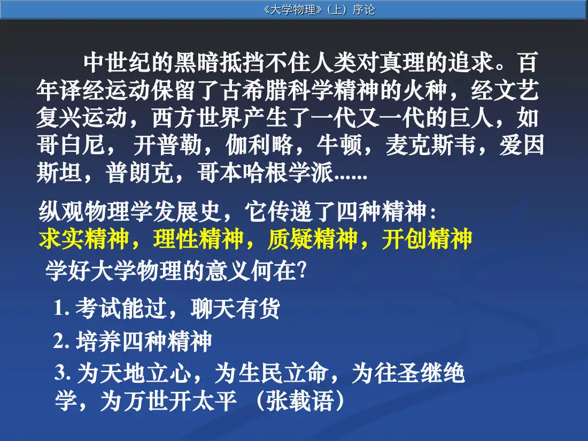
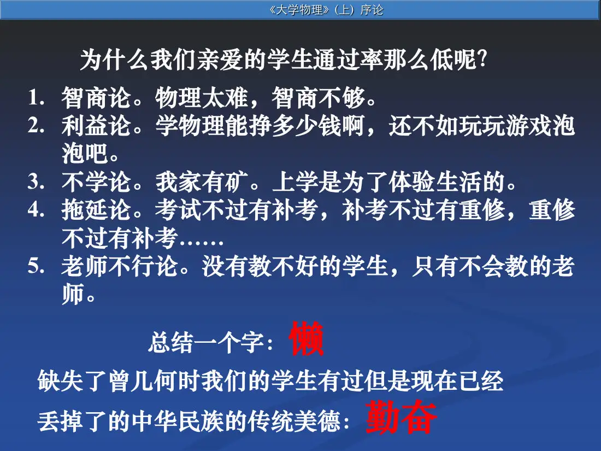
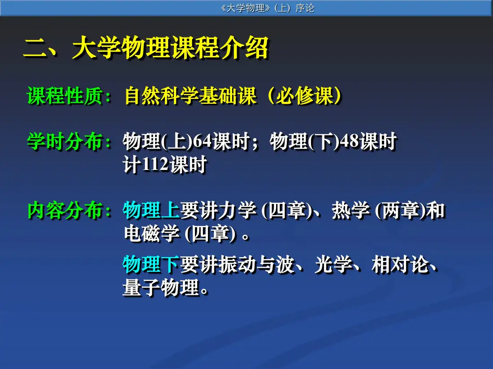
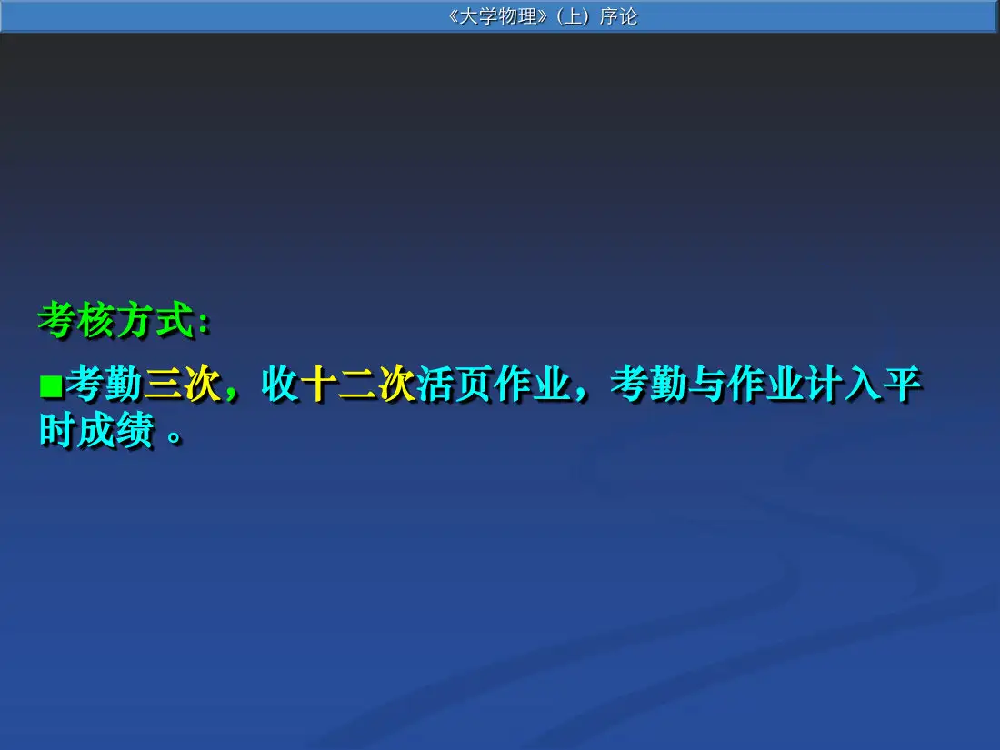

# 《大学物理》（上）绪论（课件）

原件的每一页，下面附识别出的文字。

### 《大学物理》 （上）

原文：

《大学物理》 （上）

理学院 应用物理系

周兴飞

办公室：教2-325（1）

### 一、 物理学发展简史

原文：

一、 物理学发展简史

《作者：杨茂田 大学物理》(上) 序论

### 为解决人类的共同的困惑，人类世界出现了一批先贤古希腊：

原文：

为解决人类的共同的困惑，人类世界出现了一批先贤古希腊：

泰利斯第一个提出，什么是世界本原，并认为水是本原。亚里士多德提出四元素学说，物理学名称的提出者。

欧几里德采用严密的逻辑演绎方法编成了《几何原本》建立公理化方法来认识世界。后世利用公理法建立的科学体系包括牛顿力学、电磁理论、相对论等等。

阿基米德， 物理学之父，采用实验与数学推理结合的方法来认识世界。

中国：老子认为，万物起源于道。阴阳五行学说荀子认为，天行有常，不为尧存，不为桀亡。元气学说

《作者：杨茂田 大学物理》(上) 序论

### 《作者：杨茂田 大学物理》(上) 序论

原文：

《作者：杨茂田 大学物理》(上) 序论

中世纪的黑暗抵挡不住人类对真理的追求。百年译经运动保留了古希腊科学精神的火种，经文艺复兴运动，西方世界产生了一代又一代的巨人，如哥白尼， 开普勒，伽利略，牛顿，麦克斯韦，爱因斯坦，普朗克，哥本哈根学派.

纵观物理学发展史，它传递了四种精神：求实精神，理性精神，质疑精神，开创精神学好大学物理的意义何在？

1. 考试能过，聊天有货

2. 培养四种精神

3. 为天地立心，为生民立命，为往圣继绝学，为万世开太平 （张载语）

### 为什么我们亲爱的学生通过率那么低呢？

原文：

为什么我们亲爱的学生通过率那么低呢？

1. 智商论。物理太难，智商不够。

2. 利益论。学物理能挣多少钱啊，还不如玩玩游戏泡泡吧。

3. 不学论。我家有矿。上学是为了体验生活的。

4. 拖延论。考试不过有补考，补考不过有重修，重修 不过有补考……

5. 老师不行论。没有教不好的学生，只有不会教的老师。

总结一个字：懒

缺失了曾几何时我们的学生有过但是现在已经

丢掉了的中华民族的传统美德：勤奋

《作者：杨茂田 大学物理》(上) 序论

### 二、大学物理课程介绍

原文：

二、大学物理课程介绍

课程性质：自然科学基础课（必修课）

学时分布：物理(上)64课时；物理(下)48课时计112课时

内容分布：物理上要讲力学 (四章)、热学 (两章)和电磁学 (四章) 。

物理下要讲振动与波、光学、相对论、量子物理。

《作者：杨茂田 大学物理》(上) 序论

### 考核方式：

原文：

考核方式：

考勤三次，收十二次活页作业，考勤与作业计入平时成绩 。

《作者：杨茂田 大学物理》(上) 序论
