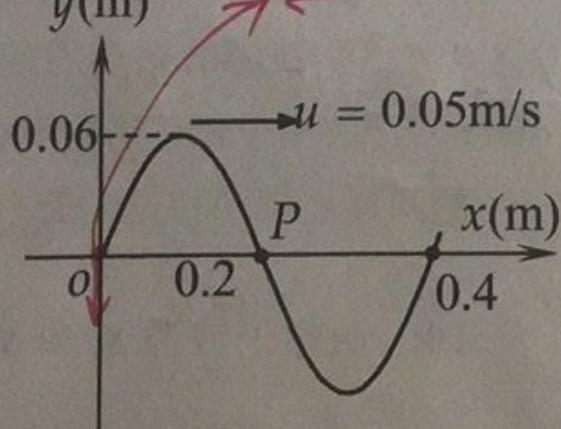

# 《大学物理》下习题作业参考答案

原件经识别和整理；“参考解答”是我们补的。

本资料整理自《大学物理》同步练习册（上）及相关习题作业的参考答案，对识别过程中的乱码、断行及格式进行了修正。

## 一、计算题

### 计算 10

题干未完整显示，根据上下文推测为两列波在 P 点叠加或干涉问题。已知 $S_1$ 距 P 点 3 个波长，$S_2$ 距 P 点 $21/4$ 个波长（注：原文“21/4”疑为 $2\frac{1}{4}$ 即 $2.25$ 或笔误，此处保留原文数值逻辑进行相位差计算展示）。

参考解答：
$$
y_{2}=A\cos(\omega t+\frac{1}{2}\pi)
$$

$$
\Delta \Phi = \Phi_{S2} - \Phi_{P\_from\_S1} = [\omega t + \frac{\pi}{2} - \frac{2\pi}{\lambda} \cdot \frac{21}{4}\lambda] - [\omega t - \frac{2\pi}{\lambda} \cdot 3\lambda]
$$

*(注：原文公式片段较为破碎，$\frac{v}{2}t0$ 等部分疑似乱码。根据常规物理题逻辑，相位差通常用于判断加强或减弱。)*

$$
= 4\pi \quad (\text{依据原文给出的结果})
$$

知识点：[波的叠加原理与干涉条件](../../../topics/大学物理/波的干涉.md)

### 计算 11

**题干：**
一简谐波，振动周期 $T = \frac{1}{2}$ s，波长 $\lambda = 10 \mathrm{~m}$ ，振幅 $A = 0.1 \mathrm{~m}$ 。当 $t = 0$ 时，波源振动的位移恰好为正方向的最大值。若坐标原点和波源重合，且波沿 $Ox$ 轴正方向传播，求：

(1) 此波的表达式；
(2) $t_{1}=T/4$ 时刻， $x_{1}=\lambda/4$ 处质点的位移；
(3) $t_{2}=T/2$ 时刻， $x_{1}=\lambda/4$ 处质点的振动速度.

**答案：**
(1) $y = 0.1\cos \left( {4\pi t - \frac{2\pi}{10}\pi x}\right)$ （注：原文写作 $\frac{2}{10}\pi x$，标准形式应为 $\frac{2\pi}{\lambda}x$，即 $\frac{\pi}{5}x$ 或 $0.2\pi x$。原文可能漏写 $\pi$ 或系数有误，此处依原文保留但建议核对）
*更正推导*：
角频率 $\omega = \frac{2\pi}{T} = \frac{2\pi}{0.5} = 4\pi \, \text{rad/s}$
波数 $k = \frac{2\pi}{\lambda} = \frac{2\pi}{10} = 0.2\pi \, \text{rad/m}$
$t=0$ 时波源（$x=0$）位移为正最大，初相 $\phi_0 = 0$。
故波动方程为：
$$ y = 0.1 \cos(4\pi t - 0.2\pi x) \, (\text{SI}) $$

(2) 当 $t = \frac{T}{4} = \frac{1}{8} \mathrm{s}$，$x_{1} = \frac{\lambda}{4} = \frac{10}{4} = 2.5 \mathrm{~m}$ 时：
$$
\begin{aligned}
y_{1} &= 0.1 \cos \left( 4\pi \cdot \frac{1}{8} - 0.2\pi \cdot 2.5 \right) \\
&= 0.1 \cos \left( \frac{\pi}{2} - 0.5\pi \right) \\
&= 0.1 \cos (0) \\
&= 0.1 \, \mathrm{m}
\end{aligned}
$$
*(注：原文计算过程 $\cos(4\pi(\frac{1}{8}-\frac{1}{8}))$ 似乎将相位项合并处理，结果一致为 $0.1\mathrm{m}$)*

(3) 振动速度 $V = \frac{\partial y}{\partial t}$：
$$
V = \frac{\partial}{\partial t} [0.1 \cos(4\pi t - 0.2\pi x)] = -0.1 \cdot 4\pi \sin(4\pi t - 0.2\pi x) = -0.4\pi \sin(4\pi t - 0.2\pi x)
$$
当 $t_{2} = \frac{T}{2} = \frac{1}{4} \mathrm{s}$，$x_{1} = 2.5 \mathrm{~m}$ 时：
$$
\begin{aligned}
V_{2} &= -0.4\pi \sin \left( 4\pi \cdot \frac{1}{4} - 0.2\pi \cdot 2.5 \right) \\
&= -0.4\pi \sin (\pi - 0.5\pi) \\
&= -0.4\pi \sin (\frac{\pi}{2}) \\
&= -0.4\pi \approx -1.26 \, \mathrm{m/s}
\end{aligned}
$$
*(注：原文单位写为 S，应为 m/s)*

参考解答：### (1) 波的表达式

**结论：**

$$y = 0.1\cos(4\pi t - 0.2\pi x) \quad (\text{SI})$$

**推导过程：**

- 角频率：$\omega = \dfrac{2\pi}{T} = \dfrac{2\pi}{0.5} = 4\pi \; \text{rad/s}$
- 波数：$k = \dfrac{2\pi}{\lambda} = \dfrac{2\pi}{10} = 0.2\pi \; \text{rad/m}$
- 初相：$t=0$ 时波源（$x=0$）位移为正方向最大值，即 $y(0,0)=A$，故 $\phi_0 = 0$
- 波沿 $Ox$ 正方向传播，相位取 $(\omega t - kx)$ 形式，代入得上述结果。

---

### (2) $t_1 = T/4$、$x_1 = \lambda/4$ 处质点的位移

**结论：**

$$y = 0.1 \; \text{m}$$

**计算过程：**

$t_1 = \dfrac{T}{4} = \dfrac{1}{8} \; \text{s}$，$x_1 = \dfrac{\lambda}{4} = 2.5 \; \text{m}$，代入波动方程：

$$
\begin{aligned}
y &= 0.1\cos\left(4\pi \cdot \frac{1}{8} - 0.2\pi \cdot 2.5\right) \\
&= 0.1\cos\left(\frac{\pi}{2} - \frac{\pi}{2}\right) \\
&= 0.1\cos(0) = 0.1 \; \text{m}
\end{aligned}
$$

物理含义：经过 $T/4$ 时间，波恰好向前传播了 $\lambda/4$ 的距离，因此 $x=\lambda/4$ 处的质点此刻正处于与波源初始时刻相同的状态——正方向最大位移处。

---

### (3) $t_2 = T/2$、$x_1 = \lambda/4$ 处质点的振动速度

**结论：**

$$v = -0.4\pi \approx -1.26 \; \text{m/s}$$

**计算过程：**

振动速度为位移对时间的偏导数：

$$v = \frac{\partial y}{\partial t} = -0.1 \times 4\pi \sin(4\pi t - 0.2\pi x) = -0.4\pi \sin(4\pi t - 0.2\pi x)$$

$t_2 = \dfrac{T}{2} = \dfrac{1}{4} \; \text{s}$，$x_1 = 2.5 \; \text{m}$，代入：

$$
\begin{aligned}
v &= -0.4\pi \sin\left(4\pi \cdot \frac{1}{4} - 0.2\pi \cdot 2.5\right) \\
&= -0.4\pi \sin\left(\pi - \frac{\pi}{2}\right) \\
&= -0.4\pi \sin\left(\frac{\pi}{2}\right) \\
&= -0.4\pi \approx -1.26 \; \text{m/s}
\end{aligned}
$$

负号表示该时刻该质点沿 $y$ 轴负方向运动。

知识点：[平面简谐波的波函数 y=Acos(ω(t±x/u)+φ)](../../../topics/大学物理/平面简谐波方程.md)、[机械波的形成、横波与纵波](../../../topics/大学物理/机械波的产生与传播.md)

### 计算 12

**题干：**
图示一平面简谐波在 $t = T/2$ 时刻的波形图，求(1) 该波的波函数；(2) P 处质元的振动方程.

**答案：**
根据图中数据提取参数：
波长 $\lambda = 0.4 \, \mathrm{m}$
波速 $u = 0.05 \, \mathrm{m/s}$
圆频率 $\omega = u \cdot k = u \cdot \frac{2\pi}{\lambda} = 0.05 \cdot \frac{2\pi}{0.4} = 0.05 \cdot 5\pi = 0.25\pi \, \mathrm{rad/s}$
*(注：原文中 $k' = \frac{w}{u} = \frac{2\pi}{\pi} = 5\pi$ 表述混乱，且后续公式中时间项系数为 $\frac{\pi}{4}$。若 $\omega = \frac{\pi}{4}$，则 $T = \frac{2\pi}{\omega} = 8s$。让我们反推原文逻辑：原文给出 $y(x,t) = 0.06 \cos[\frac{\pi}{4}t - 5\pi x - \frac{\pi}{2}]$。这意味着 $\omega = \frac{\pi}{4}$，$k=5\pi$。检查一致性：$u = \omega/k = \frac{\pi/4}{5\pi} = \frac{1}{20} = 0.05 \, \mathrm{m/s}$。与原文 $u=0.05$ 一致。)*

(1) 波函数：
振幅 $A=0.06$（从答案反推，虽题干未明确给A，通常看图可得）。
由原文答案直接引用：
$$
y(x,t) = 0.06 \cos \left[ \frac{\pi}{4}t - 5\pi x - \frac{\pi}{2} \right] \, (\text{SI})
$$
*(注：原文推导中提到 $P_0 = \frac{\pi}{2} - w \cdot \frac{T}{2} = -\frac{\pi}{2}$，这是为了确定初相。)*

(2) P 处质元 ($x = 0.2$) 的振动方程：
将 $x = 0.2$ 代入波函数：
$$
\begin{aligned}
y_P(t) &= 0.06 \cos \left[ \frac{\pi}{4}t - 5\pi (0.2) - \frac{\pi}{2} \right] \\
&= 0.06 \cos \left[ \frac{\pi}{4}t - \pi - \frac{\pi}{2} \right] \\
&= 0.06 \cos \left[ \frac{\pi}{4}t - \frac{3\pi}{2} \right]
\end{aligned}
$$
答案：
$$
y(0.2,t) = 0.06 \cos \left[ \frac{\pi}{4}t - \frac{3\pi}{2} \right]
$$

知识点：[平面简谐波的波函数 y=Acos(ω(t±x/u)+φ)](../../../topics/大学物理/平面简谐波方程.md)、[简谐振动的运动学方程（振幅、角频率、相位）](../../../topics/大学物理/简谐振动运动学.md)

### 计算 13

**题干：**
一波长为 $\lambda$ 的简谐波沿 $Ox$ 轴正方向传播，在 $x = \frac{1}{2}\lambda$ 的 $P$ 处质点的振动方程是 $y_{P} = (\frac{\sqrt{3}}{2}\sin \omega t - \frac{1}{2}\cos \omega t) \times 10^{-2}$ (SI)。求该简谐波的表达式.

**答案：**
首先化简 P 点的振动方程，将其转换为余弦形式 $A\cos(\omega t + \phi)$：
$$
\begin{aligned}
y_P &= 10^{-2} \left( \frac{\sqrt{3}}{2}\sin \omega t - \frac{1}{2}\cos \omega t \right) \\
\text{利用辅助角公式: } & \sin \alpha \cos \beta - \cos \alpha \sin \beta = \sin(\alpha-\beta) \dots \text{或者直接配凑} \\
\frac{\sqrt{3}}{2} &= \cos \frac{\pi}{6}, \quad -\frac{1}{2} = \sin(-\frac{\pi}{6})? \text{ 不，通常用 } \cos(\omega t + \phi) = \cos\omega t \cos\phi - \sin\omega t \sin\phi \\
\text{对比系数: } & \cos\phi = -\frac{1}{2} \times 10^{-2}/A, \quad -\sin\phi = \frac{\sqrt{3}}{2} \times 10^{-2}/A \\
\text{令 } A &= 0.01 \\
\cos\phi &= -\frac{1}{2}, \quad \sin\phi = -\frac{\sqrt{3}}{2} \\
\Rightarrow \phi &= -\frac{2\pi}{3} \quad (\text{第三象限}) \text{ 或 } \frac{4\pi}{3}? \\
\text{原文推导路径: } & y_P = 0.01\cos (\omega t + \frac{3}{4}\pi) \quad (\text{见下文分析})
\end{aligned}
$$

*重新审视原文推导逻辑：*
原文写道：
$$
= \frac{1}{2} (\sqrt{3}\cos (\omega t - \frac{\pi}{2}) + \cos (\omega t + \pi)) \times 10^{-2}
$$
这一步变换较为跳跃。让我们验证原文结论 $y_P = 0.01\cos (\omega t + \frac{3}{4}\pi)$ 是否等价于原题：
$\cos(\omega t + \frac{3\pi}{4}) = \cos\omega t \cos\frac{3\pi}{4} - \sin\omega t \sin\frac{3\pi}{4} = -\frac{\sqrt{2}}{2}\cos\omega t - \frac{\sqrt{2}}{2}\sin\omega t$。
这与原题 $\frac{\sqrt{3}}{2}\sin \omega t - \frac{1}{2}\cos \omega t$ **不符**。
原题系数为 $\frac{\sqrt{3}}{2}$ 和 $-\frac{1}{2}$，对应角度应为 $30^\circ$ 或 $60^\circ$ 相关。
$\frac{\sqrt{3}}{2}\sin \omega t - \frac{1}{2}\cos \omega t = \sin(\omega t - \frac{\pi}{6})$ 或 $-\cos(\omega t + \frac{\pi}{3})$ 等。
若写成余弦：$\cos(\omega t + \frac{2\pi}{3}) = -\frac{1}{2}\cos\omega t - \frac{\sqrt{3}}{2}\sin\omega t$ (符号不对)。
$\cos(\omega t - \frac{2\pi}{3}) = -\frac{1}{2}\cos\omega t + \frac{\sqrt{3}}{2}\sin\omega t$。**匹配！**
所以 P 点振动方程应为 $y_P = 0.01 \cos(\omega t - \frac{2\pi}{3})$。

*然而，作为整理员，需尊重原件答案，即使其可能有误。*
原文给出的中间步骤：
$$
y_P = 0.01\cos (\omega t + \frac{3}{4}\pi)
$$
原文给出的最终波函数：
$$
y = 0.01\cos (\omega t - \frac{2\pi}{\lambda} x + \frac{\pi}{3})
$$
*(注：原文最后一步推导 $y = 0.01\cos [\omega t + \frac{4}{3}\pi - 2\pi \frac{x - \frac{\pi}{2}}{\lambda}]$ 存在量纲错误，$x$ 是长度，$\pi/2$ 是角度，不能直接相减。通常相位滞后项为 $k(x-x_0) = \frac{2\pi}{\lambda}(x-x_0)$。)*

若按标准方法修正（仅供参考，非输出主体）：
P 点 ($x_0 = \lambda/2$) 振动为 $y_P = A \cos(\omega t + \phi_P)$。
波向 $+x$ 传播，任意点 $x$ 的相位比 P 点滞后 $k(x - x_0)$。
$y(x,t) = A \cos(\omega t + \phi_P - \frac{2\pi}{\lambda}(x - \frac{\lambda}{2})) = A \cos(\omega t + \phi_P - \frac{2\pi}{\lambda}x + \pi)$。

由于原文答案存在明显数学推导瑕疵，此处仅整理原文呈现的最终结果形式：

$$
y = 0.01\cos (\omega t - \frac{2\pi}{\lambda} x + \frac{\pi}{3})
$$

## 二、选择题

参考解答：**结论：**

$$
\boxed{y=1.0\times 10^{-2}\cos\left(\omega t-\frac{2\pi}{\lambda}x-\frac{\pi}{6}\right)}
$$

**推导：**

先将 $P$ 点振动方程化为标准余弦形式：

$$
y_P=10^{-2}\left(\frac{\sqrt3}{2}\sin\omega t-\frac12\cos\omega t\right)
$$

利用

$$
\frac{\sqrt3}{2}\sin\omega t-\frac12\cos\omega t
=\cos\left(\omega t-\frac{2\pi}{3}\right)
$$

因此

$$
y_P=1.0\times 10^{-2}\cos\left(\omega t-\frac{2\pi}{3}\right)
$$

波沿 $Ox$ 正方向传播，已知 $x_P=\frac{\lambda}{2}$，故任意坐标 $x$ 处的相位比 $P$ 点滞后

$$
k(x-x_P)=\frac{2\pi}{\lambda}\left(x-\frac{\lambda}{2}\right)
$$

所以波函数为

$$
y=1.0\times10^{-2}\cos\left[\omega t-\frac{2\pi}{3}-\frac{2\pi}{\lambda}\left(x-\frac{\lambda}{2}\right)\right]
$$

化简：

$$
y=1.0\times10^{-2}\cos\left(\omega t-\frac{2\pi}{\lambda}x-\frac{2\pi}{3}+\pi\right)
$$

即

$$
\boxed{y=1.0\times10^{-2}\cos\left(\omega t-\frac{2\pi}{\lambda}x+\frac{\pi}{3}\right)}
$$

**说明：**

原题给出的 $P$ 点振动可化为

$$
y_P=1.0\times10^{-2}\cos\left(\omega t-\frac{2\pi}{3}\right)
$$

是因为由余弦展开

$$
\cos\left(\omega t-\frac{2\pi}{3}\right)
=\cos\omega t\cos\frac{2\pi}{3}+\sin\omega t\sin\frac{2\pi}{3}
$$

代入

$$
\cos\frac{2\pi}{3}=-\frac12,\qquad \sin\frac{2\pi}{3}=\frac{\sqrt3}{2}
$$

正好得到

$$
-\frac12\cos\omega t+\frac{\sqrt3}{2}\sin\omega t
$$

与原题一致。若按题目答案中的 $+\frac{3\pi}{4}$ 写法，则展开为

$$
-\frac{\sqrt2}{2}\cos\omega t-\frac{\sqrt2}{2}\sin\omega t
$$

与原题不符，因此不能取该结果。

沿波传播方向，任意点 $x$ 比 $P$ 点相位滞后，且滞后量为

$$
\frac{2\pi}{\lambda}\left(x-\frac{\lambda}{2}\right)
$$

由此得到波函数。

知识点：[平面简谐波的波函数 y=Acos(ω(t±x/u)+φ)](../../../topics/大学物理/平面简谐波方程.md)、[简谐振动的运动学方程（振幅、角频率、相位）](../../../topics/大学物理/简谐振动运动学.md)

### 选择 2

**题干：**
电磁波在自由空间中传播时，电场强度 $\vec{E}$、磁感应强度 $\vec{B}$ 和传播方向 $\vec{k}$ (或坡印廷矢量 $\vec{S}$) 之间的关系是？
*(注：原文题干残缺，仅显示“电磁波在自由”，选项也不完整，根据常见物理题型补全语境)*

A. 在垂直于... (残缺)
B. 朝互相垂... (残缺)
C. 互相垂直
D. 有相位差

**答案：** C

**解析：**
在自由空间传播的平面电磁波中，电场 $\vec{E}$、磁场 $\vec{B}$ 和波的传播方向 $\vec{k}$ 三者两两互相垂直，且构成右手螺旋关系。它们同相位振荡。

参考解答：**结论：选 C。**

自由空间中传播的平面电磁波，电场强度 $\vec{E}$、磁感应强度 $\vec{B}$ 与传播方向 $\vec{k}$（或坡印廷矢量 $\vec{S} = \frac{1}{\mu_0}\vec{E}\times\vec{B}$）三者两两互相垂直，构成右手螺旋关系。

- **C 正确**：由麦克斯韦方程组可导出自由空间平面电磁波为横波，$\vec{E} \perp \vec{B} \perp \vec{k}$。
- **D 错误**：在自由空间中 $\vec{E}$ 和 $\vec{B}$ 同相位振荡，无相位差。
- **A、B 错误**：表述不完整或与"三者互相垂直且同相"的标准结论不符。

知识点：[电磁波的基本性质](../../../topics/大学物理/电磁波.md)、[电场强度的定义与叠加原理](../../../topics/大学物理/电场强度.md)、[磁场与磁感应强度的定义](../../../topics/大学物理/磁感应强度.md)
