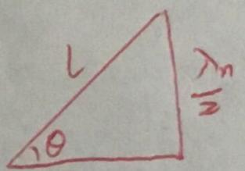

# 《大学物理》下习题作业参考答案（第12页）

原件经识别和整理；“参考解答”是我们补的。

## 计算 3

在牛顿环实验中，当透镜与玻璃间充满某种液体时，第 10 个亮环的直径由 $1.4 \times 10^{-2}$ m 变为 $1.27 \times 10^{-2}$ m，试求这种液体的折射率。

$$
r = \sqrt{\left(k - \frac{1}{2}\right) R \lambda}, \quad k = 1, 2, \dots
$$

$$
\left\{
\begin{array}{l}
\Delta = 2nd + \frac{\lambda}{2} = \frac{n r^2}{R} + \frac{\lambda}{2} = k\lambda \\
r^2 = 2dR - d^2 = 2dR
\end{array}
\right.
$$

空气：

$$
r_{10} = \sqrt{\frac{\left(10 - \frac{1}{2}\right) R \lambda}{1}} = 1.4 \times 10^{-2}\ \text{m}
$$

液体：

$$
r_{10}' = \sqrt{\frac{\left(10 - \frac{1}{2}\right) R \lambda}{n}} = 1.27 \times 10^{-2}\ \text{m}
$$

$$
n = \frac{1.4^2}{1.27^2} = 1.215
$$

## 计算 4

折射率为 1.60 的两块标准平面玻璃板之间形成一个劈形膜（劈尖角 $\theta$ 很小）。用波长 $\lambda = 600\ \text{nm}$（$1\ \text{nm} = 10^{-9}\ \text{m}$）的单色光垂直入射，产生等厚干涉条纹。假如在劈形膜内充满 $n = 1.40$ 的液体时的相邻明纹间距比劈形膜内是空气时的间距缩小 $\Delta l = 0.5\ \text{mm}$。求：(1) 两种情况下相邻两明纹厚度差之比；(2) 劈尖角 $\theta$。

(1)

$$
\frac{\frac{\lambda}{2}}{\frac{\lambda}{2n}} = n = 1.4
$$

(2)

$$
\frac{\lambda}{2\theta} - \frac{\lambda}{2n\theta} = \Delta l
$$

$$
\begin{array}{rl}
\Rightarrow \theta &= \frac{\lambda}{2}\left(1 - \frac{1}{n}\right) \cdot \frac{1}{\Delta l} \\
&= \frac{600 \times 10^{-9}}{2}\left(1 - \frac{1}{1.4}\right) \cdot \frac{1}{0.5 \times 10^{-3}} \\
&= 1.7 \times 10^{-4}\ \text{rad} \\
&= 0.0098^\circ
\end{array}
$$
