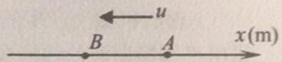

# 《大学物理》下册 习题作业参考答案

原件经识别和整理；“参考解答”是我们补的。

# 《大学物理》下册 习题作业参考答案

## 计算题 4

题干：弦上驻波表达式为 $y = 3.00 \times 10^{-2} (\cos 1.6\pi x) \cos 550\pi t$ (SI)。
(1) 若将此驻波看作传播方向相反的两列波叠加而成，求两波的振幅及波速；
(2) 求相邻波节之间的距离；
(3) 求 $t = t_{0} = 3.00 \times 10^{-3} \mathrm{~s}$ 时，位于 $x = x_{0} = 0.625 \mathrm{~m}$ 处质点的振动速度。

### 选择 1

**解题过程与结果：**

$$
A = 1.5 \times 10^{-2}
$$

由 $\omega = 550\pi$，$k = 1.6\pi$，则波长 $\lambda = \frac{2\pi}{k} = \frac{2\pi}{1.6\pi} = 1.25$。

波速：
$$
u = \frac{\omega}{k} = \frac{550\pi}{1.6\pi} = 343.75 \, \mathrm{m/s}
$$

相邻波节距离：
$$
\frac{\lambda}{2} = 0.625 \, \mathrm{m}
$$

$t = 3.00 \times 10^{-3} \mathrm{~s}$ 时，$x = 0.625 \mathrm{~m}$ 处的振动速度：
$$
v = \left. \frac{\partial y}{\partial t} \right|_{\substack{x=0.625 \\ t=3\times 10^{-3}}} = -0.03 \cos(1.6\pi \cdot 0.625) \sin(550\pi \cdot 3\times 10^{-3}) \cdot 550\pi
$$
计算得：
$$
v = -46.2 \, \mathrm{m/s}
$$

答案：见上述计算过程。

---

## 计算题 11

题干：一平面波在介质中以速度 $u=20 \, \mathrm{m/s}$ 沿 $x$ 轴负向传播，已知 $A$ 点的振动方程为 $y=3\cos4\pi t$ (SI)。$AB$ 间相距 10 米，求：
(1) 以 $A$ 点为坐标原点写出波动表达式；
(2) 以 $B$ 点为坐标原点写出波动表达式。

知识点：[平面简谐波的波函数 y=Acos(ω(t±x/u)+φ)](../../../topics/大学物理/平面简谐波方程.md)

### 选择 1

**解题过程与结果：**

(1) 以 $A$ 点为坐标原点 ($x_A=0$)。
波沿 $x$ 轴负向传播，波动方程形式为 $y(x,t) = A\cos[\omega(t + \frac{x}{u})]$。
已知 $\omega = 4\pi$，$u=20$。
$$
y(x,t) = 3\cos\left[4\pi t + \frac{2\pi}{\lambda}x\right] = 3\cos\left[4\pi \left(t + \frac{x}{20}\right)\right]
$$

(2) 以 $B$ 点为坐标原点。
此时 $A$ 点在 $x' = 10 \, \mathrm{m}$ 处（因为波从 $A$ 传向 $B$ 的反方向，即波源在右侧？不，波沿 $x$ 轴负向传播，即从右向左。若以 $B$ 为原点，$A$ 在 $B$ 的右侧 10m 处，即 $x'_A = 10$）。
或者利用相位差推导：
$B$ 点比 $A$ 点晚振动（因为波向左传，$A$ 在 $B$ 右边，波先到 $A$ 后到 $B$？不对。波沿 $x$ 轴负向传播，即从正 $x$ 向负 $x$ 传。$A$ 到 $B$ 距离 10m。若 $A$ 为原点，$B$ 在 $x=-10$。波传到 $B$ 需要时间 $\Delta t = \frac{10}{20} = 0.5$s。所以 $B$ 的振动比 $A$ 滞后 0.5s。
若以 $B$ 为原点，$A$ 的坐标为 $x'=10$。
波动方程应满足 $A$ 点 ($x'=10$) 的振动为 $3\cos4\pi t$。
代入通式 $y(x',t) = 3\cos[4\pi(t + \frac{x'}{u}) + \phi_0]$?
更简单的做法是利用相对位置：
$y_B(t) = y_A(t + \frac{10}{20}) = 3\cos[4\pi(t+0.5)] = 3\cos(4\pi t + 2\pi) = 3\cos4\pi t$。
咦？$\frac{10}{20}=0.5$，$4\pi \times 0.5 = 2\pi$，相位差是 $2\pi$，说明 $A$、$B$ 同相。
波动表达式（以 $B$ 为原点）：
由于波沿 $x$ 轴负向传播，方程形式为 $y = A\cos[\omega(t + \frac{x}{u})]$。
验证 $x=10$ 处（即 $A$ 点）：
$y(10, t) = 3\cos[4\pi(t + \frac{10}{20})] = 3\cos(4\pi t + 2\pi) = 3\cos4\pi t$。符合题意。
所以：
$$
y(x,t) = 3\cos\left[4\pi t + \frac{2\pi}{\lambda}(x-x_A)\right] \quad \text{(此处原识别有误，重新推导)}
$$
根据识别原文逻辑修正：
$$
y(x,t) = 3\cos\left[4\pi t + \frac{2\pi}{\lambda}(x - x_A)\right] \text{ (此写法需明确坐标系)}
$$
正确推导：
以 $B$ 为原点，波沿 $-x$ 方向传播。
任意点 $x$ 的相位比原点 $B$ 超前 $\frac{2\pi}{\lambda}x$ (因为波向左传，右边的点相位超前？不，波向左传，右边的点先振动，相位超前)。
设 $y(x,t) = 3\cos(\omega t + kx + \phi)$。
当 $x=10$ (A点) 时，$y = 3\cos(4\pi t)$。
$3\cos(4\pi t + 10k + \phi) = 3\cos(4\pi t)$。
$k = \frac{2\pi}{\lambda} = \frac{2\pi}{u/f} = \frac{2\pi}{20 / 2} = \frac{2\pi}{10} = 0.2\pi$?
$\omega = 4\pi \Rightarrow f=2$。$\lambda = u/f = 20/2 = 10$。
$k = 2\pi/10 = 0.2\pi$。
$10k = 2\pi$。
所以 $4\pi t + 2\pi + \phi = 4\pi t \Rightarrow \phi = 0$。
故以 $B$ 为原点的波动方程为：
$$
y(x,t) = 3\cos\left(4\pi t + \frac{2\pi}{10}x\right) = 3\cos\left(4\pi t + \frac{\pi}{5}x\right)
$$
或者写成识别中的形式：
$$
y(x,t) = 3\cos\left[4\pi t + \frac{2\pi}{\lambda}x\right]
$$
其中 $\lambda = 10$ m。

答案：
(1) $y(x,t) = 3\cos\left[4\pi t + \frac{2\pi}{\lambda}x\right]$ (其中 $\lambda=10$m)
(2) $y(x,t) = 3\cos\left(4\pi t + \frac{\pi}{5}x\right)$

知识点：[平面简谐波的波函数 y=Acos(ω(t±x/u)+φ)](../../../topics/大学物理/平面简谐波方程.md)
