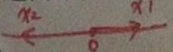
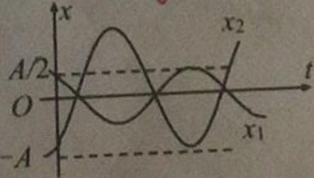
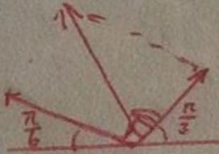

# 《大学物理》下册 第二节 振动能量和振动的合成 习题参考答案

原件经识别和整理；“参考解答”是我们补的。

# 第二节 振动能量和振动的合成

## 一、选择题

### 选择 1

题干：一弹簧振子作简谐振动，总能量为 $E_{1}$，如果简谐振动振幅增加为原来的两倍，重物的质量增为原来的四倍，则它的总能量 $E_{2}$ 变为 [D]
A. $E_{1}/4$
B. $E_{1}/2$
C. $2E_{1}$
D. $4E_{1}$

答案：D。
知识点：[简谐振动的动能、势能与总机械能](../../../topics/大学物理/简谐振动的能量.md)

### 选择 2

题干：弹簧振子在光滑水平面上作简谐振动时，弹性力在半个周期内所作的功为 [D]
A. $kA^{2}$
B. $\frac{1}{2}kA^{2}$
C. $(1/4)kA^{2}$
D. 0

答案：D。
知识点：[简谐振动的动能、势能与总机械能](../../../topics/大学物理/简谐振动的能量.md)、[保守力及其势能、中心力场与有效势](../../../topics/大学物理/保守力与势能.md)

### 选择 3

题干：一弹簧振子作简谐振动，当位移为振幅的一半时，其动能为总能量的 [D]
A. 1/4
B. 1/2
C. $1/\sqrt{2}$
D. 3/4

答案：D。
知识点：[简谐振动的动能、势能与总机械能](../../../topics/大学物理/简谐振动的能量.md)、[简谐振动的动力学特征与回复力](../../../topics/大学物理/简谐振动的动力学.md)

### 选择 4

题干：一质点作简谐振动，已知振动周期为 T，则其振动动能变化的周期是 [B]
(A) T/4
(B) T/2
(C) T
(D) 2T

答案：B。
知识点：[简谐振动的动能、势能与总机械能](../../../topics/大学物理/简谐振动的能量.md)、[简谐振动的运动学方程（振幅、角频率、相位）](../../../topics/大学物理/简谐振动运动学.md)

### 选择 5

题干：图中所画的是两个简谐振动的振动曲线。若可叠加，则合成的余弦振动的初相为 [B]
A. $\frac{3}{2}\pi$
B. $\pi$
C. $\frac{1}{2}\pi$
D. 0

答案：B。
知识点：[同方向同频率简谐振动的合成](../../../topics/大学物理/简谐振动的合成.md)、[简谐振动的运动学方程（振幅、角频率、相位）](../../../topics/大学物理/简谐振动运动学.md)、[用旋转矢量法确定初相与运动状态](../../../topics/大学物理/旋转矢量法.md)

### 填空 6

题干：两根轻弹簧的倔强系数分别为 $k_{1}$ 和 $k_{2}$，串联后与物体相接做简谐振动，则此系统的固有频率为 $\nu$ 等于 \_\_\_\_。

答案：$\frac{1}{2\pi}\sqrt{\frac{k_{1}k_{2}}{m(k_{1}+k_{2})}}$。
订正：原题识别出的分母为 $k_{1}^{2}+k_{2}$ 是错误的。弹簧串联的等效劲度系数 $k$ 满足 $\frac{1}{k} = \frac{1}{k_1} + \frac{1}{k_2}$，即 $k = \frac{k_1 k_2}{k_1 + k_2}$。固有频率 $\nu = \frac{1}{2\pi}\sqrt{\frac{k}{m}} = \frac{1}{2\pi}\sqrt{\frac{k_1 k_2}{m(k_1+k_2)}}$。

知识点：[简谐振动的运动学方程（振幅、角频率、相位）](../../../topics/大学物理/简谐振动运动学.md)

### 填空 7

题干：一物体同时参与同一直线上的两个简谐振动：
$x_{1}=0.05\cos(4\pi t+\frac{1}{3}\pi)$ (SI), $x_{2}=0.03\cos(4\pi t-\frac{2}{3}\pi)$ (SI), 则合成振动的振幅为 \_\_\_\_ m。

答案：0.02。
知识点：[同方向同频率简谐振动的合成](../../../topics/大学物理/简谐振动的合成.md)

### 填空 8

题干：两个振动方向、振幅、频率均相同的简谐运动相遇叠加，测得某一时刻两个振动的位移都为零时，运动方向相反，则这两个振动相位之差为 \_\_\_\_。合振幅为 \_\_\_\_。

答案：$\pi$；0。
知识点：[同方向同频率简谐振动的合成](../../../topics/大学物理/简谐振动的合成.md)

### 填空 9

题干：将频率为 400Hz 的标准音叉和一待测频率的音叉同时振动，测得拍频为 2.0Hz，将频率为 405Hz 的标准音叉与待测音叉同时振动，测得拍频为 3.0Hz，则待测音叉的频率为 \_\_\_\_ Hz。

答案：402。
知识点：[波的叠加原理与干涉条件](../../../topics/大学物理/波的干涉.md)

### 计算 10

题干：已知两个同方向、同频率的简谐运动的方程分别为：
$x_{1} = 0.06 \cos (2 \pi t + \frac {\pi}{3}) (m)$
$x_{2} = 0.08 \cos (2 \pi t + \frac {5 \pi}{6})$
求它们的合振动的振幅和初相位。

答案：振幅 $A = 0.1$ m，初相位 $\Phi = 113^{\circ}$ (或约 $1.97$ rad)。
知识点：[简谐振动的运动学方程（振幅、角频率、相位）](../../../topics/大学物理/简谐振动运动学.md)、[用旋转矢量法确定初相与运动状态](../../../topics/大学物理/旋转矢量法.md)、[同方向同频率简谐振动的合成](../../../topics/大学物理/简谐振动的合成.md)
