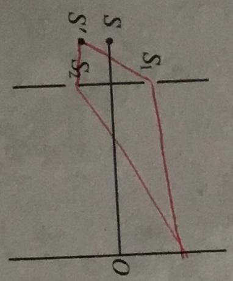
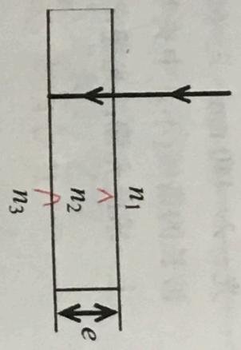

# 《大学物理》下册活页习题解答（光学部分）

原件经识别和整理；“参考解答”是我们补的。

# 《大学物理》下册活页习题解答（光学部分）

本资料由识别工具读取《大学物理》下册活页习题解答（光学部分）整理而成，已修正明显的识别错误、断行及乱码，并规范了公式与选项格式。

## 一、选择题（每小题若干分）

### 选择 1

题干：$t_{g}i_0 = n_2/n_1$，即反射光与折射面振动的完全偏振光，折射面振动大于平行入射面振动部分，振动小于平行入射面振动部分。普通折射定律，为垂直自己主满足普通的折射定律，为平行。

- (A) 完全线偏振光且折射角是 $30^{\circ}$
- (B) 部分偏振光且只是在该光由真空入射到折射率为 $\sqrt{3}$ 的

答案：未提供原件答案，根据布儒斯特角原理推断应为 (A)。
知识点：[自然光与偏振光、马吕斯定律与布儒斯特定律](../../../topics/大学物理/光的偏振.md)

### 选择 2

题干：如图所示，折射率为 $n_2$、厚度为 $e$ 的透明介质薄膜的上方和下方的透明介质的折射率分别为 $n_1$ 和 $n_3$，已知 $n_1 < n_2 < n_3$。若用波长为 $\lambda$ 的单色平行光垂直入射到该薄膜上，则从薄膜上、下两表面反射的光束的光程差是

- (A) $2n_2e$
- (B) $2n_2e + \lambda/2$
- (C) $2n_2e - \lambda/2$
- (D) $2n_2e + \lambda$

答案：(B)
知识点：[等倾干涉与等厚干涉（劈尖、牛顿环）](../../../topics/大学物理/薄膜干涉.md)、[光程、光程差与反射时的半波损失](../../../topics/大学物理/光程与半波损失.md)

### 选择 3

题干：在迈克耳孙干涉仪的一条光路中，放入一折射率为 $n$，厚度为 $d$ 的透明薄片，放入后，这条光路的光程改变了

- (A) $(n-1)d$
- (B) $2(n-1)d$
- (C) $nd$
- (D) $2nd$

答案：(B)
知识点：[光程、光程差与反射时的半波损失](../../../topics/大学物理/光程与半波损失.md)

### 选择 4

题干：在单缝夫琅禾费衍射实验中，波长为 $\lambda$ 的单色光垂直入射在宽度为 $a=4\lambda$ 的单缝上，对应于衍射角为 $30^{\circ}$ 的方向，单缝处波阵面可分成的半波带数目为

- (A) 2个
- (B) 4个
- (C) 6个
- (D) 8个

答案：(B)
知识点：[单缝衍射的暗纹条件与中央明纹宽度](../../../topics/大学物理/单缝夫琅禾费衍射.md)

### 选择 5

题干：如图所示，光源 S 向下移动到示意图中的...（原文残缺，推测为关于偏振光或干涉的图示题）

- (A) ...
- (B) ...
- (C) ...
- (D) ...

答案：未提供完整题干与选项，无法作答。
补充：原文此处识别混乱，缺失关键描述。

知识点：[自然光与偏振光、马吕斯定律与布儒斯特定律](../../../topics/大学物理/光的偏振.md)

### 选择 6

题干：ABCD 为一块方解石的一个截面，AB 为垂直于纸面的晶体平面与纸面的交线。光轴方向在纸面内且与 AB 成一锐角 $\theta$，如图所示。一束平行的单色自然光垂直于 AB 端面入射。在方解石内折射光分解为 o 光和 e 光。

- (A) 传播方向相同，电场强度的振动方向互相平行
- (B) 传播方向相同，电场强度的振动方向互相垂直
- (C) 传播方向不同，电场强度的振动方向互相垂直
- (D) 传播方向不同，电场强度的振动方向不互相垂直

答案：(C)
知识点：[自然光与偏振光、马吕斯定律与布儒斯特定律](../../../topics/大学物理/光的偏振.md)
