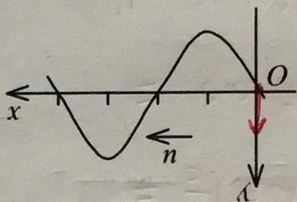
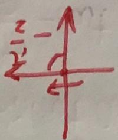
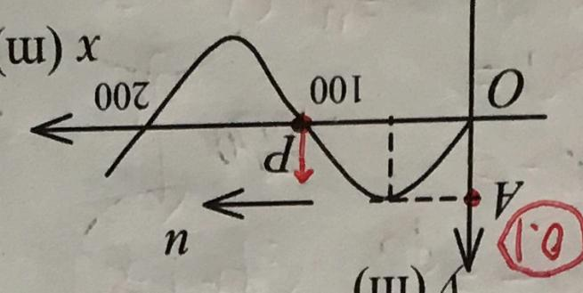
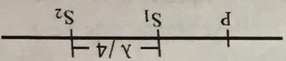
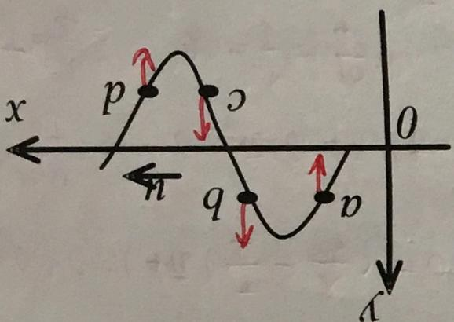

# 《大学物理》下册活页作业解答（机械波章节）

原件经识别和整理；“参考解答”是我们补的。

## 机械波

### 选择 1

机械波的表达式为 $y = 0.03\cos 6\pi (t + 0.01x)$（SI），则（　）

- A. 其振幅为 3 m
- B. 其周期为 $\frac{1}{3}$ s
- C. 其波速为 10 m/s
- D. 波沿 $x$ 轴正向传播

参考解答：**结论：选 B。**

将波动表达式展开为标准形式：

$$y = 0.03\cos(6\pi t + 0.06\pi x)$$

与标准形式 $y = A\cos(\omega t \pm kx)$ 对比，可得各参数：

- **振幅**：$A = 0.03 \text{ m}$
- **角频率**：$\omega = 6\pi \text{ rad/s}$，故周期 $T = \dfrac{2\pi}{\omega} = \dfrac{2\pi}{6\pi} = \dfrac{1}{3} \text{ s}$
- **波数**：$k = 0.06\pi \text{ rad/m}$，故波速 $v = \dfrac{\omega}{k} = \dfrac{6\pi}{0.06\pi} = 100 \text{ m/s}$
- **传播方向**：$t$ 与 $x$ 项同号（均为正），表示波沿 $x$ 轴**负向**传播。

**各选项判断：**

- **A 错误**：振幅为 $0.03\text{ m}$，而非 $3\text{ m}$。
- **B 正确**：由 $\omega = 6\pi$ 算得 $T = \frac{1}{3}\text{ s}$。
- **C 错误**：波速为 $100\text{ m/s}$，而非 $10\text{ m/s}$。
- **D 错误**：相位中 $t$ 和 $x$ 同号，波沿 $x$ 轴负向传播，而非正向。

知识点：[平面简谐波的波函数 y=Acos(ω(t±x/u)+φ)](../../../topics/大学物理/平面简谐波方程.md)、[机械波的形成、横波与纵波](../../../topics/大学物理/机械波的产生与传播.md)

### 选择 2

在简谐波传播过程中，沿传播方向相距为 $\frac{1}{2}\lambda$（$\lambda$ 为波长）的两点的振动速度必定（　）

- A. 大小相同，方向相反
- B. 大小和方向均相同
- C. 大小不同，方向相同
- D. 大小不同，方向相反

答案：A

知识点：[平面简谐波的波函数 y=Acos(ω(t±x/u)+φ)](../../../topics/大学物理/平面简谐波方程.md)

### 选择 3

一平面简谐波在 $t = 0$ 时刻的波形曲线如图所示，则 O 点的振动初相 $\phi$ 为（　）

- A. $0$
- B. $\frac{1}{2}\pi$
- C. $\pi$
- D. $\frac{3}{2}\pi$（或 $-\frac{1}{2}\pi$）

参考解答：**选 D。**

设波沿 $x$ 轴正方向传播，波函数为

$$
y=A\cos(\omega t-kx+\varphi).
$$

$t=0$ 时，O 点位于平衡位置，故 $y_O=0$，即

$$
\cos\varphi=0.
$$

又因波形在 O 点随 $x$ 增大而下降，有 $\left.\dfrac{\partial y}{\partial x}\right|_O<0$，所以

$$
v_O=\left.\frac{\partial y}{\partial t}\right|_O=-A\omega\sin\varphi>0,
$$

即 O 点正沿 $y$ 轴正方向运动，故 $\sin\varphi<0$。因此

$$
\boxed{\varphi=\frac{3\pi}{2}\ \left(\text{或 }-\frac{\pi}{2}\right)}.
$$

其余选项中，A、C 对应 O 点位移为 $\pm A$，与波形不符；B 对应 O 点向负方向运动，也不符。

知识点：[平面简谐波的波函数 y=Acos(ω(t±x/u)+φ)](../../../topics/大学物理/平面简谐波方程.md)、[简谐振动的运动学方程（振幅、角频率、相位）](../../../topics/大学物理/简谐振动运动学.md)、[用旋转矢量法确定初相与运动状态](../../../topics/大学物理/旋转矢量法.md)

### 选择 4

一平面简谐波在弹性介质中传播，在某一瞬时介质中某质元正处于平衡位置，此时其能量（　）

- A. 动能为零，势能最大
- B. 动能为零，势能为零
- C. 动能最大，势能最大
- D. 动能最大，势能为零

答案：C

知识点：[波动过程中的能量传播与能流密度](../../../topics/大学物理/波的能量.md)

### 选择 5

图示一简谐波在 $t = 0$ 时刻的波形图，波速 $u = 200\ \mathrm{m/s}$，则 P 处质点的振动速度表达式为（　）

- A. $v = -0.2\pi \cos(2\pi t - \pi)$
- B. $v = -0.2\pi \cos(\pi t - \pi)$
- C. $v = 0.2\pi \cos(2\pi t - \pi/2)$
- D. $v = 0.2\pi \cos(\pi t - 3\pi/2)$

答案：A

知识点：[平面简谐波的波函数 y=Acos(ω(t±x/u)+φ)](../../../topics/大学物理/平面简谐波方程.md)、[简谐振动的运动学方程（振幅、角频率、相位）](../../../topics/大学物理/简谐振动运动学.md)

### 选择 6

如图所示，两相干波源 $S_1$ 和 $S_2$ 相距 $\lambda/4$（$\lambda$ 为波长），$S_1$ 的相位比 $S_2$ 的相位超前 $0.5\pi$，在 $S_1$、$S_2$ 的连线上，$S_1$ 外侧各点（例如 P 点）两波引起的两简谐振动的相位差是（　）

- A. $0$
- B. $\frac{1}{2}\pi$
- C. $\pi$
- D. $\frac{3}{2}\pi$

答案：B

知识点：[平面简谐波的波函数 y=Acos(ω(t±x/u)+φ)](../../../topics/大学物理/平面简谐波方程.md)、[波的叠加原理与干涉条件](../../../topics/大学物理/波的干涉.md)

### 选择 7

一简谐波在空气中的波长是 0.25 m，传播速度是 340 m/s，当它进入另一介质时，波长变成了 0.37 m，它在该介质中传播速度为（　）

参考解答：**503.2 m/s**

简谐波从一种介质进入另一种介质时，频率 $f$ 保持不变。由波速公式 $v = \lambda f$ 可得：
$$
\frac{v_1}{\lambda_1} = \frac{v_2}{\lambda_2}
$$
代入已知数据 $\lambda_1 = 0.25\,\text{m}$，$v_1 = 340\,\text{m/s}$，$\lambda_2 = 0.37\,\text{m}$，解得：
$$
v_2 = v_1 \cdot \frac{\lambda_2}{\lambda_1} = 340 \times \frac{0.37}{0.25} = 503.2\,\text{m/s}
$$
若误认为波速不变而选 340 m/s，或误用波长反比关系计算，均因忽略了“频率恒定”这一核心物理条件而导致错误。

知识点：[平面简谐波的波函数 y=Acos(ω(t±x/u)+φ)](../../../topics/大学物理/平面简谐波方程.md)、[机械波的形成、横波与纵波](../../../topics/大学物理/机械波的产生与传播.md)

### 选择 8

已知一列波在 $t$ 时刻的波形如图所示。试分别在图上注明所示的 a、b、c、d 四点此时的运动速度的方向（设为横波）。

参考解答：a、b、c、d 四点的运动速度方向分别为：**向上、向下、向下、向上**。

横波中质点振动速度方向可由波形斜率与波传播方向共同判断：$v_y \propto -\frac{\partial y}{\partial x}$（设波沿 $x$ 正方向传播）。图中波形在 a 点处斜率为负，故 $v_y > 0$（向上）；b 点斜率为正，故 $v_y < 0$（向下）；c 点斜率为正，故 $v_y < 0$（向下）；d 点斜率为负，故 $v_y > 0$（向上）。若波沿 $x$ 负方向传播，则所有方向相反，但题目未指明传播方向时默认按常规取 $+x$ 方向，且图示波形符合该约定。

知识点：[机械波的形成、横波与纵波](../../../topics/大学物理/机械波的产生与传播.md)、[平面简谐波的波函数 y=Acos(ω(t±x/u)+φ)](../../../topics/大学物理/平面简谐波方程.md)

### 选择 9

已知波源的振动周期为 $4.00 \times 10^{-2}\ \mathrm{s}$，波的传播速度为 $300\ \mathrm{m/s}$，波沿 $x$ 轴正方向传播，则位于 $x_1 = 10.0\ \mathrm{m}$ 和 $x_2 = 16.0\ \mathrm{m}$ 的两质点振动相位差为

$$\Delta\varphi = \frac{2\pi}{\lambda}(x_2 - x_1) = \frac{2\pi}{12}\times 6 = \pi$$

参考解答：**答案：$\boxed{\pi}$**（即 $180^\circ$，两质点振动状态相反）。

波源振动周期为

$$
T=4.00\times10^{-2}\ \mathrm{s},
$$

由

$$
\lambda=vT=300\times4.00\times10^{-2}=12.0\ \mathrm{m}.
$$

对于沿 $x$ 轴正方向传播的波，相距 $\Delta x=x_2-x_1=6.0\ \mathrm{m}$ 的两质点相位差为

$$
\Delta\varphi=\frac{2\pi}{\lambda}\Delta x
=\frac{2\pi}{12.0}\times6.0
=\pi.
$$

两质点间距离恰为半个波长，因此相位差为 $\pi$；若振动初相位相同，则它们的位移和速度均相反。

知识点：[平面简谐波的波函数 y=Acos(ω(t±x/u)+φ)](../../../topics/大学物理/平面简谐波方程.md)
