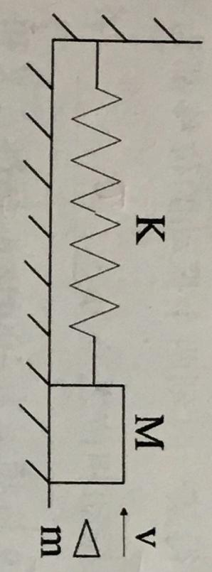

# 《大学物理》下册活页练习题解答（第11-12题）

原件经识别和整理；“参考解答”是我们补的。

---
title: 《大学物理》下册活页练习题解答（第11-12题）
kind: 答案
course: 大学物理
source: 《大学物理》下册活页练习题
---

# 《大学物理》下册活页练习题解答（第11-12题）

本资料整理自《大学物理》下册活页练习题的解答部分，针对第11题和第12题进行公式修正与排版优化。

## 一、计算题

### 计算 11

如图所示，质量为 $1.0 \times 10^{-2} \mathrm{~kg}$ 的子弹，以 $500 \mathrm{~m} \cdot \mathrm{s}^{-1}$ 的速度射入并嵌入在木块中，同时使弹簧压缩从而作简谐运动。设木块的质量为 $4.99 \mathrm{~kg}$ ，弹簧的劲度系数为 $8.00 \times 10^{3} \mathrm{~N} \cdot \mathrm{m}^{-1}$ 。若以弹簧原长时物体所在处为坐标原点，向左为 $x$ 轴正方向，求简谐运动方程。

**解题过程：**

1. **碰撞过程动量守恒**：
   设子弹质量为 $m$，木块质量为 $M$，初速度为 $v_0$，碰后共同速度为 $V$。
   $$ m v_{0} = (m + M) V $$
   代入数据：
   $$ V = \frac{m v_{0}}{m + M} = \frac{1.0 \times 10^{-2} \times 500}{1.0 \times 10^{-2} + 4.99} = \frac{5}{5} = 1 \, \mathrm{m/s} $$

2. **能量守恒求振幅**：
   碰后系统动能转化为弹性势能，最大位移即为振幅 $A$。
   $$ \frac{1}{2} k A ^ {2} = \frac{1}{2} (m + M) V ^ {2} $$
   $$ A = \sqrt{\frac{(m + M) V ^ {2}}{k}} = \sqrt{\frac{5 \times 1^2}{8000}} = \sqrt{\frac{5}{8000}} = \sqrt{\frac{1}{1600}} = 0.025 \, \mathrm{m} $$

3. **角频率计算**：
   $$ \omega = \sqrt {\frac{k}{m + M}} = \sqrt {\frac{8000}{5}} = \sqrt{1600} = 40 \, \mathrm{rad/s} $$

4. **确定初相位**：
   以弹簧原长时物体所在处为坐标原点，向左为 $x$ 轴正方向。
   $t=0$ 时，物体位于平衡位置 ($x=0$)，且向左运动 ($v > 0$)。
   设振动方程为 $x = A \cos(\omega t + \phi)$。
   由 $x(0) = A \cos \phi = 0$ 得 $\phi = \pm \frac{\pi}{2}$。
   由 $v(0) = -A\omega \sin \phi > 0$，因 $A, \omega > 0$，故 $\sin \phi < 0$，所以 $\phi = -\frac{\pi}{2}$。

**答案：**
$$ x = 0.025 \cos \left( 40 t - \frac{\pi}{2} \right) \, (\mathrm{SI}) $$

参考解答：**答案：**
简谐运动方程为：
$$ x = 0.025 \cos\left(40t - \frac{\pi}{2}\right) \, (\mathrm{SI}) $$

**简明的推理或计算过程：**

1. **碰撞过程动量守恒：**
   子弹（质量 $m$）射入并嵌入木块（质量 $M$），系统动量守恒。
   $$ m v_0 = (m + M) V $$
   代入数据：$m = 1.0 \times 10^{-2} \, \mathrm{kg}$，$M = 4.99 \, \mathrm{kg}$，$v_0 = 500 \, \mathrm{m/s}$，
   $$ V = \frac{m v_0}{m + M} = \frac{1.0 \times 10^{-2} \times 500}{1.0 \times 10^{-2} + 4.99} = \frac{5}{5} = 1 \, \mathrm{m/s} $$

2. **能量守恒求振幅：**
   碰后系统动能全部转化为弹簧的弹性势能，最大压缩量即为振幅 $A$。
   $$ \frac{1}{2}(m + M)V^2 = \frac{1}{2}kA^2 $$
   代入数据：$m + M = 5.0 \, \mathrm{kg}$，$k = 8.00 \times 10^3 \, \mathrm{N/m}$，
   $$ A = \sqrt{\frac{(m + M)V^2}{k}} = \sqrt{\frac{5.0 \times 1^2}{8000}} = \sqrt{\frac{1}{1600}} = 0.025 \, \mathrm{m} $$

3. **角频率计算：**
   弹簧振子的角频率为：
   $$ \omega = \sqrt{\frac{k}{m + M}} = \sqrt{\frac{8000}{5.0}} = \sqrt{1600} = 40 \, \mathrm{rad/s} $$

4. **确定初相位：**
   以弹簧原长时物体所在处为坐标原点，向左为 $x$ 轴正方向。$t=0$ 时，物体位于 $x=0$ 处，且向左运动（$v > 0$）。
   设 $x = A \cos(\omega t + \phi)$，由 $x(0) = 0$ 得 $\phi = \pm \frac{\pi}{2}$；由 $v(0) = -A\omega \sin\phi > 0$ 得 $\sin\phi < 0$，故 $\phi = -\frac{\pi}{2}$。

**结论：**
$$ x = 0.025 \cos\left(40t - \frac{\pi}{2}\right) \, (\mathrm{SI}) $$

知识点：[弹性碰撞与非弹性碰撞](../../../topics/大学物理/碰撞问题.md)、[动量定理与动量守恒定律](../../../topics/大学物理/动量定理与动量守恒.md)、[简谐振动的运动学方程（振幅、角频率、相位）](../../../topics/大学物理/简谐振动运动学.md)

### 计算 12

已知一质点同时参与两个同方向的简谐振动,其简谐振动方程分别为 $x_{1}=5\times10^{- 2}\cos(4t+\pi/3)(SI), x_{2}=3\times10^{- 2}\sin(4t-\pi/6)(SI)$ 。画出两振动的旋转矢量图,并求合成振动的振动方程.

**解题过程：**

1. **统一函数形式**：
   将 $x_2$ 转换为余弦形式以便比较相位。
   $$ x_{2} = 3\times10^{- 2}\sin(4t-\pi/6) = 3\times10^{- 2}\cos(4t-\pi/6 - \pi/2) = 3\times10^{- 2}\cos(4t - 2\pi/3) $$
   或者利用 $\sin \alpha = \cos(\alpha - \pi/2)$：
   $$ x_{2} = 3\times10^{- 2}\cos(4t - \frac{\pi}{6} - \frac{\pi}{2}) = 3\times10^{- 2}\cos(4t - \frac{2\pi}{3}) $$
   
   *注：原题解答中似乎直接给出了结果，我们验证一下。*
   
   另一种常见的转换是 $\sin(\theta) = \cos(\theta - \pi/2)$。
   $x_1$: 振幅 $A_1 = 5 \times 10^{-2}$, 初相 $\phi_1 = \pi/3$。
   $x_2$: 振幅 $A_2 = 3 \times 10^{-2}$, 原式为正弦。$\sin(4t - \pi/6) = \cos(4t - \pi/6 - \pi/2) = \cos(4t - 2\pi/3)$。
   
   让我们使用旋转矢量法或解析法合成。
   $x = x_1 + x_2 = A_1 \cos(\omega t + \phi_1) + A_2 \cos(\omega t + \phi_2)$
   其中 $\omega = 4$, $\phi_1 = \pi/3$, $\phi_2 = -2\pi/3$ (注意：$-2\pi/3$ 等同于 $4\pi/3$ 或 $-120^\circ$)。
   
   计算合成振幅 $A$ 和初相 $\phi$：
   $$ A_x = A_1 \cos \phi_1 + A_2 \cos \phi_2 = 5 \cos(\pi/3) + 3 \cos(-2\pi/3) = 5(0.5) + 3(-0.5) = 2.5 - 1.5 = 1 $$
   $$ A_y = A_1 \sin \phi_1 + A_2 \sin \phi_2 = 5 \sin(\pi/3) + 3 \sin(-2\pi/3) = 5(\frac{\sqrt{3}}{2}) + 3(-\frac{\sqrt{3}}{2}) = \frac{5\sqrt{3}}{2} - \frac{3\sqrt{3}}{2} = \sqrt{3} $$
   
   合成振幅：
   $$ A = \sqrt{A_x^2 + A_y^2} = \sqrt{1^2 + (\sqrt{3})^2} = \sqrt{1+3} = 2 $$
   即 $A = 2 \times 10^{-2} \, \mathrm{m}$。
   
   合成初相 $\phi$：
   $$ \tan \phi = \frac{A_y}{A_x} = \frac{\sqrt{3}}{1} = \sqrt{3} $$
   由于 $A_x > 0, A_y > 0$，$\phi$ 在第一象限，故 $\phi = \pi/3$。

   因此，合成振动方程为：
   $$ x = 2 \times 10^{-2} \cos(4t + \pi/3) \, (\mathrm{SI}) $$
   即：
   $$ x = 0.02 \cos(4t + \pi/3) $$

**答案：**
$$ x = 0.02 \cos \left( 4 t + \frac{\pi}{3} \right) \, (\mathrm{SI}) $$

参考解答：**结论**

合成振动方程为：

$$x = 2 \times 10^{-2} \cos\left(4t + \frac{\pi}{3}\right) \; (\text{SI})$$

旋转矢量图特征：$\vec{A}_1$ 与 $x$ 轴正向夹角为 $\pi/3$（第一象限），$\vec{A}_2$ 与 $x$ 轴正向夹角为 $-2\pi/3$（第三象限），两者反向夹角差为 $\pi$，合矢量 $\vec{A}$ 与 $\vec{A}_1$ 同向。

---

**推理与计算过程**

**1. 统一为余弦形式**

$x_1$ 已是标准余弦形式：
$$x_1 = 5\times10^{-2}\cos\left(4t+\frac{\pi}{3}\right)$$

利用 $\sin\alpha = \cos(\alpha - \pi/2)$ 将 $x_2$ 化为余弦形式：
$$x_2 = 3\times10^{-2}\sin\left(4t-\frac{\pi}{6}\right) = 3\times10^{-2}\cos\left(4t-\frac{\pi}{6}-\frac{\pi}{2}\right) = 3\times10^{-2}\cos\left(4t-\frac{2\pi}{3}\right)$$

由此得两振动的参数：
- $A_1 = 5\times10^{-2}\;\text{m},\quad \phi_1 = \dfrac{\pi}{3}$
- $A_2 = 3\times10^{-2}\;\text{m},\quad \phi_2 = -\dfrac{2\pi}{3}$

**2. 相位差分析**

$$\Delta\phi = \phi_1 - \phi_2 = \frac{\pi}{3} - \left(-\frac{2\pi}{3}\right) = \pi$$

两分振动反相，因此可直接由振幅之差求合振幅，且合振动初相与振幅较大者相同。

**3. 求合成振幅与初相**

$$A = A_1 - A_2 = (5 - 3)\times10^{-2} = 2\times10^{-2}\;\text{m}$$

由于 $A_1 > A_2$，合矢量方向与 $\vec{A}_1$ 一致：
$$\phi = \phi_1 = \frac{\pi}{3}$$

> **验证（正交分解法）**：
> $$A_x = A_1\cos\phi_1 + A_2\cos\phi_2 = 5\times\frac{1}{2} + 3\times\left(-\frac{1}{2}\right) = 1 \;(\times10^{-2})$$
> $$A_y = A_1\sin\phi_1 + A_2\sin\phi_2 = 5\times\frac{\sqrt{3}}{2} + 3\times\left(-\frac{\sqrt{3}}{2}\right) = \sqrt{3} \;(\times10^{-2})$$
> $$A = \sqrt{A_x^2+A_y^2} = \sqrt{1+3}\times10^{-2} = 2\times10^{-2}\;\text{m},\quad \tan\phi = \frac{\sqrt{3}}{1}\Rightarrow \phi=\frac{\pi}{3}$$

**4. 旋转矢量图说明**

在 $t=0$ 时刻的旋转矢量图中：
- $\vec{A}_1$：长度对应 $5\times10^{-2}$，从 $x$ 轴正向逆时针转 $\pi/3$；
- $\vec{A}_2$：长度对应 $3\times10^{-2}$，从 $x$ 轴正向顺时针转 $2\pi/3$（即指向第三象限）；
- $\vec{A}_1$ 与 $\vec{A}_2$ 恰好在同一直线上、方向相反；
- 合矢量 $\vec{A} = \vec{A}_1 + \vec{A}_2$：沿 $\vec{A}_1$ 方向，长度为两者之差，对应 $2\times10^{-2}$，与 $x$ 轴正向夹角 $\pi/3$。

知识点：[同方向同频率简谐振动的合成](../../../topics/大学物理/简谐振动的合成.md)、[用旋转矢量法确定初相与运动状态](../../../topics/大学物理/旋转矢量法.md)
