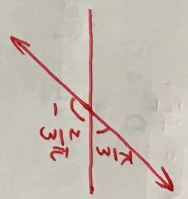

# 《大学物理》下册活页练习题解答（第11-12题）

原件经识别和整理；“参考解答”是我们补的。

本资料整理自《大学物理》下册活页练习题的解答部分，针对第11题和第12题进行公式修正与排版优化。

## 一、计算题

### 计算 11

如图所示，质量为 $1.0 \times 10^{-2} \mathrm{~kg}$ 的子弹，以 $500 \mathrm{~m} \cdot \mathrm{s}^{-1}$ 的速度射入并嵌入在木块中，同时使弹簧压缩从而作简谐运动。设木块的质量为 $4.99 \mathrm{~kg}$ ，弹簧的劲度系数为 $8.00 \times 10^{3} \mathrm{~N} \cdot \mathrm{m}^{-1}$ 。若以弹簧原长时物体所在处为坐标原点，向左为 $x$ 轴正方向，求简谐运动方程。

**解题过程：**

1. **碰撞过程动量守恒**：
   设子弹质量为 $m$，木块质量为 $M$，初速度为 $v_0$，碰后共同速度为 $V$。
   $$ m v_{0} = (m + M) V $$
   代入数据：
   $$ V = \frac{m v_{0}}{m + M} = \frac{1.0 \times 10^{-2} \times 500}{1.0 \times 10^{-2} + 4.99} = \frac{5}{5} = 1 \, \mathrm{m/s} $$

2. **能量守恒求振幅**：
   碰后系统动能转化为弹性势能，最大位移即为振幅 $A$。
   $$ \frac{1}{2} k A ^ {2} = \frac{1}{2} (m + M) V ^ {2} $$
   $$ A = \sqrt{\frac{(m + M) V ^ {2}}{k}} = \sqrt{\frac{5 \times 1^2}{8000}} = \sqrt{\frac{5}{8000}} = \sqrt{\frac{1}{1600}} = 0.025 \, \mathrm{m} $$

3. **角频率计算**：
   $$ \omega = \sqrt {\frac{k}{m + M}} = \sqrt {\frac{8000}{5}} = \sqrt{1600} = 40 \, \mathrm{rad/s} $$

4. **确定初相位**：
   以弹簧原长时物体所在处为坐标原点，向左为 $x$ 轴正方向。
   $t=0$ 时，物体位于平衡位置 ($x=0$)，且向左运动 ($v > 0$)。
   设振动方程为 $x = A \cos(\omega t + \phi)$。
   由 $x(0) = A \cos \phi = 0$ 得 $\phi = \pm \frac{\pi}{2}$。
   由 $v(0) = -A\omega \sin \phi > 0$，因 $A, \omega > 0$，故 $\sin \phi < 0$，所以 $\phi = -\frac{\pi}{2}$。

**答案：**
$$ x = 0.025 \cos \left( 40 t - \frac{\pi}{2} \right) \, (\mathrm{SI}) $$

知识点：[弹性碰撞与非弹性碰撞](../../../topics/大学物理/碰撞问题.md)、[动量定理与动量守恒定律](../../../topics/大学物理/动量定理与动量守恒.md)、[简谐振动的运动学方程（振幅、角频率、相位）](../../../topics/大学物理/简谐振动运动学.md)

### 计算 12

已知一质点同时参与两个同方向的简谐振动,其简谐振动方程分别为 $x_{1}=5\times10^{- 2}\cos(4t+\pi/3)(SI), x_{2}=3\times10^{- 2}\sin(4t-\pi/6)(SI)$ 。画出两振动的旋转矢量图,并求合成振动的振动方程.

**解题过程：**

1. **统一函数形式**：
   将 $x_2$ 转换为余弦形式以便比较相位。
   $$ x_{2} = 3\times10^{- 2}\sin(4t-\pi/6) = 3\times10^{- 2}\cos(4t-\pi/6 - \pi/2) = 3\times10^{- 2}\cos(4t - 2\pi/3) $$
   或者利用 $\sin \alpha = \cos(\alpha - \pi/2)$：
   $$ x_{2} = 3\times10^{- 2}\cos(4t - \frac{\pi}{6} - \frac{\pi}{2}) = 3\times10^{- 2}\cos(4t - \frac{2\pi}{3}) $$
   
   *注：原题解答中似乎直接给出了结果，我们验证一下。*
   
   另一种常见的转换是 $\sin(\theta) = \cos(\theta - \pi/2)$。
   $x_1$: 振幅 $A_1 = 5 \times 10^{-2}$, 初相 $\phi_1 = \pi/3$。
   $x_2$: 振幅 $A_2 = 3 \times 10^{-2}$, 原式为正弦。$\sin(4t - \pi/6) = \cos(4t - \pi/6 - \pi/2) = \cos(4t - 2\pi/3)$。
   
   让我们使用旋转矢量法或解析法合成。
   $x = x_1 + x_2 = A_1 \cos(\omega t + \phi_1) + A_2 \cos(\omega t + \phi_2)$
   其中 $\omega = 4$, $\phi_1 = \pi/3$, $\phi_2 = -2\pi/3$ (注意：$-2\pi/3$ 等同于 $4\pi/3$ 或 $-120^\circ$)。
   
   计算合成振幅 $A$ 和初相 $\phi$：
   $$ A_x = A_1 \cos \phi_1 + A_2 \cos \phi_2 = 5 \cos(\pi/3) + 3 \cos(-2\pi/3) = 5(0.5) + 3(-0.5) = 2.5 - 1.5 = 1 $$
   $$ A_y = A_1 \sin \phi_1 + A_2 \sin \phi_2 = 5 \sin(\pi/3) + 3 \sin(-2\pi/3) = 5(\frac{\sqrt{3}}{2}) + 3(-\frac{\sqrt{3}}{2}) = \frac{5\sqrt{3}}{2} - \frac{3\sqrt{3}}{2} = \sqrt{3} $$
   
   合成振幅：
   $$ A = \sqrt{A_x^2 + A_y^2} = \sqrt{1^2 + (\sqrt{3})^2} = \sqrt{1+3} = 2 $$
   即 $A = 2 \times 10^{-2} \, \mathrm{m}$。
   
   合成初相 $\phi$：
   $$ \tan \phi = \frac{A_y}{A_x} = \frac{\sqrt{3}}{1} = \sqrt{3} $$
   由于 $A_x > 0, A_y > 0$，$\phi$ 在第一象限，故 $\phi = \pi/3$。

   因此，合成振动方程为：
   $$ x = 2 \times 10^{-2} \cos(4t + \pi/3) \, (\mathrm{SI}) $$
   即：
   $$ x = 0.02 \cos(4t + \pi/3) $$

**答案：**
$$ x = 0.02 \cos \left( 4 t + \frac{\pi}{3} \right) \, (\mathrm{SI}) $$

知识点：[同方向同频率简谐振动的合成](../../../topics/大学物理/简谐振动的合成.md)、[用旋转矢量法确定初相与运动状态](../../../topics/大学物理/旋转矢量法.md)
