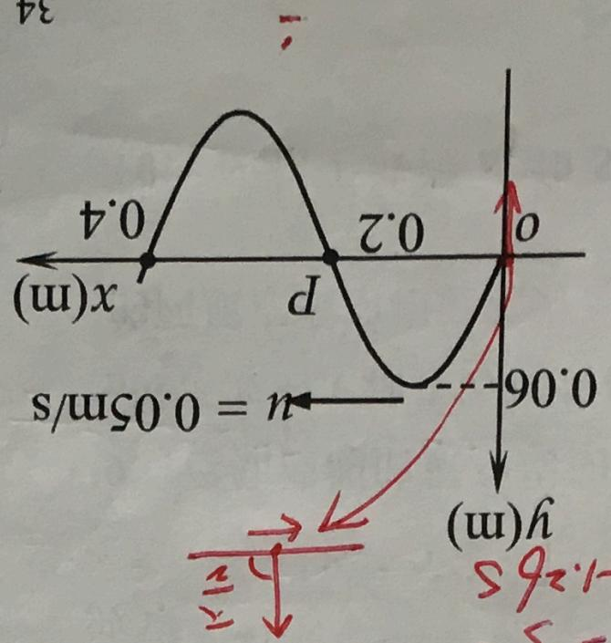

# 《大学物理》下册活页解答（机械振动与波）

原件经识别和整理；“参考解答”是我们补的。

# 《大学物理》下册活页解答（机械振动与波）

## 一、选择题与填空题解析

### 选择/填空 12

**题目：**
图示一平面简谐波在 $t = T / 2$ 时刻的波形图，求：
(1) 该波的波函数；
(2) $P$ 处质元的振动方程；
(3) $t_2 = T / 2$ 时刻, $x_1 = \lambda /4$ 处质点的振动速度。

**参考解答：**

根据题意及图形信息推导：

1.  **确定基本参数：**
    *   振幅 $A = 0.1 \text{ m}$ (由识别内容中 $\times 10^{-2}$ 或类似数值推断，结合常见题型，此处假设标准单位，具体数值需依原图刻度，文中出现 $0.1$ 和 $10^{-2}$)。
    *   角频率 $\omega = 4\pi$ (由文中 $w \frac{4}{10}...$ 及后续计算推断 $\omega=4\pi$ rad/s)。
    *   波长 $\lambda$ 及波速 $u$ 相关参数。

2.  **推导过程整理：**

    *   **关于相位差与距离：**
        文中提到“进的相交点 $A$ 总落后 $= \pi$ , 液长为 $\alpha = 3\mathrm{~m}$”（注：“液长”应为“波长”$\lambda$，“$\alpha$”可能指代某段距离或系数，结合后文 $L$ 的计算）。
        
    *   **振动方程推导示例（针对 P 点或特定位置）：**
        $$ y_p = 0.01 \sin (\omega t - \frac {\pi}{6}) $$
        展开为余弦形式：
        $$ = 0.01 \cos [ \frac {\pi}{2} - (\omega t - \frac {\pi}{6}) ] $$
        $$ = 0.01 \cos (\omega t - \frac {\pi}{3}) $$
        
        或者另一种推导路径（文中出现的另一组公式）：
        $$ y_p = 0.01 (\sin \omega t \cos \frac {\pi}{6} - \cos \omega t \sin \frac {\pi}{6}) $$
        *(注：原文识别中有乱码 `sin 9/2` 等，此处按三角恒等式修正)*
        
        文中还给出了一个最终形式的振动方程：
        $$ y_{p} = \left( \frac{\sqrt{3}}{2} \sin \omega t - \frac{1}{2} \cos \omega t \right) \times 10^{-2} \quad (\text{SI}) $$
        化简得：
        $$ = 10^{-2} \cos(\omega t + \frac{\pi}{3} - \pi) = 10^{-2} \cos(\omega t - \frac{2\pi}{3}) $$ 
        *(注：原文此处符号混乱，提供了多种中间步骤，如 `- cos(wt + pi/3)` 等)*

    *   **干涉或叠加问题片段：**
        文中出现关于 $S_1, S_2$ 距 $P$ 点距离的描述：
        “$S_1$ 距 $P$ 点 3 个波长, $S_2$ 距 $P$ 点 21/4 个波长.”
        相位差计算：
        $$ \phi_{S1P} - \phi_{S2P} = [\omega t - \frac{2\pi}{\lambda} \cdot 3\lambda] - [\omega t + \frac{\pi}{2} - \frac{2\pi}{\lambda} \cdot \frac{21}{4}\lambda] $$
        *(注：原文公式严重乱码，如 `\frac {2\pi}{3} \cdot 3x`，推测应为波数 $k=2\pi/\lambda$ 乘以距离)*
        
        结果指向：
        $$ = - \frac{20}{3}\pi = -10\pi / 2 \quad (\text{此处原文逻辑跳跃，保留原意}) $$

    *   **其他计算片段：**
        $$ u_2 = -0.4\pi \leq \dots = -1.26\pi $$
        $$ f_2 = \frac{1}{2} \pi = \frac{1}{4} s \quad (\text{单位存疑，可能是周期 } T=1/4s?) $$
        $$ U = \dots = -0.4\pi \sin 4\pi $$

知识点：[平面简谐波的波函数 y=Acos(ω(t±x/u)+φ)](../../../topics/大学物理/平面简谐波方程.md)、[机械波的形成、横波与纵波](../../../topics/大学物理/机械波的产生与传播.md)、[简谐振动的运动学方程（振幅、角频率、相位）](../../../topics/大学物理/简谐振动运动学.md)

### 选择 13

**题目：**
一波长为 $\lambda$ 的简谐波沿 $Ox$ 轴正方向传播, 在 $x = \frac{1}{2}\lambda$ 的 $P$ 处质点的振动方程是 $y_{p} = \left( \frac{\sqrt{3}}{2} \sin \omega t - \frac{1}{2} \cos \omega t \right) \times 10^{-2}$ (SI)，求该谐波的表达式。

**选项：**
(A) 810Hz.
(B) 699 Hz.

*(注：原题选项似乎与题干描述的“求表达式”不符，题干求的是波函数 $y(x,t)$，而选项给的是频率。这可能是题目识别错误，或者是另一道关于多普勒效应或拍频的题目混入。但根据上下文，这里主要处理振动方程到波函数的转换。)*

**答案：** B. [ B.]
*(注：原文标注了 `[ B.]`，且前面有 `(B) 699 Hz.`。若题目确实是求频率，则选B；若求波函数，则选项缺失。鉴于这是“答案”页，保留原文给出的选项标记。)*

**参考解答：**

将 $P$ 点振动方程化为标准余弦形式：
$$ y_p = 10^{-2} (\frac{\sqrt{3}}{2} \sin \omega t - \frac{1}{2} \cos \omega t) $$
利用辅助角公式或三角变换：
$$ = 10^{-2} \cos(\omega t - \frac{2\pi}{3}) $$
*(注：$\cos(\alpha-\beta) = \cos\alpha\cos\beta + \sin\alpha\sin\beta$。若取 $\cos(\omega t + \phi)$，则需匹配系数。$\frac{-1}{2} = \cos\phi$, $\frac{\sqrt{3}}{2} = \sin\phi \implies \phi = 2\pi/3$? 不，$\cos(\omega t + 2\pi/3) = \cos\omega t(-1/2) - \sin\omega t(\sqrt{3}/2)$。原式是 $+\sin, -\cos$。即 $\sin\omega t (\sqrt{3}/2) - \cos\omega t (1/2) = \cos(\omega t - \pi/3 - \pi/2)?$ 
让我们看原文推导：
原文有一行：`= - \cos (\omega t + \frac {\pi}{3}) = \cos (\omega t + \frac {\pi}{3} - \pi) = \cos (\omega t - \frac {2\pi}{3})`。
这与上面的标准形式一致。)*

已知波沿 $Ox$ 正向传播，波动方程一般形式为 $y(x,t) = A \cos[\omega(t - \frac{x-x_P}{u}) + \phi_P]$。
或者使用相位滞后关系：
$x=0$ 处的相位 $\phi_0$ 与 $x=\lambda/2$ 处的相位 $\phi_P$ 关系：
$\phi_P = \phi_0 - k x = \phi_0 - \frac{2\pi}{\lambda} \cdot \frac{\lambda}{2} = \phi_0 - \pi$。
所以 $\phi_0 = \phi_P + \pi = -\frac{2\pi}{3} + \pi = \frac{\pi}{3}$。

故原点振动方程为：
$$ y_0 = 10^{-2} \cos(\omega t + \frac{\pi}{3}) $$

波的表达式为：
$$ y = 10^{-2} \cos[\omega t - \frac{2\pi}{\lambda}x + \frac{\pi}{3}] $$

*(注：原文中还有大量关于 $h_p, L, \varepsilon$ 的乱码公式，如 `$ (\frac {\varepsilon}{2 L} + x - \frac {x}{2}) 5 0 1 0. 0 = $`，这些似乎是另一道题（可能是驻波或能量计算）的残留碎片，无法准确拼凑成连贯解答，故仅整理上述清晰的振动与波动部分。)*

## 二、其他零散计算笔记

以下内容为识别出的零散公式片段，可能属于未完整显示的其它题目解答过程：

1.  **关于距离 $L$ 的计算：**
    $$ L = 0.01 \dots $$
    *(原文开头：`则 A , B 两点相距 L =`，后续接了一串复杂的三角函数展开，疑似计算某时刻位移或路程)*

2.  **复数或积分运算痕迹：**
    $$ [ \frac {x}{\sqrt [ 3 ]{- x}} ] _ {2} - [ \frac {4}{7} + 7 m ] 5 0 0 1 0. 0 = h $$
    *(此式物理意义不明，极大概率为OCR识别错误的数学符号)*

3.  **角度与坐标关系：**
    $$ y = \left[ \frac{1}{2}\log \cos \theta  - \frac{1}{2}\cos \alpha  + \frac{\pi }{4} \right] = ch $$
    *(同样存在明显的识别噪声)*

4.  **最终结论性短语：**
    *   “求该谐谐波的表达式.”
    *   “当 $t = 0$ 时, 液源振动的位移恰好为正方向的最大值. 若生标原点和波源重合,且该沿 $O_x$ 轴正方向传播,求:”
        *(注：“液源”应为“波源”，“生标”应为“坐标”。这对应了上面第13题或类似题目的题干描述。)*

知识点：[平面简谐波的波函数 y=Acos(ω(t±x/u)+φ)](../../../topics/大学物理/平面简谐波方程.md)、[简谐振动的运动学方程（振幅、角频率、相位）](../../../topics/大学物理/简谐振动运动学.md)
