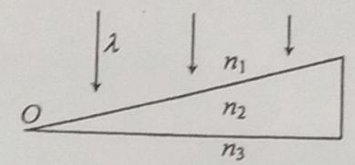
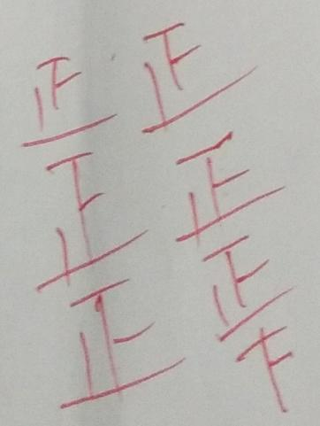

# 《大学物理（下）》期末考试试卷

原件经识别和整理；“参考解答”是我们补的。

## 四、(8分)

波长为 $\lambda$ 的单色光垂直照射到折射率为 $n_{2}$ 的劈尖薄膜上，$n_{1}<n_{2}<n_{3}$，如图所示，观察反射光形成的条纹。

(1) 从劈尖顶部 O 开始向右数第五条暗纹中心所对应的薄膜厚度是多少？

(2) 相邻的二明纹所对应的薄膜厚度之差是多少?

$$
\delta = 2 n _ {2} e
$$

$$
2 n _ {2} e _ {k} = (2 k + 1) \frac {\lambda}{2} \implies e _ {k} = \frac {(2 k + 1) \lambda}{4 n _ {2}}
$$

第五条暗纹对应 $k=4$（注：通常第一条暗纹 $k=0$），则：

$$
e _ {4} = \frac {9 \lambda}{4 n _ {2}}
$$

相邻二明纹（或暗纹）对应的薄膜厚度之差：

$$
\Delta e = e _ {k + 1} - e _ {k} = \frac {\lambda}{2 n _ {2}}
$$

## 五、(本题10分)

波长 $600\text{nm}$ 的单色光垂直照射在光栅上，紧靠光栅后用焦距为 $2\text{m}$ 的透镜把光线聚焦在屏幕上。已知光栅常数 $(a+b)=6.0\times10^{-6}\text{ m}$，第四级缺级。试求：

(1) 第二级明条纹位置；

(2) 光栅上狭缝可能的最小宽度 $a$；

(3) 按上述选定的 $a$、$b$ 值，在光屏上可能观察到的全部级数。

## 六、(本题6分)

在某一惯性系中，两个事件发生在同一地点而时间相隔 $4\text{s}$。设在另一惯性系中，该两事件的时间间隔为 $6\text{s}$，试问它们的空间间隔是多少?

解：设原参考系为 $S'$，动参考系为 $S$。由题意知 $x'_{1} = x'_{2}$，$\Delta t' = 4\text{s}$，$\Delta t = 6\text{s}$。

根据时间膨胀公式：

$$
\Delta t = \frac {\Delta t'}{\sqrt {1 - \frac {v ^ {2}}{c ^ {2}}}}
$$

$$
\sqrt {1 - \frac {v ^ {2}}{c ^ {2}}} = \frac {\Delta t'}{\Delta t} = \frac {4}{6} = \frac {2}{3}
$$

$$
1 - \frac {4}{9} = \frac {v ^ {2}}{c ^ {2}} \implies v = \frac {\sqrt {5}}{3} c
$$

根据洛伦兹变换，空间间隔 $\Delta x$ 为：

$$
\Delta x = \frac {\Delta x' + v \Delta t'}{\sqrt {1 - \frac {v^2}{c^2}}}
$$

由于 $\Delta x' = 0$，代入数值：

$$
\Delta x = \frac {v \Delta t'}{\sqrt {1 - \frac {v^2}{c^2}}} = \frac {\frac {\sqrt {5}}{3} c \times 4}{\frac {2}{3}} = 2 \sqrt {5} c
$$

*(注：此处结果单位为距离，若需具体米数，可代入 $c \approx 3\times10^8 \text{m/s}$)*

## 七、(本题8分)

一维无限深势阱定态归一化的波函数为：

$$
\Psi_n(x) = \begin{cases} 
\sqrt{\frac{2}{l}} \sin \frac{n\pi}{l} x, & 0 < x < l \\
0, & x < 0 \text{和} x > l
\end{cases}
$$

计算基态粒子（$n=1$）：

(1) 概率密度最大的位置；

(2) 处在 $x = 0$ 到 $x = l / 3$ 区间的几率。

**解答过程识别内容整理：**

对于基态 $n=1$，概率密度为：

$$
|\psi_1(x)|^2 = \frac {2}{l} \sin^2 \left(\frac {\pi}{l} x\right)
$$

(1) 求概率密度最大值位置：

令导数为零或直接观察正弦函数性质，当 $\sin^2(\frac{\pi}{l}x)=1$ 时概率密度最大。

$$
\frac {\pi}{l} x = \frac {\pi}{2} \implies x = \frac {l}{2}
$$

(2) 求区间几率：

$$
P = \int_ {0} ^ {\frac {l}{3}} |\psi_1(x)|^2 dx = \int_ {0} ^ {\frac {l}{3}} \frac {2}{l} \sin^2 \left(\frac {\pi}{l} x\right) dx
$$

利用倍角公式 $\sin^2 \theta = \frac{1-\cos 2\theta}{2}$：

$$
P = \frac {2}{l} \int_ {0} ^ {\frac {l}{3}} \frac {1 - \cos \left(\frac {2\pi}{l} x\right)}{2} dx = \frac {1}{l} \left[ x - \frac {l}{2\pi} \sin \left(\frac {2\pi}{l} x\right) \right]_ {0} ^ {\frac {l}{3}}
$$

$$
P = \frac {1}{l} \left( \frac {l}{3} - \frac {l}{2\pi} \sin \left(\frac {2\pi}{3}\right) \right) = \frac {1}{3} - \frac {1}{2\pi} \cdot \frac {\sqrt {3}}{2} = \frac {1}{3} - \frac {\sqrt {3}}{4\pi}
$$

