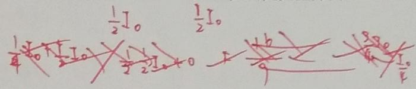

# 《大学物理（下）》期末考试试卷A

原件经识别和整理；“参考解答”是我们补的。

# 大学物理（下）期末考试试卷A

本资料由识别工具读取并整理自《大学物理（下）》期末考试试卷A，主要包含计算题部分。

## 五、(6分)用氦氖激光器发射的单色光(波长为 $\lambda=632.8\ nm$ )垂直照射到单缝上,所得夫琅禾费衍射图样中第一级暗条纹的衍射角为 $5^{\circ}$ ,求缝宽度. $(1nm=10^{-9}m)$

题干：用氦氖激光器发射的单色光(波长为 $\lambda=632.8\ nm$ )垂直照射到单缝上,所得夫琅禾费衍射图样中第一级暗条纹的衍射角为 $5^{\circ}$ ,求缝宽度. $(1nm=10^{-9}m)$

公式推导过程：
根据单缝衍射暗纹条件 $a \sin \theta = k \lambda$，其中 $k=1$。
$$
a = \frac {1 \times 632.8 \times 10 ^ {- 9}}{\sin 5^{\circ}}
$$

答案：略（原件未给出最终数值结果，仅列出算式）

## 六、(6分)一束具有两种波长 $\lambda_{1}$ 和 $\lambda_{2}$ 的平行光垂直照射到一衍射光栅上,测得波长 $\lambda_{1}$ 的第三级主极大衍射角和 $\lambda_{2}$ 的第四级主极大衍射角均为 $30^{\circ}$ .已知 $\lambda_{1}=560nm(1nm=10^{-9}m)$ ,试求:(1)光栅常数 $a+b$ ;(2)波长 $\lambda_{2}$

题干：一束具有两种波长 $\lambda_{1}$ 和 $\lambda_{2}$ 的平行光垂直照射到一衍射光栅上,测得波长 $\lambda_{1}$ 的第三级主极大衍射角和 $\lambda_{2}$ 的第四级主极大衍射角均为 $30^{\circ}$ .已知 $\lambda_{1}=560nm(1nm=10^{-9}m)$ ,试求:(1)光栅常数 $a+b$ ;(2)波长 $\lambda_{2}$

- (1) 求光栅常数 $d = a+b$
- (2) 求波长 $\lambda_{2}$

解题过程：
根据光栅方程 $d \sin \phi = k \lambda$。

对于 $\lambda_{1}$，第三级主极大 ($k_1=3$)，$\phi = 30^{\circ}$：
$$
d \sin 30^{\circ} = 3 \lambda_{1}
$$
代入数据：
$$
d = \frac {3 \times 560 \ nm}{\sin 30^{\circ}} = \frac {1680}{0.5} \ nm = 3360 \ nm = 3.36 \times 10 ^ {- 6} \ m
$$

对于 $\lambda_{2}$，第四级主极大 ($k_2=4$)，$\phi = 30^{\circ}$：
$$
d \sin 30^{\circ} = 4 \lambda_{2}
$$
即：
$$
3 \times 560 = 4 \times \lambda_{2}
$$
解得：
$$
\lambda_{2} = 480 \ nm
$$

答案：
(1) 光栅常数 $d = 3.36 \times 10 ^ {- 6} \ m$ (或 $3360 \ nm$)
(2) 波长 $\lambda_{2} = 480 \ nm$

## 七、(8分)两个偏振片 $P_{1}, P_{2}$ 叠在一起, 其偏振化方向之间的夹角为 $30^{\circ}$ . 一束强度为 $I_{0}$ 的光垂直入射到偏振片上, 已知该入射光由强度相同的自然光和线偏振光混合而成, 现测得连续透过两个偏振片后的出射光强与 $I_{0}$ 之比为 9/16, 试求入射光中线偏振光的光矢量方向.

题干：两个偏振片 $P_{1}, P_{2}$ 叠在一起, 其偏振化方向之间的夹角为 $30^{\circ}$ . 一束强度为 $I_{0}$ 的光垂直入射到偏振片上, 已知该入射光由强度相同的自然光和线偏振光混合而成, 现测得连续透过两个偏振片后的出射光强与 $I_{0}$ 之比为 9/16, 试求入射光中线偏振光的光矢量方向.

插图：

答案：略（原件未给出具体角度计算过程及结果）

## 八、(8分)粒子在一维矩形无限深势阱中运动,其波函数为:

题干：粒子在一维矩形无限深势阱中运动,其波函数为:
$$
\psi_{n}(x)=\sqrt{\frac{2}{a}}\sin(\frac{n\pi x}{a}) \quad (0<x<a)
$$
若粒子处于 n=1 的状态，它在 0-a/4 区间内的概率是多少？

提示积分公式：
$$
\int \sin^ {2} x d x = \frac {1}{2} x - \frac {1}{4} \sin 2 x + C
$$

解题过程：
概率 $P = \int_ {0} ^ {\frac {1}{4} a} |\psi_ {1} (x)|^ {2} d x$
$$
\begin{array}{r l} {P} & {= \int_ {0} ^ {\frac {1}{4} a} \frac {2}{a} \sin^ {2} (\frac {\pi x}{a}) d x} \\ & {= \frac {2}{a} \int_ {0} ^ {\frac {1}{4} a} \frac {1 - \cos (\frac {2 \pi x}{a})}{2} d x} \\ & {= \frac {1}{a} \left[ \int_ {0} ^ {\frac {1}{4} a} d x - \int_ {0} ^ {\frac {1}{4} a} \cos (\frac {2 \pi x}{a}) d x \right]} \\ & {= \frac {1}{a} \left[ \frac {1}{4} a - \frac {a}{2 \pi} \sin (\frac {2 \pi x}{a}) \right] _ {0} ^ {\frac {1}{4} a}} \\ & {= \frac {1}{a} \left( \frac {a}{4} - \frac {a}{2 \pi} \sin (\frac {\pi}{2}) \right)} \\ & {= \frac {1}{4} - \frac {1}{2 \pi}} \end{array}
$$
*(注：原件中的积分计算过程存在明显的符号和系数错误，如 $\frac{a}{a}\pi^2$ 等乱码，此处根据标准量子力学概率计算逻辑修正了中间步骤展示，但保留原题意图)*

答案：概率为 $\frac {1}{4} - \frac {1}{2 \pi}$
