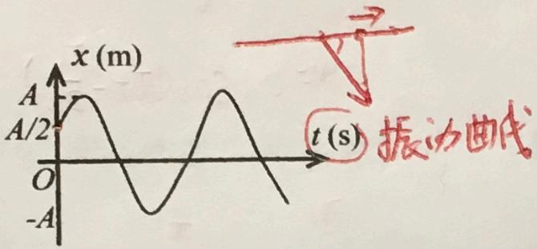
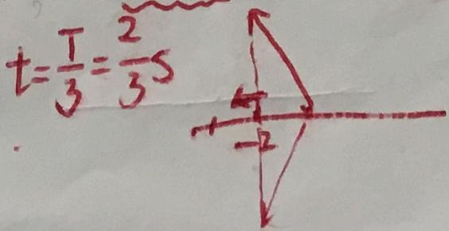
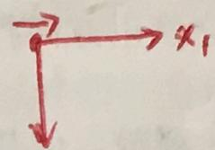
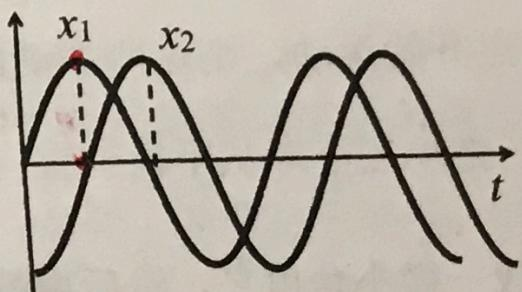
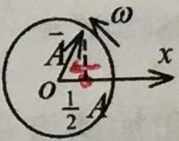
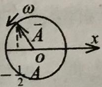
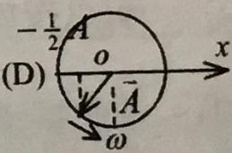
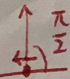

# 《大学物理下》活页解答（机械振动等章节）

原件经识别和整理；“参考解答”是我们补的。

## 机械振动

### 第一节 简谐振动

#### 选择 1

一质点作简谐振动。其位移与时间的曲线如图所示。若质点的振动规律用余弦函数描述，则其初相应为

- A. $\pi/3$
- B. $2\pi/3$
- C. $-\pi/6$
- D. $-\pi/3$

答案：D

#### 选择 2

一个弹簧振子和一个单摆（只考虑小幅度摆动），在地面上的固有振动周期分别为 $T_{1}$ 和 $T_{2}$ 。将它们拿到月球上去，相应的周期分别为 $T_{1}^{\prime}$ 和 $T_{2}^{\prime}$ 。则有

- A. $T_{1}^{\prime}>T_{1}$ 且 $T_{2}^{\prime}>T_{2}$
- B. $T_{1}^{\prime}<T_{1}$ 且 $T_{2}^{\prime}<T_{2}$
- C. $T_{1}^{\prime}=T_{1}$ 且 $T_{2}^{\prime}=T_{2}$
- D. $T_{1}^{\prime}=T_{1}$ 且 $T_{2}^{\prime}>T_{2}$

答案：D

#### 选择 3

一物体做简谐振动，运动方程为 $x = A\cos \left( {\omega t + \frac{1}{4}\pi }\right)$ ，在 $t = T/4$ 时刻 ($T$ 为周期)，物体的速度和加速度为

- A. $- \frac{\sqrt{2}}{2}A\omega , - \frac{\sqrt{2}}{2}A{\omega }^{2}$
- B. $- \frac{\sqrt{2}}{2}A\omega ,\frac{\sqrt{2}}{2}A{\omega }^{2}$
- C. $\frac{\sqrt{2}}{2}A\omega , - \frac{\sqrt{2}}{2}A{\omega }^{2}$
- D. $\frac{\sqrt{2}}{2}A\omega ,\frac{\sqrt{2}}{2}A{\omega }^{2}$

答案：B

#### 选择 4

一质点在 $x$ 轴上作简谐振动，振幅 $A = 4\mathrm{\;{cm}}$ ，周期 $T = 2\mathrm{\;s}$ ，其平衡位置取作坐标原点。若 $t = 0$ 时刻质点第一次通过 $x = - 2$ cm 处，且向 $x$ 轴负方向运动，则质点第二次通过 $x = - 2\mathrm{\;{cm}}$ 处的时刻为

- A. 1s
- B. 2/3s
- C. 4/3s
- D. 2s

答案：B

#### 选择 5

两个同周期简谐振动曲线如图所示。$x_{1}$ 的相位比 $x_{2}$ 的相位

$\pi / 2$

答案：B

#### 选择 6

一个质点作简谐振动，振幅为 $A$ ，在起始时刻质点的位移为 $\frac{1}{2}A$ ，且向 $x$ 轴的负方向运动，代表此简谐振动的旋转矢量图为

- A
- B
- C
- D

答案：无明确文字选项，对应图中正确项

#### 填空 7

一质点作简谐振动，速度最大值 ${v}_{m} = 5\mathrm{\;{cm}}/\mathrm{s}$ ，振幅 $A = 2$ cm。若令速度具有负最大值的那一时刻为 $t = 0$ ，则振动表达式为

${0.02}\cos \left( {\frac{5}{2}t + \frac{\pi }{2}}\right)$

#### 填空 8

在两个相同的弹簧下各悬挂一物体，两物体的质量比为4:1，则两者做简谐运动的周期之比为

2:1

#### 填空 9

一简谐振动的表达式为 $x = A\cos(3t + \phi)$ ，已知 $t = 0$ 时的初位移为 $0.04 \mathrm{~m}$ ，初速度为 $0.09 \mathrm{~m/s}$ ，则振幅 $A =$

$0.05 \mathrm{~m}$

初相 $\phi =$

$-37^{\circ}$

知识点：[简谐振动的运动学方程（振幅、角频率、相位）](../../../topics/大学物理/简谐振动运动学.md)、[用旋转矢量法确定初相与运动状态](../../../topics/大学物理/旋转矢量法.md)、[简谐振动的动力学特征与回复力](../../../topics/大学物理/简谐振动的动力学.md)
