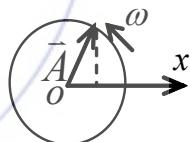
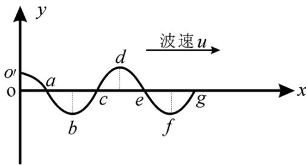
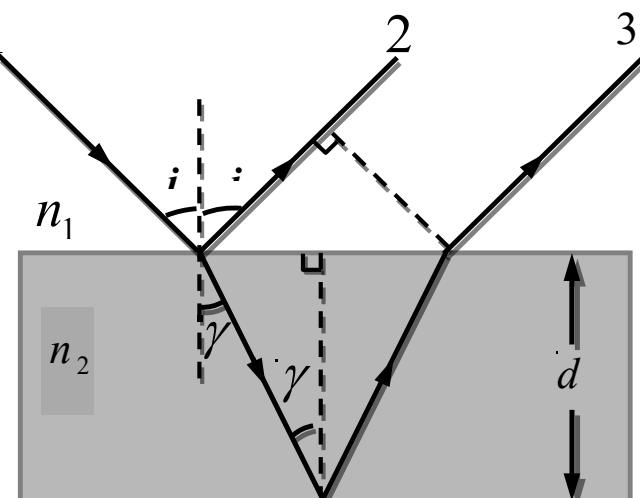

# 《大学物理下》重要知识点归纳（2018年12月）

原件经识别和整理；“参考解答”是我们补的。

# 一、简谐运动的运动方程

$x = A\cos (\omega t + \varphi)$

振幅 $A$ ： $A = \sqrt{x_0^2 + (\frac{v_0}{\omega})^2}$ ，取决于初始条件。

角频率 $\omega$ ：反映振动快慢，系统属性。 $\omega=\frac{2\pi}{T}$ ， $\omega^{2}=\frac{k}{m}$ 。

初相位 $\varphi$ ：取决于初始条件。

# 二、简谐运动物体的合外力与运动学量

简谐运动物体的合外力： $F = -kx$ （ $k$ : 比例系数）

简谐运动物体的位移: $x = A \cos (\omega t + \varphi)$

简谐运动物体的速度: $v = \frac{dx}{dt} = -\omega A \sin (\omega t + \varphi)$

简谐运动物体的加速度: $a = \frac{d^2x}{dt^2} = -\omega^2 A \cos (\omega t + \varphi)$

# 三、旋转矢量法

旋转矢量端点在 $x$ 轴上投影作简谐振动。

- 矢量转至一、二象限，速度为负
- 矢量转至三、四象限，速度为正

# 四、振动的能量

振动动能： $E_{k} = \frac{1}{2} mv^{2} = \frac{1}{2} kA^{2}\sin^{2}(\omega t + \varphi)$

振动势能： $E_{p} = \frac{1}{2} kx^{2} = \frac{1}{2} kA^{2}\cos^{2}(\omega t + \varphi)$

简谐振动总能量守恒： $E = E_{k} + E_{p} = \frac{1}{2} k A^{2}$

# 五、平面简谐波波函数

几种标准形式：

$$
y = A \cos \left[ \omega (t \mp \frac {x}{u}) + \varphi_ {o} \right] = A \cos \left[ \omega t \mp \frac {2 \pi}{\lambda} x + \varphi_ {o} \right]
$$

$\varphi_0$ ：坐标原点处质点的初相位。

$x$ 前正负号反映波的传播方向（通常沿 $x$ 轴正向传播取负号）。

# 六、波的能量

**注意：波的能量不守恒！**

任意时刻媒质中某质元的 动能 = 势能！

- a, c, e, g 点: 能量最大!
- b, d, f 点: 能量最小!

# 七、波的相干条件

1. 频率相同；
2. 振动方向相同；
3. 相位差恒定。

# 八、驻波

驻波是两列波干涉的结果。

- **波腹点**：振幅最大的点
- **波节点**：振幅最小的点
- **相邻波腹(或波节)点的距离**： $\frac{\lambda}{2}$

# 九、光程

$L = nr$

$n$: 折射率， $r$ ：光的几何路程。

光程是一种折算，把光在介质中走的路程折算成相同时间光在真空中走的路程即光程。所以，与光程或光程差联系在一起的波长永远是真空中的波长 $\lambda_{0}$ 。

# 十、光的干涉条件

光程差：

$$
\Delta=\begin{cases} \pm k\lambda & \rightarrow \text{干涉相长，明纹} \\ \pm(2k+1)\frac{\lambda}{2} & \rightarrow \text{干涉相消，暗纹} \end{cases} \quad (k=0,1,2,\cdots)
$$

# 十一、杨氏双缝干涉

相邻两条明纹(或暗纹)的间距:

$$
\Delta x = \frac{d'}{nd} \lambda
$$

- $d'$ ：缝与接收屏的距离
- $d$ ：双缝间距
- $\lambda$ ：光源波长
- $n$ ：介质的折射率

# 十二、薄膜干涉

反射光2、3的光程差：

$$
\Delta = 2 d \sqrt {n _ {2} ^ {2} - n _ {1} ^ {2} \sin^ {2} i} + \left(\frac {\lambda}{2}\right) ^ {*}
$$

- $d$: 膜的厚度
- 等号右侧第二项 $(\frac{\lambda}{2})^{*}$ 由半波损失引起。当 $n_2$ 在三种介质中最大或最小时，有这一项，否则没有这一项。

特例：光线垂直照射时， $i=0^{\circ}$

# 十三、劈尖干涉

- 相邻两明纹或暗纹的厚度差： $\Delta d = \frac{\lambda_0}{2n}$ （ $n$ ：劈尖的折射率）
- 相邻两明纹或暗纹的面间距： $l=\frac{\lambda_{0}}{2n\theta}$ （ $\theta$: 劈尖角，通常很小）

# 十四、单缝衍射（半波带理论）

$b\sin\theta=\begin{cases} \pm2k\cdot\frac{\lambda}{2} & \text{暗纹} \\ \pm(2k+1)\frac{\lambda}{2} & \text{明纹} \end{cases} \quad (k=1,2,3,\ldots)$

- $b$: 狭缝宽度
- $\theta$ : 衍射角

中央明带角宽度: $\theta = 2\theta_{1} = 2\frac{\lambda}{b}$

中央明带线宽度: $l _ {0} \approx 2 f \cdot \theta_ {1} = 2 f \cdot \frac {\lambda}{b}$

# 十五、圆孔衍射

最小分辨角:

$$
\theta_0 = 1.22 \frac{\lambda}{D}
$$

- $D$: 圆孔直径
- 当 $\theta \geq \theta_0$ 时, 能分辨

瑞利判据对应的分辨率倒数：

$$
R = \frac {1}{\theta_ {0}} = \frac {D}{1 . 2 2 \lambda}
$$

# 十六、衍射光栅

光栅方程： $d\sin \theta = k\lambda$ （ $k = 0,\pm 1,\pm 2,\ldots$ ）

- $d$ ：光栅常数
- $\theta$ ：衍射角

缺级条件： $k=\pm\frac{d}{b}k^{\prime}\quad(k^{\prime}=1,2,3,\ldots)$ ，其中 $b$: 透光部分的宽度

中央明带内条纹数： $N = 2(k - 1) + 1$ （多数情况下，此处 $k$ 指第一个缺级的级次绝对值）

如：±3级缺级， $N=2(3-1)+1=5$ （条），中央明带内条纹为 $0,\pm1,\pm2$ 级。

屏幕上能观察到的最高级次：

$$
k_{\max}=\operatorname{int}\left[\frac{d}{\lambda}\right]
$$

（推导依据： $k=\frac{d\sin\theta}{\lambda}\leq\frac{d}{\lambda}$ ）

# 十七、狭义相对论

洛伦兹时空坐标变换：

$$
\left\{\begin{aligned}x^{\prime}&=\frac{x-vt}{\sqrt{1-v^{2}/c^{2}}}\\ y^{\prime}&=y\\ z^{\prime}&=z\\ t^{\prime}&=\frac{t-vx/c^{2}}{\sqrt{1-v^{2}/c^{2}}}\end{aligned}\right.
$$

- $c$: 真空中光速
- $v$: $s^{\prime}$ 系相对 $s$ 系速率

洛伦兹速度变换：

$$
u_{x}^{\prime}=\frac{u_{x}-v}{1-\frac{u_{x}v}{c^{2}}}
$$

时间膨胀：

$$
\Delta t = \gamma \Delta t_0 \quad (\gamma=\frac{1}{\sqrt{1-v^{2}/c^{2}}}\geq1)
$$

长度收缩：

$$
L = \frac{L_0}{\gamma} \leq L_0
$$

# 十八、相对论动力学

相对论质量： $m = \frac{m_0}{\sqrt{1 - v^2 / c^2}}$

相对论动量： $p = mv = \frac{m_{0}v}{\sqrt{1 - v^{2}/c^{2}}}$

相对论动能: $E_{k} = E - E_{0} = mc^{2} - m_{0}c^{2}$

- $m_{0}$ : 物体的静质量, 是常量

质能关系: $E = mc^{2}$

相对论动量和能量的关系: $E^{2} = E_{0}^{2} + p^{2}c^{2}$

# 十九、光电效应

一个电子一次性吸收一个光子的能量 $h \nu$ 。

爱因斯坦方程：

$$
h\nu=\frac{1}{2}mv^{2}+W
$$

- $W$: 逸出功，与金属种类有关

截止频率： $\nu_{0}=\frac{W}{h}$

反向遏制电压： $u_{0}=\frac{1}{2}mv^{2}/e$

# 二十、康普顿效应

电子与光子发生完全弹性碰撞。

波长增量：

$$
\Delta \lambda = \lambda_{\text{散}} - \lambda_{\text{入}} = \frac{2h}{m_0c}\sin^2\frac{\theta}{2} = \frac{h}{m_0c} (1 - \cos \theta)
$$

# 二十一、波粒二象性

$$
E = h \nu
$$

$$
p = h / \lambda
$$

以上两式适用于光子和实物粒子(电子、质子、中子等)。

# 二十二、一维无限深势阱

能量：

$$
E_{n}=n^{2}\frac{h^{2}}{8ma^{2}}
$$

- 主量子数: $n=1,2,3,\ldots$

波函数：

$$
\Psi(x)=\sqrt{\frac{2}{a}}\sin\frac{n\pi}{a}x
$$

- 主量子数: $n=1,2,3,\ldots$
- $a$: 势阱宽度

概率密度：

$$
w(x) = |\Psi (x)|^2 = \frac{2}{a}\sin^2 (\frac{n\pi}{a} x)
$$

粒子出现概率极值的判断：

- **概率最大**： $\frac{dw(x)}{dx} = 0$ ，且 $\frac{d^2w(x)}{dx^2} < 0$
- **概率最小**： $\frac{dw(x)}{dx} = 0$ ，且 $\frac{d^2w(x)}{dx^2} >0$

*(注：原文中二阶导数变量误写为 $t$，根据上下文修正为 $x$)*

---

## 第二部分

### 一、两个同方向同频率简谐振动的合成

方法：画图，旋转矢量法！

分振动方程：

$$
x_{1} = A_{1}\cos (\omega t + \varphi_{1}), \quad x_{2} = A_{2}\cos (\omega t + \varphi_{2})
$$

合振动方程：

$$
x = x_{1} + x_{2} = A\cos (\omega t + \varphi)
$$

其中振幅：

$$
A = \sqrt{A_1^2 + A_2^2 + 2A_1A_2\cos(\varphi_2 - \varphi_1)}
$$

初相位满足：

$$
\tan \varphi = \frac {A _ {1} \sin \varphi_ {1} + A _ {2} \sin \varphi_ {2}}{A _ {1} \cos \varphi_ {1} + A _ {2} \cos \varphi_ {2}}
$$

*(注：原文写作 tg，已修正为标准数学符号 tan)*

知识点：[同方向同频率简谐振动的合成](../../../topics/大学物理/简谐振动的合成.md)、[用旋转矢量法确定初相与运动状态](../../../topics/大学物理/旋转矢量法.md)

### 二、多普勒效应公式

$$
\nu^{\prime}=\frac{u\pm\left|v_{0}\right|}{u\mp\left|v_{s}\right|}\nu
$$

- $\nu^{\prime}$ ：观察者接收频率
- $\nu$ ：波源发出频率
- $u$ ：波速
- $v_0$ ：观察者速度
- $v_s$ ：波源速度

知识点：[机械波的形成、横波与纵波](../../../topics/大学物理/机械波的产生与传播.md)、[波的叠加原理与干涉条件](../../../topics/大学物理/波的干涉.md)
