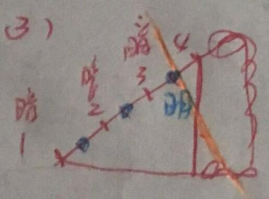
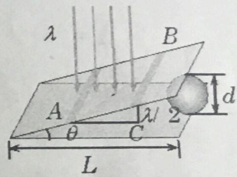

# 《大学物理》习题作业参考答案

原件经识别和整理；“参考解答”是我们补的。

## 计算 5

用波长为 $500 \text{ nm}$ ($1 \text{ nm} = 10^{-9} \text{ m}$) 的单色光垂直照射到由两块光学平玻璃构成的空气劈形膜上。在观察反射光的干涉现象中，距劈形膜棱边 $l = 1.56 \text{ cm}$ 的 A 处是从棱边算起的第四条暗条纹中心。
（1）求此空气劈形膜的劈尖角 $\theta$；
（2）改用 $600 \text{ nm}$ 的单色光垂直照射到此劈尖上仍观察反射光的干涉条纹，A 处是明条纹还是暗条纹？
（3）在第(2)问的情形从棱边到 A 处的范围内共有几条明纹？几条暗纹？

答案：
(1)
$$
\sin \theta \approx \theta = \frac {\frac {3}{2} \lambda}{l} = 4. 8 \times 10 ^ {- 5} \mathrm{rad}
$$

(2)
$$
l = \frac {\lambda}{2 \theta} = 6 2. 5 \times 10 ^ {- 4}
$$

(3)

$$
1. 5 6 / 6 2. 5 \times 10 ^ {- 2} \div 2. 5
$$

## 计算 6

如图所示, 两块相同的平板玻璃构成一空气劈尖, 长 $L = 4 \mathrm{~cm}$ , 一端夹住一金属丝, 现以波长为 $589 \mathrm{~nm}$ 的钠光垂直入射, (1) 若观察到相邻明纹 (或暗纹) 间距离 $l = 0.1 \mathrm{~mm}$ , 求金属丝的直径 $d = ?$ (2) 将金属丝通电, 受热膨胀, 直径增大, 在此过程中, 从玻璃片上方离劈棱距离为 $L / 2$ 的固定观察点上发现干涉向左移动 2 条, 问金属丝的直径膨胀了多少?

答案：
$\therefore$ 相邻明 (暗) 反间距

$$
l = \frac {\lambda_ {1}}{2 0} = \frac {\lambda_ {0}}{2 0} = 0. 1 m m
$$
$$
\theta = \frac {\lambda_ {0}}{2 l} = \frac {5 8 9 \times 10 ^ {- 9}}{2 \times 0 . 1 \times 10 ^ {- 3}} = 2. 9 4 5 \times 10 ^ {- 3} r a d
$$
$$
t g \theta = \frac {a}{L} = \theta
$$
$$
d = \angle \theta = 1. 1 7 8 \times 10 ^ {- 4} m
$$
(2) 固定观察点发现干涉条纹的左移动2至
$$
h ^ {\prime} - h = 2 \Delta d = 2: \frac {\lambda_ {0}}{2} = \lambda_ {0}
$$
$$
h ^ {\prime} = h + \lambda_ {0}
$$
前 $\sin \theta  = \frac{h}{2/2} = \frac{2h}{4} = {49\theta } = \frac{d}{2}$
$$
\sin \theta^ {\prime} = h ^ {\prime} / 2 = \frac {2 h ^ {\prime}}{L} = \frac {2 (h + x _ {0})}{L} = t g \theta^ {\prime} = \frac {d}{L}
$$
$$
\therefore d ^ {\prime} - d = 2 (h + \lambda_ {0}) - 2 h = 2 \lambda_ {0} = 1. 1 7 8 \times 10 ^ {- 6} (m)
$$
