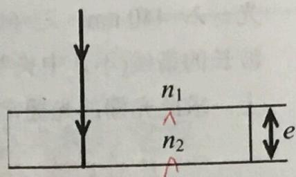

# 《大学物理》光学部分习题作业（选择题与填空题）

原件经识别和整理；“参考解答”是我们补的。

# 《大学物理》光学部分习题作业（选择题与填空题）

本资料由识别工具读取整理，修正了断行、乱码及明显的格式错误，保留了原题内容。

## 一、选择题（每小题 2 分，共 20 分）

### 选择 1
（注：原文此处内容混乱，疑似为上一题残留或页眉干扰信息，根据上下文逻辑，此处跳过无效文本，直接整理有效题目。若原文意图是第1题，则题干缺失，以下从第2题开始整理有效题目。）

知识点：[位矢及其坐标表示（直角坐标与自然坐标）](../../../topics/大学物理/位矢与坐标表示.md)、[速度、加速度的定义与微分关系](../../../topics/大学物理/速度与加速度定义.md)、[自然参数下的切向加速度与法向加速度](../../../topics/大学物理/自然坐标系下的运动.md)

### 选择 2
如图所示，折射率为 $n_2$ 、厚度为 $e$ 的透明介质薄膜的上方和下方的透明介质的折射率分别为 $n_1$ 和 $n_3$ ，已知 $n_1 < n_2 < n_3$ 。若用波长为 $\lambda$ 的单色平行光垂直入射到该薄膜上，则从薄膜上、下两表面反射的光束的光程差是

- A. $2n_2 e$ .
- B. $2n_2 e - \lambda / 2$ .
- C. $2n_2 e - \lambda$ .
- D. $2n_2 e - \lambda / (2n_2)$ .

答案：B。

知识点：[等倾干涉与等厚干涉（劈尖、牛顿环）](../../../topics/大学物理/薄膜干涉.md)、[光程、光程差与反射时的半波损失](../../../topics/大学物理/光程与半波损失.md)

### 选择 3
在迈克耳孙干涉仪的一条光路中，放入一折射率为 $n$ ，厚度为 $d$ 的透明薄片，放入后，这条光路的光程改变了

- A. $2(n-1)d$ .
- B. $2nd$ .
- C. $2(n-1)d+\lambda/2$ .
- D. $nd$ .

答案：A。
知识点：[迈克尔逊干涉仪的原理与应用](../../../topics/大学物理/迈克尔逊干涉仪.md)、[光程、光程差与反射时的半波损失](../../../topics/大学物理/光程与半波损失.md)、[等倾干涉与等厚干涉（劈尖、牛顿环）](../../../topics/大学物理/薄膜干涉.md)

### 选择 4
在单缝夫琅禾费衍射实验中，波长为 $\lambda$ 的单色光垂直入射在宽度为 $a=4\lambda$ 的单缝上，对应于衍射角为 $30^{\circ}$ 的方向，单缝处波阵面可分成的半波带数目为

- A. 2 个.
- B. 4 个.
- C. 6 个.
- D. 8 个

答案：B。
知识点：[单缝衍射的暗纹条件与中央明纹宽度](../../../topics/大学物理/单缝夫琅禾费衍射.md)

### 选择 5
自然光以 $60^{\circ}$ 的入射角照射到某两介质交界面时，反射光为完全线偏振光，则知折射光为

- A. 完全线偏振光且折射角是 $30^{\circ}$ .
- B. 部分偏振光且只是在该光由真空入射到折射率为 $\sqrt{3}$ 的介质时，折射角是 $30^{\circ}$ .
- C. 部分偏振光，但须知两种介质的折射率才能确定折射角.
- D. 部分偏振光且折射角是 $30^{\circ}$ .

答案：D。
知识点：[自然光与偏振光、马吕斯定律与布儒斯特定律](../../../topics/大学物理/光的偏振.md)

### 选择 6
ABCD 为一块方解石的一个截面，AB 为垂直于纸面的晶体平面与纸面的交线。光轴方向在纸面内且与 AB 成一锐角 $\theta$ ，如图所示。一束平行的单色自然光垂直于 AB 端面入射。在方解石内折射光分解为 o 光和 e 光，o 光和 e 光的

- A. 传播方向相同，电场强度的振动方向互相垂直.
- B. 传播方向相同，电场强度的振动方向不互相垂直.
- C. 传播方向不同，电场强度的振动方向互相垂直.
- D. 传播方向不同，电场强度的振动方向不互相垂直.

答案：C。
知识点：[自然光与偏振光、马吕斯定律与布儒斯特定律](../../../topics/大学物理/光的偏振.md)、[电磁波的基本性质](../../../topics/大学物理/电磁波.md)

### 填空 1
波长为 $\lambda$ 的单色平行光垂直入射到一狭缝上，若第一级暗纹的位置对应的衍射角为 $\theta = \pm\pi/6$ ，则缝宽的大小为 \_\_\_\_。

答案：$2\lambda$
知识点：[单缝衍射的暗纹条件与中央明纹宽度](../../../topics/大学物理/单缝夫琅禾费衍射.md)

### 填空 2
若星光的波长按 $550 \, \text{nm} (1 \, \text{nm} = 10^{-9} \, \text{m})$ 计算，孔径为 $127 \, cm$ 的大型望远镜所能分辨的两颗星的最小角距离 $\theta$ （从地上一点看两星的视线间夹角）是 \_\_\_\_。

答案：$5.28 \times 10^{-7} \, \text{rad}$
知识点：[瑞利判据与光学仪器的分辨本领](../../../topics/大学物理/光学仪器分辨本领.md)

### 填空 3
波长 $\lambda = 550 \, \text{nm} (1 \, \text{nm} = 10^{-9} \, \text{m})$ 的单色光垂直入射于光栅常数 $d = 2 \times 10^{-4} \, \text{cm}$ 的平面衍射光栅上，可能观察到的光谱线的最大级次为 \_\_\_\_。

答案：3
知识点：[光栅方程、缺级现象与光谱分辨](../../../topics/大学物理/衍射光栅.md)

### 填空 4
一束光强为 $I_{0}$ 的自然光，相继通过三个偏振片 $P_{1}$ 、 $P_{2}$ 、 $P_{3}$ 后，...（题目未显示完整，通常考察马吕斯定律的多层透射）

*(注：原文此处截断，仅保留“113”页码标记，无法生成完整答案。若需补全，需补充后续题干。)*

---
*整理说明：*
1. *删除了原文中的页眉、页脚、考生须知、装订线、水印及无意义的乱码（如“姓名”、“班级”、“学号”、“113"等）。*
2. *将识别错误的公式（如填空2中的乱码公式）修正为标准 LaTeX 格式。*
3. *将选项列表重新排版，确保每个选项独立一行。*
4. *保留了所有图片占位符，并添加了描述性文字。*

知识点：[自然光与偏振光、马吕斯定律与布儒斯特定律](../../../topics/大学物理/光的偏振.md)
