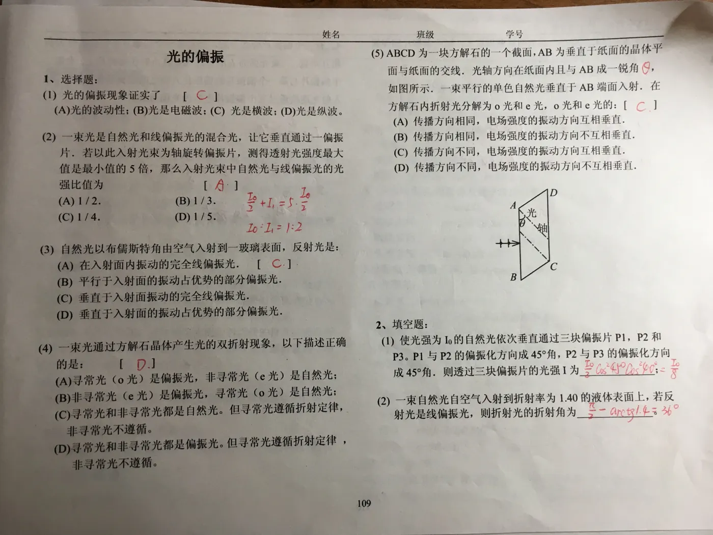

# 《大学物理》光的偏振习题作业参考答案

原件经识别和整理；“参考解答”是我们补的。

本资料由识别工具读取《大学物理》光的偏振部分习题作业参考答案整理而成，包含选择题与填空题及其解析。

## 一、选择题（每小题若干分）

### 选择 1

题干：光的偏振现象证实了 [C]
- A. 光的波动性
- B. 光是电磁波
- C. 光是横波
- D. 光是纵波

答案：C。

知识点：[自然光与偏振光、马吕斯定律与布儒斯特定律](../../../topics/大学物理/光的偏振.md)

### 选择 2

题干：一束光是自然光和线偏振光的混合光，让它垂直通过一偏振片。若以此入射光束为轴旋转偏振片，测得透射光强度最大值是最小值的5倍，那么入射光束中自然光与线偏振光的光强比值为 [A]

- A. 1/2
- B. 1/3
- C. 1/4
- D. 1/5

知识点：[自然光与偏振光、马吕斯定律与布儒斯特定律](../../../topics/大学物理/光的偏振.md)

### 选择 3

题干：自然光以布儒斯特角由空气入射到一玻璃表面，反射光是：
- A. 在入射面内振动的完全线偏振光
- B. 平行于入射面的振动占优势的部分偏振光
- C. 垂直于入射面振动的完全线偏振光
- D. 垂直于入射面的振动占优势的部分偏振光

答案：C。

知识点：[自然光与偏振光、马吕斯定律与布儒斯特定律](../../../topics/大学物理/光的偏振.md)

### 选择 4

题干：一束光通过方解石晶体产生光的双折射现象，以下描述正确的是： [D]
- A. 寻常光（o 光）是偏振光，非寻常光（e 光）是自然光
- B. 非寻常光（e 光）是偏振光，寻常光（o 光）是自然光
- C. 寻常光和非寻常光都是自然光。但寻常光遵循折射定律，非寻常光不遵循
- D. 寻常光和非寻常光都是偏振光。但寻常光遵循折射定律，非寻常光不遵循

答案：D。

知识点：[自然光与偏振光、马吕斯定律与布儒斯特定律](../../../topics/大学物理/光的偏振.md)、[几种特殊带电体（点电荷、无限长直线、圆环、圆盘等）激发的电场](../../../topics/大学物理/特殊带电体电场.md)、[电介质的极化、电极化强度与有介质时的高斯定理（D矢量）](../../../topics/大学物理/静电场中的电介质.md)

### 选择 5

题干：ABCD 为一块方解石的一个截面, AB 为垂直于纸面的晶体平面与纸面的交线. 光轴方向在纸面内且与 AB 成一锐角 $\theta$, 如图所示. 一束平行的单色自然光垂直于 AB 端面入射. 在方解石内折射光分解为 o 光和 e 光, o 光和 e 光的: [ C ]
- A. 传播方向相同, 电场强度的振动方向互相垂直
- B. 传播方向相同, 电场强度的振动方向不互相垂直
- C. 传播方向不同, 电场强度的振动方向互相垂直
- D. 传播方向不同, 电场强度的振动方向不互相垂直

答案：C。

知识点：[光程、光程差与反射时的半波损失](../../../topics/大学物理/光程与半波损失.md)、[自然光与偏振光、马吕斯定律与布儒斯特定律](../../../topics/大学物理/光的偏振.md)

### 填空 1

题干：使光强为 $I_0$ 的自然光依次垂直通过三块偏振片 P1, P2 和 P3。P1 与 P2 的偏振化方向成 $45^\circ$ 角, P2 与 P3 的偏振化方向成 $45^\circ$ 角. 则透过三块偏振片的光强 I 为 ______ .

答案：$\frac{I_0}{8}$。

知识点：[自然光与偏振光、马吕斯定律与布儒斯特定律](../../../topics/大学物理/光的偏振.md)

### 填空 2

题干：一束自然光自空气入射到折射率为 1.40 的液体表面上, 若反射光是线偏振光, 则折射光的折射角为 ______ 。

答案：$36^{\circ}$ （或 $\frac{\pi}{2} - \arctan 1.4$）。

知识点：[自然光与偏振光、马吕斯定律与布儒斯特定律](../../../topics/大学物理/光的偏振.md)
