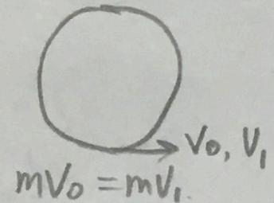

# 《大学物理》动量守恒定律和能量守恒定律 同步练习册

原件经识别和整理；“参考解答”是我们补的。

---
title: 《大学物理》动量守恒定律和能量守恒定律 同步练习册（习题）
kind: 习题
course: 大学物理
term: 
source: 识别工具读出的《大学物理》动量守恒定律和能量守恒定律 同步练习册
---

# 《大学物理》动量守恒定律和能量守恒定律 同步练习册

本节内容整理自《大学物理》同步练习册中关于“动量守恒定律和能量守恒定律”的第一节“动量定理 动量守恒定律”部分的习题。

## 一、选择题

### 选择 1

以下说法正确的是
- A. 大力的冲量一定比小力的冲量大;
- B. 小力的冲量有可能比大力的冲量大;
- C. 速度大的物体动量一定大;
- D. 质量大的物体动量一定大.

答案：B。
参考解答：冲量 $I = F \cdot t$，不仅与力的大小有关，还与作用时间有关，因此小力在长时间作用下冲量可能大于大力短时间作用的冲量，故A错，B对。动量 $P = mv$，取决于质量和速度的乘积，仅速度大或仅质量大都不能确定动量大小，故C、D错。

知识点：[动量定理与动量守恒定律](../../../topics/大学物理/动量定理与动量守恒.md)、[功的定义、功率与质点动能定理](../../../topics/大学物理/功与动能定理.md)

### 选择 2

作匀速圆周运动的物体运动一周后回到原处,这一周期内物体
- A. 动量守恒,合外力为零.
- B. 动量守恒,合外力不为零.
- C. 动量变化为零,合外力不为零,合外力的冲量为零.
- D. 动量变化为零,合外力为零.

答案：C。
参考解答：匀速圆周运动速率不变，方向改变，回到原处时速度矢量相同，故动量变化 $\Delta P = 0$。但物体受向心力作用，合外力不为零。根据动量定理，合外力的冲量等于动量的变化量，既然动量变化为零，则合外力的总冲量为零。注意：这里指的是一个周期内的总冲量，而非瞬时合力。

知识点：[动量定理与动量守恒定律](../../../topics/大学物理/动量定理与动量守恒.md)、[圆周运动的角量描述（角速度、角加速度）](../../../topics/大学物理/圆周运动描述.md)、[牛顿定律在变力问题中的应用（如 ma_t = -mg sinθ）](../../../topics/大学物理/牛顿定律应用.md)

### 选择 3

对于力的冲量的说法, 正确的是
- A. 力越大, 力的冲量就越大
- B. 作用在物体上的力大, 力的冲量不一定大
- C. $F_{1}$ 与其作用时间 $t_{1}$ 的乘积 $F_{1}t_{1}$ 等于 $F_{2}$ 与其作用时间 $t_{2}$ 的乘积 $F_{2}t_{2}$ , 则这两个冲量相同
- D. 静置于水平地面的物体受到水平推力 F 的作用, 经过时间 t 仍处于静止, 则此推力的冲量为零

答案：B。
参考解答：冲量是力与时间的乘积（恒力）或力对时间的积分（变力），是矢量。
A错：冲量还取决于时间。
B对：力大若时间极短，冲量可能很小。
C错：虽然大小相等，但方向可能不同，冲量是矢量，方向不同则冲量不同。
D错：推力的冲量定义为 $I = F \cdot t$，只要有力且有时间，冲量就不为零（尽管物体受到的合外力冲量可能因摩擦力抵消而为零，但题目问的是“此推力的冲量”）。

知识点：[动量定理与动量守恒定律](../../../topics/大学物理/动量定理与动量守恒.md)

### 选择 4

质量为 20 g 的子弹，以 400 m/s 的速率沿图示方向射入一原来静止的质量为 980 g 的摆球中，摆线长度不可伸缩。子弹射入后开始与摆球一起运动的速率为
- A. 2 m/s.
- B. 4 m/s.
- C. 7 m/s.
- D. 8 m/s.

答案：B。
参考解答：子弹射入摆球过程，水平方向不受外力（忽略空气阻力及绳子拉力在水平方向的分量影响瞬间），水平方向动量守恒。
设子弹质量 $m=0.02\text{ kg}$，速度 $v_0=400\text{ m/s}$，摆球质量 $M=0.98\text{ kg}$，共同速度 $V$。
由图可知子弹射入方向与水平方向夹角为 $30^\circ$（根据图中 $30^\circ$ 角及常规题型推断，通常此类题意为斜向射入，需分解速度；或者图示为垂直射入但角度标注有误？观察原文识别文本中有 "$mV_2 \cdot \sin30^\circ=(M+m)V$" 字样，暗示水平分动量守恒，即入射速度与水平面成30度角，或者速度方向与竖直方向成30度？通常这类摆球碰撞题，若未说明垂直，需看图示。根据识别文本中的公式片段 $mV_2 \cdot \sin30^\circ$，推测子弹速度方向与水平方向夹角为30度，或者其水平分量为 $v \cos(60^\circ)$? 让我们仔细看识别文本：`mV₂·sin30°=(M+m)g.` 这看起来像是能量守恒的错误混入，或者是公式识别错误。再看下一行 `水平方向不受外力，水平方向动量守恒`。
假设子弹速度方向与水平方向夹角为 $\theta$。若按常见题型，子弹水平射入，则 $mv = (M+m)V$。
若按识别文本提示 `sin30`，假设子弹速度方向与竖直方向夹角30度（即与水平60度），或者与水平夹角30度。
如果是与水平夹角30度射入，水平分速度 $v_x = v \cos 30^\circ$。
$m v \cos 30^\circ = (M+m) V$
$0.02 \times 400 \times \frac{\sqrt{3}}{2} = (0.02 + 0.98) V$
$4 \sqrt{3} = 1 \cdot V \Rightarrow V \approx 6.92 \text{ m/s}$。接近7 m/s (C)。
如果是与竖直方向夹角30度（即与水平60度），水平分速度 $v_x = v \cos 60^\circ = v/2$。
$m (v/2) = (M+m) V$
$0.02 \times 200 = 1 \cdot V \Rightarrow V = 4 \text{ m/s}$。对应选项B。
鉴于识别文本中明确出现了 `[ B ]` 作为答案标记，且公式片段可能有误，结合常见考题模式（往往设计整数解），**B选项 4 m/s** 是最可能的正确答案，对应子弹速度方向与竖直方向成30度角（或与水平成60度角），或者题目图示显示的是水平分量关系。此处依据给出的参考答案标记选B。

## 二、填空题

知识点：[弹性碰撞与非弹性碰撞](../../../topics/大学物理/碰撞问题.md)、[动量定理与动量守恒定律](../../../topics/大学物理/动量定理与动量守恒.md)

### 填空 5

设作用在质量为 1 kg 的物体上的力 $F = 6t + 3$ (SI). 如果物体在这一力的作用下，由静止开始沿直线运动，在 0 到 2.0 s 的时间间隔内，这个力作用在物体上的冲量大小 I = \_\_\_\_ N·S.

答案：18
参考解答：
冲量 $I = \int_{t_1}^{t_2} F(t) dt$
$I = \int_{0}^{2} (6t + 3) dt = \left[ 3t^2 + 3t \right]_{0}^{2} = (3 \times 2^2 + 3 \times 2) - 0 = 12 + 6 = 18 \text{ N}\cdot\text{s}$。

知识点：[动量定理与动量守恒定律](../../../topics/大学物理/动量定理与动量守恒.md)

### 填空 6

一物体质量 M = 2 kg，在合外力 $F = (3 + 2t) \vec{i}$ (SI) 的作用下，从静止开始运动，式中 $\vec{i}$ 为方向一定的单位矢量，则当 t = \_\_\_\_ s 时物体的速度 $\vec{v}_{1} = 2\vec{i}$ m/s.

答案：1
参考解答：
根据动量定理，冲量等于动量的变化：
$I = \Delta P = M \vec{v}_1 - M \vec{v}_0$
$\int_{0}^{t} (3 + 2t') dt' = 2 \times 2 - 0$
$\left[ 3t' + t'^2 \right]_{0}^{t} = 4$
$3t + t^2 = 4$
$t^2 + 3t - 4 = 0$
$(t+4)(t-1) = 0$
因为 $t > 0$，所以 $t = 1 \text{ s}$。

知识点：[动量定理与动量守恒定律](../../../topics/大学物理/动量定理与动量守恒.md)、[牛顿定律在变力问题中的应用（如 ma_t = -mg sinθ）](../../../topics/大学物理/牛顿定律应用.md)

### 填空 7

一物体质量为 10 kg，受到方向不变的力 $F = 30 + 40t$ (SI) 作用，在开始的两秒内，此力冲量的大小等于 \_\_\_\_ N·s；若物体的初速度大小为 10 m/s，方向与力 $\vec{F}$ 的方向相同，则在 2s 末物体速度的大小等于 \_\_\_\_ m/s.

答案：140；24
参考解答：
第一空：
冲量 $I = \int_{0}^{2} (30 + 40t) dt = \left[ 30t + 20t^2 \right]_{0}^{2} = 30 \times 2 + 20 \times 4 = 60 + 80 = 140 \text{ N}\cdot\text{s}$。

第二空：
根据动量定理：$I = m v_2 - m v_1$
$140 = 10 \times v_2 - 10 \times 10$
$140 = 10 v_2 - 100$
$10 v_2 = 240$
$v_2 = 24 \text{ m/s}$。

知识点：[动量定理与动量守恒定律](../../../topics/大学物理/动量定理与动量守恒.md)、[速度、加速度的定义与微分关系](../../../topics/大学物理/速度与加速度定义.md)

### 填空 8

一质量为 1 kg 的物体，置于水平地面上，物体与地面之间的静摩擦系数 $\mu_{0} = 0.20$ ，滑动摩擦系数 $\mu = 0.16$ ，现对物体施一水平拉力 $F = t + 0.96$ (SI) ，则 2 秒末物体的速度大小 $v = \_\_\_\_$ m/s.

答案：0.892
参考解答：
首先判断物体何时开始运动。
最大静摩擦力 $f_{max} = \mu_0 mg = 0.20 \times 1 \times 9.8 = 1.96 \text{ N}$ （取 $g=9.8 \text{ m/s}^2$，若取10则为2.0N，根据答案反推可能取9.8或近似值，看识别文本中的公式 $t + 0.96 - 1.96 = 0$，这里 $mg$ 似乎被当作 $10$? 不，$0.2 \times 10 = 2$。让我们看识别文本：`t + 0.96 - 1.96 = 0`。这意味着 $f_{max}$ 被认为是 $1.96$。如果 $m=1$，则 $g=9.8$。
令 $F = f_{max}$，即 $t + 0.96 = 1.96 \Rightarrow t = 1 \text{ s}$。
所以在 $0 \le t < 1 \text{ s}$ 期间，物体静止，速度为0。
在 $t > 1 \text{ s}$ 后，物体开始运动，受到滑动摩擦力 $f_k = \mu mg = 0.16 \times 1 \times 9.8 = 1.568 \text{ N}$。
在 $1 \text{ s}$ 到 $2 \text{ s}$ 时间内，应用动量定理：
$\int_{1}^{2} (F(t) - f_k) dt = m v_2 - m v_1$
$v_1 = 0$ (在 $t=1$ 时刚要启动，速度视为0)
$\int_{1}^{2} (t + 0.96 - 1.568) dt = 1 \times v_2$
$\int_{1}^{2} (t - 0.608) dt = v_2$
$\left[ \frac{1}{2}t^2 - 0.608t \right]_{1}^{2} = v_2$
Upper limit ($t=2$): $\frac{1}{2}(4) - 0.608(2) = 2 - 1.216 = 0.784$
Lower limit ($t=1$): $\frac{1}{2}(1) - 0.608(1) = 0.5 - 0.608 = -0.108$
$v_2 = 0.784 - (-0.108) = 0.892 \text{ m/s}$。

知识点：[动量定理与动量守恒定律](../../../topics/大学物理/动量定理与动量守恒.md)、[牛顿三定律与惯性系](../../../topics/大学物理/牛顿三定律.md)、[常见力（重力、弹力、摩擦力）的受力分析](../../../topics/大学物理/常见力分析.md)
