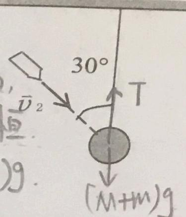

# 《大学物理》动量守恒定律和能量守恒定律 同步练习册

原件经识别和整理；“参考解答”是我们补的。

本节内容整理自《大学物理》同步练习册中关于“动量守恒定律和能量守恒定律”的第一节“动量定理 动量守恒定律”部分的习题。

## 一、选择题

### 选择 1

以下说法正确的是
- A. 大力的冲量一定比小力的冲量大;
- B. 小力的冲量有可能比大力的冲量大;
- C. 速度大的物体动量一定大;
- D. 质量大的物体动量一定大.

答案：B。
知识点：[动量定理与动量守恒定律](../../../topics/大学物理/动量定理与动量守恒.md)、[功的定义、功率与质点动能定理](../../../topics/大学物理/功与动能定理.md)

### 选择 2

作匀速圆周运动的物体运动一周后回到原处,这一周期内物体
- A. 动量守恒,合外力为零.
- B. 动量守恒,合外力不为零.
- C. 动量变化为零,合外力不为零,合外力的冲量为零.
- D. 动量变化为零,合外力为零.

答案：C。
知识点：[动量定理与动量守恒定律](../../../topics/大学物理/动量定理与动量守恒.md)、[圆周运动的角量描述（角速度、角加速度）](../../../topics/大学物理/圆周运动描述.md)、[牛顿定律在变力问题中的应用（如 ma_t = -mg sinθ）](../../../topics/大学物理/牛顿定律应用.md)

### 选择 3

对于力的冲量的说法, 正确的是
- A. 力越大, 力的冲量就越大
- B. 作用在物体上的力大, 力的冲量不一定大
- C. $F_{1}$ 与其作用时间 $t_{1}$ 的乘积 $F_{1}t_{1}$ 等于 $F_{2}$ 与其作用时间 $t_{2}$ 的乘积 $F_{2}t_{2}$ , 则这两个冲量相同
- D. 静置于水平地面的物体受到水平推力 F 的作用, 经过时间 t 仍处于静止, 则此推力的冲量为零

答案：B。
知识点：[动量定理与动量守恒定律](../../../topics/大学物理/动量定理与动量守恒.md)

### 选择 4

质量为 20 g 的子弹，以 400 m/s 的速率沿图示方向射入一原来静止的质量为 980 g 的摆球中，摆线长度不可伸缩。子弹射入后开始与摆球一起运动的速率为
- A. 2 m/s.
- B. 4 m/s.
- C. 7 m/s.
- D. 8 m/s.

答案：B。
知识点：[弹性碰撞与非弹性碰撞](../../../topics/大学物理/碰撞问题.md)、[动量定理与动量守恒定律](../../../topics/大学物理/动量定理与动量守恒.md)

### 填空 5

设作用在质量为 1 kg 的物体上的力 $F = 6t + 3$ (SI). 如果物体在这一力的作用下，由静止开始沿直线运动，在 0 到 2.0 s 的时间间隔内，这个力作用在物体上的冲量大小 I = \_\_\_\_ N·S.

答案：18
知识点：[动量定理与动量守恒定律](../../../topics/大学物理/动量定理与动量守恒.md)

### 填空 6

一物体质量 M = 2 kg，在合外力 $F = (3 + 2t) \vec{i}$ (SI) 的作用下，从静止开始运动，式中 $\vec{i}$ 为方向一定的单位矢量，则当 t = \_\_\_\_ s 时物体的速度 $\vec{v}_{1} = 2\vec{i}$ m/s.

答案：1
知识点：[动量定理与动量守恒定律](../../../topics/大学物理/动量定理与动量守恒.md)、[牛顿定律在变力问题中的应用（如 ma_t = -mg sinθ）](../../../topics/大学物理/牛顿定律应用.md)

### 填空 7

一物体质量为 10 kg，受到方向不变的力 $F = 30 + 40t$ (SI) 作用，在开始的两秒内，此力冲量的大小等于 \_\_\_\_ N·s；若物体的初速度大小为 10 m/s，方向与力 $\vec{F}$ 的方向相同，则在 2s 末物体速度的大小等于 \_\_\_\_ m/s.

答案：140；24
知识点：[动量定理与动量守恒定律](../../../topics/大学物理/动量定理与动量守恒.md)、[速度、加速度的定义与微分关系](../../../topics/大学物理/速度与加速度定义.md)

### 填空 8

一质量为 1 kg 的物体，置于水平地面上，物体与地面之间的静摩擦系数 $\mu_{0} = 0.20$ ，滑动摩擦系数 $\mu = 0.16$ ，现对物体施一水平拉力 $F = t + 0.96$ (SI) ，则 2 秒末物体的速度大小 $v = \_\_\_\_$ m/s.

答案：0.892
知识点：[动量定理与动量守恒定律](../../../topics/大学物理/动量定理与动量守恒.md)、[牛顿三定律与惯性系](../../../topics/大学物理/牛顿三定律.md)、[常见力（重力、弹力、摩擦力）的受力分析](../../../topics/大学物理/常见力分析.md)
