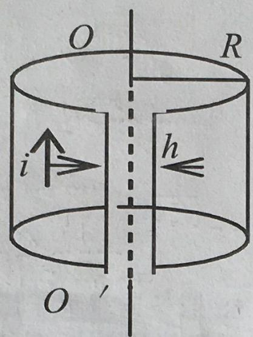
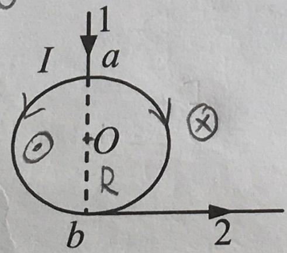
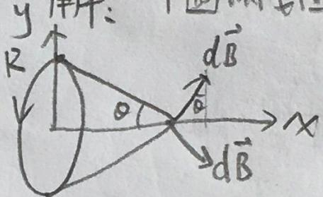
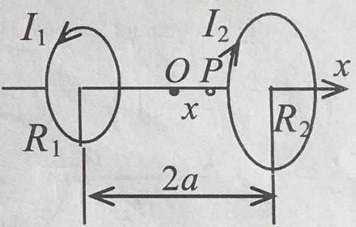
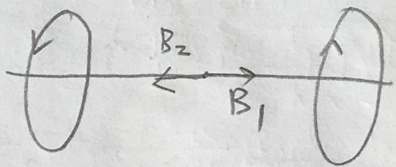

# 《大学物理》同步练习册--稳恒磁场（第58页）

原件经识别和整理；“参考解答”是我们补的。

## 计算 6

将半径为 $R$ 的无限长导体薄壁管（厚度忽略）沿轴向割去一宽度为 $h$（$h \ll R$）的无限长狭缝后，再沿轴向流有在管壁上均匀分布的电流，其面电流密度（垂直于电流的单位长度截线上的电流）为 $i$，则管轴线磁感强度的大小等于多少？

解：补完整，根据磁场叠加原理
$$B=0.$$

割去那部分看作是无限长载流直导线

$$
B = \frac {\mu_ {0} i h}{2 \pi R}
$$

## 计算 7

电流由长直导线 1 沿半径方向经 $a$ 点流入一电阻均匀的圆环，再由 $b$ 点沿切向从圆环流出，经长导线 2 返回电源（如图）。已知直导线上电流强度为 $I$，圆环的半径为 $R$，且 $a$、$b$ 与圆心 $O$ 三点在同一直线上。设直电流 1、2 及圆环电流分别在 $O$ 点产生的磁感强度为 $\vec{B}_{1}$、$\vec{B}_{2}$ 及 $\vec{B}_{3}$，则 $O$ 点的磁感强度的大小等于多少？

解：长直线 1 对 $O$ 点而言，有 $Idl \times r = 0$

$$
\therefore B _ {1} = 0
$$

电流在圆环处分流成两个方向，根据磁场叠加原理，在 $O$ 处产生的磁场方向相反，大小相等

$$
B _ {2} = 0
$$

长直线 2 相当于半无限长直线在圆心 $O$ 产生的磁场 $B_{3}=\frac{\mu_{0}I}{4\pi R}$，方向①

在 $O$ 处的磁感应强度 $B = \frac{\mu_0 I}{4\pi R}$，①

## 计算 8

如图两共轴线圈相距 $2a$，半径分别为 $R_{1}$、$R_{2}$，电流为 $I_{1}$、$I_{2}$。电流的方向相反，求轴线上相距中点 $O$ 为 $x$ 处的 $P$ 点的磁感强度。

解：一个圆环线圈在轴线任意一点产生的磁感应强度 $B$ 如下求解

取电流元 $Idl$

$$
d B = \frac {\mu_ {0}}{4 \pi} \cdot \frac {I d l \cdot \sin 9 0 ^ {\circ}}{r ^ {2}}
$$

$$
\begin{array}{l} {d B x = d B \cdot \sin \theta} \\ {d B y = d B \cdot \cos \theta} \end{array} \quad \vec {B y} = 0
$$

由对称性可知

$$
\begin{array}{r l} {B} & {= \int d B x = \oint \frac {\mu_ {0}}{4 \pi} \cdot \frac {I d l \sin 9 0 ^ {\circ}}{r ^ {2}} \sin \theta} \\ & {= \frac {\mu_ {0} I \sin \theta}{4 \pi \cdot r ^ {2}} \oint_ {L} d L = \frac {\mu_ {0} I R \sin \theta}{2 \cdot r ^ {2}}} \end{array}
$$

$$
B = B x = \frac {\mu _ {0}}{2} \frac {I R ^ {2}}{(R ^ {2} + x ^ {2}) ^ {3 / 2}}
$$

因此两个圆环在 $P$ 点产生的磁感应强度 $B$ 叠加后为

$$
B = B x _ {1} + B x _ {2} = \frac {\mu_ {0} I R _ {1} ^ {2}}{2 (R _ {1} ^ {2} + (a + x) ^ {2}) ^ {\frac {3}{2}}} - \frac {\mu_ {0} I R _ {2} ^ {2}}{2 (R _ {2} ^ {2} + (a - x) ^ {2}) ^ {\frac {3}{2}}}
$$
