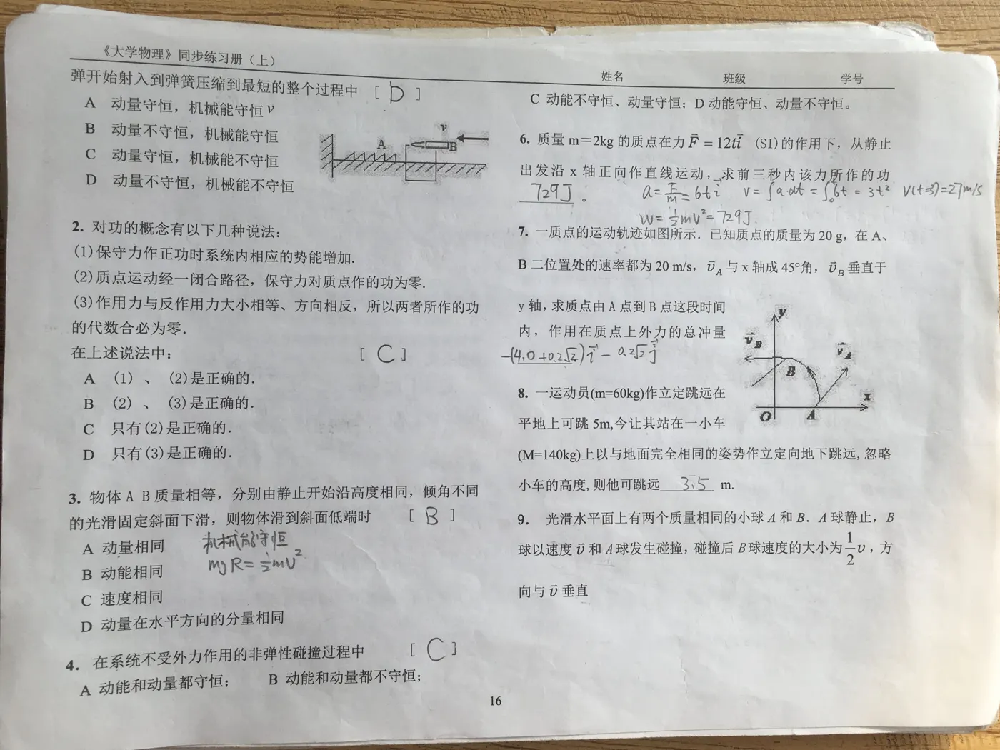

# 《大学物理》同步练习册 守恒定律章节习题

原件经识别和整理；“参考解答”是我们补的。

本资料整理自《大学物理》同步练习册（上）第16页，内容为守恒定律相关选择题与计算题。

## 一、选择题

### 选择 1

弹开始射入到弹簧压缩到最短的整个过程中 [D]

- A. 动量守恒，机械能守恒
- B. 动量不守恒，机械能守恒
- C. 动量守恒，机械能不守恒
- D. 动量不守恒，机械能不守恒

答案：D。

知识点：[动量定理与动量守恒定律](../../../topics/大学物理/动量定理与动量守恒.md)、[功能原理与机械能守恒定律](../../../topics/大学物理/功能原理与机械能守恒.md)、[常见力（重力、弹力、摩擦力）的受力分析](../../../topics/大学物理/常见力分析.md)

### 选择 2

对功的概念有以下几种说法:
(1) 保守力作正功时系统内相应的势能增加.
(2) 质点运动经一闭合路径，保守力对质点作的功为零.
(3) 作用力与反作用力大小相等、方向相反, 所以两者所作的功的代数合必为零.

在上述说法中: [C]

- A. (1)、(2)是正确的.
- B. (2)、(3)是正确的.
- C. 只有(2)是正确的.
- D. 只有(3)是正确的.

答案：C。

知识点：[保守力及其势能、中心力场与有效势](../../../topics/大学物理/保守力与势能.md)、[功的定义、功率与质点动能定理](../../../topics/大学物理/功与动能定理.md)

### 选择 3

物体 A、B 质量相等，分别由静止开始沿高度相同，倾角不同的光滑固定斜面下滑，则物体滑到斜面低端时 [B]

- A. 动量相同
- B. 动能相同
- C. 速度相同
- D. 动量在水平方向的分量相同

答案：B。

知识点：[功能原理与机械能守恒定律](../../../topics/大学物理/功能原理与机械能守恒.md)、[动量定理与动量守恒定律](../../../topics/大学物理/动量定理与动量守恒.md)

### 选择 4

在系统不受外力作用的非弹性碰撞过程中 [C]

- A. 动能和动量都守恒;
- B. 动能和动量都不守恒;
- C. 动能不守恒、动量守恒;
- D. 动能守恒、动量不守恒。

答案：C。

知识点：[弹性碰撞与非弹性碰撞](../../../topics/大学物理/碰撞问题.md)、[动量定理与动量守恒定律](../../../topics/大学物理/动量定理与动量守恒.md)

### 计算 1

质量 $m=2\text{kg}$ 的质点在力 $\vec{F}=12t\vec{i}$ (SI) 的作用下，从静止出发沿 x 轴正向作直线运动，求前三秒内该力所作的功。

答案：729 J。

知识点：[牛顿三定律与惯性系](../../../topics/大学物理/牛顿三定律.md)、[速度、加速度的定义与微分关系](../../../topics/大学物理/速度与加速度定义.md)、[功的定义、功率与质点动能定理](../../../topics/大学物理/功与动能定理.md)

### 计算 2

一质点的运动轨迹如图所示。已知质点的质量为 $20 \mathrm{~g}$ , 在 A、 B 二位置处的速率都为 $20 \mathrm{~m} / \mathrm{s}$ , $\vec{v}_{A}$ 与 x 轴成 $45^{\circ} \mathrm{角}$ , $\vec{v}_{B}$ 垂直于 y 轴, 求质点由 A 点到 B 点这段时间内, 作用在质点上外力的总冲量。

答案：$(-4.0 + 0.2\sqrt{2})\vec{i} - 0.2\sqrt{2}\vec{j} \, (\text{N}\cdot\text{s})$ （注：此答案疑似有误或题目描述有歧义，见下方订正与解析）

知识点：[动量定理与动量守恒定律](../../../topics/大学物理/动量定理与动量守恒.md)、[速度、加速度的定义与微分关系](../../../topics/大学物理/速度与加速度定义.md)、[位矢及其坐标表示（直角坐标与自然坐标）](../../../topics/大学物理/位矢与坐标表示.md)

### 计算 3

一运动员($m=60\text{kg}$)作立定跳远在平地上可跳 $5\text{m}$, 今让其站在一小车 ($M=140\text{kg}$) 上以与地面完全相同的姿势作立定向地下跳远, 忽略小车的高度, 则他可跳远 $3.5 \text{m}$。

答案：3.5 m。

知识点：[动量定理与动量守恒定律](../../../topics/大学物理/动量定理与动量守恒.md)、[相对运动与伽利略变换](../../../topics/大学物理/相对运动.md)、[速度、加速度的定义与微分关系](../../../topics/大学物理/速度与加速度定义.md)

### 选择 5 (原文编号跳跃，按顺序整理为下一题)

光滑水平面上有两个质量相同的小球 A 和 B. A 球静止, B 球以速度 $\vec{v}$ 和 A 球发生碰撞, 碰撞后 B 球速度的大小为 $\frac{1}{2}v$ , 方向与 $\vec{v}$ 垂直。

*(注：原题此处似乎只有题干，没有给出选项或具体问题，如求A的速度或恢复系数等。根据常见题型，可能问的是A球碰后的速度或系统的能量损失。由于缺乏完整题目，仅整理题干。)*

题干：光滑水平面上有两个质量相同的小球 A 和 B. A 球静止, B 球以速度 $\vec{v}$ 和 A 球发生碰撞, 碰撞后 B 球速度的大小为 $\frac{1}{2}v$ , 方向与 $\vec{v}$ 垂直。

知识点：[动量定理与动量守恒定律](../../../topics/大学物理/动量定理与动量守恒.md)、[弹性碰撞与非弹性碰撞](../../../topics/大学物理/碰撞问题.md)、[速度、加速度的定义与微分关系](../../../topics/大学物理/速度与加速度定义.md)
