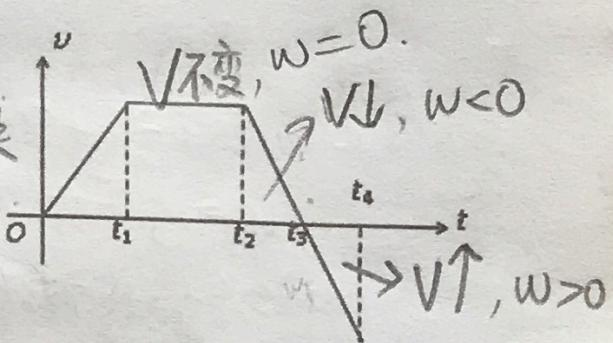

# 《大学物理》同步练习册 守恒定律（第二节 功 动能定理）

原件经识别和整理；“参考解答”是我们补的。

## 一、选择题

### 选择 1

对功的概念有以下几种说法：
(1) 保守力作正功时，系统内相应的势能增加
(2) 质点运动经一闭合路径，保守力对质点作的功为零 $\sqrt{}$
(3) 作用力和反作用力大小相等、方向相反，所以两者所作功的代数和必为零

在上述说法中：

- A. (1)、(2)是正确的
- B. (2)、(3)是正确的
- C. 只有(2)是正确的
- D. 只有(3)是正确的

答案：C。

知识点：[保守力及其势能、中心力场与有效势](../../../topics/大学物理/保守力与势能.md)、[功的定义、功率与质点动能定理](../../../topics/大学物理/功与动能定理.md)

### 选择 2

有一劲度系数为 $k$ 的轻弹簧，原长为 $l_{0}$ ，将它吊在天花板上。当它下端挂一托盘平衡时，其长度变为 $l_{1}$ 。然后在托盘中放一重物，弹簧长度变为 $l_{2}$ ，则由 $l_{1}$ 伸长至 $l_{2}$ 的过程中，弹性力所作的功为 \_\_\_\_。

- A. $-\int_{l_{1}}^{l_{2}} kx \, dx$
- B. $\int_{l_{1}}^{l_{2}} kx \, dx$ （注：此处原文排版混乱，通常指以原长起算的坐标）
- C. $-\int_{l_{1}-l_{0}}^{l_{2}-l_{0}} kx \, dx$
- D. $\int_{l_{1}-l_{0}}^{l_{2}-l_{0}} kx \, dx$

答案：C。

知识点：[功的定义、功率与质点动能定理](../../../topics/大学物理/功与动能定理.md)、[保守力及其势能、中心力场与有效势](../../../topics/大学物理/保守力与势能.md)

### 选择 3

用铁锤把质量很小的钉子敲入木板，设木板对钉子的阻力与钉子进入木板的深度成正比。在铁锤敲打第一次时，能把钉子敲入 $1.00 \mathrm{~cm}$ 。如果铁锤第二次敲打的速度与第一次完全相同，那么第二次敲入深度为：

- A. $0.41 \mathrm{~cm}$
- B. $0.50 \mathrm{~cm}$
- C. $0.73 \mathrm{~cm}$
- D. $1.00 \mathrm{~cm}$

答案：A。

知识点：[功的定义、功率与质点动能定理](../../../topics/大学物理/功与动能定理.md)、[牛顿定律在变力问题中的应用（如 ma_t = -mg sinθ）](../../../topics/大学物理/牛顿定律应用.md)

### 选择 4

将一个物体提高 10m，下列哪一种情况下提升力所作的功最小？

- A. 以 5m/s 的速度匀速提升；
- B. 以 10 m/s 的速度匀速提升；
- C. 将物体由静止开始匀加速提升 10m，速度增加到 5m/s；
- D. 物体以 10m/s 的初速度匀减速上升 10m，速度减小到 5m/s。

答案：D。

知识点：[功的定义、功率与质点动能定理](../../../topics/大学物理/功与动能定理.md)

### 选择 5

一个作直线运动的物体，其速度 $v$ 与时间 $t$ 的关系曲线如图所示。设时刻 $t_1$ 至 $t_2$ 间外力作功为 $W_1$ ; 时刻 $t_2$ 至 $t_3$ 间外力作功为 $W_2$ ; 时刻 $t_3$ 至 $t_4$ 间外力作功为 $W_3$ ，

- A. $W_{1}>0,\quad W_{2}<0,\quad W_{3}<0$
- B. $W_{1}>0,\quad W_{2}<0,\quad W_{3}>0$
- C. $W_{1}=0,\quad W_{2}<0,\quad W_{3}>0$
- D. $W_{1}=0,\quad W_{2}<0,\quad W_{3}<0$

答案：D。

知识点：[功的定义、功率与质点动能定理](../../../topics/大学物理/功与动能定理.md)、[速度、加速度的定义与微分关系](../../../topics/大学物理/速度与加速度定义.md)

### 填空 1

某质点在力 $\vec{F}=(4+5x)\vec{i}$ (SI) 的作用下沿 x 轴作直线运动，在从 x=0 移动到 x=10m 的过程中，力 $\vec{F}$ 所做的功为 290J。

*(注：此题原文似为陈述句或已给出答案的例题，若作为填空，可能问的是验证或求参数，但根据上下文“所做的功为 290J”像是题干的一部分或答案。若视为填空题，题干应为“...所做的功为 \_\_\_\_”，答案为 290J。计算如下：$W = \int_0^{10} (4+5x)dx = [4x + \frac{5}{2}x^2]_0^{10} = 40 + 250 = 290 \text{J}$)*

答案：290 J。

知识点：[功的定义、功率与质点动能定理](../../../topics/大学物理/功与动能定理.md)、[速度、加速度的定义与微分关系](../../../topics/大学物理/速度与加速度定义.md)

### 填空 2

一质点在二恒力共同作用下，位移为 $\Delta\vec{r}=3\vec{i}+8\vec{j}$ (SI); 在此过程中，动能增量为 24J，已知其中一恒力 $\vec{F}_{1}=12\vec{i}-3\vec{j}$ (SI)，则另一恒力所作的功为 \_\_\_\_。

答案：-12 J。

知识点：[功的定义、功率与质点动能定理](../../../topics/大学物理/功与动能定理.md)、[常见力（重力、弹力、摩擦力）的受力分析](../../../topics/大学物理/常见力分析.md)

### 填空 3

人从 10m 深的井中匀速提水，桶离开水面时装有水 10kg。若每升高 1m 要漏掉 0.2kg 的水，则把这桶水从水面提高到井口的过程中，人力所作的功为 \_\_\_\_。

答案：900 J。

知识点：[功的定义、功率与质点动能定理](../../../topics/大学物理/功与动能定理.md)、[牛顿定律在变力问题中的应用（如 ma_t = -mg sinθ）](../../../topics/大学物理/牛顿定律应用.md)
