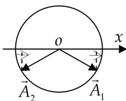
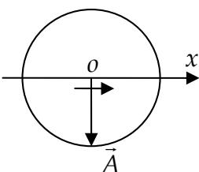
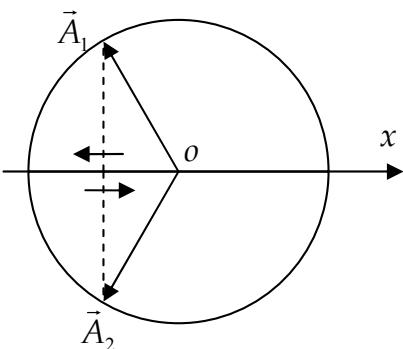
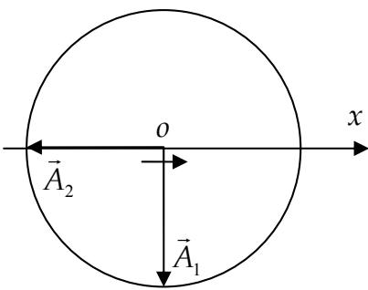
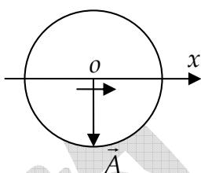
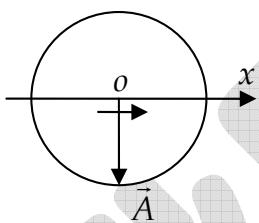
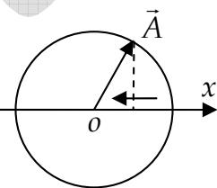
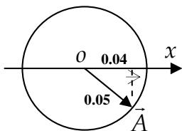
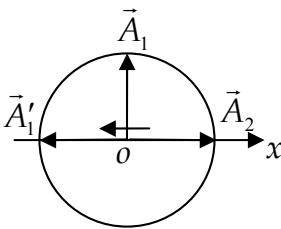

# 《大学物理》同步练习册 第12章 简谐振动（答案）

原件经识别和整理；“参考解答”是我们补的。

# 大学物理同步练习册 第12章 简谐振动（答案）

本资料由识别工具读取《大学物理》同步练习册第12章简谐振动部分的答案内容整理而成，已修正明显的断行与乱码错误。

## 一、选择题与计算题解答

### 选择 1

题干：已知速度表达式 $v = - \omega A \sin ( \omega t + \varphi )$，在 $t=0$ 时 $v = v_m / 2$，且速度随时间增大至 $v_m$。求初相位 $\varphi$ 及对应的旋转矢量。

**解析过程：**
由速度公式：
$$ v = - \omega A \sin ( \omega t + \varphi ) = - v _ { m } \sin ( \omega t + \varphi ) $$
当 $t = 0$ 时：
$$ \frac { v _ { m } } { 2 } = - v _ { m } \sin \varphi \Rightarrow \sin \varphi = - \frac { 1 } { 2 } $$
解得初相位可能为：$\varphi = - \frac { \pi } { 6 }$ 或 $\varphi = - \frac { 5 \pi } { 6 }$。
- 分别对应旋转矢量 $\vec { A } _ { 1 }$ 和 $\vec { A } _ { 2 }$。
- 分析速度与时间的关系：开始时质点的速度从 $\frac { v _ { m } } { 2 }$ 增大至 $v _ { m }$。
- 对比旋转矢量投影点的速度变化：
    - $\vec { A } _ { 1 }$ 的投影点速度从 $\frac { v _ { m } } { 2 }$ 减小至 0；
    - $\vec { A } _ { 2 }$ 的投影点速度从 $\frac { v _ { m } } { 2 }$ 增大至 $v _ { m }$。
- 结论：质点开始时对应旋转矢量为 $\vec { A } _ { 2 }$，故初相位 $\varphi = - \frac { 5 \pi } { 6 }$。

答案：C。

知识点：[简谐振动的运动学方程（振幅、角频率、相位）](../../../topics/大学物理/简谐振动运动学.md)、[用旋转矢量法确定初相与运动状态](../../../topics/大学物理/旋转矢量法.md)

### 选择 2

题干：比较弹簧振子和单摆在地球与月球上的周期变化。

**解析过程：**
1. **弹簧振子**：
   - 角频率 $\omega _ { 1 } = \sqrt { \frac { k } { m } }$
   - 周期 $T _ { 1 } = \frac { 2 \pi } { \omega _ { 1 } } = 2 \pi \sqrt { \frac { m } { k } }$
   - 拿到月球上去，质量 $m$ 和劲度系数 $k$ 都不变，所以周期不变：
     $$ T _ { 1 } ^ { \prime } = 2 \pi \sqrt { \frac { m } { k } } = T _ { 1 } $$
2. **单摆**：
   - 角频率 $\omega _ { 2 } = \sqrt { \frac { g } { l } }$
   - 周期 $T _ { 2 } = \frac { 2 \pi } { \omega _ { 2 } } = 2 \pi \sqrt { \frac { l } { g } }$
   - 拿到月球上去，摆长 $l$ 不变，重力加速度 $g$ 减小（$g' < g$），所以周期变大：
     $$ T _ { 2 } ^ { \prime } = 2 \pi \sqrt { \frac { l } { g ^ { \prime } } } > T _ { 2 } $$

答案：D。

知识点：[简谐振动的动力学特征与回复力](../../../topics/大学物理/简谐振动的动力学.md)

### 选择 3

题干：弹簧振子通过平衡位置向正方向运动，求振动方程。

**解析过程：**
- 弹簧振子振动角频率：$\omega = \sqrt { \frac { k } { m } }$
- 初始状态：重物通过平衡位置且向正方向运动。
- 由旋转矢量图可知，此时相位为 $-\frac{\pi}{2}$（即 $\cos(-\pi/2)=0$ 且导数为正）。
- 初相位：$\varphi = - \frac { \pi } { 2 }$
- 振动方程为：
  $$ x = A \cos \left( \sqrt { \frac { k } { m } } t - { \frac { \pi } { 2 } } \right) $$

答案：B。

知识点：[简谐振动的运动学方程（振幅、角频率、相位）](../../../topics/大学物理/简谐振动运动学.md)、[用旋转矢量法确定初相与运动状态](../../../topics/大学物理/旋转矢量法.md)、[简谐振动的动力学特征与回复力](../../../topics/大学物理/简谐振动的动力学.md)

### 选择 4

题干：已知周期 $T=2s$，$t=0$ 时质点在 $x=-2cm$ 处向负方向运动，求第二次经过该位置的时间。

**解析过程：**
- 由周期 $T = 2 \mathrm { s }$ 得角频率：$\omega = { \frac { 2 \pi } { T } } = \pi \mathrm { r a d / s }$
- $t = 0$ 时质点在 $x = - 2 \mathrm { c m }$ 处，向负方向运动，对应旋转矢量为 $\vec { A } _ { 1 }$。
- 设质点在 $t$ 时刻第二次经过 $x = - 2 \mathrm { c m }$ 处，对应旋转矢量为 $\vec { A } _ { 2 }$。
- 质点沿 x 轴运动过程中，对应旋转矢量从 $\vec { A } _ { 1 }$ 逆时针转到 $\vec { A } _ { 2 }$。
- 根据几何关系（见下图），转过的角度为 $\frac{2}{3}\pi$。

- 计算时间：
  $$ \omega ( t - 0 ) = \frac { 2 } { 3 } \pi \Rightarrow \pi ( t - 0 ) = \frac { 2 } { 3 } \pi \Rightarrow t = \frac { 2 } { 3 } \mathrm { s } $$

答案：B。

知识点：[简谐振动的运动学方程（振幅、角频率、相位）](../../../topics/大学物理/简谐振动运动学.md)、[用旋转矢量法确定初相与运动状态](../../../topics/大学物理/旋转矢量法.md)

### 选择 5

题干：两个弹簧振子周期相同，$t=0$ 时第一个振子从平衡位置向正方向运动，第二个从负极大位置开始运动，求相位差。

**解析过程：**
- 两个弹簧振子周期 $T$ 相同，则角频率 $\omega = { \frac { 2 \pi } { T } }$ 相同。
- $t = 0$ 时：
  - 第一个振子 $x _ { 1 }$ 从平衡位置向正方向运动，对应旋转矢量为 $\vec { A } _ { 1 }$（相位 $-\frac{\pi}{2}$）。
  - 第二个振子 $x _ { 2 }$ 从负极大位置处开始运动，对应旋转矢量为 $\vec { A } _ { 2 }$（相位 $\pi$ 或 $-\pi$）。
- 由旋转矢量图可知，第一个振子 $x _ { 1 }$ 超前第二个振子 $x _ { 2 }$ 相位为 $\frac { \pi } { 2 }$。

答案：B。

知识点：[简谐振动的运动学方程（振幅、角频率、相位）](../../../topics/大学物理/简谐振动运动学.md)、[用旋转矢量法确定初相与运动状态](../../../topics/大学物理/旋转矢量法.md)

### 选择 6

题干：$t=0$ 时质点在 $x = \frac{1}{2}A$ 处，向正方向运动。

**解析过程：**
- $t = 0$ 时质点在 $x = { \frac { 1 } { 2 } } A$ 处，向正方向运动。
- 对应旋转矢量 $\vec { A }$ 如图所示（位于第四象限，相位为 $-\frac{\pi}{3}$）。

答案：B。

知识点：[简谐振动的运动学方程（振幅、角频率、相位）](../../../topics/大学物理/简谐振动运动学.md)、[用旋转矢量法确定初相与运动状态](../../../topics/大学物理/旋转矢量法.md)

### 选择 7

题干：已知振幅 $A=2cm$，最大速度 $v_m=5cm/s$，求振动方程。

**解析过程：**
- 由振幅 $A = 2 \mathrm { c m }$，速度最大值 $v _ { { \scriptscriptstyle m } } = \omega A = 5 \mathrm { c m } / \mathrm { s }$。
- 角频率：$\omega = \frac { v _ { m } } { A } = \frac { 5 } { 2 } \mathrm { r a d / s }$。
- 由质点做简谐振动，在平衡位置处速度大小最大为 $v _ { m }$。
- $t = 0$ 时刻速度具有正最大值 $\implies$ $t = 0$ 时刻质点在平衡位置处，向正方向运动。
- 对应旋转矢量 $\vec { A }$ 如图所示，初相位：$\varphi = - \frac { \pi } { 2 }$。
- 振动方程为：
  $$ x ( t ) = 2 \cos \left( \frac { 5 } { 2 } t - \frac { \pi } { 2 } \right) \mathrm { c m } $$

参考解答：## 结论

振动方程为

$$
\boxed{x(t)=2\cos\left(\frac{5}{2}t-\frac{\pi}{2}\right)\ \mathrm{cm}}
$$

也可写成

$$
\boxed{x(t)=2\sin\left(\frac{5}{2}t\right)\ \mathrm{cm}}
$$

其中 $t$ 的单位为秒。

## 计算过程

简谐振动的最大速度满足

$$
v_m=\omega A.
$$

因此角频率为

$$
\omega=\frac{v_m}{A}
=\frac{5\ \mathrm{cm/s}}{2\ \mathrm{cm}}
=\frac{5}{2}\ \mathrm{rad/s}.
$$

取简谐振动方程为

$$
x(t)=A\cos(\omega t+\varphi).
$$

当 $t=0$ 时速度达到正最大值，说明质点位于平衡位置且沿正方向运动，即

$$
x(0)=0,\qquad v(0)=v_m>0.
$$

由

$$
x(0)=A\cos\varphi=0
$$

可得

$$
\varphi=-\frac{\pi}{2}
$$

（也可取等价的 $3\pi/2$）。故

$$
x(t)=2\cos\left(\frac{5}{2}t-\frac{\pi}{2}\right)\mathrm{cm}.
$$

利用 $\cos(\theta-\pi/2)=\sin\theta$，可等价写为

$$
x(t)=2\sin\left(\frac{5}{2}t\right)\mathrm{cm}.
$$

知识点：[简谐振动的运动学方程（振幅、角频率、相位）](../../../topics/大学物理/简谐振动运动学.md)、[用旋转矢量法确定初相与运动状态](../../../topics/大学物理/旋转矢量法.md)

### 综合 8

题干：简谐振动周期为 $T$，分情况讨论初相位和振动方程。

**解析过程：**
简谐振动周期为 $T$，则角频率 $\omega = { \frac { 2 \pi } { T } }$。

**(1) 情况一**
- 若 $t = 0$ 时刻质点在 $x = 0$ 处，向正方向运动。
- 对应旋转矢量 $\vec { A }$ 如（图一）所示，初相位：$\varphi = - \frac { \pi } { 2 }$。
- 振动方程为：
  $$ x = A \cos \left( \frac { 2 \pi } { T } t - \frac { \pi } { 2 } \right) $$

**(2) 情况二**
- 若 $t = 0$ 时刻质点在 $x = { \frac { 1 } { 2 } } A$ 处，向负方向运动。
- 对应旋转矢量 $\vec { A }$ 如（图二）所示，初相位：$\varphi = \frac { \pi } { 3 }$。
- 振动方程为：
  $$ x = A \cos \left( \frac { 2 \pi } { T } t + \frac { \pi } { 3 } \right) $$

参考解答：结论：

- 情况一：初相位 $\varphi = -\dfrac{\pi}{2}$，振动方程  
  
$$
x=A\cos\left(\frac{2\pi}{T}t-\frac{\pi}{2}\right)
$$

- 情况二：初相位 $\varphi = \dfrac{\pi}{3}$，振动方程  
  
$$
x=A\cos\left(\frac{2\pi}{T}t+\frac{\pi}{3}\right)
$$

简要推理：

角频率  

$$
\omega=\frac{2\pi}{T}
$$

**情况一**：$t=0$ 时 $x=0$，且向正方向运动。  
由  

$$
x=A\cos\varphi=0
$$

得  

$$
\varphi=\pm\frac{\pi}{2}
$$

又因为向正方向运动，速度  

$$
v=-A\omega\sin\varphi>0
$$

故  

$$
\sin\varphi<0
$$

所以  

$$
\varphi=-\frac{\pi}{2}
$$

**情况二**：$t=0$ 时 $x=\frac{A}{2}$，且向负方向运动。  
由  

$$
A\cos\varphi=\frac{A}{2}
$$

得  

$$
\cos\varphi=\frac12
$$

所以  

$$
\varphi=\pm\frac{\pi}{3}
$$

又因为向负方向运动，速度  

$$
v=-A\omega\sin\varphi<0
$$

故  

$$
\sin\varphi>0
$$

所以  

$$
\varphi=\frac{\pi}{3}
$$

知识点：[简谐振动的运动学方程（振幅、角频率、相位）](../../../topics/大学物理/简谐振动运动学.md)、[用旋转矢量法确定初相与运动状态](../../../topics/大学物理/旋转矢量法.md)

### 计算 9

题干：已知 $\omega = 3 \mathrm { rad/s}$，$t=0$ 时 $x_0 = 0.04 \mathrm{m}$，$v_0 = 0.09 \mathrm{m/s}$。求振幅和初相位。

**解析过程：**
- 已知角频率：$\omega = 3 \mathrm { r a d / s }$。
- 初始条件：$x _ { 0 } = 0 . 0 4 \mathrm { m }$，$v _ { \mathrm { 0 } } = 0 . 0 9 \mathrm { m } / \mathrm { s }$。
- 振幅计算：
  $$ A = \sqrt { x _ { 0 } ^ { 2 } + \left( \frac { v _ { 0 } } { \omega } \right) ^ { 2 } } = \sqrt { ( 0 . 0 4 ) ^ { 2 } + \left( \frac { 0 . 0 9 } { 3 } \right) ^ { 2 } } = \sqrt { 0 . 0 0 1 6 + 0 . 0 0 0 9 } = \sqrt { 0 . 0 0 2 5 } = 0 . 0 5 \mathrm { m } $$
- 初相位判断：
  - $t = 0$ 时，物体在 $x _ { 0 } = 0 . 0 4 \mathrm { m }$ 处，且 $v _ { 0 } = 0 . 0 9 \mathrm { m } / \mathrm { s } > 0$（向正方向运动）。
  - 对应旋转矢量 A 如图所示。
  - 初相位计算：
    $$ \varphi = - \mathrm { a r c t a n } { \frac { 3 } { 4 } } = - \mathrm { a r c c o s } { \frac { 4 } { 5 } } = - 0 . 6 4 \mathrm { r a d } $$

参考解答：**结论**

振幅 $A = 0.05 \, \mathrm{m}$，初相位 $\varphi = -\arctan(0.75) \approx -0.64 \, \mathrm{rad}$（或 $-36.9^\circ$）。

**推理与计算过程**

1.  **计算振幅 $A$**
    根据简谐运动的能量守恒或运动学关系，振幅由初始位移 $x_0$ 和初始速度 $v_0$ 决定：
    $$ A = \sqrt{x_0^2 + \left(\frac{v_0}{\omega}\right)^2} $$
    代入已知数据 $\omega = 3 \, \mathrm{rad/s}$，$x_0 = 0.04 \, \mathrm{m}$，$v_0 = 0.09 \, \mathrm{m/s}$：
    $$ \frac{v_0}{\omega} = \frac{0.09}{3} = 0.03 \, \mathrm{m} $$
    $$ A = \sqrt{(0.04)^2 + (0.03)^2} = \sqrt{0.0016 + 0.0009} = \sqrt{0.0025} = 0.05 \, \mathrm{m} $$

2.  **确定初相位 $\varphi$**
    设运动方程为 $x = A \cos(\omega t + \varphi)$，则速度方程为 $v = -A\omega \sin(\omega t + \varphi)$。
    在 $t=0$ 时：
    $$ x_0 = A \cos \varphi \implies \cos \varphi = \frac{x_0}{A} = \frac{0.04}{0.05} = 0.8 $$
    $$ v_0 = -A\omega \sin \varphi \implies \sin \varphi = -\frac{v_0}{A\omega} = -\frac{0.09}{0.05 \times 3} = -0.6 $$
    
    *   **象限判断**：由于 $\cos \varphi > 0$ 且 $\sin \varphi < 0$，初相位 $\varphi$ 位于第四象限。
    *   **数值计算**：
        $$ \varphi = \arcsin(-0.6) = -\arcsin(0.6) \approx -0.6435 \, \mathrm{rad} $$
        或者使用正切关系：
        $$ \tan \varphi = \frac{\sin \varphi}{\cos \varphi} = \frac{-0.6}{0.8} = -0.75 \implies \varphi = -\arctan(0.75) \approx -0.64 \, \mathrm{rad} $$

知识点：[简谐振动的运动学方程（振幅、角频率、相位）](../../../topics/大学物理/简谐振动运动学.md)、[用旋转矢量法确定初相与运动状态](../../../topics/大学物理/旋转矢量法.md)

### 计算 10

题干：两个振子周期 $T=0.4s$，第一个从平衡位置向负方向运动，经过 $\Delta t=0.5s$ 后，第二个从正方向端点开始运动，求相位差。

**解析过程：**
- 已知周期 $T = 0 . 4 \mathrm { s }$，则角频率：$\omega = { \frac { 2 \pi } { T } } = 5 \pi \mathrm { r a d / s }$。
- 第一个振子：
  - 开始时从平衡位置向负方向运动，对应旋转矢量为 $\vec { A } _ { 1 }$。
  - 经过 $\Delta t = 0 . 5 \mathrm { s }$ 后，转过角度 $\Delta \theta = \omega \Delta t = 5 \pi \times 0 . 5 = \frac { 5 } { 2 } \pi$。
  - 此时对应旋转矢量为 $\vec { A } _ { 1 } ^ { \prime }$。
- 第二个振子：
  - 此时（$t=0.5s$）从正方向端点处开始运动，对应旋转矢量为 $\vec { A } _ { 2 }$。
- 相位差分析：
  - 如图，这两个振动的相位差为 $\Delta \varphi = \pi$。

参考解答：**结论：** 相位差 $\Delta \varphi = \pi$（即反相）。

**关键步骤：**
1. 角频率 $\omega = \frac{2\pi}{T} = \frac{2\pi}{0.4} = 5\pi \,\mathrm{rad/s}$。
2. 第一个振子在 $\Delta t = 0.5\,\mathrm{s}$ 内转过的相位 $\Delta \theta = \omega \Delta t = 5\pi \times 0.5 = \frac{5}{2}\pi$（或 $\frac{\pi}{2}$ 模 $2\pi$）。
3. 由旋转矢量图分析：
   - 初始时刻（第一个开始振动时），$\vec{A}_1$ 位于平衡位置且向负方向运动。
   - 转过 $\Delta \theta = \frac{5}{2}\pi$ 后，$\vec{A}_1'$ 转到正方向端点位置（由旋转矢量图的周期性可知）。
   - 此时第二个振子恰好从正方向端点开始运动，即 $\vec{A}_2$ 也位于正方向端点位置。
4. 根据图示的特定状态，两振动的相位差为 $\Delta \varphi = \pi$。

知识点：[简谐振动的运动学方程（振幅、角频率、相位）](../../../topics/大学物理/简谐振动运动学.md)、[用旋转矢量法确定初相与运动状态](../../../topics/大学物理/旋转矢量法.md)

### 填空 11

题干：已知振动方程 $x = 0 . 1 \cos ( 8 \pi t + \frac { 2 } { 3 } \pi ) \mathrm { m }$。

**解析过程：**
- 对照标准形式 $x = A \cos (\omega t + \varphi)$。
- 振幅：$A = 0 . 1 \mathrm { m }$
- 角频率：$\omega = 8 \pi \mathrm { r a d / s }$
- 初相位：$\varphi = \frac { 2 } { 3 } \pi$

## 计算题

参考解答：**结论**  
振幅 $A = 0.1 \, \text{m}$，角频率 $\omega = 8\pi \, \text{rad/s}$，初相 $\varphi = \frac{2}{3}\pi$。

**过程**  
将给定振动方程 $x = 0.1 \cos\left(8\pi t + \frac{2}{3}\pi\right)$ 与简谐振动标准形式 $x = A \cos(\omega t + \varphi)$ 对比：
- 振幅直接由余弦前的系数得出：$A = 0.1 \, \text{m}$；
- 角频率为时间 $t$ 的系数：$\omega = 8\pi \, \text{rad/s}$；
- 初相位为括号内的常数项：$\varphi = \frac{2}{3}\pi$。

知识点：[用旋转矢量法确定初相与运动状态](../../../topics/大学物理/旋转矢量法.md)

### 计算 12

周期： $T = \frac{2\pi}{\omega} = \frac{1}{4} \text{ s}$ ，速度最大值： $v_{m} = \omega A = 0.8\pi \text{ m/s}$ ，加速度最大值： $a_{m} = \omega^{2} A = 6.4\pi^{2} \text{ m/s}^2$

答案：题目有误！

知识点：[简谐振动的运动学方程（振幅、角频率、相位）](../../../topics/大学物理/简谐振动运动学.md)

### 计算 13

已知速度最大值： $v_{m} = \omega A = 3 \times 10^{-2} \text{ m/s}$ ，振幅： $A = 2 \times 10^{-2} \text{ m}$ 。
则角频率为： $\omega = \frac{v_{m}}{A} = \frac{3}{2} \text{ rad/s}$ ；

（1）周期： $T = \frac{2\pi}{\omega} = \frac{4\pi}{3} \text{ s}$

（2）加速度的最大值： $a_{m} = \omega^{2} A = \frac{9}{4} \times 2 \times 10^{-2} = 4.5 \times 10^{-2} \text{ m/s}^2$

（3）$t = 0$时，物体位于平衡位置且向负方向运动，对应旋转矢量如图。由图可知，初相位： $\varphi = \frac{\pi}{2}$

振动方程： $x(t) = A \cos(\omega t + \varphi) = 2 \times 10^{-2} \cos(\frac{3}{2} t + \frac{\pi}{2}) \text{ m}$

参考解答：**结论**  
- (1) 周期 $T = \frac{4\pi}{3}\,\text{s}$  
- (2) 最大加速度 $a_{\max} = 4.5\times10^{-2}\,\text{m/s}^2$  
- (3) 振动方程 $x = 2\times10^{-2}\cos\!\left(\frac{3}{2}t + \frac{\pi}{2}\right)\,\text{m}$

**过程**  
由 $v_{\max} = \omega A$ 得  

$$
\omega = \frac{v_{\max}}{A} = \frac{3\times10^{-2}}{2\times10^{-2}} = \frac{3}{2}\,\text{rad/s}
$$

(1)  

$$
T = \frac{2\pi}{\omega} = \frac{2\pi}{3/2} = \frac{4\pi}{3}\,\text{s}
$$

(2)  

$$
a_{\max} = \omega^2 A = \left(\frac{3}{2}\right)^2 \times 2\times10^{-2} = 4.5\times10^{-2}\,\text{m/s}^2
$$

(3)  
$t=0$ 时在平衡位置向负方向运动，即 $x_0 = 0$、$v_0 < 0$。  
旋转矢量图中对应矢端位于正半轴的端点向下运动，故 $\varphi = \frac{\pi}{2}$。  

$$
x = A\cos(\omega t + \varphi) = 2\times10^{-2}\cos\!\left(\frac{3}{2}t + \frac{\pi}{2}\right)\,\text{m}
$$

知识点：[简谐振动的运动学方程（振幅、角频率、相位）](../../../topics/大学物理/简谐振动运动学.md)、[用旋转矢量法确定初相与运动状态](../../../topics/大学物理/旋转矢量法.md)、[简谐振动的动力学特征与回复力](../../../topics/大学物理/简谐振动的动力学.md)
