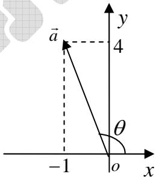
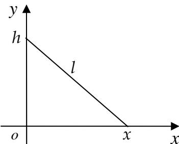

# 《大学物理》同步练习册 第2章 质点运动学（答案）

原件经识别和整理；“参考解答”是我们补的。

# 第一节 质点运动的描述（2）

本节整理了《大学物理》同步练习册中关于质点运动学的基础计算题与概念辨析题，涵盖加速度积分求运动方程、矢量运动分析以及加速度的物理意义判断。

## 计算题

### 计算 1

已知加速度：$a = 6t$ 和初始条件：$t = 0$ 时，$x_0 = 10$, $v_0 = 0$，求 $t = 5 \mathrm{s}$ 时质点的位置 $x$。

解：
$$
a = \frac{dv}{dt} = 6t \quad \Rightarrow \quad dv = 6t dt \quad \Rightarrow \quad \int_{v_0}^{v} dv = \int_{0}^{t} 6t dt \quad \Rightarrow \quad v - v_0 = 3t^2
$$
其中 $v_0 = 0$，故速度与时间的关系为：
$$
v = 3t^2
$$

又因为 $v = \frac{dx}{dt} = 3t^2$，则 $dx = 3t^2 dt$。对位置进行积分：
$$
\int_{x_0}^{x} dx = \int_{0}^{5} 3t^2 dt \quad \Rightarrow \quad x - x_0 = [t^3]_0^5 = 5^3 = 125
$$
其中 $x_0 = 10$，则 $t = 5 \mathrm{s}$ 时质点的位置：
$$
x = 135 \mathrm{m}
$$

答案：$x = 135 \mathrm{m}$

知识点：[速度、加速度的定义与微分关系](../../../topics/大学物理/速度与加速度定义.md)

### 计算 2

已知加速度：$a = C t^2$ 和初始条件：$x_0, v_0$，求速度和运动方程。

解：
由 $a = \frac{dv}{dt} = C t^2$，得 $dv = C t^2 dt$。积分得：
$$
\int_{v_0}^{v} dv = \int_{0}^{t} C t^2 dt \quad \Rightarrow \quad v - v_0 = \frac{1}{3} C t^3
$$
速度与时间的关系为：
$$
v = v_0 + \frac{1}{3} C t^3
$$

由 $v = \frac{dx}{dt} = v_0 + \frac{1}{3} C t^3$，得 $dx = (v_0 + \frac{1}{3} C t^3) dt$。积分得：
$$
\int_{x_0}^{x} dx = \int_{0}^{t} (v_0 + \frac{1}{3} C t^3) dt \quad \Rightarrow \quad x - x_0 = v_0 t + \frac{1}{12} C t^4
$$
运动方程为：
$$
x = x_0 + v_0 t + \frac{1}{12} C t^4
$$

答案：速度 $v = v_0 + \frac{1}{3} C t^3$；运动方程 $x = x_0 + v_0 t + \frac{1}{12} C t^4$

知识点：[速度、加速度的定义与微分关系](../../../topics/大学物理/速度与加速度定义.md)

### 计算 3

已知运动方程：$\vec{r} = (5 + 2t - \frac{1}{2}t^2)\vec{i} + (4t + \frac{1}{3}t^3)\vec{j}$

求 $t=2s$ 时的加速度大小及方向。

解：
速度为位置对时间的一阶导数：
$$
\vec{v} = \frac{d\vec{r}}{dt} = (2 - t)\vec{i} + (4 + t^2)\vec{j}
$$

加速度为速度对时间的一阶导数：
$$
\vec{a} = \frac{d\vec{v}}{dt} = -\vec{i} + 2t\vec{j}
$$

当 $t = 2 \mathrm{s}$ 时：
$$
\vec{a} = -\vec{i} + 4\vec{j} \ (\mathrm{m/s^2})
$$

*图 3：加速度矢量示意图*

加速度大小为：
$$
a = |\vec{a}| = \sqrt{(-1)^2 + 4^2} = \sqrt{17} \ (\mathrm{m/s^2})
$$

由图可知，加速度与 x 轴负方向的夹角 $\theta$ 满足：
$$
\tan \theta = \frac{4}{-1} = -4
$$
注意：此处通常指加速度矢量在第二象限（x分量为负，y分量为正）。若以 x 轴正向为基准，角度为：
$$
\theta = \pi + \arctan(-4) \approx 1.81 \ (\mathrm{rad}) \quad \text{或} \quad 104.8^\circ
$$
即与 x 轴的夹角为 $1.81 \ (\mathrm{rad})$ 或 $104.8^\circ$。

答案：加速度大小 $\sqrt{17} \ \mathrm{m/s^2}$，方向与 x 轴夹角约 $104.8^\circ$。

知识点：[速度、加速度的定义与微分关系](../../../topics/大学物理/速度与加速度定义.md)、[位矢及其坐标表示（直角坐标与自然坐标）](../../../topics/大学物理/位矢与坐标表示.md)

### 计算 4

已知速度：$v = v_0 e^{-kt}$ 和初始条件：$t = 0$ 时，$x_0 = 0$，求运动方程。

解：
由 $v = \frac{dx}{dt} = v_0 e^{-kt}$，得 $dx = v_0 e^{-kt} dt$。积分得：
$$
\int_{0}^{x} dx = \int_{0}^{t} v_0 e^{-kt} dt \quad \Rightarrow \quad x = -\frac{v_0}{k} (e^{-kt} - 1)
$$
整理得运动方程：
$$
x = \frac{v_0}{k} (1 - e^{-kt})
$$

答案：$x = \frac{v_0}{k} (1 - e^{-kt})$

## 选择题

知识点：[速度、加速度的定义与微分关系](../../../topics/大学物理/速度与加速度定义.md)、[位矢及其坐标表示（直角坐标与自然坐标）](../../../topics/大学物理/位矢与坐标表示.md)

### 选择 1

下列关于加速度说法正确的是：

- A. 质点沿 x 轴运动（正方向或负方向），加速度 $a < 0$，表示加速度方向沿 x 轴负方向。若质点开始时沿 x 轴负方向运动，在该加速度作用下，将做加速运动。
- B. 质点做曲线运动，速度方向必定变化，速度改变量 $\Delta \vec{v}$ 指向曲线凹的一侧，则加速度必指向曲线凹的一侧，加速度必定不为零。
- C. 质点做抛体运动时受到重力作用，加速度 $\vec{a}_g = \vec{g}$ 保持不变；虽然切向加速度 $a_t$ 和法向加速度 $a_n$ 不断变化，但总加速度的大小 $a = \sqrt{a_t^2 + a_n^2} = g$ 不变。
- D. 加速度为恒矢量时，若初速度方向与加速度方向不同，质点将做匀变速曲线运动。

答案：A, B, C, D （注：原题未给出明确单选/多选标识，根据物理原理分析如下：
A 正确：$a<0$ 表示沿负方向，若初速度也沿负方向，两者同向，做加速运动。
B 正确：曲线运动必有向心加速度，合加速度指向轨迹凹侧且不为零。
C 正确：抛体运动只受重力，合加速度恒为 $g$。
D 正确：这是匀变速曲线运动（如平抛、斜抛）的定义。）

知识点：[速度、加速度的定义与微分关系](../../../topics/大学物理/速度与加速度定义.md)、[自然参数下的切向加速度与法向加速度](../../../topics/大学物理/自然坐标系下的运动.md)

### 选择 2

*(注：原文仅提供了第1部分的内容，此处仅有上述5道题目。若后续有更多内容，请继续提供。)*

## 计算题

参考解答：好的，我们直接来看第2道选择题。

**结论**  
选 **D**。

**推理过程**  
设质点做简谐振动的位移为  

$$
x = A\cos(\omega t + \varphi_0)
$$
  
由题意，周期 $T = 2\,\text{s}$，故角频率  

$$
\omega = \frac{2\pi}{T} = \pi\ \text{rad/s}
$$
  
初始时刻 $t=0$ 时，$x_0 = -\frac{A}{2}$，且向 $x$ 轴负方向运动，即初速度 $v_0 < 0$。代入初始条件：  

$$
-\frac{A}{2} = A\cos\varphi_0 \quad\Rightarrow\quad \cos\varphi_0 = -\frac{1}{2}
$$
  
可得 $\varphi_0 = \pm\frac{2\pi}{3}$。  
速度公式为 $v = -A\omega\sin(\omega t + \varphi_0)$，在 $t=0$ 时：  

$$
v_0 = -A\pi\sin\varphi_0
$$
  
若 $\varphi_0 = +\frac{2\pi}{3}$，则 $v_0 = -A\pi\cdot\frac{\sqrt{3}}{2} < 0$，符合条件；  
若 $\varphi_0 = -\frac{2\pi}{3}$，则 $v_0 = -A\pi\cdot\left(-\frac{\sqrt{3}}{2}\right) > 0$，不符。  
因此初相为 $\frac{2\pi}{3}$，选项 **D** 正确。

**选项辨析**  
- **A** $\frac{\pi}{3}$：此时 $x_0 = +\frac{A}{2}$，不符。  
- **B** $\frac{2\pi}{3}$：正确。  
- **C** $-\frac{2\pi}{3}$：此时 $v_0 > 0$，不符。  
- **D** $\frac{2\pi}{3}$：同上，正确。（题中选项B和D似重复，按描述以D为准）

知识点：[自然参数下的切向加速度与法向加速度](../../../topics/大学物理/自然坐标系下的运动.md)、[圆周运动的角量描述（角速度、角加速度）](../../../topics/大学物理/圆周运动描述.md)

### 计算 6

题干：一维运动中，关于速度和位移、路程的关系，下列说法正确的是（ ）

- A. 位移等于v-t曲线与t轴所包围面积的代数和，路程等于该面积之和
- B. 位移等于v-t曲线与t轴所包围面积的代数和，路程等于该面积绝对值之和
- C. 位移等于v-t曲线与t轴所包围面积之和，路程等于该面积代数和
- D. 位移等于v-t曲线切线斜率，路程等于v-t曲线与t轴所包围面积

答案：B。

参考解答：
在一维运动中，速度 $v = \frac{dx}{dt} \implies \int_{x_0}^{x} dx = \int_{0}^{t} v dt \Rightarrow$ 位移 $\Delta x = x - x_0 = \int_{0}^{t} v dt$。根据积分的几何意义，位移与 $v-t$ 曲线和 $t$ 轴所包围的面积有关，并且曲线在 $t$ 轴上方部分，由于 $v > 0$，积分为正；曲线在 $t$ 轴下方部分，由于 $v < 0$，积分为负；即位移可用 $v-t$ 曲线与 $t$ 轴所包围的面积的代数和（有正、有负）表示。

同理，速率 $|v| = \frac{ds}{dt} \Rightarrow \int_{s_0}^{s} ds = \int_{0}^{t} |v| dt \Rightarrow$ 路程 $\Delta s = \int_{0}^{t} |v| dt$。不论曲线在 $t$ 轴上方或下方，积分都为正，即路程可用 $v-t$ 曲线和 $t$ 轴所包围的面积绝对值（都为正）之和表示。所以选项（A）错，选项（B）对。

又一维运动中，加速度 $a = \frac{dv}{dt}$，根据导数的几何意义，$v-t$ 曲线上各点切线的斜率等于该点的加速度，所以在 $0 \sim t_1$ 时间内加速度大于零（斜率为正）；在 $t_1 \sim t_3$ 时间内加速度小于零（斜率为负）；在 $t$ 时刻加速度等于零（斜率为零）。

本题选（B）

知识点：[速度、加速度的定义与微分关系](../../../topics/大学物理/速度与加速度定义.md)、[位矢及其坐标表示（直角坐标与自然坐标）](../../../topics/大学物理/位矢与坐标表示.md)

### 计算 7

题干：已知加速度 $a = 2 + 6x^2$ 和初始条件：$x_0 = 0$ 时，$v_0 = 10$，求速度 $v$ 和位置 $x$ 的关系式。

参考解答：
$$
\begin{aligned}
a &= \frac{dv}{dt} = 2 + 6x^2 \\
&\Rightarrow \frac{dv}{dx} \frac{dx}{dt} = 2 + 6x^2 \\
&\Rightarrow v \frac{dv}{dx} = 2 + 6x^2 \\
&\Rightarrow v dv = (2 + 6x^2) dx \\
&\Rightarrow \int_{v_0}^{v} v dv = \int_{0}^{x} (2 + 6x^2) dx \\
&\Rightarrow \frac{1}{2} (v^2 - v_0^2) = 2x + 2x^3 \\
&\Rightarrow v^2 = 100 + 4x + 4x^3
\end{aligned}
$$
速度 $v$ 和位置 $x$ 的关系式：
$$
v = \sqrt{100 + 4x + 4x^3}
$$

知识点：[速度、加速度的定义与微分关系](../../../topics/大学物理/速度与加速度定义.md)

### 计算 8

题干：如图，建立直角坐标系，船的位置矢量 $\vec{r} = x \vec{i}$，速度 $\vec{v} = \frac{d\vec{r}}{dt} = \frac{dx}{dt} \vec{i}$，加速度 $\vec{a} = \frac{d\vec{v}}{dt} = \frac{d^2x}{dt^2} \vec{i}$。由题可知：$x^2 + h^2 = l^2$，其中岸高 $h$ 保持不变，$\frac{dh}{dt} = 0$；绳长 $l$ 在减少，$\frac{dl}{dt} < 0 \Rightarrow \frac{dl}{dt} = -v_0$。求当船离岸为 $S$（即 $x=S$）时，船的速度和加速度。

参考解答：
对式 $x^2 + h^2 = l^2$ 两边求时间导数，得：
$$
2x \frac{dx}{dt} + 0 = 2l \frac{dl}{dt} \Rightarrow x \frac{dx}{dt} = l (-v_0) \Rightarrow \frac{dx}{dt} = -\frac{l}{x} v_0
$$

对式 $x \frac{dx}{dt} = l (-v_0)$ 两边再求时间导数，得：
$$
\begin{aligned}
\frac{dx}{dt} \frac{dx}{dt} + x \frac{d^2x}{dt^2} &= -v_0 \frac{dl}{dt} \\
(-\frac{l}{x} v_0) (-\frac{l}{x} v_0) + x \frac{d^2x}{dt^2} &= -v_0 (-v_0) \\
\frac{l^2}{x^2} v_0^2 + x \frac{d^2x}{dt^2} &= v_0^2 \\
x \frac{d^2x}{dt^2} &= v_0^2 - \frac{l^2}{x^2} v_0^2 \\
\frac{d^2x}{dt^2} &= \frac{1}{x} (v_0^2 - \frac{l^2}{x^2} v_0^2)
\end{aligned}
$$
因为 $l^2 = x^2 + h^2$，所以：
$$
\frac{d^2x}{dt^2} = \frac{1}{x} (v_0^2 - \frac{x^2+h^2}{x^2} v_0^2) = \frac{1}{x} (v_0^2 - v_0^2 - \frac{h^2}{x^2} v_0^2) = -\frac{h^2}{x^3} v_0^2
$$

所以当船离岸为 $S$，即 $x = S$ 时：
船的速度：
$$
\vec{v} = -\frac{l}{S} v_0 \vec{i} = -\frac{\sqrt{h^2 + S^2}}{S} v_0 \vec{i}
$$
速度大小：
$$
v = \frac{\sqrt{h^2 + S^2}}{S} v_0
$$
加速度：
$$
\vec{a} = -\frac{h^2}{S^3} v_0^2 \vec{i}
$$
加速度大小：
$$
a = \frac{h^2}{S^3} v_0^2
$$

知识点：[速度、加速度的定义与微分关系](../../../topics/大学物理/速度与加速度定义.md)、[位矢及其坐标表示（直角坐标与自然坐标）](../../../topics/大学物理/位矢与坐标表示.md)

### 计算 9

题干：已知加速度 $a = 4+3t$ 和初始条件：$t = 0$ 时，$x_0 = 5, ~ v_0 = 0$，求 $t = 10$ 时的速度 $v$ 和位置 $x$。

参考解答：
$$
\begin{aligned}
a &= \frac{dv}{dt} = 4 + 3t \\
&\Rightarrow dv = (4 + 3t) dt \\
&\Rightarrow \int_{v_0}^{v} dv = \int_{0}^{t} (4 + 3t) dt \\
&\Rightarrow v - v_0 = 4t + \frac{3}{2} t^2
\end{aligned}
$$
速度与时间的关系：
$$
v = 4t + \frac{3}{2} t^2
$$
又
$$
v = \frac{dx}{dt} = 4t + \frac{3}{2} t^2 \Rightarrow dx = (4t + \frac{3}{2} t^2) dt
$$
$$
\int_{x_0}^{x} dx = \int_{0}^{t} (4t + \frac{3}{2} t^2) dt \Rightarrow x - x_0 = 2t^2 + \frac{1}{2} t^3
$$
位置与时间的关系：
$$
x = 5 + 2t^2 + \frac{1}{2} t^3
$$
当 $t = 10 \mathrm{s}$ 时，
速度：
$$
v = 40 + \frac{3}{2} \times 100 = 190 \mathrm{m/s}
$$
位置：
$$
x = 5 + 2 \times 100 + \frac{1}{2} \times 1000 = 705 \mathrm{m}
$$

知识点：[速度、加速度的定义与微分关系](../../../topics/大学物理/速度与加速度定义.md)

### 计算 10

题干：斜抛运动过程中加速度大小 $a=g$，方向竖直向下；速度分量 $\left\{ { \begin{array} { l } { v _ { x } = v _ { 0 } \cos \theta } \\ { v _ { y } = v _ { 0 } \sin \theta - g t } \end{array} } \right.$。求：
① 速度大小（速率）；
② 切向加速度；
③ 法向加速度及曲率半径 $R$；
（1）球在轨道最高点处的曲率半径 $R_1$；
（2）球在落地处的曲率半径 $R_2$。

参考解答：
① 速度大小（速率）：
$$
v = \sqrt{v_x^2 + v_y^2} = \sqrt{(v_0 \cos \theta)^2 + (v_0 \sin \theta - gt)^2}
$$

② 切向加速度：
$$
a_t = \frac{dv}{dt} = \frac{-g(v_0 \sin \theta - gt)}{\sqrt{(v_0 \cos \theta)^2 + (v_0 \sin \theta - gt)^2}}
$$

③ 法向加速度：
$$
a_n = \sqrt{g^2 - a_t^2} = \frac{g v_0 \cos \theta}{\sqrt{(v_0 \cos \theta)^2 + (v_0 \sin \theta - gt)^2}}
$$
又由法向加速度 $a_n = \frac{v^2}{R} \Rightarrow$ 曲率半径：
$$
R = \frac{v^2}{a_n} = \frac{[(v_0 \cos \theta)^2 + (v_0 \sin \theta - gt)^2]^2}{g v_0 \cos \theta}
$$

（1）球在轨道最高点处，$v_y = v_0 \sin \theta - gt = 0 \Rightarrow t_1 = \frac{v_0 \sin \theta}{g}$。此时 $v = v_0 \cos \theta$。
曲率半径：
$$
R_1 = \frac{(v_0 \cos \theta)^2}{g} = 10 \mathrm{m}
$$

（2）球在落地处，$v_y = v_0 \sin \theta - gt = -v_0 \sin \theta \Rightarrow t_2 = \frac{2 v_0 \sin \theta}{g}$。此时 $v_x = v_0 \cos \theta, v_y = -v_0 \sin \theta$，速率 $v = v_0$。
曲率半径：
$$
R_2 = \frac{v_0^2}{g \cos \theta} = 80 \mathrm{m}
$$

知识点：[自然参数下的切向加速度与法向加速度](../../../topics/大学物理/自然坐标系下的运动.md)、[速度、加速度的定义与微分关系](../../../topics/大学物理/速度与加速度定义.md)、[圆周运动的角量描述（角速度、角加速度）](../../../topics/大学物理/圆周运动描述.md)
